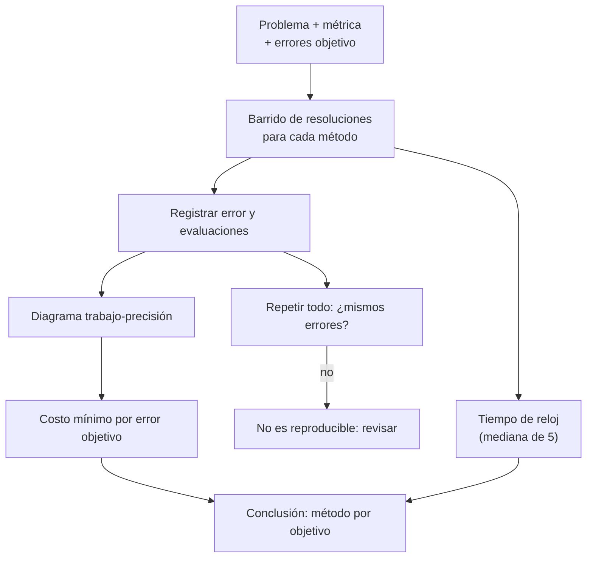

# B11-C26 — Benchmark de algoritmos numéricos

<!-- nav:top -->
[🏠 Programa](../../../../README.md) · [📚 Bloque B11](../../../tronco-comun/B11-ecuaciones-diferenciales-y-simulacion-numerica.md) · [← Anterior: B11-C25 — Aritmética de punto flotante y errores de redondeo](../B11-C25-aritmetica-de-punto-flotante-y-errores-de-redondeo/CLASE.md) · [Siguiente: B12-C01 — Espacios muestrales y eventos →](../../B12/B12-C01-espacios-muestrales-y-eventos/CLASE.md)
<!-- /nav -->

## 1. Ubicación, nivel y alcance

Clase programada de ampliación del bloque B11 (la 26.ª y última). Todo el bloque comparó métodos de a pares. Aquí aprendes a hacerlo de forma **justa, reproducible y honesta**: qué medir (error y trabajo, no solo tiempo), cómo barrer resoluciones, cómo reportar «lo mínimo que cuesta alcanzar un error objetivo» y qué trampas evitar. Nivel N2. Cierra el bloque aplicando el protocolo a los integradores de C05 a C08 y C11 en una órbita excéntrica. No cubre benchmarks de rendimiento de hardware ni paralelismo.

## 2. Por qué esta clase existe

«El método A es mejor que el B» es una afirmación vacía sin el problema, la métrica, la tolerancia y el costo. Una comparación mal diseñada lleva a elegir el algoritmo equivocado para una misión. Un diagrama trabajo-precisión bien hecho responde a la pregunta correcta: *¿cuánto trabajo necesito para tal precisión?*

La pregunta motivadora: **¿cómo comparo algoritmos para que otra persona pueda repetir el resultado y llegar a la misma conclusión?** La decisión central: **fijar el protocolo antes de mirar los resultados**.

## 3. Lo que podrás hacer al terminar

1. Diseñar un benchmark con problema, métricas, barrido y errores objetivo.
2. Medir el trabajo como evaluaciones de la función y el tiempo por separado.
3. Construir un diagrama trabajo-precisión.
4. Reportar el costo mínimo para alcanzar errores objetivo.
5. Verificar la reproducibilidad del benchmark.
6. Detectar trampas de comparación (costo oculto, implementación ineficiente, error distinto).

La evidencia es el **benchmark documentado y reproducible** del ejercicio 12 (sección 20).

## 4. Con qué llegas y cómo comprobarlo

Necesitas Euler, Heun, RK4, adaptativo y leapfrog (C05 a C08, C11), orden observado (C19) y el propagador reproducible (C20). Cinco preguntas:

1. ¿Por qué se comparan métodos a igual número de evaluaciones?
2. ¿Qué orden tienen Euler, Heun, RK4 y leapfrog?
3. ¿Qué es la reproducibilidad?
4. ¿Qué mide el tiempo de reloj que no mide el número de evaluaciones?
5. ¿Qué error se mide en la órbita de este bloque?

<details>
<summary>Ver respuestas</summary>

1. Porque la evaluación de la fuerza domina el costo y no depende de la máquina. 2. 1, 2, 4 y 2. 3. Obtener el mismo resultado con los mismos datos y código. 4. Los costos de implementación (lenguaje, memoria, vectorización) y de la máquina. 5. La distancia entre la posición final y la exacta.
</details>

Con cuatro o cinco aciertos, sigue; si no, repasa C06, C07, C19 y C20.

## 5. Un caso real: ¿qué integrador gasta menos para 1 km de precisión?

Una órbita **ilustrativa** (`a = 26 560 km`, `e = 0,30`, una vuelta desde el perigeo; `GM = 3,986 004 × 10¹⁴ m³ s⁻²`, S1) se propaga con cinco métodos. Para alcanzar un error de posición de `1 000 m`, el barrido mínimo es: **RK4 512** evaluaciones; **RK4 adaptativo 1 116**; **leapfrog 8 192**; **Heun 16 384**; **Euler**: no lo alcanza en el barrido (hasta 1 048 576 evaluaciones; solo llega a `10⁵ m` con 262 144). RK4 gasta 32 veces menos que Heun. Este es el **ejemplo conductor**.

## 6. Vocabulario

Un **benchmark** es una comparación con protocolo. El **diagrama trabajo-precisión** (*work-precision diagram*) grafica el error alcanzado frente al trabajo gastado. El **trabajo** aquí es el número de evaluaciones de la fuerza. El **barrido** repite el método con resoluciones distintas (`N = 2ᵏ`). El **error objetivo** es el nivel de precisión que se quiere. La **reproducibilidad** exige misma entrada, misma salida y semilla fija. El **tiempo de reloj** depende del equipo; se reporta como mediana de varias repeticiones y se declara el entorno. Un **sesgo de implementación** es que un método parezca mejor porque su código es más eficiente, no su algoritmo.

## 7. Modelo mental: carrera con meta de precisión

No se compara quién llega primero a una distancia, sino quién cuesta menos llegar a la misma meta. Cada método corre varias veces con más y más esfuerzo; al final se anota cuánto esfuerzo mínimo hizo falta para cruzar cada meta.



*Descripción textual:* se define el problema y los errores objetivo; cada método se barre con resoluciones crecientes registrando error y evaluaciones; se arma el diagrama trabajo-precisión y se anota el costo mínimo por objetivo; el tiempo de reloj se mide aparte; se repite todo para comprobar que los números coinciden.

Analogía: comparar vehículos por el combustible que gastan para recorrer una distancia, no por la velocidad en un tramo. Su límite: el combustible por distancia depende del terreno; un método puede ganar en un problema y perder en otro.

## 8. La explicación, paso a paso

### 8.1 Protocolo

Problema: órbita `a = 26 560 km`, `e = 0,30`, una vuelta desde el perigeo; la solución exacta vuelve al punto de partida. Métrica: distancia entre la posición final y la inicial (m). Trabajo: evaluaciones de la fuerza. Barrido: `N = 2ᵏ` pasos para los fijos y tolerancias `10⁻⁴ … 10⁻¹⁰` para el adaptativo. Errores objetivo: `10⁵`, `10³`, `10` y `1` m.

### 8.2 Verificar primero el orden

Antes de comparar costos, se verifica que cada código tiene el orden esperado (prueba de corrección): Euler `1,00`, Heun `2,00`, RK4 `4,03`, leapfrog `2,00` (promedio de las dos últimas razones). Un código con orden equivocado no merece comparación.

### 8.3 Resultados

Evaluaciones mínimas del barrido para alcanzar cada error objetivo:

| método | `≤ 10⁵ m` | `≤ 10³ m` | `≤ 10 m` | `≤ 1 m` |
|---|---|---|---|---|
| Euler | 262 144 | — | — | — |
| Heun | 2 048 | 16 384 | — | — |
| RK4 | 256 | 512 | 2 048 | 2 048 |
| leapfrog | 1 024 | 8 192 | — | — |
| RK4 adaptativo | 336 | 1 116 | 1 848 | — |

«—» significa que el barrido no alcanza el objetivo. Se ve que RK4 con paso fijo es el más barato en la mayor parte; el adaptativo no gana aquí porque la órbita es poco excéntrica y cada intento cuesta 12 evaluaciones. Con `e = 0,74` (C08) la situación cambia a favor del adaptativo.

### 8.4 Reproducibilidad

Dos barridos completos dan exactamente los mismos errores y evaluaciones (se compara toda la lista). Es una prueba que el benchmark se pasa a sí mismo: si falla, hay una dependencia oculta (semilla, reloj, orden de ejecución).

### 8.5 El tiempo de reloj, con cuidado

Mediana de 5 repeticiones, Python 3.12.9 en Windows 11: Euler `N = 8 192` (2 175 km de error), `16 ms`; Heun `N = 2 048` (`6,3 km`), `8 ms`; RK4 `N = 512` (`0,67 m`), `3,8 ms`; leapfrog `N = 2 048` (`2,1 km`), `2,3 ms`. Estos tiempos **dependen de la máquina**: no son parte de la prueba y solo valen para esta ejecución. El leapfrog tiene el menor tiempo por evaluación (menos operaciones por paso).

### 8.6 Trampas

(1) **Costo oculto**: el leapfrog de este laboratorio evalúa la fuerza dos veces por paso porque no reutiliza la del paso anterior; con reutilización costaría 1: las 8 192 evaluaciones serían ~4 096. (2) **Error distinto**: comparar a igual `N` en lugar de igual error. (3) **Sesgo de implementación**: un método más rápido por estar vectorizado. (4) **Un solo problema**: la conclusión puede no generalizar. (5) **Cosechar la meta**: elegir el objetivo después de ver los resultados.

## 9. Magnitudes, símbolos y unidades

| Símbolo | Qué es | Unidad | Nota |
|---|---|---|---|
| `N` | pasos del método fijo | — | `2ᵏ` |
| `e_pos` | error de posición tras una vuelta | m | |
| `W` | trabajo (evaluaciones) | — | |
| `rtol` | tolerancia del adaptativo | — | `10⁻⁴…10⁻¹⁰` |
| `a`, `e` | semieje y excentricidad | m, — | 26 560 km, 0,30 (ilustrativos) |
| `T` | periodo | s | 43 077,8 |
| `GM` | parámetro gravitacional | m³ s⁻² | `3,986 004 × 10¹⁴` (S1) |

## 10. Convenciones y referencias

Dos cuerpos, plano, estado inicial en el perigeo. El error se mide contra el regreso al punto de partida tras un periodo. La tabla de 8.3 usa el menor número de evaluaciones del barrido que cumple el objetivo. Los resultados son **simulados**; la órbita es **ilustrativa**.

## 11. De dónde sale lo que afirmamos

| ID | Fuente | Localizador | Respalda | Estado |
|---|---|---|---|---|
| S1 | IAU, Resolución B3 de 2015 | arXiv:1510.07674, https://arxiv.org/pdf/1510.07674 | `(GM)_E^N = 3,986 004 × 10¹⁴ m³ s⁻²` | Texto extraído del PDF el 2026-11-05 |
| S2 | Rein, H. y Spiegel, D. S., «IAS15», arXiv:1409.4779 | https://arxiv.org/abs/1409.4779 | Resumen: comparación de un integrador adaptativo de orden alto con otros integradores populares en velocidad y precisión (como ejemplo de benchmark publicado) | Consultada el 2026-11-05 (resumen) |

Límites: el protocolo del benchmark es una práctica estándar de computación científica no atribuida a una fuente consultada; de S2 solo se leyó el resumen y no se reproduce su comparación. Los tiempos de reloj son de una sola máquina.

## 12. Cómo ver el diagrama

Equivalente accesible a un diagrama trabajo-precisión (evaluaciones, error): la tabla de 8.3. Descripción larga: en escala logarítmica, la curva de Euler es una recta de pendiente −1 muy a la derecha; Heun y leapfrog, de pendiente −2; RK4, de pendiente −4, la más a la izquierda y abajo; los puntos del adaptativo siguen una curva con pendiente cercana a la de RK4 pero desplazada a la derecha por el costo de la estimación del error.

## 13. Ejemplo trabajado: elegir integrador para 10 m

**Paso 1 · Objetivo.** Error `≤ 10 m` en una vuelta.

**Paso 2 · Tabla.** Solo RK4 (2 048) y RK4 adaptativo (1 848) lo alcanzan en el barrido.

**Paso 3 · Comparación.** El adaptativo gasta un 10 % menos de evaluaciones.

**Paso 4 · Tiempo.** RK4 fijo corre con menos sobrecarga; el adaptativo, con control, es más lento por evaluación.

**Paso 5 · Reproducibilidad.** Ambos pasaron la repetición exacta.

**Paso 6 · Decisión.** Para esta órbita poco excéntrica, RK4 fijo por simplicidad; para excentricidades altas, el adaptativo (C08). Resultado **simulado** con datos ilustrativos; el benchmark debe repetirse con el problema real.

## 14. Comparación de métricas

| Métrica | Ventaja | Límite |
|---|---|---|
| Evaluaciones de la función | independiente de la máquina | ignora la sobrecarga del método |
| Tiempo de reloj | costo real | depende del equipo e implementación |
| Memoria | importante en grandes sistemas | no medida aquí |
| Error en la meta | directo | un solo problema |

## 15. Práctica guiada

**Ejercicio 1 · con los pasos indicados.** De la tabla de 8.3, calcula cuántas veces menos evaluaciones usa RK4 que Heun para `≤ 10³ m`. *Pasos:* cociente.

<details><summary>Solución comentada</summary>

`16 384/512 = 32`.
</details>

**Ejercicio 2 · con una pista.** Calcula el orden observado de un método cuyos errores en las dos últimas resoluciones son `E` y `E/16`. *Pista:* `log₂`.

<details><summary>Solución comentada</summary>

`log₂ 16 = 4`.
</details>

**Ejercicio 3 · casi autónomo.** Si el leapfrog reutilizara la fuerza del paso anterior, ¿cuántas evaluaciones necesitaría para `≤ 10³ m`?

<details><summary>Solución comentada</summary>

La mitad: `8 192/2 = 4 096` (8.6): todavía más que RK4 (512).
</details>

## 16. Práctica autónoma, transferencia e integrador

**Ejercicio 4.** ¿Por qué el benchmark verifica primero el orden de cada método?

<details><summary>Solución comentada</summary>

Para descartar errores de implementación antes de comparar costos (8.2).
</details>

**Ejercicio 5.** ¿Qué indica una celda «—» de la tabla?

<details><summary>Solución comentada</summary>

Que el barrido no alcanza ese error objetivo; el método necesitaría más recursos de los barridos.
</details>

**Ejercicio 6.** ¿Cuántas veces menos evaluaciones usa el adaptativo que Euler para `≤ 10⁵ m`?

<details><summary>Solución comentada</summary>

`262 144/336 = 780`.
</details>

**Ejercicio 7.** Con los tiempos de 8.5, calcula el tiempo por evaluación de RK4 y de leapfrog.

<details><summary>Solución comentada</summary>

RK4: `3,8 ms/2 048 = 1,9 µs`; leapfrog: `2,3 ms/4 096 = 0,56 µs`.
</details>

**Ejercicio 8.** ¿Qué debes declarar junto a cualquier tiempo de reloj?

<details><summary>Solución comentada</summary>

Equipo, sistema operativo, versión del lenguaje, número de repeticiones y estadístico (mediana).
</details>

**Ejercicio 9 · transferencia.** Un colega afirma «mi método es 10 veces más rápido» comparando con 3 000 pasos de Euler. ¿Qué preguntas harías?

<details><summary>Solución comentada</summary>

¿A qué error? ¿En qué problema? ¿Cuánto trabajo (evaluaciones)? ¿En qué máquina? ¿Se verificó el orden? ¿Se repite el resultado?
</details>

**Ejercicio 10 · transferencia.** El adaptativo no gana aquí (`e = 0,30`). ¿Qué cambio del problema esperas que lo favorezca, según C08?

<details><summary>Solución comentada</summary>

Una excentricidad mayor (`e = 0,74`): el paso adaptativo concentra el esfuerzo en el perigeo y gana 64 veces a igual costo.
</details>

**Ejercicio 11 · transferencia.** El benchmark da resultados distintos al repetir. ¿Qué causas revisas?

<details><summary>Solución comentada</summary>

Semillas aleatorias, dependencia del reloj, orden de ejecución, estado global compartido, versiones distintas de las bibliotecas.
</details>

**Ejercicio 12 · integrador.** Elabora tu *benchmark documentado y reproducible*: protocolo escrito antes de ejecutar, barrido de al menos cuatro métodos, verificación de orden, tabla de costo mínimo por error objetivo, prueba de repetición, tiempos con entorno declarado y una sección de trampas evitadas.

<details><summary>Solución modelo</summary>

Documento con problema, métricas, objetivos, tabla de costos mínimos, orden observado, prueba de reproducibilidad, tiempos con versiones y equipo, y conclusiones condicionadas al problema; datos rotulados como ilustrativos y simulados, con fuentes y fecha.
</details>

## 17. Laboratorio: benchmark de integradores

El script [benchmark_integradores.py](benchmark_integradores.py) ejecuta el barrido de cinco métodos, verifica el orden, comprueba la reproducibilidad y reporta el costo mínimo por error objetivo y los tiempos; falla si el orden, la reproducibilidad o el orden de costos (RK4 < Heun < Euler) no se cumplen.

**Datos:** `GM` nominal IAU; órbita ilustrativa. **Predice antes de ejecutar:** ¿qué método gasta menos para `10³ m`? (RK4 de paso fijo.) **Ejecución del 2026-11-06 (Python 3.12.9, Windows 11):**

```text
órbita ilustrativa: a = 26560 km, e = 0.3, periodo = 43077.8 s
reproducibilidad: dos barridos completos dan exactamente los mismos errores y evaluaciones
orden observado Euler    : 1.00 (teórico 1)
orden observado Heun     : 2.00 (teórico 2)
orden observado RK4      : 4.03 (teórico 4)
orden observado leapfrog : 2.00 (teórico 2)

evaluaciones mínimas del barrido para alcanzar cada error objetivo:
   método               <= 100000 m     <= 1000 m       <= 10 m        <= 1 m
   Euler                     262144             -             -             -
   Heun                        2048         16384             -             -
   RK4                          256           512          2048          2048
   leapfrog                    1024          8192             -             -
   RK4 adaptativo               336          1116          1848             -

tiempo de reloj (mediana de 5 repeticiones; depende de la máquina y no es parte de la prueba):
   Euler     N= 8192: error =  2.174e+06 m ; evaluaciones =   8192 ; tiempo =    16.2 ms
   Heun      N= 2048: error =  6.257e+03 m ; evaluaciones =   4096 ; tiempo =     8.2 ms
   RK4       N=  512: error =  6.738e-01 m ; evaluaciones =   2048 ; tiempo =     3.8 ms
   leapfrog  N= 2048: error =  2.053e+03 m ; evaluaciones =   4096 ; tiempo =     2.3 ms
Pruebas superadas.
```

```bash
python programa/clases/B11/B11-C26-benchmark-de-algoritmos-numericos/benchmark_integradores.py
```

**Límites:** una sola órbita; los tiempos varían entre ejecuciones y equipos; el leapfrog del laboratorio no reutiliza la fuerza; resultados **simulados**.

## 18. Errores frecuentes y cómo corregirlos

**Comparar a igual número de pasos.** Se corrige con el ejercicio 1.

**Informar solo el tiempo.** Se corrige con los ejercicios 7 y 8.

**No verificar la corrección antes de medir.** Se corrige con el ejercicio 4.

**Elegir el objetivo después de ver los resultados.** Se corrige con el ejercicio 9.

**Generalizar de un solo problema.** Se corrige con el ejercicio 10.

## 19. Cómo sabrás que vas bien

Tras 8.1: ¿escribes el protocolo antes de correr? Si no, ejercicio 12. Tras 8.3: ¿lees la tabla? Si no, ejercicios 1 y 6. Tras 8.6: ¿reconoces el costo oculto del leapfrog? Si no, ejercicio 3. Tras el laboratorio: ¿qué haría fallar la prueba de reproducibilidad? (ejercicio 11).

## 20. Qué entregas y cómo se evalúa

El producto es tu **benchmark documentado y reproducible** (ejercicio 12).

| Criterio | Inicial | En desarrollo | Logrado | Destacado |
|---|---|---|---|---|
| Protocolo | Ausente | Incompleto | Escrito antes, con métricas y objetivos | Con preregistro de decisiones |
| Verificación | Sin orden | Orden de uno | Orden de todos | Más referencia exacta |
| Reportes | Solo tiempo | Evaluaciones y tiempo mezclados | Ambos por separado y con entorno | Con diagrama trabajo-precisión |
| Reproducibilidad | No probada | Una repetición | Repetición idéntica verificada | Versiones y semilla registradas |
| Fuentes | Sin fuente | Sin fecha | Con localizador y fecha | Rotula ilustrativo y simulado |

**Condiciones críticas (no se compensan con promedio):** comparar a igual error objetivo; probar la reproducibilidad; citar solo fuentes consultadas.

## 21. Ética, seguridad y límites

Un benchmark favorable puede usarse para justificar un software sin validar. Esta comparación no demuestra que ningún integrador sea apto para operaciones y se limita a una órbita ilustrativa de dos cuerpos. Accesibilidad: fórmulas en texto, tablas equivalentes a las gráficas, ejercicios sin conexión.

## 22. Para cerrar y seguir

Un buen benchmark fija protocolo, métricas y objetivos de antemano, verifica la corrección, mide trabajo y tiempo por separado, es reproducible y reconoce sus trampas; en esta órbita, RK4 de paso fijo es el más barato hasta `1 km` y el adaptativo gana cuando la excentricidad crece. Con esta clase termina la ampliación del bloque B11. El paso siguiente del programa es la probabilidad y la estadística (B12), donde los errores y las incertidumbres se tratan de forma sistemática.

**Glosario español–inglés.** benchmark · *benchmark*; diagrama trabajo-precisión · *work-precision diagram*; error objetivo · *target error*; barrido · *sweep*; reproducibilidad · *reproducibility*; sesgo de implementación · *implementation bias*; mediana · *median*.

**Continuidad.** B12 reutiliza tu hábito de **reportar el resultado con su incertidumbre y su protocolo** para tratar datos con estadística.

**Referencias:** ver sección 11.

<!-- nav:bottom -->
---

[← Anterior: B11-C25 — Aritmética de punto flotante y errores de redondeo](../B11-C25-aritmetica-de-punto-flotante-y-errores-de-redondeo/CLASE.md) · [📚 Bloque B11](../../../tronco-comun/B11-ecuaciones-diferenciales-y-simulacion-numerica.md) · [Siguiente: B12-C01 — Espacios muestrales y eventos →](../../B12/B12-C01-espacios-muestrales-y-eventos/CLASE.md)
<!-- /nav -->
