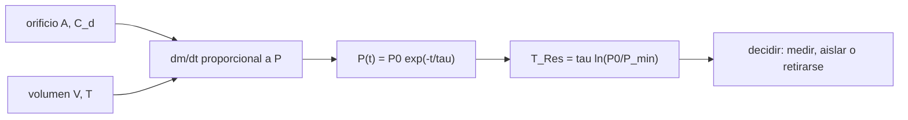

# B110-C01 — Despresurización: detección, aislamiento y respuesta

<!-- nav:top -->
[🏠 Programa](../../../../README.md) · [📚 Bloque B110](../../../tronco-comun/B110-emergencias-y-seguridad-de-tripulacion.md)
<!-- /nav -->

## 1. Ubicación, nivel y alcance

Clase 1 del bloque B110. Nivel N3. Una fuga en un módulo presurizado no se juzga por su tamaño sino por **cuánto tiempo deja antes de que la presión baje a un valor mínimo**. Aquí calculas ese tiempo de reserva con un modelo de orificio y cabina isoterma, ves cómo lo acorta la segmentación del volumen y cuánto error trae estimarlo con dos lecturas de manómetro. Se apoya en [B106](../../../tronco-comun/B106-habitats-espaciales-y-soporte-vital.md) (presurización de módulos) y no repite sus contenidos. La cabina, el orificio y el manómetro son sintéticos; no hay ninguna fuga real aquí.

## 2. Por qué esta clase existe

Un módulo presurizado siempre pierde algo de aire; lo grave es la fuga por encima de lo especificado. La decisión central: **¿cuánto tiempo queda antes de la presión mínima y qué se hace con ese tiempo (medir, aislar o retirarse)?** Los procedimientos reales los define cada operador y esta clase no los sustituye.

## 3. Lo que podrás hacer al terminar

1. Calcular el caudal másico por un orificio estrangulado hacia el vacío.
2. Deducir que la presión de una cabina isoterma decae de forma exponencial y obtener su constante de tiempo `τ`.
3. Calcular el tiempo de reserva `T_Res` hasta una presión mínima.
4. Predecir cómo cambia `T_Res` al aislar un volumen menor o al cambiar el diámetro del orificio.
5. Estimar `T_Res` con dos lecturas de manómetro y acotar su error.
6. Separar lo consultado (valores y reglas publicados) de lo ilustrativo (cabina, orificio, manómetro).

La evidencia es la **ficha de reserva de tiempo ante una fuga** del ejercicio 12 (sección 20).

## 4. Con qué llegas y cómo comprobarlo

1. ¿Qué es la presión y en qué unidades se mide?
2. ¿Qué dice la ley de los gases ideales?
3. ¿Qué es una exponencial decreciente?
4. ¿Qué es un dato sintético?
5. ¿Qué es una verificación por segunda vía?

<details>
<summary>Ver respuestas</summary>

1. Fuerza por unidad de área, en pascales (Pa); 1 mmHg = 133,322 Pa. 2. `P V = m R_esp T`. 3. Una magnitud cuya velocidad de cambio es proporcional a ella misma. 4. Un dato generado para el ejemplo, no medido. 5. Calcular lo mismo con otro método y comparar.
</details>

Con cuatro o cinco aciertos, sigue; si no, repasa los prerrequisitos.

## 5. Un caso de contexto y casos de referencia

Una cabina de `V = 100 m³` a `P₀ = 101,0 kPa` (757,6 mmHg) con un orificio de `2 mm` tarda `24,2 h` en bajar a `490 mmHg`; con uno de `10 mm`, `58,2 min`; con uno de `24,1 mm`, `10 min`. Es el **ejemplo conductor** y es **ilustrativo**. Casos de referencia consultados: la ponencia de Tobias y McMillan describe la presión mínima de 490 mmHg y la regla de dejar de aislar cuando `T_Res` baja a 10 min; los avisos de la NASA de 2018 describen un orificio de unos 2 mm en una Soyuz acoplada a la ISS, con pérdida pequeña de presión. Esta clase no reconstruye ese suceso.

## 6. Vocabulario

La **fuga de especificación** es la pérdida admisible de diseño. La **despresurización rápida** es una pérdida no planificada de aire de cabina. El **flujo estrangulado** es el que alcanza la velocidad del sonido en la garganta y ya no depende de la presión de salida. La **constante de tiempo** `τ = V/(C_d A ψ √(γ R T))` es el tiempo en que la presión cae a `1/e`. El **tiempo de reserva** `T_Res = (P/|dP/dt|) ln(P/P_min)` es el tiempo hasta la presión mínima. La **segmentación** es aislar volúmenes cerrando escotillas.

## 7. Modelo mental: una bañera con un desagüe proporcional



*Descripción textual:* el orificio y el volumen fijan la constante de tiempo; la presión decae de forma exponencial y de ahí sale el tiempo de reserva con el que se decide.

Analogía: una bañera cuyo desagüe saca agua en proporción a la altura; cuanto más baja el nivel, más lento drena. Límite: aquí el aire sale con flujo estrangulado e isotermo; en un caso real el aire se enfría al expandirse, la fuga puede cambiar de tamaño y la cabina no es un volumen único.

## 8. La explicación, paso a paso

### 8.1 Flujo por el orificio

Con vacío fuera, el flujo es estrangulado: `ṁ = C_d A P √(γ/(R T)) ψ`, con `ψ = (2/(γ+1))^((γ+1)/(2(γ−1))) = 0,5787` para `γ = 1,4`. Con `m = P V/(R T)` y `T` constante, `dP/dt = −P/τ`, de donde `P(t) = P₀ e^(−t/τ)`.

### 8.2 Tiempo de reserva

`T_Res = τ ln(P₀/P_min)`. Es la forma `(P/|dP/dt|) ln(P/P_min)` de la ponencia consultada, en la que `dP/dt` es negativo; la dependencia es la misma. Con `P_min = 490 mmHg = 65,33 kPa`, `ln(757,6/490) = 0,4358`.

| `d` (mm) | `τ` (h) | `T_Res` (h) | numérico (h) |
|---|---|---|---|
| 2 | 55,643 | 24,244 | 24,244 |
| 10 | 2,226 | 0,970 | 0,970 |
| 50 | 0,089 | 0,039 | 0,039 |
| 100 | 0,022 | 0,010 | 0,010 |

`τ ∝ V/d²`: doblar el diámetro divide `T_Res` por 4.

### 8.3 Segmentar el volumen

Si la fuga está en el volumen que se aísla, el aire disponible es menor y `T_Res` es proporcional al volumen. Con un orificio de 10 mm: `58,2 min` (100 m³), `34,9` (60 m³), `17,5` (30 m³) y `5,8` (10 m³). La ponencia consultada indica que, si `T_Res` baja a diez minutos o menos, se deja de aislar y se cierra el último volumen estable, y que no se cierra una escotilla entre los tripulantes y su vehículo de retorno porque la diferencia de presión puede impedir reabrirla (sección 3.1.5). Esta clase no enseña esos pasos.

### 8.4 Estimar con dos lecturas

Con el manómetro (resolución ilustrativa de 1 mmHg), la pendiente sale de dos lecturas separadas `Δt`. Para el orificio de 10 mm (verdad 58,2 min), el cociente estimado/verdad tiene mediana `0,95` y rango `[0,71; 1,41]` con 30 s, `[0,95; 1,13]` con 120 s y `[1,01; 1,05]` con 600 s. La pendiente secante subestima la pendiente instantánea y por eso la mediana a 600 s es `1,03`.

### 8.5 Contraste con un dato publicado

El artículo de Schaezler y colaboradores da que una fuga de `0,45 kg/día` habría tardado 146 días en bajar la presión de la ISS de 102,7 a 96,5 kPa en marzo de 2011. Con 30.000 ft³ (850 m³) y gas ideal, el laboratorio obtiene 1037 kg de aire y `143 días`. Es una **comprobación de orden de magnitud**, no una validación: el volumen libre real no se consultó.

## 9. Magnitudes, símbolos y unidades

| Símbolo | Qué es | Unidad | Valor / nota |
|---|---|---|---|
| `V` | volumen de cabina | m³ | 100 (ilustrativo) |
| `P₀`, `P_min` | presión inicial y mínima | Pa | 101,0 kPa; 65,33 kPa (490 mmHg, consultado) |
| `d`, `A` | diámetro y área del orificio | m, m² | 2 a 100 mm |
| `C_d` | coeficiente de descarga | — | 0,8 (ilustrativo) |
| `γ`, `R_esp`, `T` | gas ideal | —, J/(kg·K), K | 1,4; 287,05; 293,15 |
| `τ` | constante de tiempo | s | 55,6 h para 2 mm |
| `T_Res` | tiempo de reserva | s | 24,2 h para 2 mm |

## 10. Convenciones y referencias

Presiones absolutas en pascales; 1 mmHg = 101 325/760 Pa. Sistema de referencia: la cabina como volumen único de temperatura uniforme (sin sistema de coordenadas espacial). Aire seco como gas ideal, flujo estrangulado al vacío, `C_d` constante, cabina isoterma, sin reposición de gas. Semilla de la simulación: 110. Python 3.12.9, solo biblioteca estándar. Tolerancia: analítico frente a integración de Euler con diferencia relativa menor que `10⁻³` (el error baja con el paso).

## 11. De dónde sale lo que afirmamos

| ID | Fuente | Localizador | Respalda | Estado |
|---|---|---|---|---|
| S1 | Tobias, B. y McMillan, C., *Evolution of Hardware and Philosophy of Emergency Response Actions on the ISS and Future Spacecrafts*, SpaceOps 2023 (NASA JSC) — https://ntrs.nasa.gov/citations/20220019247 (consultada 2026-11-10) | texto completo leído (PDF, PyMuPDF), secciones 2 y 3.1 | 490 mmHg (9,5 psia) como presión mínima; fórmula de `T_Res`; regla de 10 min; no cerrar escotilla hacia el vehículo de retorno; Orion sin volumen aislable (sección 4.1) | Consultada |
| S2 | Schaezler, R. N. et al., *Trending of Overboard Leakage of ISS Cabin Atmosphere*, AIAA — https://ntrs.nasa.gov/citations/20110012997 (consultada 2026-11-10) | texto completo leído, sección de resultados | intervalo 96,5–102,7 kPa; 0,45 kg/día tarda 146 días (marzo de 2011) | Consultada |
| S3 | NASA/NSSDC, Earth Fact Sheet — https://nssdc.gsfc.nasa.gov/planetary/factsheet/earthfact.html (consultada 2026-11-10) | ficha completa leída | presión de superficie 1014 mb como contexto de `P₀` | Consultada |
| S4 | NASA, avisos sobre la fuga de la Soyuz MS-09 (agosto de 2018) — https://www.nasa.gov/news-release/nasa-roscosmos-statement-on-international-space-station-leak/ (consultada 2026-11-10) | solo el resumen de los resultados de búsqueda; la página completa no se leyó | orificio de unos 2 mm, sin peligro inmediato | Consultada parcialmente |
| — | Flujo estrangulado por un orificio, gas ideal | — | lo verifica el laboratorio con integración numérica | No consultada en una fuente concreta |

Límites: el volumen libre de la ISS, los procedimientos vigentes y los umbrales de hipoxia no se consultaron.

## 12. Cómo ver el tiempo de reserva

| Magnitud | Valor |
|---|---|
| `T_Res` (2 mm) | 24,244 h |
| `T_Res` (10 mm) | 58,2 min |
| diámetro para `T_Res` = 10 min | 24,1 mm |
| `T_Res` con `V` = 30 m³ (10 mm) | 17,5 min |
| estimación con 30 s | `[0,71; 1,41]` de la verdad |

Descripción larga: el tiempo de reserva cae con el cuadrado del diámetro y es proporcional al volumen; medir poco tiempo da una estimación muy dispersa.

## 13. Ejemplo trabajado: el orificio de 10 mm

**Paso 1 · Escala.** `τ(10)/τ(2) = (2/10)² = 0,04`, luego `τ = 55,643 × 0,04 = 2,226 h`.

**Paso 2 · Logaritmo.** `ln(757,6/490) = 0,4358`.

**Paso 3 · Reserva.** `T_Res = 2,226 × 0,4358 = 0,970 h = 58,2 min`.

**Paso 4 · Lectura.** Con 58 min hay margen para medir; con 5,8 min (10 m³) no.

## 14. Distintas formas de describir una fuga

**Por tamaño:** diámetro o área. **Por tiempo:** `τ` o `T_Res`. **Por masa:** kg/día. **Por presión:** `dP/dt`. **Por volumen afectado:** `V`.

## 15. Práctica guiada

**Ejercicio 1 · con los pasos indicados.** Convierte 490 mmHg a kPa. *Pasos:* multiplica por 133,322 Pa y divide por 1000.

<details><summary>Solución comentada</summary>

`490 × 133,322 = 65 328 Pa = 65,33 kPa`.
</details>

**Ejercicio 2 · con una pista.** Calcula `T_Res` para un orificio de 10 mm. *Pista:* `τ = 2,226 h`.

<details><summary>Solución comentada</summary>

`2,226 × ln(757,6/490) = 0,970 h = 58,2 min`.
</details>

**Ejercicio 3 · casi autónomo.** ¿Por qué `T_Res` se divide por 4 al doblar el diámetro?

<details><summary>Solución comentada</summary>

El área crece con `d²` y `τ ∝ 1/A`.
</details>

## 16. Práctica autónoma, transferencia e integrador

**Ejercicio 4 · autónomo.** `T_Res` con `V = 30 m³` y 10 mm.

<details><summary>Solución comentada</summary>

`58,2 × 0,3 = 17,5 min`.
</details>

**Ejercicio 5 · autónomo.** Área de un orificio de 2 mm.

<details><summary>Solución comentada</summary>

`π × 0,002²/4 = 3,14 × 10⁻⁶ m² = 3,14 mm²`.
</details>

**Ejercicio 6 · autónomo.** `T_Res` (2 mm, 100 m³) si `P₀ = 96,5 kPa` (723,8 mmHg).

<details><summary>Solución comentada</summary>

`55,643 × ln(723,8/490) = 55,643 × 0,3902 = 21,7 h`.
</details>

**Ejercicio 7 · autónomo.** ¿Qué diámetro duplica `T_Res` respecto de 10 mm?

<details><summary>Solución comentada</summary>

`T_Res ∝ 1/d²`; hace falta `d = 10/√2 = 7,07 mm`.
</details>

**Ejercicio 8 · autónomo.** Reproduce el contraste con Schaezler: días para bajar de 102,7 a 96,5 kPa con 0,45 kg/día y 1037 kg.

<details><summary>Solución comentada</summary>

`1037 × ln(102,7/96,5)/0,45 = 1037 × 0,0623/0,45 ≈ 143 días` (publicado: 146).
</details>

**Ejercicio 9 · transferencia.** **Transferencia.** Una lectura de 30 s da un `T_Res` entre 0,71 y 1,41 veces el real. ¿Qué compromiso plantea eso?

<details><summary>Solución comentada</summary>

Esperar da una estimación mejor pero consume tiempo de reserva; una estimación rápida y dispersa obliga a un margen mayor. El modelo no dicta qué hacer: lo decide el procedimiento oficial.
</details>

**Ejercicio 10 · transferencia.** **Transferencia.** ¿Por qué no se cierra una escotilla entre el tripulante y su vehículo de retorno durante una fuga?

<details><summary>Solución comentada</summary>

Porque la diferencia de presión puede impedir reabrirla y porque el mecanismo puede fallar cerrado (S1, 3.1.5).
</details>

**Ejercicio 11 · transferencia.** **Transferencia.** ¿Por qué un vehículo de un solo volumen no puede segmentar como la ISS?

<details><summary>Solución comentada</summary>

No tiene un volumen aislable al que retirarse: el dato consultado indica que la respuesta se centra en el traje y la reentrada (S1, 4.1).
</details>

**Ejercicio 12 · integrador.** **Integrador.** Elabora tu *ficha de reserva de tiempo ante una fuga*: tabla de `τ` y `T_Res` para cuatro diámetros, efecto de segmentar, dispersión de la estimación con dos lecturas y lista de qué es consultado e ilustrativo.

<details><summary>Solución comentada</summary>

Secciones 8.1–8.5 y la salida del laboratorio.
</details>

## 17. Laboratorio: tiempo de reserva y segmentación

El script [despresurizacion.py](despresurizacion.py) calcula `τ` y `T_Res` para cuatro diámetros, los contrasta con una integración numérica del balance de masa, halla el diámetro con `T_Res` = 10 min, escala por volumen, simula la estimación con dos lecturas (semilla 110) y compara con el dato de Schaezler (**comprueba** diferencia analítico/numérico < 1e-3 y orden de magnitud del dato publicado).

**Datos:** 490 mmHg, 96,5–102,7 kPa y 146 días **consultados**; cabina, orificio, `C_d` y manómetro **ilustrativos**. **Predice antes de ejecutar:** ¿cuánto vale `T_Res` con 10 mm y 100 m³? (≈ 58 min.) **Ejecución del 2026-11-10 (Python 3.12.9):**

```text
Python 3.12.9 (biblioteca estandar)
Cabina ILUSTRATIVA V = 100.0 m3, P0 = 101.0 kPa = 757.6 mmHg, P_min = 65.33 kPa (490 mmHg)
psi (flujo estrangulado, gamma = 1.4) = 0.5787
 d [mm]   tau [h]   T_Res [h]   T_Res numerico [h]   dif relativa
     2    55.643     24.244           24.244       2.61e-07
    10     2.226      0.970            0.970       1.62e-06
    50     0.089      0.039            0.039       3.89e-05
   100     0.022      0.010            0.010       3.28e-05
Diametro del orificio con T_Res = 10 min (regla de retirada): 24.1 mm
Segmentacion con orificio de 10 mm (fuga en el volumen que alimenta el orificio):
  V =   100 m3  T_Res =     58.2 min
  V =    60 m3  T_Res =     34.9 min
  V =    30 m3  T_Res =     17.5 min
  V =    10 m3  T_Res =      5.8 min
Estimacion de T_Res con dos lecturas (verdad 58.2 min); cociente estimado/verdad:
  intervalo    30 s: mediana   0.95  [P5   0.71; P95   1.41]  (2000 validas de 2000)
  intervalo   120 s: mediana   1.03  [P5   0.95; P95   1.13]  (2000 validas de 2000)
  intervalo   600 s: mediana   1.03  [P5   1.01; P95   1.05]  (2000 validas de 2000)
Consistencia con Schaezler et al.: V = 850 m3 -> masa de aire 1037 kg; 0.45 kg/dia tarda 143 dias (publicado: 146)
Pruebas superadas.
```

```bash
python programa/clases/B110/B110-C01-despresurizacion-deteccion-aislamiento-y-respuesta/despresurizacion.py
```

**Límites:** isotermo, un solo volumen, orificio fijo, sin reposición de gas ni efectos de hipoxia; la integración de Euler es un contraste de código, no una validación independiente de la física.

## 18. Errores frecuentes y cómo corregirlos

**Tomar el tamaño del orificio como medida de gravedad.** Lo que decide es `T_Res`, que depende también del volumen (8.2 y 8.3).

**Creer que la presión cae linealmente.** Cae de forma exponencial (8.1).

**Estimar la pendiente con una lectura muy corta.** La dispersión sube a `[0,71; 1,41]` (8.4).

**Usar esta clase como procedimiento.** Es educativa y no sustituye la formación ni los procedimientos oficiales (sección 21).

## 19. Cómo sabrás que vas bien

Tras la sección 8: ¿qué `T_Res` esperabas con 10 mm y cuál obtuviste? Si dudas, repasa el ejemplo 13. Tras el laboratorio: ¿qué comprueba? (ver la sección 17).

## 20. Qué entregas y cómo se evalúa

El producto es tu **ficha de reserva de tiempo ante una fuga** (ejercicio 12).

| Criterio | Inicial | En desarrollo | Logrado | Destacado |
|---|---|---|---|---|
| Conceptos | Los confunde | Parciales | Explica `τ` y `T_Res` | Explica los límites del modelo |
| Cálculo | Sin unidades | Con errores | Tabla completa con unidades | Calcula casos nuevos |
| Numérico | Sin comprobar | Un caso | Contraste con una segunda vía | Interpreta la dispersión |
| Fuentes | Sin fuente | Sin fecha | Fuentes con fecha y estado | Declara lo ilustrativo y lo no consultado |
| Límites | No los nombra | Uno | Tres | Discute qué falta del modelo |

**Condiciones críticas (no se compensan con promedio):** rotular la cabina, el orificio y el manómetro como ilustrativos; no presentar esta clase como procedimiento operativo; citar solo lo consultado.

## 21. Ética, seguridad y límites

Clase educativa: no es consejo operativo ni médico, no sustituye la formación, la licencia ni los procedimientos oficiales de un operador y no debe usarse para decidir en una emergencia real. Los modelos son simplificados y sus datos son sintéticos o ilustrativos. Accesibilidad: tablas equivalentes a las gráficas, fórmulas en texto, ejercicios sin conexión.

## 22. Para cerrar y seguir

Un orificio de 2 mm en 100 m³ deja `24,2 h`; uno de 10 mm, `58 min`; reducir el volumen a 10 m³ lo deja en `5,8 min`. Queda una pregunta: ¿qué cambia cuando el peligro no es la presión sino un tripulante enfermo o contaminado en la misma cabina?

**Glosario español–inglés.** tiempo de reserva · *reserve time*; flujo estrangulado · *choked flow*; constante de tiempo · *time constant*; segmentación · *segmentation*; despresurización rápida · *rapid depressurization*.

**Continuidad.** [B110-C02](../B110-C02-protocolos-operativos-de-aislamiento-de-un-tripulante-enfermo-o-contaminado/CLASE.md) trata el aislamiento de un tripulante enfermo o contaminado.

**Referencias:** ver sección 11.

<!-- nav:bottom -->
---

[📚 Bloque B110](../../../tronco-comun/B110-emergencias-y-seguridad-de-tripulacion.md)
<!-- /nav -->
