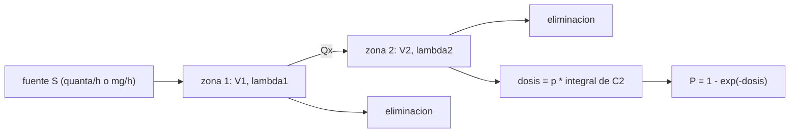

# B110-C02 — Protocolos operativos de aislamiento de un tripulante enfermo o contaminado

<!-- nav:top -->
[🏠 Programa](../../../../README.md) · [📚 Bloque B110](../../../tronco-comun/B110-emergencias-y-seguridad-de-tripulacion.md)
<!-- /nav -->

## 1. Ubicación, nivel y alcance

Clase 2 del bloque B110. Nivel N3. En una cabina cerrada el aire de todos es el mismo aire: lo que emite un tripulante enfermo o lo que se derrama sobre uno contaminado llega a los demás según cuánto se renueva, se filtra y se separa ese aire. Aquí calculas, con un modelo de mezcla en dos zonas, cuánto reducen la exposición la renovación, un filtro local, una mascarilla y una barrera. Usa [B105](../../../tronco-comun/B105-medicina-y-biologia-espacial.md) solo como contexto del microbioma y no repite sus contenidos. Todos los parámetros son sintéticos: no son datos clínicos ni toxicológicos.

**Contenido educativo: no es consejo médico ni un protocolo de aislamiento, no sustituye la formación, la licencia ni la supervisión de profesionales y no debe usarse para decidir sobre una persona real.**

## 2. Por qué esta clase existe

Aislar a alguien en una cabina cuesta espacio, tiempo y trabajo de la tripulación; no aislar cuesta exposición. La decisión central: **¿cuánta exposición evita cada barrera y con qué incertidumbre?** La clase enseña a comparar medidas con un modelo, no a prescribir ninguna.

## 3. Lo que podrás hacer al terminar

1. Calcular la tasa de eliminación de aire de una cabina y su constante de tiempo.
2. Plantear el balance de mezcla de dos zonas con un intercambio entre ellas.
3. Calcular una dosis acumulada y un riesgo tipo Wells–Riley `P = 1 − e^(−dosis)`.
4. Comparar escenarios (sin aislar, puerta, filtro local, mascarilla, sellado) por su dosis.
5. Propagar la incertidumbre de la tasa de emisión con Monte Carlo.
6. Separar lo consultado de lo ilustrativo y no confundir el modelo con un protocolo.

La evidencia es la **ficha comparativa de exposición con y sin aislamiento** del ejercicio 12 (sección 20).

## 4. Con qué llegas y cómo comprobarlo

1. ¿Qué es una concentración y en qué unidades se mide?
2. ¿Qué es una ecuación diferencial de decaimiento?
3. ¿Qué es una probabilidad acumulada?
4. ¿Qué es un dato sintético?
5. ¿Qué es una verificación por segunda vía?

<details>
<summary>Ver respuestas</summary>

1. Cantidad de una sustancia por volumen de aire, p. ej. mg/m³. 2. `dC/dt = −λ C`, con solución `C₀ e^(−λ t)`. 3. La probabilidad de que algo ocurra al menos una vez. 4. Un dato generado para el ejemplo, no medido. 5. Calcular lo mismo con otro método y comparar.
</details>

Con cuatro o cinco aciertos, sigue; si no, repasa los prerrequisitos.

## 5. Un caso de contexto y casos de referencia

Una cabina sintética de 100 m³ (zona del afectado de 10 m³ y resto de 90 m³) con tres personas susceptibles y una emisión de 10 quanta/h. Durante 72 h, el riesgo por persona pasa de `0,411` sin aislar a `0,128` con la puerta cerrada, `0,040` con un filtro local, `0,020` con mascarilla y `0,002` con el cierre sellado. Es el **ejemplo conductor** y es **ilustrativo**. Referencia consultada: la ponencia de la NASA describe la emergencia de atmósfera tóxica como derrame o liberación de un material peligroso al aire de cabina y señala que la ISS tiene más de una docena de segmentos aislables; esta clase no describe procedimientos de ninguna agencia.

## 6. Vocabulario

La **mezcla perfecta** supone concentración uniforme en cada zona. El **quantum** es una dosis infecciosa definida de forma que un quantum inhalado causa infección con probabilidad `1 − e⁻¹`; es una unidad modelística y no se mide directamente. La **tasa de eliminación** `λ` suma renovación, filtración e inactivación (1/h). El **intercambio** `Q_x` es el caudal de aire entre zonas (m³/h). La **dosis** es `p ∫ C dt`. El **riesgo** es `P = 1 − e^(−dosis)`.

## 7. Modelo mental: dos habitaciones comunicadas por una rendija



*Descripción textual:* la fuente emite en la zona 1; parte pasa a la zona 2 por el intercambio y cada zona elimina por su cuenta; la dosis se calcula con la concentración de la zona 2.

Analogía: dos habitaciones con un humo en una; la puerta cerrada y un extractor reducen cuánto llega a la otra. Límite: en una cabina real el aire no se mezcla de forma perfecta, las personas se mueven y la emisión varía; este modelo es una cota de escala, no una predicción.

## 8. La explicación, paso a paso

### 8.1 Una zona

Con `V = 100 m³`, renovación y filtración de `6/h` e inactivación de `0,6/h`, `λ = 6,6/h`; la constante de tiempo es `1/λ = 9,1 min`. En régimen estacionario `C = S/(λ V) = 10/(6,6 × 100) = 0,01515 quanta/m³`. La dosis acumulada de una persona en `t` horas es `p S/(λ V) [t − (1 − e^(−λ t))/λ]`, que da `0,5443 quanta` en 72 h.

### 8.2 Dos zonas

`dC₁/dt = S/V₁ − (Q_x/V₁)(C₁ − C₂) − λ₁ C₁` y `dC₂/dt = (Q_x/V₂)(C₁ − C₂) − λ₂ C₂`. Se integran con Euler y paso pequeño. **Verificación:** con `Q_x = 20 000 m³/h` el resultado coincide con la fórmula de una zona con diferencia relativa `2,97 × 10⁻³`; la diferencia restante viene del gradiente entre zonas, que persiste aun con `Q_x` grande.

### 8.3 Escenarios

| Escenario | Dosis (quanta) | Riesgo por persona | Casos esperados (3 pers.) |
|---|---|---|---|
| A · sin aislar (`Q_x` = 2000 m³/h) | 0,52858 | 0,41056 | 1,2317 |
| B · puerta cerrada, `Q_x` = 20 m³/h | 0,13689 | 0,12794 | 0,3838 |
| C · B + filtro local (+20/h) | 0,04099 | 0,04016 | 0,1205 |
| D · C + mascarilla (emisión × 0,5) | 0,02050 | 0,02029 | 0,0609 |
| E · D con `Q_x` = 2 m³/h (sellado) | 0,00225 | 0,00225 | 0,0067 |

Cada medida actúa sobre un término distinto: la puerta sobre `Q_x`, el filtro sobre `λ₁`, la mascarilla sobre `S`. La dosis es lineal en `S`; el riesgo no lo es porque satura.

### 8.4 Incertidumbre

La emisión `q` se supone lognormal con mediana 10 y desviación geométrica 3 (ilustrativa; 4000 muestras, semilla 110). El riesgo por persona sin aislar queda en `[0,084; 0,961]` (P5–P95, mediana `0,406`) y en el escenario D en `[0,0034; 0,116]` (mediana `0,020`). **El orden de las medidas es robusto; el riesgo absoluto no.**

### 8.5 Un contaminante

Para un pulso de 100 mg en la zona 1 y un umbral **ilustrativo** de 0,5 mg/m³ en la zona 2: sin aislar, `C₂` máxima `0,997 mg/m³` y `0,10 h` por encima del umbral; con `Q_x` = 20 m³/h, `0,107 mg/m³` y ningún tiempo por encima; con filtro local, `0,050 mg/m³`. La ecuación es la misma; cambia la unidad y no hay riesgo de transmisión.

## 9. Magnitudes, símbolos y unidades

| Símbolo | Qué es | Unidad | Valor / nota |
|---|---|---|---|
| `V₁`, `V₂` | volúmenes de las zonas | m³ | 10 y 90 (ilustrativos) |
| `S` | emisión de la fuente | quanta/h o mg/h | 10 quanta/h (ilustrativo) |
| `p` | ritmo respiratorio | m³/h | 0,5 (ilustrativo) |
| `λ` | tasa de eliminación | 1/h | 6,6 |
| `Q_x` | intercambio entre zonas | m³/h | 2 a 20 000 |
| `C` | concentración | quanta/m³ o mg/m³ | 0,01515 (estacionaria) |
| `P` | riesgo por persona | — | 0,411 sin aislar |

## 10. Convenciones y referencias

Sistema de referencia: la cabina como dos volúmenes de aire uniformes, sin coordenadas espaciales. Aire sin reposición, tres susceptibles idénticos e independientes, 72 h. Parámetros ilustrativos, no clínicos. Python 3.12.9, solo biblioteca estándar, semilla 110. Tolerancia: dos zonas frente a una zona analítica con diferencia relativa menor que 1 %.

## 11. De dónde sale lo que afirmamos

| ID | Fuente | Localizador | Respalda | Estado |
|---|---|---|---|---|
| S1 | Tobias, B. y McMillan, C., SpaceOps 2023 (NASA JSC) — https://ntrs.nasa.gov/citations/20220019247 (consultada 2026-11-10) | texto completo leído (PyMuPDF), sección 1.1 y resumen | definición de atmósfera tóxica; ISS con más de una docena de segmentos aislables | Consultada |
| S2 | Modelo de Wells–Riley; resumen de PMC3226423 (Aliabadi et al.) y PMC7202094 vistos en un buscador (2026-11-10) | solo el resumen del buscador; las páginas no se abrieron | forma `P = 1 − exp(−I q p t/Q)`, definición de quantum, supuesto de mezcla perfecta | Consultada parcialmente (fuente primaria no leída) |
| — | Balance de mezcla de dos zonas e integración de Euler | — | lo verifica el laboratorio con la fórmula analítica de una zona | No consultada en una fuente concreta |
| — | Valores de emisión, ritmo respiratorio, eficacia de mascarilla y umbral de contaminante | — | ilustrativos | No consultados |

Límites: no se consultó ninguna guía médica ni de salud ocupacional; ningún valor describe un patógeno, una persona ni una sustancia real.

## 12. Cómo ver la comparación

| Magnitud | Valor |
|---|---|
| riesgo sin aislar | 0,411 |
| riesgo con puerta cerrada | 0,128 |
| reducción de B a C | 0,128 → 0,040 |
| riesgo D (P5–P95) | 0,0034–0,116 |
| verificación una zona | 2,97 × 10⁻³ |

Descripción larga: cada barrera reduce la dosis en un factor distinto y el escenario sellado deja el riesgo en dos milésimas; la incertidumbre de la emisión abarca más de un orden de magnitud.

## 13. Ejemplo trabajado: la dosis de una zona

**Paso 1 · Eliminación.** `λ = 6 + 0,6 = 6,6/h`.

**Paso 2 · Estacionaria.** `C = 10/(6,6 × 100) = 0,01515 quanta/m³`.

**Paso 3 · Dosis.** `0,5 × 0,01515 × (72 − 0,1515) = 0,5443`.

**Paso 4 · Riesgo.** `1 − e^(−0,5443) = 0,420`.

El valor del laboratorio para el escenario A es `0,411` porque la zona 2 queda con menos concentración que la media de la cabina.

## 14. Distintas formas de describir la exposición

**Por concentración:** `C`. **Por dosis:** `p ∫C dt`. **Por riesgo:** `P`. **Por casos esperados:** `N P`. **Por tiempo sobre un umbral** (contaminante).

## 15. Práctica guiada

**Ejercicio 1 · con los pasos indicados.** Calcula la constante de tiempo de la cabina. *Pasos:* `1/λ` en horas y pásalo a minutos.

<details><summary>Solución comentada</summary>

`1/6,6 = 0,1515 h = 9,1 min`.
</details>

**Ejercicio 2 · con una pista.** Concentración estacionaria con `S = 10`, `V = 100 m³` y `λ = 6,6/h`. *Pista:* `C = S/(λ V)`.

<details><summary>Solución comentada</summary>

`10/660 = 0,01515 quanta/m³`.
</details>

**Ejercicio 3 · casi autónomo.** ¿Por qué la dosis de 72 h es casi `p C t`?

<details><summary>Solución comentada</summary>

Porque el transitorio dura solo 9 min frente a 72 h; el término `1/λ` resta apenas `0,15 h`.
</details>

## 16. Práctica autónoma, transferencia e integrador

**Ejercicio 4 · autónomo.** Riesgo del escenario B con dosis `0,13689`.

<details><summary>Solución comentada</summary>

`1 − e^(−0,13689) = 0,128`.
</details>

**Ejercicio 5 · autónomo.** Casos esperados en B con 3 personas.

<details><summary>Solución comentada</summary>

`3 × 0,12794 = 0,384`.
</details>

**Ejercicio 6 · autónomo.** Reducción relativa del riesgo de A a C.

<details><summary>Solución comentada</summary>

`0,04016/0,41056 = 0,098`; reduce un `90 %`.
</details>

**Ejercicio 7 · autónomo.** La mascarilla reduce la emisión a la mitad: ¿por qué el riesgo no se divide exactamente por 2 entre C y D?

<details><summary>Solución comentada</summary>

La dosis sí se divide por 2 (`0,04099 → 0,02050`); el riesgo `1 − e^(−dosis)` es casi lineal solo para dosis pequeñas: `0,0402 → 0,0203`.
</details>

**Ejercicio 8 · autónomo.** Tiempo para que un contaminante bien mezclado caiga a la mitad con `λ = 6,6/h`.

<details><summary>Solución comentada</summary>

`ln 2/6,6 = 0,105 h = 6,3 min`.
</details>

**Ejercicio 9 · transferencia.** **Transferencia.** El riesgo sin aislar abarca `[0,084; 0,961]`. ¿Qué se puede afirmar con seguridad?

<details><summary>Solución comentada</summary>

Que cada barrera reduce la dosis en el mismo orden para toda `q` (la dosis es lineal en `q`); el riesgo absoluto depende demasiado de `q`, que es ilustrativa.
</details>

**Ejercicio 10 · transferencia.** **Transferencia.** ¿Puede este modelo decidir si hay que aislar a una persona?

<details><summary>Solución comentada</summary>

No: faltan la evaluación clínica, la infecciosidad real y el procedimiento oficial; el modelo solo compara medidas con parámetros ilustrativos.
</details>

**Ejercicio 11 · transferencia.** **Transferencia.** ¿Qué cambia entre un patógeno y un contaminante químico?

<details><summary>Solución comentada</summary>

La unidad (quanta frente a mg/m³) y el criterio (riesgo `P` frente a un umbral de concentración); el balance de mezcla es el mismo.
</details>

**Ejercicio 12 · integrador.** **Integrador.** Elabora tu *ficha comparativa de exposición con y sin aislamiento*: tabla de los cinco escenarios, verificación con una zona, intervalo por incertidumbre en `q`, caso del contaminante y lista de qué es consultado e ilustrativo.

<details><summary>Solución comentada</summary>

Secciones 8.1–8.5 y la salida del laboratorio.
</details>

## 17. Laboratorio: exposición con y sin aislamiento

El script [aislamiento.py](aislamiento.py) integra el modelo de dos zonas, lo verifica contra la fórmula de una zona, compara cinco escenarios, propaga la incertidumbre de `q` con Monte Carlo (semilla 110) y trata un pulso de contaminante (**comprueba** diferencia con la fórmula analítica < 1 % y riesgo D menor que A).

**Datos:** todos **ilustrativos**; solo la forma del modelo se vio en un resumen. **Predice antes de ejecutar:** ¿el filtro local reduce la dosis más o menos que la puerta cerrada? (la reduce a un tercio de B.) **Ejecución del 2026-11-10 (Python 3.12.9):**

```text
Python 3.12.9 (biblioteca estandar)
Modelo ILUSTRATIVO de dos zonas: V1 = 10.0 m3 (zona del tripulante afectado), V2 = 90.0 m3; q = 10.0 quanta/h; lambda = 6.6 /h; 3 susceptibles; 72 h
Verificacion (Qx = 20000 m3/h, casi una zona): dosis numerica = 0.54269, analitica = 0.54431, dif relativa = 2.97e-03
 escenario                                    dosis [quanta]   riesgo por persona   casos esperados (3 pers.)
 A  sin aislar (Qx = 2000 m3/h)                  0.52858            0.41056               1.2317
 B  puerta cerrada, Qx = 20 m3/h                 0.13689            0.12794               0.3838
 C  B + filtro local (+20 /h) en zona 1          0.04099            0.04016               0.1205
 D  C + mascarilla (emision x 0,5)               0.02050            0.02029               0.0609
 E  D con Qx = 2 m3/h (sellado)                  0.00225            0.00225               0.0067
Incertidumbre en q (lognormal, mediana 10, GSD 3, 4000 muestras): riesgo por persona
  A: P5 0.0838  mediana 0.4061  P95 0.9589
  D: P5 0.0034  mediana 0.0200  P95 0.1164
Contaminante (pulso de 100 mg en la zona 1; umbral ILUSTRATIVO 0,5 mg/m3 en la zona 2):
  sin aislar               C2 maxima =  0.997 mg/m3 ; tiempo por encima del umbral =  0.10 h
  Qx = 20                  C2 maxima =  0.107 mg/m3 ; tiempo por encima del umbral =  0.00 h
  Qx = 20 + filtro local   C2 maxima =  0.050 mg/m3 ; tiempo por encima del umbral =  0.00 h
Pruebas superadas.
```

```bash
python programa/clases/B110/B110-C02-protocolos-operativos-de-aislamiento-de-un-tripulante-enfermo-o-contaminado/aislamiento.py
```

**Límites:** mezcla perfecta, personas inmóviles, sin reposición de aire ni dinámica de la infección, parámetros ilustrativos; el percentil 95 de `q` en la tabla de incertidumbre (`0,9589`) es un resultado del supuesto lognormal y no una predicción.

## 18. Errores frecuentes y cómo corregirlos

**Presentar el riesgo calculado como el riesgo real de una persona.** Es un modelo con parámetros ilustrativos (8.4).

**Esperar que el riesgo sea proporcional a la emisión.** La dosis lo es; el riesgo satura (ejercicio 7).

**Olvidar el término de eliminación.** Sin `λ` la concentración crece sin límite.

**Usar esta clase como protocolo médico.** No lo es (sección 21).

## 19. Cómo sabrás que vas bien

Tras la sección 8: ¿qué reducción esperabas del filtro local y cuál obtuviste? Si dudas, repasa el ejemplo 13. Tras el laboratorio: ¿qué comprueba? (ver la sección 17).

## 20. Qué entregas y cómo se evalúa

El producto es tu **ficha comparativa de exposición con y sin aislamiento** (ejercicio 12).

| Criterio | Inicial | En desarrollo | Logrado | Destacado |
|---|---|---|---|---|
| Conceptos | Los confunde | Parciales | Distingue dosis, riesgo y `λ` | Explica los límites del modelo |
| Cálculo | Sin unidades | Con errores | Tablas completas con unidades | Calcula casos nuevos |
| Numérico | Sin comprobar | Un caso | Verificación con la fórmula de una zona | Interpreta la diferencia residual |
| Fuentes | Sin fuente | Sin fecha | Fuentes con fecha y estado | Declara lo ilustrativo y lo no consultado |
| Límites | No los nombra | Uno | Tres | Discute qué falta del modelo |

**Condiciones críticas (no se compensan con promedio):** rotular los parámetros como ilustrativos; no presentar el modelo como consejo médico ni como protocolo; citar solo lo consultado.

## 21. Ética, seguridad y límites

Clase educativa: **no es consejo médico ni operativo**, no sustituye la formación, la licencia ni la supervisión de profesionales de la salud o de seguridad, y no debe usarse para decidir sobre una persona real ni sobre una emergencia real. Los modelos son simplificados y sus datos son sintéticos o ilustrativos. No se describen patógenos ni sustancias concretas. Accesibilidad: tablas equivalentes a las gráficas, fórmulas en texto, ejercicios sin conexión.

## 22. Para cerrar y seguir

Con los mismos 10 quanta/h, la exposición de 72 h baja de `0,41` a `0,13` con una puerta y a `0,04` con un filtro local, pero el riesgo absoluto es incierto en un orden de magnitud. Queda una pregunta: cuando el peligro obliga a salir, ¿alcanza el tiempo para llegar a un refugio o a un vehículo de retorno?

**Glosario español–inglés.** mezcla perfecta · *well-mixed*; tasa de eliminación · *removal rate*; dosis · *dose*; aislamiento · *isolation*; atmósfera tóxica · *toxic atmosphere*.

**Continuidad.** [B110-C03](../B110-C03-evacuacion-y-refugio-de-emergencia/CLASE.md) trata la evacuación y el refugio de emergencia.

**Referencias:** ver sección 11.

<!-- nav:bottom -->
---

[📚 Bloque B110](../../../tronco-comun/B110-emergencias-y-seguridad-de-tripulacion.md)
<!-- /nav -->
