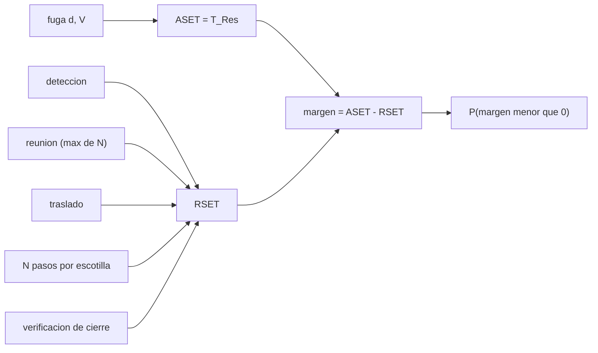

# B110-C03 — Evacuación y refugio de emergencia

<!-- nav:top -->
[🏠 Programa](../../../../README.md) · [📚 Bloque B110](../../../tronco-comun/B110-emergencias-y-seguridad-de-tripulacion.md) · [← Anterior: B110-C02 — Protocolos operativos de aislamiento de un tripulante enfermo o contaminado](../B110-C02-protocolos-operativos-de-aislamiento-de-un-tripulante-enfermo-o-contaminado/CLASE.md) · [Siguiente: B110-C04 — Priorización y decisiones bajo emergencia →](../B110-C04-priorizacion-y-decisiones-bajo-emergencia/CLASE.md)
<!-- /nav -->

## 1. Ubicación, nivel y alcance

Clase 3 del bloque B110. Nivel N3. Evacuar o refugiarse es una carrera entre dos relojes: el tiempo que el peligro deja (**ASET**, tiempo disponible) y el que la tripulación necesita para estar a salvo (**RSET**, tiempo necesario). Aquí los calculas para una fuga de aire, los comparas con un margen y su incertidumbre, ves cómo el tamaño de la tripulación y los cuellos de botella (la escotilla) alargan el segundo y compruebas por qué no se debe cerrar el paso hacia el vehículo de retorno. Usa la reserva de tiempo de [B110-C01](../B110-C01-despresurizacion-deteccion-aislamiento-y-respuesta/CLASE.md) para el primer reloj. Los tiempos y la nave son sintéticos y no describen ninguna nave real ni ningún entrenamiento.

**Contenido educativo: no es un procedimiento de evacuación ni consejo operativo.**

## 2. Por qué esta clase existe

Ninguna clase anterior trata evacuación, refugio y vehículos de escape. La decisión central: **¿alcanza el margen entre ASET y RSET, y cuánto de ese margen depende de supuestos que no se conocen?**

## 3. Lo que podrás hacer al terminar

1. Definir ASET, RSET y margen de evacuación.
2. Calcular el ASET de una fuga con el modelo de C01.
3. Sumar las fases del RSET y ver el efecto de la tripulación y de la escotilla como cuello de botella.
4. Estimar la probabilidad de margen negativo con Monte Carlo y una semilla fija.
5. Calcular en cuánto tiempo una escotilla cerrada bajo fuga deja de poder reabrirse.
6. Separar lo consultado (principios de refugio y camino libre) de lo ilustrativo (todos los tiempos).

La evidencia es la **ficha de margen de evacuación** del ejercicio 12 (sección 20).

## 4. Con qué llegas y cómo comprobarlo

1. ¿Qué es una distribución lognormal?
2. ¿Qué es una mediana y un percentil?
3. ¿Qué es la fuerza sobre una superficie en función de la presión?
4. ¿Qué es un dato sintético?
5. ¿Qué es una verificación por segunda vía?

<details>
<summary>Ver respuestas</summary>

1. Una distribución cuyo logaritmo es normal; modela tiempos positivos con cola larga. 2. La mediana es el valor que deja la mitad de los datos por debajo; el percentil 95 deja el 95 %. 3. `F = ΔP · A`. 4. Un dato generado para el ejemplo, no medido. 5. Calcular lo mismo con otro método y comparar.
</details>

Con cuatro o cinco aciertos, sigue; si no, repasa los prerrequisitos.

## 5. Un caso de contexto y casos de referencia

Una cabina de 100 m³ con un orificio de 20 mm da un ASET de `14,55 min`. Una tripulación de 4 necesita un RSET mediano de `6,90 min` (`[5,54; 8,81]`) y el margen mediano es de `7,64 min`. Con un orificio de 30 mm el ASET cae a `6,47 min` y la probabilidad de margen negativo sube a `0,684`. Es el **ejemplo conductor** y es **ilustrativo**. Referencia consultada: la ponencia de la NASA indica que en la ISS se mantiene siempre un camino libre de cada tripulante a su vehículo de retorno, que cualquier módulo puede ser refugio si da acceso libre a ese vehículo y aire respirable, y que en una nave de un solo volumen como Orion no hay vehículo de escape aparte.

## 6. Vocabulario

El **ASET** (*available safe egress time*) es el tiempo disponible antes de que el peligro impida la salida; aquí se toma igual a `T_Res`. El **RSET** (*required safe egress time*) es el tiempo necesario: detección, reunión, traslado, paso por escotilla y verificación. El **margen** es `ASET − RSET`. El **refugio** es un volumen con aire respirable y acceso libre al vehículo de retorno. El **cuello de botella** es la etapa que fuerza a pasar de a uno.

## 7. Modelo mental: una carrera de dos relojes



*Descripción textual:* el tamaño de la fuga fija el primer reloj; las fases de la salida suman el segundo; su diferencia es el margen y la simulación da la probabilidad de que sea negativo.

Analogía: una carrera contra una vela que se consume mientras se llena una fila de personas por una puerta. Límite: se suponen fases independientes con tiempos lognormales; una escotilla atascada, una persona herida o una ruta bloqueada son sucesos que el modelo no contiene.

## 8. La explicación, paso a paso

### 8.1 El primer reloj

`ASET = τ ln(P₀/P_min)` con `τ ∝ V/d²` (clase C01). Para 100 m³: `58,19 min` (10 mm), `14,55 min` (20 mm), `6,47 min` (30 mm) y `3,64 min` (40 mm).

### 8.2 El segundo reloj

Fases (medianas y GSD **ilustrativas**): detección `20 s` (1,5), reunión `60 s` (1,5) por persona y se toma el máximo de las `N`, traslado `90 s` (1,3), paso por la escotilla `20 s` (1,3) por persona y en serie, y verificación del cierre `120 s` (1,4). Con `N = 4` y sin varianza, `RSET = 20 + 60 + 90 + 4 × 20 + 120 = 370 s`; el laboratorio lo reproduce de forma exacta.

### 8.3 Margen y probabilidad

Con 20 000 corridas (semilla 110):

| `d` (mm) | `N` | RSET mediano (min) | margen mediano (min) | `P(margen < 0)` |
|---|---|---|---|---|
| 10 | 2 | 5,96 | 52,23 | 0,0000 |
| 20 | 2 | 5,96 | 8,59 | 0,0000 |
| 20 | 4 | 6,90 | 7,64 | 0,0000 |
| 20 | 6 | 7,74 | 6,81 | 0,0000 |
| 30 | 2 | 5,96 | 0,51 | 0,3041 |
| 30 | 4 | 6,90 | −0,44 | 0,6841 |
| 30 | 6 | 7,74 | −1,27 | 0,9319 |
| 40 | 2 | 5,96 | −2,32 | 0,9996 |

Pasar de 2 a 6 personas añade `1,78 min` al RSET mediano por el cuello de botella de la escotilla y por el máximo de las reuniones. La probabilidad cambia de forma abrupta cerca de `d = 30 mm`: cuando el margen mediano se acerca a cero, la cola del RSET decide.

### 8.4 Camino libre

Una escotilla de 0,8 m de diámetro tiene `0,503 m²`. Con una fuerza máxima **ilustrativa** de 500 N, la diferencia de presión máxima que permite reabrirla es `995 Pa = 7,5 mmHg`. Si se cierra con una fuga de 10 mm en el volumen del lado que pierde, esa diferencia se supera en `79,3 s` (100 m³), `23,8 s` (30 m³) o `7,9 s` (10 m³). La ponencia consultada da como razones para no cerrar una escotilla hacia el vehículo de retorno que la diferencia de presión puede impedir reabrirla y que el mecanismo puede fallar cerrado; el número de 500 N no se consultó.

### 8.5 Qué no capta el modelo

Fases correlacionadas, personas heridas, rutas bloqueadas, fallas de equipo y estrés. Un margen positivo en este modelo no es una garantía.

## 9. Magnitudes, símbolos y unidades

| Símbolo | Qué es | Unidad | Valor / nota |
|---|---|---|---|
| `ASET` | tiempo disponible | min | 14,55 (20 mm) |
| `RSET` | tiempo necesario | min | 6,90 mediano (N = 4) |
| `N` | personas | — | 2, 4, 6 |
| `d` | diámetro del orificio | mm | 10 a 40 |
| `A` | área de la escotilla | m² | 0,503 |
| `ΔP` | diferencia de presión | Pa | 995 máximo reabrible (ilustrativo) |
| `P(margen < 0)` | probabilidad de margen negativo | — | 0 a 1 |

## 10. Convenciones y referencias

Tiempos en segundos o minutos; presiones en pascales y mmHg (1 mmHg = 101 325/760 Pa). Sistema de referencia: línea de tiempo desde el instante de la fuga (`t = 0`); sin geometría espacial. Cabina isoterma de 100 m³ a 101 kPa, gas ideal, `C_d = 0,8`, fases independientes y lognormales. Python 3.12.9, biblioteca estándar, semilla 110, 20 000 corridas por caso. Tolerancia: Monte Carlo sin varianza igual a la fórmula con `10⁻⁹`.

## 11. De dónde sale lo que afirmamos

| ID | Fuente | Localizador | Respalda | Estado |
|---|---|---|---|---|
| S1 | Tobias, B. y McMillan, C., SpaceOps 2023 (NASA JSC) — https://ntrs.nasa.gov/citations/20220019247 (consultada 2026-11-10) | texto completo leído (PyMuPDF), secciones 2.1, 3.1.3, 3.1.5 y 4.1 | camino libre al vehículo de retorno; concepto de refugio; 490 mmHg; regla de 10 min; no cerrar escotilla (ΔP y fallo cerrada); Orion de un solo volumen | Consultada |
| S2 | Modelo ASET/RSET | — | concepto de comparar tiempo disponible y necesario | No consultada en una fuente concreta |
| — | Tiempos de fase, fuerza de 500 N, tamaño de tripulación | — | ilustrativos | No consultados |

Límites: no se consultó ningún procedimiento ni tiempo de entrenamiento de una agencia; los procedimientos vigentes no se consultaron.

## 12. Cómo ver el margen

| Magnitud | Valor |
|---|---|
| ASET (20 mm) | 14,55 min |
| RSET mediano (N = 4) | 6,90 min |
| `P(margen < 0)` (30 mm, N = 4) | 0,684 |
| ΔP reabrible | 995 Pa |
| tiempo hasta atasco (30 m³) | 23,8 s |

Descripción larga: con un orificio pequeño el margen es amplio; hacia 30 mm se acerca a cero y la probabilidad de fallar pasa de nula a muy alta en pocos milímetros; cerrar una escotilla con fuga la deja inabrible en segundos.

## 13. Ejemplo trabajado: orificio de 20 mm, cuatro personas

**Paso 1 · ASET.** `58,19 × (10/20)² = 14,55 min`.

**Paso 2 · RSET determinista.** `20 + 60 + 90 + 4 × 20 + 120 = 370 s = 6,17 min`.

**Paso 3 · Margen determinista.** `14,55 − 6,17 = 8,38 min`.

**Paso 4 · Margen simulado.** La mediana es `7,64 min` porque el máximo de las reuniones y las colas lognormales alargan el RSET (`6,90 min`).

## 14. Distintas formas de describir un margen

**Absoluto:** `ASET − RSET` en minutos. **Relativo:** `RSET/ASET`. **Probabilístico:** `P(margen < 0)`. **Por cuello de botella:** el paso en serie por la escotilla.

## 15. Práctica guiada

**Ejercicio 1 · con los pasos indicados.** RSET determinista con `N = 4`. *Pasos:* suma detección, reunión, traslado, `N` pasos y verificación.

<details><summary>Solución comentada</summary>

`20 + 60 + 90 + 80 + 120 = 370 s = 6,17 min`.
</details>

**Ejercicio 2 · con una pista.** ASET para un orificio de 20 mm. *Pista:* `ASET ∝ 1/d²` y `58,19 min` corresponde a 10 mm.

<details><summary>Solución comentada</summary>

`58,19 × 0,25 = 14,55 min`.
</details>

**Ejercicio 3 · casi autónomo.** ¿Por qué el margen simulado (7,64 min) es menor que el determinista (8,38 min)?

<details><summary>Solución comentada</summary>

Porque la mediana de un máximo de lognormales y la suma con colas largas superan la suma de medianas.
</details>

## 16. Práctica autónoma, transferencia e integrador

**Ejercicio 4 · autónomo.** ASET para 30 mm.

<details><summary>Solución comentada</summary>

`58,19/9 = 6,47 min`.
</details>

**Ejercicio 5 · autónomo.** ¿Cuánto crece el RSET mediano al pasar de 2 a 6 personas?

<details><summary>Solución comentada</summary>

`7,74 − 5,96 = 1,78 min`.
</details>

**Ejercicio 6 · autónomo.** ¿Qué diámetro anula el margen determinista de `N = 4` (RSET 370 s)?

<details><summary>Solución comentada</summary>

`ASET = 6,17 min` → `d = 10 √(58,19/6,17) = 30,7 mm`.
</details>

**Ejercicio 7 · autónomo.** Convierte 995 Pa a mmHg.

<details><summary>Solución comentada</summary>

`995/133,322 = 7,46 mmHg`.
</details>

**Ejercicio 8 · autónomo.** ¿Qué lado de la ley `t ∝ V` explica que 10 m³ se atasque 10 veces antes que 100 m³?

<details><summary>Solución comentada</summary>

`τ ∝ V`: `79,3/10 = 7,9 s`.
</details>

**Ejercicio 9 · transferencia.** **Transferencia.** Con 20 mm y `N = 6`, `P(margen < 0) = 0,0000` pero el margen mediano es 6,8 min. ¿Es seguro?

<details><summary>Solución comentada</summary>

No se puede afirmar: la probabilidad es condicional al modelo, que no incluye atascos, heridos ni rutas bloqueadas, y los tiempos son ilustrativos.
</details>

**Ejercicio 10 · transferencia.** **Transferencia.** ¿Por qué una nave de un solo volumen no puede aplicar el concepto de refugio de la ISS?

<details><summary>Solución comentada</summary>

No tiene un volumen separado al que retirarse; la ponencia consultada indica que la respuesta se basa en otros medios (traje y retorno).
</details>

**Ejercicio 11 · transferencia.** **Transferencia.** Un módulo ¿es refugio solo por estar cerrado?

<details><summary>Solución comentada</summary>

No: según la fuente consultada debe dar acceso libre al vehículo de retorno y aire respirable.
</details>

**Ejercicio 12 · integrador.** **Integrador.** Elabora tu *ficha de margen de evacuación*: ASET por diámetro, RSET por tamaño de tripulación, tabla de `P(margen < 0)`, tiempo hasta atasco de la escotilla y lista de qué es consultado e ilustrativo.

<details><summary>Solución comentada</summary>

Secciones 8.1–8.5 y la salida del laboratorio.
</details>

## 17. Laboratorio: tiempo disponible frente a tiempo necesario

El script [evacuacion.py](evacuacion.py) calcula el ASET de C01, simula el RSET con 20 000 corridas por caso (semilla 110), halla la probabilidad de margen negativo y el tiempo hasta que una escotilla cerrada deja de poder reabrirse (**comprueba** que sin varianza el RSET es la fórmula exacta, que la probabilidad crece con la tripulación y que los extremos son 0 y 1).

**Datos:** 490 mmHg y el principio de camino libre **consultados**; todos los tiempos, la tripulación y los 500 N **ilustrativos**. **Predice antes de ejecutar:** ¿qué orificio hace que el margen mediano sea casi cero con 4 personas? (≈ 30 mm.) **Ejecución del 2026-11-10 (Python 3.12.9):**

```text
Python 3.12.9 (biblioteca estandar)
Cabina ILUSTRATIVA V = 100 m3, P0 = 101 kPa, P_min = 490 mmHg (consultado); tiempos de las fases ILUSTRATIVOS
RSET determinista (n = 4): formula = 370.0 s ; simulacion sin varianza = 370.0 s
ASET por diametro de orificio (T_Res de la clase C01):
  d = 10 mm  ASET =   58.19 min
  d = 20 mm  ASET =   14.55 min
  d = 30 mm  ASET =    6.47 min
  d = 40 mm  ASET =    3.64 min
 d [mm]  n   RSET mediana [min]  [P5; P95]    margen mediano [min]   P(margen < 0)   P(margen < 10 min)
    10   2           5.96  [ 4.63;  7.81]           52.23           0.0000             0.0000
    10   4           6.90  [ 5.54;  8.81]           51.28           0.0000             0.0000
    10   6           7.74  [ 6.36;  9.65]           50.45           0.0000             0.0000
    20   2           5.96  [ 4.63;  7.81]            8.59           0.0000             0.9610
    20   4           6.90  [ 5.54;  8.81]            7.64           0.0000             0.9993
    20   6           7.74  [ 6.36;  9.65]            6.81           0.0000             1.0000
    30   2           5.96  [ 4.63;  7.81]            0.51           0.3041             1.0000
    30   4           6.90  [ 5.54;  8.81]           -0.44           0.6841             1.0000
    30   6           7.74  [ 6.36;  9.65]           -1.27           0.9319             1.0000
    40   2           5.96  [ 4.63;  7.81]           -2.32           0.9996             1.0000
    40   4           6.90  [ 5.54;  8.81]           -3.27           1.0000             1.0000
    40   6           7.74  [ 6.36;  9.65]           -4.10           1.0000             1.0000
Escotilla de 0,8 m: area 0.503 m2; fuerza maxima ILUSTRATIVA 500 N => dP maximo reabrible = 995 Pa = 7.5 mmHg
Tiempo desde el cierre hasta que dP supera ese valor (fuga de 10 mm en el volumen del lado que pierde):
  volumen del lado que pierde =   100 m3 ->   79.3 s
  volumen del lado que pierde =    30 m3 ->   23.8 s
  volumen del lado que pierde =    10 m3 ->    7.9 s
Pruebas superadas.
```

```bash
python programa/clases/B110/B110-C03-evacuacion-y-refugio-de-emergencia/evacuacion.py
```

**Límites:** fases independientes, ASET igual a `T_Res` (sin hipoxia ni temperatura), sin fallas de equipo; la última columna `P(margen < 10 min)` es solo un indicador de holgura y no una norma.

## 18. Errores frecuentes y cómo corregirlos

**Tomar el RSET como un número único.** Es una distribución con cola larga (8.2 y 8.3).

**Creer que más gente solo suma un paso.** Suma pasos en serie y alarga el máximo de las reuniones.

**Cerrar una escotilla «para aislar» sin pensar en reabrirla.** Ver 8.4.

**Usar esta clase como procedimiento de evacuación.** No lo es (sección 21).

## 19. Cómo sabrás que vas bien

Tras la sección 8: ¿qué ASET esperabas para 20 mm y cuál obtuviste? Si dudas, repasa el ejemplo 13. Tras el laboratorio: ¿qué comprueba? (ver la sección 17).

## 20. Qué entregas y cómo se evalúa

El producto es tu **ficha de margen de evacuación** (ejercicio 12).

| Criterio | Inicial | En desarrollo | Logrado | Destacado |
|---|---|---|---|---|
| Conceptos | Los confunde | Parciales | Distingue ASET, RSET y margen | Explica los límites del modelo |
| Cálculo | Sin unidades | Con errores | Tablas completas con unidades | Calcula casos nuevos |
| Numérico | Sin comprobar | Un caso | Verifica la fórmula determinista | Interpreta la cola de la distribución |
| Fuentes | Sin fuente | Sin fecha | Fuentes con fecha y estado | Declara lo ilustrativo y lo no consultado |
| Límites | No los nombra | Uno | Tres | Discute qué falta del modelo |

**Condiciones críticas (no se compensan con promedio):** rotular todos los tiempos como ilustrativos; no presentar un margen positivo como garantía; no presentar la clase como procedimiento; citar solo lo consultado.

## 21. Ética, seguridad y límites

Clase educativa: **no es un procedimiento de evacuación, consejo operativo ni médico**, no sustituye la formación, la licencia ni los procedimientos oficiales de un operador y no debe usarse para decidir en una emergencia real. Los modelos son simplificados y sus datos son sintéticos o ilustrativos. Accesibilidad: tablas equivalentes a las gráficas, fórmulas en texto, ejercicios sin conexión.

## 22. Para cerrar y seguir

Con un orificio de 20 mm el ASET es `14,55 min` y el RSET mediano `6,90 min`; con 30 mm el margen desaparece. Una escotilla cerrada bajo fuga se atasca en segundos. Queda una pregunta: cuando varias cosas fallan a la vez, ¿qué se atiende primero?

**Glosario español–inglés.** tiempo disponible · *available safe egress time (ASET)*; tiempo necesario · *required safe egress time (RSET)*; refugio · *safe haven*; vehículo de retorno · *return vehicle*; cuello de botella · *bottleneck*.

**Continuidad.** [B110-C04](../B110-C04-priorizacion-y-decisiones-bajo-emergencia/CLASE.md) trata la priorización y las decisiones bajo emergencia.

**Referencias:** ver sección 11.

<!-- nav:bottom -->
---

[← Anterior: B110-C02 — Protocolos operativos de aislamiento de un tripulante enfermo o contaminado](../B110-C02-protocolos-operativos-de-aislamiento-de-un-tripulante-enfermo-o-contaminado/CLASE.md) · [📚 Bloque B110](../../../tronco-comun/B110-emergencias-y-seguridad-de-tripulacion.md) · [Siguiente: B110-C04 — Priorización y decisiones bajo emergencia →](../B110-C04-priorizacion-y-decisiones-bajo-emergencia/CLASE.md)
<!-- /nav -->
