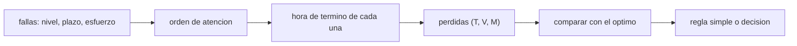

# B110-C04 — Priorización y decisiones bajo emergencia

<!-- nav:top -->
[🏠 Programa](../../../../README.md) · [📚 Bloque B110](../../../tronco-comun/B110-emergencias-y-seguridad-de-tripulacion.md)
<!-- /nav -->

## 1. Ubicación, nivel y alcance

Clase 4 del bloque B110. Nivel N3. Cuando fallan varias cosas a la vez y hay un solo equipo para atenderlas, el orden de atención decide qué se pierde. Aquí formalizas la regla de prioridad (tripulación, vehículo, misión) como pérdida lexicográfica, calculas el orden óptimo por fuerza bruta y por programación dinámica, y mides cuánto pierde una regla simple frente a ese óptimo. Se apoya en [B104](../../../tronco-comun/B104-astronautica-y-preparacion-de-astronautas.md) (procedimientos de emergencia) y en los plazos de [B110-C01](../B110-C01-despresurizacion-deteccion-aislamiento-y-respuesta/CLASE.md) y [B110-C03](../B110-C03-evacuacion-y-refugio-de-emergencia/CLASE.md). Las fallas, plazos y esfuerzos son sintéticos y no describen ninguna nave real.

**Contenido educativo: no es una guía de decisión para una emergencia real.**

## 2. Por qué esta clase existe

B104 enseña los procedimientos; falta cómo se ordenan cuando coinciden. La decisión central: **¿qué se atiende primero y cuánto cuesta equivocarse de orden?**

## 3. Lo que podrás hacer al terminar

1. Enunciar el orden de prioridad (tripulación, vehículo, misión) y la idea de que se pueden sacrificar sistemas para proteger a la tripulación.
2. Modelar cada falla con nivel, plazo y esfuerzo.
3. Calcular las pérdidas lexicográficas de un orden de atención.
4. Hallar el orden óptimo por dos vías (fuerza bruta y programación dinámica).
5. Comparar reglas simples (llegada, severidad, plazo más cercano, nivel y plazo) con el óptimo.
6. Medir la sensibilidad a un error en los plazos y separar lo consultado de lo ilustrativo.

La evidencia es la **ficha de priorización de un caso con tres fallas** (o más) del ejercicio 12 (sección 20).

## 4. Con qué llegas y cómo comprobarlo

1. ¿Qué es una permutación y cuántas hay de `n` elementos?
2. ¿Qué es un orden lexicográfico?
3. ¿Qué es un plazo frente a un esfuerzo?
4. ¿Qué es un dato sintético?
5. ¿Qué es una verificación por segunda vía?

<details>
<summary>Ver respuestas</summary>

1. Un orden de los elementos; hay `n!`. 2. Se compara primero el primer componente y solo se desempata con el siguiente: `(0, 5, 9) < (1, 0, 0)`. 3. El plazo es cuándo ocurre la consecuencia si no se atiende; el esfuerzo es cuánto trabajo exige atenderla. 4. Un dato generado para el ejemplo, no medido. 5. Calcular lo mismo con otro método y comparar.
</details>

Con cuatro o cinco aciertos, sigue; si no, repasa los prerrequisitos.

## 5. Un caso de contexto y casos de referencia

Seis fallas simultáneas **sintéticas**: humo en un rack (tripulación, plazo 15 min, esfuerzo 10), fuga lenta de aire (tripulación, 55 min, 20), filtro de CO₂ fuera de servicio (tripulación, 120 min, 35), radiador (vehículo, 90 min, 30), comunicaciones (misión, 240 min, 25) y un experimento detenido (misión, 600 min, 15). Hay un orden que no pierde nada, pero con holgura cero en dos casos; atender por orden de llegada pierde dos fallas de tripulación. Referencia consultada: la ponencia de la NASA establece la prioridad crew–vehículo–misión y que las respuestas de emergencia admiten perder sistemas, funciones o incluso volúmenes para mantener a la tripulación a salvo.

## 6. Vocabulario

El **plazo** es el tiempo hasta que la consecuencia ocurre si no se atiende. El **esfuerzo** es el trabajo de atenderla. Una falla se **consume** si se termina después de su plazo. La **pérdida lexicográfica** es la tupla (consumidas de tripulación, de vehículo, de misión). La **holgura** es `plazo − hora de término`. **EDF** es la regla del plazo más cercano.

## 7. Modelo mental: una sola fila de trabajo con relojes



*Descripción textual:* de las fallas y un orden salen las horas de término; contra los plazos dan las pérdidas, que se comparan con las del orden óptimo.

Analogía: un solo cajero con clientes que tienen distinta urgencia y cada uno se va si espera demasiado. Límite: un solo equipo, esfuerzos fijos y conocidos, sin fallas que cambien los plazos de otras; en la realidad hay varias personas, incertidumbre y cascadas.

## 8. La explicación, paso a paso

### 8.1 Pérdidas de un orden

Para el orden `(F2, F4, F5, F1, F3, F6)` se acumulan los esfuerzos y se compara con el plazo: F2 termina a `10 ≤ 15`, F4 a `30 ≤ 55`, F5 a `65 ≤ 120`, F1 a `95 > 90` (se consume una de vehículo), F3 a `120`, F6 a `135`. Pérdidas `(0, 1, 0)`.

### 8.2 El orden óptimo

Hay 720 órdenes de 6 fallas. El mejor es `(0, 0, 0)` y lo cumplen 8; uno es `(F2, F3, F4, F1, F5, F6)`: términos a `10, 35, 55, 85, 120, 135`, de modo que F4 (plazo 55) y F5 (plazo 120) terminan **justo en el plazo** (holgura cero). La programación dinámica sobre subconjuntos da la misma pérdida, `(0, 0, 0)`.

### 8.3 Reglas simples en el caso

| Regla | Orden (índices) | Pérdidas `(T, V, M)` |
|---|---|---|
| llegada (FIFO) | 0, 1, 2, 3, 4, 5 | (2, 0, 0) |
| severidad (nivel y llegada) | 1, 3, 4, 0, 2, 5 | (0, 1, 0) |
| plazo más cercano (EDF) | 1, 3, 0, 4, 2, 5 | (0, 0, 0) |
| nivel y plazo | 1, 3, 4, 0, 2, 5 | (0, 1, 0) |

En este caso EDF encuentra el óptimo; la regla «tripulación primero» sacrifica una falla de vehículo para proteger a la tripulación con más holgura de la necesaria, lo que es coherente con la prioridad consultada pero no es lo mejor posible.

### 8.4 Qué pasa en promedio

Con 3000 escenarios aleatorios de 6 fallas (semilla 110), las pérdidas de tripulación del óptimo suman `1387`:

| Regla | Óptima en | Pérdidas T extra | Escenarios con T peor |
|---|---|---|---|
| FIFO | 7,2 % | 2370 | 1831 |
| severidad | 10,2 % | 968 | 834 |
| EDF | 24,9 % | 2332 | 1625 |
| nivel y plazo | 15,7 % | 681 | 503 |

EDF es la que más veces acierta el óptimo completo, pero ignora el nivel y pierde mucha tripulación; «nivel y plazo» es la mejor para proteger a la tripulación y aun así queda a `681` pérdidas del óptimo.

### 8.5 Sensibilidad a los plazos

Si los plazos reales fueran un `30 %` menores, el orden «nivel y plazo» pierde `(0, 1, 0)` y el óptimo con esos plazos también pierde `(0, 1, 0)`: aquí el error no empeora el resultado, pero en otro caso podría. Hay que revisar la holgura y no solo el orden.

## 9. Magnitudes, símbolos y unidades

| Símbolo | Qué es | Unidad | Valor / nota |
|---|---|---|---|
| `nivel` | T, V o M | — | prioridad 1, 2, 3 (consultada) |
| `d_i` | plazo | min | 15 a 600 (ilustrativos) |
| `e_i` | esfuerzo | min | 10 a 35 (ilustrativos) |
| `C_i` | hora de término | min | acumulada |
| `L` | pérdidas | tupla | `(0, 0, 0)` el óptimo |
| holgura | `d_i − C_i` | min | 0 en F4 y F5 |

## 10. Convenciones y referencias

Tiempos en minutos desde el instante en que coinciden las fallas (`t = 0`); un solo equipo de respuesta; sin sistema de coordenadas espacial. Una falla atendida después de su plazo se consume; no hay pérdida parcial. Pérdida lexicográfica. Python 3.12.9, biblioteca estándar, semilla 110. Tolerancia: el óptimo por fuerza bruta y por programación dinámica deben coincidir exactamente.

## 11. De dónde sale lo que afirmamos

| ID | Fuente | Localizador | Respalda | Estado |
|---|---|---|---|---|
| S1 | Tobias, B. y McMillan, C., SpaceOps 2023 (NASA JSC) — https://ntrs.nasa.gov/citations/20220019247 (consultada 2026-11-10) | texto completo leído (PyMuPDF), secciones 1, 2 y 2.2 | prioridad crew–vehículo–misión; pérdida admisible de sistemas y volúmenes; la tripulación lidera sin depender del control de misión | Consultada |
| S2 | Programación de tareas con plazos (EDF) y programación dinámica sobre subconjuntos | — | las verifica el laboratorio con una segunda vía | No consultada en una fuente concreta |
| — | Fallas, plazos, esfuerzos y escenarios aleatorios | — | ilustrativos | No consultados |

Límites: no se consultó ninguna regla de vuelo ni lista de fallas de una nave; los procedimientos vigentes no se consultaron.

## 12. Cómo ver la priorización

| Magnitud | Valor |
|---|---|
| pérdidas del óptimo (caso) | (0, 0, 0) |
| pérdidas FIFO (caso) | (2, 0, 0) |
| órdenes óptimos de 720 | 8 |
| óptima en 3000 escenarios (EDF) | 24,9 % |
| pérdidas T extra (nivel y plazo) | 681 |

Descripción larga: ordenar por llegada es lo peor para la tripulación; ordenar por nivel y plazo la protege mejor, y ninguna regla simple alcanza siempre el óptimo.

## 13. Ejemplo trabajado: atender por orden de llegada

**Paso 1 · Términos.** Esfuerzos acumulados `30, 40, 65, 85, 120, 135 min`.

**Paso 2 · Comparación.** F2 (plazo 15) termina a 40 → consumida; F4 (plazo 55) termina a 85 → consumida.

**Paso 3 · Pérdidas.** `(2, 0, 0)`.

**Paso 4 · Lectura.** Atender primero el radiador (esfuerzo 30) antes que el humo costó dos fallas de tripulación.

## 14. Distintas formas de describir una decisión

**Por orden:** una permutación. **Por pérdidas:** la tupla `(T, V, M)`. **Por holgura:** minutos de sobra por falla. **Por regla:** FIFO, severidad, EDF o nivel y plazo.

## 15. Práctica guiada

**Ejercicio 1 · con los pasos indicados.** Pérdidas del orden `(F2, F4, F5, F1, F3, F6)`. *Pasos:* acumula esfuerzos y compara con cada plazo.

<details><summary>Solución comentada</summary>

Términos `10, 30, 65, 95, 120, 135`; solo F1 (95 > 90) se consume: `(0, 1, 0)`.
</details>

**Ejercicio 2 · con una pista.** Pérdidas de FIFO. *Pista:* términos `30, 40, 65, 85, 120, 135`.

<details><summary>Solución comentada</summary>

F2 (40 > 15) y F4 (85 > 55) se consumen: `(2, 0, 0)`.
</details>

**Ejercicio 3 · casi autónomo.** ¿Qué fallas tienen holgura cero en el orden óptimo `(F2, F3, F4, F1, F5, F6)`?

<details><summary>Solución comentada</summary>

F4 termina a 55 con plazo 55 y F5 a 120 con plazo 120.
</details>

## 16. Práctica autónoma, transferencia e integrador

**Ejercicio 4 · autónomo.** Suma de esfuerzos del caso.

<details><summary>Solución comentada</summary>

`30 + 10 + 25 + 20 + 35 + 15 = 135 min`.
</details>

**Ejercicio 5 · autónomo.** Si el esfuerzo de F2 fuera 16 min (plazo 15), ¿qué puede pasar?

<details><summary>Solución comentada</summary>

Ningún orden la salva (16 > 15): hay al menos una pérdida de tripulación inevitable; el modelo sirve para detectarlo.
</details>

**Ejercicio 6 · autónomo.** Orden EDF del caso y sus pérdidas.

<details><summary>Solución comentada</summary>

`(F2, F4, F1, F5, F3, F6)`: términos `10, 30, 60, 95, 120, 135`; `(0, 0, 0)`.
</details>

**Ejercicio 7 · autónomo.** ¿Cuánto más pierde «nivel y plazo» que el óptimo en tripulación, en proporción?

<details><summary>Solución comentada</summary>

`681/1387 = 0,49`: un 49 % más que el óptimo.
</details>

**Ejercicio 8 · autónomo.** ¿Cuántos órdenes distintos hay para 7 fallas?

<details><summary>Solución comentada</summary>

`7! = 5040`.
</details>

**Ejercicio 9 · transferencia.** **Transferencia.** «Nivel y plazo» pierde una falla de vehículo que el óptimo no pierde. ¿Contradice la prioridad consultada?

<details><summary>Solución comentada</summary>

No: la fuente consultada pone la tripulación primero y admite perder sistemas; el modelo muestra que, además, una regla de nivel estricto puede perder más de lo necesario.
</details>

**Ejercicio 10 · transferencia.** **Transferencia.** Si los plazos reales son un 30 % menores, ¿qué revisarías?

<details><summary>Solución comentada</summary>

La holgura de cada falla y no solo el orden: en el orden óptimo del caso F4 y F5 tienen holgura cero, de modo que con plazos menores se consumirían: el resultado cambia de forma abrupta.
</details>

**Ejercicio 11 · transferencia.** **Transferencia.** ¿Qué omite el modelo que importa en una emergencia real?

<details><summary>Solución comentada</summary>

Varios respondedores en paralelo, plazos inciertos, fallas que cambian los plazos de otras, tareas que se hacen a medias y el criterio de la tripulación, que según la fuente lidera la respuesta.
</details>

**Ejercicio 12 · integrador.** **Integrador.** Elabora tu *ficha de priorización de un caso con tres fallas* (o más): tabla del caso, órdenes comparados, pérdidas, holguras, sensibilidad a los plazos y lista de qué es consultado e ilustrativo.

<details><summary>Solución comentada</summary>

Secciones 8.1–8.5 y la salida del laboratorio.
</details>

## 17. Laboratorio: orden óptimo y reglas simples

El script [priorizacion.py](priorizacion.py) calcula las pérdidas de un orden, el óptimo por fuerza bruta y por programación dinámica, compara cuatro reglas y repite el experimento con 3000 escenarios aleatorios (semilla 110) (**comprueba** que ambas vías del óptimo coinciden y que EDF acierta el óptimo más veces que FIFO).

**Datos:** la prioridad crew–vehículo–misión **consultada**; fallas, plazos, esfuerzos y escenarios **ilustrativos**. **Predice antes de ejecutar:** ¿qué regla simple pierde menos tripulación en promedio? (nivel y plazo.) **Ejecución del 2026-11-10 (Python 3.12.9):**

```text
Python 3.12.9 (biblioteca estandar)
Caso ILUSTRATIVO de 6 fallas simultaneas (nivel T = tripulacion, V = vehiculo, M = mision; plazo y esfuerzo en min):
  0: F1 radiador (lazo termico)             nivel V  plazo   90  esfuerzo  30
  1: F2 humo en un rack                     nivel T  plazo   15  esfuerzo  10
  2: F3 comunicaciones                      nivel M  plazo  240  esfuerzo  25
  3: F4 fuga lenta de aire                  nivel T  plazo   55  esfuerzo  20
  4: F5 filtro de CO2 fuera de servicio     nivel T  plazo  120  esfuerzo  35
  5: F6 experimento detenido                nivel M  plazo  600  esfuerzo  15
Optimo por fuerza bruta (720 ordenes): perdidas (T, V, M) = (0, 0, 0); 8 ordenes optimos; el primero: (1, 2, 3, 0, 4, 5)
Optimo por programacion dinamica: (0, 0, 0) (coincide: True)
Reglas simples sobre el caso:
  FIFO       orden [0, 1, 2, 3, 4, 5]  perdidas (T, V, M) = (2, 0, 0)
  severidad  orden [1, 3, 4, 0, 2, 5]  perdidas (T, V, M) = (0, 1, 0)
  EDF        orden [1, 3, 0, 4, 2, 5]  perdidas (T, V, M) = (0, 0, 0)
  nivel+EDF  orden [1, 3, 4, 0, 2, 5]  perdidas (T, V, M) = (0, 1, 0)
Sensibilidad: orden nivel+EDF con plazos reales 30 % menores: perdidas (0, 1, 0); optimo con esos plazos (0, 1, 0)
Experimento: 3000 escenarios aleatorios de 6 fallas (semilla 110); perdidas T del optimo en total = 1387
  regla       optima en   perdidas T extra (total)   escenarios con perdida T peor que el optimo
  FIFO            7.2 %            2370                        1831
  severidad      10.2 %             968                         834
  EDF            24.9 %            2332                        1625
  nivel+EDF      15.7 %             681                         503
Pruebas superadas.
```

```bash
python programa/clases/B110/B110-C04-priorizacion-y-decisiones-bajo-emergencia/priorizacion.py
```

**Límites:** un solo equipo, esfuerzos y plazos conocidos, pérdida binaria; la coincidencia de las dos vías valida el código, no que el modelo describa una emergencia real.

## 18. Errores frecuentes y cómo corregirlos

**Atender por orden de llegada.** Ver 8.3 y 8.4.

**Fijarse solo en el nivel e ignorar los plazos.** Ver 8.4.

**Confiar en el orden sin mirar la holgura.** Ver 8.5.

**Usar esta clase como guía de decisión.** No lo es (sección 21).

## 19. Cómo sabrás que vas bien

Tras la sección 8: ¿qué pérdidas esperabas para FIFO y cuáles obtuviste? Si dudas, repasa el ejemplo 13. Tras el laboratorio: ¿qué comprueba? (ver la sección 17).

## 20. Qué entregas y cómo se evalúa

El producto es tu **ficha de priorización** (ejercicio 12).

| Criterio | Inicial | En desarrollo | Logrado | Destacado |
|---|---|---|---|---|
| Conceptos | Los confunde | Parciales | Distingue plazo, esfuerzo y pérdida | Explica los límites del modelo |
| Cálculo | Sin unidades | Con errores | Tablas completas con unidades | Calcula casos nuevos |
| Numérico | Sin comprobar | Un caso | Óptimo por dos vías | Interpreta las diferencias entre reglas |
| Fuentes | Sin fuente | Sin fecha | Fuentes con fecha y estado | Declara lo ilustrativo y lo no consultado |
| Límites | No los nombra | Uno | Tres | Discute qué falta del modelo |

**Condiciones críticas (no se compensan con promedio):** rotular fallas, plazos y esfuerzos como ilustrativos; no presentar la clase como guía de decisión real; citar solo lo consultado.

## 21. Ética, seguridad y límites

Clase educativa: **no es consejo operativo ni médico**, no sustituye la formación, la licencia ni las reglas de vuelo de un operador y no debe usarse para decidir en una emergencia real. Los modelos son simplificados y sus datos son sintéticos o ilustrativos. Accesibilidad: tablas equivalentes a las gráficas, fórmulas en texto, ejercicios sin conexión.

## 22. Para cerrar y seguir

En el caso de seis fallas existe un orden sin pérdidas, pero con dos holguras en cero; ordenar por llegada pierde dos fallas de tripulación y ninguna regla simple acierta siempre. Queda una pregunta: ¿cómo se ejecuta cada paso de esos procedimientos sin cometer errores bajo estrés?

**Glosario español–inglés.** plazo · *deadline*; esfuerzo · *effort*; holgura · *slack*; pérdida lexicográfica · *lexicographic loss*; plazo más cercano · *earliest deadline first (EDF)*.

**Continuidad.** [B110-C05](../B110-C05-checklists-de-emergencia-ejecucion-y-verificacion-cruzada/CLASE.md) trata los checklists de emergencia y su verificación cruzada.

**Referencias:** ver sección 11.

<!-- nav:bottom -->
---

[📚 Bloque B110](../../../tronco-comun/B110-emergencias-y-seguridad-de-tripulacion.md)
<!-- /nav -->
