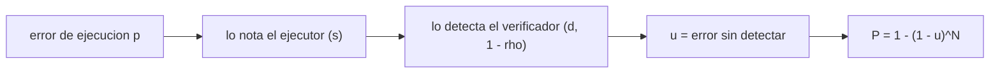

# B110-C05 — Checklists de emergencia: ejecución y verificación cruzada

<!-- nav:top -->
[🏠 Programa](../../../../README.md) · [📚 Bloque B110](../../../tronco-comun/B110-emergencias-y-seguridad-de-tripulacion.md) · [← Anterior: B110-C04 — Priorización y decisiones bajo emergencia](../B110-C04-priorizacion-y-decisiones-bajo-emergencia/CLASE.md) · [Siguiente: B111-C01 — Fundamentos de factores humanos en operaciones espaciales →](../../B111/B111-C01-fundamentos-de-factores-humanos-en-operaciones-espaciales/CLASE.md)
<!-- /nav -->

## 1. Ubicación, nivel y alcance

Clase 5 y última del bloque B110. Nivel N3. Un checklist de emergencia se ejecuta con estrés, poco tiempo y, a veces, sin sistemas de ayuda. Aquí calculas la probabilidad de que un error de ejecución llegue al final sin ser detectado, cuánto la reduce una verificación cruzada, cuánto la limita el pensamiento común de quien ejecuta y de quien verifica, y cuánto tiempo cuesta. Cierra la secuencia de [C01](../B110-C01-despresurizacion-deteccion-aislamiento-y-respuesta/CLASE.md) a [C04](../B110-C04-priorizacion-y-decisiones-bajo-emergencia/CLASE.md): los procedimientos que ellas ordenan se ejecutan paso a paso. El checklist, las probabilidades y los tiempos son sintéticos y no describen ningún checklist real.

**Contenido educativo: no es un procedimiento ni un checklist operativo.**

## 2. Por qué esta clase existe

Los checklists de emergencia se leen y verifican bajo estrés y no tenían clase propia. La decisión central: **¿cuánta verificación cruzada vale su costo en tiempo, y qué la hace menos eficaz de lo que parece?**

## 3. Lo que podrás hacer al terminar

1. Distinguir lectura-hacer, lectura-respuesta y verificación cruzada de pasos críticos.
2. Calcular la probabilidad de un error no detectado por paso y en todo el checklist.
3. Incorporar la correlación de modo común entre ejecutor y verificador.
4. Contrastar la fórmula con una simulación Monte Carlo con semilla fija.
5. Comparar el costo en tiempo con la reducción de probabilidad, incluido el efecto del estrés.
6. Separar lo consultado de lo ilustrativo y no atribuir al modelo la eficacia de checklists reales.

La evidencia es la **ficha de fiabilidad de un checklist** del ejercicio 12 (sección 20).

## 4. Con qué llegas y cómo comprobarlo

1. ¿Qué es una probabilidad de al menos un suceso entre `N` independientes?
2. ¿Qué es la independencia?
3. ¿Qué es una simulación Monte Carlo?
4. ¿Qué es un dato sintético?
5. ¿Qué es una verificación por segunda vía?

<details>
<summary>Ver respuestas</summary>

1. `1 − (1 − u)^N`. 2. Que saber el resultado de uno no cambia la probabilidad del otro. 3. Repetir muchas veces un experimento aleatorio y contar. 4. Un dato generado para el ejemplo, no medido. 5. Calcular lo mismo con otro método y comparar.
</details>

Con cuatro o cinco aciertos, sigue; si no, repasa los prerrequisitos.

## 5. Un caso de contexto y casos de referencia

Un checklist **sintético** de 20 pasos (5 críticos) con probabilidad de error de ejecución de `0,01` por paso. Sin verificación, la probabilidad de que algún error pase sin detectar es `0,131` y toma `120 s`; con respuesta verificada en todos los pasos baja a `0,074` y toma `240 s`; si ejecutor y verificador comparten del todo sus errores, la verificación casi no ayuda. Es el **ejemplo conductor** y es **ilustrativo**. Referencias consultadas: la ponencia de la NASA señala que las acciones iniciales de emergencia se memorizan y que la tripulación debe poder trabajar con procedimientos impresos y revisando posiciones físicas de válvulas; la nota de prensa de Harvard sobre el estudio de Haynes y colaboradores (2009) informa un descenso de las muertes hospitalarias de 1,5 % a 0,8 % tras introducir un checklist quirúrgico, en un estudio no aleatorizado. Ese dato es de otro dominio y **no se usa en el cálculo**.

## 6. Vocabulario

**Lectura-hacer** (*read-do*): se lee un paso y se ejecuta. **Lectura-respuesta** (*challenge-response*): uno lee, el otro responde tras comprobar. **Verificación cruzada**: una segunda persona comprueba el estado. Un **paso crítico** es aquel cuyo error tiene consecuencia grave. El **modo común** `ρ` es la fracción de errores que comparten ejecutor y verificador. El **error no detectado** por paso es `u = p (1 − s)(1 − d(1 − ρ))`.

## 7. Modelo mental: capas de un filtro con un agujero común



*Descripción textual:* un error ocurre con probabilidad `p`, puede ser notado por quien ejecuta (`s`) y luego por el verificador (`d`, reducido por el modo común `ρ`); lo que sobrevive es `u` y se acumula sobre `N` pasos.

Analogía: dos coladores en serie con un mismo hueco; si el hueco es común, el segundo no atrapa lo que ya pasó por el primero. Límite: errores independientes entre pasos, probabilidades constantes, sin errores de la propia verificación ni cambio de los tiempos con el estrés.

## 8. La explicación, paso a paso

### 8.1 Un paso

`u = p (1 − s)(1 − d (1 − ρ))`. Sin verificador (`d = 0`) y con `p = 0,01`, `s = 0,3`: `u = 0,007`. Con verificador (`d = 0,9`, `ρ = 0,5`): `u = 0,007 × 0,55 = 0,00385`.

### 8.2 Todo el checklist

`P = 1 − (1 − u)^N`. Con `N = 20`: `0,13107` sin verificar y `0,07425` con verificación. Para `u` pequeña, `P ≈ N u` (`0,077` frente a `0,0743`).

### 8.3 Verificación con la simulación

Con 200 000 corridas y semilla 110: sin verificador `0,13181` (analítico `0,13107`, `0,97` desviaciones) y con verificador `0,07360` (analítico `0,07425`, `1,10` desviaciones). La simulación valida el código de la fórmula, no el modelo.

### 8.4 Tres modalidades

| Modalidad | `u` por paso | `P` (error sin detectar) | Tiempo |
|---|---|---|---|
| A · lectura-hacer, sin verificar | 0,00700 | 0,13107 | 120 s |
| B · respuesta verificada en todos | 0,00385 | 0,07425 | 240 s |
| C · verificar solo los 5 críticos | 0,00385 / 0,00700 | 0,11720 (en críticos: 0,01910) | 150 s |

Verificar solo los críticos cuesta `30 s` más y baja a `0,019` el riesgo en esos pasos, pero deja el de los demás.

### 8.5 El modo común

Modalidad B con distintos `ρ`: `0,0139` (0,0), `0,0385` (0,2), `0,0743` (0,5) y `0,1088` (0,8). Una verificación realizada por quien comparte el mismo error vale mucho menos que una independiente; con `ρ = 0` se reduce el riesgo en un factor 9,4 frente a A, con `ρ = 0,5` en `1,77`.

### 8.6 Estrés y costo

Con `p` triplicada (`0,03`) y `ρ = 0,5`: `0,346` sin verificar y `0,207` con verificación; el riesgo no se triplica porque satura. Pasar de A a B ahorra probabilidad (`0,1311 → 0,0742`) a cambio de `120 s` extra: `2112 s` por cada unidad de probabilidad evitada. Si esos 120 s caben en el margen de tiempo de [C03](../B110-C03-evacuacion-y-refugio-de-emergencia/CLASE.md) lo decide el procedimiento oficial, no este modelo.

## 9. Magnitudes, símbolos y unidades

| Símbolo | Qué es | Unidad | Valor / nota |
|---|---|---|---|
| `N` | pasos del checklist | — | 20 (5 críticos) |
| `p` | error de ejecución por paso | — | 0,01; 0,03 con estrés |
| `s` | el ejecutor lo nota | — | 0,3 |
| `d` | el verificador lo detecta | — | 0,9 |
| `ρ` | modo común | — | 0 a 0,8 |
| `u` | error sin detectar por paso | — | 0,00385 |
| `P` | al menos un error sin detectar | — | 0,074 |
| `t` | tiempo | s | 120 a 240 |

## 10. Convenciones y referencias

Probabilidades adimensionales; tiempos en segundos. Sistema de referencia: la secuencia de pasos del checklist, sin coordenadas espaciales. Pasos independientes, probabilidades constantes, un ejecutor y un verificador. Python 3.12.9, biblioteca estándar, semilla 110, 200 000 corridas. Tolerancia: analítico frente a Monte Carlo dentro de 4 desviaciones estándar binomiales.

## 11. De dónde sale lo que afirmamos

| ID | Fuente | Localizador | Respalda | Estado |
|---|---|---|---|---|
| S1 | Tobias, B. y McMillan, C., SpaceOps 2023 (NASA JSC) — https://ntrs.nasa.gov/citations/20220019247 (consultada 2026-11-10) | texto completo leído (PyMuPDF), secciones 2.2 y 2.4 | acciones iniciales memorizadas; procedimientos impresos y posiciones físicas de válvulas; formación conjunta | Consultada |
| S2 | Harvard Gazette (enero de 2009), nota sobre Haynes et al., *NEJM* 360:491-9 — https://news.harvard.edu/gazette/story/2009/01/surgical-safety-checklist-drops-deaths-and-complications-by-more-than-one-third/ (consultada 2026-11-10) | solo el resumen del buscador; el artículo de NEJM y la nota completa no se leyeron | muertes 1,5 % → 0,8 %, complicaciones 11,0 % → 7,0 %, estudio no aleatorizado | Consultada parcialmente |
| S3 | Degani, A. y Wiener, E. L., *Human Factors of Flight-Deck Checklists: The Normal Checklist*, NASA CR-177549 — https://ntrs.nasa.gov/citations/19910017830 (consultada 2026-11-10) | solo el registro bibliográfico; el PDF es un escaneado que no se leyó | existencia del informe | Consultada parcialmente |
| — | Probabilidad de error acumulado y modo común | — | lo verifica el laboratorio con Monte Carlo | No consultada en una fuente concreta |
| — | Valores de `p`, `s`, `d`, `ρ` y tiempos | — | ilustrativos | No consultados |

Límites: no se consultó ningún checklist de emergencia ni dato de tasa de error humano de una agencia; los procedimientos vigentes no se consultaron.

## 12. Cómo ver la fiabilidad

| Magnitud | Valor |
|---|---|
| `P` sin verificar | 0,131 |
| `P` con verificación (`ρ` = 0,5) | 0,074 |
| `P` con verificación (`ρ` = 0) | 0,014 |
| tiempo extra de B frente a A | 120 s |
| `P` bajo estrés (A / B) | 0,346 / 0,207 |

Descripción larga: la verificación cruzada reduce el riesgo, pero casi todo su beneficio depende de que sea independiente; el estrés sube el riesgo de forma menos que proporcional por saturación.

## 13. Ejemplo trabajado: la modalidad B

**Paso 1 · Sin verificar.** `u = 0,01 × (1 − 0,3) = 0,007`.

**Paso 2 · Verificador.** `1 − 0,9 × (1 − 0,5) = 0,55`; `u = 0,007 × 0,55 = 0,00385`.

**Paso 3 · Acumulado.** `P = 1 − (1 − 0,00385)^20 = 0,0743`.

**Paso 4 · Costo.** `20 × 12 s = 240 s`, `120 s` más que lectura-hacer.

## 14. Distintas formas de describir un checklist

**Por modalidad:** lectura-hacer, respuesta, verificación cruzada. **Por riesgo:** `u` o `P`. **Por tiempo:** segundos por paso. **Por criticidad:** pasos críticos y no críticos.

## 15. Práctica guiada

**Ejercicio 1 · con los pasos indicados.** `u` sin verificador. *Pasos:* `p (1 − s)`.

<details><summary>Solución comentada</summary>

`0,01 × 0,7 = 0,007`.
</details>

**Ejercicio 2 · con una pista.** `P` para `N = 20` y `u = 0,007`. *Pista:* `1 − 0,993^20`.

<details><summary>Solución comentada</summary>

`0,993^20 = e^(−0,1405) = 0,869`; `P = 0,131`.
</details>

**Ejercicio 3 · casi autónomo.** Tiempos de las modalidades A y B.

<details><summary>Solución comentada</summary>

A: `20 × 6 = 120 s`; B: `20 × 12 = 240 s`.
</details>

## 16. Práctica autónoma, transferencia e integrador

**Ejercicio 4 · autónomo.** `P` con verificador independiente (`ρ = 0`).

<details><summary>Solución comentada</summary>

`u = 0,007 × 0,1 = 0,0007`; `P = 1 − 0,9993^20 = 0,0139`.
</details>

**Ejercicio 5 · autónomo.** Factor de reducción de `P` entre `ρ = 0` y `ρ = 0,5` en la modalidad B.

<details><summary>Solución comentada</summary>

`0,0743/0,0139 = 5,3`: el modo común multiplica el riesgo por 5,3.
</details>

**Ejercicio 6 · autónomo.** Tiempo y `P` de la modalidad C.

<details><summary>Solución comentada</summary>

`120 + 5 × 6 = 150 s`; `P = 0,1172`.
</details>

**Ejercicio 7 · autónomo.** Cociente de `P` sin verificar bajo estrés y en reposo.

<details><summary>Solución comentada</summary>

`0,346/0,131 = 2,64`, menos que 3 por la saturación.
</details>

**Ejercicio 8 · autónomo.** Aproximación `P ≈ N u` en la modalidad B y su error.

<details><summary>Solución comentada</summary>

`20 × 0,00385 = 0,077`; error `+3,7 %` frente a `0,0743`.
</details>

**Ejercicio 9 · transferencia.** **Transferencia.** El modelo reduce `P` en un 43 % (A a B) y el estudio quirúrgico informó una baja de las muertes de 47 %. ¿Se pueden equiparar?

<details><summary>Solución comentada</summary>

No: son dominios y magnitudes distintos y el estudio no fue aleatorizado; la coincidencia numérica es casual y el modelo no se calibró con él.
</details>

**Ejercicio 10 · transferencia.** **Transferencia.** ¿Por qué un verificador que piensa igual que el ejecutor ayuda menos?

<details><summary>Solución comentada</summary>

Porque comparten el error (`ρ` alto): lo que no ve uno tampoco lo ve el otro; el beneficio cae de `0,0139` a `0,0743` al subir `ρ` de 0 a 0,5.
</details>

**Ejercicio 11 · transferencia.** **Transferencia.** ¿Con qué otra clase del bloque se decide si caben 120 s extra de verificación?

<details><summary>Solución comentada</summary>

Con [B110-C03](../B110-C03-evacuacion-y-refugio-de-emergencia/CLASE.md), comparando el tiempo extra con el margen entre ASET y RSET; la decisión real la fija el procedimiento oficial.
</details>

**Ejercicio 12 · integrador.** **Integrador.** Elabora tu *ficha de fiabilidad de un checklist*: tabla de las tres modalidades, sensibilidad a `ρ`, efecto del estrés, verificación Monte Carlo y lista de qué es consultado e ilustrativo.

<details><summary>Solución comentada</summary>

Secciones 8.1–8.6 y la salida del laboratorio.
</details>

## 17. Laboratorio: error sin detectar y verificación cruzada

El script [checklist.py](checklist.py) calcula `u` y `P` para tres modalidades, contrasta la fórmula con 200 000 corridas Monte Carlo (semilla 110), barre `ρ` y el estrés y estima el costo en tiempo (**comprueba** que la simulación coincide con la fórmula dentro de 4 desviaciones y que `P` crece con `ρ`).

**Datos:** la práctica de memorizar y usar procedimientos impresos **consultada**; todas las probabilidades y tiempos **ilustrativos**. **Predice antes de ejecutar:** ¿cuánto baja `P` al verificar todos los pasos con `ρ = 0,5`? (de 0,13 a 0,07.) **Ejecución del 2026-11-10 (Python 3.12.9):**

```text
Python 3.12.9 (biblioteca estandar)
Checklist ILUSTRATIVO: N = 20 pasos (5 criticos); p = 0.01; s = 0.3; d = 0.9
Verificacion Monte Carlo frente a la formula (rho = 0,5):
  solo ejecutor    analitico = 0.13107  MC = 0.13181  desviaciones = 0.97
  con verificador  analitico = 0.07425  MC = 0.07360  desviaciones = 1.10
Comparacion de modalidades (p = 0,01; rho = 0,5 salvo que se indique):
 modalidad                        u por paso   P(error sin detectar)   tiempo [s]
 A  lectura-hacer sin verificar      0.00700        0.13107              120
 B  respuesta verificada, todos      0.00385        0.07425              240
 C  verificar solo los criticos   0.00385/0.00700        0.11720              150   (solo en criticos: 0.01910)
Sensibilidad a la correlacion de modo comun rho (modalidad B):
  rho = 0.0  P = 0.01391
  rho = 0.2  P = 0.03848
  rho = 0.5  P = 0.07425
  rho = 0.8  P = 0.10875
Estres (p x 3 = 0,03), rho = 0,5:
  A  sin verificar   P = 0.34589
  B  verificada      P = 0.20733
B frente a A: reduce P de 0.1311 a 0.0742 (factor 1.77) con 120 s extra; 2112 s por cada unidad de probabilidad evitada
Pruebas superadas.
```

```bash
python programa/clases/B110/B110-C05-checklists-de-emergencia-ejecucion-y-verificacion-cruzada/checklist.py
```

**Límites:** pasos independientes, probabilidades fijas, sin errores del verificador ni de lectura, sin efecto del estrés sobre `d` ni `s`; Monte Carlo valida el código de la fórmula, no la realidad.

## 18. Errores frecuentes y cómo corregirlos

**Creer que verificar siempre divide el riesgo por `d`.** El modo común lo limita (8.5).

**Aplicar el resultado de un dominio a otro.** Ver el ejercicio 9.

**Sumar probabilidades sin saturación.** `P ≈ N u` solo vale para `u` pequeña (ejercicio 8).

**Usar esta clase como checklist real.** No lo es (sección 21).

## 19. Cómo sabrás que vas bien

Tras la sección 8: ¿qué `P` esperabas con verificación y cuál obtuviste? Si dudas, repasa el ejemplo 13. Tras el laboratorio: ¿qué comprueba? (ver la sección 17).

## 20. Qué entregas y cómo se evalúa

El producto es tu **ficha de fiabilidad de un checklist** (ejercicio 12).

| Criterio | Inicial | En desarrollo | Logrado | Destacado |
|---|---|---|---|---|
| Conceptos | Los confunde | Parciales | Distingue `p`, `s`, `d` y `ρ` | Explica los límites del modelo |
| Cálculo | Sin unidades | Con errores | Tablas completas | Calcula casos nuevos |
| Numérico | Sin comprobar | Un caso | Contraste Monte Carlo | Interpreta desviaciones y saturación |
| Fuentes | Sin fuente | Sin fecha | Fuentes con fecha y estado | Declara lo ilustrativo y lo no consultado |
| Límites | No los nombra | Uno | Tres | Discute qué falta del modelo |

**Condiciones críticas (no se compensan con promedio):** rotular las probabilidades y tiempos como ilustrativos; no atribuir al modelo la eficacia de checklists reales ni presentar la clase como checklist operativo; citar solo lo consultado.

## 21. Ética, seguridad y límites

Clase educativa: **no es consejo operativo ni médico**, no sustituye la formación, la licencia ni los procedimientos oficiales de un operador y no debe usarse para decidir en una emergencia real. Los modelos son simplificados y sus datos son sintéticos o ilustrativos; el estudio quirúrgico citado es de otro dominio y solo se vio por una nota de prensa. Accesibilidad: tablas equivalentes a las gráficas, fórmulas en texto, ejercicios sin conexión.

## 22. Para cerrar y seguir

Con 20 pasos y un error por paso de `0,01`, la probabilidad de un error sin detectar es `0,131` sin verificar y `0,074` con verificación, pero solo `0,014` si el verificador es independiente. Esto cierra el bloque: el tiempo de reserva (C01), la contención (C02), el margen de evacuación (C03), el orden de atención (C04) y la ejecución fiable (C05) se leen con el mismo hilo, tiempo disponible frente a tiempo necesario. El siguiente bloque trata los factores humanos y el liderazgo de la tripulación.

**Glosario español–inglés.** lectura-hacer · *read-do*; lectura-respuesta · *challenge-response*; verificación cruzada · *cross-check*; modo común · *common mode*; paso crítico · *critical step*.

**Continuidad.** El bloque siguiente es [B111](../../../tronco-comun/B111-factores-humanos-y-liderazgo-de-tripulacion.md).

**Referencias:** ver sección 11.

<!-- nav:bottom -->
---

[← Anterior: B110-C04 — Priorización y decisiones bajo emergencia](../B110-C04-priorizacion-y-decisiones-bajo-emergencia/CLASE.md) · [📚 Bloque B110](../../../tronco-comun/B110-emergencias-y-seguridad-de-tripulacion.md) · [Siguiente: B111-C01 — Fundamentos de factores humanos en operaciones espaciales →](../../B111/B111-C01-fundamentos-de-factores-humanos-en-operaciones-espaciales/CLASE.md)
<!-- /nav -->
