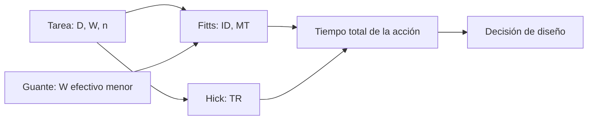

# B111-C01 — Fundamentos de factores humanos en operaciones espaciales

<!-- nav:top -->
[🏠 Programa](../../../../README.md) · [📚 Bloque B111](../../../tronco-comun/B111-factores-humanos-y-liderazgo-de-tripulacion.md) · [← Anterior: B110-C05 — Checklists de emergencia: ejecución y verificación cruzada](../../../tronco-comun/B110-emergencias-y-seguridad-de-tripulacion.md#b110-c05) · [Siguiente: B111-C02 — Gestión intercultural en tripulaciones multinacionales →](../B111-C02-gestion-intercultural-en-tripulaciones-multinacionales/CLASE.md)
<!-- /nav -->

## 1. Ubicación, nivel y alcance

Clase 1 del bloque B111. Nivel N3. Los factores humanos estudian cómo encajan las capacidades y los límites de las personas con las tareas, los equipos y las interfaces que se les dan. Aquí calculas dos leyes clásicas del desempeño humano, la de Fitts (tiempo de movimiento) y la de Hick–Hyman (tiempo de elección), y ves cómo un guante o un menú más largo degradan el tiempo de respuesta. Complementa la ergonomía física de B106-C16 con el marco general de capacidades, límites y errores. Los parámetros son sintéticos.

## 2. Por qué esta clase existe

Una interfaz mal diseñada convierte a una tripulación competente en una fuente de errores. La decisión central: **¿qué parte del tiempo y del error es del diseño y no de la persona?**

## 3. Lo que podrás hacer al terminar

1. Calcular el índice de dificultad de Fitts y el tiempo de movimiento.
2. Calcular el tiempo de elección de Hick–Hyman para `n` opciones.
3. Estimar el efecto de reducir el ancho efectivo del objetivo (guante).
4. Recuperar los parámetros de un modelo ajustando datos sintéticos.
5. Explicar por qué son modelos de un dominio acotado y no verdades universales.
6. Distinguir lo consultado de lo ilustrativo.

La evidencia es la **ficha de capacidades y límites de una interfaz** del ejercicio 12 (sección 20).

## 4. Con qué llegas y cómo comprobarlo

1. ¿Qué es un logaritmo en base 2 y qué mide en bits?
2. ¿Qué es una regresión por mínimos cuadrados?
3. ¿Qué es una semilla fija?
4. ¿Qué es un dato sintético?
5. ¿Qué es un error de diseño frente a un error de la persona?

<details>
<summary>Ver respuestas</summary>

1. El exponente al que se eleva 2 para obtener un número; cuenta cuántas decisiones binarias distinguen las opciones. 2. El ajuste de una recta que minimiza la suma de los cuadrados de los residuos. 3. Un valor inicial del generador aleatorio que hace repetible la simulación. 4. Un dato fabricado para el ejemplo, no medido. 5. El primero nace de condiciones de trabajo que el sistema fija; el segundo se atribuye a la persona sin mirarlas.
</details>

Con cuatro o cinco aciertos, sigue; si no, repasa los prerrequisitos.

## 5. Un caso de contexto y casos de referencia

Un panel exige pulsar un botón de `W = 20 mm` a `D = 100 mm`. Con la ley de Fitts sintética el tiempo es `0,5877 s`; con guante (ancho efectivo `0,7 W`) sube a `0,6538 s`, un `11,24 %` más. Elegir entre 8 opciones equiprobables cuesta `0,8206 s` frente a `0,5353 s` con 2. Es el **ejemplo conductor**. Todo es **ilustrativo**.

## 6. Vocabulario

El **índice de dificultad** de Fitts es `ID = log₂(D/W + 1)` en bits (formulación de Shannon), con `D` la distancia al objetivo y `W` su ancho. El **tiempo de movimiento** es `MT = a + b·ID`. La **ley de Hick–Hyman** da el tiempo de elección `TR = c + d·log₂(n + 1)` para `n` opciones equiprobables. La **capacidad aparente** `ID/MT` se mide en bit/s.

## 7. Modelo mental: un buzón más lejano y más estrecho cuesta más tiempo



*Descripción textual:* la tarea fija distancia, ancho y número de opciones; el movimiento y la elección suman su tiempo; el diseño puede acortarlo agrandando objetivos o reduciendo opciones.

Analogía: meter una carta en un buzón: cuanto más lejos y estrecho, más cuesta. Límite: las leyes son regularidades de experimentos de laboratorio con tareas simples; no incluyen microgravedad, fatiga, estrés ni experiencia.

## 8. La explicación, paso a paso

### 8.1 Fitts

Con los parámetros sintéticos `a = 0,20 s` y `b = 0,15 s/bit`, `D = 100 mm` y `W = 20 mm` dan `ID = log₂(6) = 2,5850 bit` y `MT = 0,5877 s`. Duplicar la distancia o reducir el ancho a la mitad suma casi un bit.

| `D` (mm) | `W` (mm) | `ID` (bit) | `MT` (s) | `MT` con guante (s) | aumento |
|---|---|---|---|---|---|
| 50 | 10 | 2,5850 | 0,5877 | 0,6538 | 11,24 % |
| 50 | 20 | 1,8074 | 0,4711 | 0,5289 | 12,27 % |
| 100 | 10 | 3,4594 | 0,7189 | 0,7901 | 9,90 % |
| 100 | 20 | 2,5850 | 0,5877 | 0,6538 | 11,24 % |
| 200 | 10 | 4,3923 | 0,8588 | 0,9329 | 8,62 % |
| 200 | 20 | 3,4594 | 0,7189 | 0,7901 | 9,90 % |

### 8.2 Hick–Hyman

`TR = 0,25 + 0,18 log₂(n + 1)`: `n = 1` da `0,4300 s`, `n = 2` da `0,5353 s`, `n = 4` da `0,6679 s`, `n = 8` da `0,8206 s` y `n = 16` da `0,9857 s`. El tiempo crece con el logaritmo, no linealmente: pasar de 8 a 16 opciones añade `0,1652 s`.

### 8.3 Segunda vía

Con 200 pares sintéticos `(ID, MT)` con ruido gaussiano de `0,03 s` (semilla 111), un ajuste de mínimos cuadrados recupera `a = 0,2030 s` y `b = 0,1488 s/bit`, con errores de `0,0030 s` y `0,0012 s/bit`, dentro de la tolerancia (`0,02 s` y `0,01 s/bit`).

### 8.4 Qué enseña y qué no

El diseño actúa sobre `D`, `W` y `n`: objetivos grandes y cercanos, pocas opciones, agrupación. Pero un número no dice por qué una persona se equivocó: el marco de factores humanos busca primero las condiciones de trabajo (interfaz, carga, tiempo, equipo), no la culpa. Una revisión de investigación en análogos de la ESA subraya que los estudios de salud conductual y desempeño en análogos sirven para planificar misiones, seleccionar y entrenar, y requieren calidad metodológica (S2).

## 9. Magnitudes, símbolos y unidades

| Símbolo | Qué es | Unidad | Valor / nota |
|---|---|---|---|
| `D` | distancia al objetivo | mm | 50–200 |
| `W` | ancho del objetivo | mm | 10 y 20 |
| `ID` | índice de dificultad | bit | 2,5850 |
| `MT` | tiempo de movimiento | s | 0,5877 |
| `a`, `b` | parámetros de Fitts | s, s/bit | 0,20 y 0,15 (sintéticos) |
| `n` | opciones equiprobables | — | 1–16 |
| `TR` | tiempo de elección | s | 0,5353 (`n` = 2) |

## 10. Convenciones y referencias

Movimiento apuntado en una dimensión, usuario entrenado, sin errores, sin microgravedad modelada. Todos los parámetros (`a`, `b`, `c`, `d`, factor del guante `0,7`) son **sintéticos**; no proceden de mediciones ni del estándar NASA-STD-3001, que no se consultó.

## 11. De dónde sale lo que afirmamos

| ID | Fuente | Localizador | Respalda | Estado |
|---|---|---|---|---|
| S1 | Fitts, P. M. (1954), J. Exp. Psychol. 47(6):381–391 — DOI 10.1037/h0055392 (consultada 2026-11-10, metadatos vía Crossref) | registro bibliográfico | existencia y cita de la ley de Fitts | Consultada (solo metadatos) |
| S2 | De la Torre, G. G. et al. (2024), npj Microgravity 10:98 — DOI 10.1038/s41526-024-00437-w (consultada 2026-11-10, resumen vía Europe PMC) | resumen | utilidad y calidad metodológica de los análogos | Consultada (solo resumen) |
| — | NASA-STD-3001 Vol. 2 (factores humanos) | página no disponible (404) | — | **No consultada** |
| — | Hick–Hyman, formulación de Shannon de Fitts | — | las verifica el laboratorio | No consultada en una fuente concreta |

Límites: los valores numéricos no proceden de ninguna fuente; no se consultó el texto completo de S1 ni de S2.

## 12. Cómo ver la degradación por el guante

| Magnitud | Valor |
|---|---|
| `MT` (100 mm, 20 mm) | 0,5877 s |
| `MT` con guante | 0,6538 s |
| aumento | 11,24 % |
| `TR` con 8 opciones | 0,8206 s |
| capacidad aparente | 4,398 bit/s |

Descripción larga: el guante añade 0,44 bit de dificultad y alrededor de un 11 % de tiempo; ocho opciones cuestan 0,29 s más que dos.

## 13. Ejemplo trabajado: el botón con guante

**Paso 1 · Ancho efectivo.** `W_eff = 0,7 × 20 = 14 mm`.

**Paso 2 · Dificultad.** `ID = log₂(100/14 + 1) = log₂(8,1429) = 3,0255 bit`.

**Paso 3 · Tiempo.** `MT = 0,20 + 0,15 × 3,0255 = 0,6538 s`.

**Paso 4 · Comparación.** `0,6538/0,5877 = 1,1124`: un 11,24 % más.

## 14. Distintas formas de describir una interfaz

**Por dificultad:** `ID`. **Por tiempo:** `MT` y `TR`. **Por capacidad:** `ID/MT`. **Por diseño:** objetivos más grandes, menos opciones, agrupación.

## 15. Práctica guiada

**Ejercicio 1 · con los pasos indicados.** Calcula `ID` para `D = 50 mm` y `W = 10 mm`. *Pasos:* `log₂(50/10 + 1) = log₂ 6`.

<details><summary>Solución comentada</summary>

`2,5850 bit`.
</details>

**Ejercicio 2 · con una pista.** Calcula `MT` para ese caso. *Pista:* `0,20 + 0,15 × ID`.

<details><summary>Solución comentada</summary>

`0,20 + 0,3878 = 0,5877 s`.
</details>

**Ejercicio 3 · casi autónomo.** ¿Por qué `D = 100, W = 20` y `D = 50, W = 10` tienen el mismo `ID`?

<details><summary>Solución comentada</summary>

Porque `ID` depende de la razón `D/W`, que vale 5 en ambos.
</details>

## 16. Práctica autónoma, transferencia e integrador

**Ejercicio 4 · autónomo.** `ID` para `D = 200 mm` y `W = 10 mm`.

<details><summary>Solución comentada</summary>

`log₂(21) = 4,3923 bit`.
</details>

**Ejercicio 5 · autónomo.** `TR` con `n = 3`.

<details><summary>Solución comentada</summary>

`0,25 + 0,18 × log₂ 4 = 0,25 + 0,36 = 0,6100 s`.
</details>

**Ejercicio 6 · autónomo.** Aumento relativo de `MT` con guante para `D = 200`, `W = 10`.

<details><summary>Solución comentada</summary>

`0,9329/0,8588 − 1 = 8,62 %`.
</details>

**Ejercicio 7 · autónomo.** ¿Cuánto añade pasar de 8 a 16 opciones?

<details><summary>Solución comentada</summary>

`0,9857 − 0,8206 = 0,1652 s` (de la tabla, con redondeo).
</details>

**Ejercicio 8 · autónomo.** Capacidad aparente con `D = 100`, `W = 20`.

<details><summary>Solución comentada</summary>

`2,5850/0,5877 = 4,398 bit/s`.
</details>

**Ejercicio 9 · transferencia.** **Transferencia.** Un menú de 16 opciones se puede dividir en dos niveles de 4 opciones cada uno. ¿Es más rápido según Hick–Hyman?

<details><summary>Solución comentada</summary>

Dos elecciones de `n = 4` cuestan `2 × 0,6679 = 1,3358 s`, más que una de 16 (`0,9857 s`): según este modelo no, aunque el menú plano puede tener otros costos (errores, búsqueda). El modelo orienta, no decide.
</details>

**Ejercicio 10 · transferencia.** **Transferencia.** Un colega dice que las leyes prueban que cierto tripulante «es lento». Respóndele.

<details><summary>Solución comentada</summary>

Las leyes describen tareas simples con parámetros sintéticos; no evalúan personas. Un tiempo largo apunta primero a la interfaz y a las condiciones, y ningún resultado de esta clase sirve para evaluar individuos.
</details>

**Ejercicio 11 · transferencia.** **Transferencia.** Falta un dato para aplicar Fitts a un panel real en microgravedad. ¿Cuál?

<details><summary>Solución comentada</summary>

Los parámetros `a` y `b` medidos en esas condiciones y con ese equipo; los de la clase son sintéticos.
</details>

**Ejercicio 12 · integrador.** **Integrador.** Elabora tu *ficha de capacidades y límites de una interfaz*: tabla de `ID`, `MT` y `MT` con guante para tres tamaños de botón, tabla de `TR`, ajuste de la segunda vía y lista de lo que el modelo no incluye.

<details><summary>Solución comentada</summary>

Secciones 8.1–8.4 y la salida del laboratorio.
</details>

## 17. Laboratorio: Fitts y Hick–Hyman con datos sintéticos

El script [factores.py](factores.py) calcula `ID`, `MT`, el efecto del guante y `TR`, y ajusta 200 datos sintéticos (**comprueba** que `a` y `b` se recuperan dentro de la tolerancia).

**Datos:** todos **sintéticos** (parámetros, ruido y factor del guante). **Predice antes de ejecutar:** ¿cuánto aumenta `MT` con guante para `D = 100`, `W = 20`? (11,24 %.) **Ejecución del 2026-11-10 (Python 3.12.9):**

```text
Python 3.12.9 (biblioteca estandar)
Fitts SINTETICO: MT = 0.20 + 0.15 ID [s]; guante: W_eff = 0.7 W
  D [mm]  W [mm]  ID sin guante [bit]  MT sin guante [s]  ID guante [bit]  MT guante [s]  aumento [%]
      50      10              2.5850             0.5877           3.0255         0.6538       11.24
      50      20              1.8074             0.4711           2.1926         0.5289       12.27
     100      10              3.4594             0.7189           3.9341         0.7901        9.90
     100      20              2.5850             0.5877           3.0255         0.6538       11.24
     200      10              4.3923             0.8588           4.8861         0.9329        8.62
     200      20              3.4594             0.7189           3.9341         0.7901        9.90
Hick-Hyman SINTETICO: TR = 0.25 + 0.18 log2(n+1) [s]
  n opciones  TR [s]  incremento frente a n-1 [s]
           1  0.4300         -
           2  0.5353    0.1053
           4  0.6679    0.1327
           8  0.8206    0.1526
          16  0.9857    0.1652
Segunda via (ajuste de 200 datos sinteticos, semilla 111): a_est = 0.2030 s ; b_est = 0.1488 s/bit
  errores: |a_est - a| = 0.0030 s ; |b_est - b| = 0.0012 s/bit
Capacidad aparente (D = 100 mm, W = 20 mm) = ID/MT = 4.398 bit/s
Pruebas superadas.
```

```bash
python programa/clases/B111/B111-C01-fundamentos-de-factores-humanos-en-operaciones-espaciales/factores.py
```

**Límites:** tareas simples, usuario entrenado, sin errores, sin microgravedad; el «incremento frente a n−1» de la tabla compara con la fila anterior (no con `n − 1` literal).

## 18. Errores frecuentes y cómo corregirlos

**Atribuir un tiempo largo a la persona.** Se corrige con 8.4.

**Creer que `TR` crece linealmente con `n`.** Se corrige con 8.2.

**Tratar los parámetros como medidos.** Se corrige con la sección 10.

**Usar el modelo para evaluar individuos.** Se corrige con la sección 21.

## 19. Cómo sabrás que vas bien

Tras la sección 8: ¿qué aumento esperabas con guante y cuál obtuviste? Si dudas, repasa el ejemplo 13. Tras el laboratorio: ¿qué comprueba? (ver la sección 17).

## 20. Qué entregas y cómo se evalúa

El producto es tu **ficha de capacidades y límites de una interfaz** (ejercicio 12).

| Criterio | Inicial | En desarrollo | Logrado | Destacado |
|---|---|---|---|---|
| Conceptos | Los confunde | Parciales | Calcula `ID`, `MT` y `TR` | Explica los límites |
| Cálculo | Sin unidades | Con errores | Tablas completas con unidades | Calcula casos nuevos |
| Segunda vía | Sin comprobar | Un caso | Recupera `a` y `b` | Interpreta el error |
| Fuentes | Sin fuente | Sin fecha | Fuentes con fecha y estado | Declara lo no consultado |
| Límites | No los nombra | Uno | Tres | Discute qué falta del modelo |

**Condiciones críticas (no se compensan con promedio):** rotular los parámetros como sintéticos; no evaluar ni juzgar a personas con el modelo; citar solo lo consultado.

## 21. Ética, seguridad y límites

Clase educativa: no da consejo médico, psicológico ni operativo, no sirve para seleccionar ni evaluar tripulantes y no sustituye a NASA-STD-3001 ni a la formación en factores humanos. Los datos son sintéticos. Accesibilidad: tablas equivalentes a las gráficas, fórmulas en texto, ejercicios sin conexión.

## 22. Para cerrar y seguir

Un botón con guante cuesta `0,6538 s` frente a `0,5877 s`, y elegir entre ocho opciones cuesta `0,8206 s`: el diseño fija una parte grande del tiempo. Queda una pregunta: ¿qué cambia cuando la tripulación mezcla idiomas y culturas?

**Glosario español–inglés.** factores humanos · *human factors*; ley de Fitts · *Fitts's law*; ley de Hick–Hyman · *Hick–Hyman law*; índice de dificultad · *index of difficulty*; tiempo de movimiento · *movement time*.

**Continuidad.** [B111-C02](../B111-C02-gestion-intercultural-en-tripulaciones-multinacionales/CLASE.md) estudia la gestión intercultural.

**Referencias:** ver sección 11.

<!-- nav:bottom -->
---

[← Anterior: B110-C05 — Checklists de emergencia: ejecución y verificación cruzada](../../../tronco-comun/B110-emergencias-y-seguridad-de-tripulacion.md#b110-c05) · [📚 Bloque B111](../../../tronco-comun/B111-factores-humanos-y-liderazgo-de-tripulacion.md) · [Siguiente: B111-C02 — Gestión intercultural en tripulaciones multinacionales →](../B111-C02-gestion-intercultural-en-tripulaciones-multinacionales/CLASE.md)
<!-- /nav -->
