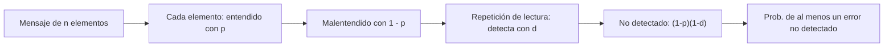

# B111-C02 — Gestión intercultural en tripulaciones multinacionales

<!-- nav:top -->
[🏠 Programa](../../../../README.md) · [📚 Bloque B111](../../../tronco-comun/B111-factores-humanos-y-liderazgo-de-tripulacion.md) · [← Anterior: B111-C01 — Fundamentos de factores humanos en operaciones espaciales](../B111-C01-fundamentos-de-factores-humanos-en-operaciones-espaciales/CLASE.md) · [Siguiente: B111-C03 — Carga cognitiva y gestión de la atención →](../B111-C03-carga-cognitiva-y-gestion-de-la-atencion/CLASE.md)
<!-- /nav -->

## 1. Ubicación, nivel y alcance

Clase 2 del bloque B111. Nivel N3. Las tripulaciones espaciales son internacionales: mezclan idiomas, estilos de trabajo y expectativas sobre la jerarquía y la comunicación. Aquí calculas, sobre una tripulación **enteramente sintética**, un índice de diversidad, distancias entre perfiles, un índice de endogrupo y la probabilidad de un malentendido no detectado con y sin repetición de lectura. Sigue a [B111-C01](../B111-C01-fundamentos-de-factores-humanos-en-operaciones-espaciales/CLASE.md). Ningún dato describe a un país, un grupo ni una persona real.

## 2. Por qué esta clase existe

Ninguna clase del programa trataba las diferencias culturales y de idioma en equipos internacionales. La decisión central: **¿cómo se vuelve un riesgo de comunicación cuantificable y cómo se mitiga con procedimientos y no con estereotipos?**

## 3. Lo que podrás hacer al terminar

1. Calcular el índice de diversidad de Blau de una tripulación.
2. Calcular distancias normalizadas entre perfiles y localizar la mayor.
3. Calcular el índice de endogrupo frente a la mezcla al azar.
4. Calcular la probabilidad de un malentendido no detectado y el efecto de la repetición de lectura.
5. Contrastar la fórmula con una simulación Monte Carlo.
6. Explicar por qué los datos sintéticos no se pueden leer como retrato de ninguna cultura.

La evidencia es la **ficha de riesgo de comunicación de una tripulación sintética** del ejercicio 12 (sección 20).

## 4. Con qué llegas y cómo comprobarlo

1. ¿Qué es una probabilidad condicional?
2. ¿Qué es la distancia euclidiana entre dos vectores?
3. ¿Qué es una simulación Monte Carlo?
4. ¿Qué es un estereotipo?
5. ¿Qué es la repetición de lectura (*readback*)?

<details>
<summary>Ver respuestas</summary>

1. La probabilidad de un suceso sabiendo que ocurrió otro. 2. La raíz de la suma de los cuadrados de las diferencias componente a componente. 3. Estimar una probabilidad repitiendo muchas veces un experimento aleatorio simulado. 4. Una creencia simplificada que se aplica a todas las personas de un grupo. 5. Repetir el receptor el mensaje recibido para que el emisor confirme que se entendió.
</details>

Con cuatro o cinco aciertos, sigue; si no, repasa los prerrequisitos.

## 5. Un caso de contexto y casos de referencia

Una tripulación sintética de seis miembros en tres grupos ficticios (G1, G2, G3) tiene un índice de diversidad de Blau de `0,6667`. En el modelo, las interacciones observadas dentro del grupo son un `62 %` frente al `33,33 %` esperado con mezcla al azar, una razón de `1,860`. Un mensaje de 5 elementos críticos a un miembro con proficiencia `0,90` tiene `40,95 %` de probabilidad de un malentendido no detectado sin repetición de lectura y `9,61 %` con ella (detección `0,8`). Es el **ejemplo conductor**. Todo es **sintético**.

## 6. Vocabulario

El **índice de diversidad de Blau** es `1 − Σ pg²`, con `pg` la fracción de la tripulación en el grupo `g`. La **distancia normalizada** entre dos perfiles de `k` dimensiones en escala 0–100 es `√Σ(Δ)² / (100 √k)`. El **endogrupo** es la tendencia a interactuar dentro del propio grupo; su índice compara la fracción observada con `Σ pg²`. La **proficiencia** `p` es la probabilidad de entender bien un elemento crítico y `d` la de detectar el error mediante repetición de lectura.

## 7. Modelo mental: un mensaje es una cadena de elementos y cada uno puede fallar



*Descripción textual:* cada elemento crítico puede entenderse mal; la repetición de lectura detecta parte de esos errores; lo que queda sin detectar se acumula a lo largo del mensaje.

Analogía: un teléfono descompuesto con confirmación: confirmar cada frase reduce el error acumulado. Límite: el modelo supone elementos independientes y sin ruido de canal; la comunicación real depende del contexto, la confianza y la práctica compartida.

## 8. La explicación, paso a paso

### 8.1 Diversidad y distancia

Con tres grupos de dos miembros, `pg = 1/3` y `Blau = 1 − 3 × (1/3)² = 0,6667`. Los perfiles sintéticos (cuatro dimensiones 0–100) dan distancias normalizadas de `0,050` dentro de cada grupo y de `0,217` a `0,349` entre grupos; la máxima es `0,349` (M4–M5). La distancia describe diferencia en datos ficticios, no «compatibilidad».

### 8.2 Endogrupo

Con mezcla al azar, la fracción esperada de interacciones dentro del grupo es `Σ pg² = 0,3333`. La fracción observada sintética es `0,62`, una razón de `1,860`: casi el doble. Un estudio de invernada en la Antártida (análogo espacial) informó que las interacciones se concentraron cada vez más dentro de los grupos nacionales, con riesgo de fragmentación social (S1); aquí solo se toma la idea, no los datos.

### 8.3 Malentendido y repetición de lectura

`P_no detectado = 1 − (1 − (1 − p)(1 − d))ⁿ`. Para `n = 5`:

| miembro | `p` | `d` | `P` analítica | `P` Monte Carlo | diferencia |
|---|---|---|---|---|---|
| M1 | 0,99 | 0,0 | 0,04901 | 0,04784 | 0,00116 |
| M1 | 0,99 | 0,8 | 0,00996 | 0,00988 | 0,00008 |
| M4 | 0,90 | 0,0 | 0,40951 | 0,40949 | 0,00001 |
| M4 | 0,90 | 0,8 | 0,09608 | 0,09675 | 0,00067 |
| M5 | 0,85 | 0,0 | 0,55629 | 0,55449 | 0,00180 |
| M5 | 0,85 | 0,8 | 0,14127 | 0,14071 | 0,00056 |

La simulación (semilla 112, 200 000 mensajes) coincide con la fórmula con diferencia máxima `0,00180`, dentro de la tolerancia `0,005`.

### 8.4 Qué enseña y qué no

La repetición de lectura reduce el riesgo en un factor de 4 a 5 en estos casos, para cualquier proficiencia: es un procedimiento, no un juicio sobre las personas. Pero los índices no explican causas: una distancia grande o un endogrupo alto no son «problemas culturales» en sí. El 62 % observado es un dato ficticio.

## 9. Magnitudes, símbolos y unidades

| Símbolo | Qué es | Unidad | Valor / nota |
|---|---|---|---|
| `pg` | fracción del grupo `g` | — | 1/3 |
| `Blau` | índice de diversidad | — | 0,6667 |
| `dij` | distancia normalizada | — | 0,050–0,349 |
| `p` | proficiencia por elemento | — | 0,85–0,99 (sintético) |
| `d` | detección por repetición de lectura | — | 0 y 0,8 |
| `n` | elementos críticos | — | 5 |
| `P` | malentendido no detectado | — | 0,0100–0,5563 |

## 10. Convenciones y referencias

Seis miembros ficticios (M1–M6), tres grupos ficticios, cuatro dimensiones ficticias y proficiencias ficticias. No son datos de ningún modelo cultural publicado ni de país alguno. Elementos y detección independientes; sin ruido de canal.

## 11. De dónde sale lo que afirmamos

| ID | Fuente | Localizador | Respalda | Estado |
|---|---|---|---|---|
| S1 | Cantisani, A. et al. (2026), PNAS 123(22):e2533420123 — DOI 10.1073/pnas.2533420123 (consultada 2026-11-10, resumen vía Europe PMC) | resumen | soledad y conflicto aumentan, cohesión y desempeño bajan, interacciones cada vez más dentro de grupos nacionales (12 miembros, 10 meses, Concordia) | Consultada (solo resumen) |
| S2 | Basner, M. et al. (2026), Front. Psychol. 17 — DOI 10.3389/fpsyg.2026.1783846 (consultada 2026-11-10, resumen vía Europe PMC) | resumen | proximidad medida con sensores como indicador objetivo de cohesión en análogos antárticos | Consultada (solo resumen) |
| — | Modelos culturales publicados (p. ej. dimensiones de Hofstede), normas de comunicación aeronáutica | — | — | **No consultada** |
| — | Fórmulas de Blau y de error acumulado | — | las verifica el laboratorio | No consultada en una fuente concreta |

Límites: los datos del laboratorio son sintéticos; no se consultó el texto completo de S1 ni de S2.

## 12. Cómo ver el riesgo de comunicación

| Magnitud | Valor |
|---|---|
| Blau | 0,6667 |
| distancia máxima | 0,349 |
| razón de endogrupo | 1,860 |
| `P` (M4, sin repetición de lectura) | 0,40951 |
| `P` (M4, con repetición de lectura) | 0,09608 |

Descripción larga: la repetición de lectura baja un riesgo de cuatro de cada diez a menos de uno de cada diez en el caso de M4.

## 13. Ejemplo trabajado: el malentendido de M4

**Paso 1 · Sin repetición.** Cada elemento falla con `0,10`; `P = 1 − 0,9⁵ = 0,40951`.

**Paso 2 · Con repetición.** Falla sin detectarse con `0,10 × 0,20 = 0,02`; `P = 1 − 0,98⁵ = 0,09608`.

**Paso 3 · Cociente.** `0,40951/0,09608 = 4,26`.

**Paso 4 · Lectura.** El procedimiento reduce el riesgo; no se concluye nada sobre M4 como persona.

## 14. Distintas formas de describir una tripulación

**Por composición:** Blau. **Por perfil:** distancias. **Por interacción:** razón de endogrupo. **Por comunicación:** `P` no detectado.

## 15. Práctica guiada

**Ejercicio 1 · con los pasos indicados.** Calcula Blau para 4 miembros en dos grupos de dos. *Pasos:* `1 − (0,5² + 0,5²)`.

<details><summary>Solución comentada</summary>

`0,5`.
</details>

**Ejercicio 2 · con una pista.** Calcula `P` con `p = 0,95`, `d = 0` y `n = 3`. *Pista:* `1 − p³`.

<details><summary>Solución comentada</summary>

`1 − 0,857375 = 0,1426`.
</details>

**Ejercicio 3 · casi autónomo.** ¿Por qué la repetición de lectura reduce `P` aunque no cambie `p`?

<details><summary>Solución comentada</summary>

Porque detecta una fracción de los errores antes de que actúen: el factor por elemento pasa de `1 − p` a `(1 − p)(1 − d)`.
</details>

## 16. Práctica autónoma, transferencia e integrador

**Ejercicio 4 · autónomo.** Blau para 6 miembros en grupos de 3, 2 y 1.

<details><summary>Solución comentada</summary>

`1 − (0,25 + 0,1111 + 0,0278) = 0,6111`.
</details>

**Ejercicio 5 · autónomo.** Distancia normalizada entre `(80,30,55,60)` y `(35,70,60,40)`.

<details><summary>Solución comentada</summary>

`√(2025 + 1600 + 25 + 400)/(100 × 2) = √4050/200 = 0,318`.
</details>

**Ejercicio 6 · autónomo.** `P` con `p = 0,99`, `d = 0` y `n = 5`.

<details><summary>Solución comentada</summary>

`1 − 0,99⁵ = 0,04901`.
</details>

**Ejercicio 7 · autónomo.** Razón de endogrupo si lo observado fuese `0,40`.

<details><summary>Solución comentada</summary>

`0,40/0,3333 = 1,2`.
</details>

**Ejercicio 8 · autónomo.** `P` con `p = 0,90`, `d = 0,8` y `n = 10`.

<details><summary>Solución comentada</summary>

`1 − 0,98¹⁰ = 0,1829`.
</details>

**Ejercicio 9 · transferencia.** **Transferencia.** Un manual propone asignar tareas según la nacionalidad del tripulante. Respóndele con lo visto.

<details><summary>Solución comentada</summary>

Los índices describen composición y no a las personas; un estereotipo no es un dato. Se asignan tareas por competencia y se reduce el riesgo con procedimientos como la repetición de lectura.
</details>

**Ejercicio 10 · transferencia.** **Transferencia.** La razón de endogrupo sube con el tiempo. ¿Qué decisiones de equipo considerarías y qué no podrías afirmar?

<details><summary>Solución comentada</summary>

Mezclar tareas y turnos, actividades comunes; no puedes afirmar la causa solo con la razón, y en una misión real hay que medirla con datos autorizados.
</details>

**Ejercicio 11 · transferencia.** **Transferencia.** ¿Qué parámetro sería más difícil de obtener para una tripulación real?

<details><summary>Solución comentada</summary>

`p` y `d`: dependen de cada persona, de la tarea y del contexto, y medirlos para evaluar individuos plantea cuestiones éticas.
</details>

**Ejercicio 12 · integrador.** **Integrador.** Elabora tu *ficha de riesgo de comunicación de una tripulación sintética*: Blau, matriz de distancias, razón de endogrupo, tabla de `P` con y sin repetición de lectura, contraste Monte Carlo y límites.

<details><summary>Solución comentada</summary>

Secciones 8.1–8.4 y la salida del laboratorio.
</details>

## 17. Laboratorio: diversidad y malentendido en una tripulación sintética

El script [intercultural.py](intercultural.py) calcula Blau, la matriz de distancias, el endogrupo y la probabilidad de malentendido, y la contrasta con una simulación (**comprueba** diferencia máxima < 0,005).

**Datos:** todos **sintéticos**. **Predice antes de ejecutar:** ¿cuánto vale Blau con tres grupos iguales? (0,6667.) **Ejecución del 2026-11-10 (Python 3.12.9):**

```text
Python 3.12.9 (biblioteca estandar)
Tripulacion SINTETICA de 6 miembros en 3 grupos ficticios
Indice de diversidad de Blau = 0.6667
Distancia normalizada entre perfiles (0 = igual, 1 = maxima):
          M1     M2     M3     M4     M5     M6
   M1  0.000  0.050  0.318  0.348  0.268  0.266
   M2  0.050  0.000  0.298  0.326  0.219  0.217
   M3  0.318  0.298  0.000  0.050  0.333  0.286
   M4  0.348  0.326  0.050  0.000  0.349  0.301
   M5  0.268  0.219  0.333  0.349  0.000  0.050
   M6  0.266  0.217  0.286  0.301  0.050  0.000
Distancia maxima = 0.349
Endogrupo: esperado con mezcla al azar = 0.3333 ; observado SINTETICO = 0.62 ; razon = 1.860
Malentendido no detectado (n = 5 elementos criticos, deteccion por repeticion d):
  miembro   p     d     P analitica   P Monte Carlo   diferencia
      M1  0.99  0.0       0.04901         0.04784     0.00116
      M1  0.99  0.8       0.00996         0.00988     0.00008
      M4  0.90  0.0       0.40951         0.40949     0.00001
      M4  0.90  0.8       0.09608         0.09675     0.00067
      M5  0.85  0.0       0.55629         0.55449     0.00180
      M5  0.85  0.8       0.14127         0.14071     0.00056
Diferencia maxima analitica/Monte Carlo = 0.00180
Pruebas superadas.
```

```bash
python programa/clases/B111/B111-C02-gestion-intercultural-en-tripulaciones-multinacionales/intercultural.py
```

**Límites:** perfiles y proficiencias ficticios; sin ruido de canal ni contexto; no evalúa a personas ni culturas.

## 18. Errores frecuentes y cómo corregirlos

**Leer los perfiles sintéticos como retrato de una cultura.** Se corrige con la sección 10.

**Creer que la diversidad es un riesgo por sí misma.** Se corrige con 8.4.

**Confundir distancia con incompatibilidad.** Se corrige con 8.1.

**Suponer que la repetición de lectura elimina el error.** Se corrige con 8.3.

## 19. Cómo sabrás que vas bien

Tras la sección 8: ¿qué `P` esperabas para M4 con repetición de lectura y cuál obtuviste? Si dudas, repasa el ejemplo 13. Tras el laboratorio: ¿qué comprueba? (ver la sección 17).

## 20. Qué entregas y cómo se evalúa

El producto es tu **ficha de riesgo de comunicación de una tripulación sintética** (ejercicio 12).

| Criterio | Inicial | En desarrollo | Logrado | Destacado |
|---|---|---|---|---|
| Conceptos | Los confunde | Parciales | Calcula Blau, distancias y `P` | Explica los límites |
| Cálculo | Sin unidades | Con errores | Tablas completas | Calcula casos nuevos |
| Simulación | Sin comprobar | Un caso | Contraste con la fórmula | Interpreta las diferencias |
| Fuentes | Sin fuente | Sin fecha | Fuentes con fecha y estado | Declara lo no consultado |
| Límites | No los nombra | Uno | Tres | Discute qué falta del modelo |

**Condiciones críticas (no se compensan con promedio):** rotular tripulación, perfiles y proficiencias como sintéticos; no atribuir rasgos a una cultura ni a una persona; citar solo lo consultado.

## 21. Ética, seguridad y límites

Clase educativa: no da consejo psicológico ni operativo, no sirve para seleccionar ni evaluar tripulantes y no sustituye a la formación intercultural ni a los estándares de las agencias. Evita los estereotipos nacionales: los datos son ficticios. Accesibilidad: tablas equivalentes a las gráficas, fórmulas en texto, ejercicios sin conexión.

## 22. Para cerrar y seguir

La tripulación sintética tiene Blau `0,6667` y casi el doble de interacciones dentro del grupo que al azar; la repetición de lectura baja el malentendido de `40,95 %` a `9,61 %` en el caso de M4. Queda una pregunta: ¿cuánto puede atender una persona a la vez?

**Glosario español–inglés.** diversidad · *diversity*; endogrupo · *in-group*; repetición de lectura · *readback*; proficiencia · *proficiency*; cohesión · *cohesion*.

**Continuidad.** [B111-C03](../B111-C03-carga-cognitiva-y-gestion-de-la-atencion/CLASE.md) estudia la carga cognitiva.

**Referencias:** ver sección 11.

<!-- nav:bottom -->
---

[← Anterior: B111-C01 — Fundamentos de factores humanos en operaciones espaciales](../B111-C01-fundamentos-de-factores-humanos-en-operaciones-espaciales/CLASE.md) · [📚 Bloque B111](../../../tronco-comun/B111-factores-humanos-y-liderazgo-de-tripulacion.md) · [Siguiente: B111-C03 — Carga cognitiva y gestión de la atención →](../B111-C03-carga-cognitiva-y-gestion-de-la-atencion/CLASE.md)
<!-- /nav -->
