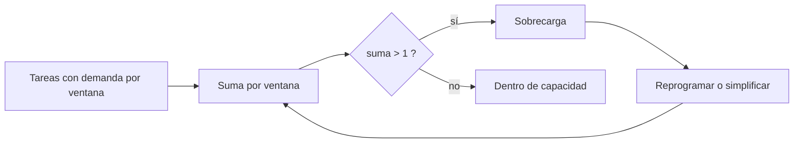

# B111-C03 — Carga cognitiva y gestión de la atención

<!-- nav:top -->
[🏠 Programa](../../../../README.md) · [📚 Bloque B111](../../../tronco-comun/B111-factores-humanos-y-liderazgo-de-tripulacion.md) · [← Anterior: B111-C02 — Gestión intercultural en tripulaciones multinacionales](../B111-C02-gestion-intercultural-en-tripulaciones-multinacionales/CLASE.md) · [Siguiente: B111-C04 — Conciencia situacional en operaciones de vuelo →](../B111-C04-conciencia-situacional-en-operaciones-de-vuelo/CLASE.md)
<!-- /nav -->

## 1. Ubicación, nivel y alcance

Clase 3 del bloque B111. Nivel N3. La atención y la memoria de trabajo son limitadas; cuando las tareas simultáneas exigen más de lo que la persona puede dar, el desempeño cae. Aquí calculas una carga de trabajo ponderada con el esquema de seis subescalas del NASA-TLX (con valoraciones sintéticas) y la utilización de una línea de tiempo de tareas, y ves cómo reprogramar una tarea elimina una sobrecarga. Sigue a [B111-C02](../B111-C02-gestion-intercultural-en-tripulaciones-multinacionales/CLASE.md). Los datos son sintéticos.

## 2. Por qué esta clase existe

Ninguna clase trataba la carga cognitiva ni el diseño de tareas para limitarla. La decisión central: **¿cómo se mide la carga y cómo se rediseña una secuencia para que no haya picos que superen la capacidad?**

## 3. Lo que podrás hacer al terminar

1. Calcular los pesos de las seis subescalas a partir de 15 comparaciones por pares.
2. Calcular la carga ponderada y la carga cruda.
3. Sumar las demandas de tareas por ventana de tiempo y detectar sobrecargas.
4. Reprogramar una tarea y comprobar que baja el pico sin cambiar el trabajo total.
5. Contrastar los pesos por enumeración con una fórmula cerrada.
6. Distinguir una medida subjetiva de una demanda objetiva.

La evidencia es la **ficha de carga de una secuencia de tareas** del ejercicio 12 (sección 20).

## 4. Con qué llegas y cómo comprobarlo

1. ¿Cuántos pares distintos se forman con 6 elementos?
2. ¿Qué es la memoria de trabajo?
3. ¿Qué es una media ponderada?
4. ¿Qué diferencia hay entre una medida subjetiva y una objetiva?
5. ¿Qué es un dato sintético?

<details>
<summary>Ver respuestas</summary>

1. `C(6,2) = 15`. 2. El sistema que mantiene y manipula información a corto plazo, de capacidad limitada. 3. Una media en la que cada valor pesa según su importancia. 4. La primera es lo que la persona declara; la segunda, lo que se mide con instrumentos o con la tarea. 5. Un dato fabricado para el ejemplo.
</details>

Con cuatro o cinco aciertos, sigue; si no, repasa los prerrequisitos.

## 5. Un caso de contexto y casos de referencia

Un operador sintético valora seis subescalas (mental 70, física 20, temporal 80, rendimiento 35, esfuerzo 65, frustración 40). Con los pesos de sus 15 comparaciones por pares la carga ponderada es `65,333` frente a `51,667` de la cruda. En la línea de tiempo, cuatro tareas suman `1,30` en una ventana de 10 s; desplazar la tarea D baja el pico a `1,00`. Es el **ejemplo conductor**. Todo es **sintético**.

## 6. Vocabulario

La **carga de trabajo** es la demanda que una tarea impone a una persona. El esquema NASA-TLX, descrito por Hart y Staveland (1988), usa seis subescalas (exigencia mental, física y temporal, rendimiento, esfuerzo y frustración) valoradas de 0 a 100; en 15 comparaciones por pares la persona elige cuál subescala pesó más y cada una recibe un peso de 0 a 5 que suma 15. La **carga ponderada** es `Σ valoración × peso / 15`; la **cruda**, la media simple. La **utilización** de una ventana es la suma de las demandas de las tareas activas (1,0 = capacidad).

## 7. Modelo mental: una mesa con tareas que ocupan espacio



*Descripción textual:* se suman las demandas de las tareas simultáneas; si en alguna ventana superan la capacidad, se reprograma o se simplifica la tarea hasta que no haya sobrecarga.

Analogía: una mesa de trabajo: puedes sostener varias tareas, pero hay un área limitada. Límite: las demandas aquí se suman sin recursos múltiples, sin aprendizaje ni fatiga; la carga real no es aditiva ni se mide solo con un número.

## 8. La explicación, paso a paso

### 8.1 Pesos y carga ponderada

Con 15 pares y una preferencia sintética (gana la subescala de mayor «importancia» ficticia 6, 1, 5, 2, 4, 3), los pesos son `[5, 0, 4, 1, 3, 2]`, que suman 15. La carga ponderada es `(70×5 + 20×0 + 80×4 + 35×1 + 65×3 + 40×2)/15 = 980/15 = 65,333`.

| Subescala | valoración | peso | aporte |
|---|---|---|---|
| Mental | 70 | 5 | 23,333 |
| Física | 20 | 0 | 0,000 |
| Temporal | 80 | 4 | 21,333 |
| Rendimiento | 35 | 1 | 2,333 |
| Esfuerzo | 65 | 3 | 13,000 |
| Frustración | 40 | 2 | 5,333 |

### 8.2 Línea de tiempo

Las demandas totales por ventana de 10 s son `0,3 0,3 0,7 1,0 1,3 0,9 0,3 0,3 0,3 0,3 0,3 0,3`. El pico es `1,30` y hay `1` ventana en sobrecarga (10 s de 120 s).

### 8.3 Reprogramar

Desplazar la tarea D (demanda `0,3` durante 2 ventanas) a las ventanas 9–10 da `0,3 0,3 0,7 1,0 1,0 0,6 0,3 0,3 0,6 0,6 0,3 0,3`: pico `1,00`, ninguna sobrecarga y utilización media `0,525`. El trabajo total no cambia: solo cómo se reparte.

### 8.4 Segunda vía y límites

Los pesos obtenidos por enumeración de los 15 pares coinciden con la fórmula cerrada (peso = rango de importancia), y la suma de demandas se conserva. La carga ponderada es una medida **subjetiva**; no equivale a la capacidad real, y un valor alto no dice qué rediseñar.

## 9. Magnitudes, símbolos y unidades

| Símbolo | Qué es | Unidad | Valor / nota |
|---|---|---|---|
| `r_i` | valoración de la subescala `i` | 0–100 | 20–80 (sintéticas) |
| `w_i` | peso de la subescala | recuento 0–5 | suma 15 |
| `TLX` | carga ponderada | 0–100 | 65,333 |
| `u_k` | utilización de la ventana `k` | — | pico 1,30 |
| ventana | duración | s | 10 |

## 10. Convenciones y referencias

Las valoraciones, la preferencia en los pares y las demandas son **sintéticas**. El esquema se cita de Hart y Staveland (1988): solo se consultaron los metadatos. Demandas aditivas, capacidad 1,0 por ventana, sin recursos múltiples.

## 11. De dónde sale lo que afirmamos

| ID | Fuente | Localizador | Respalda | Estado |
|---|---|---|---|---|
| S1 | Hart, S. G. y Staveland, L. E. (1988), «Development of NASA-TLX (Task Load Index)», en *Human Mental Workload*, Advances in Psychology, pp. 139–183 — DOI 10.1016/S0166-4115(08)62386-9 (consultada 2026-11-10, metadatos vía Crossref) | registro bibliográfico | existencia, título y cita del esquema | Consultada (solo metadatos) |
| — | Descripción de las seis subescalas y de los 15 pares | página de NASA-TLX sin conexión | — | **No consultada** (se usa como convención del ejemplo) |
| — | Teoría de la carga cognitiva y de recursos múltiples | — | — | No consultada |

Límites: ninguna cifra proviene de una fuente; el esquema se resume de memoria como convención didáctica y debe verificarse en la fuente primaria.

## 12. Cómo ver la carga

| Magnitud | Valor |
|---|---|
| carga ponderada | 65,333 |
| carga cruda | 51,667 |
| pico original | 1,30 |
| pico tras reprogramar | 1,00 |
| utilización media | 0,525 |

Descripción larga: la sobrecarga estaba en una sola ventana de 10 s y desaparece al mover una tarea; la media no cambia.

## 13. Ejemplo trabajado: la ventana 5

**Paso 1 · Tareas activas.** A (0,3), B (0,4), C (0,3) y D (0,3).

**Paso 2 · Suma.** `0,3 + 0,4 + 0,3 + 0,3 = 1,3`.

**Paso 3 · Diagnóstico.** `1,3 > 1`: sobrecarga.

**Paso 4 · Acción.** Mover D a otra ventana deja `1,0` y no hay exceso.

## 14. Distintas formas de describir la carga

**Subjetiva:** TLX ponderado. **Objetiva:** utilización por ventana. **Por tiempo:** ventanas en sobrecarga. **Por diseño:** reprogramar, simplificar, automatizar.

## 15. Práctica guiada

**Ejercicio 1 · con los pasos indicados.** ¿Cuántas comparaciones hay con 6 subescalas? *Pasos:* `6×5/2`.

<details><summary>Solución comentada</summary>

15.
</details>

**Ejercicio 2 · con una pista.** Calcula la carga cruda con valoraciones 70, 20, 80, 35, 65, 40. *Pista:* suma y divide entre 6.

<details><summary>Solución comentada</summary>

`310/6 = 51,667`.
</details>

**Ejercicio 3 · casi autónomo.** ¿Por qué la subescala física (peso 0) no aporta a la ponderada?

<details><summary>Solución comentada</summary>

Porque en ninguna comparación fue elegida como la más importante: su aporte es `20 × 0/15 = 0`.
</details>

## 16. Práctica autónoma, transferencia e integrador

**Ejercicio 4 · autónomo.** Aporte de «Esfuerzo».

<details><summary>Solución comentada</summary>

`65 × 3/15 = 13,000`.
</details>

**Ejercicio 5 · autónomo.** Utilización de la ventana 4 (índice 3).

<details><summary>Solución comentada</summary>

`0,3 + 0,4 + 0,3 = 1,0`: dentro de capacidad, sin margen.
</details>

**Ejercicio 6 · autónomo.** Utilización media de la línea original.

<details><summary>Solución comentada</summary>

La suma es `6,3` entre 12 ventanas: `0,525` (la misma tras reprogramar, porque el trabajo total no cambia).
</details>

**Ejercicio 7 · autónomo.** Si D se moviera a las ventanas 3–4, ¿habría sobrecarga?

<details><summary>Solución comentada</summary>

Sí: la ventana 4 (índice 3) sumaría `1,0 + 0,3 = 1,3`.
</details>

**Ejercicio 8 · autónomo.** Carga ponderada si todos los pesos fueran 2,5.

<details><summary>Solución comentada</summary>

Es la cruda: `51,667`.
</details>

**Ejercicio 9 · transferencia.** **Transferencia.** Un operador declara carga baja pero comete errores. ¿Qué miras?

<details><summary>Solución comentada</summary>

La medida es subjetiva: se contrasta con demandas objetivas, con desempeño y con la interfaz; la carga baja declarada no garantiza un buen estado.
</details>

**Ejercicio 10 · transferencia.** **Transferencia.** Dos tareas «caben» en capacidad 1,0 pero sus demandas son del mismo tipo (visual). ¿Qué limita el modelo?

<details><summary>Solución comentada</summary>

La suma aditiva ignora que tareas que compiten por el mismo recurso interfieren más; haría falta un modelo de recursos múltiples que no se consultó.
</details>

**Ejercicio 11 · transferencia.** **Transferencia.** ¿Por qué no basta reportar solo el TLX ponderado?

<details><summary>Solución comentada</summary>

Oculta qué subescala domina y el pico en el tiempo; se acompaña de la tabla de aportes y de la línea de tiempo.
</details>

**Ejercicio 12 · integrador.** **Integrador.** Elabora tu *ficha de carga de una secuencia de tareas*: tabla de aportes, carga ponderada y cruda, línea de tiempo antes y después, y límites del modelo.

<details><summary>Solución comentada</summary>

Secciones 8.1–8.4 y la salida del laboratorio.
</details>

## 17. Laboratorio: carga ponderada y línea de tiempo

El script [carga.py](carga.py) calcula pesos por enumeración y por fórmula, la carga ponderada y la cruda, y la utilización antes y después de reprogramar (**comprueba** que la suma de demandas se conserva y que el pico baja a 1,0).

**Datos:** todos **sintéticos**. **Predice antes de ejecutar:** ¿cuál será el pico tras mover D? (1,00.) **Ejecución del 2026-11-10 (Python 3.12.9):**

```text
Python 3.12.9 (biblioteca estandar)
Subescala     valoracion  peso  aporte (val*peso/15)
Mental               70     5       23.333
Fisica               20     0        0.000
Temporal             80     4       21.333
Rendimiento          35     1        2.333
Esfuerzo             65     3       13.000
Frustracion          40     2        5.333
Pesos por enumeracion = [5, 0, 4, 1, 3, 2] ; por formula = [5, 0, 4, 1, 3, 2] ; suma = 15
Carga ponderada = 65.333 ; carga cruda = 51.667 (escala 0-100)
Linea de tiempo SINTETICA (ventanas de 10 s): demanda total por ventana
   0.3  0.3  0.7  1.0  1.3  0.9  0.3  0.3  0.3  0.3  0.3  0.3
Pico = 1.30 ; ventanas en sobrecarga = 1 (10 s de 120 s)
Tras desplazar la tarea D a las ventanas 9-10:
   0.3  0.3  0.7  1.0  1.0  0.6  0.3  0.3  0.6  0.6  0.3  0.3
Pico = 1.00 ; ventanas en sobrecarga = 0 ; utilizacion media = 0.525
Pruebas superadas.
```

```bash
python programa/clases/B111/B111-C03-carga-cognitiva-y-gestion-de-la-atencion/carga.py
```

**Límites:** demandas aditivas, sin recursos múltiples; la «preferencia» en los pares es una regla sintética, no una respuesta humana.

## 18. Errores frecuentes y cómo corregirlos

**Tratar el TLX como una medida objetiva.** Se corrige con 8.4.

**Creer que «utilización ≤ 1» garantiza buen desempeño.** Se corrige con el ejercicio 10.

**Mover la tarea sin comprobar la suma total.** Se corrige con 8.3.

**Citar el esquema como si se hubiera leído.** Se corrige con la sección 11.

## 19. Cómo sabrás que vas bien

Tras la sección 8: ¿qué pico esperabas tras mover D y cuál obtuviste? Si dudas, repasa el ejemplo 13. Tras el laboratorio: ¿qué comprueba? (ver la sección 17).

## 20. Qué entregas y cómo se evalúa

El producto es tu **ficha de carga de una secuencia de tareas** (ejercicio 12).

| Criterio | Inicial | En desarrollo | Logrado | Destacado |
|---|---|---|---|---|
| Conceptos | Los confunde | Parciales | Calcula TLX y utilización | Explica los límites |
| Cálculo | Sin unidades | Con errores | Tablas completas | Calcula casos nuevos |
| Segunda vía | Sin comprobar | Un caso | Pesos por dos vías | Interpreta la sensibilidad |
| Fuentes | Sin fuente | Sin fecha | Fuentes con fecha y estado | Declara lo no consultado |
| Límites | No los nombra | Uno | Tres | Discute qué falta del modelo |

**Condiciones críticas (no se compensan con promedio):** rotular valoraciones y demandas como sintéticas; no usar el modelo para evaluar personas; citar solo lo consultado.

## 21. Ética, seguridad y límites

Clase educativa: no da consejo médico ni operativo ni sirve para evaluar a nadie, y no sustituye a los estándares de factores humanos ni a una evaluación de carga real. Los datos son sintéticos. Accesibilidad: tablas equivalentes a las gráficas, fórmulas en texto, ejercicios sin conexión.

## 22. Para cerrar y seguir

La carga ponderada sintética es `65,333` y una ventana de `1,30` desaparece al reprogramar una tarea. Queda una pregunta: ¿cómo sabe la tripulación qué está pasando mientras gestiona esa carga?

**Glosario español–inglés.** carga de trabajo · *workload*; carga cognitiva · *cognitive load*; atención · *attention*; ponderada · *weighted*; sobrecarga · *overload*.

**Continuidad.** [B111-C04](../B111-C04-conciencia-situacional-en-operaciones-de-vuelo/CLASE.md) estudia la conciencia situacional.

**Referencias:** ver sección 11.

<!-- nav:bottom -->
---

[← Anterior: B111-C02 — Gestión intercultural en tripulaciones multinacionales](../B111-C02-gestion-intercultural-en-tripulaciones-multinacionales/CLASE.md) · [📚 Bloque B111](../../../tronco-comun/B111-factores-humanos-y-liderazgo-de-tripulacion.md) · [Siguiente: B111-C04 — Conciencia situacional en operaciones de vuelo →](../B111-C04-conciencia-situacional-en-operaciones-de-vuelo/CLASE.md)
<!-- /nav -->
