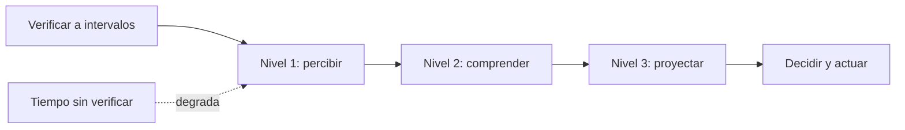

# B111-C04 — Conciencia situacional en operaciones de vuelo

<!-- nav:top -->
[🏠 Programa](../../../../README.md) · [📚 Bloque B111](../../../tronco-comun/B111-factores-humanos-y-liderazgo-de-tripulacion.md) · [← Anterior: B111-C03 — Carga cognitiva y gestión de la atención](../B111-C03-carga-cognitiva-y-gestion-de-la-atencion/CLASE.md) · [Siguiente: B111-C05 — Toma de decisiones con incertidumbre en equipo →](../B111-C05-toma-de-decisiones-con-incertidumbre-en-equipo/CLASE.md)
<!-- /nav -->

## 1. Ubicación, nivel y alcance

Clase 4 del bloque B111. Nivel N3. La conciencia situacional es lo que una persona sabe de lo que ocurre a su alrededor, lo que significa y lo que ocurrirá. Aquí calculas, para una tripulación sintética, la probabilidad de acertar cada uno de los tres niveles, la cobertura y el acuerdo del equipo y el intervalo máximo entre verificaciones que mantiene vigente un dato, y los contrastas con una simulación. Sigue a [B111-C03](../B111-C03-carga-cognitiva-y-gestion-de-la-atencion/CLASE.md). Es la conciencia situacional **de la tripulación**; la del dominio espacial (B119-C13) es otra. Los datos son sintéticos.

## 2. Por qué esta clase existe

Falta la clase que trate la conciencia situacional de la tripulación. La decisión central: **¿cómo se cuantifica lo que el equipo sabe y cada cuánto debe verificarlo para que no se quede desactualizado?**

## 3. Lo que podrás hacer al terminar

1. Nombrar los tres niveles (percepción, comprensión, proyección).
2. Calcular la probabilidad acumulada de acertar cada nivel.
3. Calcular la cobertura y el acuerdo de un equipo.
4. Calcular el intervalo máximo de verificación para un umbral de vigencia.
5. Contrastar las fórmulas con una simulación Monte Carlo.
6. Explicar por qué una puntuación simulada no mide a ninguna persona.

La evidencia es la **ficha de conciencia situacional con intervalo de verificación** del ejercicio 12 (sección 20).

## 4. Con qué llegas y cómo comprobarlo

1. ¿Qué es la probabilidad de un suceso condicionada a otro?
2. ¿Qué es un decaimiento exponencial?
3. ¿Qué es una cobertura (al menos uno)?
4. ¿Qué es una simulación Monte Carlo?
5. ¿Qué es un dato sintético?

<details>
<summary>Ver respuestas</summary>

1. La probabilidad del primero sabiendo que ocurrió el segundo. 2. Una magnitud que disminuye proporcionalmente a su valor: `exp(−t/τ)`. 3. La probabilidad de que al menos un miembro cumpla algo: `1 − Π(1 − pᵢ)`. 4. Estimar una probabilidad repitiendo un experimento aleatorio simulado. 5. Un dato fabricado para el ejemplo.
</details>

Con cuatro o cinco aciertos, sigue; si no, repasa los prerrequisitos.

## 5. Un caso de contexto y casos de referencia

Un tripulante sintético (T3) percibe bien con probabilidad `0,90`, comprende dado que percibió con `0,85` y proyecta dado que comprendió con `0,70`: acierta los tres niveles con `0,5355`. Un dato con vida media sintética `τ = 600 s` solo sigue vigente con probabilidad `0,90` si se verifica cada `63,22 s`. Es el **ejemplo conductor**. Todo es **sintético**.

## 6. Vocabulario

En el marco de Endsley (1995), la **conciencia situacional** tiene tres niveles: **percepción** de los elementos relevantes, **comprensión** de su significado y **proyección** de su estado futuro. Una **puntuación tipo SAGAT** congela una simulación y pregunta por cada nivel; aquí se simula, no se mide. La **cobertura** es la probabilidad de que al menos un miembro perciba un elemento. El **intervalo de verificación** es el tiempo máximo entre comprobaciones para que la probabilidad de vigencia no baje de un umbral.

## 7. Modelo mental: tres escalones, cada uno depende del anterior



*Descripción textual:* para proyectar hay que haber comprendido y para comprender hay que haber percibido; con el tiempo el dato se desactualiza y la verificación periódica lo renueva.

Analogía: leer un mapa mientras se conduce: ver la señal, entender qué indica y prever la curva siguiente. Límite: el modelo usa probabilidades fijas e independencia entre sondeos; la conciencia real depende de la tarea, la interfaz, la carga y el equipo.

## 8. La explicación, paso a paso

### 8.1 Niveles acumulados

Con `(p₁, p₂|₁, p₃|₂)` por tripulante, las probabilidades acumuladas son `p₁`, `p₁p₂|₁` y `p₁p₂|₁p₃|₂`. Cada nivel acumulado es menor o igual que el anterior.

| Tripulante | L1 | L2 | L3 | L1 MC | L2 MC | L3 MC | dif. máx. |
|---|---|---|---|---|---|---|---|
| T1 | 0,9700 | 0,8924 | 0,7585 | 0,9698 | 0,8932 | 0,7583 | 0,00077 |
| T2 | 0,9500 | 0,8360 | 0,6521 | 0,9513 | 0,8393 | 0,6534 | 0,00329 |
| T3 | 0,9000 | 0,7650 | 0,5355 | 0,9011 | 0,7653 | 0,5377 | 0,00218 |
| T4 | 0,9300 | 0,7440 | 0,4836 | 0,9300 | 0,7438 | 0,4824 | 0,00118 |

La simulación (semilla 114, 100 000 sondeos por tripulante) coincide con diferencia máxima `0,00329` (tolerancia `0,006`).

### 8.2 Equipo

La cobertura del nivel 1 con cuatro miembros independientes es `1 − (0,03 × 0,05 × 0,10 × 0,07) = 0,999989`. El acuerdo de T1 y T2 en el nivel 1 es `0,9215`; el de T3 y T4, `0,8370`. Que el equipo cubra no implica que comprenda ni que comparta el mismo modelo.

### 8.3 Degradación y verificación

La probabilidad de que el dato siga vigente tras `t` segundos es `exp(−t/τ)`, con `τ = 600 s` sintético: `0,9048` a 60 s, `0,6065` a 300 s, `0,3679` a 600 s y `0,1353` a 1200 s. Para mantener `≥ 0,90`, `t = −τ ln 0,90 = 63,22 s`.

### 8.4 Qué enseña y qué no

Un diseño que muestra datos frescos, avisa de lo desactualizado y reparte las comprobaciones mantiene la conciencia; la carga alta (C03) la erosiona. Pero estas cifras no miden a nadie: son parámetros sintéticos con independencia entre niveles, y los resultados dependen de ellos.

## 9. Magnitudes, símbolos y unidades

| Símbolo | Qué es | Unidad | Valor / nota |
|---|---|---|---|
| `p₁` | acierto del nivel 1 | — | 0,90–0,97 (sintético) |
| `p₂|₁` | acierto del nivel 2 dado el 1 | — | 0,80–0,92 |
| `p₃|₂` | acierto del nivel 3 dado el 2 | — | 0,65–0,85 |
| `τ` | escala de vigencia del dato | s | 600 (sintético) |
| `t_max` | intervalo de verificación | s | 63,22 |

## 10. Convenciones y referencias

Los tres niveles se toman de Endsley (1995), de quien solo se consultaron los metadatos y el resumen. Las probabilidades y `τ` son **sintéticos**. Sondeos independientes, sin sesgo de respuesta, sin automatización que cambie las tasas.

## 11. De dónde sale lo que afirmamos

| ID | Fuente | Localizador | Respalda | Estado |
|---|---|---|---|---|
| S1 | Endsley, M. R. (1995), «Toward a Theory of Situation Awareness in Dynamic Systems», Human Factors 37(1):32–64 — DOI 10.1518/001872095779049543 (consultada 2026-11-10, metadatos y resumen vía Crossref) | resumen | modelo teórico de la conciencia situacional; atención y memoria de trabajo como límites; modelos mentales y metas; relación con carga, estrés y automatización | Consultada (solo resumen) |
| — | Definición detallada de los tres niveles y el método SAGAT | texto completo no accesible | — | **No consultada** (se usa la convención estándar del ejemplo) |

Límites: ninguna cifra procede de la fuente; no se consultó el texto completo.

## 12. Cómo ver la conciencia de la tripulación

| Magnitud | Valor |
|---|---|
| L3 de T3 | 0,5355 |
| cobertura del nivel 1 | 0,999989 |
| acuerdo T1–T2 | 0,9215 |
| intervalo máximo | 63,22 s |
| diferencia MC máxima | 0,00329 |

Descripción larga: la percepción es casi universal en el equipo, pero la proyección individual ronda el 50–75 %; y el dato caduca en alrededor de un minuto para mantener `0,90`.

## 13. Ejemplo trabajado: T3 en tres niveles

**Paso 1 · Percibir.** `0,90`.

**Paso 2 · Comprender.** `0,90 × 0,85 = 0,765`.

**Paso 3 · Proyectar.** `0,765 × 0,70 = 0,5355`.

**Paso 4 · Lectura.** De cada 100 sondeos, unos 54 aciertan los tres niveles; el cuello de botella es la proyección.

## 14. Distintas formas de describir la conciencia

**Por nivel:** 1, 2 y 3. **Por equipo:** cobertura y acuerdo. **Por tiempo:** `exp(−t/τ)`. **Por diseño:** frescura, alertas y verificación cruzada.

## 15. Práctica guiada

**Ejercicio 1 · con los pasos indicados.** Calcula L2 de T1. *Pasos:* `0,97 × 0,92`.

<details><summary>Solución comentada</summary>

`0,8924`.
</details>

**Ejercicio 2 · con una pista.** Calcula L3 de T1. *Pista:* multiplica L2 por `0,85`.

<details><summary>Solución comentada</summary>

`0,8924 × 0,85 = 0,7585`.
</details>

**Ejercicio 3 · casi autónomo.** ¿Por qué L3 nunca supera L1?

<details><summary>Solución comentada</summary>

Porque es el producto de L1 por probabilidades menores o iguales que 1.
</details>

## 16. Práctica autónoma, transferencia e integrador

**Ejercicio 4 · autónomo.** L3 de T4.

<details><summary>Solución comentada</summary>

`0,93 × 0,80 × 0,65 = 0,4836`.
</details>

**Ejercicio 5 · autónomo.** Acuerdo de T2 y T3 en el nivel 1.

<details><summary>Solución comentada</summary>

`0,95 × 0,90 = 0,855`.
</details>

**Ejercicio 6 · autónomo.** Vigencia tras 120 s.

<details><summary>Solución comentada</summary>

`exp(−120/600) = 0,8187`.
</details>

**Ejercicio 7 · autónomo.** Intervalo máximo para `≥ 0,95`.

<details><summary>Solución comentada</summary>

`−600 ln 0,95 = 30,78 s`.
</details>

**Ejercicio 8 · autónomo.** Cobertura de dos miembros con `p₁ = 0,90` y `0,93`.

<details><summary>Solución comentada</summary>

`1 − 0,10 × 0,07 = 0,993`.
</details>

**Ejercicio 9 · transferencia.** **Transferencia.** El equipo cubre casi todos los elementos pero decide mal. ¿Qué nivel revisas?

<details><summary>Solución comentada</summary>

Los niveles 2 y 3: cubrir percepción no basta; se revisan la comprensión compartida y la proyección (modelos mentales, información, formación).
</details>

**Ejercicio 10 · transferencia.** **Transferencia.** Un directivo propone puntuar a cada tripulante con estas cifras. Respóndele.

<details><summary>Solución comentada</summary>

Las cifras son sintéticas; no miden a nadie ni sirven para evaluar personas. Una evaluación real exigiría métodos validados, ética y los estándares de la agencia.
</details>

**Ejercicio 11 · transferencia.** **Transferencia.** ¿Qué haría más lenta la degradación (mayor `τ`) en el diseño de una pantalla?

<details><summary>Solución comentada</summary>

Datos que se refrescan solos, indicación de antigüedad y alertas de cambio; no se modela aquí cómo.
</details>

**Ejercicio 12 · integrador.** **Integrador.** Elabora tu *ficha de conciencia situacional con intervalo de verificación*: tabla de niveles, cobertura y acuerdo, curva de vigencia, intervalo para dos umbrales y límites.

<details><summary>Solución comentada</summary>

Secciones 8.1–8.4 y la salida del laboratorio.
</details>

## 17. Laboratorio: tres niveles, equipo y vigencia

El script [situacional.py](situacional.py) calcula los niveles, la cobertura, el acuerdo y la vigencia y los contrasta con una simulación (**comprueba** diferencia máxima < 0,006).

**Datos:** todos **sintéticos**. **Predice antes de ejecutar:** ¿qué intervalo mantiene `0,90`? (63,22 s.) **Ejecución del 2026-11-10 (Python 3.12.9):**

```text
Python 3.12.9 (biblioteca estandar)
Tripulacion SINTETICA; puntuacion simulada por nivel (acumulada: acierta todos los niveles previos)
  trip   L1 an.   L2 an.   L3 an.   L1 MC    L2 MC    L3 MC   dif. max
  T1     0.9700   0.8924   0.7585   0.9698   0.8932   0.7583   0.00077
  T2     0.9500   0.8360   0.6521   0.9513   0.8393   0.6534   0.00329
  T3     0.9000   0.7650   0.5355   0.9011   0.7653   0.5377   0.00218
  T4     0.9300   0.7440   0.4836   0.9300   0.7438   0.4824   0.00118
Diferencia maxima analitica/Monte Carlo = 0.00329
Cobertura del equipo en nivel 1 (al menos uno percibe el elemento) = 0.999989
Acuerdo T1-T2 en nivel 1 = 0.9215 ; T3-T4 = 0.8370
Degradacion SINTETICA con tau = 600 s:
  t sin verificar [s]  P(dato vigente)
                    0          1.0000
                   60          0.9048
                  120          0.8187
                  300          0.6065
                  600          0.3679
                 1200          0.1353
Intervalo maximo de verificacion para >= 0.90: 63.22 s ; comprobacion exp(-t/tau) = 0.9000
Pruebas superadas.
```

```bash
python programa/clases/B111/B111-C04-conciencia-situacional-en-operaciones-de-vuelo/situacional.py
```

**Límites:** probabilidades fijas e independientes; sin automatización, carga ni dinámica de equipo.

## 18. Errores frecuentes y cómo corregirlos

**Confundir percibir con comprender.** Se corrige con 8.1.

**Creer que más pantallas dan más conciencia.** Se corrige con 8.4.

**Tomar la puntuación simulada como medida de una persona.** Se corrige con la sección 21.

**Olvidar que el dato caduca.** Se corrige con 8.3.

## 19. Cómo sabrás que vas bien

Tras la sección 8: ¿qué L3 esperabas para T3 y cuál obtuviste? Si dudas, repasa el ejemplo 13. Tras el laboratorio: ¿qué comprueba? (ver la sección 17).

## 20. Qué entregas y cómo se evalúa

El producto es tu **ficha de conciencia situacional con intervalo de verificación** (ejercicio 12).

| Criterio | Inicial | En desarrollo | Logrado | Destacado |
|---|---|---|---|---|
| Conceptos | Los confunde | Parciales | Calcula niveles y vigencia | Explica los límites |
| Cálculo | Sin unidades | Con errores | Tablas completas | Calcula casos nuevos |
| Simulación | Sin comprobar | Un caso | Contraste con la fórmula | Interpreta las diferencias |
| Fuentes | Sin fuente | Sin fecha | Fuentes con fecha y estado | Declara lo no consultado |
| Límites | No los nombra | Uno | Tres | Discute qué falta del modelo |

**Condiciones críticas (no se compensan con promedio):** rotular tripulación y probabilidades como sintéticas; no evaluar a personas con el modelo; citar solo lo consultado.

## 21. Ética, seguridad y límites

Clase educativa: no da consejo operativo ni psicológico, no sirve para evaluar a tripulantes y no sustituye a los estándares de factores humanos ni a la formación de tripulaciones. Los datos son sintéticos. Accesibilidad: tablas equivalentes a las gráficas, fórmulas en texto, ejercicios sin conexión.

## 22. Para cerrar y seguir

La proyección es el nivel más frágil (`0,5355` en T3) y el dato debe verificarse cada `63,22 s` para mantener `0,90`. Queda una pregunta: ¿cómo decide un grupo con lo que sabe y lo que no sabe?

**Glosario español–inglés.** conciencia situacional · *situation awareness*; percepción · *perception*; comprensión · *comprehension*; proyección · *projection*; vigencia · *currency*.

**Continuidad.** [B111-C05](../B111-C05-toma-de-decisiones-con-incertidumbre-en-equipo/CLASE.md) estudia la decisión en equipo.

**Referencias:** ver sección 11.

<!-- nav:bottom -->
---

[← Anterior: B111-C03 — Carga cognitiva y gestión de la atención](../B111-C03-carga-cognitiva-y-gestion-de-la-atencion/CLASE.md) · [📚 Bloque B111](../../../tronco-comun/B111-factores-humanos-y-liderazgo-de-tripulacion.md) · [Siguiente: B111-C05 — Toma de decisiones con incertidumbre en equipo →](../B111-C05-toma-de-decisiones-con-incertidumbre-en-equipo/CLASE.md)
<!-- /nav -->
