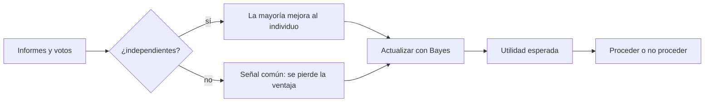

# B111-C05 — Toma de decisiones con incertidumbre en equipo

<!-- nav:top -->
[🏠 Programa](../../../../README.md) · [📚 Bloque B111](../../../tronco-comun/B111-factores-humanos-y-liderazgo-de-tripulacion.md) · [← Anterior: B111-C04 — Conciencia situacional en operaciones de vuelo](../B111-C04-conciencia-situacional-en-operaciones-de-vuelo/CLASE.md) · [Siguiente: B111-C06 — Gestión del error humano y cultura de seguridad →](../B111-C06-gestion-del-error-humano-y-cultura-de-seguridad/CLASE.md)
<!-- /nav -->

## 1. Ubicación, nivel y alcance

Clase 5 del bloque B111. Nivel N3. Decidir en equipo bajo incertidumbre combina información dispersa, opiniones correlacionadas y costos asimétricos. Aquí calculas la exactitud de una votación mayoritaria con y sin correlación entre los miembros, actualizas una creencia con informes de fiabilidad conocida y decides con la utilidad esperada. B12 da las herramientas estadísticas; aquí se aplican a la decisión grupal. Sigue a [B111-C04](../B111-C04-conciencia-situacional-en-operaciones-de-vuelo/CLASE.md). Los datos son sintéticos.

## 2. Por qué esta clase existe

B12 da herramientas estadísticas, no la decisión grupal bajo presión. La decisión central: **¿cuándo vale más el grupo que el individuo y cuándo la correlación borra esa ventaja?**

## 3. Lo que podrás hacer al terminar

1. Calcular la exactitud de una mayoría de `n` miembros independientes.
2. Incluir una correlación entre miembros y ver cómo se pierde la ventaja.
3. Actualizar una probabilidad con informes positivos y negativos (Bayes).
4. Decidir con la utilidad esperada y su umbral.
5. Contrastar las fórmulas con una simulación Monte Carlo.
6. Explicar los límites de un modelo racional frente a sesgos y presión.

La evidencia es la **ficha de decisión grupal con su sensibilidad** del ejercicio 12 (sección 20).

## 4. Con qué llegas y cómo comprobarlo

1. ¿Qué es la distribución binomial?
2. ¿Qué es el teorema de Bayes?
3. ¿Qué es una utilidad esperada?
4. ¿Qué significa «independientes»?
5. ¿Qué es un dato sintético?

<details>
<summary>Ver respuestas</summary>

1. La probabilidad de `k` éxitos en `n` ensayos independientes de probabilidad `p`. 2. La regla que actualiza una probabilidad con nueva evidencia: posterior ∝ prior × verosimilitud. 3. La media de los resultados ponderada por sus probabilidades. 4. Que saber el resultado de uno no cambia la probabilidad del otro. 5. Un dato fabricado para el ejemplo.
</details>

Con cuatro o cinco aciertos, sigue; si no, repasa los prerrequisitos.

## 5. Un caso de contexto y casos de referencia

Cada miembro acierta con `p = 0,70`. Cinco miembros independientes aciertan por mayoría con `0,8369`; si la mitad de las veces todos siguen una señal común (`ρ = 0,5`), baja a `0,7685`; con `ρ = 1`, a `0,7000`. Una falla con prior `0,10` sube a `0,3333` tras un informe positivo y a `0,6923` tras dos; con beneficio 100 y costo 400, se procede solo si la probabilidad de falla es menor que `0,20`. Es el **ejemplo conductor**. Todo es **sintético**.

## 6. Vocabulario

La **votación mayoritaria** con `n` impar acierta si más de la mitad acierta. La **correlación** `ρ` modela aquí la fracción de decisiones en que todos adoptan una señal común, que acierta con probabilidad `p`; con `1 − ρ` votan independientemente. La **actualización bayesiana** usa sensibilidad `s` y tasa de falsa alarma `f`. La **utilidad esperada** de proceder es `(1 − p_f)·B − p_f·C`, que es positiva si `p_f < B/(B + C)`.

## 7. Modelo mental: muchos ojos, pero una misma ventana



*Descripción textual:* si los miembros son independientes, el grupo mejora al individuo; si siguen una señal común, no; la creencia se actualiza con Bayes y se decide comparando la utilidad esperada.

Analogía: varios testigos del mismo accidente que han oído la misma noticia antes. Límite: el modelo es racional y sin sesgos; en la práctica pesan el anclaje, la jerarquía, la presión de tiempo y la aversión a la pérdida (Kahneman y Tversky 1979 describen esa tendencia, cuyo contenido no se consultó).

## 8. La explicación, paso a paso

### 8.1 Mayoría con independencia

`P_bin(n, p) = Σ_{k > n/2} C(n,k) pᵏ (1−p)ⁿ⁻ᵏ`. Con `p = 0,70`: `n = 1` da `0,7000`, `n = 3` da `0,7840`, `n = 5` da `0,8369` y `n = 9` da `0,9012`.

### 8.2 Mayoría con correlación

`P_grupo = ρ p + (1 − ρ) P_bin`. Con `n = 9`: `ρ = 0` da `0,9012`, `ρ = 0,5` da `0,8006` y `ρ = 1` da `0,7000`. Con correlación total el grupo no mejora al individuo, por grande que sea.

| `n` | `ρ` | analítica | Monte Carlo | diferencia |
|---|---|---|---|---|
| 3 | 0,0 | 0,7840 | 0,7845 | 0,00053 |
| 3 | 0,5 | 0,7420 | 0,7398 | 0,00220 |
| 5 | 0,0 | 0,8369 | 0,8364 | 0,00057 |
| 5 | 0,5 | 0,7685 | 0,7687 | 0,00025 |
| 9 | 0,0 | 0,9012 | 0,9018 | 0,00058 |
| 9 | 0,5 | 0,8006 | 0,8012 | 0,00056 |

La simulación (semilla 115, 100 000 decisiones) coincide con diferencia máxima `0,00249` (tolerancia `0,006`).

### 8.3 Bayes y utilidad esperada

Con prior `0,10`, sensibilidad `0,90` y falsa alarma `0,20`: un informe positivo da `0,09/(0,09 + 0,18) = 0,3333`; dos positivos, `0,6923`; uno positivo y uno negativo, `0,0588`. Con `B = 100` y `C = 400` (unidades arbitrarias), el umbral es `p* = 0,20`:

| `p_falla` | utilidad esperada de proceder | decisión |
|---|---|---|
| 0,1000 | 50,000 | proceder |
| 0,3333 | −66,667 | no proceder |
| 0,6923 | −246,154 | no proceder |
| 0,0588 | 70,588 | proceder |

### 8.4 Qué enseña y qué no

La diversidad de fuentes independientes vale más que añadir miembros que piensan igual; los informes opuestos se pesan, no se promedian a ojo; y el umbral depende de los costos. Pero el modelo no incluye jerarquía, presión de tiempo ni sesgos, y no dice quién decide.

## 9. Magnitudes, símbolos y unidades

| Símbolo | Qué es | Unidad | Valor / nota |
|---|---|---|---|
| `n` | miembros (impar) | — | 1, 3, 5, 9 |
| `p` | acierto individual | — | 0,70 (sintético) |
| `ρ` | correlación (señal común) | — | 0, 0,5, 1 |
| `s`, `f` | sensibilidad, falsa alarma | — | 0,90 y 0,20 |
| `B`, `C` | beneficio, costo | unidades arbitrarias | 100 y 400 |
| `p*` | umbral de decisión | — | 0,20 |

## 10. Convenciones y referencias

Todos los valores son **sintéticos**. La «correlación» es una mezcla simple con una señal común, no una correlación de Pearson. Miembros e informes independientes dado el estado. No se modelan sesgos ni jerarquía.

## 11. De dónde sale lo que afirmamos

| ID | Fuente | Localizador | Respalda | Estado |
|---|---|---|---|---|
| S1 | Kahneman, D. y Tversky, A. (1979), «Prospect Theory: An Analysis of Decision under Risk», Econometrica 47(2):263 — DOI 10.2307/1914185 (consultada 2026-11-10, metadatos vía Crossref) | registro bibliográfico | existencia y cita de la teoría de las perspectivas | Consultada (solo metadatos) |
| — | Binomial, Bayes, utilidad esperada | — | las verifica el laboratorio | No consultada en una fuente concreta |
| — | Literatura de decisión en equipos de vuelo o análogos | — | — | **No consultada** |

Límites: el contenido de S1 no se consultó; las cifras no proceden de ninguna fuente.

## 12. Cómo ver la decisión

| Magnitud | Valor |
|---|---|
| mayoría `n = 5`, independientes | 0,8369 |
| mayoría `n = 9`, `ρ = 0,5` | 0,8006 |
| posterior tras 2 positivos | 0,6923 |
| umbral `p*` | 0,2000 |
| diferencia MC máxima | 0,00249 |

Descripción larga: sumar miembros ayuda, pero la señal común frena la mejora; con dos informes positivos la falla ya es más probable que no y se decide no proceder.

## 13. Ejemplo trabajado: un informe positivo

**Paso 1 · Prior.** `P(falla) = 0,10`.

**Paso 2 · Verosimilitud.** Positivo con falla `0,90`; positivo sin falla `0,20`.

**Paso 3 · Posterior.** `0,10 × 0,90/(0,10 × 0,90 + 0,90 × 0,20) = 0,09/0,27 = 0,3333`.

**Paso 4 · Decisión.** `0,3333 > 0,20`: la utilidad esperada es `−66,667`; no proceder.

## 14. Distintas formas de describir la decisión

**Por mayoría:** `P_bin`. **Por correlación:** `ρ`. **Por creencia:** posterior. **Por valor:** utilidad esperada y umbral.

## 15. Práctica guiada

**Ejercicio 1 · con los pasos indicados.** Calcula la mayoría de `n = 3` con `p = 0,70`. *Pasos:* `3p²(1−p) + p³`.

<details><summary>Solución comentada</summary>

`3 × 0,49 × 0,3 + 0,343 = 0,7840`.
</details>

**Ejercicio 2 · con una pista.** Calcula `P_grupo` con `n = 3`, `ρ = 0,5`. *Pista:* `0,5 × 0,70 + 0,5 × 0,7840`.

<details><summary>Solución comentada</summary>

`0,7420`.
</details>

**Ejercicio 3 · casi autónomo.** ¿Por qué con `ρ = 1` no mejora el grupo?

<details><summary>Solución comentada</summary>

Todos siguen la misma señal: el grupo acierta lo que acierta la señal, `p`.
</details>

## 16. Práctica autónoma, transferencia e integrador

**Ejercicio 4 · autónomo.** Umbral con `B = 50` y `C = 200`.

<details><summary>Solución comentada</summary>

`50/250 = 0,20`.
</details>

**Ejercicio 5 · autónomo.** Utilidad esperada con `p_f = 0,20`.

<details><summary>Solución comentada</summary>

`0,8 × 100 − 0,2 × 400 = 0`: indiferencia.
</details>

**Ejercicio 6 · autónomo.** Posterior tras un informe negativo desde el prior `0,10`.

<details><summary>Solución comentada</summary>

`0,10 × 0,10/(0,10 × 0,10 + 0,90 × 0,80) = 0,01/0,73 = 0,0137`.
</details>

**Ejercicio 7 · autónomo.** `P_grupo` para `n = 5`, `ρ = 0,5`.

<details><summary>Solución comentada</summary>

`0,5 × 0,70 + 0,5 × 0,8369 = 0,7685`.
</details>

**Ejercicio 8 · autónomo.** ¿Qué `ρ` da `0,80` con `n = 9`?

<details><summary>Solución comentada</summary>

Resolver `0,70ρ + 0,9012(1 − ρ) = 0,80`: `ρ = 0,1012/0,2012 = 0,503`.
</details>

**Ejercicio 9 · transferencia.** **Transferencia.** Un jefe de equipo habla primero y los demás coinciden. ¿Qué ocurre con la ventaja del grupo?

<details><summary>Solución comentada</summary>

Se aproxima a `ρ = 1`: las opiniones dejan de ser independientes y el grupo se parece al jefe; se pide opinión individual antes de la discusión.
</details>

**Ejercicio 10 · transferencia.** **Transferencia.** Dos informes se contradicen. ¿Cómo los pesas?

<details><summary>Solución comentada</summary>

Con Bayes, según su sensibilidad y falsa alarma; en el ejemplo un positivo y un negativo dejan `0,0588`, por debajo del prior.
</details>

**Ejercicio 11 · transferencia.** **Transferencia.** ¿Qué no puede afirmar este modelo sobre una decisión real?

<details><summary>Solución comentada</summary>

No incluye sesgos, jerarquía, presión de tiempo ni información incompleta de los parámetros: no dice qué decidir en una misión real.
</details>

**Ejercicio 12 · integrador.** **Integrador.** Elabora tu *ficha de decisión grupal con su sensibilidad*: tabla de exactitud con `ρ`, posteriores, umbral y decisión, y lista de límites.

<details><summary>Solución comentada</summary>

Secciones 8.1–8.4 y la salida del laboratorio.
</details>

## 17. Laboratorio: mayoría con correlación, Bayes y utilidad

El script [decision.py](decision.py) calcula la mayoría, el posterior y la utilidad esperada, y contrasta la mayoría con una simulación (**comprueba** diferencia máxima < 0,006).

**Datos:** todos **sintéticos**. **Predice antes de ejecutar:** ¿cuánto acierta un grupo de 9 con `ρ = 1`? (0,7000.) **Ejecución del 2026-11-10 (Python 3.12.9):**

```text
Python 3.12.9 (biblioteca estandar)
Votacion mayoritaria (SINTETICA), p = 0.70 por miembro
  n   rho   exactitud analitica   Monte Carlo   diferencia
  1   0.0               0.7000        0.6975     0.00249
  1   0.5               0.7000        0.6993     0.00075
  1   1.0               0.7000        0.6978     0.00220
  3   0.0               0.7840        0.7845     0.00053
  3   0.5               0.7420        0.7398     0.00220
  3   1.0               0.7000        0.7017     0.00173
  5   0.0               0.8369        0.8364     0.00057
  5   0.5               0.7685        0.7687     0.00025
  5   1.0               0.7000        0.7004     0.00040
  9   0.0               0.9012        0.9018     0.00058
  9   0.5               0.8006        0.8012     0.00056
  9   1.0               0.7000        0.7004     0.00036
Diferencia maxima = 0.00249
Bayes: prior = 0.1000 ; tras 1 informe positivo = 0.3333 ; tras 2 positivos = 0.6923 ; tras positivo y negativo = 0.0588
Umbral de decision p* = B/(B+C) = 0.2000
  p_falla = 0.1000  utilidad esperada de proceder =   50.000  decision: proceder
  p_falla = 0.3333  utilidad esperada de proceder =  -66.667  decision: no proceder
  p_falla = 0.6923  utilidad esperada de proceder = -246.154  decision: no proceder
  p_falla = 0.0588  utilidad esperada de proceder =   70.588  decision: proceder
Pruebas superadas.
```

```bash
python programa/clases/B111/B111-C05-toma-de-decisiones-con-incertidumbre-en-equipo/decision.py
```

**Límites:** modelo racional, sin sesgos ni jerarquía; la diferencia de la fila `n = 1` es ruido de la simulación (el valor analítico es `p`).

## 18. Errores frecuentes y cómo corregirlos

**Creer que más miembros siempre mejoran la decisión.** Se corrige con 8.2.

**Promediar informes contradictorios a ojo.** Se corrige con 8.3.

**Ignorar el costo asimétrico.** Se corrige con el umbral `p*`.

**Aplicar el modelo a una decisión real sin sus parámetros.** Se corrige con la sección 21.

## 19. Cómo sabrás que vas bien

Tras la sección 8: ¿qué exactitud esperabas con `n = 9` y `ρ = 0,5` y cuál obtuviste? Si dudas, repasa el ejemplo 13. Tras el laboratorio: ¿qué comprueba? (ver la sección 17).

## 20. Qué entregas y cómo se evalúa

El producto es tu **ficha de decisión grupal con su sensibilidad** (ejercicio 12).

| Criterio | Inicial | En desarrollo | Logrado | Destacado |
|---|---|---|---|---|
| Conceptos | Los confunde | Parciales | Calcula mayoría, Bayes y utilidad | Explica los límites |
| Cálculo | Sin unidades | Con errores | Tablas completas | Calcula casos nuevos |
| Simulación | Sin comprobar | Un caso | Contraste con la fórmula | Interpreta las diferencias |
| Fuentes | Sin fuente | Sin fecha | Fuentes con fecha y estado | Declara lo no consultado |
| Límites | No los nombra | Uno | Tres | Discute qué falta del modelo |

**Condiciones críticas (no se compensan con promedio):** rotular los parámetros como sintéticos; no presentar el modelo como guía de una decisión real; citar solo lo consultado.

## 21. Ética, seguridad y límites

Clase educativa: no da consejo operativo, médico ni de seguridad, y ningún resultado debe usarse para decidir en una operación real, para la cual rigen los procedimientos y la autoridad de la misión. Los datos son sintéticos. Accesibilidad: tablas equivalentes a las gráficas, fórmulas en texto, ejercicios sin conexión.

## 22. Para cerrar y seguir

Cinco miembros independientes acierta `0,8369` y con una señal común de `ρ = 0,5`, `0,7685`; dos informes positivos llevan la falla de `0,10` a `0,6923`. Queda una pregunta: ¿qué hacemos con los errores que igualmente ocurrirán?

**Glosario español–inglés.** decisión en equipo · *team decision-making*; incertidumbre · *uncertainty*; utilidad esperada · *expected utility*; probabilidad posterior · *posterior probability*; señal común · *common signal*.

**Continuidad.** [B111-C06](../B111-C06-gestion-del-error-humano-y-cultura-de-seguridad/CLASE.md) estudia la gestión del error humano.

**Referencias:** ver sección 11.

<!-- nav:bottom -->
---

[← Anterior: B111-C04 — Conciencia situacional en operaciones de vuelo](../B111-C04-conciencia-situacional-en-operaciones-de-vuelo/CLASE.md) · [📚 Bloque B111](../../../tronco-comun/B111-factores-humanos-y-liderazgo-de-tripulacion.md) · [Siguiente: B111-C06 — Gestión del error humano y cultura de seguridad →](../B111-C06-gestion-del-error-humano-y-cultura-de-seguridad/CLASE.md)
<!-- /nav -->
