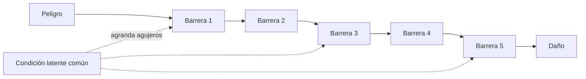

# B111-C06 — Gestión del error humano y cultura de seguridad

<!-- nav:top -->
[🏠 Programa](../../../../README.md) · [📚 Bloque B111](../../../tronco-comun/B111-factores-humanos-y-liderazgo-de-tripulacion.md) · [← Anterior: B111-C05 — Toma de decisiones con incertidumbre en equipo](../B111-C05-toma-de-decisiones-con-incertidumbre-en-equipo/CLASE.md) · [Siguiente: B112-C01 — Magnitudes dosimétricas: dosis absorbida, LET y eficacia biológica →](../../../tronco-comun/B112-radiobiologia-y-proteccion-radiologica-espacial.md#b112-c01)
<!-- /nav -->

## 1. Ubicación, nivel y alcance

Clase 6 y última del bloque B111. Nivel N3. Las personas se equivocan; lo que un sistema seguro hace es impedir que un error llegue a ser un daño. Aquí calculas, con un modelo sintético de cinco barreras en serie («queso suizo»), la probabilidad de que todas fallen con y sin una condición latente común, clasificas errores por tipo y estimas cuántos casi-eventos se reportan y cómo cambia con una cultura de seguridad que facilita reportar. Sigue a [B111-C05](../B111-C05-toma-de-decisiones-con-incertidumbre-en-equipo/CLASE.md). Los datos son sintéticos.

## 2. Por qué esta clase existe

Falta la clase sobre tipos de error, barreras y reporte. La decisión central: **¿dónde se pone el esfuerzo: en culpar al que erró o en reforzar las barreras y las condiciones que dejaron pasar el error?**

## 3. Lo que podrás hacer al terminar

1. Distinguir resbalón, descuido, equivocación y violación.
2. Calcular la probabilidad de que todas las barreras fallen si son independientes.
3. Incluir una condición latente común y medir cuánto aumenta el riesgo.
4. Calcular qué barrera aporta más protección.
5. Calcular los reportes esperados por tipo y el efecto de una cultura que los facilita.
6. Contrastar la fórmula con una simulación Monte Carlo y explicar los límites.

La evidencia es la **ficha de barreras y de reporte de un evento sintético** del ejercicio 12 (sección 20).

## 4. Con qué llegas y cómo comprobarlo

1. ¿Qué es la probabilidad de que ocurran varios sucesos independientes a la vez?
2. ¿Qué es una causa común?
3. ¿Qué es un casi-evento?
4. ¿Qué diferencia hay entre una falla activa y una condición latente?
5. ¿Qué es un dato sintético?

<details>
<summary>Ver respuestas</summary>

1. El producto de sus probabilidades. 2. Un factor que afecta a varias barreras a la vez y las hace fallar juntas. 3. Un suceso que pudo causar daño y no lo causó. 4. La primera es un acto inseguro con efecto inmediato; la segunda, una condición del sistema (diseño, carga, procedimientos) que permanece oculta hasta que se combina con otras. 5. Un dato fabricado para el ejemplo.
</details>

Con cuatro o cinco aciertos, sigue; si no, repasa los prerrequisitos.

## 5. Un caso de contexto y casos de referencia

Cinco barreras sintéticas con probabilidades de falla `0,10; 0,05; 0,20; 0,10; 0,15` fallan todas juntas con `1,500 × 10⁻⁵` si son independientes. Si una condición latente común (presente el `10 %` de las veces) triplica cada probabilidad, el riesgo sube a `3,780 × 10⁻⁴`, **25,2 veces más**. De 1000 casi-eventos se reportan `395` con las tasas sintéticas y `592,5` si una cultura de seguridad las multiplica por `1,5`. Es el **ejemplo conductor**. Todo es **sintético**.

## 6. Vocabulario

Reason (2000) distingue el enfoque de la persona del enfoque del sistema, y describe las defensas en capas con agujeros que se alinean por fallas activas y condiciones latentes; de ese artículo solo se consultaron los metadatos. Aquí: el **resbalón** es un fallo de ejecución (hacer otra cosa de la prevista), el **descuido** un fallo de memoria, la **equivocación** un plan equivocado y la **violación** una desviación deliberada de una regla; esta clasificación se toma como convención didáctica. Una **barrera** es una defensa con probabilidad de falla `q`. Una **condición latente** común multiplica las `q` por `k`. La **cultura de seguridad** se modela como un factor `r` que aumenta la tasa de reporte.

## 7. Modelo mental: rebanadas de queso con agujeros



*Descripción textual:* un peligro causa daño solo si atraviesa todas las barreras; una condición latente común agranda los agujeros de varias a la vez, y el reporte de casi-eventos revela qué barreras ya fallaron.

Analogía: rebanadas de queso apiladas: un agujero no basta, pero si se alinean, pasa. Límite: el modelo supone barreras independientes dado el estado latente y probabilidades fijas; las barreras reales interactúan y cambian.

## 8. La explicación, paso a paso

### 8.1 Barreras independientes

`P = Π qᵢ = 0,10 × 0,05 × 0,20 × 0,10 × 0,15 = 1,500 × 10⁻⁵`. Quitar la barrera `i` multiplica el riesgo:

| barrera | `q` | `P` sin ella | aumento |
|---|---|---|---|
| 1 | 0,10 | 1,500 × 10⁻⁴ | 10,00 |
| 2 | 0,05 | 3,000 × 10⁻⁴ | 20,00 |
| 3 | 0,20 | 7,500 × 10⁻⁵ | 5,00 |
| 4 | 0,10 | 1,500 × 10⁻⁴ | 10,00 |
| 5 | 0,15 | 1,000 × 10⁻⁴ | 6,67 |

La barrera más valiosa (aquí la 2) es la de menor `q`.

### 8.2 Causa común

Con probabilidad `c = 0,10` la condición latente está presente y cada `q` se multiplica por `k = 3` (tope 1): `P = 0,90 × 1,5 × 10⁻⁵ + 0,10 × (0,3 × 0,15 × 0,6 × 0,3 × 0,45) = 1,35 × 10⁻⁵ + 3,645 × 10⁻⁴ = 3,780 × 10⁻⁴`. El cociente es `25,2`: casi todo el riesgo viene del `10 %` de las veces en que la condición está presente. Una simulación (semilla 116, 1 000 000 de eventos) da `3,850 × 10⁻⁴`, con diferencia relativa `0,019` (tolerancia `0,15`).

### 8.3 Reporte

De 1000 casi-eventos, con mezcla `(0,30; 0,35; 0,25; 0,10)` y tasa de reporte `(0,40; 0,30; 0,60; 0,20)`, se reportan `120 + 105 + 150 + 20 = 395` (`0,395`). Las violaciones y los descuidos son los menos reportados. Con una cultura que multiplica la tasa por `1,5` (tope 1), `592,5`.

| tipo | ocurren | tasa | reportados |
|---|---|---|---|
| resbalón | 300 | 0,40 | 120,0 |
| descuido | 350 | 0,30 | 105,0 |
| equivocación | 250 | 0,60 | 150,0 |
| violación | 100 | 0,20 | 20,0 |

### 8.4 Qué enseña y qué no

Reducir una condición latente compartida vale más que mejorar una sola barrera; el reporte sin represalia revela las barreras ya perforadas; y culpar a la persona no cambia las condiciones. Pero las cifras son sintéticas, el modelo no distingue tipos de daño y la cultura de seguridad real no se reduce a un factor `r`. Ninguno de estos números evalúa a personas ni organizaciones.

## 9. Magnitudes, símbolos y unidades

| Símbolo | Qué es | Unidad | Valor / nota |
|---|---|---|---|
| `qᵢ` | probabilidad de falla de la barrera `i` | — | 0,05–0,20 (sintético) |
| `c` | presencia de la condición latente | — | 0,10 |
| `k` | multiplicador de las `q` | — | 3 |
| `P` | todas las barreras fallan | — | 1,5 × 10⁻⁵; 3,78 × 10⁻⁴ |
| tasa | fracción reportada por tipo | — | 0,20–0,60 |
| `r` | factor de cultura | — | 1,0 y 1,5 |

## 10. Convenciones y referencias

Cinco barreras, `c`, `k`, mezcla de tipos y tasas de reporte son **sintéticos**. La clasificación de errores es una convención didáctica. Barreras independientes dado el estado latente.

## 11. De dónde sale lo que afirmamos

| ID | Fuente | Localizador | Respalda | Estado |
|---|---|---|---|---|
| S1 | Reason, J. (2000), «Human error: models and management», BMJ 320(7237):768–770 — DOI 10.1136/bmj.320.7237.768 (consultada 2026-11-10, metadatos vía Europe PMC) | registro bibliográfico | existencia y cita del artículo | Consultada (solo metadatos) |
| — | Texto de Reason y modelo del queso suizo | PMC bloqueó la lectura (verificación) | — | **No consultada** (el modelo se usa como analogía estándar) |
| — | Taxonomías de error y sistemas de reporte de las agencias | — | — | **No consultada** |

Límites: ninguna cifra procede de una fuente; los enunciados de la sección 6 sobre el modelo deben verificarse en el texto primario.

## 12. Cómo ver las barreras y el reporte

| Magnitud | Valor |
|---|---|
| `P` independientes | 1,500 × 10⁻⁵ |
| `P` con causa común | 3,780 × 10⁻⁴ |
| cociente | 25,2 |
| reportados (base) | 395 |
| reportados (`r` = 1,5) | 592,5 |

Descripción larga: una condición oculta que se da una de cada diez veces multiplica el riesgo por 25; una cultura que facilita reportar eleva los reportes en la mitad.

## 13. Ejemplo trabajado: la causa común

**Paso 1 · Estado normal.** `0,90 × 1,5 × 10⁻⁵ = 1,35 × 10⁻⁵`.

**Paso 2 · Estado latente.** Las `q` pasan a `0,30; 0,15; 0,60; 0,30; 0,45` y su producto es `3,645 × 10⁻³`; con peso `0,10`, `3,645 × 10⁻⁴`.

**Paso 3 · Total.** `1,35 × 10⁻⁵ + 3,645 × 10⁻⁴ = 3,780 × 10⁻⁴`.

**Paso 4 · Lectura.** `3,780 × 10⁻⁴/1,5 × 10⁻⁵ = 25,2`: el estado latente aporta el 96 % del riesgo.

## 14. Distintas formas de describir el error

**Por tipo:** resbalón, descuido, equivocación, violación. **Por defensa:** barreras y su `q`. **Por sistema:** condiciones latentes. **Por aprendizaje:** reporte y análisis.

## 15. Práctica guiada

**Ejercicio 1 · con los pasos indicados.** Calcula `P` con tres barreras `0,1; 0,1; 0,1`. *Pasos:* producto.

<details><summary>Solución comentada</summary>

`10⁻³`.
</details>

**Ejercicio 2 · con una pista.** Calcula el aumento al quitar una de esas barreras. *Pista:* `0,01/0,001`.

<details><summary>Solución comentada</summary>

`10`.
</details>

**Ejercicio 3 · casi autónomo.** ¿Por qué la causa común aumenta tanto el riesgo?

<details><summary>Solución comentada</summary>

Porque rompe la independencia: las barreras fallan juntas y el producto de probabilidades pequeñas deja de ser un buen resumen.
</details>

## 16. Práctica autónoma, transferencia e integrador

**Ejercicio 4 · autónomo.** Reportados si la tasa de violación pasa de `0,20` a `0,40`.

<details><summary>Solución comentada</summary>

`+ 100 × 0,20 = +20`: `415`.
</details>

**Ejercicio 5 · autónomo.** Fracción reportada con `r = 1,5`.

<details><summary>Solución comentada</summary>

`592,5/1000 = 0,5925`.
</details>

**Ejercicio 6 · autónomo.** `P` con causa común si `c = 0,20`.

<details><summary>Solución comentada</summary>

`0,80 × 1,5 × 10⁻⁵ + 0,20 × 3,645 × 10⁻³ = 1,2 × 10⁻⁵ + 7,29 × 10⁻⁴ = 7,41 × 10⁻⁴`.
</details>

**Ejercicio 7 · autónomo.** Fracción del riesgo aportada por el estado latente en el caso base.

<details><summary>Solución comentada</summary>

`3,645 × 10⁻⁴/3,780 × 10⁻⁴ = 0,964`.
</details>

**Ejercicio 8 · autónomo.** ¿Qué barrera quitarías en último lugar?

<details><summary>Solución comentada</summary>

La 2: su ausencia multiplica el riesgo por 20, el máximo.
</details>

**Ejercicio 9 · transferencia.** **Transferencia.** Tras un incidente se propone sancionar a quien se equivocó. ¿Qué opinas según el enfoque de sistema?

<details><summary>Solución comentada</summary>

La sanción no cambia las condiciones latentes y desalienta el reporte; se analizan las barreras y condiciones que dejaron pasar el error. Una violación deliberada se trata distinto, con juicio profesional.
</details>

**Ejercicio 10 · transferencia.** **Transferencia.** Un reporte tarda semanas y no recibe respuesta. ¿Qué pasa con las tasas del modelo?

<details><summary>Solución comentada</summary>

Bajan (`r < 1`): el reporte se percibe inútil; se pierde información sobre barreras perforadas.
</details>

**Ejercicio 11 · transferencia.** **Transferencia.** ¿Qué dato necesitarías para estimar `c` y `k` en un sistema real?

<details><summary>Solución comentada</summary>

Datos de eventos y de condiciones de operación auditados, con permiso y análisis de dependencias; los de la clase son sintéticos.
</details>

**Ejercicio 12 · integrador.** **Integrador.** Elabora tu *ficha de barreras y de reporte de un evento sintético*: `P` independiente y con causa común, aporte de cada barrera, tabla de reportes, efecto de la cultura y límites.

<details><summary>Solución comentada</summary>

Secciones 8.1–8.4 y la salida del laboratorio.
</details>

## 17. Laboratorio: barreras, causa común y reporte

El script [error.py](error.py) calcula `P` independiente y con causa común, el aporte de cada barrera y los reportes, y contrasta `P` con una simulación (**comprueba** diferencia relativa < 0,15 y `P` con causa común > `P` independiente).

**Datos:** todos **sintéticos**. **Predice antes de ejecutar:** ¿por cuánto se multiplica el riesgo con la causa común? (25,2.) **Ejecución del 2026-11-10 (Python 3.12.9):**

```text
Python 3.12.9 (biblioteca estandar)
Barreras SINTETICAS q = (0.1, 0.05, 0.2, 0.1, 0.15)
P(todas fallan), independientes = 1.500e-05
P(todas fallan), con condicion latente comun (c = 0.1, k = 3) = 3.780e-04
Monte Carlo (1000000 eventos) = 3.850e-04 ; diferencia relativa = 0.019
Cociente causa comun / independiente = 25.200
Aporte de cada capa: P sin la barrera i (independientes) y multiplicador de riesgo
  barrera 1: sin ella P = 1.500e-04 ; aumento = 10.00
  barrera 2: sin ella P = 3.000e-04 ; aumento = 20.00
  barrera 3: sin ella P = 7.500e-05 ; aumento = 5.00
  barrera 4: sin ella P = 1.500e-04 ; aumento = 10.00
  barrera 5: sin ella P = 1.000e-04 ; aumento = 6.67
Reporte de 1000 casi-eventos SINTETICOS:
  tipo           ocurren  tasa  reportados
  resbalon           300  0.40       120.0
  descuido           350  0.30       105.0
  equivocacion       250  0.60       150.0
  violacion          100  0.20        20.0
Reportados = 395.0 de 1000 (fraccion 0.395)
  con cultura que multiplica la tasa por 1.0: reportados = 395.0
  con cultura que multiplica la tasa por 1.5: reportados = 592.5
Pruebas superadas.
```

```bash
python programa/clases/B111/B111-C06-gestion-del-error-humano-y-cultura-de-seguridad/error.py
```

**Límites:** barreras independientes dado el estado latente; tasas fijas; sin gravedad del daño; ninguna cifra evalúa personas ni organizaciones.

## 18. Errores frecuentes y cómo corregirlos

**Multiplicar probabilidades sin comprobar la independencia.** Se corrige con 8.2.

**Buscar al culpable en lugar de la condición.** Se corrige con 8.4.

**Tratar todos los errores como el mismo tipo.** Se corrige con la sección 6.

**Leer la tasa de reporte como tasa de error.** Se corrige con 8.3.

## 19. Cómo sabrás que vas bien

Tras la sección 8: ¿cuánto esperabas que subiera el riesgo con la causa común y cuánto subió? Si dudas, repasa el ejemplo 13. Tras el laboratorio: ¿qué comprueba? (ver la sección 17).

## 20. Qué entregas y cómo se evalúa

El producto es tu **ficha de barreras y de reporte de un evento sintético** (ejercicio 12).

| Criterio | Inicial | En desarrollo | Logrado | Destacado |
|---|---|---|---|---|
| Conceptos | Los confunde | Parciales | Distingue tipos y barreras | Explica los límites |
| Cálculo | Sin unidades | Con errores | Tablas completas | Calcula casos nuevos |
| Simulación | Sin comprobar | Un caso | Contraste con la fórmula | Interpreta las diferencias |
| Fuentes | Sin fuente | Sin fecha | Fuentes con fecha y estado | Declara lo no consultado |
| Límites | No los nombra | Uno | Tres | Discute qué falta del modelo |

**Condiciones críticas (no se compensan con promedio):** rotular barreras, tasas y mezcla como sintéticas; no atribuir culpa a personas ni evaluar organizaciones con el modelo; citar solo lo consultado.

## 21. Ética, seguridad y límites

Clase educativa: **no da consejo médico, psicológico ni operativo**, no sirve para investigar un evento real ni para evaluar personas u organizaciones, y no sustituye a los sistemas de reporte, a los estándares de seguridad de las agencias ni a la formación de tripulaciones. Los datos son sintéticos. Accesibilidad: tablas equivalentes a las gráficas, fórmulas en texto, ejercicios sin conexión.

## 22. Para cerrar y seguir

Cinco barreras valen `1,500 × 10⁻⁵` si son independientes y `3,780 × 10⁻⁴` con una condición latente común, y una cultura que facilita el reporte eleva los avisos de `395` a `592,5` de cada 1000. Con esta clase se cierra el bloque: de las capacidades humanas al sistema que las protege de sus propios errores.

**Glosario español–inglés.** error humano · *human error*; cultura de seguridad · *safety culture*; barrera · *barrier*; condición latente · *latent condition*; casi-evento · *near miss*.

**Continuidad.** Esta es la última clase de B111; la guía del bloque la enlaza y la navegación continúa con el siguiente bloque.

**Referencias:** ver sección 11.

<!-- nav:bottom -->
---

[← Anterior: B111-C05 — Toma de decisiones con incertidumbre en equipo](../B111-C05-toma-de-decisiones-con-incertidumbre-en-equipo/CLASE.md) · [📚 Bloque B111](../../../tronco-comun/B111-factores-humanos-y-liderazgo-de-tripulacion.md) · [Siguiente: B112-C01 — Magnitudes dosimétricas: dosis absorbida, LET y eficacia biológica →](../../../tronco-comun/B112-radiobiologia-y-proteccion-radiologica-espacial.md#b112-c01)
<!-- /nav -->
