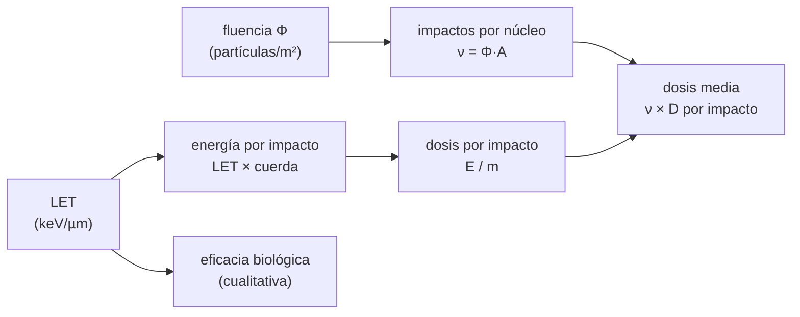

# B112-C01 — Magnitudes dosimétricas: dosis absorbida, LET y eficacia biológica

<!-- nav:top -->
[🏠 Programa](../../../../README.md) · [📚 Bloque B112](../../../tronco-comun/B112-radiobiologia-y-proteccion-radiologica-espacial.md) · [← Anterior: B111-C06 — Gestión del error humano y cultura de seguridad](../../B111/B111-C06-gestion-del-error-humano-y-cultura-de-seguridad/CLASE.md) · [Siguiente: B112-C02 — Dosis equivalente y dosis efectiva →](../B112-C02-dosis-equivalente-y-dosis-efectiva/CLASE.md)
<!-- /nav -->

## 1. Ubicación, nivel y alcance

Clase 1 del bloque B112 (área A09). Nivel N3. Es la primera del bloque: define la **dosis absorbida** (cuánta energía deposita la radiación por kilogramo de tejido) y el **LET** (cuánta energía pierde una partícula por micrómetro de recorrido), y muestra por qué dos radiaciones con la misma dosis en gray pueden ser muy distintas a escala de una célula. Todas las cifras del laboratorio son **ilustrativas y sintéticas**; ninguna es una medición.

## 2. Por qué esta clase existe

B105-C06 introduce la exposición a la radiación espacial como un hecho del entorno, pero no define qué se mide ni en qué unidades. Sin esa definición no se puede leer una tasa de dosis de una misión ni entender por qué los iones pesados preocupan más que los protones. La decisión central: **¿qué magnitud usar para describir la radiación, y qué información se pierde al resumirla en un solo número de gray?**

## 3. Lo que podrás hacer al terminar

1. Calcular la dosis absorbida `D = E/m` en gray a partir de una energía y una masa.
2. Convertir un LET de keV/µm a J/m y calcular la energía que una traza deja en un volumen.
3. Calcular la fluencia que da una dosis macroscópica con `D = Φ·LET/ρ` y el número medio de impactos por núcleo.
4. Explicar con la estadística de Poisson por qué, a la misma dosis, una parte de los núcleos no recibe ningún impacto de un ion pesado.
5. Distinguir dosis absorbida (física, Gy) de eficacia biológica (efecto) y justificar por qué hace falta otra magnitud.
6. Rotular qué cifras son consultadas, cuáles ilustrativas y cuáles sintéticas.

La evidencia es la **ficha dosimétrica con unidades y balance de energía** del ejercicio 12 (sección 20).

## 4. Con qué llegas y cómo comprobarlo

1. ¿Qué es un julio y qué es un kilogramo?
2. ¿Qué es una densidad y cuánto vale la del agua?
3. ¿Qué es un proceso de Poisson?
4. ¿Cuánto es un keV en julios?
5. ¿Qué es un dato sintético?

<details>
<summary>Ver respuestas</summary>

1. Unidades SI de energía y de masa. 2. Masa por volumen; 1000 kg/m³. 3. Un conteo de sucesos independientes con tasa media constante. 4. 1,602 × 10⁻¹⁶ J. 5. Uno generado por un modelo y no medido; se rotula como tal.
</details>

Con cuatro o cinco aciertos, sigue; si no, repasa los prerrequisitos.

## 5. Un caso de contexto y casos de referencia

Un núcleo celular esférico de 10 µm de diámetro (masa `5,236 × 10⁻¹³ kg`) recibe una dosis macroscópica de 0,1 Gy. Si la dosis es de fotones (LET ilustrativo 0,3 keV/µm) recibe unos 163 impactos de electrones; si es de protones, 98; si es de oxígeno, 1,6; si es de hierro (150 keV/µm), solo **0,33 impactos** de media y el 72,1 % de los núcleos no recibe ninguno, mientras el 27,9 % recibe 0,306 Gy de golpe. Misma dosis media, deposición distinta. Es el **ejemplo conductor**: todo es **ilustrativo y sintético** (semilla 112), con LET redondeados que no proceden de una tabla consultada.

## 6. Vocabulario

La **dosis absorbida** `D` es la energía depositada por unidad de masa, `D = E/m`, y su unidad es el gray (1 Gy = 1 J/kg). El **LET** (transferencia lineal de energía) es el cociente `dE/dl` entre la energía que una partícula cargada pierde por colisiones y la distancia recorrida; su unidad es J/m, a menudo keV/µm (definición del glosario de ICRP 103, consultado). La **fluencia** `Φ` es el número de partículas por unidad de área. La **eficacia biológica relativa** (RBE) compara el efecto de dos radiaciones a igual dosis; aquí se trata solo de forma cualitativa. Una **traza** es el camino de una partícula; el **impacto** es la travesía de un núcleo por una traza.

## 7. Modelo mental



*Descripción textual:* la fluencia da el número medio de impactos por núcleo; el LET y la cuerda dan la energía de cada impacto, y esta dividida por la masa da su dosis; el producto de ambos es la dosis media. El LET, además, orienta la eficacia biológica.

Analogía: repartir 100 granizos sobre un tejado con muchos pequeños o con pocos muy grandes: el peso total es el mismo, pero el daño en cada punto no. Límite: el granizo no se reparte al azar entre puntos distintos de la célula ni deja deltas; aquí no se modelan electrones secundarios ni fragmentación nuclear.

## 8. La explicación, paso a paso

### 8.1 Dosis absorbida y energía

La dosis `D = E/m` mide energía por masa. Un gray es un julio por kilogramo. Con `E = 3,33 keV = 5,34 × 10⁻¹⁶ J` en una masa de `5,236 × 10⁻¹³ kg` resulta `1,02 × 10⁻³ Gy`. Control: la unidad sale en J/kg sin factores sobrantes.

### 8.2 LET y energía por impacto

El LET se da en keV/µm. Una traza que cruza el núcleo con la cuerda media `2d/3 = 6,67 µm` deja `E = LET × cuerda`. Para el hierro ilustrativo de 150 keV/µm son `1000 keV = 1,6 × 10⁻¹³ J`; sobre la masa del núcleo, `0,306 Gy` por un solo impacto, frente a `1,02 mGy` de un protón de 0,5 keV/µm: un factor 300, el cociente de los LET.

### 8.3 De la fluencia a la dosis macroscópica

Con partículas de LET constante, `D = Φ·LET/ρ` (LET en J/m, `ρ = 1000 kg/m³`). Para 0,1 Gy, el hierro necesita `Φ = 4,16 × 10⁵ cm⁻²` y el protón `1,25 × 10⁸ cm⁻²`. El número medio de impactos por núcleo es `ν = Φ·A`, con `A = πd²/4 = 7,854 × 10⁻¹¹ m²`: 98,0 para el protón y 0,327 para el hierro.

### 8.4 Estadística de impactos

Los impactos siguen una distribución de Poisson: la fracción de núcleos sin impacto es `e^(−ν)`, 72,1 % para el hierro (simulado 72,1 %). La dispersión de la dosis por núcleo es `σ/media = 1/√ν`: 0,10 para el protón y 1,75 para el hierro. La dosis media coincide en todos los casos con la macroscópica dentro del 3 % (control del laboratorio).

### 8.5 Dosis y eficacia biológica

La dosis en gray promedia sobre la masa y no dice cómo se reparte la energía. A igual dosis, una radiación de alto LET concentra la energía en pocas trazas muy densas, lo que está asociado a más daño complejo por traza (B112-C05) y, por eso, a más eficacia biológica relativa. Esa eficacia se corrige con los factores de la clase siguiente (B112-C02). Esta clase no calcula ninguna RBE numérica.

## 9. Magnitudes, símbolos y unidades

| Símbolo | Qué es | Unidad | Valor / nota |
|---|---|---|---|
| `D` | dosis absorbida | Gy = J/kg | 0,1 Gy macroscópica; 1,02 mGy por protón; 0,306 Gy por hierro |
| LET | energía perdida por longitud | keV/µm (1 keV/µm = 1,602 × 10⁻¹⁰ J/m) | 0,3 a 150 (ilustrativos) |
| `Φ` | fluencia | m⁻² (o cm⁻²) | 4,16 × 10⁵ cm⁻² (hierro, 0,1 Gy) |
| `ν` | impactos medios por núcleo | — | 98,0 (protón); 0,327 (hierro) |
| `d`, `m` | diámetro y masa del núcleo | m, kg | 10 µm; 5,236 × 10⁻¹³ kg |
| CV | desviación típica / media de la dosis | — | `1/√ν` |

## 10. Convenciones y referencias

Unidades SI: dosis en gray, LET en keV/µm (o J/m), longitudes en metros. Sistema de referencia: el núcleo esférico de 10 µm en reposo, trazas con dirección isótropa y cuerda media `2d/3`. Datos **ilustrativos y sintéticos** (semilla 112); `1 keV = 1,602176634 × 10⁻¹⁶ J` (valor del SI, no consultado en este bloque). Tolerancias: dosis media simulada igual a la macroscópica dentro del 3 %; fracción sin impacto igual a `e^(−ν)` dentro de 0,01; 200 000 núcleos por radiación. Numpy 2.4.4, Python 3.12.9.

## 11. De dónde sale lo que afirmamos

| ID | Fuente | Localizador | Respalda | Estado |
|---|---|---|---|---|
| S1 | ICRP, 2007, *The 2007 Recommendations of the ICRP*, Publicación 103, Ann. ICRP 37(2-4), extracto gratuito (PDF leído con PyMuPDF) — icrp.org (consultada 2026-11-10) | glosario: «Linear energy transfer», «Radiation weighting factor» | definición de LET (dE/dl, unidad J/m o keV/µm) y del factor de ponderación de la radiación como corrección de la mayor eficacia biológica del alto LET | Consultada (extracto) |
| S2 | Cucinotta, F. A. y Durante, M., «Cancer risk from exposure to galactic cosmic rays: implications for space exploration by human beings», Lancet Oncol 7(5):431-435, 2006, doi 10.1016/S1470-2045(06)70695-7 (resumen vía Europe PMC, consultado 2026-11-10) | resumen | los iones de alta carga y energía dominan el riesgo en el espacio profundo y su efecto biológico está mal conocido | Consultada (solo resumen) |
| — | Definición de gray (J/kg), `D = E/m`, `D = Φ·LET/ρ` y estadística de Poisson | — | las verifica el laboratorio | No consultada en una fuente concreta (las verifica el laboratorio) |

Límites: de ICRP 103 solo se consultó el extracto gratuito (glosario y resumen), no las tablas numéricas. Los valores de LET de la tabla (0,3; 0,5; 2; 30; 150 keV/µm) son **ilustrativos y no se consultaron** en una tabla publicada (por ejemplo, de NIST); no deben usarse para dosimetría. Tampoco se consultaron las publicaciones ICRU sobre magnitudes dosimétricas.

## 12. Cómo ver el resultado

| Métrica | Valor |
|---|---|
| Núcleo: masa / cuerda media | 5,236 × 10⁻¹³ kg / 6,67 µm |
| Dosis por impacto, protón / hierro | 1,02 mGy / 0,306 Gy |
| Impactos por núcleo, protón / hierro (0,1 Gy) | 98,0 / 0,327 |
| Núcleos sin impacto, protón / hierro | 0,0 % / 72,1 % |
| Dispersión σ/media, protón / hierro | 0,10 / 1,75 |

Descripción larga: a igual dosis media de 0,1 Gy, los protones reparten unos cien impactos pequeños por núcleo y el hierro menos de uno, pero grande; el promedio es el mismo y la distribución, muy distinta.

## 13. Ejemplo trabajado: dosis por impacto de un ion de hierro

**Paso 1 · Energía.** LET ilustrativo 150 keV/µm y cuerda 6,67 µm: `E = 150 × 6,67 = 1000 keV`.

**Paso 2 · A julios.** `1000 × 1,602 × 10⁻¹⁶ = 1,602 × 10⁻¹³ J`.

**Paso 3 · Masa.** `m = ρ·πd³/6 = 1000 × 5,236 × 10⁻¹⁶ = 5,236 × 10⁻¹³ kg`.

**Paso 4 · Dosis.** `D = 1,602 × 10⁻¹³ / 5,236 × 10⁻¹³ = 0,306 Gy`.

## 14. Distintas formas de describir el problema

**Por energía:** `D = E/m`. **Por partículas:** `D = Φ·LET/ρ`. **Por estadística:** `ν = Φ·A` y Poisson. **Por dispersión:** `CV = 1/√ν`. **Por tabla:** valores equivalentes a la gráfica de impactos.

## 15. Práctica guiada

**Ejercicio 1 · con los pasos indicados.** Calcula la dosis que deja un protón (LET ilustrativo 0,5 keV/µm) al cruzar el núcleo con la cuerda media. *Pasos:* energía en keV, a julios, dividir por la masa.

<details><summary>Solución comentada</summary>

`E = 0,5 × 6,67 = 3,33 keV = 5,34 × 10⁻¹⁶ J`; `D = 5,34 × 10⁻¹⁶ / 5,236 × 10⁻¹³ = 1,02 × 10⁻³ Gy`.
</details>

**Ejercicio 2 · con una pista.** Convierte 150 keV/µm a J/m. *Pista:* `1 keV = 1,602 × 10⁻¹⁶ J` y `1 µm = 10⁻⁶ m`.

<details><summary>Solución comentada</summary>

`150 × 1,602 × 10⁻¹⁶ / 10⁻⁶ = 2,40 × 10⁻⁸ J/m`.
</details>

**Ejercicio 3 · casi autónomo.** Halla la fluencia que da 0,1 Gy con ese LET. *Pista:* `Φ = D·ρ/LET`, con LET en J/m.

<details><summary>Solución comentada</summary>

`Φ = 0,1 × 1000 / 2,40 × 10⁻⁸ = 4,16 × 10⁹ m⁻² = 4,16 × 10⁵ cm⁻²`.
</details>

## 16. Práctica autónoma, transferencia e integrador

**Ejercicio 4 · autónomo.** Un astronauta de 70 kg absorbe 1 J repartido de forma uniforme. ¿Qué dosis es?

<details><summary>Solución comentada</summary>

`D = 1/70 = 0,0143 Gy = 14,3 mGy`.
</details>

**Ejercicio 5 · autónomo.** Con `ν = 24,5` impactos medios (helio), ¿cuál es la dispersión relativa de la dosis por núcleo?

<details><summary>Solución comentada</summary>

`1/√24,5 = 0,20`, el valor de la tabla del laboratorio.
</details>

**Ejercicio 6 · autónomo.** El cociente de `ν` entre protón y hierro es 98,0/0,327 = 300. ¿Por qué coincide con el cociente de LET?

<details><summary>Solución comentada</summary>

A igual dosis, `ν = D·ρ·A/LET` es inversamente proporcional al LET: `150/0,5 = 300`.
</details>

**Ejercicio 7 · autónomo.** ¿Qué fracción de núcleos recibe al menos un impacto de hierro con `ν = 0,327`?

<details><summary>Solución comentada</summary>

`1 − e^(−0,327) = 0,279`, es decir 27,9 % (la simulación dio 72,1 % sin impacto).
</details>

**Ejercicio 8 · autónomo.** Dos radiaciones dan 0,1 Gy; una es de fotones y otra de hierro. ¿Puedes afirmar que producen el mismo efecto biológico? Razona sin cifras.

<details><summary>Solución comentada</summary>

No. La dosis en gray no recoge cómo se reparte la energía; el alto LET concentra la energía en pocas trazas densas y suele ser más eficaz. Se necesitan factores de calidad (B112-C02).
</details>

**Ejercicio 9 · transferencia.** Un dosímetro dice «0,5 mGy en un día» en una nave. ¿Basta ese número para estimar el riesgo? ¿Qué preguntarías?

<details><summary>Solución comentada</summary>

No: falta la composición del campo (qué LET) y el tejido que se considera. Preguntas: ¿qué partículas?, ¿qué LET?, ¿cómo se convirtió a dosis equivalente o efectiva?
</details>

**Ejercicio 10 · transferencia.** En un experimento con células se pide 0,1 Gy de hierro. El 72,1 % de los núcleos no recibe nada. ¿Qué implica para interpretar una curva dosis-respuesta de la población?

<details><summary>Solución comentada</summary>

El efecto medio proviene de una minoría de núcleos con 0,3 Gy o más; el efecto por núcleo irradiado no es el de 0,1 Gy, y la población de células es heterogénea.
</details>

**Ejercicio 11 · transferencia.** Repite el cálculo del hierro con un núcleo de 5 µm de diámetro (mismos LET y dosis macroscópica). ¿Cómo cambian la dosis por impacto y `ν`?

<details><summary>Solución comentada</summary>

La cuerda pasa a 3,33 µm y la masa a 1/8: la dosis por impacto es `0,306 × 4 = 1,22 Gy`; `ν` pasa de 0,327 a 0,082 (la sección baja 4 veces). Impactos más raros y más intensos.
</details>

**Ejercicio 12 · integrador.** Elabora tu *ficha dosimétrica con unidades y balance de energía*: definiciones, cálculo de dosis por impacto, fluencia e impactos por núcleo para dos radiaciones, comprobación de la dosis media, fracción sin impacto y qué es ilustrativo.

<details><summary>Solución comentada</summary>

Secciones 8.1–8.5, el ejemplo 13 y la salida del laboratorio.
</details>

## 17. Laboratorio: dosis y LET en un núcleo celular simulado

El script [dosimetria.py](dosimetria.py) calcula la dosis por impacto, la fluencia y los impactos por núcleo para cinco radiaciones ilustrativas, simula 200 000 núcleos con una distribución de Poisson y **comprueba** que la dosis media simulada iguala la macroscópica y que la fracción sin impacto sigue `e^(−ν)`.

**Datos:** todo **ilustrativo y sintético** con semilla 112; los LET son redondeados y no proceden de una tabla consultada; ninguna cifra es una medición. **Predice antes de ejecutar:** ¿Qué fracción de los núcleos no recibirá ningún impacto de hierro a 0,1 Gy? (`e^(−0,327) = 72 %`.) **Ejecución del 2026-11-10 (Python 3.12.9):**

```text
Python 3.12.9; numpy 2.4.4
DATOS ILUSTRATIVOS Y SINTETICOS (semilla 112): LET redondeados sin tabla consultada; ninguna cifra es una medicion
Nucleo: diametro 10 um, masa 5.236e-13 kg, cuerda media 6.67 um, seccion 7.854e-11 m2
Dosis macroscopica fijada: 0.1 Gy. Energia por impacto = LET x cuerda; dosis por impacto = energia/masa
radiacion                            LET  D/impacto[Gy]  fluencia[cm-2]  impactos/nucleo  nucleos sin impacto  dosis sim [Gy]
foton (electrones secundarios)       0.3      6.120e-04       2.081e+08          163.402                 0.0%          0.1000
proton de alta energia               0.5      1.020e-03       1.248e+08           98.041                 0.0%          0.1000
helio                                2.0      4.080e-03       3.121e+07           24.510                 0.0%          0.0999
oxigeno                             30.0      6.120e-02       2.081e+06            1.634                19.4%          0.1003
hierro                             150.0      3.060e-01       4.161e+05            0.327                72.1%          0.1001
Un solo impacto de hierro entrega 0.306 Gy al nucleo; uno de proton, 1.02 mGy
Dispersion de la dosis por nucleo (misma dosis media 0.1 Gy): desviacion tipica / media
  foton (electrones secundarios)   LET    0.3 keV/um -> CV =   0.08
  proton de alta energia           LET    0.5 keV/um -> CV =   0.10
  helio                            LET    2.0 keV/um -> CV =   0.20
  oxigeno                          LET   30.0 keV/um -> CV =   0.78
  hierro                           LET  150.0 keV/um -> CV =   1.75
Pruebas superadas.
```

```bash
python programa/clases/B112/B112-C01-magnitudes-dosimetricas-dosis-absorbida-let-y-eficacia-biologica/dosimetria.py
```

**Límites:** un núcleo esférico, LET constante, sin electrones secundarios, sin fragmentación, trazas isótropas independientes y un solo tamaño de núcleo; no sirve para dosimetría real.

## 18. Errores frecuentes y cómo corregirlos

**Tomar el gray como medida del daño.** El gray mide energía por masa; el efecto depende además de cómo se deposita (8.5).

**Olvidar la conversión de keV a julios.** Usa `1 keV = 1,602 × 10⁻¹⁶ J` y verifica que la dosis salga en J/kg.

**Confundir fluencia con dosis.** La fluencia son partículas por área; `D = Φ·LET/ρ` las relaciona (8.3).

**Presentar los LET ilustrativos como valores publicados.** Rotúlalos como ilustrativos (sección 10).

## 19. Cómo sabrás que vas bien

Tras la sección 8: ¿cuántas veces mayor es la dosis por impacto del hierro que la del protón y por qué? Si dudas, repasa el ejemplo 13. Tras el laboratorio: ¿qué comprueba? (ver la sección 17).

## 20. Qué entregas y cómo se evalúa

El producto es tu **ficha dosimétrica con unidades y balance de energía** (ejercicio 12).

| Criterio | Inicial | En desarrollo | Logrado | Destacado |
|---|---|---|---|---|
| Conceptos | Confunde dosis y efecto | Parciales | Explica D, LET, fluencia e impactos | Explica el efecto del LET sobre la distribución |
| Cálculo | Sin unidades | Con errores | Calcula dosis por impacto y fluencia | Calcula casos nuevos |
| Numérico | Sin control | Un caso | Compara la dosis media simulada con la macroscópica | Interpreta la incertidumbre |
| Fuentes | Sin fuente | Sin fecha | Fuentes con fecha y estado | Declara lo sintético y lo no consultado |
| Límites | No los nombra | Uno | Tres | Discute qué falta del modelo |

**Condiciones críticas (no se compensan con promedio):** rotular todo como sintético o ilustrativo; no dar consejo médico ni operativo; no presentar estas cifras como la exposición o el riesgo de una persona real; citar solo lo consultado.

## 21. Ética, seguridad y límites

Clase **educativa**: **no da consejo médico ni operativo** y no sustituye la formación, la licencia ni la supervisión de profesionales de física médica, medicina aeroespacial o protección radiológica. Los LET y los tamaños son ilustrativos; una dosimetría real exige instrumentos calibrados, el campo de radiación medido y personal cualificado. Accesibilidad: tablas equivalentes a las gráficas, fórmulas en texto, ejercicios sin conexión.

## 22. Para cerrar y seguir

La dosis absorbida cuenta la energía por kilogramo; el LET dice cómo se reparte esa energía a lo largo de las trazas. Con la misma dosis media de 0,1 Gy, un núcleo recibe unos cien impactos suaves de protón o, el 72 % de las veces, ninguno del hierro y, el resto, 0,3 Gy de golpe. Esa diferencia es el origen de la eficacia biológica distinta de cada radiación.

**Glosario español–inglés.** dosis absorbida · *absorbed dose*; transferencia lineal de energía · *linear energy transfer*; fluencia · *fluence*; eficacia biológica relativa · *relative biological effectiveness*; traza · *track*.

**Continuidad.** Sigue con [B112-C02 — Dosis equivalente y dosis efectiva](../B112-C02-dosis-equivalente-y-dosis-efectiva/CLASE.md), donde la calidad de la radiación se convierte en factores de ponderación.

**Referencias:** ver sección 11.

<!-- nav:bottom -->
---

[← Anterior: B111-C06 — Gestión del error humano y cultura de seguridad](../../B111/B111-C06-gestion-del-error-humano-y-cultura-de-seguridad/CLASE.md) · [📚 Bloque B112](../../../tronco-comun/B112-radiobiologia-y-proteccion-radiologica-espacial.md) · [Siguiente: B112-C02 — Dosis equivalente y dosis efectiva →](../B112-C02-dosis-equivalente-y-dosis-efectiva/CLASE.md)
<!-- /nav -->
