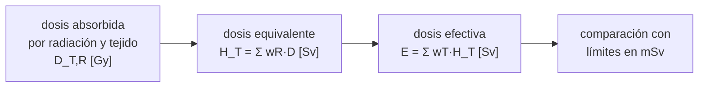

# B112-C02 — Dosis equivalente y dosis efectiva

<!-- nav:top -->
[🏠 Programa](../../../../README.md) · [📚 Bloque B112](../../../tronco-comun/B112-radiobiologia-y-proteccion-radiologica-espacial.md) · [← Anterior: B112-C01 — Magnitudes dosimétricas: dosis absorbida, LET y eficacia biológica](../B112-C01-magnitudes-dosimetricas-dosis-absorbida-let-y-eficacia-biologica/CLASE.md) · [Siguiente: B112-C03 — Efectos agudos de la radiación →](../B112-C03-efectos-agudos-de-la-radiacion/CLASE.md)
<!-- /nav -->

## 1. Ubicación, nivel y alcance

Clase 2 del bloque B112 (área A09). Nivel N3. Continúa B112-C01: allí la dosis se mide en gray y es una magnitud física; aquí se convierte en **dosis equivalente** (corrige la calidad de la radiación) y **dosis efectiva** (corrige además la sensibilidad de cada tejido), ambas en sievert. Los campos del laboratorio son **inventados**.

## 2. Por qué esta clase existe

Ninguna clase trata factores de ponderación y dosis equivalente, y sin ellos un límite en mSv de una norma no se puede leer. La decisión central: **¿cómo se resume en un solo número en sievert una exposición mezclada de varias radiaciones y órganos, y qué no dice ese número?**

## 3. Lo que podrás hacer al terminar

1. Calcular la dosis equivalente `H_T = Σ w_R D_{T,R}` de un tejido con varias radiaciones.
2. Calcular la dosis efectiva `E = Σ w_T H_T` y comprobar que la suma de factores de tejido es 1.
3. Explicar la diferencia entre gray, sievert, dosis equivalente y dosis efectiva.
4. Calcular `Q(L)` para varios LET y contrastarlo con los factores `w_R`.
5. Reconocer que la dosis efectiva es una magnitud de protección y no la dosis de una persona concreta.
6. Rotular lo consultado, lo de uso corriente no verificado y lo inventado.

La evidencia es la **ficha de dosis efectiva con tabla de ponderaciones** del ejercicio 12 (sección 20).

## 4. Con qué llegas y cómo comprobarlo

1. ¿Qué es el gray?
2. ¿Qué es el LET?
3. ¿Qué es una media ponderada?
4. ¿Qué es una dosis por órgano?
5. ¿Qué es un valor inventado?

<details>
<summary>Ver respuestas</summary>

1. Un julio de energía absorbida por kilogramo (B112-C01). 2. La energía que una partícula cargada pierde por unidad de longitud (B112-C01). 3. Una suma de valores multiplicados por pesos que suman 1. 4. La energía absorbida por kilogramo en ese órgano. 5. Uno que el autor fija sin medirlo y se rotula como tal.
</details>

Con cuatro o cinco aciertos, sigue; si no, repasa los prerrequisitos.

## 5. Un caso de contexto y casos de referencia

En un campo inventado de 100 días las dosis absorbidas de cuerpo entero son 30 mGy de fotones y electrones, 45 mGy de protones y 5 mGy de alfa e iones pesados: **80 mGy en total**. Con `w_R` de 1, 2 y 20 la dosis equivalente es `30 + 90 + 100 = 220 mSv`: las 5 mGy de iones pesados aportan casi la mitad. Con factores de órgano inventados la dosis efectiva sale 209,28 mSv. Es el **ejemplo conductor**: todo es **sintético** (semilla 113) y los factores son de uso corriente, no verificados en la tabla de la fuente.

## 6. Vocabulario

La **dosis equivalente** de un tejido es `H_T = Σ_R w_R D_{T,R}`, con `w_R` el factor de ponderación de la radiación (adimensional) que refleja la mayor eficacia biológica del alto LET; su unidad es el sievert. La **dosis efectiva** es `E = Σ_T w_T H_T`, con `w_T` el factor de ponderación del tejido, que representa su contribución relativa al detrimento total y cuya suma vale 1 (definiciones del glosario de ICRP 103, consultado). El **factor de calidad** `Q(L)` es una función del LET usada en magnitudes operacionales. El **detrimento** cuantifica el daño sobre la salud por cáncer y efectos hereditables.

## 7. Modelo mental



*Descripción textual:* de la dosis absorbida por radiación y tejido se pasa, con los factores de la radiación, a la dosis equivalente de cada tejido y, con los factores de tejido, a la dosis efectiva que se compara con los límites.

Analogía: convertir distintas monedas a una sola y luego pesar cada compra por su importancia; el total es cómodo, pero ya no dice qué se compró. Límite: las ponderaciones son valores de consenso para protección, no medidas del daño de un individuo.

## 8. La explicación, paso a paso

### 8.1 Dosis equivalente

Con `w_R = 1` para fotones y electrones, 2 para protones y 20 para alfa e iones pesados (uso corriente; la tabla de ICRP 103 no estaba en el extracto consultado), la dosis de 80 mGy se convierte en 220 mSv: razón `H/D = 2,75 Sv/Gy`. Para neutrones `w_R` es una función continua de la energía (extracto consultado), de modo que una tabla de valores únicos no basta.

### 8.2 Dosis efectiva

`E = Σ w_T H_T`, con la suma de `w_T` igual a 1 dentro de 1e-12 (control). Si la dosis equivalente es uniforme en todo el cuerpo, `E` es igual a esa dosis: 220 mSv. Si cada órgano recibe un factor de blindaje propio (inventado, entre 0,7 y 1,3), `E = 209,28 mSv`; el orden de los órganos no cambia el resultado.

### 8.3 La misma dosis absorbida con otra calidad

10 mGy de cuerpo entero dan 10 mSv de fotones, 20 mSv de protones y 200 mSv de iones pesados: el mismo gray cuenta veinte veces más con `w_R = 20`. Por eso un límite en mSv no se puede comparar con una lectura en mGy sin conocer el campo.

### 8.4 Factor de calidad Q(L)

`Q(L)` ilustrativo (definición habitual, no consultada): 1 si `L < 10 keV/µm`; `0,32 L − 2,2` entre 10 y 100; `300/√L` por encima. Da 1,00 a 10 keV/µm, 7,40 a 30, 29,80 a 100, 24,49 a 150 y 13,42 a 500: sube y luego baja, porque a LET muy alto parte de la energía se «desperdicia» en células ya muy dañadas.

### 8.5 Qué no es la dosis efectiva

Es una magnitud de protección para persona de referencia, no una medida del daño de un individuo. Con factores de órgano inventados al azar (20 000 sorteos), `E` tiene media 220,02 mSv y desviación típica 11,97 mSv (5,4 %). Además NASA calcula su dosis efectiva con su propio factor de calidad y parámetros de una mujer de 35 años (OCHMO-TB-020, consultado), no con la tabla de ICRP.

## 9. Magnitudes, símbolos y unidades

| Símbolo | Qué es | Unidad | Valor / nota |
|---|---|---|---|
| `D_{T,R}` | dosis absorbida de la radiación R en el tejido T | Gy | 30; 45; 5 mGy (campo inventado) |
| `w_R` | factor de ponderación de la radiación | — | 1; 2; 20 (uso corriente, no verificado) |
| `H_T` | dosis equivalente del tejido | Sv | 220 mSv de cuerpo entero |
| `w_T` | factor de ponderación del tejido | — | suma 1,000000000000 |
| `E` | dosis efectiva | Sv | 209,28 mSv con factores de órgano inventados |
| `Q(L)` | factor de calidad ilustrativo | — | 1,00 a 29,80 según el LET |

## 10. Convenciones y referencias

Unidades: gray para dosis absorbida y sievert para dosis equivalente y efectiva (ambos J/kg; solo cambia la magnitud). Persona de referencia simplificada: los 15 grupos de tejidos de la tabla del laboratorio con `w_T` de 0,12 (seis), 0,08, 0,04 (cuatro) y 0,01 (cuatro). Datos **sintéticos** (semilla 113). Tolerancias: suma de `w_T` igual a 1 dentro de 1e-12; con dosis uniforme `E` igual a `H` dentro de 1e-12; media de la dispersión dentro del 1 % de la analítica. Numpy 2.4.4, Python 3.12.9.

## 11. De dónde sale lo que afirmamos

| ID | Fuente | Localizador | Respalda | Estado |
|---|---|---|---|---|
| S1 | ICRP, 2007, Publicación 103, Ann. ICRP 37(2-4), extracto gratuito (PDF leído con PyMuPDF) — icrp.org (consultada 2026-11-10) | resumen (apartado h) y glosario: «Radiation weighting factor», «Tissue weighting factor», «Radiation detriment» | definiciones de `w_R` y `w_T`, suma de `w_T` igual a 1, `w_R` de neutrones como función continua de la energía y cambios de valores para neutrones y protones | Consultada (extracto, sin tablas numéricas) |
| S2 | NASA OCHMO, *NASA-STD-3001 Technical Brief OCHMO-TB-020 Rev E*, 2022-12-27, nasa.gov (PDF leído con PyMuPDF, consultado 2026-11-10) | pág. 4 | la dosis efectiva de NASA se calcula con el factor de calidad de NASA y parámetros de una mujer de 35 años para ambos sexos | Consultada |
| — | Valores numéricos de `w_R` (1, 2, 20) y de `w_T` (0,12; 0,08; 0,04; 0,01) y función `Q(L)` | — | de uso corriente; las tablas de ICRP 103 y la función de ICRP 60 no se consultaron | No consultada (verificar en la fuente antes de usar) |

Límites: del extracto de ICRP 103 solo se consultaron el resumen y el glosario; **no se consultaron sus tablas de factores**, así que los números de `w_R`, `w_T` y `Q(L)` del laboratorio son de uso corriente y deben verificarse en la fuente vigente. La publicación del NCRP sobre factores de calidad para el espacio no se consultó.

## 12. Cómo ver el resultado

| Métrica | Valor |
|---|---|
| Suma de `w_T` | 1,000000000000 |
| Dosis absorbida / equivalente de cuerpo entero | 80 mGy / 220 mSv (H/D = 2,75) |
| Dosis efectiva con factores de órgano inventados | 209,28 mSv |
| 10 mGy de fotones / protones / iones pesados | 10 / 20 / 200 mSv |
| Dispersión de `E` (20 000 sorteos) | 220,02 ± 11,97 mSv |

Descripción larga: el mismo gray cuenta de 1 a 20 veces según la radiación; la dosis efectiva agrega órganos con pesos que suman 1, pero no identifica a una persona concreta.

## 13. Ejemplo trabajado: dosis equivalente y efectiva uniformes

**Paso 1 · Dosis equivalente.** `H = 1·30 + 2·45 + 20·5 = 30 + 90 + 100 = 220 mSv`.

**Paso 2 · Pesos de tejido.** `0,08 + 6·0,12 + 4·0,04 + 4·0,01 = 1,00`.

**Paso 3 · Efectiva.** Con `H_T = 220 mSv` en todos los tejidos, `E = Σ w_T·220 = 220 mSv`.

**Paso 4 · Lectura.** Sin conocer los `w_R` no se puede volver de 220 mSv a 80 mGy.

## 14. Distintas formas de describir el problema

**Por radiación:** `w_R`. **Por tejido:** `w_T`. **Por suma:** `H_T` y `E`. **Por función:** `Q(L)` del LET. **Por tabla:** órganos y aportes `w_T·H_T`.

## 15. Práctica guiada

**Ejercicio 1 · con los pasos indicados.** Calcula `H` de un campo con 30 mGy de fotones, 45 mGy de protones y 5 mGy de iones pesados. *Pasos:* multiplicar cada dosis por su `w_R` y sumar.

<details><summary>Solución comentada</summary>

`30 + 2·45 + 20·5 = 220 mSv`.
</details>

**Ejercicio 2 · con una pista.** Con dosis equivalente uniforme de 220 mSv, ¿cuánto vale `E`? *Pista:* la suma de `w_T` es 1.

<details><summary>Solución comentada</summary>

`E = 220 mSv`.
</details>

**Ejercicio 3 · casi autónomo.** Comprueba que los `w_T` de la tabla suman 1. *Pista:* 1 de 0,08, 6 de 0,12, 4 de 0,04 y 4 de 0,01.

<details><summary>Solución comentada</summary>

`0,08 + 0,72 + 0,16 + 0,04 = 1,00`.
</details>

## 16. Práctica autónoma, transferencia e integrador

**Ejercicio 4 · autónomo.** ¿Cuántos mSv son 10 mGy de iones pesados con `w_R = 20`?

<details><summary>Solución comentada</summary>

`200 mSv`.
</details>

**Ejercicio 5 · autónomo.** Un pulmón con factor de órgano 1,066 tiene `H_T = 234,59 mSv`. ¿Cuánto aporta a `E`?

<details><summary>Solución comentada</summary>

`0,12 × 234,59 = 28,15 mSv`.
</details>

**Ejercicio 6 · autónomo.** Calcula `Q(30)` con la función ilustrativa.

<details><summary>Solución comentada</summary>

`0,32·30 − 2,2 = 7,40`.
</details>

**Ejercicio 7 · autónomo.** Calcula `Q(150)`.

<details><summary>Solución comentada</summary>

`300/√150 = 24,49`.
</details>

**Ejercicio 8 · autónomo.** `H/D = 2,75 Sv/Gy` en el campo conductor. ¿Por qué no es 1, 2 ni 20?

<details><summary>Solución comentada</summary>

Es un promedio ponderado por las dosis de cada radiación: `(30·1 + 45·2 + 5·20)/80 = 2,75`.
</details>

**Ejercicio 9 · transferencia.** La norma de NASA fija 600 mSv de dosis efectiva de carrera. ¿Se calcula con la tabla de `w_R` de ICRP?

<details><summary>Solución comentada</summary>

No necesariamente: según OCHMO-TB-020 se usa el factor de calidad de NASA (modelo de cáncer de 2012) y parámetros de una mujer de 35 años. Hay que leer la definición de cada norma.
</details>

**Ejercicio 10 · transferencia.** `E` tiene una dispersión de 11,97 mSv sobre 220 al variar los factores de órgano. ¿Qué significa para el uso de `E` en una persona concreta?

<details><summary>Solución comentada</summary>

Que `E` es un valor de referencia con una incertidumbre de varios por ciento solo por la distribución de órganos (más aún por la calidad); no es la dosis de un individuo.
</details>

**Ejercicio 11 · transferencia.** Para neutrones `w_R` es una función continua de la energía. ¿Qué cambia en un campo con neutrones secundarios de un blindaje?

<details><summary>Solución comentada</summary>

Hay que conocer el espectro de energías de neutrones y evaluar `w_R(E)` en cada energía; un valor único puede subestimar o sobrestimar.
</details>

**Ejercicio 12 · integrador.** Elabora tu *ficha de dosis efectiva con tabla de ponderaciones*: definiciones, cálculo de `H` y `E` de un campo mixto, comprobación de la suma de `w_T`, la misma dosis con distinta calidad, la dispersión por órgano y qué es consultado, no verificado e inventado.

<details><summary>Solución comentada</summary>

Secciones 8.1–8.5, el ejemplo 13 y la salida del laboratorio.
</details>

## 17. Laboratorio: dosis equivalente y efectiva de un campo mixto inventado

El script [dosis_efectiva.py](dosis_efectiva.py) calcula `H` por radiación, `E` por 15 grupos de tejidos con factores de órgano inventados, la misma dosis con distinta calidad, `Q(L)` y la dispersión de `E`; **comprueba** que la suma de `w_T` es 1, que con dosis uniforme `E` iguala a `H` y que el orden de los órganos no cambia `E`.

**Datos:** todo **sintético** con semilla 113; los factores `w_R`, `w_T` y la función `Q(L)` son de uso corriente y **no se verificaron** en una tabla consultada. **Predice antes de ejecutar:** ¿Cuánto vale la dosis equivalente de 10 mGy de iones pesados con `w_R = 20`? (200 mSv.) **Ejecución del 2026-11-10 (Python 3.12.9):**

```text
Python 3.12.9; numpy 2.4.4
DATOS SINTETICOS (semilla 113); factores wR y wT de uso corriente, tabla de ICRP 103 no consultada en el extracto
Suma de wT = 1.000000000000
Campo inventado, 100 dias: dosis absorbida media de cuerpo entero por radiacion [mGy]
  foton/electron        30.00 mGy  (wR = 1) -> H =    30.00 mSv
  proton                45.00 mGy  (wR = 2) -> H =    90.00 mSv
  alfa/ion pesado        5.00 mGy  (wR = 20) -> H =   100.00 mSv
Dosis absorbida total = 80.00 mGy; dosis equivalente de cuerpo entero = 220.00 mSv; razon H/D = 2.750 Sv/Gy
Dosis efectiva E = sum wT*H_T = 209.28 mSv (cuerpo entero uniforme: 220.00 mSv)
organo                  factor  H_T [mSv]  wT*H_T [mSv]
gonadas                  0.742     163.32        13.065
medula osea              0.791     173.91        20.870
colon                    0.787     173.11        20.773
pulmon                   1.066     234.59        28.150
estomago                 0.976     214.66        25.759
mama                     1.299     285.85        34.302
restantes                0.998     219.57        26.348
vejiga                   0.802     176.50         7.060
higado                   0.727     159.97         6.399
esofago                  1.126     247.63         9.905
tiroides                 0.993     218.45         8.738
superficie osea          1.068     235.05         2.350
cerebro                  0.872     191.92         1.919
glandulas salivales      0.789     173.60         1.736
piel                     0.867     190.85         1.908
Misma dosis absorbida de cuerpo entero (10 mGy) segun la calidad de la radiacion:
  solo foton/electron    : E =   10.0 mSv
  solo proton            : E =   20.0 mSv
  solo alfa/ion pesado   : E =  200.0 mSv
Q(L) ilustrativo segun el LET [keV/um]: 0.3 -> 1.00; 5 -> 1.00; 10 -> 1.00; 30 -> 7.40; 100 -> 29.80; 150 -> 24.49; 500 -> 13.42
Dispersion de E por factores de organo inventados (20000 sorteos): media 220.02 mSv, desv. tip. 11.97 mSv
Pruebas superadas.
```

```bash
python programa/clases/B112/B112-C02-dosis-equivalente-y-dosis-efectiva/dosis_efectiva.py
```

**Límites:** un solo campo inventado, factores de órgano aleatorios uniformes, una persona de referencia simplificada sin sexo ni edad y factores no verificados; no calcula la dosis de nadie.

## 18. Errores frecuentes y cómo corregirlos

**Sumar mGy y mSv como si fueran lo mismo.** Son magnitudes distintas; convierte con `w_R` (8.1).

**Suponer que `E` es la dosis de una persona.** Es una magnitud de protección de referencia (8.5).

**Aplicar los `w_R` de ICRP a un límite que usa otro factor de calidad.** Lee la definición de la norma (ejercicio 9).

**Presentar los factores como valores consultados.** Rotúlalos como de uso corriente y no verificados (sección 11).

## 19. Cómo sabrás que vas bien

Tras la sección 8: ¿cuántas veces cuenta más un gray de iones pesados que uno de fotones? Si dudas, repasa el ejemplo 13. Tras el laboratorio: ¿qué comprueba? (ver la sección 17).

## 20. Qué entregas y cómo se evalúa

El producto es tu **ficha de dosis efectiva con tabla de ponderaciones** (ejercicio 12).

| Criterio | Inicial | En desarrollo | Logrado | Destacado |
|---|---|---|---|---|
| Conceptos | Confunde Gy y Sv | Parciales | Explica `H`, `E`, `w_R` y `w_T` | Explica por qué `E` no es la dosis de una persona |
| Cálculo | Sin unidades | Con errores | Calcula `H` y `E` | Calcula casos nuevos |
| Numérico | Sin control | Un caso | Comprueba suma de pesos e invarianzas | Interpreta la incertidumbre |
| Fuentes | Sin fuente | Sin fecha | Fuentes con fecha y estado | Declara lo sintético y lo no consultado |
| Límites | No los nombra | Uno | Tres | Discute qué falta del modelo |

**Condiciones críticas (no se compensan con promedio):** rotular todo como sintético o ilustrativo; no dar consejo médico ni operativo; no presentar estas cifras como la exposición o el riesgo de una persona real; citar solo lo consultado.

## 21. Ética, seguridad y límites

Clase **educativa**: **no da consejo médico ni operativo** y no sustituye la formación, la licencia ni la supervisión de profesionales de física médica, medicina aeroespacial o protección radiológica. Los factores de ponderación y los límites reales los fija la norma vigente; en proyectos reales se toman de su fuente actual y los aplica personal de protección radiológica. Accesibilidad: tablas equivalentes a las gráficas, fórmulas en texto, ejercicios sin conexión.

## 22. Para cerrar y seguir

El gray mide la energía; el sievert la convierte, con factores de consenso, en una cantidad comparable con los límites. Un mismo campo de 80 mGy se convierte en 220 mSv si contiene iones pesados, y esa conversión solo vale como magnitud de protección: no es la dosis ni el riesgo de una persona concreta.

**Glosario español–inglés.** dosis equivalente · *equivalent dose*; dosis efectiva · *effective dose*; factor de ponderación de la radiación · *radiation weighting factor*; factor de ponderación del tejido · *tissue weighting factor*; detrimento · *detriment*.

**Continuidad.** Sigue con [B112-C03 — Efectos agudos de la radiación](../B112-C03-efectos-agudos-de-la-radiacion/CLASE.md), donde la dosis se asocia a efectos con umbral.

**Referencias:** ver sección 11.

<!-- nav:bottom -->
---

[← Anterior: B112-C01 — Magnitudes dosimétricas: dosis absorbida, LET y eficacia biológica](../B112-C01-magnitudes-dosimetricas-dosis-absorbida-let-y-eficacia-biologica/CLASE.md) · [📚 Bloque B112](../../../tronco-comun/B112-radiobiologia-y-proteccion-radiologica-espacial.md) · [Siguiente: B112-C03 — Efectos agudos de la radiación →](../B112-C03-efectos-agudos-de-la-radiacion/CLASE.md)
<!-- /nav -->
