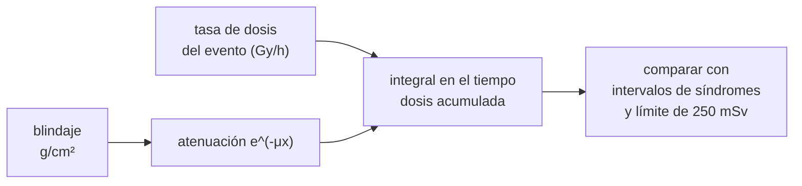

# B112-C03 — Efectos agudos de la radiación

<!-- nav:top -->
[🏠 Programa](../../../../README.md) · [📚 Bloque B112](../../../tronco-comun/B112-radiobiologia-y-proteccion-radiologica-espacial.md) · [← Anterior: B112-C02 — Dosis equivalente y dosis efectiva](../B112-C02-dosis-equivalente-y-dosis-efectiva/CLASE.md) · [Siguiente: B112-C04 — Efectos crónicos y carcinogénesis por radiación →](../B112-C04-efectos-cronicos-y-carcinogenesis-por-radiacion/CLASE.md)
<!-- /nav -->

## 1. Ubicación, nivel y alcance

Clase 3 del bloque B112 (área A09). Nivel N3. Trata los efectos que aparecen **pronto y por encima de un umbral** de dosis: los síndromes agudos por radiación, con sus intervalos de dosis, y cómo un evento de partículas solares inventado se compara con ellos y con el límite de 250 mSv de NASA. **Contenido educativo: no sustituye formación, licencia ni supervisión profesional, ni da consejo médico.**

## 2. Por qué esta clase existe

Ninguna clase cubre síndromes agudos y umbrales. Un evento solar grande es el único escenario de la exploración que podría producir efectos agudos, y por eso los límites de corto plazo y el blindaje de refugio se diseñan a su medida. La decisión central: **¿qué dosis y qué blindaje separan una exposición sin efectos agudos de una con síndrome, y con qué incertidumbre?**

## 3. Lo que podrás hacer al terminar

1. Nombrar los síndromes agudos y sus intervalos de dosis consultados.
2. Integrar una tasa de dosis variable en el tiempo para obtener la dosis acumulada de un evento.
3. Calcular el efecto de un blindaje por densidad superficial y hallar el mínimo que cumple un límite.
4. Distinguir efectos con umbral (agudos) de efectos sin umbral (C04) y explicar la forma sigmoidea.
5. Interpretar un límite en dosis efectiva frente a un intervalo en gray de dosis absorbida.
6. Rotular lo consultado, lo inventado y que no es consejo médico.

La evidencia es la **tabla de efectos por intervalo de dosis** del ejercicio 12 (sección 20).

## 4. Con qué llegas y cómo comprobarlo

1. ¿Qué es una tasa de dosis?
2. ¿Qué es una integral numérica?
3. ¿Qué es un umbral?
4. ¿Qué es una atenuación exponencial?
5. ¿Qué diferencia hay entre Gy y Sv?

<details>
<summary>Ver respuestas</summary>

1. Dosis por unidad de tiempo, por ejemplo Gy/h. 2. La suma de áreas de trapecios bajo una curva. 3. Un valor por debajo del cual no hay efecto observable. 4. Un descenso `e^(−μx)` con el espesor. 5. Energía por masa frente a dosis ponderada por calidad (B112-C02).
</details>

Con cuatro o cinco aciertos, sigue; si no, repasa los prerrequisitos.

## 5. Un caso de contexto y casos de referencia

Un evento solar **inventado** tiene un pico de 0,5 Gy/h y un perfil log-normal con máximo a las 6 h. Su dosis acumulada sin blindaje es `8,285 Gy`, en el intervalo gastrointestinal citado (4–15 Gy). Con 10 g/cm² baja a 1,12 Gy; con 20 g/cm², a 0,152 Gy; y hacen falta `20,97 g/cm²` para cumplir 250 mSv con el factor ilustrativo de 2 Sv/Gy. Es el **ejemplo conductor**: el evento, el coeficiente de atenuación y la curva dosis-respuesta son **sintéticos** (semilla 114); los intervalos de síndromes y el límite de 250 mSv son **consultados**.

## 6. Vocabulario

El **síndrome de radiación aguda** (ARS) es el conjunto de efectos que aparecen en horas a semanas tras una dosis alta en poco tiempo. Tiene una fase de **pródromo** (náuseas, vómitos, anorexia), y subsíndromes **hematopoyético** (HSS), **gastrointestinal** (GIS) y **neurovascular** o del sistema nervioso central (SNC). Un **evento de partículas solares** (SPE) es una ráfaga de protones de energía muy variable. La **densidad superficial** (g/cm²) mide el espesor de blindaje como masa por área. El **umbral** es la dosis por debajo de la cual no se observa el efecto; **tasa de dosis** es la dosis por tiempo.

## 7. Modelo mental



*Descripción textual:* la tasa de dosis del evento, atenuada por el blindaje, se integra en el tiempo para dar la dosis acumulada; esa dosis se compara con los intervalos de los síndromes (en gray) y con el límite en dosis efectiva (en mSv).

Analogía: una quemadura solar necesita un mínimo de exposición; por debajo no hay efecto visible, por encima aumenta con la dosis. Límite: en los efectos agudos la dosis, la tasa y la calidad cuentan, y la sensibilidad individual varía.

## 8. La explicación, paso a paso

### 8.1 Síndromes y umbrales consultados

Seed (NASA THREE, 2011) describe: el **síndrome hematopoyético** es el más frecuente y aparece en el intervalo de 0,5 a 8 Gy, tarda semanas en expresarse y, sin tratamiento, a dosis altas puede causar la muerte en 15–60 días; el **gastrointestinal** exige 4–15 Gy y aparece en días; el **neurovascular o del SNC** solo tras más de 20–30 Gy, en horas. A 1–2 Gy hasta el 50 % de los expuestos muestra en 2–4 semanas una reducción moderada de células sanguíneas. Las dosis ISS típicas son de 0,5 a 1,2 mSv/día, sin preocupación por efectos agudos.

### 8.2 Un evento y su dosis acumulada

Con tasa `Ḋ(t) = Ḋ₀ exp(−ln²(t/t₀)/(2s²))` (`Ḋ₀ = 0,5 Gy/h`, `t₀ = 6 h`, `s = 0,8`), la integral analítica es `Ḋ₀ t₀ s √(2π) e^(s²/2) = 8,2847 Gy`; la numérica da el mismo valor a 4 cifras (control).

### 8.3 Blindaje

Con `D(x) = D(0) e^(−μ x)` y `μ = 0,20 cm²/g` (inventado): 5,553 Gy a 2 g/cm², 3,048 a 5, 1,121 a 10, 0,4125 a 15 y 0,1517 a 20. El rango de 5–20 g/cm² de aluminio o polietileno citado por OCHMO-TB-020 es el contexto de ingeniería; el coeficiente de aquí no es el de ningún material.

### 8.4 Dosis efectiva y límite

NASA-STD-3001 limita el SPE de diseño a **250 mSv** de dosis efectiva por evento «para minimizar efectos agudos» (OCHMO-TB-020, consultado). Con el factor ilustrativo `2 Sv/Gy` (cota alta, no consultado) el mínimo hallado por bisección es `20,97 g/cm²`; con 30 g/cm² quedan 41 mSv.

### 8.5 Forma sigmoidea

La respuesta a una dosis tiene forma de S: baja y casi plana a dosis pequeñas, crece rápido y satura. La curva de la clase (D50 = 3 Gy, pendiente 4) es **inventada** para mostrar la forma: 1,22 % a 1 Gy, 16,49 % a 2, 50 % a 3, 88,53 % a 5, 98,06 % a 8. No es un dato humano. Que los efectos agudos tengan un «umbral aparente» no implica que los crónicos (C04) también lo tengan.

## 9. Magnitudes, símbolos y unidades

| Símbolo | Qué es | Unidad | Valor / nota |
|---|---|---|---|
| `Ḋ` | tasa de dosis absorbida | Gy/h | pico 0,5 (inventado; Seed cita hasta 1,4 para un evento extremo) |
| `D` | dosis acumulada | Gy | 8,285 sin blindaje |
| `x` | densidad superficial del blindaje | g/cm² | 0 a 30 |
| `μ` | coeficiente de atenuación | cm²/g | 0,20 (inventado) |
| `E` | dosis efectiva (ilustrativa) | mSv | 2 Sv/Gy × D |
| límite SPE | dosis efectiva por evento | mSv | 250 (NASA-STD-3001, consultado) |

## 10. Convenciones y referencias

Unidades: Gy, mSv, g/cm², horas. Sistema de referencia: dosis de cuerpo entero uniforme, sin tejidos separados. Datos **sintéticos** (semilla 114) salvo los intervalos de síndromes y el límite de 250 mSv, que se consultaron. Integración trapezoidal sobre 400 001 puntos con malla geométrica de 10⁻⁴ a 5000 h. Tolerancias: integral numérica igual a la analítica dentro del 0,1 %; la dosis decrece monótonamente con el blindaje; el blindaje hallado cumple el límite. Numpy 2.4.4, Python 3.12.9.

## 11. De dónde sale lo que afirmamos

| ID | Fuente | Localizador | Respalda | Estado |
|---|---|---|---|---|
| S1 | Seed, T. M., «Acute Effects», NASA THREE, publicado 2011-07-11, three.jsc.nasa.gov/articles/SeedAcuteEffects.pdf (PDF leído con PyMuPDF, consultado 2026-11-10) | introducción y descripción del síndrome de radiación aguda | intervalos de dosis de HSS (0,5–8 Gy), GIS (4–15 Gy) y SNC (>20 Gy); a 1–2 Gy hasta 50 % con reducción moderada; ISS de 0,5 a 1,2 mSv/día; hasta 1,4 Gy/h estimado en un evento extremo | Consultada |
| S2 | NASA OCHMO, *NASA-STD-3001 Technical Brief OCHMO-TB-020 Rev E*, 2022-12-27, nasa.gov (PDF, consultado 2026-11-10) | págs. 1–6 | límite de 250 mSv de dosis efectiva por evento solar; blindaje de 5–20 g/cm² eficaz contra SPE; síndromes por SPE (náuseas, vómitos, fatiga, piel, órganos hematopoyéticos) | Consultada |
| — | Factor 2 Sv/Gy, coeficiente de atenuación, curva sigmoidea y perfil temporal | — | inventados para el laboratorio | Sintético (no es dato) |

Límites: Seed es un artículo de 2011 y los intervalos son orientativos; los intervalos citados se solapan y no dan un umbral individual. No se consultaron NCRP 132, las normas sanitarias de ARS de otras agencias ni datos de eventos reales. El perfil del evento y la curva sigmoidea son inventados.

## 12. Cómo ver el resultado

| Métrica | Valor |
|---|---|
| Dosis sin blindaje (analítica / numérica) | 8,2847 / 8,2847 Gy |
| Dosis con 10 / 20 g/cm² | 1,1212 / 0,1517 Gy |
| Blindaje mínimo para 250 mSv (modelo inventado) | 20,97 g/cm² |
| Fracción con efecto a 1 / 3 / 5 Gy (sigmoide inventada) | 1,22 % / 50,00 % / 88,53 % |

Descripción larga: la dosis cae exponencialmente con el blindaje y cruza varios intervalos de síndromes; el límite de 250 mSv exige más blindaje que evitar el síndrome, porque está pensado para evitar cualquier efecto agudo.

## 13. Ejemplo trabajado: dosis de un evento con blindaje

**Paso 1 · Sin blindaje.** `D(0) = 8,2847 Gy`.

**Paso 2 · Atenuación.** `D(10) = 8,2847 · e^(−0,20·10) = 8,2847 · 0,1353 = 1,121 Gy`.

**Paso 3 · Intervalo.** 1,121 Gy está dentro del hematopoyético (0,5–8 Gy).

**Paso 4 · Límite.** `1,121 Gy × 2 Sv/Gy = 2242 mSv`, muy por encima de 250 mSv; no cumple.

## 14. Distintas formas de describir el problema

**Por tiempo:** la tasa `Ḋ(t)`. **Por dosis acumulada:** la integral. **Por blindaje:** `e^(−μx)`. **Por intervalo:** síndrome según la dosis. **Por tabla:** blindaje y dosis.

## 15. Práctica guiada

**Ejercicio 1 · con los pasos indicados.** Calcula la dosis con 5 g/cm² si `D(0) = 8,2847 Gy` y `μ = 0,20 cm²/g`. *Pasos:* exponente, exponencial, producto.

<details><summary>Solución comentada</summary>

`8,2847 · e^(−1) = 8,2847 · 0,3679 = 3,048 Gy`.
</details>

**Ejercicio 2 · con una pista.** Clasifica 3,048 Gy según los intervalos de Seed. *Pista:* HSS 0,5–8; GIS 4–15; SNC > 20 Gy.

<details><summary>Solución comentada</summary>

Está solo en el intervalo hematopoyético (menor que 4 Gy).
</details>

**Ejercicio 3 · casi autónomo.** Convierte 0,1517 Gy a mSv con 2 Sv/Gy y compara con 250 mSv.

<details><summary>Solución comentada</summary>

`303,4 mSv`, mayor que 250 mSv: no cumple.
</details>

## 16. Práctica autónoma, transferencia e integrador

**Ejercicio 4 · autónomo.** ¿Por qué a 15 g/cm² la dosis (0,4125 Gy) queda «por debajo de 0,5 Gy» y aun así no cumple 250 mSv?

<details><summary>Solución comentada</summary>

El intervalo está en gray de dosis absorbida y el límite en dosis efectiva (mSv): `0,4125 × 2 = 825 mSv`. Son magnitudes y propósitos distintos.
</details>

**Ejercicio 5 · autónomo.** La integral analítica es `Ḋ₀ t₀ s √(2π) e^(s²/2)`. Calcúlala con `0,5`, `6`, `0,8`.

<details><summary>Solución comentada</summary>

`0,5·6·0,8·2,5066·e^(0,32) = 6,016·1,3771 = 8,285 Gy`.
</details>

**Ejercicio 6 · autónomo.** ¿Cuántos g/cm² reducen la dosis a la mitad con `μ = 0,20`?

<details><summary>Solución comentada</summary>

`ln 2 / 0,20 = 3,47 g/cm²`.
</details>

**Ejercicio 7 · autónomo.** En la curva sigmoidea inventada, ¿qué fracción hay a 1 Gy y a 5 Gy?

<details><summary>Solución comentada</summary>

1,22 % y 88,53 %.
</details>

**Ejercicio 8 · autónomo.** ¿Por qué no se debe usar la sigmoide de la clase para estimar efectos en personas?

<details><summary>Solución comentada</summary>

Porque está inventada (D50 y pendiente arbitrarias); solo muestra la forma.
</details>

**Ejercicio 9 · transferencia.** Un refugio de tormenta reduce la dosis un factor 10. ¿Cuántos g/cm² son con `μ = 0,20` y qué ventaja y límite tiene el modelo?

<details><summary>Solución comentada</summary>

`ln 10 / 0,20 = 11,5 g/cm²`. Ventaja: cálculo rápido; límite: la atenuación real no es exponencial pura (secundarios, espectro) y μ no es un dato de material.
</details>

**Ejercicio 10 · transferencia.** Un límite de 250 mSv por evento se aplica a la dosis efectiva; una persona recibe 1,1 Gy de cuerpo entero. ¿Cómo comparas ambos?

<details><summary>Solución comentada</summary>

Hay que convertir con factores de ponderación y calidad (B112-C02) y usar el espectro del evento; no se compara gray con mSv directamente.
</details>

**Ejercicio 11 · transferencia.** Seed cita 1,4 Gy/h estimados para un evento extremo y el laboratorio usa 0,5. ¿Qué cambia en el blindaje mínimo?

<details><summary>Solución comentada</summary>

La dosis escala 2,8 veces; el blindaje aumenta en `ln 2,8 / 0,20 = 5,1 g/cm²` (de 20,97 a unos 26 g/cm²).
</details>

**Ejercicio 12 · integrador.** Elabora tu *tabla de efectos por intervalo de dosis*: síndromes y dosis consultadas, dosis del evento inventado con y sin blindaje, comparación con 250 mSv, forma sigmoidea y qué es inventado.

<details><summary>Solución comentada</summary>

Secciones 8.1–8.5, el ejemplo 13 y la salida del laboratorio.
</details>

## 17. Laboratorio: un evento solar inventado frente a los umbrales

El script [efectos_agudos.py](efectos_agudos.py) integra la tasa de dosis del evento, aplica un blindaje por densidad superficial, clasifica la dosis según los intervalos de síndromes de Seed, halla por bisección el blindaje mínimo para 250 mSv y muestra la forma de una sigmoide inventada; **comprueba** la integral numérica contra la analítica y la monotonía con el blindaje.

**Datos:** el evento, `μ`, el factor 2 Sv/Gy y la sigmoide son **sintéticos** con semilla 114; los intervalos de síndromes y el límite de 250 mSv son **consultados**. **Predice antes de ejecutar:** ¿Cuántos g/cm² bastan para reducir una dosis de 8,28 Gy a 125 mSv de dosis absorbida con `μ = 0,20`? (`ln(8,28/0,125)/0,20 ≈ 21 g/cm²`.) **Ejecución del 2026-11-10 (Python 3.12.9):**

```text
Python 3.12.9; numpy 2.4.4
DATOS SINTETICOS (semilla 114): evento inventado; intervalos de sindromes de Seed (2011) y limite de 250 mSv de NASA-STD-3001
Dosis acumulada sin blindaje: numerica 8.2847 Gy, analitica (de 0 a infinito) 8.2847 Gy
Clasificacion de la dosis sin blindaje: sindrome gastrointestinal
 blindaje [g/cm2]  dosis [Gy]  efectiva [mSv]  cumple 250 mSv  intervalo de efectos
                0      8.2847         16569.3              no  sindrome gastrointestinal
                2      5.5534         11106.8              no  prodromo y sindrome hematopoyetico + sindrome gastrointestinal
                5      3.0478          6095.5              no  prodromo y sindrome hematopoyetico
               10      1.1212          2242.4              no  prodromo y sindrome hematopoyetico
               15      0.4125           824.9              no  por debajo de 0.5 Gy
               20      0.1517           303.5              no  por debajo de 0.5 Gy
               30      0.0205            41.1              si  por debajo de 0.5 Gy
Blindaje minimo (modelo inventado) para 250 mSv: 20.97 g/cm2
Curva dosis-respuesta SIGMOIDEA INVENTADA (D50 = 3 Gy, pendiente 4): fraccion con efecto
   0.1 Gy ->   0.00 %
   0.5 Gy ->   0.08 %
   1.0 Gy ->   1.22 %
   2.0 Gy ->  16.49 %
   3.0 Gy ->  50.00 %
   5.0 Gy ->  88.53 %
   8.0 Gy ->  98.06 %
Pruebas superadas.
```

```bash
python programa/clases/B112/B112-C03-efectos-agudos-de-la-radiacion/efectos_agudos.py
```

**Límites:** dosis uniforme de cuerpo entero, atenuación exponencial pura, sin radiación secundaria, factor de conversión ilustrativo y sin efectos de tasa de dosis ni variabilidad individual; **no da consejo médico ni operativo**.

## 18. Errores frecuentes y cómo corregirlos

**Comparar gray con mSv sin convertir.** Las magnitudes son distintas (ejercicio 4).

**Tomar los intervalos como umbrales individuales exactos.** Son rangos orientativos con solapes (8.1).

**Suponer atenuación exponencial pura en un blindaje real.** Hay secundarios y espectro (ejercicio 9).

**Presentar la sigmoide inventada como dato.** Rotúlala como ilustrativa (8.5).

## 19. Cómo sabrás que vas bien

Tras la sección 8: ¿qué síndromes puede producir 3 Gy y cuál no? Si dudas, repasa el ejemplo 13. Tras el laboratorio: ¿qué comprueba? (ver la sección 17).

## 20. Qué entregas y cómo se evalúa

El producto es tu **tabla de efectos por intervalo de dosis** (ejercicio 12).

| Criterio | Inicial | En desarrollo | Logrado | Destacado |
|---|---|---|---|---|
| Conceptos | Confunde dosis y umbral | Parciales | Explica los síndromes y la integral de dosis | Explica por qué gray y mSv no se comparan directamente |
| Cálculo | Sin unidades | Con errores | Integra la dosis y aplica el blindaje | Calcula casos nuevos |
| Numérico | Sin control | Un caso | Compara la integral numérica con la analítica | Interpreta la incertidumbre |
| Fuentes | Sin fuente | Sin fecha | Fuentes con fecha y estado | Declara lo sintético y lo no consultado |
| Límites | No los nombra | Uno | Tres | Discute qué falta del modelo |

**Condiciones críticas (no se compensan con promedio):** rotular todo como sintético o ilustrativo; no dar consejo médico ni operativo; no presentar estas cifras como la exposición o el riesgo de una persona real; citar solo lo consultado.

## 21. Ética, seguridad y límites

Clase **educativa**: **no da consejo médico ni operativo** y no sustituye la formación, la licencia ni la supervisión de profesionales de física médica, medicina aeroespacial o protección radiológica. Los intervalos de dosis son orientativos y no sirven para triaje ni tratamiento; la respuesta a una exposición real la dirige personal médico cualificado con medición de la exposición. Ninguna cifra del laboratorio describe un evento real. Accesibilidad: tablas equivalentes a las gráficas, fórmulas en texto, ejercicios sin conexión.

## 22. Para cerrar y seguir

Los efectos agudos exigen dosis altas en poco tiempo: sobre 0,5 Gy empiezan los efectos hematopoyéticos, sobre 4 Gy los gastrointestinales y sobre 20 Gy los neurovasculares. Un evento solar inventado de 8,3 Gy sin blindaje baja a 0,15 Gy con 20 g/cm², y aun así supera el límite de 250 mSv en dosis efectiva: el límite protege con holgura mucho más allá de los umbrales de efectos.

**Glosario español–inglés.** síndrome de radiación aguda · *acute radiation syndrome*; pródromo · *prodrome*; evento de partículas solares · *solar particle event*; densidad superficial · *areal density*; umbral · *threshold*.

**Continuidad.** Sigue con [B112-C04 — Efectos crónicos y carcinogénesis por radiación](../B112-C04-efectos-cronicos-y-carcinogenesis-por-radiacion/CLASE.md), donde los efectos no tienen umbral claro.

**Referencias:** ver sección 11.

<!-- nav:bottom -->
---

[← Anterior: B112-C02 — Dosis equivalente y dosis efectiva](../B112-C02-dosis-equivalente-y-dosis-efectiva/CLASE.md) · [📚 Bloque B112](../../../tronco-comun/B112-radiobiologia-y-proteccion-radiologica-espacial.md) · [Siguiente: B112-C04 — Efectos crónicos y carcinogénesis por radiación →](../B112-C04-efectos-cronicos-y-carcinogenesis-por-radiacion/CLASE.md)
<!-- /nav -->
