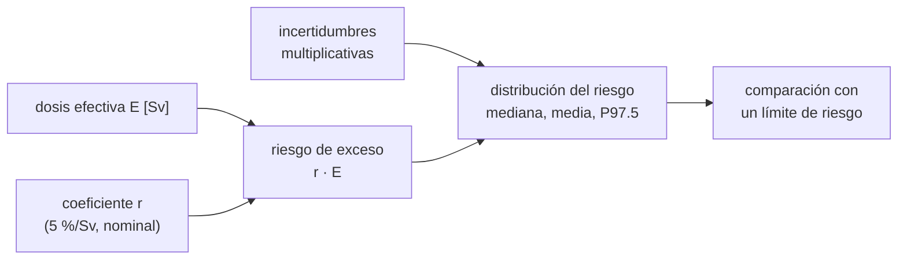

# B112-C04 — Efectos crónicos y carcinogénesis por radiación

<!-- nav:top -->
[🏠 Programa](../../../../README.md) · [📚 Bloque B112](../../../tronco-comun/B112-radiobiologia-y-proteccion-radiologica-espacial.md) · [← Anterior: B112-C03 — Efectos agudos de la radiación](../B112-C03-efectos-agudos-de-la-radiacion/CLASE.md) · [Siguiente: B112-C05 — Daño y reparación del ADN por radiación espacial →](../B112-C05-dano-y-reparacion-del-adn-por-radiacion-espacial/CLASE.md)
<!-- /nav -->

## 1. Ubicación, nivel y alcance

Clase 4 del bloque B112 (área A09). Nivel N3. Trata los efectos que aparecen **meses o años después** y no tienen un umbral claro: sobre todo el cáncer. Aprendes el modelo lineal sin umbral, el factor de reducción por dosis y tasa de dosis (DDREF), por qué no se puede medir el riesgo de dosis bajas directamente y cómo se combinan las incertidumbres. **Contenido educativo; no da consejo médico.**

## 2. Por qué esta clase existe

Ninguna clase cubre riesgo de cáncer y efectos tardíos. Los límites de carrera de una misión se expresan como riesgo, no como umbral, y sin entender cómo se estima y cuán incierta es esa estimación, un límite en mSv parece más preciso de lo que es. La decisión central: **¿cómo se extrapola el riesgo de dosis altas a dosis bajas y qué incertidumbre arrastra esa extrapolación?**

## 3. Lo que podrás hacer al terminar

1. Calcular un riesgo de exceso lineal `r·E` con un coeficiente en Sv⁻¹.
2. Explicar el modelo lineal sin umbral y el papel del DDREF.
3. Estimar cuántas personas hacen falta para detectar un exceso de riesgo y comprobarlo por simulación.
4. Propagar incertidumbres multiplicativas lognormales y leer mediana, media y percentil 97,5.
5. Distinguir efectos agudos con umbral (C03) de efectos crónicos sin umbral claro.
6. Rotular lo consultado, lo inventado y que no es consejo médico.

La evidencia es la **ficha de riesgo de exceso con intervalo** del ejercicio 12 (sección 20).

## 4. Con qué llegas y cómo comprobarlo

1. ¿Qué es un riesgo como probabilidad?
2. ¿Qué es una distribución lognormal?
3. ¿Qué es un percentil?
4. ¿Qué es la dosis efectiva?
5. ¿Qué es un dato sintético?

<details>
<summary>Ver respuestas</summary>

1. Un número entre 0 y 1 (o un porcentaje) de que ocurra un suceso. 2. Una cuyo logaritmo es normal; modela factores multiplicativos. 3. El valor bajo el cual cae un porcentaje de los datos. 4. La dosis ponderada por radiación y tejido, en Sv (B112-C02). 5. Uno generado por un modelo y no medido; se rotula como tal.
</details>

Con cuatro o cinco aciertos, sigue; si no, repasa los prerrequisitos.

## 5. Un caso de contexto y casos de referencia

Con el coeficiente nominal de ICRP 103 de unos `5 %/Sv` (consultado), una dosis efectiva de 600 mSv da un riesgo de exceso de `3,00 %`; sobre una incidencia basal **inventada** del 20 % es un 15 % más. Detectarlo en un estudio exige 2943 personas por grupo; el exceso de 100 mSv exigiría 101 402. Con cuatro factores de incertidumbre inventados (desviaciones geométricas de 1,5, 1,5, 1,9 y 1,2) el riesgo de 600 mSv tiene mediana 3,00 %, media 4,41 % y percentil 97,5 de 16,79 %. Es el **ejemplo conductor**: ICRP y Cucinotta, Kim y Ren se consultaron; los factores, la incidencia basal y las cohortes son **sintéticos** (semilla 115).

## 6. Vocabulario

El **modelo lineal sin umbral** (LNT) supone que el riesgo de exceso crece proporcional a la dosis, sin umbral, también a dosis bajas. El **riesgo de exceso** es la probabilidad adicional atribuible a la exposición. El **DDREF** (factor de efectividad de dosis y tasa de dosis) divide el riesgo de dosis altas y tasas altas para obtener el de dosis bajas; ICRP 103 mantiene para cánceres sólidos el valor 2 (extracto consultado). El **detrimento** nominal combinado de cáncer y efectos hereditables es de unos 5 % por Sv (ICRP 103). Un **efecto estocástico** es aquel cuya probabilidad, no su gravedad, crece con la dosis. La **desviación geométrica** (GSD) mide la dispersión multiplicativa de una lognormal.

## 7. Modelo mental



*Descripción textual:* la dosis efectiva y el coeficiente dan el riesgo de exceso nominal; las incertidumbres multiplicativas lo convierten en una distribución de la que se leen mediana, media y percentil 97,5 para compararlos con un límite de riesgo.

Analogía: una lotería con premio proporcional a lo apostado, donde cada décima de apuesta añade la misma probabilidad. Límite: a dosis bajas el efecto es tan pequeño que no se puede observar; el modelo es una **hipótesis** de protección, no una medición directa.

## 8. La explicación, paso a paso

### 8.1 El modelo lineal sin umbral

ICRP 103 mantiene la hipótesis de respuesta lineal a dosis bajas para cáncer y efectos hereditables y estima un detrimento nominal de alrededor del 5 % por Sv, con un DDREF de 2 para cánceres sólidos (extracto consultado). El riesgo de exceso nominal es `r·E` con `r = 0,05 Sv⁻¹`: 0,050 % a 10 mSv, 0,500 % a 100, 1,250 % a 250, 3,000 % a 600 y 5,000 % a 1000 mSv. Que 600 mSv dé 3 % es aritmética de este coeficiente, no la definición de la norma de NASA, que usa su propio modelo (B112-C06).

### 8.2 Por qué el riesgo bajo no se mide

Con una incidencia basal inventada del 20 %, detectar el exceso con 5 % de error de tipo I y 80 % de potencia exige, por grupo, 101 402 personas a 100 mSv, 2943 a 600, 1094 a 1000 y 81 a 4000 mSv. El tamaño crece como `1/Δp²`. Por simulación, con 1094 por grupo a 1000 mSv la potencia es 0,804 (objetivo 0,80). Por eso las dosis bajas se **extrapolan** desde dosis altas.

### 8.3 Incertidumbre multiplicativa

Cucinotta, Kim y Ren (NASA NTRS) señalan que las incertidumbres provienen de los coeficientes epidemiológicos, el DDREF, los factores de calidad y la física del campo y que el cociente entre el nivel del 95 % y la estimación puntual es de unas 4 veces para misiones lunares y a Marte. En el laboratorio, la combinación de cuatro factores inventados (1,5; 1,5; 1,9; 1,2) tiene `GSD = 2,41` y una mediana de 3,00 %.

### 8.4 Mediana, media y cola

Una lognormal tiene la media mayor que la mediana: `exp(σ²/2) = 1,47`. Con 400 000 sorteos: mediana 3,00 %, media 4,41 %, percentil 2,5 de 0,53 % y percentil 97,5 de 16,79 %. El cociente del percentil 97,5 con la media es 3,81 (4 veces en la fuente: es una coincidencia de órdenes de magnitud; los factores del laboratorio no se calibraron para reproducirla) y con la mediana 5,60 (analítico 5,61).

### 8.5 Efectos crónicos no cancerígenos

Cucinotta, Kim y Ren recuerdan que los riesgos incluyen también efectos degenerativos como cataratas o enfermedad cardiaca y posibles daños del sistema nervioso central; ICRP 103 juzga insuficientes los datos de enfermedades no cancerosas a dosis bajas. Esta clase no los modela.

## 9. Magnitudes, símbolos y unidades

| Símbolo | Qué es | Unidad | Valor / nota |
|---|---|---|---|
| `r` | coeficiente de riesgo nominal | Sv⁻¹ | 0,05 (ICRP 103) |
| `E` | dosis efectiva | Sv | 0,01 a 1 |
| riesgo de exceso | `r·E` | probabilidad | 3,00 % a 600 mSv |
| DDREF | factor de efectividad de dosis y tasa de dosis | — | 2 (cánceres sólidos, ICRP 103) |
| GSD | desviación geométrica | — | 1,5; 1,5; 1,9; 1,2 (inventadas); combinada 2,41 |
| `n` | personas por grupo para detectar el exceso | personas | 2943 a 600 mSv (basal inventada del 20 %) |

## 10. Convenciones y referencias

Unidades: Sv para dosis efectiva, probabilidad (o %) para riesgo, personas para cohortes. Población: una persona de referencia sin edad ni sexo (modelo minimalista; NASA y ICRP los usan). Datos **sintéticos** (semilla 115): incidencia basal del 20 %, GSD de los factores y cohortes. Tolerancias: potencia simulada igual a 0,80 dentro de 0,05; mediana simulada igual al producto de medianas dentro del 2 %; cociente P97,5/mediana igual al analítico dentro del 3 %. 400 000 sorteos. Numpy 2.4.4, Python 3.12.9.

## 11. De dónde sale lo que afirmamos

| ID | Fuente | Localizador | Respalda | Estado |
|---|---|---|---|---|
| S1 | ICRP, 2007, Publicación 103, Ann. ICRP 37(2-4), extracto gratuito (PDF leído con PyMuPDF) — icrp.org (consultada 2026-11-10) | resumen, apartados (e)–(g) | detrimento combinado de cerca de 5 % por Sv, respuesta lineal a dosis bajas, DDREF = 2, datos insuficientes de enfermedades no cancerosas a dosis bajas | Consultada (extracto) |
| S2 | Cucinotta, F. A., Kim, M.-H. Y. y Ren, L., «Evaluating Shielding Effectiveness for Reducing Space Radiation Cancer Risks», manuscrito, NASA JSC (NTRS 20070005030), ntrs.nasa.gov (PDF leído con PyMuPDF, consultado 2026-11-10) | resumen e introducción | incertidumbre de unas 4 veces entre el 95 % y la estimación puntual; fuentes de incertidumbre; riesgos degenerativos y del SNC; GCR puede superar límites en misiones largas | Consultada (resumen e introducción) |
| S3 | Cucinotta, F. A. y Durante, M., Lancet Oncol 7(5):431-435, 2006, doi 10.1016/S1470-2045(06)70695-7 (resumen vía Europe PMC, consultado 2026-11-10) | resumen | predicciones de riesgo muy inciertas por la biología poco conocida de los iones pesados | Consultada (solo resumen) |
| — | Fórmula de potencia de la comparación de dos proporciones y propiedades de la lognormal | — | las verifica el laboratorio | No consultada en una fuente concreta (las verifica el laboratorio) |

Límites: de ICRP 103 solo se consultó el extracto gratuito; de Cucinotta, Kim y Ren, el resumen y la introducción; de Cucinotta y Durante, solo el resumen. **No se consultaron** el informe BEIR VII ni los modelos completos de NASA o ICRP: el coeficiente de 5 %/Sv es un valor nominal de protección y no el modelo de NASA, que depende de edad y sexo.

## 12. Cómo ver el resultado

| Métrica | Valor |
|---|---|
| Exceso a 100 / 600 / 1000 mSv | 0,500 % / 3,000 % / 5,000 % |
| Personas por grupo a 100 / 600 / 1000 mSv | 101 402 / 2943 / 1094 |
| Potencia simulada (1000 mSv, n = 1094) | 0,804 |
| Riesgo a 600 mSv: mediana / media / P97,5 | 3,00 % / 4,41 % / 16,79 % |
| GSD combinada / P97,5 sobre mediana | 2,41 / 5,60 (analítico 5,61) |

Descripción larga: el exceso crece linealmente con la dosis, detectar dosis bajas exige cohortes enormes y la incertidumbre multiplicativa hace que la cola superior del riesgo sea varias veces la estimación puntual.

## 13. Ejemplo trabajado: riesgo nominal de 600 mSv y su cola

**Paso 1 · Nominal.** `r·E = 0,05 × 0,6 = 0,03 = 3 %`.

**Paso 2 · GSD combinada.** `ln GSD = √(0,405² + 0,405² + 0,642² + 0,182²) = 0,880`, `GSD = 2,41`.

**Paso 3 · Cola.** `exp(1,96 × 0,880) = 5,61`: el percentil 97,5 es 5,61 veces la mediana.

**Paso 4 · Lectura.** `3 % × 5,61 = 16,8 %`, el valor simulado 16,79 %.

## 14. Distintas formas de describir el problema

**Por dosis:** `r·E`. **Por muestra:** tamaño para detectarlo. **Por distribución:** lognormal. **Por cola:** P97,5. **Por tabla:** exceso por dosis.

## 15. Práctica guiada

**Ejercicio 1 · con los pasos indicados.** Calcula el riesgo de exceso nominal a 250 mSv con `r = 0,05/Sv`. *Pasos:* convertir a Sv, multiplicar.

<details><summary>Solución comentada</summary>

`0,05 × 0,25 = 0,0125 = 1,25 %`.
</details>

**Ejercicio 2 · con una pista.** ¿Qué porcentaje de la incidencia basal inventada (20 %) es el exceso de 100 mSv? *Pista:* 0,5 % sobre 20 %.

<details><summary>Solución comentada</summary>

`0,5/20 = 2,5 %`.
</details>

**Ejercicio 3 · casi autónomo.** Calcula la GSD combinada de 1,5; 1,5; 1,9 y 1,2. *Pista:* suma de cuadrados de los logaritmos.

<details><summary>Solución comentada</summary>

`√(0,1644 + 0,1644 + 0,4120 + 0,0332) = 0,880`; `GSD = 2,41`.
</details>

## 16. Práctica autónoma, transferencia e integrador

**Ejercicio 4 · autónomo.** Calcula el cociente P97,5/mediana de la lognormal con `σ = 0,880`.

<details><summary>Solución comentada</summary>

`exp(1,96 × 0,880) = 5,61`.
</details>

**Ejercicio 5 · autónomo.** ¿Por qué la media (4,41 %) es mayor que la mediana (3,00 %)?

<details><summary>Solución comentada</summary>

En una lognormal `media/mediana = exp(σ²/2) = exp(0,387) = 1,47`; la cola derecha empuja la media.
</details>

**Ejercicio 6 · autónomo.** El tamaño de cohorte pasa de 1094 (1000 mSv) a 101 402 (100 mSv). ¿Por qué ≈ 93 veces?

<details><summary>Solución comentada</summary>

Crece como `1/Δp²`: el exceso baja 10 veces (5 % a 0,5 %) y el tamaño ≈ 100 veces (algo menos por la varianza).
</details>

**Ejercicio 7 · autónomo.** ¿Qué asume el DDREF = 2?

<details><summary>Solución comentada</summary>

Que el riesgo por unidad de dosis a dosis y tasas bajas es la mitad del observado a dosis y tasas altas para cánceres sólidos (valor de ICRP 103).
</details>

**Ejercicio 8 · autónomo.** ¿Por qué un riesgo de exceso de 3 % a 600 mSv no es «el riesgo de la norma de NASA»?

<details><summary>Solución comentada</summary>

Porque es un coeficiente nominal de ICRP; NASA usa su propio modelo con edad, sexo y factor de calidad (B112-C06).
</details>

**Ejercicio 9 · transferencia.** Un estudio con 300 astronautas reales ¿puede medir el exceso de riesgo a 100 mSv? Razona con la tabla.

<details><summary>Solución comentada</summary>

No: harían falta unas 100 000 personas por grupo; con cientos solo se detectarían excesos enormes. Por eso se extrapola.
</details>

**Ejercicio 10 · transferencia.** Si el riesgo verdadero tuviera un umbral a 100 mSv, ¿qué haría el modelo lineal sin umbral por debajo de 100 mSv?

<details><summary>Solución comentada</summary>

Sobrestimar el riesgo: asignaría un exceso positivo donde el verdadero sería nulo; es una hipótesis prudente de protección.
</details>

**Ejercicio 11 · transferencia.** Una norma impone el límite al percentil 97,5 de la distribución del riesgo. ¿Qué ventaja da frente a usar la mediana y qué coste?

<details><summary>Solución comentada</summary>

Ventaja: incluye la incertidumbre y protege ante ella; coste: la misma dosis parece 5,6 veces más arriesgada y puede limitar misiones que la mediana permitiría.
</details>

**Ejercicio 12 · integrador.** Elabora tu *ficha de riesgo de exceso con intervalo*: coeficiente consultado, riesgo nominal a tres dosis, tamaño de cohorte para detectarlo, distribución con mediana, media y P97,5, y qué es consultado, inventado y no verificado.

<details><summary>Solución comentada</summary>

Secciones 8.1–8.5, el ejemplo 13 y la salida del laboratorio.
</details>

## 17. Laboratorio: riesgo lineal, potencia estadística e incertidumbre multiplicativa

El script [riesgo_cronico.py](riesgo_cronico.py) calcula el riesgo nominal, el tamaño de cohorte para detectarlo y su potencia por simulación, y propaga cuatro incertidumbres lognormales inventadas con 400 000 sorteos; **comprueba** que la potencia simulada es 0,80 dentro de 0,05 y que mediana y P97,5 coinciden con los valores analíticos.

**Datos:** los GSD, la incidencia basal y las cohortes son **sintéticos** con semilla 115; el coeficiente de 5 %/Sv y el DDREF son **consultados** (ICRP 103, extracto). **Predice antes de ejecutar:** ¿Cuántas veces es mayor el percentil 97,5 que la mediana con `GSD = 2,41`? (`exp(1,96 ln 2,41) ≈ 5,6`.) **Ejecución del 2026-11-10 (Python 3.12.9):**

```text
Python 3.12.9; numpy 2.4.4
DATOS SINTETICOS (semilla 115); coeficiente nominal de 5 %/Sv de ICRP 103 (extracto); incertidumbres inventadas
Riesgo de exceso nominal r*E con r = 0.05/Sv (lineal sin umbral):
  E =    10 mSv -> exceso  0.050 %  (  0.25 % de la incidencia basal inventada)
  E =   100 mSv -> exceso  0.500 %  (  2.50 % de la incidencia basal inventada)
  E =   250 mSv -> exceso  1.250 %  (  6.25 % de la incidencia basal inventada)
  E =   600 mSv -> exceso  3.000 %  ( 15.00 % de la incidencia basal inventada)
  E =  1000 mSv -> exceso  5.000 %  ( 25.00 % de la incidencia basal inventada)
Personas por grupo para detectar el exceso (alfa 5 %, potencia 80 %, incidencia basal inventada 20 %):
  E =   100 mSv ->       101402 por grupo
  E =   600 mSv ->         2943 por grupo
  E =  1000 mSv ->         1094 por grupo
  E =  4000 mSv ->           81 por grupo
Comprobacion por simulacion (E = 1000 mSv, n = 1094): potencia 0.804 (objetivo 0.80)
Incertidumbre multiplicativa (factores lognormales inventados; desviacion geometrica de cada uno):
  coeficiente epidemiologico           GSD 1.50
  DDREF (efecto de la tasa de dosis)   GSD 1.50
  factor de calidad (iones pesados)    GSD 1.90
  fisica del campo de radiacion        GSD 1.20
Exceso de riesgo para E = 600 mSv: mediana 3.00 %, media 4.41 %, 2.5 % = 0.53 %, 97.5 % = 16.79 %
Cociente nivel 97.5 % / media = 3.81 ; nivel 97.5 % / mediana = 5.60
GSD combinada analitica = 2.41; 97.5 %/mediana analitico = 5.61
Efecto del DDREF sobre el exceso nominal a 600 mSv: con DDREF = 1 el exceso seria el doble que con DDREF = 2 (el 5 %/Sv ya lo incorpora).
Pruebas superadas.
```

```bash
python programa/clases/B112/B112-C04-efectos-cronicos-y-carcinogenesis-por-radiacion/riesgo_cronico.py
```

**Límites:** un único coeficiente nominal sin edad ni sexo, incidencia basal inventada, factores independientes y lognormales y ausencia de efectos no cancerosos; no reproduce el modelo de NASA ni el de ICRP y **no estima el riesgo de nadie**.

## 18. Errores frecuentes y cómo corregirlos

**Tratar el riesgo de dosis bajas como medido.** Se extrapola; no se puede detectar directamente (8.2).

**Dar una estimación sin incertidumbre.** Reporta mediana y cola (8.4).

**Llamar «riesgo de la norma» al producto `r·E`.** La norma usa su propio modelo (ejercicio 8).

**Presentar los factores inventados como calibrados.** Rotúlalos como sintéticos (sección 10).

## 19. Cómo sabrás que vas bien

Tras la sección 8: ¿por qué el percentil 97,5 es varias veces la mediana? Si dudas, repasa el ejemplo 13. Tras el laboratorio: ¿qué comprueba? (ver la sección 17).

## 20. Qué entregas y cómo se evalúa

El producto es tu **ficha de riesgo de exceso con intervalo** (ejercicio 12).

| Criterio | Inicial | En desarrollo | Logrado | Destacado |
|---|---|---|---|---|
| Conceptos | Confunde riesgo y dosis | Parciales | Explica LNT, DDREF y la incertidumbre | Explica por qué el riesgo bajo no se mide |
| Cálculo | Sin unidades | Con errores | Calcula el exceso y la cohorte | Calcula casos nuevos |
| Numérico | Sin control | Un caso | Compara mediana, media y cola con la analítica | Interpreta la incertidumbre |
| Fuentes | Sin fuente | Sin fecha | Fuentes con fecha y estado | Declara lo sintético y lo no consultado |
| Límites | No los nombra | Uno | Tres | Discute qué falta del modelo |

**Condiciones críticas (no se compensan con promedio):** rotular todo como sintético o ilustrativo; no dar consejo médico ni operativo; no presentar estas cifras como la exposición o el riesgo de una persona real; citar solo lo consultado.

## 21. Ética, seguridad y límites

Clase **educativa**: **no da consejo médico ni operativo** y no sustituye la formación, la licencia ni la supervisión de profesionales de física médica, medicina aeroespacial o protección radiológica. Los coeficientes de riesgo son poblacionales y de protección, no pronósticos individuales; cualquier evaluación del riesgo de una persona corresponde a profesionales de física médica y epidemiología con los datos y modelos vigentes. Accesibilidad: tablas equivalentes a las gráficas, fórmulas en texto, ejercicios sin conexión.

## 22. Para cerrar y seguir

El riesgo crónico se modela como lineal sin umbral: unos 5 % por Sv. A dosis bajas el exceso es demasiado pequeño para medirse y se extrapola; por eso cada estimación viene con una incertidumbre multiplicativa de varias veces. Un límite al percentil 97,5 es una decisión de prudencia sobre esa incertidumbre, no una medición.

**Glosario español–inglés.** modelo lineal sin umbral · *linear no-threshold model*; riesgo de exceso · *excess risk*; factor de efectividad de dosis y tasa de dosis · *dose and dose-rate effectiveness factor*; efecto estocástico · *stochastic effect*; desviación geométrica · *geometric standard deviation*.

**Continuidad.** Sigue con [B112-C05 — Daño y reparación del ADN por radiación espacial](../B112-C05-dano-y-reparacion-del-adn-por-radiacion-espacial/CLASE.md), el mecanismo molecular detrás de estos efectos.

**Referencias:** ver sección 11.

<!-- nav:bottom -->
---

[← Anterior: B112-C03 — Efectos agudos de la radiación](../B112-C03-efectos-agudos-de-la-radiacion/CLASE.md) · [📚 Bloque B112](../../../tronco-comun/B112-radiobiologia-y-proteccion-radiologica-espacial.md) · [Siguiente: B112-C05 — Daño y reparación del ADN por radiación espacial →](../B112-C05-dano-y-reparacion-del-adn-por-radiacion-espacial/CLASE.md)
<!-- /nav -->
