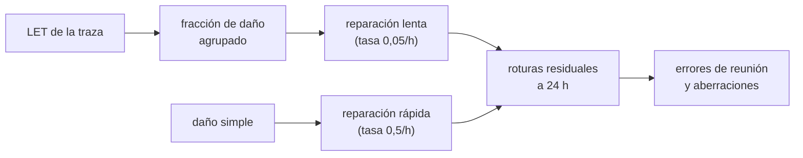

# B112-C05 — Daño y reparación del ADN por radiación espacial

<!-- nav:top -->
[🏠 Programa](../../../../README.md) · [📚 Bloque B112](../../../tronco-comun/B112-radiobiologia-y-proteccion-radiologica-espacial.md) · [← Anterior: B112-C04 — Efectos crónicos y carcinogénesis por radiación](../B112-C04-efectos-cronicos-y-carcinogenesis-por-radiacion/CLASE.md) · [Siguiente: B112-C06 — Modelos de riesgo de radiación para misiones →](../B112-C06-modelos-de-riesgo-de-radiacion-para-misiones/CLASE.md)
<!-- /nav -->

## 1. Ubicación, nivel y alcance

Clase 5 del bloque B112 (área A09). Nivel N3. Baja al mecanismo: cómo una traza de radiación rompe el ADN, por qué las roturas dobles **agrupadas** de los iones pesados son más difíciles de reparar y cómo un error de reunión puede acabar en una aberración cromosómica. El modelo del laboratorio es **cualitativo y sintético**, no calibrado con datos. **Contenido educativo; no da consejo médico.**

## 2. Por qué esta clase existe

Falta la clase de mecanismos moleculares de daño y reparación. Sin ella, la diferencia de eficacia biológica entre fotones e iones pesados (B112-C01, C02) y la incertidumbre del riesgo (C04) parecen cifras arbitrarias. La decisión central: **¿por qué, a igual dosis, el daño de alto LET se repara peor y qué puede predecir un modelo simple sobre eso?**

## 3. Lo que podrás hacer al terminar

1. Describir roturas simples y dobles del ADN y la diferencia entre daño disperso y agrupado.
2. Relacionar la fracción de daño agrupado con el LET en un modelo cualitativo.
3. Simular la cinética de reparación con tasas rápida y lenta y calcular las roturas residuales a 24 h.
4. Contar errores de reunión entre roturas cercanas y relacionarlos con las aberraciones.
5. Comparar el residual del hierro con el de los fotones y explicar el orden de magnitud.
6. Rotular qué se consultó (solo un resumen) y qué es inventado en el modelo.

La evidencia es la **informe de roturas no reparadas frente al LET** del ejercicio 12 (sección 20).

## 4. Con qué llegas y cómo comprobarlo

1. ¿Qué es la dosis absorbida y el LET?
2. ¿Qué es una cinética exponencial de primer orden?
3. ¿Qué es el ADN y para qué sirve?
4. ¿Qué es una media de Poisson?
5. ¿Qué es un dato sintético?

<details>
<summary>Ver respuestas</summary>

1. Energía por masa (Gy) y energía perdida por longitud (keV/µm) (B112-C01). 2. Un decaimiento `e^(−kt)` con tasa constante. 3. La molécula que almacena la información genética de la célula. 4. El número medio de sucesos independientes por intervalo. 5. Uno generado por un modelo y no medido; se rotula como tal.
</details>

Con cuatro o cinco aciertos, sigue; si no, repasa los prerrequisitos.

## 5. Un caso de contexto y casos de referencia

Con 1 Gy y un rendimiento inventado de 35 roturas dobles por núcleo, el número de roturas es el mismo para fotones, protones, helio, carbono y hierro (34,8 a 35,3), pero las que quedan **sin reparar a 24 h** pasan de 0,07 con fotones a 8,28 con hierro (un factor de 121) y los errores de reunión de 0,83 a 35,8. La causa es la fracción de roturas «agrupadas» de reparación lenta, que el modelo hace crecer con el LET (0,007 con fotones; 0,789 con hierro). Es el **ejemplo conductor**: el modelo es **sintético e ilustrativo** (semilla 116); lo consultado es solo el resumen de Hagiwara et al. (2019).

## 6. Vocabulario

Una **rotura doble** (DSB) rompe las dos hebras del ADN; es el daño más peligroso. Un **daño agrupado o complejo** reúne varias lesiones (roturas dobles, simples o de bases) a pocos nanómetros. La **reparación** devuelve la integridad al ADN: la **unión de extremos no homólogos** (NHEJ) reúne los extremos directamente y puede cometer errores. Un **error de reunión** une extremos equivocados y puede originar **aberraciones cromosómicas** (dicéntricos, translocaciones, deleciones). La **cinética de reparación** es la evolución del número de roturas con el tiempo.

## 7. Modelo mental



*Descripción textual:* el LET fija la fracción de daño agrupado, que se repara despacio, mientras el daño simple se repara rápido; las roturas que quedan y los pares cercanos dan los errores de reunión.

Analogía: una grieta aislada en un muro se tapa rápido; muchas grietas juntas obligan a reparar la sección entera y es fácil unir mal las piezas. Límite: la cinética de reparación real depende de la fase del ciclo celular, de las proteínas implicadas y de la cromatina, nada de lo cual se modela aquí.

## 8. La explicación, paso a paso

### 8.1 Roturas y agrupación

Hagiwara et al. (2019, resumen consultado) explican que los rayos X y gamma depositan la energía de forma dispersa, mientras que la radiación de alto LET la deposita de forma densa a lo largo de la traza; los iones pesados producen más aberraciones cromosómicas (dicéntricos, translocaciones) y deleciones mayores de 1000 pb que los rayos X; y observaron roturas dobles agrupadas a lo largo de la traza y en los límites de los cromosomas. Cucinotta y Durante (2006, resumen) resaltan que la biología de los iones pesados está mal conocida.

### 8.2 Modelo del laboratorio

Cada núcleo recibe 35 roturas por Gy (inventado). La probabilidad de que una rotura sea agrupada es `p = LET/(LET + 40)`: 0,007 con 0,3 keV/µm, 0,048 con 2, 0,500 con 40 y 0,789 con 150. Las roturas simples se reparan con tasa 0,5/h (vida media 1,39 h) y las agrupadas con 0,05/h (13,9 h).

### 8.3 Cinética y residuales

Las roturas sin reparar a 0, 2, 6 y 24 h siguen `N(t) = N₀[(1−p) e^(−0,5t) + p e^(−0,05t)]`. Para fotones: 35; 13,0; 1,9; 0,07. Para hierro: 35; 27,8; 20,9; 8,28 (analítico 8,32). El rendimiento inicial es igual; lo que cambia es la cola lenta.

### 8.4 Errores de reunión

Se cuenta cada par de roturas a menos de 0,5 µm cuando una se repara antes que la otra. Con fotones 0,83 por núcleo y con hierro 35,8: la agrupación a lo largo de la traza aumenta la probabilidad de reunir mal. El número depende por completo de la distancia de 0,5 µm y de la geometría inventada; solo es fiable el sentido de la tendencia.

### 8.5 Qué enseña y qué no

Enseña por qué el mismo gray no es igual de dañino (B112-C01, C02) y de dónde viene parte de la incertidumbre del riesgo (C04). No predice aberraciones ni cánceres: el modelo no está calibrado con datos.

## 9. Magnitudes, símbolos y unidades

| Símbolo | Qué es | Unidad | Valor / nota |
|---|---|---|---|
| `N₀` | roturas dobles iniciales por núcleo | — | 35 por Gy (inventado) |
| `p` | probabilidad de daño agrupado | — | `LET/(LET+40)` (inventada) |
| `k_rap`, `k_len` | tasas de reparación rápida y lenta | h⁻¹ | 0,5 y 0,05 (inventadas) |
| `N(t)` | roturas sin reparar | — | 8,28 a 24 h con hierro |
| `r_int` | distancia de interacción | µm | 0,5 (inventada) |
| LET | energía perdida por longitud | keV/µm | 0,3 a 150 (ilustrativos) |

## 10. Convenciones y referencias

Unidades: Gy, keV/µm, µm, horas. Geometría: núcleo esférico de 10 µm, trazas rectas de cuerda aleatoria, roturas uniformes sobre la traza (B112-C01). Datos **sintéticos e ilustrativos** (semilla 116), sin calibración. Tolerancias: rendimiento total igual a 35 dentro del 4 %; roturas sin reparar a 24 h iguales a la analítica dentro del 3 % del inicial más 0,3; residuales crecientes con el LET. 600 a 1500 núcleos por radiación. Numpy 2.4.4, Python 3.12.9.

## 11. De dónde sale lo que afirmamos

| ID | Fuente | Localizador | Respalda | Estado |
|---|---|---|---|---|
| S1 | Hagiwara, Y. et al., «Clustered DNA double-strand break formation and the repair pathway following heavy-ion irradiation», J Radiat Res 60(1):69-79, 2019, doi 10.1093/jrr/rry096 (resumen vía Europe PMC, consultado 2026-11-10) | resumen | alto LET: energía densa en la traza, más dicéntricos, translocaciones y deleciones > 1000 pb que con rayos X; roturas dobles agrupadas a lo largo de la traza y en límites cromosómicos | Consultada (solo resumen) |
| S2 | Cucinotta, F. A. y Durante, M., Lancet Oncol 7(5):431-435, 2006, doi 10.1016/S1470-2045(06)70695-7 (resumen vía Europe PMC, consultado 2026-11-10) | resumen | los iones de alta carga y energía dominan el riesgo y su biología está poco conocida | Consultada (solo resumen) |
| — | Rendimiento de roturas, tasas de reparación, función de agrupación y distancia de interacción | — | inventados para el laboratorio; no calibrados con datos | Sintético (no es dato) |

Límites: de los dos artículos solo se consultó el resumen, a través de Europe PMC; el texto completo no se pudo leer (PMC y la editorial bloquearon la descarga automática) y **no se consultó**. Por eso no se afirman mecanismos ni valores cuantitativos de la literatura: las tasas, el rendimiento y la agrupación son del laboratorio.

## 12. Cómo ver el resultado

| Métrica | Valor |
|---|---|
| Roturas totales (fotones / hierro) | 35,26 / 35,15 por núcleo |
| Sin reparar a 2 / 6 / 24 h, fotones | 12,99 / 1,88 / 0,07 |
| Sin reparar a 2 / 6 / 24 h, hierro | 27,84 / 20,94 / 8,28 |
| Errores de reunión (fotones / hierro) | 0,827 / 35,806 |
| Residual 24 h hierro / fotones | 121,2 |

Descripción larga: el número de roturas iniciales es el mismo, pero con alto LET una fracción grande es agrupada y se repara despacio, de modo que a 24 h quedan unas 120 veces más roturas y muchos más errores de reunión.

## 13. Ejemplo trabajado: residual a 24 h con hierro

**Paso 1 · Agrupada.** `p = 150/(150 + 40) = 0,789`.

**Paso 2 · Cada fracción.** `e^(−0,5·24) ≈ 6 × 10⁻⁶` (rápida) y `e^(−0,05·24) = 0,301` (lenta).

**Paso 3 · Total.** `N(24) = 35·(0,211·6 × 10⁻⁶ + 0,789·0,301) = 8,32`.

**Paso 4 · Contraste.** La simulación dio 8,28 (dentro del 3 % de 35 más 0,3).

## 14. Distintas formas de describir el problema

**Por mecanismo:** daño simple o agrupado. **Por cinética:** dos exponenciales. **Por distancia:** pares a menos de 0,5 µm. **Por LET:** fracción agrupada. **Por tabla:** residuales por radiación.

## 15. Práctica guiada

**Ejercicio 1 · con los pasos indicados.** Calcula `p` para 40 keV/µm con `p = LET/(LET + 40)`.

<details><summary>Solución comentada</summary>

`40/80 = 0,500`.
</details>

**Ejercicio 2 · con una pista.** ¿Cuánto vale la vida media de una rotura con tasa 0,5/h? *Pista:* `ln 2/k`.

<details><summary>Solución comentada</summary>

`0,693/0,5 = 1,39 h`.
</details>

**Ejercicio 3 · casi autónomo.** Con tasa 0,05/h, ¿qué fracción de roturas queda tras 24 h?

<details><summary>Solución comentada</summary>

`e^(−1,2) = 0,301`.
</details>

## 16. Práctica autónoma, transferencia e integrador

**Ejercicio 4 · autónomo.** Calcula el residual a 24 h con `p = 0,5` y `N₀ = 35`.

<details><summary>Solución comentada</summary>

`35·(0,5·6 × 10⁻⁶ + 0,5·0,301) = 5,27`, la analítica del carbono (simulado 5,16).
</details>

**Ejercicio 5 · autónomo.** ¿Por qué el número inicial de roturas es el mismo para todas las radiaciones?

<details><summary>Solución comentada</summary>

Porque el rendimiento por Gy es la misma entrada (35); lo que cambia es la reparación.
</details>

**Ejercicio 6 · autónomo.** A 2 h las roturas sin reparar con puro daño simple valen `35·e^(−1)`. Calcúlalo y compáralo con los fotones.

<details><summary>Solución comentada</summary>

`35 × 0,368 = 12,88`; fotones 12,99 (casi todo daño simple).
</details>

**Ejercicio 7 · autónomo.** El residual de hierro frente al de fotones es 8,28/0,07 = 121. ¿Es plausible como cifra real?

<details><summary>Solución comentada</summary>

No es una predicción: depende de tasas, `p` y geometría inventadas. Solo es fiable que sea mucho mayor.
</details>

**Ejercicio 8 · autónomo.** ¿Qué mide el número de errores de reunión y qué no?

<details><summary>Solución comentada</summary>

Cuenta pares cercanos con reparación desigual; no predice aberraciones reales y depende de los 0,5 µm.
</details>

**Ejercicio 9 · transferencia.** Si un fármaco hipotético acelerase la reparación lenta de 0,05 a 0,10/h, ¿cuánto baja el residual del hierro a 24 h?

<details><summary>Solución comentada</summary>

`35·0,789·e^(−2,4) = 2,50`, frente a 8,32 (hipótesis ilustrativa, no un efecto real).
</details>

**Ejercicio 10 · transferencia.** Una nave recibe sobre todo protones de bajo LET en tránsito y algunos iones pesados. ¿Qué parte del residual del modelo aportarían los pesados con el mismo gray?

<details><summary>Solución comentada</summary>

Una fracción desproporcionada: el residual de hierro es unas 100 veces el de fotones por gray; con pocos iones pesados el residual total se concentra en ellos.
</details>

**Ejercicio 11 · transferencia.** El texto completo de los artículos no se consultó. ¿Qué afirmaciones de esta clase quedarían sin respaldo si el resumen se equivocara?

<details><summary>Solución comentada</summary>

Las cualitativas de la sección 8.1; el modelo numérico es del laboratorio y sigue siendo sintético.
</details>

**Ejercicio 12 · integrador.** Elabora tu *informe de roturas no reparadas frente al LET*: definiciones, tabla de `p`, cinética a 0, 2, 6 y 24 h por radiación, errores de reunión, factor hierro/fotones y qué es consultado, inventado y no consultado.

<details><summary>Solución comentada</summary>

Secciones 8.1–8.5, el ejemplo 13 y la salida del laboratorio.
</details>

## 17. Laboratorio: roturas dobles agrupadas y su reparación simulada

El script [reparacion_adn.py](reparacion_adn.py) coloca roturas dobles a lo largo de trazas de cinco LET ilustrativos en un núcleo, simula la reparación con tasas rápida y lenta, cuenta roturas sin reparar y errores de reunión y las compara con la cinética analítica; **comprueba** el rendimiento fijo, la coincidencia con la analítica y el crecimiento del residual con el LET. Tarda unos 40 s.

**Datos:** todo **sintético e ilustrativo** con semilla 116; solo la tendencia cualitativa se apoya en el resumen de Hagiwara et al. (2019); ningún parámetro está calibrado. **Predice antes de ejecutar:** ¿Qué fracción de roturas agrupadas lentas quedan tras 24 h? (`e^(−1,2) ≈ 30 %`.) **Ejecución del 2026-11-10 (Python 3.12.9):**

```text
Python 3.12.9; numpy 2.4.4
DATOS SINTETICOS E ILUSTRATIVOS (semilla 116): sin calibracion con datos; solo cualitativamente apoyado en Hagiwara et al. (2019), resumen
Dosis 1.0 Gy, rendimiento inventado 35 roturas dobles/Gy/nucleo; reparacion rapida 0.5/h, lenta 0.05/h; interaccion 0.5 um
radiacion     LET impactos/nuc prob.agrup.  roturas  sin reparar 2h     6h    24h  errores reunion
fotones       0.3      1634.02       0.007    35.26           12.99   1.88   0.07            0.827
proton        0.5       980.41       0.012    34.77           12.88   2.08   0.12            0.825
helio         2.0       245.10       0.048    35.07           14.03   2.94   0.49            1.202
carbono      40.0        12.26       0.500    34.97           22.17  13.69   5.16            8.398
hierro      150.0         3.27       0.789    35.15           27.84  20.94   8.28           35.806
Control analitico de la cinetica (roturas sin reparar a 0, 2, 6, 24 h): simulado frente a analitico
  fotones    sim [35.26 12.99  1.88  0.07]  ana [35.   13.02  1.92  0.08]
  proton     sim [34.77 12.88  2.08  0.12]  ana [35.   13.11  2.04  0.13]
  helio      sim [35.07 14.03  2.94  0.5 ]  ana [35.   13.77  2.89  0.5 ]
  carbono    sim [34.97 22.17 13.69  5.16]  ana [35.   22.27 13.84  5.27]
  hierro     sim [35.15 27.84 20.94  8.28]  ana [35.   27.71 20.84  8.32]
Residuales a 24 h: fotones 0.07, proton 0.12, helio 0.49, carbono 5.16, hierro 8.28 ; razon hierro / fotones = 121.2
Pruebas superadas.
```

```bash
python programa/clases/B112/B112-C05-dano-y-reparacion-del-adn-por-radiacion-espacial/reparacion_adn.py
```

**Límites:** geometría de traza simplificada, un solo tipo de lesión, tasas de primer orden inventadas, un solo tamaño de núcleo y distancia de interacción arbitraria; no predice aberraciones, mutaciones ni cáncer.

## 18. Errores frecuentes y cómo corregirlos

**Pensar que más roturas iniciales explican el mayor daño.** El rendimiento inicial es igual; la diferencia está en la reparación (8.3).

**Tomar las tasas como constantes biológicas.** Son inventadas (sección 10).

**Confundir error de reunión con mutación comprobada.** Es un recuento del modelo (8.4).

**Citar mecanismos que solo se leyeron en un resumen.** Rotula «solo resumen» (sección 11).

## 19. Cómo sabrás que vas bien

Tras la sección 8: ¿por qué quedan más roturas sin reparar con hierro si el rendimiento es el mismo? Si dudas, repasa el ejemplo 13. Tras el laboratorio: ¿qué comprueba? (ver la sección 17).

## 20. Qué entregas y cómo se evalúa

El producto es tu **informe de roturas no reparadas frente al LET** (ejercicio 12).

| Criterio | Inicial | En desarrollo | Logrado | Destacado |
|---|---|---|---|---|
| Conceptos | Confunde cantidad de roturas con complejidad | Parciales | Explica daño agrupado, reparación y errores de reunión | Explica la diferencia por LET |
| Cálculo | Sin unidades | Con errores | Calcula la cinética | Calcula casos nuevos |
| Numérico | Sin control | Un caso | Compara con la cinética analítica | Interpreta la incertidumbre |
| Fuentes | Sin fuente | Sin fecha | Fuentes con fecha y estado | Declara lo sintético y lo no consultado |
| Límites | No los nombra | Uno | Tres | Discute qué falta del modelo |

**Condiciones críticas (no se compensan con promedio):** rotular todo como sintético o ilustrativo; no dar consejo médico ni operativo; no presentar estas cifras como la exposición o el riesgo de una persona real; citar solo lo consultado.

## 21. Ética, seguridad y límites

Clase **educativa**: **no da consejo médico ni operativo** y no sustituye la formación, la licencia ni la supervisión de profesionales de física médica, medicina aeroespacial o protección radiológica. El modelo es didáctico y no calibrado; no sirve para estimar daños ni efectos en personas. La investigación de reparación del ADN y de contramedidas se hace con protocolos, comités y personal cualificado. Accesibilidad: tablas equivalentes a las gráficas, fórmulas en texto, ejercicios sin conexión.

## 22. Para cerrar y seguir

El mismo número de roturas dobles no es el mismo daño: las agrupadas a lo largo de la traza de un ion pesado se reparan despacio y favorecen errores de reunión. En el modelo inventado, a 24 h quedan unas 120 veces más roturas con hierro que con fotones. Con esto se cierra el nivel molecular que sostiene la eficacia biológica y la incertidumbre del riesgo.

**Glosario español–inglés.** rotura doble · *double-strand break*; daño agrupado · *clustered damage*; unión de extremos no homólogos · *non-homologous end joining*; aberración cromosómica · *chromosomal aberration*; cinética de reparación · *repair kinetics*.

**Continuidad.** Sigue con [B112-C06 — Modelos de riesgo de radiación para misiones](../B112-C06-modelos-de-riesgo-de-radiacion-para-misiones/CLASE.md), que integra dosis, riesgo e incertidumbre.

**Referencias:** ver sección 11.

<!-- nav:bottom -->
---

[← Anterior: B112-C04 — Efectos crónicos y carcinogénesis por radiación](../B112-C04-efectos-cronicos-y-carcinogenesis-por-radiacion/CLASE.md) · [📚 Bloque B112](../../../tronco-comun/B112-radiobiologia-y-proteccion-radiologica-espacial.md) · [Siguiente: B112-C06 — Modelos de riesgo de radiación para misiones →](../B112-C06-modelos-de-riesgo-de-radiacion-para-misiones/CLASE.md)
<!-- /nav -->
