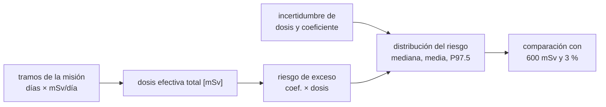

# B112-C06 — Modelos de riesgo de radiación para misiones

<!-- nav:top -->
[🏠 Programa](../../../../README.md) · [📚 Bloque B112](../../../tronco-comun/B112-radiobiologia-y-proteccion-radiologica-espacial.md) · [← Anterior: B112-C05 — Daño y reparación del ADN por radiación espacial](../B112-C05-dano-y-reparacion-del-adn-por-radiacion-espacial/CLASE.md) · [Siguiente: B113-C01 — Estrés operacional y estrategias de afrontamiento →](../../../tronco-comun/B113-salud-conductual-y-bienestar-en-aislamiento.md#b113-c01)
<!-- /nav -->

## 1. Ubicación, nivel y alcance

Clase 6 y última del bloque B112 (área A09). Nivel N3. Integra las cinco anteriores: de las tasas de dosis por tramo de una misión a la dosis efectiva total, de ahí a un riesgo de exceso con incertidumbre, y de ahí a la comparación con los límites de NASA (600 mSv de dosis efectiva de carrera; riesgo de muerte inducida por exposición del 3 % al nivel del 95 %). Los escenarios son **inventados** y el coeficiente es nominal; no es el modelo de NASA. **Contenido educativo: no da consejo médico ni operativo.**

## 2. Por qué esta clase existe

Falta la clase de estimación de riesgo por misión. Es la que usa un planificador: suma dosis de cada tramo, la convierte en riesgo y decide si cabe dentro de un límite. La decisión central: **¿contra qué número se compara una misión (dosis, riesgo medio o cola de la distribución) y cuánto cambia la conclusión según esa elección?**

## 3. Lo que podrás hacer al terminar

1. Sumar dosis efectivas por tramo (días × mSv/día) y compararlas con el límite de 600 mSv.
2. Convertir la dosis en riesgo de exceso nominal y explicar por qué no es el riesgo de la norma de NASA.
3. Propagar incertidumbres lognormales de la dosis y del coeficiente por Monte Carlo.
4. Leer mediana, media, percentil 97,5 y probabilidad de superar un límite, y explicar el «nivel del 95 %».
5. Analizar la sensibilidad a la tasa de dosis de tránsito y al tiempo de tránsito.
6. Rotular lo consultado, lo inventado y que no es consejo médico ni operativo.

La evidencia es la **informe de riesgo de misión con intervalo** del ejercicio 12 (sección 20).

## 4. Con qué llegas y cómo comprobarlo

1. ¿Qué es la dosis efectiva?
2. ¿Qué es el riesgo de exceso lineal?
3. ¿Qué es un percentil 97,5?
4. ¿Qué es una simulación de Monte Carlo?
5. ¿Qué es un escenario inventado?

<details>
<summary>Ver respuestas</summary>

1. La dosis ponderada por radiación y tejido, en Sv (B112-C02). 2. `r·E` con `r` en Sv⁻¹ (B112-C04). 3. El valor bajo el cual cae el 97,5 % de la distribución. 4. Repetir un cálculo con entradas sorteadas para conocer la distribución del resultado. 5. Uno que el autor define sin datos de misión y rotula como tal.
</details>

Con cuatro o cinco aciertos, sigue; si no, repasa los prerrequisitos.

## 5. Un caso de contexto y casos de referencia

Tres escenarios **inventados**. Una estancia en la ISS de 180 días a 0,8 mSv/día suma 144 mSv. Una misión lunar de 30 días en superficie (0,5 mSv/día) con 6 días de tránsito (1,0 mSv/día) suma 21 mSv. Una misión a Marte con 400 días de tránsito a 1,5 mSv/día y 100 días en superficie a 0,5 mSv/día suma **650 mSv**, por encima de los 600 mSv. Con un coeficiente nominal de 5 %/Sv y factores inventados, el riesgo de exceso de Marte es de 3,25 % determinista, mediana 3,27 %, media 4,59 % y percentil 97,5 de 16,45 %, y la probabilidad de superar el 3 % es del 54,1 %. Es el **ejemplo conductor**: las tasas de superficie (0,5) y de tránsito (1,5) son ejemplos de la fuente consultada; los escenarios y los factores son **sintéticos** (semilla 117).

## 6. Vocabulario

El **riesgo de exceso de muerte inducida por exposición** (REID) es la probabilidad de que una persona muera de cáncer a causa de la exposición, en función de la dosis efectiva, la edad y el sexo (NASA THREE). El **límite de carrera** de NASA se fija con un REID del 3 % al **nivel del 95 % de confianza**, que según el informe de National Academies (2021) corresponde al percentil 97,5 de la distribución de incertidumbre. Un **límite administrativo** es un valor más estricto que se usa para cumplir el estándar. **ALARA** es el principio de mantener la exposición tan baja como sea razonablemente alcanzable. El **tránsito** es el viaje entre destinos; la **superficie**, la estancia sobre un cuerpo planetario.

## 7. Modelo mental



*Descripción textual:* las dosis por tramo suman la dosis total; con el coeficiente dan el riesgo; las incertidumbres lo convierten en una distribución y esta se compara con el límite de dosis de 600 mSv y con el de riesgo del 3 %.

Analogía: planificar un viaje con presupuesto: se suma el gasto previsto de cada tramo y se pregunta con qué holgura se cumple aun en un escenario caro. Límite: aquí las «tarifas» (tasas de dosis) varían con el ciclo solar y el blindaje, y el coeficiente depende de la edad y el sexo.

## 8. La explicación, paso a paso

### 8.1 Dosis por tramo

La dosis efectiva de la misión es `Σ (días × tasa)`: ISS 180 d × 0,8 = 144 mSv; Luna 6 × 1,0 + 30 × 0,5 = 21 mSv; Marte 400 × 1,5 + 100 × 0,5 = 650 mSv. Seed (NASA THREE, 2011) da de 0,5 a 1,2 mSv/día para la ISS; OCHMO-TB-020 cita unos 0,5 mSv/día en superficie y 1,5 mSv/día en un ejemplo de tránsito a Marte.

### 8.2 Los límites consultados

OCHMO-TB-020 (NASA-STD-3001 Vol. 1 Rev B) fija la dosis efectiva de carrera en 600 mSv, universal para edad y sexo, calculada con el factor de calidad de NASA y los parámetros de una mujer de 35 años, y 250 mSv por evento solar. NASA THREE explica que los límites de carrera se basan en un REID del 3 %. National Academies (2021) indica que el nivel del 95 % es el percentil 97,5, que NASA usa un límite administrativo de 1 % de REID y que las misiones largas probablemente superen 600 mSv. Los valores de dosis de esta clase se comparan con ellos solo como ilustración.

### 8.3 Del escenario al riesgo

Con `r = 0,05 Sv⁻¹` (nominal ICRP 103, **no** el modelo de NASA): ISS 0,72 %, Luna 0,11 %, Marte 3,25 %. Con las incertidumbres inventadas (GSD de dosis de 1,25 a 1,35 por tramo y GSD del coeficiente de 2,2), la mediana coincide con el valor determinista (dentro del 2 %) y la media es mayor, 1,01 %; 0,15 %; 4,59 %.

### 8.4 Cola y probabilidad de exceder

Los percentiles 97,5 son 3,59 % (ISS), 0,53 % (Luna) y 16,45 % (Marte), unas 3,6 veces la media; la probabilidad de superar el 3 % es del 4,1 %, 0,0 % y 54,1 %. El 3,59 % de la ISS **no** dice que la ISS supere el límite: refleja el GSD de 2,2 inventado y el coeficiente nominal, que no son los de NASA. Es un aviso de que un resultado depende de los supuestos de incertidumbre.

### 8.5 Sensibilidad y decisión

La dosis de Marte pasa de 450 mSv (1,00 mSv/día) a 750 mSv (1,75 mSv/día), es decir, de 2,25 % a 3,75 % de riesgo nominal. Acortar 90 días el tránsito a 1,5 mSv/día ahorra 135 mSv (0,68 puntos porcentuales); en OCHMO-TB-020 un ejemplo similar muestra que una fuente nuclear que ahorra 135 mSv pero añade 150 mSv aumenta la exposición neta en 15 mSv. Qué comparar (dosis, media o cola) es una decisión de política, no un cálculo.

## 9. Magnitudes, símbolos y unidades

| Símbolo | Qué es | Unidad | Valor / nota |
|---|---|---|---|
| `d_i`, `Ḣ_i` | días y tasa de dosis efectiva del tramo `i` | d, mSv/d | ISS 180 d y 0,8; Marte 400 d y 1,5, 100 d y 0,5 |
| `E` | dosis efectiva de la misión | mSv | 144; 21; 650 |
| `r` | coeficiente de riesgo nominal | Sv⁻¹ | 0,05 (ICRP 103; no el de NASA) |
| REID | riesgo de exceso de muerte inducida por exposición | probabilidad | límite de carrera 3 % (NASA) |
| GSD | desviación geométrica | — | dosis 1,25 a 1,35; coeficiente 2,2 (inventadas) |
| P97,5 | percentil 97,5 del riesgo | probabilidad | 16,45 % (Marte, inventado) |

## 10. Convenciones y referencias

Unidades: mSv, días, probabilidad. Sistema de referencia: persona de referencia sin edad ni sexo; escenarios con tasas constantes. Datos **sintéticos** (semilla 117): duraciones, GSD y el uso del coeficiente nominal; tasas de 0,5 y 1,5 mSv/día y límites de OCHMO-TB-020 y 0,5–1,2 mSv/día de Seed **consultados**. Tolerancias: mediana simulada igual al valor determinista dentro del 2 %; P97,5/mediana igual al analítico dentro del 3 %; 400 000 sorteos por escenario. Numpy 2.4.4, Python 3.12.9.

## 11. De dónde sale lo que afirmamos

| ID | Fuente | Localizador | Respalda | Estado |
|---|---|---|---|---|
| S1 | NASA OCHMO, *NASA-STD-3001 Technical Brief OCHMO-TB-020 Rev E*, 2022-12-27, nasa.gov (PDF leído con PyMuPDF, consultado 2026-11-10) | págs. 1–6 | 600 mSv de carrera (universal), 250 mSv por SPE, 20 mSv por año de misión para tecnologías nucleares; 0,5 mSv/día en superficie; ejemplo de tránsito a 1,5 mSv/día; ejemplo de 135 mSv ahorrados frente a 150 mSv de la fuente | Consultada |
| S2 | NASA THREE, «Acceptable Risk», three.jsc.nasa.gov/Encyclopedia/Article/139 (página, consultada 2026-11-10) | artículo | REID como medida de riesgo; límites de carrera con REID del 3 %; ALARA y acciones de mitigación | Consultada |
| S3 | National Academies of Sciences, Engineering, and Medicine, 2021, *Space Radiation and Astronaut Health: Managing and Communicating Cancer Risks*, cap. 3 — nationalacademies.org/read/26155/chapter/5 (página, consultada 2026-11-10; leída a través de un resumen de la herramienta de consulta) | capítulo 3 | nivel del 95 % igual al percentil 97,5; límite administrativo de 1 % de REID; propuesta de 600 mSv; las misiones largas probablemente superan 600 mSv | Consultada (a través de un resumen automático; no se leyó el texto completo) |
| S4 | Seed, T. M., «Acute Effects», NASA THREE, 2011-07-11 (PDF, consultado 2026-11-10) | sección de entornos | 0,5 a 1,2 mSv/día en la ISS | Consultada |
| S5 | ICRP, 2007, Publicación 103, extracto gratuito (consultada 2026-11-10) | resumen | detrimento nominal de 5 %/Sv | Consultada (extracto) |
| S6 | Cucinotta, F. A., Kim, M.-H. Y. y Ren, L., manuscrito NTRS 20070005030 (PDF, consultado 2026-11-10) | resumen | incertidumbre de unas 4 veces entre el nivel del 95 % y la estimación puntual; GCR puede superar límites en misiones largas a Marte | Consultada (resumen e introducción) |

Límites: el capítulo de National Academies se leyó a través de un resumen automático; las normas NASA-STD-3001 completas, NCRP 132, 153 y 183 y el modelo NSCR de NASA **no se consultaron**. Los valores de 144, 21 y 650 mSv son de escenarios inventados, no de misiones reales, y el coeficiente de 5 %/Sv es nominal, no el de NASA.

## 12. Cómo ver el resultado

| Métrica | Valor |
|---|---|
| Dosis ISS / Luna / Marte | 144,0 / 21,0 / 650,0 mSv |
| Riesgo determinista | 0,72 % / 0,11 % / 3,25 % |
| Marte: mediana / media / P97,5 | 3,27 % / 4,59 % / 16,45 % |
| P(riesgo > 3 %) ISS / Luna / Marte | 4,1 % / 0,0 % / 54,1 % |
| Marte: dosis/600 mSv y P97,5/3 % | 1,08 y 5,48 |

Descripción larga: la dosis de Marte supera los 600 mSv por poco, pero el percentil 97,5 del riesgo es 5,5 veces el 3 %: la conclusión depende de si se compara la dosis, la mediana o la cola.

## 13. Ejemplo trabajado: dosis y riesgo de la misión a Marte inventada

**Paso 1 · Dosis.** `E = 400 × 1,5 + 100 × 0,5 = 650 mSv`.

**Paso 2 · Contra el límite.** `650/600 = 1,08`: supera por 8 %.

**Paso 3 · Riesgo nominal.** `0,05 × 0,650 = 3,25 %`.

**Paso 4 · Cola.** `P97,5 = 16,45 %`, unas 3,59 veces la media de 4,59 %; probabilidad de superar el 3 %: 54,1 %.

## 14. Distintas formas de describir el problema

**Por tramos:** suma de días por tasa. **Por límite:** dosis/600. **Por riesgo:** coeficiente × dosis. **Por distribución:** mediana, media, P97,5. **Por sensibilidad:** tasa de tránsito.

## 15. Práctica guiada

**Ejercicio 1 · con los pasos indicados.** Calcula la dosis de la ISS con 180 días y 0,8 mSv/día. *Pasos:* producto.

<details><summary>Solución comentada</summary>

`180 × 0,8 = 144 mSv`.
</details>

**Ejercicio 2 · con una pista.** Calcula el riesgo nominal de 144 mSv con `r = 0,05/Sv`. *Pista:* pasa a Sv.

<details><summary>Solución comentada</summary>

`0,05 × 0,144 = 0,0072 = 0,72 %`.
</details>

**Ejercicio 3 · casi autónomo.** Halla la dosis de la misión lunar: 6 d a 1,0 mSv/día y 30 d a 0,5.

<details><summary>Solución comentada</summary>

`6 + 15 = 21 mSv`.
</details>

## 16. Práctica autónoma, transferencia e integrador

**Ejercicio 4 · autónomo.** ¿Cuántos días de tránsito a 1,5 mSv/día dan 600 mSv sin superficie?

<details><summary>Solución comentada</summary>

`600/1,5 = 400 días`.
</details>

**Ejercicio 5 · autónomo.** Si el tránsito de Marte baja a 1,0 mSv/día, ¿cuánto vale la dosis y qué fracción del límite es?

<details><summary>Solución comentada</summary>

`400 + 50 = 450 mSv`; `450/600 = 0,75`.
</details>

**Ejercicio 6 · autónomo.** Ahorrar 90 días de tránsito a 1,5 mSv/día, ¿cuántos mSv y cuántos puntos de riesgo nominal ahorra?

<details><summary>Solución comentada</summary>

`135 mSv` y `0,05 × 0,135 = 0,675 ≈ 0,68` puntos porcentuales.
</details>

**Ejercicio 7 · autónomo.** Interpreta «nivel del 95 %» según la fuente de National Academies.

<details><summary>Solución comentada</summary>

Es el percentil 97,5 de la distribución de incertidumbre (límite superior de un intervalo del 95 %).
</details>

**Ejercicio 8 · autónomo.** ¿Por qué la mediana simulada coincide con el valor determinista pero la media no?

<details><summary>Solución comentada</summary>

La lognormal es asimétrica: la mediana es el producto de las medianas, y la media es mayor por la cola derecha.
</details>

**Ejercicio 9 · transferencia.** La ISS da un P97,5 de 3,59 % en el laboratorio. ¿Concluyes que la ISS supera el límite? Razona.

<details><summary>Solución comentada</summary>

No: depende del GSD inventado de 2,2 y del coeficiente nominal; no son los de NASA. La lección es la sensibilidad a los supuestos.
</details>

**Ejercicio 10 · transferencia.** Una fuente nuclear ahorra 90 días de tránsito (135 mSv) pero añade 150 mSv. ¿Ayuda?

<details><summary>Solución comentada</summary>

La exposición neta sube 15 mSv (ejemplo de OCHMO-TB-020). No ayuda a menos que se cuente además otro beneficio; hay que sumar todas las fuentes.
</details>

**Ejercicio 11 · transferencia.** Un planificador debe decidir si una misión «cumple». Compara tres criterios: dosis frente a 600 mSv, riesgo medio frente a 3 % y P97,5 frente a 3 %. ¿Cómo los ordenas de menos a más exigente para Marte?

<details><summary>Solución comentada</summary>

Dosis (1,08 del límite), media (4,59 % = 1,53 veces 3 %) y P97,5 (16,45 % = 5,48 veces). El tercero es el más exigente; la elección es política.
</details>

**Ejercicio 12 · integrador.** Elabora tu *informe de riesgo de misión con intervalo*: escenarios con sus tramos, dosis, comparación con 600 mSv, riesgo nominal, distribución con mediana, media y P97,5, sensibilidad a la tasa de tránsito y qué es consultado, inventado y no consultado.

<details><summary>Solución comentada</summary>

Secciones 8.1–8.5, el ejemplo 13 y la salida del laboratorio.
</details>

## 17. Laboratorio: riesgo de tres misiones inventadas con su intervalo

El script [riesgo_mision.py](riesgo_mision.py) suma las dosis por tramo de tres escenarios, calcula el riesgo nominal, propaga incertidumbres lognormales con 400 000 sorteos por escenario y compara con los límites consultados; **comprueba** que la mediana simulada iguala el valor determinista y que el percentil 97,5 se ajusta al analítico.

**Datos:** los escenarios, los GSD y el uso del coeficiente nominal son **sintéticos** con semilla 117; las tasas de 0,5 y 1,5 mSv/día y los límites de 600 y 250 mSv son **consultados**. **Predice antes de ejecutar:** ¿Qué escenario supera 600 mSv? (Marte, con 650 mSv.) **Ejecución del 2026-11-10 (Python 3.12.9):**

```text
Python 3.12.9; numpy 2.4.4
ESCENARIOS SINTETICOS (semilla 117); tasas de dosis de la fuente solo donde se indica; coeficiente 5 %/Sv nominal, no el de NASA
escenario                                dosis [mSv] riesgo det.  mediana   media   P97.5  P(>3%)  P97.5/media
ISS 180 d                                      144.0       0.72%    0.72%   1.01%   3.59%    4.1%         3.56
Luna 30 d (6 d de transito)                     21.0       0.11%    0.11%   0.15%   0.53%    0.0%         3.56
Marte 2x200 d + 100 d en superficie            650.0       3.25%    3.27%   4.59%  16.45%   54.1%         3.59
Comparacion con los limites consultados (dosis determinista):
  ISS 180 d                                dosis/600 mSv =  0.24; P97.5 / 3 % =  1.20
  Luna 30 d (6 d de transito)              dosis/600 mSv =  0.04; P97.5 / 3 % =  0.18
  Marte 2x200 d + 100 d en superficie      dosis/600 mSv =  1.08; P97.5 / 3 % =  5.48
Sensibilidad del escenario de Marte a la tasa de transito (mSv/dia): dosis determinista y riesgo determinista
  1.00 ->   450.0 mSv ;  2.25 %
  1.25 ->   550.0 mSv ;  2.75 %
  1.50 ->   650.0 mSv ;  3.25 %
  1.75 ->   750.0 mSv ;  3.75 %
Ahorro de 90 dias de transito a 1.5 mSv/dia = 135 mSv (0.68 puntos porcentuales de riesgo nominal)
Pruebas superadas.
```

```bash
python programa/clases/B112/B112-C06-modelos-de-riesgo-de-radiacion-para-misiones/riesgo_mision.py
```

**Límites:** coeficiente nominal sin edad ni sexo, factores independientes y lognormales, tasas constantes y sin ciclo solar ni eventos solares; **no es el modelo de NASA ni sirve para evaluar una misión real**, y no da consejo médico ni operativo.

## 18. Errores frecuentes y cómo corregirlos

**Comparar solo la dosis con 600 mSv.** Mira también la cola del riesgo (8.4).

**Tomar el coeficiente nominal como el modelo de NASA.** NASA usa edad, sexo y su propio factor de calidad (8.2).

**Leer una cola dependiente de supuestos como un hecho.** Examina la sensibilidad (8.4, 8.5).

**Presentar los escenarios como misiones reales.** Rotúlalos como inventados (sección 10).

## 19. Cómo sabrás que vas bien

Tras la sección 8: ¿por qué la misión de Marte «supera» 600 mSv por poco pero su P97,5 es 5,5 veces el 3 %? Si dudas, repasa el ejemplo 13. Tras el laboratorio: ¿qué comprueba? (ver la sección 17).

## 20. Qué entregas y cómo se evalúa

El producto es tu **informe de riesgo de misión con intervalo** (ejercicio 12).

| Criterio | Inicial | En desarrollo | Logrado | Destacado |
|---|---|---|---|---|
| Conceptos | Confunde dosis y riesgo | Parciales | Explica dosis, riesgo, límite y nivel del 95 % | Compara tres criterios y su política |
| Cálculo | Sin unidades | Con errores | Suma dosis por tramo y calcula el riesgo | Calcula casos nuevos |
| Numérico | Sin control | Un caso | Compara con el valor determinista y el analítico | Interpreta la incertidumbre |
| Fuentes | Sin fuente | Sin fecha | Fuentes con fecha y estado | Declara lo sintético y lo no consultado |
| Límites | No los nombra | Uno | Tres | Discute qué falta del modelo |

**Condiciones críticas (no se compensan con promedio):** rotular todo como sintético o ilustrativo; no dar consejo médico ni operativo; no presentar estas cifras como la exposición o el riesgo de una persona real; citar solo lo consultado.

## 21. Ética, seguridad y límites

Clase **educativa**: **no da consejo médico ni operativo** y no sustituye la formación, la licencia ni la supervisión de profesionales de física médica, medicina aeroespacial o protección radiológica. Los límites y modelos reales los fijan las normas vigentes y los aplican equipos de protección radiológica y de medicina aeroespacial con datos de la misión; ninguna cifra de esta clase es una evaluación de misión ni un consejo operativo. Los límites citados corresponden a la revisión consultada y pueden cambiar. Accesibilidad: tablas equivalentes a las gráficas, fórmulas en texto, ejercicios sin conexión.

## 22. Para cerrar y seguir

Una misión se evalúa sumando dosis por tramos, convirtiéndolas en riesgo con un coeficiente y propagando la incertidumbre. En el escenario inventado de Marte, la dosis de 650 mSv supera por poco los 600 mSv, pero la cola del riesgo es más de cinco veces el 3 %: la conclusión depende del criterio y de los supuestos. Con esto se cierra el bloque: de la magnitud física a la decisión de misión y su incertidumbre.

**Glosario español–inglés.** riesgo de exceso de muerte inducida por exposición · *risk of exposure-induced death (REID)*; límite de carrera · *career limit*; nivel de confianza · *confidence level*; tránsito · *transit*; tan bajo como sea razonablemente alcanzable · *as low as reasonably achievable (ALARA)*.

**Continuidad.** Esta es la última clase del bloque B112. Vuelve al [bloque B112](../../../tronco-comun/B112-radiobiologia-y-proteccion-radiologica-espacial.md) para el recorrido completo.

**Referencias:** ver sección 11.

<!-- nav:bottom -->
---

[← Anterior: B112-C05 — Daño y reparación del ADN por radiación espacial](../B112-C05-dano-y-reparacion-del-adn-por-radiacion-espacial/CLASE.md) · [📚 Bloque B112](../../../tronco-comun/B112-radiobiologia-y-proteccion-radiologica-espacial.md) · [Siguiente: B113-C01 — Estrés operacional y estrategias de afrontamiento →](../../../tronco-comun/B113-salud-conductual-y-bienestar-en-aislamiento.md#b113-c01)
<!-- /nav -->
