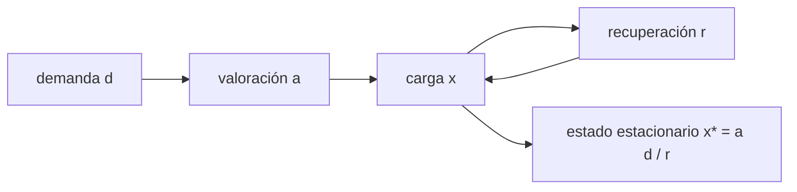

# B113-C01 — Estrés operacional y estrategias de afrontamiento

<!-- nav:top -->
[🏠 Programa](../../../../README.md) · [📚 Bloque B113](../../../tronco-comun/B113-salud-conductual-y-bienestar-en-aislamiento.md) · [← Anterior: B112-C06 — Modelos de riesgo de radiación para misiones](../../../tronco-comun/B112-radiobiologia-y-proteccion-radiologica-espacial.md#b112-c06) · [Siguiente: B113-C02 — Ansiedad y respuesta emocional en escenarios simulados →](../B113-C02-ansiedad-y-respuesta-emocional-en-escenarios-simulados/CLASE.md)
<!-- /nav -->

## 1. Ubicación, nivel y alcance

Clase 1 del bloque B113. Nivel N3. Aquí tratas el estrés operacional como un proceso que **se acumula con la demanda y se disipa con la recuperación**, y comparas, con un modelo muy simple, qué hace cada estrategia de afrontamiento. Parte de [B105](../../../tronco-comun/B105-medicina-y-biologia-espacial.md) solo para el marco del aislamiento. Todos los datos son sintéticos. **Esta clase no da consejo médico, psicológico ni operativo y no sustituye formación, licencia ni supervisión profesional.**

## 2. Por qué esta clase existe

B105-C09 presenta la salud mental en aislamiento, pero no el estrés operacional. La decisión central: **¿sobre qué palanca actuar, bajar la demanda vivida o acelerar la recuperación, y cómo saber si funcionó?**

## 3. Lo que podrás hacer al terminar

1. Plantear el modelo de acumulación y recuperación `x[n+1] = (1 − r) x[n] + a d`.
2. Calcular el estado estacionario `x* = a d / r` y el tiempo de respuesta.
3. Comparar cuatro estrategias ilustrativas (ninguna, centrada en el problema, centrada en la recuperación, combinada).
4. Estimar cuánto tarda en volver a la normalidad tras un pico de demanda.
5. Explicar por qué un modelo así no mide a una persona.
6. Separar lo consultado (el marco de la NASA) de lo sintético (los números).

La evidencia es la **ficha comparativa de estrategias de afrontamiento** del ejercicio 12 (sección 20).

## 4. Con qué llegas y cómo comprobarlo

1. ¿Qué es una ecuación en diferencias?
2. ¿Qué es un estado estacionario?
3. ¿Qué es un dato sintético?
4. ¿Qué diferencia hay entre un modelo y una medición?
5. ¿Qué es una segunda vía de verificación?

<details>
<summary>Ver respuestas</summary>

1. Una regla que da el valor siguiente a partir del actual. 2. El valor al que tiende la serie cuando ya no cambia. 3. Un dato generado para el ejemplo, no medido. 4. El modelo calcula lo que sus supuestos implican; la medición observa. 5. Calcular lo mismo con otro método y comparar.
</details>

Con cuatro o cinco aciertos, sigue; si no, repasa los prerrequisitos.

## 5. Un caso de contexto y casos de referencia

Una demanda diaria constante de `d = 10 u.a./día` produce, sin estrategia (`r = 0,20`, `a = 1,00`), una carga estacionaria de `50 u.a.`; la estrategia combinada (`r = 0,35`, `a = 0,70`) la deja en `20 u.a.`. Es el **ejemplo conductor** y es **sintético**: «u.a.» son unidades arbitrarias y ningún valor describe a una persona.

El informe de evidencia del HRP de la NASA afirma que el aislamiento y el confinamiento pueden degradar el funcionamiento cognitivo y conductual y que las contramedidas actuales han mitigado el riesgo en misiones de unos seis meses (S1, S2). Esta clase no reproduce esas contramedidas: modela la lógica de cómo una palanca u otra cambia una carga.

## 6. Vocabulario

El **estrés operacional** es la carga que impone el trabajo, el entorno y las condiciones de una misión. El **afrontamiento** es el conjunto de maneras de responder a esa carga. La **valoración** `a` es la fracción de la demanda que se vive como carga. La **recuperación** `r` es la fracción de la carga que se disipa cada día. El **estado estacionario** `x* = a d / r` es la carga a la que tiende el sistema con demanda constante.

## 7. Modelo mental: una bañera con grifo y desagüe



*Descripción textual:* la demanda entra a través de la valoración, la carga se acumula y la recuperación la reduce; con demanda constante la carga tiende a `a d / r`.

Analogía: el grifo es lo que llega, el desagüe es la recuperación; el nivel final depende de ambos. Límite: una persona no es una bañera; el modelo es lineal y de primer orden y omite diferencias individuales, contexto social y efectos acumulativos de largo plazo.

## 8. La explicación, paso a paso

### 8.1 El modelo y su estado estacionario

Con `x[n+1] = (1 − r) x[n] + a d`, la carga se estabiliza cuando `x = (1 − r) x + a d`, es decir `x* = a d / r`. Con `r = 0,20`, `a = 1` y `d = 10`: `x* = 50 u.a.`. Desde `x₀ = 0`, la solución es `x[n] = x* (1 − (1 − r)^n)`.

### 8.2 Cuatro estrategias ilustrativas

| Estrategia | `r` | `a` | `x*` (u.a.) | Días al 80 % de `x*` |
|---|---|---|---|---|
| Sin estrategia | 0,20 | 1,00 | 50,000 | 7,21 |
| Centrada en el problema | 0,20 | 0,70 | 35,000 | 7,21 |
| Centrada en la recuperación | 0,35 | 1,00 | 28,571 | 3,74 |
| Combinada | 0,35 | 0,70 | 20,000 | 3,74 |

Los valores de `r` y `a` son **ilustrativos**, no se tomaron de ninguna fuente. Actuar sobre `a` baja el nivel pero no el tiempo de respuesta; actuar sobre `r` baja el nivel y acorta el tiempo.

### 8.3 Dos vías y demanda ruidosa

La simulación día a día coincide con la fórmula cerrada con una diferencia máxima de `1,4 × 10⁻¹⁴` en `x(60)`. Con una demanda que fluctúa (media 10, desviación 3, semilla 42), la media de la carga en los últimos 200 días es `1,017 x*` en tres casos y `1,016 x*` en el cuarto: el estado estacionario sigue siendo un buen resumen.

### 8.4 Un pico de demanda

Tras diez días con demanda doble sin estrategia, la carga llega a `94,63 u.a.` y hacen falta `13` días con la demanda normal para volver al `105 %` de `x*`. La recuperación es la que fija esa cola.

## 9. Magnitudes, símbolos y unidades

| Símbolo | Qué es | Unidad | Valor / nota |
|---|---|---|---|
| `x` | carga de estrés | u.a. | sintética |
| `d` | demanda diaria | u.a./día | 10 (ilustrativo) |
| `a` | valoración | — | 0,70 a 1,00 |
| `r` | recuperación diaria | 1/día | 0,20 a 0,35 |
| `x*` | estado estacionario | u.a. | 20 a 50 |
| `n` | día | día | 0 a 400 |

## 10. Convenciones y referencias

Tiempo discreto en días; cero es el inicio sin carga previa. Datos sintéticos con semilla `42`. Sistema de referencia: un individuo abstracto, sin escala clínica. Tolerancia de las pruebas: diferencia con la fórmula cerrada menor que `1e-9`; cociente de la media ruidosa con `x*` dentro del 5 %. Python 3.12.9, solo biblioteca estándar.

## 11. De dónde sale lo que afirmamos

| ID | Fuente | Localizador | Respalda | Estado |
|---|---|---|---|---|
| S1 | NASA HRP, *Evidence Report: Risk of Adverse Cognitive or Behavioral Conditions and Psychiatric Disorders* (Slack et al.) — https://ntrs.nasa.gov/api/citations/20150016966/downloads/20150016966.pdf (consultada 2026-11-10; el documento descargado trae la fecha de publicación sin rellenar) | 106 páginas leídas como texto; resumen ejecutivo y secciones sobre contramedidas y autonomía | El aislamiento y el confinamiento pueden afectar el funcionamiento cognitivo y conductual; las contramedidas de la ISS han mitigado el riesgo en misiones de unos seis meses; con retardo, la tripulación vigilará indicadores y aplicará contramedidas con autonomía | Consultada |
| S2 | NASA, página «Risk of Adverse Cognitive or Behavioral Conditions and Psychiatric Disorders» — https://www.nasa.gov/directorates/esdmd/hhp/risk-of-adverse-cognitive-or-behavioral-conditions-and-psychiatric-disorders (consultada 2026-11-10) | página completa | Enunciado del riesgo; las contramedidas viables para exploración aún no están validadas | Consultada |
| — | Modelo de primer orden y su estado estacionario | — | Lo verifica el laboratorio con la fórmula cerrada | No consultada en una fuente concreta |
| — | Valores de `r`, `a`, `d` | — | Ilustrativos | No consultada |

Límites: no se consultó literatura clínica sobre estrategias de afrontamiento concretas; ningún número del modelo procede de una fuente.

## 12. Cómo ver la acumulación del estrés

| Magnitud | Valor |
|---|---|
| `x*` sin estrategia | 50,000 u.a. |
| `x*` combinada | 20,000 u.a. |
| Diferencia con la fórmula cerrada | 1,4 × 10⁻¹⁴ |
| Pico tras 10 días de demanda doble | 94,63 u.a. |

Descripción larga: la carga sube de forma exponencial hacia `x*`; la recuperación decide la velocidad y la valoración decide el nivel.

## 13. Ejemplo trabajado: la estrategia combinada

**Paso 1 · Datos.** `r = 0,35`, `a = 0,70`, `d = 10`.

**Paso 2 · Estado estacionario.** `x* = 0,70 × 10/0,35 = 20 u.a.`

**Paso 3 · Tiempo al 80 %.** `n = ln(0,2)/ln(0,65) = 3,74 días`.

**Paso 4 · Lectura.** Frente a `50 u.a.` sin estrategia, el nivel baja un `60 %` en este modelo ilustrativo.

## 14. Distintas formas de describir el estrés

**Por nivel:** `x*`. **Por velocidad:** días al 80 %. **Por palanca:** `a` (valoración) o `r` (recuperación). **Por riesgo:** el pico ante una demanda extraordinaria.

## 15. Práctica guiada

**Ejercicio 1 · con los pasos indicados.** Calcula `x*` para `r = 0,20`, `a = 1` y `d = 10`. *Pasos:* aplica `a d / r`.

<details><summary>Solución comentada</summary>

`10/0,20 = 50 u.a.`
</details>

**Ejercicio 2 · con una pista.** ¿Cuántos días tarda la carga en alcanzar la mitad de `x*` con `r = 0,20`? *Pista:* `n = ln(0,5)/ln(0,8)`.

<details><summary>Solución comentada</summary>

`0,6931/0,2231 = 3,106 días`.
</details>

**Ejercicio 3 · casi autónomo.** ¿Por qué la estrategia combinada da `20 u.a.` y no simplemente la suma de efectos?

<details><summary>Solución comentada</summary>

Porque `x* = a d / r` es un cociente: multiplica el efecto de `a` (0,70) por el de `1/r` (0,20/0,35), de modo que `50 × 0,70 × 0,5714 = 20`.
</details>

## 16. Práctica autónoma, transferencia e integrador

**Ejercicio 4 · autónomo.** `x*` con `r = 0,10`, `a = 1` y `d = 10`.

<details><summary>Solución comentada</summary>

`100 u.a.`
</details>

**Ejercicio 5 · autónomo.** Carga a los 10 días de la estrategia combinada desde `x₀ = 0`.

<details><summary>Solución comentada</summary>

`20 (1 − 0,65¹⁰) = 20 × 0,98654 = 19,73 u.a.`
</details>

**Ejercicio 6 · autónomo.** Días al 80 % con `r = 0,5`.

<details><summary>Solución comentada</summary>

`ln(0,2)/ln(0,5) = 2,32 días`.
</details>

**Ejercicio 7 · autónomo.** Si la demanda se duplica sin cambiar `r` ni `a`, ¿qué pasa con `x*`?

<details><summary>Solución comentada</summary>

Se duplica: el modelo es lineal en `d`.
</details>

**Ejercicio 8 · autónomo.** ¿Qué `r` da `x* = 20` con `a = 0,5` y `d = 10`?

<details><summary>Solución comentada</summary>

`r = 0,5 × 10/20 = 0,25`.
</details>

**Ejercicio 9 · transferencia.** **Transferencia.** El modelo da `x* = 20` para la combinada. ¿Prueba que una persona real sentiría menos estrés?

<details><summary>Solución comentada</summary>

No: `r` y `a` son ilustrativos, la carga está en unidades arbitrarias y el modelo no incluye diferencias individuales. Es una herramienta para razonar, no una medición.
</details>

**Ejercicio 10 · transferencia.** **Transferencia.** El informe S1 recoge que, según una revisión de entornos aislados, evitar el contacto con el apoyo administrativo puede ser una estrategia eficaz para mantener el funcionamiento psicosocial. ¿Cómo lo expresarías en el modelo y qué precaución tomas?

<details><summary>Solución comentada</summary>

Podría verse como una reducción de `a` (menos demanda vivida), pero es un hallazgo de grupos concretos descrito en una revisión; no se generaliza ni se recomienda desde un modelo, y su efecto sobre la comunicación necesaria para la seguridad se debe valorar con profesionales.
</details>

**Ejercicio 11 · transferencia.** **Transferencia.** Con retardo de comunicación, S1 señala que la tripulación deberá vigilar indicadores de su estado y aplicar contramedidas con autonomía. ¿Qué serie del modelo sería un indicador y qué señal activaría una respuesta?

<details><summary>Solución comentada</summary>

La serie `x[n]`; una señal sería su tendencia sostenida por encima de `x*` esperada. En una situación real el indicador y el umbral los fijan profesionales, no este modelo.
</details>

**Ejercicio 12 · integrador.** **Integrador.** Elabora tu *ficha comparativa de estrategias de afrontamiento*: tabla de `x*` y días al 80 % para las cuatro estrategias, la respuesta a un pico, la lista de qué es consultado y qué es sintético, y tres límites del modelo.

<details><summary>Solución comentada</summary>

Secciones 8.2–8.4 y la salida del laboratorio; los límites: linealidad, valores ilustrativos de `r` y `a`, ausencia de diferencias individuales.
</details>

## 17. Laboratorio: acumulación y recuperación del estrés

El script [estres.py](estres.py) simula la carga día a día para cuatro estrategias, compara con la fórmula cerrada y con una demanda ruidosa, y calcula la respuesta a un pico (**comprueba** diferencia < 1e-9 con la solución analítica y cociente con `x*` dentro del 5 %).

**Datos:** sintéticos e ilustrativos (semilla 42). **Predice antes de ejecutar:** ¿cuántos días al 80 % con `r = 0,35`? (3,74.) **Ejecución del 2026-11-10 (Python 3.12.9):**

```text
Python 3.12.9 (biblioteca estandar)
Datos SINTETICOS e ILUSTRATIVOS: demanda d = 10.0 u.a./dia, 60 dias, semilla 42
 estrategia                     r     a   x*(u.a.)  x(60) sim  x(60) analitica  dias al 80%
 sin estrategia               0.20  1.00    50.000     50.000          50.000       7.21
 centrada en el problema      0.20  0.70    35.000     35.000          35.000       7.21
 centrada en la recuperacion  0.35  1.00    28.571     28.571          28.571       3.74
 combinada                    0.35  0.70    20.000     20.000          20.000       3.74
Diferencia maxima simulacion-analitica en x(60) = 1.42e-14
Con demanda ruidosa (media 10.00, sd 3.0; 400 dias), media de x en los ultimos 200 dias:
  sin estrategia               media =  50.856 ; x* =  50.000 ; cociente = 1.017
  centrada en el problema      media =  35.599 ; x* =  35.000 ; cociente = 1.017
  centrada en la recuperacion  media =  29.037 ; x* =  28.571 ; cociente = 1.016
  combinada                    media =  20.326 ; x* =  20.000 ; cociente = 1.016
Pulso (10 dias con demanda doble, sin estrategia): pico = 94.63 u.a.; 13 dias para volver al 105% de x*
Pruebas superadas.
```

```bash
python programa/clases/B113/B113-C01-estres-operacional-y-estrategias-de-afrontamiento/estres.py
```

**Límites:** modelo lineal de primer orden con parámetros ilustrativos; la comprobación contra la fórmula cerrada valida el código, no la psicología.

## 18. Errores frecuentes y cómo corregirlos

**Leer `x*` como estrés de una persona.** Se corrige con la sección 7.

**Creer que bajar `a` acorta la recuperación.** Se corrige con 8.2.

**Tomar el acuerdo con la fórmula cerrada como validación del modelo.** Se corrige con la sección 17.

**Usar la clase como guía de tratamiento.** Se corrige con la sección 21.

## 19. Cómo sabrás que vas bien

Tras la sección 8: ¿qué `x*` esperabas para la combinada y cuál obtuviste? Si dudas, repasa el ejemplo 13. Tras el laboratorio: ¿qué comprueba? (ver la sección 17).

## 20. Qué entregas y cómo se evalúa

El producto es tu **ficha comparativa de estrategias de afrontamiento** (ejercicio 12).

| Criterio | Inicial | En desarrollo | Logrado | Destacado |
|---|---|---|---|---|
| Conceptos | Los confunde | Parciales | Distingue `a` y `r` | Explica los límites |
| Cálculo | Sin unidades | Con errores | Tabla completa con unidades | Calcula casos nuevos |
| Numérico | Sin comprobar | Un caso | Contraste con la fórmula cerrada | Interpreta la demanda ruidosa |
| Fuentes | Sin fuente | Sin fecha | Fuentes con fecha y estado | Declara lo sintético y lo no consultado |
| Límites | No los nombra | Uno | Tres | Discute qué falta del modelo |

**Condiciones críticas (no se compensan con promedio):** rotular los datos como sintéticos; no presentar el modelo como diagnóstico ni medición; declarar que no es consejo médico ni operativo.

## 21. Ética, seguridad y límites

Clase educativa: **no da consejo médico, psicológico ni operativo** y no sustituye formación, licencia ni supervisión profesional. Los modelos son simplificados y sus datos sintéticos; ningún resultado describe a una persona ni a una tripulación. Quien sufra malestar persistente debe consultar a un profesional cualificado. Accesibilidad: tablas equivalentes a las gráficas, fórmulas en texto, ejercicios sin conexión.

## 22. Para cerrar y seguir

Con la misma demanda, la carga estacionaria baja de `50` a `20 u.a.` al actuar sobre la valoración y la recuperación, y la recuperación fija la rapidez. Queda una pregunta: ¿cómo cambia la respuesta emocional cuando el escenario es una simulación de riesgo que se repite?

**Glosario español–inglés.** estrés operacional · *operational stress*; afrontamiento · *coping*; recuperación · *recovery*; estado estacionario · *steady state*; valoración · *appraisal*.

**Continuidad.** [B113-C02](../B113-C02-ansiedad-y-respuesta-emocional-en-escenarios-simulados/CLASE.md) estudia la respuesta emocional en escenarios simulados.

**Referencias:** ver sección 11.

<!-- nav:bottom -->
---

[← Anterior: B112-C06 — Modelos de riesgo de radiación para misiones](../../../tronco-comun/B112-radiobiologia-y-proteccion-radiologica-espacial.md#b112-c06) · [📚 Bloque B113](../../../tronco-comun/B113-salud-conductual-y-bienestar-en-aislamiento.md) · [Siguiente: B113-C02 — Ansiedad y respuesta emocional en escenarios simulados →](../B113-C02-ansiedad-y-respuesta-emocional-en-escenarios-simulados/CLASE.md)
<!-- /nav -->
