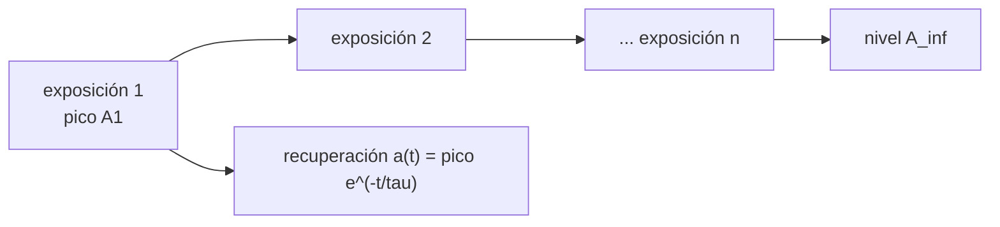

# B113-C02 — Ansiedad y respuesta emocional en escenarios simulados

<!-- nav:top -->
[🏠 Programa](../../../../README.md) · [📚 Bloque B113](../../../tronco-comun/B113-salud-conductual-y-bienestar-en-aislamiento.md) · [← Anterior: B113-C01 — Estrés operacional y estrategias de afrontamiento](../B113-C01-estres-operacional-y-estrategias-de-afrontamiento/CLASE.md) · [Siguiente: B113-C03 — Comunicación diferida y soporte psicológico a distancia →](../B113-C03-comunicacion-diferida-y-soporte-psicologico-a-distancia/CLASE.md)
<!-- /nav -->

## 1. Ubicación, nivel y alcance

Clase 2 del bloque B113. Nivel N3. Entrenar con simulaciones de riesgo provoca una respuesta emocional; aquí modelas cómo el **pico de activación disminuye con las repeticiones (habituación)** y cómo decae dentro de cada exposición. Usas [B113-C01](../B113-C01-estres-operacional-y-estrategias-de-afrontamiento/CLASE.md) para la idea de recuperación. Todos los datos son sintéticos. **No es consejo médico ni psicológico, no diagnostica ansiedad y no sustituye formación, licencia ni supervisión profesional.**

## 2. Por qué esta clase existe

Ninguna clase previa trata la respuesta emocional ante simulaciones de riesgo. La decisión central: **¿cuántas repeticiones de un escenario hacen falta para que el pico baje a un nivel de trabajo, y cuándo la repetición deja de ayudar?**

## 3. Lo que podrás hacer al terminar

1. Plantear el pico `A_n = A_∞ + (A₁ − A_∞) e^{−k(n−1)}`.
2. Ajustar `k` con una regresión sobre `ln(A_n − A_∞)`.
3. Calcular las exposiciones necesarias para reducir el exceso a la mitad o a un umbral.
4. Calcular el tiempo de recuperación dentro de una exposición.
5. Reconocer el caso de sensibilización (`k < 0`) y por qué obliga a parar y consultar a profesionales.
6. Separar lo consultado de lo sintético.

La evidencia es la **curva de habituación con sus límites** del ejercicio 12 (sección 20).

## 4. Con qué llegas y cómo comprobarlo

1. ¿Qué es una exponencial decreciente?
2. ¿Qué es una regresión lineal sobre logaritmos?
3. ¿Qué es la habituación?
4. ¿Qué es un dato sintético?
5. ¿Por qué un promedio de grupo no describe a cada persona?

<details>
<summary>Ver respuestas</summary>

1. Una función que baja de forma proporcional a su valor. 2. Ajustar una recta a `ln y` frente a `x` para estimar una tasa. 3. La disminución de una respuesta con la exposición repetida. 4. Un dato generado, no medido. 5. Porque ocultan la variación individual.
</details>

Con cuatro o cinco aciertos, sigue; si no, repasa los prerrequisitos.

## 5. Un caso de contexto y casos de referencia

Con `A₁ = 10`, `A_∞ = 3` y `k = 0,45` (todo **sintético**), el pico baja a `5,85` en la tercera exposición y a `3,30` en la octava. Treinta sujetos sintéticos con `k` distinto dan una media de grupo de la que se recupera `k = 0,4453` frente a un `k` medio verdadero de `0,4527` (error `1,7 %`). Es el **ejemplo conductor**.

El informe del HRP de la NASA trata el riesgo de condiciones cognitivas y conductuales adversas en aislamiento y confinamiento (S1); esta clase no reproduce ese informe ni trata ansiedad clínica.

## 6. Vocabulario

La **activación** `A` es la desviación de una respuesta fisiológica o emocional respecto de su línea base, en unidades arbitrarias. La **habituación** es la disminución del pico con las exposiciones. `A_∞` es el nivel al que tiende. `k` es la **tasa de habituación** por exposición. `τ` es la **constante de recuperación** dentro de una exposición. La **sensibilización** es el aumento del pico con las repeticiones.

## 7. Modelo mental: una escalera que se vuelve más baja



*Descripción textual:* cada exposición tiene un pico menor que la anterior hasta un nivel `A_∞`; dentro de cada una, la activación decae con constante `τ`.

Analogía: cada vez que subes la misma escalera cuesta un poco menos, hasta un mínimo. Límite: si el escenario cambia, si la persona se agota o si hay una condición clínica, el patrón no se cumple.

## 8. La explicación, paso a paso

### 8.1 El pico en cada exposición

Con `k = 0,45`: `A₃ = 3 + 7 e^{−0,9} = 5,846`. Con 30 sujetos sintéticos (`k ~ N(0,45; 0,08)`, `A₁` con ±10 %, ruido 0,25), la media por exposición es:

| Exposición | Pico medio (sim.) | Pico del modelo |
|---|---|---|
| 1 | 9,897 | 10,000 |
| 2 | 7,371 | 7,463 |
| 3 | 5,910 | 5,846 |
| 4 | 4,841 | 4,815 |
| 5 | 4,273 | 4,157 |
| 6 | 3,815 | 3,738 |
| 7 | 3,503 | 3,470 |
| 8 | 3,281 | 3,300 |

### 8.2 Ajustar la tasa

Como `ln(A_n − A_∞) = ln(A₁ − A_∞) − k(n − 1)`, la pendiente de la recta es `−k`. El ajuste da `k = 0,4453`. Se necesita conocer `A_∞`; si no se conoce, el ajuste cambia.

### 8.3 Cuántas repeticiones y cuánto tiempo

El exceso se reduce a la mitad en `1 + ln 2/k = 2,54` exposiciones. Dentro de una exposición, con `τ = 8 min`, la activación vuelve al `10 %` del pico a los `τ ln 10 = 18,42 min`.

### 8.4 Cuando el modelo no vale

Con `k = −0,10` el pico **sube**: `10,00`, `12,45` y `17,10` en las exposiciones 1, 4 y 8. Un aumento así en una situación real no se maneja con el modelo: se detiene la actividad y se consulta a profesionales. Es un contraejemplo ilustrativo, no un dato.

## 9. Magnitudes, símbolos y unidades

| Símbolo | Qué es | Unidad | Valor / nota |
|---|---|---|---|
| `A_n` | pico en la exposición `n` | u.a. | sintético |
| `A_∞` | nivel asintótico | u.a. | 3,0 (ilustrativo) |
| `k` | tasa de habituación | por exposición | 0,45 (ilustrativo) |
| `τ` | constante de recuperación | min | 8 (ilustrativo) |
| `t` | tiempo desde el pico | min | 0 a 20 |

## 10. Convenciones y referencias

Exposiciones numeradas desde 1; línea base en cero. Datos sintéticos con semilla `7`. Tolerancias de las pruebas: `A₁` exacto a `1e-12`, `k` ajustado sobre la curva sin ruido exacto a `1e-9`, y error relativo del `k` ajustado con ruido menor que el `15 %`. Python 3.12.9, solo biblioteca estándar.

## 11. De dónde sale lo que afirmamos

| ID | Fuente | Localizador | Respalda | Estado |
|---|---|---|---|---|
| S1 | NASA HRP, *Evidence Report: Risk of Adverse Cognitive or Behavioral Conditions and Psychiatric Disorders* — https://ntrs.nasa.gov/api/citations/20150016966/downloads/20150016966.pdf (consultada 2026-11-10; fecha de publicación sin rellenar en el documento) | 106 páginas leídas como texto | El aislamiento y el confinamiento pueden afectar el funcionamiento cognitivo y conductual | Consultada |
| S2 | NASA, página del riesgo — https://www.nasa.gov/directorates/esdmd/hhp/risk-of-adverse-cognitive-or-behavioral-conditions-and-psychiatric-disorders (consultada 2026-11-10) | página completa | Enunciado del riesgo | Consultada |
| — | Habituación exponencial y su regresión | — | La verifica el laboratorio | No consultada en una fuente concreta |
| — | Parámetros `A₁`, `A_∞`, `k`, `τ` | — | Ilustrativos | No consultada |

Límites: no se consultó literatura sobre ansiedad ni sobre exposición graduada; no se afirma que las simulaciones de riesgo habitúen a nadie.

## 12. Cómo ver la habituación

| Magnitud | Valor |
|---|---|
| `A₃` del modelo | 5,846 u.a. |
| `k` ajustado | 0,4453 |
| Exposiciones a la mitad del exceso | 2,54 |
| Recuperación al 10 % | 18,42 min |

Descripción larga: el pico baja rápido en las primeras repeticiones y se aplana cerca de `A_∞`.

## 13. Ejemplo trabajado: exposiciones hasta un umbral

**Paso 1 · Umbral.** Queremos `A_n ≤ A_∞ + 0,5 = 3,5`.

**Paso 2 · Ecuación.** `7 e^{−0,45(n−1)} ≤ 0,5`, es decir `n − 1 ≥ ln 14/0,45 = 5,864`.

**Paso 3 · Entero.** `n = 7` (`A₇ = 3,470`).

**Paso 4 · Lectura.** En el modelo, siete repeticiones bastan; en la realidad el número depende de la persona y del escenario.

## 14. Distintas formas de describir la respuesta

**Por pico:** `A_n`. **Por tasa:** `k`. **Por tiempo:** `τ`. **Por forma:** habituación (`k > 0`) o sensibilización (`k < 0`).

## 15. Práctica guiada

**Ejercicio 1 · con los pasos indicados.** Calcula `A₃` con `A₁ = 10`, `A_∞ = 3`, `k = 0,45`. *Pasos:* aplica la fórmula con `n − 1 = 2`.

<details><summary>Solución comentada</summary>

`3 + 7 e^{−0,9} = 3 + 7 × 0,40657 = 5,846`.
</details>

**Ejercicio 2 · con una pista.** ¿En cuántas exposiciones se reduce a la mitad el exceso? *Pista:* `1 + ln 2/k`.

<details><summary>Solución comentada</summary>

`1 + 0,6931/0,45 = 2,54`.
</details>

**Ejercicio 3 · casi autónomo.** ¿Por qué `ln(A_n − A_∞)` frente a `n` es una recta?

<details><summary>Solución comentada</summary>

Porque `A_n − A_∞` es una exponencial pura en `n`; su logaritmo es lineal con pendiente `−k`.
</details>

## 16. Práctica autónoma, transferencia e integrador

**Ejercicio 4 · autónomo.** Tiempo para que la activación baje al `50 %` del pico con `τ = 8 min`.

<details><summary>Solución comentada</summary>

`8 ln 2 = 5,55 min`.
</details>

**Ejercicio 5 · autónomo.** `A₅` con los mismos parámetros.

<details><summary>Solución comentada</summary>

`3 + 7 e^{−1,8} = 4,157`.
</details>

**Ejercicio 6 · autónomo.** `A₃` si `k = 0,9`.

<details><summary>Solución comentada</summary>

`3 + 7 e^{−1,8} = 4,157`: duplicar `k` equivale a duplicar el número de pasos.
</details>

**Ejercicio 7 · autónomo.** Exposiciones para `A_n ≤ 3,5`.

<details><summary>Solución comentada</summary>

`n = 7` (ejemplo 13).
</details>

**Ejercicio 8 · autónomo.** Tiempo para llegar al `5 %` del pico con `τ = 8 min`.

<details><summary>Solución comentada</summary>

`8 ln 20 = 23,97 min`.
</details>

**Ejercicio 9 · transferencia.** **Transferencia.** La media de grupo da `k = 0,4453`. ¿Sirve para predecir a un sujeto concreto?

<details><summary>Solución comentada</summary>

No: en los datos sintéticos `k` varía entre sujetos (desviación 0,08) y la media oculta esa variación.
</details>

**Ejercicio 10 · transferencia.** **Transferencia.** Un instructor ve que los picos de un participante suben con cada repetición. ¿Qué hace la clase que corresponde al modelo y qué no hace?

<details><summary>Solución comentada</summary>

El modelo lo describe como `k < 0`, pero no decide qué hacer: la actividad se detiene y se deriva a profesionales cualificados. La clase no da pautas operativas.
</details>

**Ejercicio 11 · transferencia.** **Transferencia.** ¿Por qué un escenario de riesgo simulado no equivale al riesgo real al comparar la respuesta emocional?

<details><summary>Solución comentada</summary>

La simulación omite consecuencias reales; la respuesta emocional puede ser menor o distinta. El modelo ajusta solo la habituación a la simulación, no predice la respuesta en una emergencia real.
</details>

**Ejercicio 12 · integrador.** **Integrador.** Elabora tu *curva de habituación con sus límites*: tabla de picos medios y del modelo, `k` ajustado, exposiciones a un umbral, el contraejemplo de sensibilización y la lista de qué es consultado y qué es sintético.

<details><summary>Solución comentada</summary>

Secciones 8.1–8.4 y la salida del laboratorio.
</details>

## 17. Laboratorio: habituación en escenarios simulados

El script [habituacion.py](habituacion.py) genera 30 sujetos sintéticos, calcula los picos medios, ajusta `k` por regresión y calcula tiempos de recuperación (**comprueba** `A₁` exacto, `k` ajustado exacto sin ruido y error con ruido < 15 %).

**Datos:** sintéticos (semilla 7). **Predice antes de ejecutar:** ¿cuántas exposiciones para reducir el exceso a la mitad? (2,54.) **Ejecución del 2026-11-10 (Python 3.12.9):**

```text
Python 3.12.9 (biblioteca estandar)
Datos SINTETICOS: A1=10.0, Ainf=3.0, k=0.45, tau=8.0 min, 30 sujetos, semilla 7
 exposicion  pico medio (sim)  pico del modelo
      1            9.897           10.000
      2            7.371            7.463
      3            5.910            5.846
      4            4.841            4.815
      5            4.273            4.157
      6            3.815            3.738
      7            3.503            3.470
      8            3.281            3.300
k ajustado = 0.4453 ; k verdadero medio = 0.4527 ; error relativo = 1.7 %
Exposiciones para reducir a la mitad el exceso sobre Ainf: 2.54
Tiempo para volver al 10 % del pico dentro de una exposicion: 18.42 min
Contraejemplo ilustrativo con k = -0.10 (sensibilizacion): picos 1, 4, 8 = 10.00, 12.45, 17.10
Pruebas superadas.
```

```bash
python programa/clases/B113/B113-C02-ansiedad-y-respuesta-emocional-en-escenarios-simulados/habituacion.py
```

**Límites:** habituación exponencial con parámetros ilustrativos; no hay ninguna medición; el ajuste exige conocer `A_∞`.

## 18. Errores frecuentes y cómo corregirlos

**Aplicar el promedio de grupo a una persona.** Se corrige con el ejercicio 9.

**Suponer que la habituación siempre ocurre.** Se corrige con 8.4.

**Usar el modelo para decidir sobre una persona real.** Se corrige con la sección 21.

**Presentar datos sintéticos como observados.** Se corrige con la sección 10.

## 19. Cómo sabrás que vas bien

Tras la sección 8: ¿qué `A₃` esperabas y cuál obtuviste? Si dudas, repasa el ejemplo 13. Tras el laboratorio: ¿qué comprueba? (ver la sección 17).

## 20. Qué entregas y cómo se evalúa

El producto es tu **curva de habituación con sus límites** (ejercicio 12).

| Criterio | Inicial | En desarrollo | Logrado | Destacado |
|---|---|---|---|---|
| Conceptos | Los confunde | Parciales | Calcula picos y `k` | Explica los límites |
| Cálculo | Sin unidades | Con errores | Tabla completa | Resuelve umbrales nuevos |
| Numérico | Sin comprobar | Un caso | Contraste con la curva sin ruido | Interpreta el error de ajuste |
| Fuentes | Sin fuente | Sin fecha | Fuentes con fecha y estado | Declara lo sintético y lo no consultado |
| Límites | No los nombra | Uno | Tres | Incluye la sensibilización |

**Condiciones críticas (no se compensan con promedio):** rotular los datos como sintéticos; no diagnosticar ni dar pautas; declarar que no es consejo médico ni operativo.

## 21. Ética, seguridad y límites

Clase educativa: **no da consejo médico, psicológico ni operativo**, no diagnostica ansiedad y no sustituye formación, licencia ni supervisión profesional. En cualquier entrenamiento real la participación es voluntaria y puede detenerse en cualquier momento. Quien sienta malestar persistente debe consultar a un profesional cualificado. Accesibilidad: tablas equivalentes a las gráficas, fórmulas en texto, ejercicios sin conexión.

## 22. Para cerrar y seguir

Con `k = 0,45` el pico baja de `10` a `3,3` en ocho exposiciones y la mitad del exceso se pierde en `2,54`; con `k` negativo el patrón se invierte y el modelo deja de servir. Queda una pregunta: ¿qué cambia cuando el apoyo llega con retardo?

**Glosario español–inglés.** habituación · *habituation*; sensibilización · *sensitization*; activación · *arousal*; línea base · *baseline*; exposición · *exposure*.

**Continuidad.** [B113-C03](../B113-C03-comunicacion-diferida-y-soporte-psicologico-a-distancia/CLASE.md) estudia la comunicación diferida.

**Referencias:** ver sección 11.

<!-- nav:bottom -->
---

[← Anterior: B113-C01 — Estrés operacional y estrategias de afrontamiento](../B113-C01-estres-operacional-y-estrategias-de-afrontamiento/CLASE.md) · [📚 Bloque B113](../../../tronco-comun/B113-salud-conductual-y-bienestar-en-aislamiento.md) · [Siguiente: B113-C03 — Comunicación diferida y soporte psicológico a distancia →](../B113-C03-comunicacion-diferida-y-soporte-psicologico-a-distancia/CLASE.md)
<!-- /nav -->
