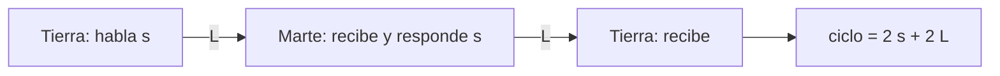

# B113-C03 — Comunicación diferida y soporte psicológico a distancia

<!-- nav:top -->
[🏠 Programa](../../../../README.md) · [📚 Bloque B113](../../../tronco-comun/B113-salud-conductual-y-bienestar-en-aislamiento.md) · [← Anterior: B113-C02 — Ansiedad y respuesta emocional en escenarios simulados](../B113-C02-ansiedad-y-respuesta-emocional-en-escenarios-simulados/CLASE.md) · [Siguiente: B113-C04 — Autonomía personal y gestión del tiempo en aislamiento →](../B113-C04-autonomia-personal-y-gestion-del-tiempo-en-aislamiento/CLASE.md)
<!-- /nav -->

## 1. Ubicación, nivel y alcance

Clase 3 del bloque B113. Nivel N3. En una misión a Marte el apoyo desde la Tierra llega con minutos de retraso. Aquí calculas el **retardo de la luz** entre la Tierra y Marte y cuántos **intercambios de una conversación** caben en una sesión de apoyo; después discutes qué cambia para el apoyo. Los datos de distancia son de la NASA; la sesión y los turnos son ilustrativos. **No es consejo médico, psicológico ni operativo y no sustituye formación, licencia ni supervisión profesional.**

## 2. Por qué esta clase existe

Ninguna clase trata el efecto del retardo en el apoyo psicológico. La decisión central: **¿qué formatos de apoyo siguen siendo posibles cuando una respuesta tarda decenas de minutos?**

## 3. Lo que podrás hacer al terminar

1. Calcular el retardo de ida `L = d/c` y el de ida y vuelta.
2. Calcular cuántos intercambios caben en una sesión de duración `T` con turnos de `s` segundos.
3. Verificar la fórmula con una simulación por eventos.
4. Hallar el retardo a partir del cual solo cabe un intercambio.
5. Distinguir conversación en tiempo real de mensajes asincrónicos.
6. Separar lo consultado (distancias, `c`, informe de la NASA) de lo ilustrativo (sesión y turnos).

La evidencia es la **tabla de retardo y de intercambios por sesión** del ejercicio 12 (sección 20).

## 4. Con qué llegas y cómo comprobarlo

1. ¿Cuál es la velocidad de la luz y en qué unidades?
2. ¿Qué es un retardo de ida y vuelta?
3. ¿Cómo se convierte km en m?
4. ¿Qué es un dato ilustrativo?
5. ¿Qué es una simulación por eventos?

<details>
<summary>Ver respuestas</summary>

1. `299 792 458 m/s`, exacta. 2. El tiempo de ida más el de vuelta. 3. Multiplicando por 1000. 4. Un valor elegido para el ejemplo, no tomado de una fuente. 5. Avanzar el tiempo de suceso en suceso para contar lo que ocurre.
</details>

Con cuatro o cinco aciertos, sigue; si no, repasa los prerrequisitos.

## 5. Un caso de contexto y casos de referencia

A la mínima distancia Tierra–Marte de la ficha de la NASA (`54,6 × 10⁶ km`), la luz tarda `3,035 min` en ir; a la máxima (`401,4 × 10⁶ km`), `22,315 min`. En una sesión **ilustrativa** de 50 minutos con turnos de 60 s por lado caben `25` intercambios sin retardo, `6` a la distancia mínima y `1` a la máxima. Es el **ejemplo conductor**.

El informe del HRP de la NASA habla de un retardo de «hasta 20 minutos» en un sentido y señala que afectará a las operaciones y a la percepción de aislamiento; también que las conferencias psicológicas privadas podrían volverse menos relevantes para la tripulación (S1).

## 6. Vocabulario

El **retardo de ida** `L = d/c` es el tiempo que tarda la señal en llegar. Un **intercambio** es una intervención de cada lado. La **conversación en tiempo real** exige retardos pequeños. El mensaje **asincrónico** se envía y se responde cuando se pueda. La **distancia Tierra–Marte** varía entre un mínimo y un máximo de la ficha de la NASA.

## 7. Modelo mental: una carta por barco



*Descripción textual:* un intercambio dura lo que habla cada lado más dos retardos de ida; el número de intercambios en una sesión es el entero de `T/(2s + 2L)`.

Analogía: una carta por barco permite pensar la respuesta, pero no sostiene una conversación animada. Límite: el modelo cuenta tiempo, no calidad del apoyo; no dice qué formato es mejor para una persona.

## 8. La explicación, paso a paso

### 8.1 Retardo de la luz

`L = d/c`. Para `d = 54,6 × 10⁹ m` y `c = 299 792 458 m/s`: `L = 182,13 s = 3,035 min`. Para `d = 401,4 × 10⁶ km`: `22,315 min`. La cifra de 20 minutos del informe corresponde a `359,8 × 10⁶ km`, dentro del intervalo de la ficha.

### 8.2 Intercambios por sesión

| Caso | Distancia (10⁶ km) | `L` ida (min) | Ida y vuelta (min) | Intercambios (fórmula / sim.) |
|---|---|---|---|---|
| Mínima | 54,6 | 3,035 | 6,071 | 6 / 6 |
| 20 min de ida | 359,8 | 20,000 | 40,000 | 1 / 1 |
| Máxima | 401,4 | 22,315 | 44,631 | 1 / 1 |
| Sin retardo | — | 0 | 0 | 25 |

El ciclo a la distancia mínima es `2 + 6,071 = 8,07 min`, y `50/8,07 = 6,19`, es decir `6`.

### 8.3 Dos vías

La fórmula y la simulación por eventos dan el mismo número en los tres casos. Es una comprobación del código; el modelo es contar tiempo.

### 8.4 Umbrales

Con turnos de 60 s, solo cabe un intercambio cuando `2s + 2L > 25 min`, es decir `L > 11,5 min`; no cabe ninguno cuando `2s + 2L > 50 min`, es decir `L > 24 min`, un valor mayor que el máximo de la ficha. Con retardo máximo, el primer mensaje asincrónico tiene respuesta posible tras `46,63 min`.

## 9. Magnitudes, símbolos y unidades

| Símbolo | Qué es | Unidad | Valor / nota |
|---|---|---|---|
| `d` | distancia Tierra–Marte | km | 54,6 × 10⁶ a 401,4 × 10⁶ |
| `c` | velocidad de la luz | m/s | 299 792 458 (exacta) |
| `L` | retardo de ida | s o min | 182,1 s a 1339 s |
| `T` | duración de la sesión | min | 50 (ilustrativo) |
| `s` | turno por lado | s | 60 (ilustrativo) |

## 10. Convenciones y referencias

Distancia entre centros de planeta según la ficha; no se modelan órbitas ni conjunciones, ni retardos de relé o de procesamiento. Señal en el vacío en línea recta. Tolerancias: retardo mínimo `182,13 ± 0,01 s`; fórmula y simulación iguales en enteros. Python 3.12.9, solo biblioteca estándar.

## 11. De dónde sale lo que afirmamos

| ID | Fuente | Localizador | Respalda | Estado |
|---|---|---|---|---|
| S1 | NASA HRP, *Evidence Report: Risk of Adverse Cognitive or Behavioral Conditions and Psychiatric Disorders* — https://ntrs.nasa.gov/api/citations/20150016966/downloads/20150016966.pdf (consultada 2026-11-10; fecha sin rellenar en el documento) | 106 páginas leídas como texto; pasajes sobre retardo | Retardo de hasta 20 min en un sentido; la tripulación vigilará indicadores y aplicará contramedidas con autonomía; las conferencias psicológicas privadas podrían ser menos relevantes | Consultada |
| S2 | NASA/NSSDC, Mars Fact Sheet — https://nssdc.gsfc.nasa.gov/planetary/factsheet/marsfact.html (consultada 2026-11-10) | ficha leída | Distancia a la Tierra: mínima 54,6 y máxima 401,4 × 10⁶ km (no lista tiempos de luz) | Consultada |
| S3 | NIST, CODATA 2022, constante `c` — https://physics.nist.gov/cgi-bin/cuu/Value?c (consultada 2026-11-10) | página de la constante | `c = 299 792 458 m/s`, exacta | Consultada |
| — | Unidad astronómica (149 597 870,7 km) usada como comprobación | — | Solo verifica el código | No consultada |
| — | Duración de la sesión y turnos | — | Ilustrativos | No consultada |

Límites: no se consultó literatura sobre telepsicología con retardo; la clase no evalúa ningún formato de apoyo.

## 12. Cómo ver el retardo

| Magnitud | Valor |
|---|---|
| `L` mínimo | 3,035 min |
| `L` máximo | 22,315 min |
| Intercambios en 50 min a distancia mínima | 6 |
| Sin retardo | 25 |

Descripción larga: el retardo reduce el número de intercambios de 25 a 6 a la distancia mínima y a 1 a la máxima.

## 13. Ejemplo trabajado: la sesión a distancia mínima

**Paso 1 · Retardo.** `L = 54,6 × 10⁹/299 792 458 = 182,13 s`.

**Paso 2 · Ciclo.** `2 × 60 + 2 × 182,13 = 484,26 s = 8,071 min`.

**Paso 3 · Intercambios.** `50/8,071 = 6,19`, es decir `6`.

**Paso 4 · Lectura.** Con 6 intercambios de un minuto cabe una conversación corta; con 1, el formato debe ser otro.

## 14. Distintas formas de describir la comunicación

**Por retardo:** `L`. **Por ciclo:** `2s + 2L`. **Por formato:** tiempo real o asincrónico. **Por capacidad:** intercambios por sesión.

## 15. Práctica guiada

**Ejercicio 1 · con los pasos indicados.** Calcula `L` para `54,6 × 10⁶ km`. *Pasos:* pasa a metros y divide por `c`.

<details><summary>Solución comentada</summary>

`54,6 × 10⁹/299 792 458 = 182,13 s = 3,035 min`.
</details>

**Ejercicio 2 · con una pista.** ¿Cuántos intercambios caben en 50 min a distancia mínima? *Pista:* ciclo `2s + 2L`.

<details><summary>Solución comentada</summary>

`50/8,071 = 6,19`, es decir `6`.
</details>

**Ejercicio 3 · casi autónomo.** ¿Por qué con `L = 20 min` solo cabe un intercambio?

<details><summary>Solución comentada</summary>

El ciclo es `2 + 40 = 42 min`; el segundo intercambio terminaría a los `84 min`, fuera de la sesión de 50.
</details>

## 16. Práctica autónoma, transferencia e integrador

**Ejercicio 4 · autónomo.** Retardo de la luz a `1,496 × 10⁸ km` (distancia de uso general, no consultada).

<details><summary>Solución comentada</summary>

`1,496 × 10¹¹/299 792 458 = 499 s = 8,3 min`.
</details>

**Ejercicio 5 · autónomo.** Distancia que corresponde a `L = 10 min`.

<details><summary>Solución comentada</summary>

`600 × 299 792 458 m = 1,799 × 10¹¹ m = 179,9 × 10⁶ km`.
</details>

**Ejercicio 6 · autónomo.** Intercambios con retardo máximo y turnos de 30 s.

<details><summary>Solución comentada</summary>

Ciclo `60 + 2 × 1338,9 = 2737,8 s = 45,6 min`; `50/45,6 = 1,10`, es decir `1`.
</details>

**Ejercicio 7 · autónomo.** Tiempo hasta la primera respuesta a un mensaje de 60 s con retardo máximo y respuesta de 60 s.

<details><summary>Solución comentada</summary>

`60 + 2 × 1338,9 + 60 = 2797,8 s = 46,63 min`.
</details>

**Ejercicio 8 · autónomo.** Retardo de ida máximo para que quepan dos intercambios en 50 min con turnos de 60 s.

<details><summary>Solución comentada</summary>

`2 (2s + 2L) ≤ 3000 s`, es decir `L ≤ 690 s = 11,5 min`.
</details>

**Ejercicio 9 · transferencia.** **Transferencia.** Con retardo de 20 min, ¿qué formatos de apoyo siguen siendo posibles?

<details><summary>Solución comentada</summary>

Mensajes de texto, audio o vídeo grabados y respuestas escritas; la conversación fluida deja de ser posible. El modelo no dice cuál es mejor: eso lo deciden profesionales.
</details>

**Ejercicio 10 · transferencia.** **Transferencia.** S1 prevé que la tripulación vigile indicadores y aplique contramedidas con autonomía. ¿Qué relación tiene con el retardo?

<details><summary>Solución comentada</summary>

Con retardo de decenas de minutos la tierra no puede intervenir en tiempo real, de modo que la primera detección y respuesta recae en la tripulación; las cifras de la clase muestran cuánto margen hay.
</details>

**Ejercicio 11 · transferencia.** **Transferencia.** ¿Qué retardos adicionales omite el modelo y por qué importan?

<details><summary>Solución comentada</summary>

Procesamiento, relés, coordinación de la agenda y esperas del profesional; suman al retardo de la luz y reducen aún más los intercambios.
</details>

**Ejercicio 12 · integrador.** **Integrador.** Elabora tu *tabla de retardo y de intercambios por sesión*: `L`, ciclo e intercambios para tres distancias, los umbrales de 8.4, la lista de qué es consultado e ilustrativo y tres límites.

<details><summary>Solución comentada</summary>

Secciones 8.1–8.4 y la salida del laboratorio.
</details>

## 17. Laboratorio: retardo y sesiones a distancia

El script [retardo.py](retardo.py) calcula el retardo para tres distancias y cuenta los intercambios con la fórmula y con una simulación por eventos (**comprueba** `L` mínimo `182,13 s`, coincidencia fórmula–simulación y monotonía).

**Datos:** distancias y `c` consultadas; sesión y turnos **ilustrativos**. **Predice antes de ejecutar:** ¿cuántos intercambios a la distancia mínima? (6.) **Ejecución del 2026-11-10 (Python 3.12.9):**

```text
Python 3.12.9 (biblioteca estandar)
c = 299792458 m/s (exacta); distancias de la ficha de Marte (NASA/NSSDC, 2026-11-10)
Sesion ILUSTRATIVA: T = 50 min, turno = 60 s por lado
 caso                                    dist [10^6 km]  L ida [min]  ida y vuelta [min]  intercambios (formula/sim)
 minima                                         54.6        3.035             6.071            6 /6
 20 min de ida (cifra del informe HRP)         359.8       20.000            40.000            1 /1
 maxima                                        401.4       22.315            44.631            1 /1
Sin retardo (referencia): 25 intercambios en la misma sesion
Mensajes asincronos (un mensaje de 60 s cada sentido): primera respuesta posible tras 46.63 min con retardo maximo
Pruebas superadas.
```

```bash
python programa/clases/B113/B113-C03-comunicacion-diferida-y-soporte-psicologico-a-distancia/retardo.py
```

**Límites:** solo retardo de luz; fórmula y simulación son dos vías del mismo supuesto; no evalúa calidad del apoyo.

## 18. Errores frecuentes y cómo corregirlos

**Usar la distancia equivocada o mezclar km y m.** Se corrige con la sección 9.

**Olvidar que el ciclo incluye dos retardos.** Se corrige con 8.2.

**Concluir qué formato de apoyo es mejor.** Se corrige con la sección 7.

**Tomar el retardo como el único.** Se corrige con el ejercicio 11.

## 19. Cómo sabrás que vas bien

Tras la sección 8: ¿qué `L` esperabas a la distancia máxima y cuál obtuviste? Si dudas, repasa el ejemplo 13. Tras el laboratorio: ¿qué comprueba? (ver la sección 17).

## 20. Qué entregas y cómo se evalúa

El producto es tu **tabla de retardo y de intercambios por sesión** (ejercicio 12).

| Criterio | Inicial | En desarrollo | Logrado | Destacado |
|---|---|---|---|---|
| Conceptos | Los confunde | Parciales | Distingue `L` y ciclo | Explica los límites |
| Cálculo | Sin unidades | Con errores | Tabla completa con unidades | Calcula umbrales |
| Numérico | Sin comprobar | Un caso | Contraste con la simulación | Interpreta las diferencias |
| Fuentes | Sin fuente | Sin fecha | Fuentes con fecha y estado | Declara lo ilustrativo y lo no consultado |
| Límites | No los nombra | Uno | Tres | Discute qué falta del modelo |

**Condiciones críticas (no se compensan con promedio):** rotular sesión y turnos como ilustrativos; no recomendar un formato de apoyo; declarar que no es consejo médico ni operativo.

## 21. Ética, seguridad y límites

Clase educativa: **no da consejo médico, psicológico ni operativo** y no sustituye formación, licencia ni supervisión profesional. Calcula tiempos de la luz y no evalúa ningún servicio de apoyo. El apoyo real lo diseñan y prestan profesionales cualificados con protocolos de la agencia. Accesibilidad: tablas equivalentes a las gráficas, fórmulas en texto, ejercicios sin conexión.

## 22. Para cerrar y seguir

La luz tarda entre `3,0` y `22,3 min` en ir de la Tierra a Marte; en 50 minutos caben `25` intercambios sin retardo, `6` a la distancia mínima y `1` a la máxima. Queda una pregunta: ¿cómo organiza el tiempo una tripulación que debe sostenerse con autonomía?

**Glosario español–inglés.** retardo · *delay*; ida y vuelta · *round trip*; intercambio · *exchange*; asincrónico · *asynchronous*; sesión · *session*.

**Continuidad.** [B113-C04](../B113-C04-autonomia-personal-y-gestion-del-tiempo-en-aislamiento/CLASE.md) estudia la autonomía y la gestión del tiempo.

**Referencias:** ver sección 11.

<!-- nav:bottom -->
---

[← Anterior: B113-C02 — Ansiedad y respuesta emocional en escenarios simulados](../B113-C02-ansiedad-y-respuesta-emocional-en-escenarios-simulados/CLASE.md) · [📚 Bloque B113](../../../tronco-comun/B113-salud-conductual-y-bienestar-en-aislamiento.md) · [Siguiente: B113-C04 — Autonomía personal y gestión del tiempo en aislamiento →](../B113-C04-autonomia-personal-y-gestion-del-tiempo-en-aislamiento/CLASE.md)
<!-- /nav -->
