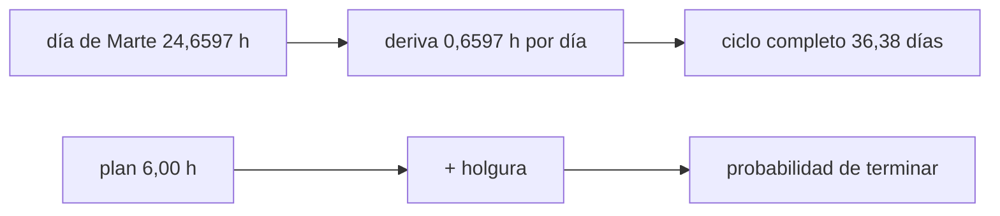

# B113-C04 — Autonomía personal y gestión del tiempo en aislamiento

<!-- nav:top -->
[🏠 Programa](../../../../README.md) · [📚 Bloque B113](../../../tronco-comun/B113-salud-conductual-y-bienestar-en-aislamiento.md) · [← Anterior: B113-C03 — Comunicación diferida y soporte psicológico a distancia](../B113-C03-comunicacion-diferida-y-soporte-psicologico-a-distancia/CLASE.md) · [Siguiente: B113-C05 — Intervenciones de apoyo y contramedidas conductuales →](../B113-C05-intervenciones-de-apoyo-y-contramedidas-conductuales/CLASE.md)
<!-- /nav -->

## 1. Ubicación, nivel y alcance

Clase 4 del bloque B113. Nivel N3. Con apoyo diferido, la tripulación organiza su propio tiempo. Aquí calculas la **deriva entre el día solar de Marte y el reloj terrestre** y diseñas una **rutina con holgura** frente a tareas que duran más de lo previsto. La rutina y las duraciones son sintéticas. **No es consejo médico, psicológico ni operativo y no sustituye formación, licencia ni supervisión profesional.**

## 2. Por qué esta clase existe

Falta la clase sobre autonomía y rutinas. La decisión central: **¿qué holgura reservar en una jornada y qué reloj seguir cuando el día local no dura 24 horas?**

## 3. Lo que podrás hacer al terminar

1. Calcular la deriva diaria del día marciano respecto del terrestre.
2. Calcular a qué hora terrestre empieza el sol `n` y en cuántos días el desfase completa una vuelta.
3. Estimar por simulación la probabilidad de terminar un plan con una holgura dada.
4. Verificar la duración media simulada con la esperada.
5. Relacionar el ritmo libre cercano a 25 h con la pérdida de sincronía.
6. Separar lo consultado (día marciano, Basner et al.) de lo sintético (la rutina).

La evidencia es el **plan de rutina con holgura y su deriva** del ejercicio 12 (sección 20).

## 4. Con qué llegas y cómo comprobarlo

1. ¿Qué es un día solar?
2. ¿Qué es la aritmética módulo 24?
3. ¿Qué es una simulación de Monte Carlo?
4. ¿Qué es una holgura en un plan?
5. ¿Qué es un dato sintético?

<details>
<summary>Ver respuestas</summary>

1. El tiempo entre dos mediodías consecutivos. 2. Quedarse con el resto de dividir por 24. 3. Repetir un experimento aleatorio muchas veces y contar. 4. Tiempo reservado para imprevistos. 5. Un dato generado, no medido.
</details>

Con cuatro o cinco aciertos, sigue; si no, repasa los prerrequisitos.

## 5. Un caso de contexto y casos de referencia

El día solar de Marte dura `24,6597 h` (ficha de la NASA): un reloj marciano se desplaza `0,6597 h = 39,58 min` por día terrestre y recorre las 24 horas en `36,38` días. Una jornada **sintética** de 6 tareas planificadas en `6,00 h`, con duraciones reales entre `0,8×` y `1,4×` lo planificado, se termina a tiempo en el `9 %` de los casos sin holgura y en el `81 %` con 1 h. Es el **ejemplo conductor**.

Basner et al. (2013) siguieron a seis personas durante 520 días de confinamiento simulado de una misión a Marte; la actividad en vigilia disminuyó y el ciclo sueño–vigilia de un tripulante se alargó hasta casi 25 h (S3). El informe de la NASA recoge que la autonomía y el trabajo con sentido se consideran importantes para el bienestar (S1).

## 6. Vocabulario

El **día solar** es el intervalo entre dos pasos del Sol por el meridiano. La **deriva** es la diferencia entre dos relojes de distinto periodo. La **holgura** es el tiempo reservado sin tarea asignada. La **autonomía** es la capacidad de decidir cómo y cuándo hacer el trabajo. El **ritmo libre** es el periodo del ciclo sueño–vigilia sin señales externas.

## 7. Modelo mental: dos relojes que no coinciden



*Descripción textual:* la diferencia entre el día marciano y el terrestre produce una deriva diaria que vuelve a la fase inicial tras 36,38 días; aparte, la holgura sobre el plan determina la probabilidad de terminar a tiempo.

Analogía: dos relojes que adelantan distinto se vuelven a alinear solo tras un ciclo. Límite: el modelo no incluye la luz, el sueño ni el estado de ánimo; solo aritmética de relojes y una duración aleatoria.

## 8. La explicación, paso a paso

### 8.1 Deriva del día marciano

`24,6597 − 24 = 0,6597 h = 39,58 min` por día terrestre. El ciclo completo es `24/0,6597 = 36,38` días. El sol `n` empieza a la hora terrestre `(n × 24,6597) mod 24`:

| Sol `n` | Hora terrestre de inicio (h) |
|---|---|
| 0 | 0,000 |
| 1 | 0,660 |
| 10 | 6,597 |
| 30 | 19,791 |
| 36 | 23,749 |
| 37 | 0,409 |

### 8.2 Holgura frente a imprevistos

Seis tareas planificadas suman `6,00 h` (1,5; 1,0; 1,0; 1,0; 0,75; 0,75). Cada duración real es `U(0,8; 1,4)` veces la planificada, de media `1,1`, de modo que la duración esperada es `6,60 h`. Con 20 000 ensayos (semilla 11):

| Holgura (h) | P(terminar a tiempo) | Duración media (h) | Esperada (h) |
|---|---|---|---|
| 0,0 | 0,092 | 6,595 | 6,600 |
| 0,5 | 0,412 | 6,601 | 6,600 |
| 1,0 | 0,807 | 6,604 | 6,600 |
| 1,5 | 0,981 | 6,600 | 6,600 |
| 2,0 | 1,000 | 6,594 | 6,600 |

La duración máxima posible es `6 × 1,4 = 8,4 h`: solo una holgura de `2,4 h` garantiza terminar siempre.

### 8.3 Ritmo libre

Un ritmo libre de `25,0 h` (valor **ilustrativo**, cercano al del tripulante b de Basner et al.) desplaza el sueño `1 h` por día respecto de un reloj de 24 h: `10 h` tras `10` días y una vuelta completa en `24` días.

### 8.4 Qué decide la tripulación

Con apoyo diferido, la elección del reloj de referencia, de las holguras y de las pausas pasa a la tripulación. La clase no dice cuál es la rutina adecuada: muestra cómo cuantificar el compromiso entre plan ajustado y margen.

## 9. Magnitudes, símbolos y unidades

| Símbolo | Qué es | Unidad | Valor / nota |
|---|---|---|---|
| `P_sol` | día solar de Marte | h | 24,6597 |
| `Δ` | deriva por día terrestre | h | 0,6597 |
| `N_ciclo` | días de ciclo completo | día | 36,38 |
| `h` | holgura | h | 0 a 2 |
| `p` | probabilidad de terminar | — | 0,09 a 1 |

## 10. Convenciones y referencias

Sol 0 empieza a las 00:00 del reloj terrestre. Tiempo en horas decimales. Datos sintéticos con semilla `11`; duraciones `U(0,8; 1,4)` sobre el plan. Tolerancias de las pruebas: deriva exacta a `1e-9`; duración media simulada dentro de `0,03 h` de la esperada. Python 3.12.9, solo biblioteca estándar.

## 11. De dónde sale lo que afirmamos

| ID | Fuente | Localizador | Respalda | Estado |
|---|---|---|---|---|
| S1 | NASA HRP, *Evidence Report: Risk of Adverse Cognitive or Behavioral Conditions and Psychiatric Disorders* — https://ntrs.nasa.gov/api/citations/20150016966/downloads/20150016966.pdf (consultada 2026-11-10; fecha sin rellenar en el documento) | 106 páginas leídas como texto; sección «Job design—Autonomy and meaningful work» | Autonomía y trabajo con sentido como indicadores de bienestar eudaimónico; las simulaciones sugieren que la autonomía podría ayudar | Consultada |
| S2 | NASA/NSSDC, Mars Fact Sheet — https://nssdc.gsfc.nasa.gov/planetary/factsheet/marsfact.html (consultada 2026-11-10) | ficha leída | Día solar 24,6597 h; rotación sidérea 24,6229 h | Consultada |
| S3 | Basner et al., «Mars 520-d mission simulation reveals protracted crew hypokinesis and alterations of sleep duration and timing», *PNAS* 2013, doi:10.1073/pnas.1212646110 — PDF del autor, https://www.med.upenn.edu/uep/assets/user-content/documents/PNAS2013Basner1212646110withSupportingAppendix.pdf (consultada 2026-11-10) | resumen y texto del artículo con apéndice | 520 días, seis personas; menor actividad en vigilia; ciclo sueño–vigilia cercano a 25 h en un tripulante | Consultada |
| — | Duraciones de tareas, plan y holgura | — | Sintéticos | No consultada |

Límites: no se consultó la literatura de cronobiología más allá de Basner et al.; la rutina no es una recomendación.

## 12. Cómo ver la deriva

| Magnitud | Valor |
|---|---|
| Deriva | 0,6597 h/día |
| Ciclo completo | 36,38 días |
| `P(terminar)` con 1 h | 0,807 |
| Duración esperada | 6,60 h |

Descripción larga: la deriva recorre el día en 36,4 días; la probabilidad de terminar sube de 0,09 a 0,81 al añadir 1 h de holgura.

## 13. Ejemplo trabajado: hora terrestre del sol 30

**Paso 1 · Acumulado.** `30 × 24,6597 = 739,791 h`.

**Paso 2 · Módulo.** `739,791 − 30 × 24 = 19,791 h`.

**Paso 3 · Lectura.** El sol 30 empieza a las `19:47` del reloj terrestre.

**Paso 4 · Comprobación.** `30 × 0,6597 = 19,791 h`.

## 14. Distintas formas de describir la rutina

**Por reloj:** terrestre o marciano. **Por deriva:** `Δ`. **Por plan:** horas planificadas. **Por riesgo:** probabilidad de terminar a tiempo.

## 15. Práctica guiada

**Ejercicio 1 · con los pasos indicados.** Calcula la deriva en minutos por día terrestre. *Pasos:* resta 24 h y multiplica por 60.

<details><summary>Solución comentada</summary>

`0,6597 × 60 = 39,58 min`.
</details>

**Ejercicio 2 · con una pista.** ¿A qué hora terrestre empieza el sol 10? *Pista:* `10 × 0,6597`.

<details><summary>Solución comentada</summary>

`6,597 h`.
</details>

**Ejercicio 3 · casi autónomo.** ¿Por qué la duración media simulada es `6,60 h` y no `6,00 h`?

<details><summary>Solución comentada</summary>

La media de `U(0,8; 1,4)` es `1,1`; `6 × 1,1 = 6,60 h`.
</details>

## 16. Práctica autónoma, transferencia e integrador

**Ejercicio 4 · autónomo.** Deriva acumulada en 100 días terrestres.

<details><summary>Solución comentada</summary>

`100 × 0,6597 = 65,97 h`.
</details>

**Ejercicio 5 · autónomo.** Hora terrestre de inicio del sol 30.

<details><summary>Solución comentada</summary>

`19,791 h` (ejemplo 13).
</details>

**Ejercicio 6 · autónomo.** ¿Qué holgura de la tabla da al menos `80 %` de probabilidad?

<details><summary>Solución comentada</summary>

`1,0 h` (`0,807`).
</details>

**Ejercicio 7 · autónomo.** Holgura que garantiza terminar siempre.

<details><summary>Solución comentada</summary>

`8,4 − 6,0 = 2,4 h`.
</details>

**Ejercicio 8 · autónomo.** Días para un desfase completo con un ritmo libre de `24,5 h`.

<details><summary>Solución comentada</summary>

`24/0,5 = 48 días`.
</details>

**Ejercicio 9 · transferencia.** **Transferencia.** ¿Qué reloj debería seguir una tripulación en Marte?

<details><summary>Solución comentada</summary>

El modelo no lo decide: calcula la deriva si se sigue el sol marciano (39,58 min por día) o la pérdida de sincronía con la Tierra si se sigue el reloj terrestre. La elección la hacen la agencia y los profesionales.
</details>

**Ejercicio 10 · transferencia.** **Transferencia.** Basner et al. encontraron en un tripulante un ciclo cercano a 25 h. ¿Qué enseñan los 10 h de desfase en 10 días?

<details><summary>Solución comentada</summary>

Que un ciclo ligeramente más largo que 24 h se acumula rápido y exige señales externas (luz, comidas, ejercicio) como las que los autores proponen; el valor de 25 h del laboratorio es ilustrativo.
</details>

**Ejercicio 11 · transferencia.** **Transferencia.** Una rutina planificada al 100 % sin holgura da `9 %` de éxito. ¿Qué mensaje no debe extraerse?

<details><summary>Solución comentada</summary>

Que cualquier plan real tenga esa probabilidad: las duraciones son sintéticas. Sí que conviene medir las propias duraciones antes de fijar holguras.
</details>

**Ejercicio 12 · integrador.** **Integrador.** Elabora tu *plan de rutina con holgura y su deriva*: tabla de deriva, probabilidades por holgura, holgura elegida con su razón, lista de qué es consultado y sintético y tres límites.

<details><summary>Solución comentada</summary>

Secciones 8.1–8.4 y la salida del laboratorio.
</details>

## 17. Laboratorio: deriva del día y holgura de una rutina

El script [ritmo.py](ritmo.py) calcula la deriva y las horas de inicio, y estima por Monte Carlo la probabilidad de terminar el plan con distintas holguras (**comprueba** la deriva exacta y la duración media dentro de 0,03 h de la esperada).

**Datos:** día solar consultado; plan, duraciones y ritmo libre **sintéticos**. **Predice antes de ejecutar:** ¿cuántos días dura el ciclo completo? (36,38.) **Ejecución del 2026-11-10 (Python 3.12.9):**

```text
Python 3.12.9 (biblioteca estandar)
Dia solar de Marte = 24.6597 h (NASA/NSSDC, 2026-11-10); dia terrestre = 24.0 h
Deriva = 0.6597 h = 39.58 min por dia terrestre; ciclo completo en 36.38 dias
 sol n   hora terrestre de inicio [h]
     0        0.000
     1        0.660
    10        6.597
    30       19.791
    36       23.749
    37        0.409
Plan ILUSTRATIVO: 6 tareas, 6.00 h planificadas; duraciones reales U(0.8, 1.4) x plan (media x1.1), semilla 11
 holgura [h]  P(terminar a tiempo)  duracion media [h]  esperada [h]
       0.0            0.092               6.595         6.600
       0.5            0.412               6.601         6.600
       1.0            0.807               6.604         6.600
       1.5            0.981               6.600         6.600
       2.0            1.000               6.594         6.600
Ritmo libre ILUSTRATIVO de 25.0 h: desfase de 10.0 h tras 10 dias; ciclo completo en 24.0 dias
Pruebas superadas.
```

```bash
python programa/clases/B113/B113-C04-autonomia-personal-y-gestion-del-tiempo-en-aislamiento/ritmo.py
```

**Límites:** solo aritmética de relojes y duraciones aleatorias independientes; no modela sueño, luz ni fatiga. El `1,000` de la última fila es un redondeo: la probabilidad real es menor que 1.

## 18. Errores frecuentes y cómo corregirlos

**Confundir el día sidéreo (24,6229 h) con el solar (24,6597 h).** Se corrige con S2.

**Planificar sin holgura.** Se corrige con 8.2.

**Tomar las probabilidades sintéticas como las de una persona.** Se corrige con el ejercicio 11.

**Usar la clase como pauta de rutina.** Se corrige con la sección 21.

## 19. Cómo sabrás que vas bien

Tras la sección 8: ¿qué hora terrestre esperabas para el sol 30 y cuál obtuviste? Si dudas, repasa el ejemplo 13. Tras el laboratorio: ¿qué comprueba? (ver la sección 17).

## 20. Qué entregas y cómo se evalúa

El producto es tu **plan de rutina con holgura y su deriva** (ejercicio 12).

| Criterio | Inicial | En desarrollo | Logrado | Destacado |
|---|---|---|---|---|
| Conceptos | Los confunde | Parciales | Distingue deriva y holgura | Explica los límites |
| Cálculo | Sin unidades | Con errores | Tablas completas | Calcula casos nuevos |
| Numérico | Sin comprobar | Un caso | Contrasta media simulada y esperada | Interpreta las probabilidades |
| Fuentes | Sin fuente | Sin fecha | Fuentes con fecha y estado | Declara lo sintético y lo no consultado |
| Límites | No los nombra | Uno | Tres | Discute qué falta del modelo |

**Condiciones críticas (no se compensan con promedio):** rotular rutina y duraciones como sintéticas; no dar pautas personales; declarar que no es consejo médico ni operativo.

## 21. Ética, seguridad y límites

Clase educativa: **no da consejo médico, psicológico ni operativo** y no sustituye formación, licencia ni supervisión profesional. Los horarios de una misión real los fijan la agencia y su personal médico; esta clase solo enseña aritmética de relojes y de holguras con datos sintéticos. Quien tenga problemas de sueño persistentes debe consultar a un profesional. Accesibilidad: tablas equivalentes a las gráficas, fórmulas en texto, ejercicios sin conexión.

## 22. Para cerrar y seguir

El día de Marte deriva `39,58 min` por día frente al reloj terrestre y una holgura de `1 h` sube de `9 %` a `81 %` la probabilidad de terminar un plan sintético. Queda una pregunta: ¿cómo se evalúa si una contramedida conductual realmente funciona?

**Glosario español–inglés.** día solar · *solar day*; deriva · *drift*; holgura · *slack*; autonomía · *autonomy*; ritmo libre · *free-running rhythm*.

**Continuidad.** [B113-C05](../B113-C05-intervenciones-de-apoyo-y-contramedidas-conductuales/CLASE.md) estudia las intervenciones y su evaluación.

**Referencias:** ver sección 11.

<!-- nav:bottom -->
---

[← Anterior: B113-C03 — Comunicación diferida y soporte psicológico a distancia](../B113-C03-comunicacion-diferida-y-soporte-psicologico-a-distancia/CLASE.md) · [📚 Bloque B113](../../../tronco-comun/B113-salud-conductual-y-bienestar-en-aislamiento.md) · [Siguiente: B113-C05 — Intervenciones de apoyo y contramedidas conductuales →](../B113-C05-intervenciones-de-apoyo-y-contramedidas-conductuales/CLASE.md)
<!-- /nav -->
