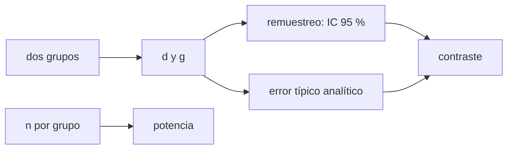

# B113-C05 — Intervenciones de apoyo y contramedidas conductuales

<!-- nav:top -->
[🏠 Programa](../../../../README.md) · [📚 Bloque B113](../../../tronco-comun/B113-salud-conductual-y-bienestar-en-aislamiento.md) · [← Anterior: B113-C04 — Autonomía personal y gestión del tiempo en aislamiento](../B113-C04-autonomia-personal-y-gestion-del-tiempo-en-aislamiento/CLASE.md) · [Siguiente: B114-C01 — Rutas de evacuación y salidas de emergencia en hábitats →](../../../tronco-comun/B114-seguridad-y-respuesta-a-emergencias-en-habitats.md#b114-c01)
<!-- /nav -->

## 1. Ubicación, nivel y alcance

Clase 5 del bloque B113. Nivel N3. Cierra el bloque con una pregunta de método: **¿cómo se sabe si una contramedida conductual funciona?** Calculas el **tamaño del efecto** (d de Cohen y g de Hedges) y su incertidumbre por remuestreo con grupos sintéticos, y ves cómo depende del tamaño de la muestra. Usas lo visto en [B113-C01](../B113-C01-estres-operacional-y-estrategias-de-afrontamiento/CLASE.md) a [C04](../B113-C04-autonomia-personal-y-gestion-del-tiempo-en-aislamiento/CLASE.md) solo como contexto. **No es consejo médico, psicológico ni operativo, no evalúa ninguna intervención real y no sustituye formación, licencia ni supervisión profesional.**

## 2. Por qué esta clase existe

Falta la clase sobre intervenciones de apoyo. La decisión central: **¿qué evidencia hace falta antes de creer que una contramedida tiene efecto, y por qué una tripulación pequeña no basta para demostrarlo?**

## 3. Lo que podrás hacer al terminar

1. Calcular `d` de Cohen y `g` de Hedges entre dos grupos.
2. Calcular el error típico analítico de `d`.
3. Estimar un intervalo del 95 % por remuestreo (bootstrap).
4. Contrastar el intervalo y el error del remuestreo con la fórmula.
5. Estimar la fracción de ensayos que detectan un efecto según `n`.
6. Separar lo consultado (el marco de contramedidas de la NASA) de lo sintético (los grupos).

La evidencia es el **informe de evaluación de una contramedida sintética** del ejercicio 12 (sección 20).

## 4. Con qué llegas y cómo comprobarlo

1. ¿Qué es una media y una desviación típica?
2. ¿Qué es un intervalo de confianza?
3. ¿Qué es remuestrear con reemplazo?
4. ¿Qué es un dato sintético?
5. ¿Qué diferencia hay entre efecto y significación?

<details>
<summary>Ver respuestas</summary>

1. El valor central y la dispersión. 2. Un rango plausible para una cantidad estimada. 3. Extraer muestras del mismo tamaño de los datos, permitiendo repetidos. 4. Un dato generado, no medido. 5. El efecto es su tamaño; la significación, si se distingue del azar con ese `n`.
</details>

Con cuatro o cinco aciertos, sigue; si no, repasa los prerrequisitos.

## 5. Un caso de contexto y casos de referencia

Dos grupos **sintéticos** de bienestar en u.a.: control `N(50, 10)` y con contramedida `N(55, 10)`, un efecto verdadero de `0,5` desviaciones típicas. Con 10 por grupo, `d = 0,623` y el intervalo `[−0,214; 1,748]` incluye el cero; con 300, `d = 0,574` y `[0,423; 0,744]` lo excluye. Es el **ejemplo conductor**.

El informe del HRP de la NASA describe la prevención, la mitigación y el tratamiento mediante un sistema de contramedidas, y señala que las contramedidas viables y validadas para exploración aún no existen (S1, S2). Esta clase no evalúa ninguna de ellas.

## 6. Vocabulario

La **contramedida** es una medida para prevenir o mitigar un riesgo. El **tamaño del efecto** `d = (m₂ − m₁)/s_p` es la diferencia de medias en unidades de desviación típica combinada. La **g de Hedges** corrige el sesgo de `d` en muestras pequeñas. El **remuestreo** (bootstrap) estima la incertidumbre repitiendo el cálculo sobre muestras con reemplazo. La **potencia** es la fracción de ensayos que detectan un efecto real.

## 7. Modelo mental: pesar con una balanza ruidosa



*Descripción textual:* de dos grupos se calcula `d`; su incertidumbre se estima por remuestreo y por fórmula, y se contrastan; el tamaño de la muestra determina la potencia.

Analogía: una balanza ruidosa necesita varias pesadas para distinguir dos objetos casi iguales. Límite: el modelo supone datos normales, grupos independientes y un solo resultado; omite sesgos de selección, abandonos y diferencias individuales.

## 8. La explicación, paso a paso

### 8.1 Tamaño del efecto

`d = (m_c − m_0)/s_p`, con `s_p = √(((n₁−1)s₁² + (n₂−1)s₂²)/(n₁+n₂−2))`. La corrección de Hedges es `g = d (1 − 3/(4(n₁+n₂) − 9))`. Para `d = 0,5` y `n = 15` por grupo, `g = 0,5 × (1 − 3/111) = 0,4865`.

### 8.2 Incertidumbre

El error típico analítico es `SE = √((n₁+n₂)/(n₁n₂) + d²/(2(n₁+n₂)))`. Con 2000 remuestreos (semilla 2026):

| `n`/grupo | `d` | `g` | SE analítico | SE remuestreo | IC 95 % remuestreo | ¿Contiene 0,5? |
|---|---|---|---|---|---|---|
| 10 | 0,623 | 0,597 | 0,458 | 0,496 | [−0,214; 1,748] | sí |
| 30 | 0,359 | 0,354 | 0,260 | 0,259 | [−0,139; 0,886] | sí |
| 100 | 0,413 | 0,412 | 0,143 | 0,142 | [0,140; 0,693] | sí |
| 300 | 0,574 | 0,573 | 0,083 | 0,081 | [0,423; 0,744] | sí |

Con una muestra pequeña, `d` varía mucho: `0,359` con 30 por grupo frente al verdadero `0,5`.

### 8.3 Dos vías

El error del remuestreo coincide con el analítico dentro del `20 %` en `n ≥ 30` (en `n = 30`, `0,259` frente a `0,260`). Son dos métodos distintos para la misma incertidumbre, de modo que la coincidencia es una comprobación real, aunque ambos suponen datos normales.

### 8.4 Potencia

La fracción de 400 ensayos sintéticos cuyo intervalo aproximado `d ± 1,96 SE` excluye `0`: `0,203` con 10 por grupo, `0,487` con 30 y `0,938` con 100. Para excluir `0` hace falta `d/SE > 1,96`; con `d = 0,5`, `SE² = 2,125/n`, luego `n > 32,6`. Una tripulación de seis personas está muy por debajo de esos tamaños: no sirve para estimar un efecto así.

## 9. Magnitudes, símbolos y unidades

| Símbolo | Qué es | Unidad | Valor / nota |
|---|---|---|---|
| `d` | tamaño del efecto | desviaciones típicas | 0,36 a 0,62 |
| `g` | `d` corregido | desviaciones típicas | 0,35 a 0,60 |
| `n` | tamaño por grupo | personas sintéticas | 10 a 300 |
| `SE` | error típico de `d` | desviaciones típicas | 0,08 a 0,46 |
| `s_p` | desviación combinada | u.a. | 10 |

## 10. Convenciones y referencias

Puntuación de bienestar sintética en u.a.; efecto verdadero `δ = 0,5`; semilla `2026`; 2000 remuestreos (percentil 2,5 y 97,5). Tolerancias de las pruebas: SE del remuestreo dentro del `20 %` del analítico para `n ≥ 30`; potencia creciente con `n`; `g` exacta a `1e-12`. Python 3.12.9, solo biblioteca estándar.

## 11. De dónde sale lo que afirmamos

| ID | Fuente | Localizador | Respalda | Estado |
|---|---|---|---|---|
| S1 | NASA HRP, *Evidence Report: Risk of Adverse Cognitive or Behavioral Conditions and Psychiatric Disorders* — https://ntrs.nasa.gov/api/citations/20150016966/downloads/20150016966.pdf (consultada 2026-11-10; fecha sin rellenar en el documento) | 106 páginas leídas como texto; apartados de contramedidas | Prevención, mitigación y tratamiento mediante contramedidas; detección temprana; con retardo, aplicación autónoma | Consultada |
| S2 | NASA, página del riesgo — https://www.nasa.gov/directorates/esdmd/hhp/risk-of-adverse-cognitive-or-behavioral-conditions-and-psychiatric-disorders (consultada 2026-11-10) | página completa | Las contramedidas viables y aceptables para exploración aún no están desarrolladas ni validadas | Consultada |
| — | `d` de Cohen, `g` de Hedges, error típico y remuestreo | — | Relaciones estándar; las verifica el laboratorio | No consultada en una fuente concreta |
| — | Grupos, efecto `δ = 0,5` | — | Sintéticos | No consultada |

Límites: no se consultó literatura clínica sobre ninguna intervención; no se afirma que una contramedida concreta funcione.

## 12. Cómo ver la incertidumbre

| Magnitud | Valor |
|---|---|
| `d` con `n = 10` | 0,623 |
| IC 95 % con `n = 10` | [−0,214; 1,748] |
| IC 95 % con `n = 300` | [0,423; 0,744] |
| Potencia con `n = 30` | 0,487 |

Descripción larga: el intervalo se estrecha con `n` y la potencia crece de `0,20` a `0,94` entre 10 y 100 por grupo.

## 13. Ejemplo trabajado: error típico con 30 por grupo

**Paso 1 · Datos.** `d = 0,5`, `n₁ = n₂ = 30`.

**Paso 2 · Fórmula.** `SE² = 60/900 + 0,25/120 = 0,06667 + 0,00208 = 0,06875`.

**Paso 3 · Raíz.** `SE = 0,2622`.

**Paso 4 · Lectura.** Un intervalo aproximado de `±1,96 × 0,2622 = ±0,51` alrededor de `0,5` casi toca el cero.

## 14. Distintas formas de describir un efecto

**Por tamaño:** `d`, `g`. **Por incertidumbre:** `SE`, IC. **Por muestra:** `n`. **Por detección:** potencia.

## 15. Práctica guiada

**Ejercicio 1 · con los pasos indicados.** Calcula `g` para `d = 0,5` y `n = 15` por grupo. *Pasos:* `1 − 3/(4 × 30 − 9)`.

<details><summary>Solución comentada</summary>

`0,5 × (1 − 3/111) = 0,4865`.
</details>

**Ejercicio 2 · con una pista.** Calcula el `SE` para `d = 0,5` y `n = 30` por grupo. *Pista:* `60/900 + 0,25/120`.

<details><summary>Solución comentada</summary>

`√0,06875 = 0,2622`.
</details>

**Ejercicio 3 · casi autónomo.** ¿Por qué el intervalo con `n = 10` es tan ancho?

<details><summary>Solución comentada</summary>

Porque `SE ≈ 0,46`; `±1,96 SE` son casi `±0,9` desviaciones típicas.
</details>

## 16. Práctica autónoma, transferencia e integrador

**Ejercicio 4 · autónomo.** Intervalo aproximado `d ± 1,96 SE` con `n = 100` (`d = 0,413`, `SE = 0,143`).

<details><summary>Solución comentada</summary>

`[0,133; 0,693]`, cercano al del remuestreo `[0,140; 0,693]`.
</details>

**Ejercicio 5 · autónomo.** `d` para medias `55` y `50` con `s_p = 10`.

<details><summary>Solución comentada</summary>

`0,5`.
</details>

**Ejercicio 6 · autónomo.** `d` si la desviación fuera `20` con la misma diferencia de medias.

<details><summary>Solución comentada</summary>

`5/20 = 0,25`.
</details>

**Ejercicio 7 · autónomo.** ¿Qué fracción de ensayos detecta el efecto con 30 por grupo?

<details><summary>Solución comentada</summary>

`0,487`: algo menos de la mitad.
</details>

**Ejercicio 8 · autónomo.** `n` mínimo por grupo para `d/SE > 1,96` con `d = 0,5`.

<details><summary>Solución comentada</summary>

`n > 2,125/(0,5/1,96)² = 32,6`, es decir `33`.
</details>

**Ejercicio 9 · transferencia.** **Transferencia.** Una tripulación de seis personas prueba una contramedida y mejora el bienestar medio. ¿Qué se puede concluir?

<details><summary>Solución comentada</summary>

Muy poco: con `n = 6` el intervalo sería enorme, sin grupo de comparación y con otros cambios simultáneos. Sirve para generar hipótesis, no para demostrar un efecto.
</details>

**Ejercicio 10 · transferencia.** **Transferencia.** S2 indica que las contramedidas viables para exploración aún no están validadas. ¿Qué papel tienen los análogos terrestres según S1?

<details><summary>Solución comentada</summary>

S1 señala que los entornos análogos permiten probar y validar la factibilidad de contramedidas, herramientas y procedimientos; un diseño así sí admite grupos y tamaños de muestra mayores.
</details>

**Ejercicio 11 · transferencia.** **Transferencia.** Un colega informa solo de los ensayos donde el intervalo excluye `0`. ¿Qué sesgo introduce?

<details><summary>Solución comentada</summary>

Sesgo de publicación: con `n = 30` solo el `49 %` de los ensayos lo excluyen, de modo que los publicados sobrestiman `d` (los significativos tienen `d` mayor que el verdadero).
</details>

**Ejercicio 12 · integrador.** **Integrador.** Elabora tu *informe de evaluación de una contramedida sintética*: tabla de `d`, `g`, `SE` e IC para cuatro tamaños de muestra, potencia, el `n` mínimo, lista de qué es consultado y sintético y tres límites.

<details><summary>Solución comentada</summary>

Secciones 8.1–8.4 y la salida del laboratorio.
</details>

## 17. Laboratorio: tamaño del efecto y remuestreo

El script [efecto.py](efecto.py) genera grupos sintéticos, calcula `d`, `g`, el error analítico, el intervalo por remuestreo y la potencia empírica (**comprueba** el error del remuestreo dentro del 20 % del analítico, el estrechamiento del intervalo con `n` y la potencia creciente).

**Datos:** sintéticos (semilla 2026). **Predice antes de ejecutar:** ¿qué intervalo será más estrecho, el de 100 o el de 300? (el de 300.) **Ejecución del 2026-11-10 (Python 3.12.9):**

```text
Python 3.12.9 (biblioteca estandar)
Datos SINTETICOS: control N(50, 10); con contramedida N(55, 10) (delta = 0.5 sd); semilla 2026
   n/grupo   d      g     SE analitico  SE bootstrap  IC95 % bootstrap       contiene delta
       10  0.623  0.597        0.458         0.496   [-0.214,  1.748]   si
       30  0.359  0.354        0.260         0.259   [-0.139,  0.886]   si
      100  0.413  0.412        0.143         0.142   [ 0.140,  0.693]   si
      300  0.574  0.573        0.083         0.081   [ 0.423,  0.744]   si
Fraccion de 400 ensayos sinteticos cuyo IC aproximado (d +- 1.96 SE) excluye 0:
  n =  10 por grupo: 0.203
  n =  30 por grupo: 0.487
  n = 100 por grupo: 0.938
Pruebas superadas.
```

```bash
python programa/clases/B113/B113-C05-intervenciones-de-apoyo-y-contramedidas-conductuales/efecto.py
```

**Límites:** datos normales e independientes, un solo resultado y un solo ensayo por tamaño; no hay estudio real detrás.

## 18. Errores frecuentes y cómo corregirlos

**Tomar `d` de una muestra pequeña como el efecto verdadero.** Se corrige con 8.2.

**Confundir efecto con significación.** Se corrige con 8.4.

**Concluir de una tripulación pequeña.** Se corrige con el ejercicio 9.

**Presentar datos sintéticos como una evaluación real.** Se corrige con la sección 10.

## 19. Cómo sabrás que vas bien

Tras la sección 8: ¿qué `SE` esperabas para `n = 30` y cuál obtuviste? Si dudas, repasa el ejemplo 13. Tras el laboratorio: ¿qué comprueba? (ver la sección 17).

## 20. Qué entregas y cómo se evalúa

El producto es tu **informe de evaluación de una contramedida sintética** (ejercicio 12).

| Criterio | Inicial | En desarrollo | Logrado | Destacado |
|---|---|---|---|---|
| Conceptos | Los confunde | Parciales | Distingue `d`, IC y potencia | Explica los límites |
| Cálculo | Sin unidades | Con errores | Tablas completas | Calcula el `n` mínimo |
| Numérico | Sin comprobar | Un caso | Contraste remuestreo–fórmula | Interpreta las diferencias |
| Fuentes | Sin fuente | Sin fecha | Fuentes con fecha y estado | Declara lo sintético y lo no consultado |
| Límites | No los nombra | Uno | Tres | Discute el sesgo de selección |

**Condiciones críticas (no se compensan con promedio):** rotular los datos como sintéticos; no presentar el resultado como evidencia clínica; declarar que no es consejo médico ni operativo.

## 21. Ética, seguridad y límites

Clase educativa: **no da consejo médico, psicológico ni operativo**, no evalúa ninguna intervención real y no sustituye formación, licencia ni supervisión profesional. Cualquier estudio con personas exige consentimiento informado, revisión ética y protección de datos; los resultados de una tripulación pequeña son sensibles y no deben identificar a nadie. Quien necesite apoyo debe acudir a un profesional cualificado. Accesibilidad: tablas equivalentes a las gráficas, fórmulas en texto, ejercicios sin conexión.

## 22. Para cerrar y seguir

Con un efecto verdadero de `0,5` desviaciones típicas, 10 personas por grupo solo lo detectan en el `20 %` de los ensayos y hacen falta unas `33` para llegar al `50 %`. Con esta clase termina el bloque B113: del estrés al modo de evaluar una contramedida, siempre con datos sintéticos y sin sustituir a los profesionales.

**Glosario español–inglés.** contramedida · *countermeasure*; tamaño del efecto · *effect size*; remuestreo · *bootstrap*; potencia · *power*; error típico · *standard error*.

**Continuidad.** Con esta clase cierra el bloque; el siguiente del área es [B114](../../../tronco-comun/B114-seguridad-y-respuesta-a-emergencias-en-habitats.md).

**Referencias:** ver sección 11.

<!-- nav:bottom -->
---

[← Anterior: B113-C04 — Autonomía personal y gestión del tiempo en aislamiento](../B113-C04-autonomia-personal-y-gestion-del-tiempo-en-aislamiento/CLASE.md) · [📚 Bloque B113](../../../tronco-comun/B113-salud-conductual-y-bienestar-en-aislamiento.md) · [Siguiente: B114-C01 — Rutas de evacuación y salidas de emergencia en hábitats →](../../../tronco-comun/B114-seguridad-y-respuesta-a-emergencias-en-habitats.md#b114-c01)
<!-- /nav -->
