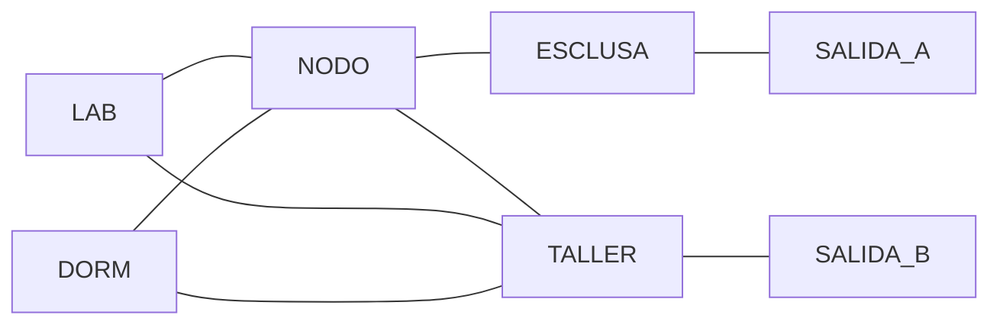

# B114-C01 — Rutas de evacuación y salidas de emergencia en hábitats

<!-- nav:top -->
[🏠 Programa](../../../../README.md) · [📚 Bloque B114](../../../tronco-comun/B114-seguridad-y-respuesta-a-emergencias-en-habitats.md) · [← Anterior: B113-C05 — Intervenciones de apoyo y contramedidas conductuales](../../../tronco-comun/B113-salud-conductual-y-bienestar-en-aislamiento.md#b113-c05) · [Siguiente: B114-C02 — Detección, localización y respuesta a fugas de presión →](../B114-C02-deteccion-localizacion-y-respuesta-a-fugas-de-presion/CLASE.md)
<!-- /nav -->

## 1. Ubicación, nivel y alcance

Clase 1 del bloque B114. Nivel N3. Una ruta de evacuación es un camino en un grafo de módulos con un tiempo asociado. Aquí calculas ese tiempo con el algoritmo de camino mínimo, compruebas que cada compartimento tiene una alternativa independiente y estimas el efecto de la cola en las salidas. El hábitat es **sintético**: no corresponde a ningún diseño real. No hay sistema de referencia espacial, solo un grafo de módulos con longitudes en metros.

## 2. Por qué esta clase existe

Una salida existe en el plano, pero la evacuación depende de cuánto se tarda en llegar a ella y de qué pasa si el camino principal queda bloqueado. La decisión central: **¿cuánto tarda en salir toda la tripulación y qué ruta queda si falla la principal?**

## 3. Lo que podrás hacer al terminar

1. Modelar un hábitat como un grafo con longitudes de pasillo.
2. Calcular el camino mínimo hasta la salida más cercana con Dijkstra.
3. Convertir distancia en tiempo de salida con velocidad y tiempo de reacción.
4. Comprobar la existencia de una ruta alternativa que no comparte pasillos.
5. Estimar el tiempo de cola con el flujo de una puerta.
6. Separar lo sintético de lo que no se consultó (normas de salidas).

La evidencia es el **plano de evacuación sintético con tiempos** del ejercicio 12 (sección 20).

## 4. Con qué llegas y cómo comprobarlo

1. ¿Qué es un grafo y qué son sus aristas?
2. ¿Qué unidad tiene un flujo de personas por una puerta?
3. ¿Qué es un dato sintético?
4. ¿Qué es una verificación por segunda vía?
5. ¿Qué significa «ruta independiente»?

<details>
<summary>Ver respuestas</summary>

1. Un conjunto de nodos unidos por aristas; aquí, módulos unidos por pasillos. 2. Personas por segundo. 3. Un dato generado para el ejemplo, no medido. 4. Calcular lo mismo con otro método y comparar. 5. Una ruta que no comparte ningún pasillo con la principal.
</details>

Con cuatro o cinco aciertos, sigue; si no, repasa los prerrequisitos.

## 5. Un caso de contexto y casos de referencia

Un hábitat sintético de cinco módulos (laboratorio, dormitorio, nodo, taller y esclusa) tiene dos salidas. Con `v = 1,0 m/s` y `20 s` de reacción, el peor tiempo de salida individual es `41,0 s` y la evacuación de seis personas repartidas en dos salidas termina en `47,0 s`. Es el **ejemplo conductor**. Todo es **ilustrativo**: ninguna cifra describe un hábitat real.

## 6. Vocabulario

La **ruta de evacuación** es el camino desde un módulo hasta una salida. La **ruta alternativa** es otra que no comparte pasillos con la principal. El **camino mínimo** es el de menor longitud total. El **flujo de puerta** `Q` es el número de personas por segundo que cruza una salida. El **cuello de botella** es el elemento que limita el flujo.

## 7. Modelo mental: un mapa de calles con una calle cortada



*Descripción textual:* laboratorio y dormitorio llegan al nodo y al taller; el nodo lleva a la esclusa y a la salida A; el taller lleva a la salida B.

Analogía: es como volver a casa si cortan una calle; importa que exista otra, no solo que la principal sea corta. Límite: el modelo ignora humo, oscuridad, personas heridas, puertas atascadas y que la gente no camina a velocidad constante.

## 8. La explicación, paso a paso

### 8.1 Tiempo de salida

`t = t_reacción + d/v`. Desde el laboratorio, `d = 21 m` por el taller hasta la salida B, así que `t = 20 + 21/1,0 = 41 s`. El dormitorio llega por el nodo y la esclusa (`20 m`, `40 s`).

### 8.2 Camino mínimo con dos vías

El laboratorio calcula `d` con Dijkstra y lo repite enumerando todos los caminos simples; la diferencia es menor que `10⁻⁹ m`. Es una comprobación **independiente** (algoritmo distinto).

### 8.3 Rutas alternativas

Al bloquear los pasillos de la ruta principal, el laboratorio recalcula: el laboratorio pasa a `22 m` por el nodo y la esclusa y el dormitorio a `20 m` por el taller. Ambos tienen alternativa; si no la hubiera, el módulo sería una trampa.

### 8.4 Cola en la salida

Seis personas por una sola salida con `Q = 0,5 pers/s` tardan `12 s` en pasar; repartidas en dos, `6 s`. El tiempo total estimado es `41 + 6 = 47 s`.

## 9. Magnitudes, símbolos y unidades

| Símbolo | Qué es | Unidad | Valor / nota |
|---|---|---|---|
| `d` | longitud del camino | m | 21 (laboratorio) |
| `v` | velocidad de marcha | m/s | 1,0 (ilustrativa) |
| `t_reacción` | tiempo de reacción | s | 20 (ilustrativo) |
| `Q` | flujo de puerta | personas/s | 0,5 (ilustrativo) |
| `N` | personas | — | 6 (sintético) |

## 10. Convenciones y referencias

Grafo no dirigido, longitudes en metros, sin sistema de referencia espacial. Velocidad, tiempo de reacción y flujo de puerta son **ilustrativos** y no proceden de ninguna norma. Python 3.12, biblioteca estándar.

## 11. De dónde sale lo que afirmamos

| ID | Fuente | Localizador | Respalda | Estado |
|---|---|---|---|---|
| S1 | NASA OCHMO, NASA-STD-3001 Technical Brief OCHMO-TB-003 «Habitable Atmosphere», Rev A (2023) — https://www.nasa.gov/wp-content/uploads/2023/12/ochmo-tb-003-habitable-atmosphere.pdf (consultada 2026-11-10, leída con PyMuPDF) | lista de requisitos y texto general | contexto: la norma contempla emergencias de atmósfera y su vigilancia; no da rutas | Consultada |
| — | Requisitos de salidas de emergencia y de egreso de NASA-STD-3001 | — | tiempos y dimensiones normativas | No consultada |
| — | Algoritmo de Dijkstra y teoría de colas | — | las verifica el laboratorio con una segunda vía | No consultada en una fuente concreta |

Límites: el grafo, las velocidades y los flujos son sintéticos; no se infiere ningún tiempo de evacuación real.

## 12. Cómo ver una evacuación

| Módulo | Tiempo de salida |
|---|---|
| Laboratorio | 41,0 s |
| Dormitorio | 40,0 s |
| Taller | 29,0 s |
| Nodo | 34,0 s |

Descripción larga: los módulos más alejados de una salida tardan más; el taller, pegado a la salida B, es el más rápido.

## 13. Ejemplo trabajado: el dormitorio

**Paso 1 · Ruta principal.** Dormitorio → nodo (`6 m`) → esclusa (`10 m`) → salida A (`4 m`): `20 m`.

**Paso 2 · Tiempo.** `20 + 20/1,0 = 40 s`.

**Paso 3 · Alternativa.** Bloqueados esos pasillos: dormitorio → taller (`11 m`) → salida B (`9 m`): `20 m`.

**Paso 4 · Lectura.** La alternativa cuesta lo mismo, de modo que el bloqueo no retrasa la salida.

## 14. Distintas formas de describir una evacuación

**Por distancia:** `d`. **Por tiempo:** `t`. **Por redundancia:** número de rutas independientes. **Por capacidad:** `Q`. **Por colas:** `N/Q`.

## 15. Práctica guiada

**Ejercicio 1 · con los pasos indicados.** Calcula el tiempo de salida del taller. *Pasos:* distancia mínima, divide por `v`, suma la reacción.

<details><summary>Solución comentada</summary>

`d = 9 m`; `t = 20 + 9 = 29 s`.
</details>

**Ejercicio 2 · con una pista.** ¿Cuánto tarda en cruzar una puerta con `Q = 0,5 pers/s` un grupo de 6? *Pista:* `N/Q`.

<details><summary>Solución comentada</summary>

`6/0,5 = 12 s`.
</details>

**Ejercicio 3 · casi autónomo.** ¿Por qué se calcula la ruta de dos maneras distintas?

<details><summary>Solución comentada</summary>

Porque un error del algoritmo no coincidiría con el de la enumeración: es una verificación independiente.
</details>

## 16. Práctica autónoma, transferencia e integrador

**Ejercicio 4 · autónomo.** Tiempo de salida del nodo.

<details><summary>Solución comentada</summary>

`14 m` por la esclusa: `20 + 14 = 34 s`.
</details>

**Ejercicio 5 · autónomo.** Si `v` baja a `0,5 m/s` por humo, ¿cuál es el tiempo del laboratorio?

<details><summary>Solución comentada</summary>

`20 + 21/0,5 = 62 s`.
</details>

**Ejercicio 6 · autónomo.** Si se bloquea el pasillo nodo–esclusa, ¿cómo sale el nodo?

<details><summary>Solución comentada</summary>

Por el taller: `7 + 9 = 16 m`, `36 s`.
</details>

**Ejercicio 7 · autónomo.** ¿Qué pasa con el tiempo de cola si la puerta duplica su flujo?

<details><summary>Solución comentada</summary>

Se reduce a la mitad: `N/(2Q)`.
</details>

**Ejercicio 8 · autónomo.** ¿Cuántas salidas hacen falta para que la cola sea menor que `3 s` con `N = 6` y `Q = 0,5`?

<details><summary>Solución comentada</summary>

`6/(k·0,5) < 3` implica `k > 4`: cuatro no basta, hacen falta cinco; muestra el límite del modelo.
</details>

**Ejercicio 9 · transferencia.** **Transferencia.** Un módulo tiene una sola puerta de salida. ¿Qué advertencia da el modelo?

<details><summary>Solución comentada</summary>

No tiene ruta alternativa: es un punto único de fallo que debe señalarse en el análisis.
</details>

**Ejercicio 10 · transferencia.** **Transferencia.** ¿Por qué no se puede usar `v = 1,0 m/s` como dato normativo?

<details><summary>Solución comentada</summary>

Es ilustrativa; la velocidad real depende de visibilidad, microgravedad o gravedad parcial, trajes y entrenamiento, y no se consultó ninguna norma.
</details>

**Ejercicio 11 · transferencia.** **Transferencia.** Un pasillo se estrecha a una persona de ancho. ¿Cómo lo modelarías?

<details><summary>Solución comentada</summary>

Con un flujo máximo por esa arista (cuello de botella) y una cola antes de ella.
</details>

**Ejercicio 12 · integrador.** **Integrador.** Elabora tu *plano de evacuación sintético con tiempos*: grafo, tabla de tiempos por módulo, rutas alternativas, tiempo de cola y lista de qué es sintético y qué no se consultó.

<details><summary>Solución comentada</summary>

Secciones 8.1–8.4 y la salida del laboratorio.
</details>

## 17. Laboratorio: evacuación de un hábitat sintético

El script [evacuacion.py](evacuacion.py) calcula el camino mínimo con Dijkstra, lo verifica por enumeración, busca rutas alternativas y estima la cola (**comprueba** diferencia < 1e-9 m y que repartir en dos salidas reduce la cola).

**Datos:** grafo, velocidad, reacción y flujo **sintéticos**. **Predice antes de ejecutar:** ¿cuál es el tiempo del taller? (29 s.) **Ejecución del 2026-11-10 (Python 3.12.9):**

```text
Python 3.12.9 (biblioteca estandar)
Habitat SINTETICO: v = 1.0 m/s, flujo de puerta = 0.5 pers/s, reaccion = 20 s
 origen   d_min [m]  t_salida [s]  ruta
LAB          21.0         41.0  LAB->TALLER->SALIDA_B
DORM         20.0         40.0  DORM->NODO->ESCLUSA->SALIDA_A
TALLER        9.0         29.0  TALLER->SALIDA_B
NODO         14.0         34.0  NODO->ESCLUSA->SALIDA_A
Peor tiempo de salida individual = 41.0 s
Ruta alternativa tras bloquear la ruta principal:
  LAB   d = 22.0 m (principal 21.0 m)  LAB->NODO->ESCLUSA->SALIDA_A
  DORM  d = 20.0 m (principal 20.0 m)  DORM->TALLER->SALIDA_B
Cola en una sola salida: 6 personas / 0.5 pers/s = 12.0 s
Reparto en dos salidas: 6.0 s
Tiempo total de evacuacion (reparto en 2 salidas) = 47.0 s
Pruebas superadas.
```

```bash
python programa/clases/B114/B114-C01-rutas-de-evacuacion-y-salidas-de-emergencia-en-habitats/evacuacion.py
```

**Límites:** velocidad constante, sin humo, sin interacción entre personas y sin obstáculos; la cola es determinista.

## 18. Errores frecuentes y cómo corregirlos

**Contar solo la distancia y olvidar la reacción.** Se corrige con 8.1.

**Suponer que una salida basta sin ruta alternativa.** Se corrige con 8.3.

**Ignorar la cola en la puerta.** Se corrige con 8.4.

**Tomar los valores sintéticos como normativos.** Se corrige con la sección 10.

## 19. Cómo sabrás que vas bien

Tras la sección 8: ¿qué tiempo esperabas para el nodo y cuál obtuviste? Si dudas, repasa el ejemplo 13. Tras el laboratorio: ¿qué comprueba? (ver la sección 17).

## 20. Qué entregas y cómo se evalúa

El producto es tu **plano de evacuación sintético con tiempos** (ejercicio 12).

| Criterio | Inicial | En desarrollo | Logrado | Destacado |
|---|---|---|---|---|
| Conceptos | Los confunde | Parciales | Calcula tiempos y alternativas | Explica los límites |
| Cálculo | Sin unidades | Con errores | Tablas completas con unidades | Calcula casos nuevos |
| Numérico | Sin comprobar | Un caso | Contraste con una segunda vía | Interpreta las diferencias |
| Fuentes | Sin fuente | Sin fecha | Fuentes con fecha y estado | Declara lo sintético y lo no consultado |
| Límites | No los nombra | Uno | Tres | Discute qué falta del modelo |

**Condiciones críticas (no se compensan con promedio):** rotular el hábitat y las velocidades como sintéticos; no presentar un resultado como procedimiento operativo; citar solo lo consultado.

## 21. Ética, seguridad y límites

Clase educativa: no es consejo médico ni operativo, no sustituye a las normas ni al entrenamiento de ningún programa, y ningún resultado sirve para dimensionar ni certificar salidas de un hábitat real. Los modelos son simplificados y sus datos sintéticos. Accesibilidad: tablas equivalentes a las gráficas, fórmulas en texto, ejercicios sin conexión.

## 22. Para cerrar y seguir

Un hábitat sintético de cinco módulos evacúa a seis personas en `47 s` con dos salidas, y cada módulo tiene alternativa. Queda una pregunta: ¿cómo se detecta y se localiza una fuga que obliga a evacuar?

**Glosario español–inglés.** ruta de evacuación · *evacuation route*; camino mínimo · *shortest path*; cuello de botella · *bottleneck*; flujo de puerta · *door flow*; ruta alternativa · *alternate route*.

**Continuidad.** [B114-C02](../B114-C02-deteccion-localizacion-y-respuesta-a-fugas-de-presion/CLASE.md) estudia la detección y localización de fugas.

**Referencias:** ver sección 11.

<!-- nav:bottom -->
---

[← Anterior: B113-C05 — Intervenciones de apoyo y contramedidas conductuales](../../../tronco-comun/B113-salud-conductual-y-bienestar-en-aislamiento.md#b113-c05) · [📚 Bloque B114](../../../tronco-comun/B114-seguridad-y-respuesta-a-emergencias-en-habitats.md) · [Siguiente: B114-C02 — Detección, localización y respuesta a fugas de presión →](../B114-C02-deteccion-localizacion-y-respuesta-a-fugas-de-presion/CLASE.md)
<!-- /nav -->
