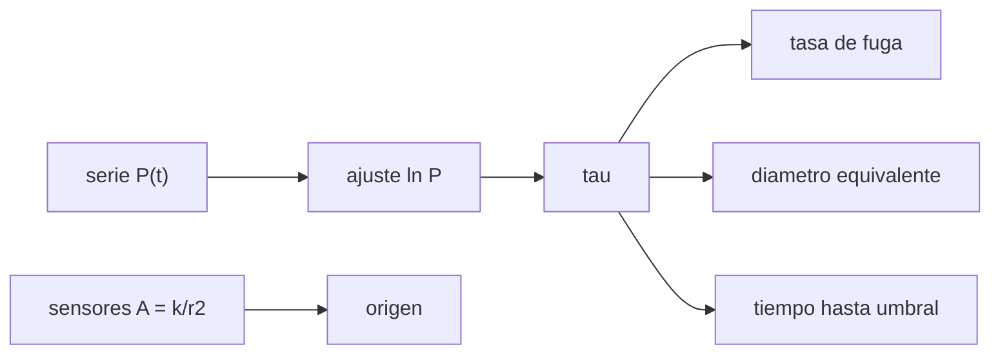

# B114-C02 — Detección, localización y respuesta a fugas de presión

<!-- nav:top -->
[🏠 Programa](../../../../README.md) · [📚 Bloque B114](../../../tronco-comun/B114-seguridad-y-respuesta-a-emergencias-en-habitats.md) · [← Anterior: B114-C01 — Rutas de evacuación y salidas de emergencia en hábitats](../B114-C01-rutas-de-evacuacion-y-salidas-de-emergencia-en-habitats/CLASE.md) · [Siguiente: B114-C03 — Alarmas y procedimientos ante desviaciones atmosféricas →](../B114-C03-alarmas-y-procedimientos-ante-desviaciones-atmosfericas/CLASE.md)
<!-- /nav -->

## 1. Ubicación, nivel y alcance

Clase 2 del bloque B114. Nivel N3. Una fuga lenta se ve como una caída de presión; su tasa, su tamaño equivalente y su ubicación son inferencias. Aquí estimas la tasa de fuga ajustando una exponencial a una serie de presión, la conviertes en masa perdida y diámetro equivalente de orificio y localizas el origen con sensores de amplitud. El hábitat y las mediciones son **sintéticos**; la ley del gas ideal y el flujo estrangulado son relaciones estándar. Usa [C01](../B114-C01-rutas-de-evacuacion-y-salidas-de-emergencia-en-habitats/CLASE.md) solo como contexto de por qué se evacúa.

## 2. Por qué esta clase existe

Una fuga pequeña no suena ni se ve, pero decide cuántos días quedan para actuar. La decisión central: **¿con qué rapidez pierde presión el hábitat y dónde está el origen?**

## 3. Lo que podrás hacer al terminar

1. Ajustar `ln P` frente a `t` para estimar la constante de tiempo `τ`.
2. Convertir `τ` en tasa de fuga (Pa/s y kg/día).
3. Estimar el diámetro equivalente de un orificio con flujo estrangulado.
4. Localizar un origen con sensores de amplitud `A = k/r²`.
5. Calcular el tiempo hasta un umbral de presión dado.
6. Separar lo sintético de lo consultado y de lo no consultado.

La evidencia es el **informe de fuga con tasa, origen e incertidumbre** del ejercicio 12 (sección 20).

## 4. Con qué llegas y cómo comprobarlo

1. ¿Qué es una presión y en qué unidades se mide?
2. ¿Qué dice la ley del gas ideal?
3. ¿Qué es una exponencial decreciente?
4. ¿Qué es un dato sintético?
5. ¿Qué es una verificación por segunda vía?

<details>
<summary>Ver respuestas</summary>

1. Fuerza por unidad de área; Pa. 2. `PV = nRT`. 3. Una magnitud que decae proporcionalmente a su valor: `P = P₀ e^(−t/τ)`. 4. Un dato generado para el ejemplo, no medido. 5. Calcular lo mismo con otro método y comparar.
</details>

Con cuatro o cinco aciertos, sigue; si no, repasa los prerrequisitos.

## 5. Un caso de contexto y casos de referencia

Un hábitat sintético de `100 m³` a `101 325 Pa` y `293,15 K` tiene un orificio oculto de `0,30 mm`. En 48 h la presión cae `1943,9 Pa` (`1,92 %`). El análisis recupera `τ = 8,909 × 10⁶ s` (`103 días`), un diámetro equivalente de `0,30 mm` y el origen a `0,00 m` del real. Es el **ejemplo conductor**. Todo es **ilustrativo**: ninguna cifra describe un hábitat real.

## 6. Vocabulario

La **constante de tiempo** `τ` es el tiempo en que la presión cae un factor `e`. La **tasa de fuga** es la pérdida de presión o de masa por unidad de tiempo. El **flujo estrangulado** es el máximo caudal másico por un orificio cuando la presión exterior es muy baja. El **diámetro equivalente** es el del orificio que daría esa tasa. La **localización** es la estimación de la posición del origen.

## 7. Modelo mental: un globo con un alfilerazo



*Descripción textual:* de la serie de presión salen `τ`, la tasa, el diámetro y el tiempo al umbral; de los sensores sale el origen.

Analogía: un globo con un alfilerazo pierde aire más rápido cuanto más lleno está. Límite: se supone temperatura constante, orificio fijo y flujo estrangulado; la fuga real puede crecer y la temperatura cambiar.

## 8. La explicación, paso a paso

### 8.1 Decaimiento exponencial

Con flujo estrangulado, `ṁ = C_d A P √(γ/(R_s T)) (2/(γ+1))^((γ+1)/(2(γ−1)))` y `m = P V/(R_s T)`, de modo que `dP/dt = −P/τ` con `τ = V/(C_d A c R_s T)`, donde `c` es el factor anterior. Para `d = 0,30 mm`, `C_d = 0,8` y `γ = 1,4`: `τ = 8,903 × 10⁶ s`.

### 8.2 Estimar τ del ruido

La serie sintética lleva ruido gaussiano de `5 Pa` (semilla 114). La regresión de `ln P` frente a `t` da `τ = 8,909 × 10⁶ s`, con error relativo de `0,07 %`. La tasa inicial es `1,137 × 10⁻² Pa/s = 40,9 Pa/h = 1,168 kg/día`.

### 8.3 Dos vías para la masa perdida

La masa perdida en 48 h por la ley del gas ideal con la caída observada es `2,3100 kg`; con el modelo exponencial, `2,3129 kg` (diferencia `0,13 %`). Dos vías: medición de presión y modelo de flujo.

### 8.4 Localizar y decidir

Cinco sensores miden `A = k/(r² + 0,04)` con `3 %` de ruido; una búsqueda en malla de `0,05 m` recupera `(7,20; 1,80) m`. Con la fuga estimada, la presión llega a `90 kPa` en `12,2 días` y a `34,5 kPa` (límite inferior de la exposición indefinida citado por la NASA) en `111,1 días`: **el tiempo disponible es largo, pero la fuga debe repararse antes**.

## 9. Magnitudes, símbolos y unidades

| Símbolo | Qué es | Unidad | Valor / nota |
|---|---|---|---|
| `P₀` | presión inicial | Pa | 101 325 |
| `V` | volumen | m³ | 100 (ilustrativo) |
| `τ` | constante de tiempo | s | 8,909 × 10⁶ |
| `C_d` | coeficiente de descarga | — | 0,8 (ilustrativo) |
| `ṁ` | caudal másico | kg/s | 1,35 × 10⁻⁵ |
| `R` | constante molar de los gases | J/(mol K) | 8,314 462 618 (CODATA 2022) |

## 10. Convenciones y referencias

Temperatura constante de `293,15 K`, aire seco con `M = 0,028 965 kg/mol` (valor típico, no consultado), flujo estrangulado hacia vacío, orificio de borde afilado. Sensores en un plano `(x, y)` en metros del hábitat sintético. Python 3.12, biblioteca estándar.

## 11. De dónde sale lo que afirmamos

| ID | Fuente | Localizador | Respalda | Estado |
|---|---|---|---|---|
| S1 | NIST, CODATA 2022, «Molar gas constant» — https://physics.nist.gov/cgi-bin/cuu/Value?r (consultada 2026-11-10) | página del valor | `R = 8,314 462 618… J mol⁻¹ K⁻¹`, exacta | Consultada |
| S2 | NASA OCHMO, OCHMO-TB-003 «Habitable Atmosphere», Rev A (2023) — https://www.nasa.gov/wp-content/uploads/2023/12/ochmo-tb-003-habitable-atmosphere.pdf (consultada 2026-11-10, PyMuPDF) | secciones de presión total y requisito `[V2 6006]` | 1 atm = 101,3 kPa; presión de exposición indefinida `34,5 kPa < P ≤ 103 kPa` | Consultada |
| — | Requisitos de detección y localización de fugas de NASA-STD-3001 y de ECSS | — | límites normativos de tasa de fuga | No consultada |
| — | Flujo estrangulado y ley del gas ideal | — | los verifica el laboratorio con una segunda vía | No consultada en una fuente concreta |

Límites: el volumen, el orificio, `C_d` y el ruido son sintéticos; no se infiere la tasa de fuga de ninguna estación real.

## 12. Cómo ver una fuga

| Magnitud | Valor |
|---|---|
| caída en 48 h | 1943,9 Pa |
| `τ` estimado | 8,909 × 10⁶ s |
| masa perdida en 48 h | 2,31 kg |
| error de localización | 0,00 m |
| tiempo a 90 kPa | 12,2 días |

Descripción larga: la presión baja menos de un 2 % en dos días, pero la tendencia exponencial lleva a umbrales críticos en semanas o meses.

## 13. Ejemplo trabajado: tiempo hasta 90 kPa

**Paso 1 · Constante.** `τ = 103,1 días`.

**Paso 2 · Cociente.** `P₀/P_u = 101 325/90 000 = 1,1258`.

**Paso 3 · Logaritmo.** `ln 1,1258 = 0,1185`.

**Paso 4 · Tiempo.** `t = 0,1185 × 103,1 = 12,2 días`.

## 14. Distintas formas de describir una fuga

**Por presión:** `dP/dt`. **Por masa:** `ṁ`. **Por tamaño:** diámetro equivalente. **Por tiempo:** `τ`. **Por lugar:** `(x, y)`.

## 15. Práctica guiada

**Ejercicio 1 · con los pasos indicados.** Calcula la presión tras 10 días con `τ = 8,903 × 10⁶ s`. *Pasos:* `t/τ`, exponencial, producto.

<details><summary>Solución comentada</summary>

`t/τ = 864 000/8,903 × 10⁶ = 0,09705`; `e^(−0,09705) = 0,9075`; `P = 91 950 Pa`.
</details>

**Ejercicio 2 · con una pista.** Si el diámetro del orificio se duplica, ¿cómo cambia `τ`? *Pista:* `τ ∝ 1/A`.

<details><summary>Solución comentada</summary>

El área se cuadruplica y `τ` se divide por 4: `25,8 días`.
</details>

**Ejercicio 3 · casi autónomo.** ¿Por qué se ajusta `ln P` y no `P`?

<details><summary>Solución comentada</summary>

Porque `ln P = ln P₀ − t/τ` es lineal en `t`, y la pendiente da `−1/τ`.
</details>

## 16. Práctica autónoma, transferencia e integrador

**Ejercicio 4 · autónomo.** ¿Cuánto tarda en llegar a `34,5 kPa` con `τ = 103 días`?

<details><summary>Solución comentada</summary>

`103 × ln(101 325/34 500) = 103 × 1,0775 = 111 días`.
</details>

**Ejercicio 5 · autónomo.** Si el volumen se duplica con el mismo orificio, ¿qué le pasa a `τ`?

<details><summary>Solución comentada</summary>

Se duplica: `206 días`; un volumen mayor da más tiempo.
</details>

**Ejercicio 6 · autónomo.** Convierte `40,9 Pa/h` en `Pa/día`.

<details><summary>Solución comentada</summary>

`40,9 × 24 = 982 Pa/día`.
</details>

**Ejercicio 7 · autónomo.** ¿Qué pasa con `τ` si el aire se enfría de `293 K` a `263 K` con el mismo orificio?

<details><summary>Solución comentada</summary>

En `τ = V/(C_d A c R_s T)` el factor `c` varía como `T^(−1/2)`, de modo que `τ ∝ T^(−1/2)`: `√(293,15/263,15) = 1,0555`, es decir, `τ` sube un 5,6 % al enfriarse (a volumen y temperatura del gas constantes durante la fuga).
</details>

**Ejercicio 8 · autónomo.** Con `A = k/r²`, si un sensor está al doble de distancia, ¿cómo cambia su amplitud?

<details><summary>Solución comentada</summary>

Cae a una cuarta parte.
</details>

**Ejercicio 9 · transferencia.** **Transferencia.** La presión baja `0,1 %` en un día. ¿Basta eso para declarar una fuga?

<details><summary>Solución comentada</summary>

No: hay que descartar deriva de sensores, cambios de temperatura y uso de la atmósfera por la tripulación o los sistemas.
</details>

**Ejercicio 10 · transferencia.** **Transferencia.** ¿Por qué la localización con pocos sensores puede ser ambigua?

<details><summary>Solución comentada</summary>

Con dos sensores hay una curva de puntos con la misma razón de amplitudes; hacen falta al menos tres no alineados y más para reducir el ruido.
</details>

**Ejercicio 11 · transferencia.** **Transferencia.** ¿Qué haría falta para usar este método en un hábitat real?

<details><summary>Solución comentada</summary>

Datos medidos, calibración de sensores, tasas de fuga y procedimientos de la norma y del programa; la clase no los trae.
</details>

**Ejercicio 12 · integrador.** **Integrador.** Elabora tu *informe de fuga con tasa, origen e incertidumbre*: `τ` y su error, tasa en Pa/h y kg/día, diámetro equivalente, origen, tiempo a dos umbrales y lista de qué es sintético y qué no se consultó.

<details><summary>Solución comentada</summary>

Secciones 8.1–8.4 y la salida del laboratorio.
</details>

## 17. Laboratorio: fuga de un hábitat sintético

El script [fuga.py](fuga.py) genera la serie de presión con semilla `114`, ajusta `τ`, calcula la tasa y el diámetro equivalente, localiza el origen con cinco sensores y calcula los tiempos a dos umbrales (**comprueba** error de `τ` < 5 %, masa perdida por dos vías y error de localización < 0,3 m).

**Datos:** todos **sintéticos**; `R` de NIST y umbral de 34,5 kPa consultados. **Predice antes de ejecutar:** ¿qué diámetro equivalente recuperará? (el real, `0,30 mm`.) **Ejecución del 2026-11-10 (Python 3.12.9):**

```text
Python 3.12.9 (biblioteca estandar)
Habitat SINTETICO: V = 100 m3, T = 293.15 K, P0 = 101325 Pa, Cd = 0.8
Orificio real: d = 0.3 mm; tau = 8.9029e+06 s = 103.0 dias
Caida observada en 48 h (sintetica): 1943.9 Pa (1.9184 %)
tau estimado = 8.9094e+06 s (verdadero 8.9029e+06); error relativo = 0.07 %
Tasa de fuga inicial = 1.137e-02 Pa/s = 40.94 Pa/h ; masa = 1.352e-05 kg/s = 1.168 kg/dia
Diametro equivalente estimado = 0.30 mm (verdadero 0.30 mm)
Masa perdida en 48 h = 2.3100 kg (ley del gas ideal)
Origen real (7.20, 1.80) m ; estimado (7.20, 1.80) m ; error = 0.00 m
t hasta 90 kPa (alerta ilustrativa)                = 12.2 dias
t hasta 34.5 kPa (limite inferior NASA-STD-3001)   = 111.1 dias
Masa perdida segun el modelo exponencial = 2.3129 kg
Pruebas superadas.
```

```bash
python programa/clases/B114/B114-C02-deteccion-localizacion-y-respuesta-a-fugas-de-presion/fuga.py
```

**Límites:** temperatura constante, un solo orificio, ruido gaussiano, flujo estrangulado hacia vacío y sensores sin deriva. Un error de localización de `0,00 m` refleja datos sintéticos limpios, no un desempeño real.

## 18. Errores frecuentes y cómo corregirlos

**Ajustar `P` lineal en vez de `ln P`.** Se corrige con 8.1.

**Confundir caída de presión con fuga sin descartar la temperatura.** Se corrige con el ejercicio 9.

**Creer que un error de `0,00 m` es el desempeño real.** Se corrige con la sección 17.

**Presentar `d` equivalente como el tamaño físico de la grieta.** Se corrige con la sección 6.

## 19. Cómo sabrás que vas bien

Tras la sección 8: ¿qué tiempo esperabas hasta `90 kPa` y cuál obtuviste? Si dudas, repasa el ejemplo 13. Tras el laboratorio: ¿qué comprueba? (ver la sección 17).

## 20. Qué entregas y cómo se evalúa

El producto es tu **informe de fuga con tasa, origen e incertidumbre** (ejercicio 12).

| Criterio | Inicial | En desarrollo | Logrado | Destacado |
|---|---|---|---|---|
| Conceptos | Los confunde | Parciales | Estima `τ`, tasa y diámetro | Explica los límites |
| Cálculo | Sin unidades | Con errores | Tablas completas con unidades | Calcula casos nuevos |
| Numérico | Sin comprobar | Un caso | Dos vías para la masa | Interpreta las diferencias |
| Fuentes | Sin fuente | Sin fecha | Fuentes con fecha y estado | Declara lo sintético y lo no consultado |
| Límites | No los nombra | Uno | Tres | Discute qué falta del modelo |

**Condiciones críticas (no se compensan con promedio):** rotular los datos como sintéticos; no presentar un resultado como procedimiento operativo; citar solo lo consultado.

## 21. Ética, seguridad y límites

Clase educativa: no es consejo médico ni operativo, no sustituye a las normas ni a los procedimientos de ningún programa y ningún resultado sirve para evaluar la estanqueidad de un hábitat real. Los datos son sintéticos y los modelos simplificados. Accesibilidad: tablas equivalentes a las gráficas, fórmulas en texto, ejercicios sin conexión.

## 22. Para cerrar y seguir

Un orificio de `0,30 mm` en `100 m³` baja la presión un `1,9 %` en dos días y la deja en `90 kPa` en `12 días`. Queda una pregunta: ¿qué umbrales deben disparar una alarma antes de llegar ahí?

**Glosario español–inglés.** fuga · *leak*; constante de tiempo · *time constant*; flujo estrangulado · *choked flow*; diámetro equivalente · *equivalent diameter*; tasa de fuga · *leak rate*.

**Continuidad.** [B114-C03](../B114-C03-alarmas-y-procedimientos-ante-desviaciones-atmosfericas/CLASE.md) estudia las alarmas y sus umbrales.

**Referencias:** ver sección 11.

<!-- nav:bottom -->
---

[← Anterior: B114-C01 — Rutas de evacuación y salidas de emergencia en hábitats](../B114-C01-rutas-de-evacuacion-y-salidas-de-emergencia-en-habitats/CLASE.md) · [📚 Bloque B114](../../../tronco-comun/B114-seguridad-y-respuesta-a-emergencias-en-habitats.md) · [Siguiente: B114-C03 — Alarmas y procedimientos ante desviaciones atmosféricas →](../B114-C03-alarmas-y-procedimientos-ante-desviaciones-atmosfericas/CLASE.md)
<!-- /nav -->
