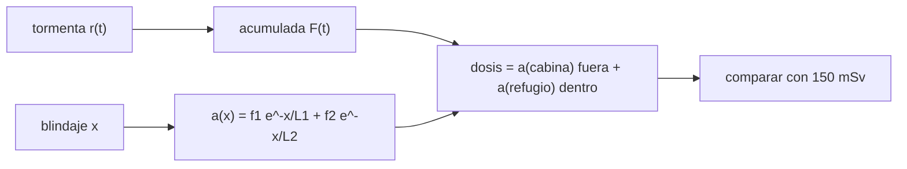

# B114-C04 — Refugio contra tormentas solares y compartimentos de protección

<!-- nav:top -->
[🏠 Programa](../../../../README.md) · [📚 Bloque B114](../../../tronco-comun/B114-seguridad-y-respuesta-a-emergencias-en-habitats.md) · [← Anterior: B114-C03 — Alarmas y procedimientos ante desviaciones atmosféricas](../B114-C03-alarmas-y-procedimientos-ante-desviaciones-atmosfericas/CLASE.md) · [Siguiente: B114-C05 — Despresurización: escenarios, tiempos y respuesta →](../B114-C05-despresurizacion-escenarios-tiempos-y-respuesta/CLASE.md)
<!-- /nav -->

## 1. Ubicación, nivel y alcance

Clase 4 del bloque B114. Nivel N3. Un refugio contra una tormenta solar es un compartimento con más masa por unidad de área entre la tripulación y el espacio. Aquí estimas la fracción de dosis que deja pasar un blindaje con un modelo exponencial de dos componentes, integras una tormenta **sintética** en el tiempo y calculas cuánto blindaje y cuánta rapidez de entrada hacen falta para cumplir un objetivo de dosis. El objetivo de `150 mSv` es una cifra de diseño atribuida al refugio de Orion; el modelo de atenuación y la tormenta son ilustrativos. Usa [C03](../B114-C03-alarmas-y-procedimientos-ante-desviaciones-atmosfericas/CLASE.md) para la idea de alarma y tiempo de aviso.

## 2. Por qué esta clase existe

Una tormenta solar no se puede evitar, pero se puede limitar la dosis si la tripulación llega a tiempo a un lugar bien blindado. La decisión central: **¿cuánto blindaje y cuánto tiempo de reacción hacen falta para quedar bajo un objetivo de dosis?**

## 3. Lo que podrás hacer al terminar

1. Calcular la fracción transmitida por un blindaje de `x g/cm²`.
2. Integrar el perfil temporal de una tormenta con una fórmula analítica y comprobarla numéricamente.
3. Calcular la dosis total según la hora de entrada y de salida del refugio.
4. Resolver la densidad areal mínima para un objetivo de dosis.
5. Explicar por qué la rapidez de entrada importa más que el espesor extra.
6. Separar la cifra consultada de los parámetros ilustrativos.

La evidencia es la **ficha de dosis de un refugio** del ejercicio 12 (sección 20).

## 4. Con qué llegas y cómo comprobarlo

1. ¿Qué es una dosis equivalente y en qué unidades se mide?
2. ¿Qué es la densidad areal de un blindaje?
3. ¿Qué es una exponencial decreciente?
4. ¿Qué es un dato sintético?
5. ¿Qué es una verificación por segunda vía?

<details>
<summary>Ver respuestas</summary>

1. Una medida del efecto biológico de la radiación; Sv (aquí mSv). 2. Masa por unidad de área atravesada, en g/cm². 3. Una magnitud que decae con la distancia: `e^(−x/L)`. 4. Un dato generado para el ejemplo, no medido. 5. Calcular lo mismo con otro método y comparar.
</details>

Con cuatro o cinco aciertos, sigue; si no, repasa los prerrequisitos.

## 5. Un caso de contexto y casos de referencia

Una tormenta sintética entrega `600 mSv` en espacio libre con escala de tiempo `6 h`. Una cabina de `5 g/cm²` deja pasar `64 %`: `383,6 mSv` sin refugio. Con un refugio de `30 g/cm²` al que se entra a la hora `1` y del que se sale a las `24 h`, la dosis es `124,9 mSv`, bajo el objetivo de `150 mSv`; si se entra a las `4 h`, sube a `163,0 mSv`. Es el **ejemplo conductor**. Todo es **ilustrativo**: ninguna cifra describe una tormenta real ni un blindaje real.

## 6. Vocabulario

La **tormenta de partículas solares** es un aumento de protones energéticos de origen solar. La **dosis equivalente** `H` se mide en mSv. La **densidad areal** `x` es la masa por área del blindaje, en g/cm². La **longitud de atenuación** `L` es la densidad areal que reduce la dosis en un factor `e`. El **refugio** es el compartimento más blindado.

## 7. Modelo mental: ponerse debajo de un paraguas más grueso



*Descripción textual:* la tormenta se integra en el tiempo; la dosis es la fracción transmitida por la cabina fuera del refugio más la del refugio dentro; se compara con el objetivo.

Analogía: cuanto más rápido se entra bajo el paraguas, menos mojado se queda; y un paraguas muy grueso ayuda poco si se entra tarde. Límite: el modelo usa dos exponenciales; la física real depende del espectro de protones, de los materiales y de la geometría.

## 8. La explicación, paso a paso

### 8.1 Atenuación

`a(x) = f₁ e^(−x/L₁) + f₂ e^(−x/L₂)` con `f₁ = 0,7`, `L₁ = 8 g/cm²`, `f₂ = 0,3`, `L₂ = 40 g/cm²` (**ilustrativos**). Resulta `a(5) = 0,639`, `a(10) = 0,434`, `a(20) = 0,239` y `a(40) = 0,115`: la componente penetrante domina a espesores grandes y el blindaje rinde cada vez menos.

### 8.2 Perfil de la tormenta

La tasa es `r(t) = H₀ t e^(−t/τ)/τ²` con `H₀ = 600 mSv` y `τ = 6 h`, de integral `F(t) = H₀[1 − e^(−t/τ)(1 + t/τ)]`. En 10 h acumula `297,80 mSv`; la integral numérica da el mismo valor (diferencia relativa `1,3 × 10⁻⁹`).

### 8.3 Dosis según el tiempo de entrada

`H = a(x_cabina)[F(t_e) + F(T) − F(t_s)] + a(x_ref)[F(t_s) − F(t_e)]`. Con `x_ref = 30 g/cm²` y salida a las 24 h: entrada a las `0,5 h` → `122,3 mSv`; `1 h` → `124,9`; `2 h` → `134,2`; `4 h` → `163,0` (no cumple); `8 h` → `232,5`.

### 8.4 Cuánto blindaje y cuánto tiempo

Para `150 mSv` con salida a las 24 h: `22,9 g/cm²` si se entra a las `0,5 h`, `25,3` a las `2 h` y `36,0` a las `4 h`. Salir pronto es costoso: con entrada a la hora 1, salir a las `6 h` da `310,9 mSv` y a las `48 h`, `99,3`. **La rapidez de entrada y la permanencia pesan tanto como el espesor.**

## 9. Magnitudes, símbolos y unidades

| Símbolo | Qué es | Unidad | Valor / nota |
|---|---|---|---|
| `H₀` | dosis libre total | mSv | 600 (sintética) |
| `τ` | escala de la tormenta | h | 6 (sintética) |
| `x` | densidad areal | g/cm² | 30 (refugio) |
| `a(x)` | fracción transmitida | — | 0,158 a 30 g/cm² |
| `t_e`, `t_s` | entrada y salida | h | 1 y 24 |
| `H` | dosis total | mSv | 124,9 |

## 10. Convenciones y referencias

Tiempo en horas desde el inicio de la tormenta; dosis equivalente en mSv; densidad areal en g/cm²; sin sistema de referencia espacial (un solo punto del hábitat). Todo parámetro de atenuación y de tormenta es **ilustrativo**. Python 3.12, biblioteca estándar.

## 11. De dónde sale lo que afirmamos

| ID | Fuente | Localizador | Respalda | Estado |
|---|---|---|---|---|
| S1 | Health Physics Society, «Ask the Experts», respuesta de N. Dickinson, 2026-02-23 — https://hps.org/publicinformation/ate/q17174/ (consultada 2026-11-10) | respuesta completa | tras las medidas de Artemis I, dosis < 250 mSv en un evento grande, < 150 mSv con protección corporal y < 150 mSv en el refugio; el refugio es un recinto blindado | Consultada |
| — | Resumen de resultados de Artemis I y valores de densidad areal de Orion | — | blindaje equivalente de una nave real | No consultada |
| — | Límites de dosis de NASA-STD-3001 y de NCRP | — | límites de exposición | No consultada |
| — | Modelo de atenuación exponencial de dos componentes | — | lo verifica el laboratorio con una integral numérica | No consultada en una fuente concreta |

Límites: la tormenta, `x`, `L₁`, `L₂`, `f₁` y `f₂` son ilustrativos; no se estima la dosis de ninguna misión.

## 12. Cómo ver la dosis de un refugio

| Entrada [h] | Dosis [mSv] |
|---|---|
| 0,5 | 122,3 |
| 1 | 124,9 |
| 2 | 134,2 |
| 4 | 163,0 |
| 8 | 232,5 |

Descripción larga: la dosis crece con el retraso de entrada y supera el objetivo de `150 mSv` entre las 2 y las 4 horas con este blindaje.

## 13. Ejemplo trabajado: atenuación de 30 g/cm²

**Paso 1 · Componente blanda.** `0,7 e^(−30/8) = 0,7 × 0,02352 = 0,01646`.

**Paso 2 · Componente penetrante.** `0,3 e^(−30/40) = 0,3 × 0,47237 = 0,14171`.

**Paso 3 · Suma.** `a(30) = 0,1582`.

**Paso 4 · Lectura.** El refugio deja pasar `15,8 %`, frente al `63,9 %` de la cabina.

## 14. Distintas formas de describir un refugio

**Por espesor:** `x`. **Por atenuación:** `a(x)`. **Por dosis:** `H`. **Por tiempo:** `t_e`, `t_s`. **Por margen:** `H/150 mSv`.

## 15. Práctica guiada

**Ejercicio 1 · con los pasos indicados.** Calcula `a(20)`. *Pasos:* dos exponenciales y suma.

<details><summary>Solución comentada</summary>

`0,7 e^(−2,5) + 0,3 e^(−0,5) = 0,0575 + 0,1820 = 0,2394`.
</details>

**Ejercicio 2 · con una pista.** ¿Qué fracción de la dosis libre de 10 h ya se acumuló? *Pista:* `297,8/600`.

<details><summary>Solución comentada</summary>

`49,6 %`: casi la mitad de la tormenta cae en las primeras 10 h.
</details>

**Ejercicio 3 · casi autónomo.** ¿Por qué duplicar el espesor no divide la dosis por dos?

<details><summary>Solución comentada</summary>

Porque la componente penetrante (`L₂ = 40 g/cm²`) casi no se atenúa; el modelo muestra rendimientos decrecientes.
</details>

## 16. Práctica autónoma, transferencia e integrador

**Ejercicio 4 · autónomo.** Dosis sin refugio (cabina durante 72 h).

<details><summary>Solución comentada</summary>

`383,6 mSv`.
</details>

**Ejercicio 5 · autónomo.** Reducción relativa lograda por el refugio con entrada a la hora 1.

<details><summary>Solución comentada</summary>

`1 − 124,9/383,6 = 67,4 %`.
</details>

**Ejercicio 6 · autónomo.** ¿Cuántos mSv añade retrasar la entrada de 1 h a 4 h?

<details><summary>Solución comentada</summary>

`163,0 − 124,9 = 38,1 mSv`.
</details>

**Ejercicio 7 · autónomo.** ¿Qué pasa si se sale del refugio a las 6 h en lugar de a las 24 h?

<details><summary>Solución comentada</summary>

La dosis sube de `124,9` a `310,9 mSv`: aún quedaba mucha tormenta.
</details>

**Ejercicio 8 · autónomo.** ¿Qué `x` mínimo hace falta con entrada a las 2 h?

<details><summary>Solución comentada</summary>

`25,3 g/cm²` (laboratorio).
</details>

**Ejercicio 9 · transferencia.** **Transferencia.** Un hábitat tiene un refugio excelente pero la alarma tarda 6 h. ¿Qué concluyes?

<details><summary>Solución comentada</summary>

Que la cadena de aviso es parte del diseño: con entrada tardía el refugio no cumple, como muestran las filas de 4 y 8 h.
</details>

**Ejercicio 10 · transferencia.** **Transferencia.** ¿Por qué no se puede usar `a(x)` de esta clase para blindar un vehículo real?

<details><summary>Solución comentada</summary>

Porque es un modelo ilustrativo; la atenuación real depende del espectro, de los materiales, de la geometría y de los códigos de transporte de radiación validados.
</details>

**Ejercicio 11 · transferencia.** **Transferencia.** ¿Qué papel tienen los materiales ricos en hidrógeno?

<details><summary>Solución comentada</summary>

La literatura los usa porque atenúan mejor protones por masa; esta clase no consultó esos datos y solo lo menciona como pregunta abierta.
</details>

**Ejercicio 12 · integrador.** **Integrador.** Elabora tu *ficha de dosis de un refugio*: tabla de dosis según entrada y salida, `x` mínimo para 150 mSv, margen y lista de qué es consultado, sintético y no consultado.

<details><summary>Solución comentada</summary>

Secciones 8.1–8.4 y la salida del laboratorio.
</details>

## 17. Laboratorio: refugio de un hábitat sintético

El script [refugio.py](refugio.py) calcula la atenuación, integra la tormenta (analítica y numérica), la dosis según entrada y salida, y resuelve `x` mínimo por bisección (**comprueba** diferencia analítica/numérica < 1e-6 y dosis creciente con el retraso).

**Datos:** todo **sintético o ilustrativo**; solo el objetivo de 150 mSv procede de una fuente consultada. **Predice antes de ejecutar:** ¿cumple 150 mSv con entrada a las 4 h? (no: 163,0 mSv.) **Ejecución del 2026-11-10 (Python 3.12.9):**

```text
Python 3.12.9 (biblioteca estandar)
Tormenta SINTETICA: H0 = 600 mSv en espacio libre, tau = 6.0 h, ventana 72 h
Atenuacion ILUSTRATIVA de dos componentes (L1 = 8, L2 = 40 g/cm2)
Fraccion transmitida por blindaje [g/cm2]:
  x =   0  ->  1.0000
  x =   5  ->  0.6394
  x =  10  ->  0.4342
  x =  20  ->  0.2394
  x =  40  ->  0.1151
Dosis libre acumulada en 10 h: analitica 297.7990 mSv ; numerica 297.7990 mSv ; dif = 1.31e-09
Dosis total [mSv] con refugio de 30 g/cm2 y salida a las 24 h:
  t_entrada [h]   dosis [mSv]   cumple 150 mSv
       0.5          122.3   si
       1.0          124.9   si
       2.0          134.2   si
       4.0          163.0   no
       8.0          232.5   no
Sin refugio (solo cabina, 5 g/cm2): 383.6 mSv
Densidad areal minima del refugio para 150 mSv:
  entrada a las 0.5 h -> 22.9 g/cm2
  entrada a las 1.0 h -> 23.4 g/cm2
  entrada a las 2.0 h -> 25.3 g/cm2
  entrada a las 4.0 h -> 36.0 g/cm2
Efecto del tiempo de salida (entrada 1 h, refugio 30 g/cm2):
  salida a las    6 h -> 310.9 mSv
  salida a las   12 h -> 215.7 mSv
  salida a las   24 h -> 124.9 mSv
  salida a las   48 h -> 99.3 mSv
Pruebas superadas.
```

```bash
python programa/clases/B114/B114-C04-refugio-contra-tormentas-solares-y-compartimentos-de-proteccion/refugio.py
```

**Límites:** un solo punto, dos exponenciales, perfil temporal gamma sin espectro de energías y sin dosis por rayos cósmicos galácticos ni por la propia nave.

## 18. Errores frecuentes y cómo corregirlos

**Pensar que el espesor lo resuelve todo.** Se corrige con 8.4.

**Olvidar la dosis fuera del refugio.** Se corrige con 8.3.

**Usar el modelo como diseño real.** Se corrige con la sección 10.

**Tratar la tormenta sintética como un evento observado.** Se corrige con la sección 5.

## 19. Cómo sabrás que vas bien

Tras la sección 8: ¿qué dosis esperabas con entrada a las 2 h y cuál obtuviste? Si dudas, repasa el ejemplo 13. Tras el laboratorio: ¿qué comprueba? (ver la sección 17).

## 20. Qué entregas y cómo se evalúa

El producto es tu **ficha de dosis de un refugio** (ejercicio 12).

| Criterio | Inicial | En desarrollo | Logrado | Destacado |
|---|---|---|---|---|
| Conceptos | Los confunde | Parciales | Calcula atenuación y dosis | Explica los límites |
| Cálculo | Sin unidades | Con errores | Tablas completas con unidades | Calcula casos nuevos |
| Numérico | Sin comprobar | Un caso | Integral analítica y numérica | Interpreta las diferencias |
| Fuentes | Sin fuente | Sin fecha | Fuentes con fecha y estado | Declara lo sintético y lo no consultado |
| Límites | No los nombra | Uno | Tres | Discute qué falta del modelo |

**Condiciones críticas (no se compensan con promedio):** rotular tormenta y blindaje como sintéticos; no presentar un resultado como diseño o consejo; citar solo lo consultado.

## 21. Ética, seguridad y límites

Clase educativa: no es consejo médico ni operativo, no sustituye a los límites de dosis, a los procedimientos ni al entrenamiento de ningún programa y ningún resultado sirve para dimensionar un refugio real. Los datos son sintéticos y los modelos simplificados. Accesibilidad: tablas equivalentes a las gráficas, fórmulas en texto, ejercicios sin conexión.

## 22. Para cerrar y seguir

Un refugio de `30 g/cm²` deja la dosis sintética en `125 mSv` si se entra a la hora 1 y en `163 mSv` si se entra a las 4 h. Queda una pregunta: ¿cuánto tarda en caer la presión si el casco se abre?

**Glosario español–inglés.** tormenta de partículas solares · *solar particle event*; refugio · *storm shelter*; densidad areal · *areal density*; dosis equivalente · *dose equivalent*; blindaje · *shielding*.

**Continuidad.** [B114-C05](../B114-C05-despresurizacion-escenarios-tiempos-y-respuesta/CLASE.md) estudia la despresurización.

**Referencias:** ver sección 11.

<!-- nav:bottom -->
---

[← Anterior: B114-C03 — Alarmas y procedimientos ante desviaciones atmosféricas](../B114-C03-alarmas-y-procedimientos-ante-desviaciones-atmosfericas/CLASE.md) · [📚 Bloque B114](../../../tronco-comun/B114-seguridad-y-respuesta-a-emergencias-en-habitats.md) · [Siguiente: B114-C05 — Despresurización: escenarios, tiempos y respuesta →](../B114-C05-despresurizacion-escenarios-tiempos-y-respuesta/CLASE.md)
<!-- /nav -->
