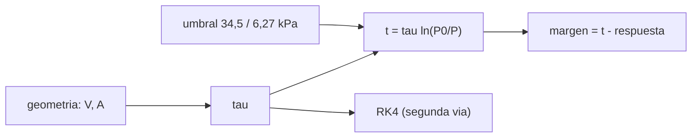

# B114-C05 — Despresurización: escenarios, tiempos y respuesta

<!-- nav:top -->
[🏠 Programa](../../../../README.md) · [📚 Bloque B114](../../../tronco-comun/B114-seguridad-y-respuesta-a-emergencias-en-habitats.md) · [← Anterior: B114-C04 — Refugio contra tormentas solares y compartimentos de protección](../B114-C04-refugio-contra-tormentas-solares-y-compartimentos-de-proteccion/CLASE.md) · [Siguiente: B114-C06 — Matriz de riesgo ambiental de un hábitat →](../B114-C06-matriz-de-riesgo-ambiental-de-un-habitat/CLASE.md)
<!-- /nav -->

## 1. Ubicación, nivel y alcance

Clase 5 del bloque B114. Nivel N3. La despresurización es una carrera: la presión baja según el tamaño del orificio y el volumen, y la respuesta de la tripulación tiene un tiempo. Aquí calculas el tiempo hasta dos umbrales de presión para cuatro tamaños de orificio con flujo estrangulado, lo verificas con integración numérica, comparas el modelo isotermo con el adiabático y obtienes el margen de respuesta. El hábitat es **sintético**. [C02](../B114-C02-deteccion-localizacion-y-respuesta-a-fugas-de-presion/CLASE.md) trató la fuga lenta; aquí se ve el extremo rápido.

## 2. Por qué esta clase existe

Entre una grieta de `1 mm` y una brecha de `100 mm` el tiempo disponible pasa de días a segundos. La decisión central: **¿cuánto tiempo hay hasta un umbral de presión y alcanza para responder?**

## 3. Lo que podrás hacer al terminar

1. Calcular `τ` de despresurización con flujo estrangulado.
2. Calcular el tiempo hasta un umbral con `t = τ ln(P₀/P)`.
3. Verificar el resultado con una integración numérica (RK4).
4. Comparar el modelo isotermo con el adiabático.
5. Calcular el margen de respuesta y el diámetro máximo para un tiempo dado.
6. Separar los umbrales consultados de la respuesta ilustrativa.

La evidencia es el **cuadro de escenarios de despresurización** del ejercicio 12 (sección 20).

## 4. Con qué llegas y cómo comprobarlo

1. ¿Qué es el flujo estrangulado?
2. ¿Cómo escala el área de un orificio con su diámetro?
3. ¿Qué es una exponencial decreciente?
4. ¿Qué es un dato sintético?
5. ¿Qué es una verificación por segunda vía?

<details>
<summary>Ver respuestas</summary>

1. El caudal máximo por un orificio, que no aumenta aunque baje la presión exterior. 2. Con el cuadrado del diámetro. 3. `P = P₀ e^(−t/τ)`. 4. Un dato generado para el ejemplo, no medido. 5. Calcular lo mismo con otro método y comparar.
</details>

Con cuatro o cinco aciertos, sigue; si no, repasa los prerrequisitos.

## 5. Un caso de contexto y casos de referencia

Un hábitat sintético de `100 m³` a `101 325 Pa` y `293,15 K` se abre por un orificio de `20 mm`: `τ = 2003 s` y la presión llega a `34,5 kPa` en `2158 s` (`36 min`) y a `6,27 kPa` en `5574 s`. Con `100 mm` llega a `34,5 kPa` en `86,3 s`, antes de una respuesta ilustrativa de `300 s`. Es el **ejemplo conductor**. Todo es **ilustrativo** salvo los umbrales citados.

## 6. Vocabulario

La **despresurización** es la pérdida de presión de un volumen cerrado hacia el exterior. La **constante de tiempo** `τ` es el tiempo en que la presión cae un factor `e`. El **modelo isotermo** supone temperatura constante del gas; el **adiabático**, ausencia de intercambio de calor. El **margen de respuesta** es el tiempo hasta el umbral menos el tiempo de respuesta. El **umbral de presión** es el valor cuyo cruce se evalúa.

## 7. Modelo mental: una bañera con un desagüe



*Descripción textual:* el volumen y el área dan `τ`; con el umbral se obtiene el tiempo y, restando la respuesta, el margen; el RK4 lo comprueba.

Analogía: una bañera con un desagüe ancho se vacía en segundos y con uno estrecho en horas; el tiempo se reparte según el cociente volumen/área. Límite: el modelo no incluye el flujo en pasillos, el cierre de compuertas ni el intercambio de calor con las paredes.

## 8. La explicación, paso a paso

### 8.1 Tiempo característico

Con flujo estrangulado, `τ = V/(C_d A √(γ R_s T₀) ψ)`, con `ψ = (2/(γ+1))^((γ+1)/(2(γ−1))) = 0,5787`, `γ = 1,4`, `C_d = 0,8` y `R_s = R/M` con `R = 8,314 462 618 J/(mol K)`. Resulta `τ = 801 262 s` (9,3 días) para `1 mm`, `32 050 s` para `5 mm`, `2003 s` para `20 mm` y `80,1 s` para `100 mm`: `τ ∝ 1/d²`.

### 8.2 Tiempo hasta los umbrales

`t = τ ln(P₀/P)`. Para `20 mm`: `ln(101 325/34 500) = 1,0776` y `t = 2158 s`; `ln(101 325/6270) = 2,783` y `t = 5574 s`. Para `1 mm` el tiempo es de `10 días`; para `100 mm`, `86,3 s` y `223 s`.

### 8.3 Dos vías y dos modelos

Una integración RK4 con paso `0,05 s` da `2158,147 s` frente al `2158,147 s` analítico (diferencia relativa `1,6 × 10⁻¹¹`). El modelo adiabático da `1666,5 s`, un `77 %` del isotermo: al enfriarse el gas restante, la presión cae antes. La realidad queda **entre** ambos, según el intercambio de calor.

### 8.4 Margen y diámetro máximo

Con una respuesta ilustrativa de `300 s`, el margen hasta `34,5 kPa` es `1858 s` con `20 mm` y **negativo** (`−213,7 s`) con `100 mm`. El diámetro máximo para disponer de `600 s` hasta `34,5 kPa` es `37,9 mm`. El tiempo escala con el volumen: `1079 s` en `50 m³` y `8633 s` en `400 m³`.

## 9. Magnitudes, símbolos y unidades

| Símbolo | Qué es | Unidad | Valor / nota |
|---|---|---|---|
| `V` | volumen | m³ | 100 (ilustrativo) |
| `A` | área del orificio | m² | `π d²/4` |
| `τ` | constante de tiempo | s | 2003 (20 mm) |
| `ψ` | factor de flujo estrangulado | — | 0,5787 |
| `P_u` | umbral de presión | Pa | 34 500; 6270 |
| `T_resp` | tiempo de respuesta | s | 300 (ilustrativo) |

## 10. Convenciones y referencias

Aire seco, gas ideal, flujo estrangulado hacia vacío, orificio de borde afilado, `C_d = 0,8`, un solo volumen sin compartimentos. Presiones en Pa; `1 kPa = 1000 Pa`. Python 3.12, biblioteca estándar.

## 11. De dónde sale lo que afirmamos

| ID | Fuente | Localizador | Respalda | Estado |
|---|---|---|---|---|
| S1 | NASA OCHMO, OCHMO-TB-003 «Habitable Atmosphere», Rev A (2023) — https://www.nasa.gov/wp-content/uploads/2023/12/ochmo-tb-003-habitable-atmosphere.pdf (consultada 2026-11-10, PyMuPDF) | secciones de límites de presión total y `[V2 6006]` | 34,5 kPa < P ≤ 103 kPa para exposición indefinida; ebullismo a 6,27 kPa (47,0 mmHg) a 37 °C; 1 atm = 101,3 kPa | Consultada |
| S2 | NIST, CODATA 2022 — https://physics.nist.gov/cgi-bin/cuu/Value?r (consultada 2026-11-10) | valor de `R` | 8,314 462 618… J mol⁻¹ K⁻¹ | Consultada |
| — | Requisitos `[V2 11100]` (trajes de protección ante despresurización) y tiempos de respuesta de la tripulación | — | tiempos de respuesta reales | No consultada |
| — | Flujo estrangulado, modelos isotermo y adiabático | — | los verifica el laboratorio con RK4 | No consultada en una fuente concreta |

Límites: `V`, `d`, `C_d`, `T_resp` y la temperatura son sintéticos o ilustrativos; no se infiere el tiempo de despresurización de ningún hábitat real.

## 12. Cómo ver una despresurización

| `d` [mm] | `τ` [s] | a 34,5 kPa [s] | margen [s] |
|---|---|---|---|
| 1 | 801 262 | 863 259 | 862 959 |
| 5 | 32 050 | 34 530 | 34 230 |
| 20 | 2003 | 2158 | 1858 |
| 100 | 80,1 | 86,3 | −213,7 |

Descripción larga: el tiempo cae con el cuadrado del diámetro; con 100 mm el umbral se cruza antes de que termine la respuesta.

## 13. Ejemplo trabajado: 20 mm hasta 34,5 kPa

**Paso 1 · Área.** `A = π(0,020)²/4 = 3,1416 × 10⁻⁴ m²`.

**Paso 2 · Constante.** `τ = 2003 s`.

**Paso 3 · Logaritmo.** `ln(101 325/34 500) = 1,0776`.

**Paso 4 · Tiempo.** `t = 2003 × 1,0776 = 2158 s = 36 min`.

## 14. Distintas formas de describir una despresurización

**Por tamaño:** `d`. **Por tiempo:** `τ`. **Por umbral:** `t(P_u)`. **Por margen:** `t − T_resp`. **Por modelo:** isotermo y adiabático.

## 15. Práctica guiada

**Ejercicio 1 · con los pasos indicados.** Calcula `τ` para `5 mm` a partir del valor de `1 mm`. *Pasos:* `τ ∝ 1/d²`.

<details><summary>Solución comentada</summary>

`801 262/25 = 32 050 s`.
</details>

**Ejercicio 2 · con una pista.** ¿Cuántas veces más tarda en llegar a `6,27 kPa` que a `34,5 kPa`? *Pista:* cociente de logaritmos.

<details><summary>Solución comentada</summary>

`2,783/1,0776 = 2,58`; `5574/2158 = 2,58`.
</details>

**Ejercicio 3 · casi autónomo.** ¿Por qué el tiempo escala linealmente con el volumen?

<details><summary>Solución comentada</summary>

Porque `τ = V/(C_d A c)`: a igual orificio, más aire tarda proporcionalmente más en salir.
</details>

## 16. Práctica autónoma, transferencia e integrador

**Ejercicio 4 · autónomo.** Tiempo a `34,5 kPa` con `100 mm`.

<details><summary>Solución comentada</summary>

`80,1 × 1,0776 = 86,3 s`.
</details>

**Ejercicio 5 · autónomo.** Margen de respuesta con `5 mm` y `T_resp = 300 s`.

<details><summary>Solución comentada</summary>

`34 530 − 300 = 34 230 s`.
</details>

**Ejercicio 6 · autónomo.** Si el volumen es `400 m³` y `d = 20 mm`, ¿cuánto tarda en llegar a `34,5 kPa`?

<details><summary>Solución comentada</summary>

`4 × 2158 = 8633 s`.
</details>

**Ejercicio 7 · autónomo.** ¿Qué `d` da `τ = 200 s`?

<details><summary>Solución comentada</summary>

`τ ∝ 1/d²`: `d = 20 × √(2003/200) = 63,3 mm`.
</details>

**Ejercicio 8 · autónomo.** ¿Cuánto más rápido llega el modelo adiabático a `34,5 kPa` con `20 mm`?

<details><summary>Solución comentada</summary>

`1666,5/2158,1 = 0,772`: un `22,8 %` antes.
</details>

**Ejercicio 9 · transferencia.** **Transferencia.** Un colega dice «con un orificio de 5 mm tenemos medio día». ¿Qué comprobarías?

<details><summary>Solución comentada</summary>

Que el modelo es de un solo volumen y sin compartimentos; son `9,6 h` hasta 34,5 kPa en el laboratorio, pero el tiempo real depende de la geometría, el calor y el cierre de compuertas.
</details>

**Ejercicio 10 · transferencia.** **Transferencia.** ¿Por qué los umbrales de presión de la clase no son un criterio de seguridad para personas?

<details><summary>Solución comentada</summary>

Son valores citados de una nota técnica para exposición indefinida y ebullismo, no un criterio de supervivencia ni de procedimiento; el efecto fisiológico depende de la persona, del oxígeno y del tiempo.
</details>

**Ejercicio 11 · transferencia.** **Transferencia.** ¿Cómo ayuda dividir el hábitat en compartimentos con compuertas?

<details><summary>Solución comentada</summary>

Reduce el `V` efectivo que se pierde por la brecha y permite aislar el compartimento dañado, ganando tiempo; esta clase no lo modela.
</details>

**Ejercicio 12 · integrador.** **Integrador.** Elabora tu *cuadro de escenarios de despresurización*: `τ`, tiempos a dos umbrales y márgenes para cuatro diámetros, comparación RK4, modelo adiabático y lista de qué es consultado, sintético y no consultado.

<details><summary>Solución comentada</summary>

Secciones 8.1–8.4 y la salida del laboratorio.
</details>

## 17. Laboratorio: despresurización de un hábitat sintético

El script [despresurizacion.py](despresurizacion.py) calcula `τ` y los tiempos a dos umbrales para cuatro orificios, los verifica con RK4, compara con el modelo adiabático y resuelve el diámetro máximo por bisección (**comprueba** diferencia analítico/RK4 < 1e-6 y adiabático más rápido que isotermo).

**Datos:** todo **sintético o ilustrativo**; solo `R` y los dos umbrales proceden de fuentes consultadas. **Predice antes de ejecutar:** ¿qué `τ` tendrá el orificio de 100 mm? (80,1 s.) **Ejecución del 2026-11-10 (Python 3.12.9):**

```text
Python 3.12.9 (biblioteca estandar)
Habitat SINTETICO: V = 100 m3, T0 = 293.15 K, P0 = 101325 Pa, Cd = 0.8, respuesta = 300 s (ilustrativa)
Flujo estrangulado hacia vacio: coeficiente PSI = 0.5787
 d [mm]   tau [s]   t->34.5 kPa [s]  t->6.27 kPa [s]  margen resp. [s]
    1.0  801262.1         863258.8        2229557.2         862958.8
    5.0   32050.5          34530.4          89182.3          34230.4
   20.0    2003.2           2158.1           5573.9           1858.1
  100.0      80.1             86.3            223.0           -213.7
d = 20 mm hasta 34.5 kPa: analitico 2158.147 s ; RK4 2158.147 s ; dif rel = 1.61e-11
d = 20 mm hasta 34.5 kPa: adiabatico 1666.5 s (isotermico 2158.1 s) ; cociente = 0.772
Diametro maximo de orificio para disponer de 600 s hasta 34.5 kPa: 37.9 mm
Escala con el volumen (d = 20 mm, hasta 34.5 kPa):
  V =    50 m3 -> 1079.1 s
  V =   100 m3 -> 2158.1 s
  V =   400 m3 -> 8632.6 s
Pruebas superadas.
```

```bash
python programa/clases/B114/B114-C05-despresurizacion-escenarios-tiempos-y-respuesta/despresurizacion.py
```

**Límites:** un solo volumen, flujo estrangulado hacia vacío, sin transferencia de calor, sin compartimentos y sin la dinámica de cierre de compuertas.

## 18. Errores frecuentes y cómo corregirlos

**Pensar que el tiempo escala con `d` y no con `d²`.** Se corrige con 8.1.

**Tomar el modelo isotermo como único.** Se corrige con 8.3.

**Mezclar el umbral de presión con un criterio fisiológico.** Se corrige con el ejercicio 10.

**Presentar un tiempo sintético como un tiempo real de una nave.** Se corrige con la sección 11.

## 19. Cómo sabrás que vas bien

Tras la sección 8: ¿qué tiempo esperabas con `20 mm` y cuál obtuviste? Si dudas, repasa el ejemplo 13. Tras el laboratorio: ¿qué comprueba? (ver la sección 17).

## 20. Qué entregas y cómo se evalúa

El producto es tu **cuadro de escenarios de despresurización** (ejercicio 12).

| Criterio | Inicial | En desarrollo | Logrado | Destacado |
|---|---|---|---|---|
| Conceptos | Los confunde | Parciales | Calcula `τ`, tiempos y márgenes | Explica los límites |
| Cálculo | Sin unidades | Con errores | Tablas completas con unidades | Calcula casos nuevos |
| Numérico | Sin comprobar | Un caso | Contraste analítico/RK4 | Interpreta isotermo y adiabático |
| Fuentes | Sin fuente | Sin fecha | Fuentes con fecha y estado | Declara lo sintético y lo no consultado |
| Límites | No los nombra | Uno | Tres | Discute qué falta del modelo |

**Condiciones críticas (no se compensan con promedio):** rotular el hábitat y la respuesta como sintéticos; no presentar un tiempo como criterio de seguridad; citar solo lo consultado.

## 21. Ética, seguridad y límites

Clase educativa: no es consejo médico ni operativo, no sustituye a las normas, a los procedimientos ni al entrenamiento de ningún programa, y ningún resultado sirve para dimensionar ni evaluar un hábitat real ni para decidir cuánto tiempo tiene una persona. Los datos son sintéticos y los modelos simplificados. Accesibilidad: tablas equivalentes a las gráficas, fórmulas en texto, ejercicios sin conexión.

## 22. Para cerrar y seguir

Con `20 mm` la presión sintética llega a `34,5 kPa` en `36 min`; con `100 mm`, en `86 s`, antes de que acabe una respuesta de `300 s`. Queda una pregunta: ¿cómo se ordenan y priorizan todos estos peligros?

**Glosario español–inglés.** despresurización · *depressurization*; flujo estrangulado · *choked flow*; margen · *margin*; adiabático · *adiabatic*; orificio · *orifice*.

**Continuidad.** [B114-C06](../B114-C06-matriz-de-riesgo-ambiental-de-un-habitat/CLASE.md) construye la matriz de riesgo.

**Referencias:** ver sección 11.

<!-- nav:bottom -->
---

[← Anterior: B114-C04 — Refugio contra tormentas solares y compartimentos de protección](../B114-C04-refugio-contra-tormentas-solares-y-compartimentos-de-proteccion/CLASE.md) · [📚 Bloque B114](../../../tronco-comun/B114-seguridad-y-respuesta-a-emergencias-en-habitats.md) · [Siguiente: B114-C06 — Matriz de riesgo ambiental de un hábitat →](../B114-C06-matriz-de-riesgo-ambiental-de-un-habitat/CLASE.md)
<!-- /nav -->
