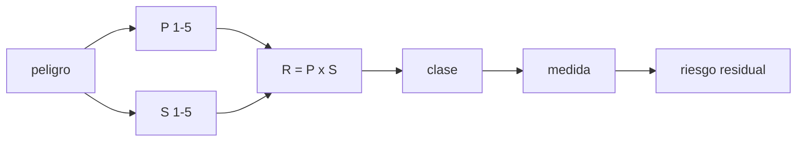

# B114-C06 — Matriz de riesgo ambiental de un hábitat

<!-- nav:top -->
[🏠 Programa](../../../../README.md) · [📚 Bloque B114](../../../tronco-comun/B114-seguridad-y-respuesta-a-emergencias-en-habitats.md) · [← Anterior: B114-C05 — Despresurización: escenarios, tiempos y respuesta](../B114-C05-despresurizacion-escenarios-tiempos-y-respuesta/CLASE.md) · [Siguiente: B115-C01 — Cultivos hidropónicos para hábitats →](../../../tronco-comun/B115-sistemas-bioregenerativos-y-cultivo-en-habitats.md#b115-c01)
<!-- /nav -->

## 1. Ubicación, nivel y alcance

Clase 6 y última del bloque B114. Nivel N3. Una matriz de riesgo ordena peligros según su probabilidad y su severidad para decidir qué medidas aplicar primero. Aquí construyes una matriz de `5 × 5`, clasificas siete peligros ambientales de un hábitat **sintético** (los de las clases C01–C05 y otros), aplicas medidas que reducen probabilidad o severidad y mides cuánto cambia la clasificación si las calificaciones fallan en una unidad. Todas las calificaciones son ilustrativas y no provienen de ningún análisis de riesgo real.

## 2. Por qué esta clase existe

Los cálculos de C01–C05 responden a peligros concretos, pero los recursos son limitados y alguien debe decidir el orden. La decisión central: **¿qué peligros se atienden primero y cuánta confianza merece ese orden?**

## 3. Lo que podrás hacer al terminar

1. Definir escalas ordinales de probabilidad y severidad.
2. Calcular el riesgo `R = P × S` y clasificarlo en bajo, medio o alto.
3. Aplicar medidas y calcular el riesgo residual.
4. Ordenar los peligros por prioridad.
5. Medir la sensibilidad de la clasificación a errores de calificación.
6. Reconocer los límites de una escala ordinal y rotular lo sintético.

La evidencia es la **matriz de riesgo con medidas y riesgo residual** del ejercicio 12 (sección 20).

## 4. Con qué llegas y cómo comprobarlo

1. ¿Qué es una escala ordinal?
2. ¿Qué diferencia hay entre probabilidad y severidad?
3. ¿Qué es un riesgo residual?
4. ¿Qué es un dato sintético?
5. ¿Qué es una verificación por segunda vía?

<details>
<summary>Ver respuestas</summary>

1. Una escala donde importa el orden pero no la distancia entre valores. 2. La probabilidad dice cuán a menudo ocurre; la severidad, cuán grave es si ocurre. 3. El riesgo que queda después de aplicar las medidas. 4. Un dato generado para el ejemplo, no medido. 5. Calcular lo mismo con otro método y comparar.
</details>

Con cuatro o cinco aciertos, sigue; si no, repasa los prerrequisitos.

## 5. Un caso de contexto y casos de referencia

Siete peligros sintéticos suman un riesgo de `62` puntos; con las medidas ilustrativas quedan en `37` (`−40,3 %`). La tormenta solar encabeza la lista (`R = 12`) y la brecha por impacto y el incendio empatan en `10`. Al perturbar cada calificación en `±1`, el peligro de mayor riesgo cambia en el `56,9 %` de las muestras: el orden es frágil. Es el **ejemplo conductor**. Todo es **ilustrativo**.

## 6. Vocabulario

La **probabilidad** `P` y la **severidad** `S` son calificaciones de 1 a 5. El **riesgo** `R = P × S` es un índice ordinal. La **clase** es bajo (`R < 8`), medio (`8 ≤ R < 15`) o alto (`R ≥ 15`) en esta clase. La **medida** reduce `P` (prevención) o `S` (mitigación). El **riesgo residual** es el `R` tras aplicar las medidas.

## 7. Modelo mental: un semáforo con celdas



*Descripción textual:* cada peligro recibe `P` y `S`; su producto da `R` y la clase; la medida baja `P` o `S` y produce el riesgo residual.

Analogía: un semáforo agrupa situaciones muy distintas en tres colores para decidir rápido, a costa de perder detalle. Límite: `P × S` sobre escalas ordinales no es un riesgo cuantitativo y un producto igual puede esconder casos muy distintos (alta probabilidad leve frente a baja probabilidad catastrófica).

## 8. La explicación, paso a paso

### 8.1 La matriz

De las `25` celdas de la matriz `5 × 5`, `12` son bajas, `7` medias y `6` altas con los cortes `8` y `15`. Es un conteo directo, independiente del cálculo de los peligros.

### 8.2 Los peligros y sus medidas

| Peligro | `P` | `S` | `R` | Clase | `P'` | `S'` | `R'` |
|---|---|---|---|---|---|---|---|
| Fuga lenta de presión | 3 | 3 | 9 | media | 2 | 3 | 6 |
| Brecha por impacto | 2 | 5 | 10 | media | 2 | 4 | 8 |
| Tormenta de partículas solares | 3 | 4 | 12 | media | 3 | 2 | 6 |
| Exceso de CO₂ | 3 | 3 | 9 | media | 2 | 2 | 4 |
| Incendio | 2 | 5 | 10 | media | 1 | 4 | 4 |
| Polvo en el hábitat | 4 | 2 | 8 | media | 3 | 2 | 6 |
| Fallo de salida de emergencia | 1 | 4 | 4 | baja | 1 | 3 | 3 |

Las medidas remiten a C01 (rutas alternativas), C02 (tendencia de presión), C04 (refugio y aviso) y a otras no tratadas. La reducción total es de `62` a `37`.

### 8.3 Prioridad

El orden inicial es tormenta solar (`12`), incendio y brecha (`10`, empate), fuga y CO₂ (`9`), polvo (`8`) y salida de emergencia (`4`). El empate muestra que `R` no basta: se desempata por severidad (la brecha y el incendio tienen `S = 5`).

### 8.4 Sensibilidad

Con `20 000` muestras (semilla `114`), perturbar `P` y `S` en `−1`, `0` o `+1` cambia la clase del `44 %` al `56 %` de las veces para seis de los siete peligros y del `22,5 %` para la salida de emergencia. **Con calificaciones inciertas la clase es inestable**: una matriz debe presentar su incertidumbre, no solo su resultado.

## 9. Magnitudes, símbolos y unidades

| Símbolo | Qué es | Unidad | Valor / nota |
|---|---|---|---|
| `P` | probabilidad ordinal | — | 1–5 (sintética) |
| `S` | severidad ordinal | — | 1–5 (sintética) |
| `R` | índice de riesgo | — | 1–25 |
| `R'` | riesgo residual | — | tras la medida |
| cortes | bajo/medio/alto | — | 8 y 15 (ilustrativos) |

## 10. Convenciones y referencias

Escalas ordinales sin unidades; los cortes `8` y `15` son ilustrativos y no proceden de ninguna norma. Cada medida reduce `P` o `S` en 0, 1 o 2 puntos con valor mínimo 1. Python 3.12, biblioteca estándar, semilla `114`.

## 11. De dónde sale lo que afirmamos

| ID | Fuente | Localizador | Respalda | Estado |
|---|---|---|---|---|
| S1 | NASA OCHMO, OCHMO-TB-003 «Habitable Atmosphere», Rev A (2023) — https://www.nasa.gov/wp-content/uploads/2023/12/ochmo-tb-003-habitable-atmosphere.pdf (consultada 2026-11-10, PyMuPDF) | lista de requisitos y resumen | contexto: atmósfera habitable, vigilancia y alerta como riesgos tratados por la norma | Consultada |
| S2 | Health Physics Society, respuesta de N. Dickinson (2026-02-23) — https://hps.org/publicinformation/ate/q17174/ (consultada 2026-11-10) | respuesta completa | contexto: la tormenta solar es un peligro con refugio dedicado | Consultada |
| — | Estándares de gestión de riesgos (ECSS-M-ST-80, NASA-STD-8719.x, ISO 31000) | — | escalas y cortes normativos | No consultada |
| — | Las calificaciones `P`, `S` y las medidas | — | son sintéticas; no hay datos de frecuencia | No consultada |

Límites: ningún peligro tiene frecuencia observada; las calificaciones son decisiones de ejemplo.

## 12. Cómo ver una matriz

| Clase | Celdas |
|---|---|
| Alta | 6 |
| Media | 7 |
| Baja | 12 |

Descripción larga: la mayor parte de la matriz es baja; los siete peligros del ejemplo caen casi todos en la zona media, cerca de los cortes, por lo que son sensibles a pequeños cambios.

## 13. Ejemplo trabajado: la tormenta solar

**Paso 1 · Calificación.** `P = 3`, `S = 4`: `R = 12` (media).

**Paso 2 · Medida.** Refugio y aviso (C04): `ΔS = 2`, `S' = 2`.

**Paso 3 · Residual.** `R' = 3 × 2 = 6` (baja).

**Paso 4 · Lectura.** El refugio reduce la severidad pero no la probabilidad; la tormenta seguirá ocurriendo.

## 14. Distintas formas de describir un riesgo

**Por celda:** `(P, S)`. **Por índice:** `R`. **Por clase:** bajo, medio o alto. **Por medida:** prevención o mitigación. **Por incertidumbre:** fracción que cambia de clase.

## 15. Práctica guiada

**Ejercicio 1 · con los pasos indicados.** Calcula `R` y la clase del incendio. *Pasos:* `P × S` y compara con los cortes.

<details><summary>Solución comentada</summary>

`2 × 5 = 10`: media.
</details>

**Ejercicio 2 · con una pista.** ¿Cuánto baja el exceso de CO₂ con su medida? *Pista:* `R` y `R'`.

<details><summary>Solución comentada</summary>

De `9` a `4`: `−5` puntos (`−55,6 %`).
</details>

**Ejercicio 3 · casi autónomo.** ¿Por qué la brecha por impacto y el incendio empatan en `10`?

<details><summary>Solución comentada</summary>

Ambos tienen `P = 2` y `S = 5`; hay que desempatar con otro criterio (p. ej. detectabilidad o tiempo de respuesta).
</details>

## 16. Práctica autónoma, transferencia e integrador

**Ejercicio 4 · autónomo.** ¿Cuántos puntos de riesgo reduce el refugio solar?

<details><summary>Solución comentada</summary>

De `12` a `6`: `6` puntos.
</details>

**Ejercicio 5 · autónomo.** ¿Cuántas celdas de la matriz son altas con un corte de `15`?

<details><summary>Solución comentada</summary>

`6`: `(3,5)`, `(4,4)`, `(4,5)`, `(5,3)`, `(5,4)`, `(5,5)`.
</details>

**Ejercicio 6 · autónomo.** Expresa en porcentaje la reducción total.

<details><summary>Solución comentada</summary>

`(62 − 37)/62 = 40,3 %`.
</details>

**Ejercicio 7 · autónomo.** Si el corte alto baja a `12`, ¿qué peligro sube de clase?

<details><summary>Solución comentada</summary>

La tormenta solar (`R = 12`) pasa a alta.
</details>

**Ejercicio 8 · autónomo.** ¿Por qué un riesgo `R = 4` puede ser peor que uno de `R = 9`?

<details><summary>Solución comentada</summary>

`P = 1`, `S = 4` frente a `P = 3`, `S = 3`: un fallo raro y grave puede ser inaceptable aunque su índice sea menor; por eso las matrices reales añaden reglas para severidades altas.
</details>

**Ejercicio 9 · transferencia.** **Transferencia.** Dos equipos califican el mismo peligro y difieren en una unidad de `P`. ¿Qué hacer?

<details><summary>Solución comentada</summary>

Documentar la discrepancia, reconciliar con datos o revisión disciplinar y mostrar el rango; el laboratorio muestra que una unidad cambia la clase en casi la mitad de los casos.
</details>

**Ejercicio 10 · transferencia.** **Transferencia.** ¿Qué datos reales harían falta para reemplazar `P` ordinal por frecuencias?

<details><summary>Solución comentada</summary>

Tasas de eventos medidas (impactos, fallos de equipos, tormentas), con su incertidumbre; esta clase no consultó ninguna.
</details>

**Ejercicio 11 · transferencia.** **Transferencia.** ¿Por qué esta matriz no sirve para decidir sobre un hábitat real?

<details><summary>Solución comentada</summary>

Porque las calificaciones son sintéticas; un análisis real exige datos, expertos, normas y un proceso de aprobación del programa.
</details>

**Ejercicio 12 · integrador.** **Integrador.** Elabora tu *matriz de riesgo con medidas y riesgo residual*: tabla de siete peligros con `P`, `S`, `R`, clase, medida y residual, orden de prioridad, sensibilidad y lista de qué es sintético y no consultado.

<details><summary>Solución comentada</summary>

Secciones 8.1–8.4 y la salida del laboratorio.
</details>

## 17. Laboratorio: matriz de riesgo sintética

El script [matriz_riesgo.py](matriz_riesgo.py) calcula `R`, clase, residual y prioridad de siete peligros, el conteo de celdas de la matriz y la sensibilidad con `20 000` muestras (**comprueba** que `R' ≤ R`, que hay 25 celdas y que la suma residual es menor).

**Datos:** todo **sintético**. **Predice antes de ejecutar:** ¿cuál encabeza la lista? (la tormenta solar, `R = 12`.) **Ejecución del 2026-11-10 (Python 3.12.9):**

```text
Python 3.12.9 (biblioteca estandar)
Matriz SINTETICA: P y S ordinales 1-5; ALTO >= 15, MEDIO 8-14, BAJO < 8
peligro                           P  S    R clase | P' S'   R' clase'
Fuga lenta de presion             3  3    9 MEDIO |  2  3    6 BAJO 
Brecha por impacto                2  5   10 MEDIO |  2  4    8 MEDIO
Tormenta de particulas solares    3  4   12 MEDIO |  3  2    6 BAJO 
Exceso de CO2                     3  3    9 MEDIO |  2  2    4 BAJO 
Incendio                          2  5   10 MEDIO |  1  4    4 BAJO 
Polvo en el habitat               4  2    8 MEDIO |  3  2    6 BAJO 
Fallo de salida de emergencia     1  4    4 BAJO  |  1  3    3 BAJO 
Suma de riesgos: inicial 62 ; residual 37 ; reduccion 40.3 %
Orden de prioridad inicial:
  1. Tormenta de particulas solares   R = 12
  2. Incendio                         R = 10
  3. Brecha por impacto               R = 10
  4. Fuga lenta de presion            R = 9
  5. Exceso de CO2                    R = 9
  6. Polvo en el habitat              R = 8
  7. Fallo de salida de emergencia    R = 4
Sensibilidad (+-1 en P y S, 20000 muestras): fraccion que cambia de clase
  Fuga lenta de presion             44.7 %
  Brecha por impacto                55.1 %
  Tormenta de particulas solares    44.2 %
  Exceso de CO2                     44.6 %
  Incendio                          55.6 %
  Polvo en el habitat               55.7 %
  Fallo de salida de emergencia     22.5 %
El peligro de mayor riesgo cambia en el 56.9 % de las muestras
Celdas de la matriz 5x5: {'ALTO': 6, 'MEDIO': 7, 'BAJO': 12}
Pruebas superadas.
```

```bash
python programa/clases/B114/B114-C06-matriz-de-riesgo-ambiental-de-un-habitat/matriz_riesgo.py
```

**Límites:** escalas ordinales, perturbaciones independientes y uniformes, empates del máximo resueltos por orden alfabético del nombre; el orden de prioridad del ejemplo es ilustrativo.

## 18. Errores frecuentes y cómo corregirlos

**Tratar `P × S` como un riesgo cuantitativo.** Se corrige con la sección 7.

**Ignorar los empates y la incertidumbre.** Se corrige con 8.3 y 8.4.

**Olvidar que una medida cambia `P` o `S`, no ambos.** Se corrige con el ejemplo 13.

**Presentar calificaciones sintéticas como análisis real.** Se corrige con la sección 11.

## 19. Cómo sabrás que vas bien

Tras la sección 8: ¿qué peligro esperabas en primer lugar y cuál obtuviste? Si dudas, repasa el ejemplo 13. Tras el laboratorio: ¿qué comprueba? (ver la sección 17).

## 20. Qué entregas y cómo se evalúa

El producto es tu **matriz de riesgo con medidas y riesgo residual** (ejercicio 12).

| Criterio | Inicial | En desarrollo | Logrado | Destacado |
|---|---|---|---|---|
| Conceptos | Los confunde | Parciales | Calcula `R`, clase y residual | Explica los límites |
| Cálculo | Sin unidades | Con errores | Tablas completas | Calcula casos nuevos |
| Numérico | Sin comprobar | Un caso | Conteo de celdas y sensibilidad | Interpreta la inestabilidad |
| Fuentes | Sin fuente | Sin fecha | Fuentes con fecha y estado | Declara lo sintético y lo no consultado |
| Límites | No los nombra | Uno | Tres | Discute qué falta del modelo |

**Condiciones críticas (no se compensan con promedio):** rotular las calificaciones como sintéticas; no presentar la matriz como análisis de riesgo real; citar solo lo consultado.

## 21. Ética, seguridad y límites

Clase educativa: no es consejo médico ni operativo, no sustituye a los procesos de análisis de riesgo, a las normas ni a la aprobación de ningún programa, y ninguna matriz de esta clase sirve para decidir sobre un hábitat real. Los datos son sintéticos y los modelos simplificados. Accesibilidad: tablas equivalentes a las gráficas, fórmulas en texto, ejercicios sin conexión.

## 22. Para cerrar y seguir

Siete peligros sintéticos pasan de `62` a `37` puntos de riesgo con medidas, pero su clase cambia en casi la mitad de las muestras si una calificación falla en una unidad. El bloque deja una idea: **el tiempo disponible, la alarma y el refugio importan, y toda priorización debe mostrar su incertidumbre**.

**Glosario español–inglés.** matriz de riesgo · *risk matrix*; probabilidad · *likelihood*; severidad · *severity*; riesgo residual · *residual risk*; medida de mitigación · *mitigation measure*.

**Continuidad.** Fin del bloque; volver a la [guía del bloque B114](../../../tronco-comun/B114-seguridad-y-respuesta-a-emergencias-en-habitats.md).

**Referencias:** ver sección 11.

<!-- nav:bottom -->
---

[← Anterior: B114-C05 — Despresurización: escenarios, tiempos y respuesta](../B114-C05-despresurizacion-escenarios-tiempos-y-respuesta/CLASE.md) · [📚 Bloque B114](../../../tronco-comun/B114-seguridad-y-respuesta-a-emergencias-en-habitats.md) · [Siguiente: B115-C01 — Cultivos hidropónicos para hábitats →](../../../tronco-comun/B115-sistemas-bioregenerativos-y-cultivo-en-habitats.md#b115-c01)
<!-- /nav -->
