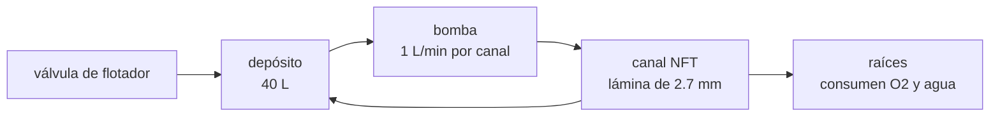

# B115-C01 — Cultivos hidropónicos para hábitats

<!-- nav:top -->
[🏠 Programa](../../../../README.md) · [📚 Bloque B115](../../../tronco-comun/B115-sistemas-bioregenerativos-y-cultivo-en-habitats.md) · [← Anterior: B114-C06 — Matriz de riesgo ambiental de un hábitat](../../B114/B114-C06-matriz-de-riesgo-ambiental-de-un-habitat/CLASE.md) · [Siguiente: B115-C02 — Iluminación de cultivos con LED y espectro de crecimiento →](../B115-C02-iluminacion-de-cultivos-con-led-y-espectro-de-crecimiento/CLASE.md)
<!-- /nav -->

## 1. Ubicación, nivel y alcance

Clase 1 del bloque B115. Nivel N3. En un hábitat cerrado no hay suelo que reponer ni lluvia que regar: las raíces reciben agua y nutrientes por un circuito controlado. Aquí dimensionas un **canal de película de nutrientes (NFT)** sintético: la profundidad de la lámina, su velocidad, el oxígeno que llevan las raíces y el balance de agua del depósito. Lo que cambia respecto de [B106](../../../tronco-comun/B106-habitats-espaciales-y-soporte-vital.md) es el enfoque: allí el cultivo aparece como parte del soporte vital; aquí se diseña el sistema de raíz.

## 2. Por qué esta clase existe

Un cultivo sin suelo depende por completo de que el caudal, el oxígeno y el nivel del depósito no fallen. La decisión central: **¿qué caudal y qué volumen hacen falta para que las raíces reciban oxígeno y agua sin que el sistema se vacíe o se inunde, y cómo se comprueba?**

## 3. Lo que podrás hacer al terminar

1. Calcular la profundidad y la velocidad de una película de nutrientes con la ecuación de Manning.
2. Comprobar el régimen (número de Froude) y el tiempo de residencia en un canal.
3. Estimar el oxígeno disuelto de entrada y la caída producida por la respiración de las raíces.
4. Cerrar el balance de agua de un depósito con válvula de reposición.
5. Reconocer por qué la microgravedad cambia el diseño (capilaridad, aireación).
6. Rotular qué es sintético, qué es consultado y qué no se consultó.

La evidencia es la **ficha de dimensionamiento de un canal hidropónico** del ejercicio 12 (sección 20).

## 4. Con qué llegas y cómo comprobarlo

1. ¿Qué es un caudal y en qué unidades se da?
2. ¿Qué es el oxígeno disuelto?
3. ¿Qué es un balance de masa?
4. ¿Qué es un dato sintético?
5. ¿Qué es una verificación por segunda vía?

<details>
<summary>Ver respuestas</summary>

1. El volumen que pasa por unidad de tiempo (L/min, m³/s). 2. El oxígeno gaseoso disuelto en el agua, en mg/L. 3. Lo que entra menos lo que sale es lo que se acumula. 4. Un dato generado para el ejemplo, no medido. 5. Calcular lo mismo con otro método o contra una solución conocida y comparar.
</details>

Con cuatro o cinco aciertos, sigue; si no, repasa los prerrequisitos.

## 5. Un caso de contexto y casos de referencia

Un canal sintético de 0,10 m de ancho y 2,0 m de largo, con 1 % de pendiente, lleva 1,0 L/min con 12 plantas. La lámina mide **2,68 mm**, corre a 6,21 cm/s con Froude 0,383 y tarda 32,2 s en recorrerlo. El oxígeno de entrada a 22 °C es 8,67 mg/L y las raíces lo bajan 1,20 mg/L. Es el **ejemplo conductor**: todo es **sintético o ilustrativo** y no describe ningún hardware.

Caso de referencia consultado: Monje y colaboradores (2019, NASA) compararon sistemas de agua para lechuga a 300 µmol m⁻² s⁻¹, 3000 µmol mol⁻¹ de CO₂, 40 % de humedad y 23 °C: el NFT dio en promedio 78 g por planta (n = 3) y los otros sistemas entre el 34 % y el 51 % de esa cifra.

## 6. Vocabulario

La **hidroponía** cultiva con las raíces en solución acuosa o en un sustrato inerte. En una **película de nutrientes (NFT)** una lámina delgada y recirculante moja las raíces en un canal inclinado. La **ecuación de Manning** relaciona caudal, geometría, pendiente y rugosidad. El **número de Froude** `Fr = v/√(g h)` distingue flujo lento (`Fr < 1`) de rápido. El **oxígeno disuelto (DO)** es el que pueden respirar las raíces. La **válvula de flotador** repone el nivel del depósito.

## 7. Modelo mental



*Descripción textual:* la bomba lleva la solución del depósito a la cabecera del canal; la lámina avanza por gravedad, las raíces toman oxígeno y agua y el sobrante vuelve al depósito, donde una válvula repone el agua transpirada.

Analogía: un canal NFT es un arroyo diminuto bajo un seto de raíces. Límite: un arroyo real tiene rugosidad variable; las raíces crecen y estrechan la lámina con el tiempo, lo que este modelo de rugosidad constante no recoge.

## 8. La explicación, paso a paso

### 8.1 Profundidad de la lámina

Con el canal ancho y rectangular, `Q = (1/n)·A·R^(2/3)·√S`, donde `A = w h`, `R = w h/(w + 2h)`, `S` es la pendiente y `n` la rugosidad de Manning. Para `Q = 1,0 L/min = 1,667×10⁻⁵ m³/s`, `n = 0,030 s m⁻¹ᐟ³` (ilustrativo: canal con raíces y esterilla), `S = 0,01` y `w = 0,10 m`, la biseccion da `h = 2,682 mm`. El laboratorio reconstruye el caudal con ese `h` y el error relativo es de 10⁻¹⁶.

### 8.2 Velocidad, régimen y residencia

`v = Q/A = 6,21 cm/s`, `Fr = v/√(g h) = 0,383`: flujo lento, sin salto hidráulico. `t = L/v = 32,2 s` y el canal retiene `A·L = 536 mL` de solución. Con `n = 0,012` (plástico liso) el mismo canal daría `Fr = 1,21` con 2 % de pendiente (ejecución exploratoria que no forma parte del script): la rugosidad y la pendiente mandan sobre el régimen.

### 8.3 Oxígeno disuelto

La saturación en agua dulce a nivel del mar sigue una relación empírica de la temperatura (no consultada, la verifica el laboratorio): 9,40 mg/L a 18 °C, 8,67 a 22 y 7,44 a 30. Con 12 plantas que respiran 6 mg O₂/h cada una (sintético) y 60 L/h de caudal, la caída es `72/60 = 1,20 mg/L`. La ley de Henry escala la saturación con la presión parcial de O₂: con 70,3 kPa y 26,5 % de O₂ (**ilustrativo**) el factor es `0,880` y la saturación a 22 °C baja a 7,62 mg/L.

### 8.4 Balance de agua del depósito

Seis canales de 12 plantas a 0,12 L/día por planta consumen 8,64 L/día. Sin reposición, un depósito de 40 L se vaciaría en 4,6 días (el valor «−20,48 L» a los 7 días es el déficit acumulado, no un volumen real). Con la válvula de flotador el nivel oscila entre 39,10 y 40,00 L. La simulación numérica coincide con la solución analítica `V₀ − N·u·t` (error 10⁻¹⁵).

### 8.5 Qué cambia sin gravedad

Monje y colaboradores (2019) señalan que en microgravedad la redistribución capilar de la humedad produce mala aireación de la zona radicular y que la falta de convección natural empeora la transferencia de masa y calor. Una lámina que baja «por gravedad» no existe allí: los sistemas espaciales usan membranas porosas, succión o sustratos controlados, y su productividad fue, en esa comparación, entre el 34 % y el 51 % de la del NFT terrestre.

## 9. Magnitudes, símbolos y unidades

| Símbolo | Qué es | Unidad | Valor / nota |
|---|---|---|---|
| `Q` | caudal por canal | L/min | 1,0 (sintético) |
| `w`, `L`, `S` | ancho, largo y pendiente del canal | m, m, m/m | 0,10; 2,0; 0,01 |
| `n` | rugosidad de Manning | s m⁻¹ᐟ³ | 0,030 (ilustrativo) |
| `h`, `v` | profundidad y velocidad de la lámina | mm, cm/s | 2,682 y 6,21 |
| `Fr` | número de Froude | — | 0,383 |
| DO | oxígeno disuelto | mg/L | 8,67 (22 °C), caída 1,20 |
| `V` | volumen del depósito | L | 40 |

## 10. Convenciones y referencias

Canal rectangular de fondo plano, flujo uniforme y estacionario, gravedad de la Tierra (9,81 m/s²), agua pura a la temperatura indicada. Unidades SI más L, min y mg/L. Datos sintéticos sin semilla aleatoria (el laboratorio es determinista). Tolerancias: caudal reconstruido dentro de 10⁻⁶ en términos relativos, depósito dentro del 1 % del analítico, `Fr < 1`, saturación de O₂ a 22 °C entre 8,5 y 9,1 mg/L. Numpy 2.4.4, Python 3.12.9.

## 11. De dónde sale lo que afirmamos

| ID | Fuente | Localizador | Respalda | Estado |
|---|---|---|---|---|
| S1 | Monje, O., Nugent, M. R., Hummerick, M. E., Dreschel, T. W., Spencer, L. E., Romeyn, M. W., Massa, G. D., Wheeler, R. M., Fritsche, R. F., «New Frontiers in Food Production Beyond LEO», ICES-2019-260 — NTRS 20190027339, https://ntrs.nasa.gov/api/citations/20190027339/downloads/20190027339.pdf (consultada 2026-11-10, PDF con PyMuPDF) | sección III y figura 1 | NFT de 78 g por planta; productividad del APH, On-Demand y PTNDS de 51 %, 39 % y 34 % del NFT; efectos indirectos de la microgravedad (aireación y convección) | Consultada |
| — | Manning, Froude, saturación empírica de O₂, ley de Henry | — | las verifica el laboratorio | No consultada en una fuente concreta (las verifica el laboratorio) |

Límites: de S1 se usan las cifras citadas; el resto del documento no se reproduce. El coeficiente de rugosidad y la respiración de las raíces son valores sintéticos, no datos de un sistema real.

## 12. Cómo ver el resultado

| Magnitud | Valor |
|---|---|
| Profundidad / velocidad | 2,682 mm / 6,21 cm/s |
| Froude / residencia | 0,383 / 32,2 s |
| Volumen retenido | 536 mL |
| DO de salida a 18 / 22 / 26 / 30 °C | 8,20 / 7,47 / 6,82 / 6,24 mg/L |
| Factor de Henry (70,3 kPa, 26,5 % O₂) | 0,880 |
| Consumo del depósito | 8,64 L/día; se vacía en 4,6 días |

Descripción larga: la lámina es delgada y lenta; el oxígeno disponible baja con la temperatura y con una atmósfera menos rica; y el depósito necesita reposición continua.

## 13. Ejemplo trabajado: oxígeno que sale del canal

**Paso 1 · Saturación.** A 26 °C, `14,652 − 0,41022·26 + 0,007991·26² − 0,000077774·26³ = 8,02 mg/L`.

**Paso 2 · Consumo.** `12·6 = 72 mg/h`.

**Paso 3 · Caudal en L/h.** `1,0 L/min = 60 L/h`.

**Paso 4 · Salida.** `8,02 − 72/60 = 6,82 mg/L`. Si el umbral de diseño ilustrativo fuera 5 mg/L, quedarían 1,82 mg/L de margen.

## 14. Distintas formas de describir el problema

**Por hidráulica:** `h`, `v`, `Fr`. **Por tiempo:** residencia de 32,2 s. **Por oxígeno:** saturación menos consumo. **Por masa:** `entra = sale + transpira`. **Por riesgo:** minutos hasta que el depósito se vacía si falla la válvula.

## 15. Práctica guiada

**Ejercicio 1 · con los pasos indicados.** Calcula la velocidad de la lámina si `Q = 1,0 L/min` y `h = 2,682 mm`, `w = 0,10 m`. *Pasos:* convierte el caudal a m³/s, calcula el área y divide.

<details><summary>Solución comentada</summary>

`Q = 1,667×10⁻⁵ m³/s`, `A = 0,10·0,002682 = 2,682×10⁻⁴ m²`, `v = 0,0621 m/s = 6,21 cm/s`.
</details>

**Ejercicio 2 · con una pista.** Calcula el tiempo de residencia en 2,0 m. *Pista:* `t = L/v`.

<details><summary>Solución comentada</summary>

`2,0/0,0621 = 32,2 s`.
</details>

**Ejercicio 3 · casi autónomo.** Calcula la caída de oxígeno con 12 plantas de 6 mg/h y 1,0 L/min.

<details><summary>Solución comentada</summary>

`72 mg/h ÷ 60 L/h = 1,20 mg/L`.
</details>

## 16. Práctica autónoma, transferencia e integrador

**Ejercicio 4 · autónomo.** Calcula el número de Froude con `v = 6,21 cm/s` y `h = 2,682 mm`.

<details><summary>Solución comentada</summary>

`√(9,81·0,002682) = 0,1622 m/s`; `Fr = 0,0621/0,1622 = 0,383`. Es flujo lento.
</details>

**Ejercicio 5 · autónomo.** Calcula el factor de Henry para 70,3 kPa y 26,5 % de O₂ respecto del aire a 101,325 kPa y 20,9 %.

<details><summary>Solución comentada</summary>

`(70,3·0,265)/(101,325·0,209) = 18,63/21,18 = 0,880`.
</details>

**Ejercicio 6 · autónomo.** ¿En cuántos días se vacía un depósito de 40 L que pierde 8,64 L/día?

<details><summary>Solución comentada</summary>

`40/8,64 = 4,63 días`.
</details>

**Ejercicio 7 · autónomo.** Con 78 g por planta en NFT, ¿qué cantidad corresponde al 51 %, 39 % y 34 %?

<details><summary>Solución comentada</summary>

`39,8 g`, `30,4 g` y `26,5 g`. Son cifras de un experimento puntual con n = 3 y condiciones específicas, no leyes.
</details>

**Ejercicio 8 · autónomo.** Si se duplica el caudal a 2 L/min, ¿cómo cambia aproximadamente la profundidad? *Pista:* para un canal ancho `h ∝ Q^(3/5)`.

<details><summary>Solución comentada</summary>

`2^0,6 = 1,516`: unos 4,07 mm (aproximación de canal ancho; el valor exacto difiere algo porque el canal tiene 0,10 m de ancho). La velocidad crece `2^0,4 = 1,32` veces y la residencia baja a unos 24 s.
</details>

**Ejercicio 9 · transferencia.** Un canal igual se instala en un hábitat lunar con `g = 1,62 m/s²`. ¿Qué esperas del flujo y por qué no basta con escalar?

<details><summary>Solución comentada</summary>

La fuerza motriz por unidad de masa es `g·S`, de modo que la velocidad baja aproximadamente como `√(g/g₀)` (≈ 0,41 veces, unos 2,5 cm/s) y la lámina engruesa. Pero con láminas de milímetros la tensión superficial importa más que en la Tierra; este laboratorio no la incluye, así que el resultado solo es una cota inicial.
</details>

**Ejercicio 10 · transferencia.** A 30 °C con la atmósfera ilustrativa de 70,3 kPa y 26,5 % de O₂, ¿cuánto oxígeno llega al final del canal y cómo se compara con un umbral de diseño ilustrativo de 5 mg/L?

<details><summary>Solución comentada</summary>

`7,44·0,880 = 6,55 mg/L` de saturación; menos 1,20 da `5,35 mg/L`: 0,35 mg/L sobre el umbral. El margen es mínimo: con más plantas por canal se cruza.
</details>

**Ejercicio 11 · transferencia.** La válvula repone cuando el nivel baja 1 L, pero el nivel mínimo simulado es 39,10 L y no 39,00 L. ¿Por qué?

<details><summary>Solución comentada</summary>

La simulación avanza de 0,5 h en 0,5 h y consume 0,18 L por paso: 39,28 → 39,10 → 38,92, y al detectar `< 39` repone a 40. El mínimo registrado tras reponer es 39,10; un paso más fino se acercaría a 39,00. Es un efecto de la discretización.
</details>

**Ejercicio 12 · integrador.** Elabora tu *ficha de dimensionamiento de un canal hidropónico*: geometría, caudal, profundidad, velocidad, Froude, residencia, oxígeno de entrada y de salida, balance de agua del depósito y lista de qué es sintético, qué es consultado y qué no se consultó.

<details><summary>Solución comentada</summary>

Secciones 8.1–8.5 y la salida del laboratorio.
</details>

## 17. Laboratorio: canal NFT y depósito

El script [hidroponia.py](hidroponia.py) calcula la lámina por Manning, el régimen, el oxígeno y el balance del depósito (**comprueba** el caudal reconstruido, `Fr < 1`, la saturación a 22 °C y la coincidencia del depósito con la solución analítica). Tarda menos de un segundo.

**Datos:** todo **sintético o ilustrativo**; ninguna cifra describe un hardware. **Predice antes de ejecutar:** ¿será la lámina de milímetros o de centímetros? (De milímetros.) **Ejecución del 2026-11-10 (Python 3.12.9):**

```text
Python 3.12.9; numpy 2.4.4
DATOS SINTETICOS/ILUSTRATIVOS: canal 0.10 m x 2.0 m, pendiente 1 %, n de Manning 0.030, 1.0 L/min
Profundidad de pelicula h = 2.682 mm; velocidad = 6.21 cm/s; Froude = 0.383
Tiempo de residencia = 32.2 s; volumen retenido en el canal = 536.4 mL
Comprobacion: caudal reconstruido, error relativo = 0.00e+00
Oxigeno disuelto en la entrada (saturacion empirica, nivel del mar, aire 20.9 % O2)
   T[C]   DOsat[mg/L]   caida con 12 plantas a 6 mg/h  DOsal[mg/L]
    18         9.40                         1.20           8.20
    22         8.67                         1.20           7.47
    26         8.02                         1.20           6.82
    30         7.44                         1.20           6.24
Efecto de la atmosfera del habitat sobre la saturacion (ley de Henry, T = 22 C)
   aire a 101.3 kPa, 20.9 % O2        factor = 1.000  DOsat = 8.67 mg/L
   ilustrativo 70.3 kPa, 26.5 % O2    factor = 0.880  DOsat = 7.62 mg/L
Deposito de 40 L con 6 canales x 12 plantas, 0.12 L/dia/planta (sintetico), 7 dias
   Consumo = 8.64 L/dia; sin reposicion V(7 d) = -20.48 L (analitico -20.48 L, error 2.0e-15)
   Con valvula: V minimo = 39.10 L, V maximo = 40.00 L; sin reposicion se vacia en 4.6 dias
Pruebas superadas.
```

```bash
python programa/clases/B115/B115-C01-cultivos-hidroponicos-para-habitats/hidroponia.py
```

**Límites:** flujo uniforme, canal rectangular, rugosidad constante, sin tensión superficial ni crecimiento de raíces; la saturación de O₂ es una relación empírica no consultada. No es un diseño de un sistema real.

## 18. Errores frecuentes y cómo corregirlos

**Elegir la rugosidad sin pensar en las raíces.** Con `n = 0,012` y 2 % de pendiente el régimen salía rápido (`Fr = 1,21`). Se corrige con 8.2.

**Olvidar que la saturación baja con la temperatura y con la presión parcial de O₂.** Se corrige con 8.3 y el ejercicio 10.

**Leer el déficit de un depósito como un volumen negativo.** Se corrige con 8.4.

**Presentar el modelo como un sistema probado en vuelo.** Se corrige con la sección 10.

## 19. Cómo sabrás que vas bien

Tras la sección 8: ¿qué `Fr` esperabas y cuál obtuviste? Si dudas, repasa el ejemplo 13. Tras el laboratorio: ¿qué comprueba? (ver la sección 17).

## 20. Qué entregas y cómo se evalúa

El producto es tu **ficha de dimensionamiento de un canal hidropónico** (ejercicio 12).

| Criterio | Inicial | En desarrollo | Logrado | Destacado |
|---|---|---|---|---|
| Conceptos | Confunde caudal y velocidad | Parciales | Explica lámina, Froude y oxígeno | Explica qué cambia sin gravedad |
| Cálculo | Sin unidades | Con errores | Calcula `h`, `v`, residencia y DO con unidades | Calcula casos nuevos |
| Numérico | Sin comprobar | Un caso | Compara con el analítico y el caudal reconstruido | Interpreta la discretización |
| Fuentes | Sin fuente | Sin fecha | Fuentes con fecha y estado | Declara lo sintético y lo no consultado |
| Límites | No los nombra | Uno | Tres | Discute qué falta del modelo |

**Condiciones críticas (no se compensan con promedio):** rotular los datos como sintéticos; no presentar el modelo como un sistema real; citar solo lo consultado.

## 21. Ética, seguridad y límites

Clase educativa: **no da consejo operativo ni sanitario**. Los datos son sintéticos y el modelo es mínimo; ningún resultado sustituye al diseño, el ensayo y la revisión de un sistema de cultivo de una misión. Accesibilidad: tablas equivalentes a las gráficas, fórmulas en texto, ejercicios sin conexión.

## 22. Para cerrar y seguir

Un canal NFT sintético tiene una lámina de 2,7 mm, 32 s de residencia y un margen de oxígeno que se estrecha con la temperatura; el depósito exige reposición continua. Queda una pregunta: ¿qué luz necesitan esas plantas y cuánto cuesta en energía?

**Glosario español–inglés.** película de nutrientes · *nutrient film technique (NFT)*; oxígeno disuelto · *dissolved oxygen*; válvula de flotador · *float valve*; tiempo de residencia · *residence time*; número de Froude · *Froude number*.

**Continuidad.** [B115-C02](../B115-C02-iluminacion-de-cultivos-con-led-y-espectro-de-crecimiento/CLASE.md) calcula los fotones, la energía y el calor de la iluminación.

**Referencias:** ver sección 11.

<!-- nav:bottom -->
---

[← Anterior: B114-C06 — Matriz de riesgo ambiental de un hábitat](../../B114/B114-C06-matriz-de-riesgo-ambiental-de-un-habitat/CLASE.md) · [📚 Bloque B115](../../../tronco-comun/B115-sistemas-bioregenerativos-y-cultivo-en-habitats.md) · [Siguiente: B115-C02 — Iluminación de cultivos con LED y espectro de crecimiento →](../B115-C02-iluminacion-de-cultivos-con-led-y-espectro-de-crecimiento/CLASE.md)
<!-- /nav -->
