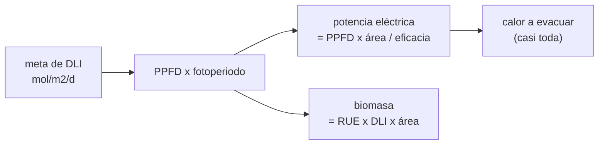

# B115-C02 — Iluminación de cultivos con LED y espectro de crecimiento

<!-- nav:top -->
[🏠 Programa](../../../../README.md) · [📚 Bloque B115](../../../tronco-comun/B115-sistemas-bioregenerativos-y-cultivo-en-habitats.md) · [← Anterior: B115-C01 — Cultivos hidropónicos para hábitats](../B115-C01-cultivos-hidroponicos-para-habitats/CLASE.md) · [Siguiente: B115-C03 — Control de nutrientes y solución nutritiva →](../B115-C03-control-de-nutrientes-y-solucion-nutritiva/CLASE.md)
<!-- /nav -->

## 1. Ubicación, nivel y alcance

Clase 2 del bloque B115. Nivel N3. Las plantas de un hábitat cerrado crecen con la luz que les damos: cuántos fotones, de qué color, durante cuántas horas y a qué coste eléctrico. Aquí conviertes una meta de luz en fotones, en potencia y en calor, y comparas espectros por su eficacia. Lo que cambia respecto de [B106](../../../tronco-comun/B106-habitats-espaciales-y-soporte-vital.md) es el receptor: allí la iluminación se diseña para la vista y el ritmo circadiano de las personas; aquí, para la fotosíntesis.

## 2. Por qué esta clase existe

La luz es el mayor consumo eléctrico de un cultivo cerrado. La decisión central: **¿cuántos fotones por metro cuadrado y día hacen falta, con qué eficacia se producen y qué potencia y calor suponen para el hábitat?**

## 3. Lo que podrás hacer al terminar

1. Calcular la integral diaria de luz (DLI) a partir del flujo de fotones y el fotoperiodo.
2. Calcular la energía de un mol de fotones de un color dado.
3. Combinar la eficacia de varios LED en una luminaria y compararla con valores publicados.
4. Calcular la potencia eléctrica, la energía diaria y el calor de un módulo.
5. Detectar una discrepancia entre una tabla publicada y su cálculo y explicarla.
6. Rotular qué es consultado, qué es ilustrativo y qué no se consultó.

La evidencia es la **ficha de iluminación con potencia eléctrica** del ejercicio 12 (sección 20).

## 4. Con qué llegas y cómo comprobarlo

1. ¿Qué es un mol de fotones?
2. ¿Qué es una potencia y en qué unidad se mide?
3. ¿Qué relaciona la energía de un fotón con su longitud de onda?
4. ¿Qué es un dato sintético?
5. ¿Qué es una verificación por segunda vía?

<details>
<summary>Ver respuestas</summary>

1. Un número de Avogadro de fotones (6,022×10²³). 2. Energía por unidad de tiempo; vatio (W = J/s). 3. `E = h c/λ`: cuanto más corta la longitud de onda, más energía. 4. Un dato generado para el ejemplo, no medido. 5. Calcular lo mismo con otro método o contra una cifra publicada y comparar.
</details>

Con cuatro o cinco aciertos, sigue; si no, repasa los prerrequisitos.

## 5. Un caso de contexto y casos de referencia

Una luminaria que cubre 1 m² con un flujo de 500 µmol m⁻² s⁻¹ durante 16 h entrega una DLI de **28,8 mol m⁻² d⁻¹**. Con una eficacia de luminaria de 3,4 µmol/J consume 147 W por metro cuadrado y 2,35 kWh/m² al día. Es el **ejemplo conductor**; los números de eficacia y de luz proceden de fuentes consultadas y el rendimiento de la planta es ilustrativo.

Casos de referencia consultados: Khodadad y colaboradores (2020) describen la luz de Veggie en la ISS: unos 200 µmol m⁻² s⁻¹ en la superficie de las almohadillas, con una proporción de LED de 12 rojos (630 nm), 3 azules (455 nm) y 1 verde (530 nm) y 16 h de luz y 8 de oscuridad. Wheeler (NASA/KSC) tabula el área necesaria para el oxígeno de una persona: con 500 µmol m⁻² s⁻¹ y una eficiencia de uso de la radiación de 0,75 g/mol, 31,5 m².

## 6. Vocabulario

El **flujo de fotones fotosintéticos (PPFD)** cuenta los fotones de 400–700 nm que llegan a una superficie (µmol m⁻² s⁻¹). La **integral diaria de luz (DLI)** es su suma en un día (mol m⁻² d⁻¹). El **fotoperiodo** son las horas de luz por día. La **eficacia fotónica** son los micromoles de fotones por julio eléctrico (µmol/J). La **eficiencia de uso de la radiación (RUE)** son los gramos de biomasa por mol de fotones. La **luminaria** es el conjunto de LED, controlador y óptica.

## 7. Modelo mental



*Descripción textual:* la meta de luz fija el flujo y las horas; el flujo y el área dan, con la eficacia, la potencia eléctrica; casi toda esa potencia acaba como calor; y una fracción pequeña se guarda como biomasa.

Analogía: una luminaria de cultivo es un grifo de fotones: el caudal es el PPFD y el recibo de la luz depende de lo eficiente que sea el grifo. Límite: los fotones no se acumulan en un depósito; la planta los aprovecha en el instante, y a partir de cierta intensidad la respuesta se satura.

## 8. La explicación, paso a paso

### 8.1 De flujo a integral diaria

`DLI = PPFD·t·3600/10⁶` con `t` en horas. Con 500 µmol m⁻² s⁻¹ y 16 h: `28,80 mol m⁻² d⁻¹`, igual a la fila de la tabla de Wheeler (28,8). Con 200 µmol m⁻² s⁻¹ (Veggie según Khodadad) y 16 h: `11,52 mol m⁻² d⁻¹`.

### 8.2 Energía de un fotón según su color

`E = N_A h c/λ`: 262,9 kJ/mol a 455 nm (azul), 225,7 a 530 nm (verde), 189,9 a 630 nm (rojo) y 163,9 a 730 nm (rojo lejano). Un mol de fotones azules cuesta un 38 % más de energía que uno de rojos: por eso, a igual número de fotones, el rojo es más barato de producir.

### 8.3 Eficacia de una mezcla

Si una fracción `f_i` de los fotones viene de un LED con eficacia `η_i`, la eficacia de la mezcla es `1/Σ(f_i/η_i)`, un promedio armónico: los fotones caros pesan más. Con las eficacias de paquete de Kusuma y colaboradores (rojo 4,5, azul 3,5 y blanco 2,9 µmol/J): 90 % rojo + 10 % azul da 4,375; 100 % blanco, 2,900; 50 % rojo + 50 % blanco, 3,527. Las luminarias publicadas por esos autores son 4,1, 2,7 y 3,4, es decir, entre el 93 % y el 96 % de la eficacia del paquete: el resto se pierde por caída de corriente y térmica, el controlador y la óptica. El laboratorio comprueba que el cociente está entre 0,90 y 1,00.

### 8.4 Potencia, energía y calor

La potencia eléctrica es `P = PPFD·A/η`. A 500 µmol m⁻² s⁻¹ y 3,4 µmol/J: 147,1 W/m² y 2,35 kWh/m² al día con 16 h. La energía radiante de la luz PAR es 102,2 W/m² (el 70 % de la eléctrica, con la mezcla 12:3 de energía media por mol). Con una RUE de 0,75 g/mol y 15,6 kJ por gramo de biomasa (CH₂O, ilustrativo) solo se guarda el 5,7 % de la energía de los fotones: **casi toda la potencia eléctrica acaba como calor** que el hábitat debe evacuar.

### 8.5 La tabla de Wheeler y su discrepancia

La tabla da 31,5 m² por persona para su oxígeno (830 g/día, supuesto de la propia tabla, con RUE 0,75, PPF 500 y 16 h). La biomasa implícita es `31,5·0,75·28,8 = 680 g/d`, es decir, 26,2 g de biomasa por mol de O₂; si toda la biomasa fuera CH₂O (30 g/mol) saldrían 778 g/d y 36,0 m². La diferencia (14 %) viene de la composición de la biomasa y del cociente de asimilación, que la diapositiva no detalla; el laboratorio la señala sin resolverla. Con 3,4 µmol/J, el módulo de 31,5 m² exige **4,63 kW** mientras la luz está encendida (74,1 kWh/día). Con 2,0 µmol/J serían 7,88 kW y con 4,1 µmol/J, 3,84 kW.

## 9. Magnitudes, símbolos y unidades

| Símbolo | Qué es | Unidad | Valor / nota |
|---|---|---|---|
| PPFD | flujo de fotones fotosintéticos | µmol m⁻² s⁻¹ | 200 (Veggie) y 500 (Wheeler) |
| DLI | integral diaria de luz | mol m⁻² d⁻¹ | 11,52 y 28,8 |
| `η` | eficacia fotónica | µmol/J | 4,5 rojo, 3,5 azul, 2,9 blanco (paquete) |
| `E` | energía de un mol de fotones | kJ/mol | 189,9 a 630 nm |
| RUE | eficiencia de uso de la radiación | g/mol | 0,75 (tabla de Wheeler) |
| `P` | potencia eléctrica de la luminaria | W | 147,1 W/m² con 500 µmol y 3,4 µmol/J |

## 10. Convenciones y referencias

PAR entre 400 y 700 nm. Eficacias de paquete a 25 °C de unión y las de luminaria como publica Kusuma y colaboradores. Se supone que la mezcla 12:3 de LED de Veggie se expresa en fotones (la fuente da la proporción de LED, no de fotones: **supuesto propio**). Constantes SI exactas (`N_A`, `h`, `c`). El laboratorio es determinista. Tolerancias: DLI de 500 µmol y 16 h igual a 28,8 y cociente luminaria/paquete entre 0,90 y 1,00. Numpy 2.4.4, Python 3.12.9.

## 11. De dónde sale lo que afirmamos

| ID | Fuente | Localizador | Respalda | Estado |
|---|---|---|---|---|
| S1 | Kusuma, P., Pattison, P. M., Bugbee, B., «From physics to fixtures to food: current and potential LED efficacy», *Horticulture Research* 7:56 (2020) — https://www.nature.com/articles/s41438-020-0283-7 (consultada 2026-11-10) | texto de la página: resumen, tabla 1 y conclusiones | eficacias de paquete rojo 4,5, azul 3,5 y blanco 2,9 µmol/J; luminarias de 3,4 (blanco + rojo), 4,1 (azul + rojo) y 2,7 µmol/J (blanco); valores típicos de 2–3 µmol/J; caída térmica de ~10 % entre 25 y 85 °C | Consultada |
| S2 | Khodadad, C. L. M. et al., «Microbiological and Nutritional Analysis of Lettuce Crops Grown on the International Space Station», *Frontiers in Plant Science* 11:199 (2020) — https://www.frontiersin.org/articles/10.3389/fpls.2020.00199 (consultada 2026-11-10, PDF con PyMuPDF) | sección de métodos | ~200 µmol m⁻² s⁻¹, 12:3:1 (630/455/530 nm), 16 h de luz | Consultada |
| S3 | Wheeler, R. M., «Development of Bioregenerative Life Support for Longer Missions: When Can Plants Begin to Contribute to Atmospheric Management?», diapositivas NASA/KSC — NTRS 20150022488, https://ntrs.nasa.gov/api/citations/20150022488/downloads/20150022488.pdf (consultada 2026-11-10, PDF con PyMuPDF) | tabla «Area Per Person for O2» y diapositiva de cámaras | 31,5 m² por persona con RUE 0,75 y PPF 500; 830 g de O₂ por persona y día (NASA SPP 30262, según la diapositiva); 210 cámaras Veggie de 0,15 m² | Consultada |
| — | Eficacia del LED verde, curva de acción de la fotosíntesis, energía de CH₂O | — | — | No consultada en una fuente concreta (el verde solo apareció en un resumen secundario; la energía de la biomasa es un valor ilustrativo) |

Límites: de S1 no se reproducen tablas; de S3 solo la fila citada. Las cifras de Wheeler son una diapositiva, no el artículo de 2008 (Adv. Space Res. 41:706–713), que **no se consultó**.

## 12. Cómo ver el resultado

| Magnitud | Valor |
|---|---|
| DLI con 500 / 200 µmol m⁻² s⁻¹ (16 h) | 28,80 / 11,52 mol m⁻² d⁻¹ |
| Eficacia de mezcla de paquete (90R+10A / blanco / 50R+50B) | 4,375 / 2,900 / 3,527 µmol/J |
| Cociente luminaria/paquete | 0,937 / 0,931 / 0,964 |
| Potencia a 500 µmol (3,4 µmol/J) | 147,1 W/m²; 2,35 kWh/m²/d |
| Fracción de la PAR guardada en biomasa | 5,7 % |
| Módulo de 31,5 m² | 4,63 kW; 74,1 kWh/d |

Descripción larga: la eficacia de la luminaria fija la potencia; casi toda la potencia sale como calor; la tabla publicada y su cálculo difieren un 14 % por la composición de la biomasa.

## 13. Ejemplo trabajado: potencia de 1 m² a 300 µmol m⁻² s⁻¹

**Paso 1 · DLI.** Con 18 h: `300·18·3600/10⁶ = 19,44 mol m⁻² d⁻¹`.

**Paso 2 · Potencia.** `300/3,4 = 88,2 W`.

**Paso 3 · Energía diaria.** `88,2·18/1000 = 1,59 kWh`.

**Paso 4 · Lectura.** Casi toda esa energía será calor en el hábitat.

## 14. Distintas formas de describir el problema

**Por fotones:** PPFD y DLI. **Por energía:** `E = h c/λ`. **Por eficacia:** promedio armónico de los LED. **Por potencia:** `PPFD·A/η`. **Por calor:** la potencia menos lo guardado en biomasa. **Por área:** `biomasa/(RUE·DLI)`.

## 15. Práctica guiada

**Ejercicio 1 · con los pasos indicados.** Calcula la DLI de 300 µmol m⁻² s⁻¹ durante 18 h. *Pasos:* multiplica por las horas, por 3600 y divide por 10⁶.

<details><summary>Solución comentada</summary>

`300·18·3600/10⁶ = 19,44 mol m⁻² d⁻¹`.
</details>

**Ejercicio 2 · con una pista.** ¿Cuánta energía tiene un fotón de 630 nm? *Pista:* `E = h c/λ`, con `h c = 1,98645×10⁻²⁵ J m`.

<details><summary>Solución comentada</summary>

`1,98645×10⁻²⁵/630×10⁻⁹ = 3,153×10⁻¹⁹ J`, que por `N_A` da 189,9 kJ/mol.
</details>

**Ejercicio 3 · casi autónomo.** Calcula la potencia eléctrica de 1 m² a 300 µmol m⁻² s⁻¹ y 3,4 µmol/J.

<details><summary>Solución comentada</summary>

`300/3,4 = 88,2 W`.
</details>

## 16. Práctica autónoma, transferencia e integrador

**Ejercicio 4 · autónomo.** Calcula la eficacia de una mezcla de 50 % de fotones rojos (4,5 µmol/J) y 50 % blancos (2,9 µmol/J).

<details><summary>Solución comentada</summary>

`1/(0,5/4,5 + 0,5/2,9) = 1/(0,1111 + 0,1724) = 3,527 µmol/J`.
</details>

**Ejercicio 5 · autónomo.** ¿Qué fracción de la eficacia de paquete conserva la luminaria azul + roja (4,1 frente a 4,375)?

<details><summary>Solución comentada</summary>

`4,1/4,375 = 0,937`: se pierde el 6,3 % por caída de corriente, térmica, controlador y óptica.
</details>

**Ejercicio 6 · autónomo.** ¿Cuántas horas de luz hacen falta para una DLI ilustrativa de 17 mol m⁻² d⁻¹ con 300 µmol m⁻² s⁻¹?

<details><summary>Solución comentada</summary>

`17·10⁶/(300·3600) = 15,7 h`.
</details>

**Ejercicio 7 · autónomo.** ¿Cuántos m² darían el mismo oxígeno si la biomasa fuera CH₂O (778 g/d) con RUE 0,75 y DLI 28,8?

<details><summary>Solución comentada</summary>

`778/(0,75·28,8) = 36,0 m²`, un 14 % más que los 31,5 m² de la tabla.
</details>

**Ejercicio 8 · autónomo.** Comprueba que 210 cámaras Veggie de 0,15 m² equivalen a los 31,5 m² de la tabla.

<details><summary>Solución comentada</summary>

`210·0,15 = 31,5 m²`: la diapositiva es coherente consigo misma.
</details>

**Ejercicio 9 · transferencia.** Si la luminaria del módulo de 31,5 m² pasara de 3,4 a 2,0 µmol/J, ¿cuánto crece la potencia y el calor?

<details><summary>Solución comentada</summary>

De 4,63 a 7,88 kW, un 70 % más; el calor crece igual. La eficacia es la palanca más barata para reducir la carga térmica.
</details>

**Ejercicio 10 · transferencia.** Un hábitat dispone de 3 kW eléctricos para luz. ¿Cuántos metros cuadrados puede iluminar a 500 µmol m⁻² s⁻¹ con 3,4 µmol/J, y qué fracción de los 31,5 m² es?

<details><summary>Solución comentada</summary>

`3000/147,1 = 20,4 m²`, el 65 % de 31,5 m². Y habría que evacuar esos 3 kW de calor.
</details>

**Ejercicio 11 · transferencia.** En un hábitat lunar la noche dura unos 14 días terrestres. ¿Qué cambia en la ficha de iluminación?

<details><summary>Solución comentada</summary>

La potencia no cambia mientras la luz esté encendida, pero la energía debe venir de baterías, de otra fuente o de luz conducida; esta clase no trae datos de generación, así que no se puede cuantificar aquí. Es una pregunta de diseño, no una respuesta.
</details>

**Ejercicio 12 · integrador.** Elabora tu *ficha de iluminación con potencia eléctrica*: meta de DLI, PPFD y fotoperiodo, espectro y eficacia, potencia y energía diaria, calor a evacuar, comparación con la tabla de Wheeler y lista de qué es consultado, qué es ilustrativo y qué no se consultó.

<details><summary>Solución comentada</summary>

Secciones 8.1–8.5 y la salida del laboratorio.
</details>

## 17. Laboratorio: luz, potencia y calor

El script [iluminacion.py](iluminacion.py) calcula la energía por mol de fotones, la DLI, la eficacia de las mezclas frente a las luminarias publicadas, la potencia y el calor, y la discrepancia de la tabla de Wheeler (**comprueba** DLI = 28,8 y cociente luminaria/paquete entre 0,90 y 1,00). Tarda menos de un segundo.

**Datos:** eficacias y luz **consultadas** (S1–S3); rendimiento y fracción de energía **ilustrativos**. **Predice antes de ejecutar:** ¿qué fracción de la energía de la luz se guarda en biomasa: 5 %, 30 % o 70 %? (Cerca del 5 %.) **Ejecución del 2026-11-10 (Python 3.12.9):**

```text
Python 3.12.9; numpy 2.4.4
DATOS: eficacias de Kusuma et al. (2020), luz de Veggie de Khodadad et al. (2020), tabla de Wheeler (NASA/KSC)
Energia de un mol de fotones
   azul 455 nm            262.9 kJ/mol
   verde 530 nm           225.7 kJ/mol
   rojo 630 nm            189.9 kJ/mol
   rojo lejano 730 nm     163.9 kJ/mol
DLI con 500 umol/m2/s y 16 h = 28.80 mol/m2/d (tabla de Wheeler: 28.8)
DLI con 200 umol/m2/s y 16 h = 11.52 mol/m2/d (Veggie segun Khodadad)
Eficacia de mezcla (paquete) frente a luminaria publicada
   90 % rojo + 10 % azul (fotones)    paquete = 4.375  luminaria Kusuma = 4.1  cociente = 0.937
   100 % blanco                       paquete = 2.900  luminaria Kusuma = 2.7  cociente = 0.931
   50 % rojo + 50 % blanco            paquete = 3.527  luminaria Kusuma = 3.4  cociente = 0.964
   Rojo:azul 12:3 (sin el verde, cuya eficacia no se verifico) paquete = 4.257 umol/J
Potencia electrica y calor para 1 m2 con PPFD de 200 y de 500 umol/m2/s (eficacia de luminaria 3.4 umol/J)
   PPFD 200: potencia electrica =   58.8 W/m2; PAR radiante =  40.9 W/m2 (70 % de la electrica); energia = 0.94 kWh/m2/d; fraccion de la PAR guardada en biomasa = 5.7 %
   PPFD 500: potencia electrica =  147.1 W/m2; PAR radiante = 102.2 W/m2 (70 % de la electrica); energia = 2.35 kWh/m2/d; fraccion de la PAR guardada en biomasa = 5.7 %
   El resto (casi toda la potencia electrica) acaba como calor que el habitat debe evacuar.
Area y potencia para el oxigeno de una persona (tabla de Wheeler: 31.5 m2 con RUE 0.75, PPF 500, 16 h)
   Potencia de luminaria con 3.4 umol/J = 4.63 kW mientras esta encendida; 74.1 kWh/dia
   Biomasa implicita en la tabla = 680 g/d = 26.2 g por mol de O2; con CH2O (30 g/mol) serian 778 g/d
Sensibilidad: efecto de la eficacia en la potencia del modulo de 31.5 m2
   eficacia 2.0 umol/J ->   7.88 kW
   eficacia 3.0 umol/J ->   5.25 kW
   eficacia 3.4 umol/J ->   4.63 kW
   eficacia 4.1 umol/J ->   3.84 kW
Pruebas superadas.
```

```bash
python programa/clases/B115/B115-C02-iluminacion-de-cultivos-con-led-y-espectro-de-crecimiento/iluminacion.py
```

**Límites:** no hay respuesta espectral de la planta ni saturación, la mezcla 12:3 se supone en fotones, el LED verde no se calcula, la energía de la biomasa es ilustrativa y no se incluye el calor de las fuentes de alimentación fuera del hábitat. No es un diseño de iluminación real.

## 18. Errores frecuentes y cómo corregirlos

**Confundir lúmenes con fotones fotosintéticos.** Los lúmenes pesan por la visión humana; el cultivo cuenta fotones. Se corrige con 8.1.

**Promediar eficacias con media aritmética.** Se usa el promedio armónico (8.3).

**Olvidar el calor.** Más del 95 % de la potencia eléctrica acaba como calor (8.4).

**Fiarse de una tabla sin recalcularla.** Se corrige con 8.5.

## 19. Cómo sabrás que vas bien

Tras la sección 8: ¿qué potencia esperabas y cuál obtuviste? Si dudas, repasa el ejemplo 13. Tras el laboratorio: ¿qué comprueba? (ver la sección 17).

## 20. Qué entregas y cómo se evalúa

El producto es tu **ficha de iluminación con potencia eléctrica** (ejercicio 12).

| Criterio | Inicial | En desarrollo | Logrado | Destacado |
|---|---|---|---|---|
| Conceptos | Confunde PPFD y DLI | Parciales | Explica DLI, eficacia y calor | Explica la discrepancia de la tabla |
| Cálculo | Sin unidades | Con errores | Calcula DLI, mezcla y potencia con unidades | Calcula casos nuevos |
| Numérico | Sin comprobar | Un caso | Compara con las luminarias publicadas | Interpreta las diferencias |
| Fuentes | Sin fuente | Sin fecha | Fuentes con fecha y estado | Declara lo ilustrativo y lo no consultado |
| Límites | No los nombra | Uno | Tres | Discute qué falta del modelo |

**Condiciones críticas (no se compensan con promedio):** rotular lo ilustrativo; no presentar el modelo como diseño real; citar solo lo consultado.

## 21. Ética, seguridad y límites

Clase educativa: **no da consejo operativo ni sanitario**. Las cifras son de ejemplo y de fuentes citadas; ningún resultado sustituye al diseño eléctrico y térmico de una misión. Accesibilidad: tablas equivalentes a las gráficas, fórmulas en texto, ejercicios sin conexión.

## 22. Para cerrar y seguir

Una luminaria de 3,4 µmol/J y 31,5 m² exige 4,6 kW y evacuar casi todo como calor; la tabla publicada que lo dimensiona difiere un 14 % de su recálculo con CH₂O. Queda una pregunta: ¿qué lleva el agua que riega esas raíces?

**Glosario español–inglés.** flujo de fotones fotosintéticos · *photosynthetic photon flux density (PPFD)*; integral diaria de luz · *daily light integral (DLI)*; eficacia fotónica · *photon efficacy*; fotoperiodo · *photoperiod*; luminaria · *fixture*.

**Continuidad.** [B115-C03](../B115-C03-control-de-nutrientes-y-solucion-nutritiva/CLASE.md) trata la solución nutritiva que moja las raíces.

**Referencias:** ver sección 11.

<!-- nav:bottom -->
---

[← Anterior: B115-C01 — Cultivos hidropónicos para hábitats](../B115-C01-cultivos-hidroponicos-para-habitats/CLASE.md) · [📚 Bloque B115](../../../tronco-comun/B115-sistemas-bioregenerativos-y-cultivo-en-habitats.md) · [Siguiente: B115-C03 — Control de nutrientes y solución nutritiva →](../B115-C03-control-de-nutrientes-y-solucion-nutritiva/CLASE.md)
<!-- /nav -->
