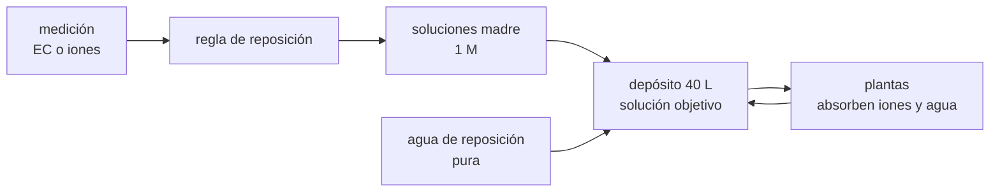

# B115-C03 — Control de nutrientes y solución nutritiva

<!-- nav:top -->
[🏠 Programa](../../../../README.md) · [📚 Bloque B115](../../../tronco-comun/B115-sistemas-bioregenerativos-y-cultivo-en-habitats.md) · [← Anterior: B115-C02 — Iluminación de cultivos con LED y espectro de crecimiento](../B115-C02-iluminacion-de-cultivos-con-led-y-espectro-de-crecimiento/CLASE.md) · [Siguiente: B115-C04 — Sistemas aeropónicos →](../B115-C04-sistemas-aeroponicos/CLASE.md)
<!-- /nav -->

## 1. Ubicación, nivel y alcance

Clase 3 del bloque B115. Nivel N3. En un cultivo sin suelo, la solución nutritiva es el suelo: cada ion que la planta necesita está disuelto en el agua que circula. Aquí preparas una receta clásica (la de Hoagland), compruebas que está equilibrada, calculas cuánto agotan las plantas en un circuito cerrado y comparas dos reglas de reposición. Lo que cambia respecto de [B106](../../../tronco-comun/B106-habitats-espaciales-y-soporte-vital.md) es el foco: allí importa el agua como recurso del hábitat; aquí, lo que lleva disuelto.

## 2. Por qué esta clase existe

Una solución nutritiva que se repone «por conductividad» puede parecer estable y estar desequilibrada. La decisión central: **¿qué se mide, cada cuánto y qué se repone para que cada ion se mantenga cerca de su objetivo, y cuándo conviene renovar la solución?**

## 3. Lo que podrás hacer al terminar

1. Convertir una receta en mM, en mg/L de elemento y en gramos de sal para un depósito.
2. Comprobar la electroneutralidad de una solución.
3. Verificar una solución de micronutrientes contra las concentraciones publicadas.
4. Simular el agotamiento de los iones en un circuito cerrado y compararlo con la solución analítica.
5. Comparar una regla de reposición por conductividad con una por ion.
6. Rotular qué es consultado, qué es sintético y qué es ilustrativo.

La evidencia es la **ficha de solución nutritiva con regla de reposición** del ejercicio 12 (sección 20).

## 4. Con qué llegas y cómo comprobarlo

1. ¿Qué es una concentración molar?
2. ¿Qué es un ion y qué carga tiene el calcio disuelto?
3. ¿Qué es la conductividad eléctrica de una solución?
4. ¿Qué es un dato sintético?
5. ¿Qué es una verificación por segunda vía?

<details>
<summary>Ver respuestas</summary>

1. Moles de soluto por litro de solución (mol/L, o mM si son milésimas). 2. Un átomo o grupo con carga; el calcio disuelto es Ca²⁺ (carga +2). 3. La capacidad de conducir corriente; sube con los iones disueltos (mS/cm). 4. Un dato generado para el ejemplo, no medido. 5. Calcular lo mismo con otro método o contra una cifra publicada y comparar.
</details>

Con cuatro o cinco aciertos, sigue; si no, repasa los prerrequisitos.

## 5. Un caso de contexto y casos de referencia

Un depósito sintético de 40 L alimenta un cultivo que consume 8,64 L de agua al día (el de [B115-C01](../B115-C01-cultivos-hidroponicos-para-habitats/CLASE.md)). La solución 1 de Hoagland da 210 mg/L de N, 31 de P, 235 de K, 200 de Ca, 49 de Mg y 64 de S, con una conductividad estimada de 2,4 mS/cm. Si se repone solo agua, a los 14 días la solución de los iones que más absorbe la planta ha caído a un 16–22 %. Es el **ejemplo conductor**: la receta es consultada, el consumo y la absorción son **sintéticos**.

Caso de referencia consultado: Monje y colaboradores (2019) indican que unos 40–50 m² de cultivo y unos 90 kg de fertilizante producen las calorías de una persona durante un año con 40 mol m⁻² d⁻¹ de luz (estudios en tierra), y que el sustrato del APH (unos 4 kg por 0,2 m²) no se recicla fácilmente.

## 6. Vocabulario

La **solución nutritiva** es agua con los elementos esenciales disueltos. Los **macronutrientes** (N, P, K, Ca, Mg, S) se dan en mM; los **micronutrientes** (B, Mn, Zn, Cu, Mo, Fe) en décimas o centésimas de mg/L. La **solución madre** es una solución concentrada que se diluye al preparar. La **conductividad eléctrica (EC)** es una medida global de las sales. La **electroneutralidad** exige que las cargas positivas y negativas sumen lo mismo. La **fuerza iónica** `I = ½Σ c z²` mide la «carga» del conjunto de iones.

## 7. Modelo mental



*Descripción textual:* las soluciones madre y el agua llenan el depósito; las plantas absorben cada ion a su ritmo; un sensor mide y una regla decide cuánta solución madre añadir.

Analogía: es una despensa con seis productos que se gastan a ritmos distintos; reponer «el valor total de la compra» no repone lo que falta de cada uno. Límite: aquí no hay pH, precipitación, quelatos ni hierro, que en un cultivo real son parte del problema.

## 8. La explicación, paso a paso

### 8.1 La receta

La circular 347 de la Estación Experimental de California (Hoagland y Arnon) da, para la solución 1, por litro: 1 mL de KH₂PO₄, 5 mL de KNO₃, 5 mL de Ca(NO₃)₂ y 2 mL de MgSO₄ de soluciones madre, más 1 mL de una solución de micronutrientes y hierro en forma de tartrato una o dos veces por semana, con pH cerca de 6 ajustado con H₂SO₄ 0,1 N. El texto escaneado pierde la molaridad de las madres: este laboratorio **supone 1 M**. Con ese supuesto salen K 6 mM, Ca 5, Mg 2, NO₃ 15, H₂PO₄ 1 y SO₄ 2; en elemento: N 210,1, P 31,0, K 234,6, Ca 200,4, Mg 48,6 y S 64,1 mg/L. Para 40 L hacen falta 5,44 g de KH₂PO₄, 20,22 g de KNO₃, 47,23 g de Ca(NO₃)₂·4H₂O (hidratación supuesta) y 19,72 g de MgSO₄·7H₂O.

### 8.2 Dos comprobaciones independientes

Electroneutralidad: cationes `6 + 2·5 + 2·2 = 20 meq/L`; aniones `15 + 1 + 2·2 = 20 meq/L`. Micronutrientes: con las masas del texto (2,86 g/L de H₃BO₃, 1,81 de MnCl₂·4H₂O, 0,22 de ZnSO₄·7H₂O, 0,08 de CuSO₄·5H₂O y 0,09 de H₂MoO₄·H₂O con 85 % de MoO₃) el laboratorio calcula 0,500, 0,502, 0,050, 0,020 y 0,051 mg/L de B, Mn, Zn, Cu y Mo; el texto dice 0,5, 0,5, 0,05, 0,02 y 0,05: coinciden dentro del 2 %.

### 8.3 Conductividad estimada

La EC se estima sumando conductividades equivalentes límite de los iones (valores estándar no consultados) y multiplicando por un factor de actividad `1 − 0,6√I`, con `I = 29,0 mM`. El resultado es 2,40 mS/cm con una incertidumbre de ±15 %: sirve para seguir **cambios relativos**, no como valor absoluto.

### 8.4 Agotamiento sin control

Cada ion se absorbe como `a_i·C_i·Q_agua` (con factores `a_i` sintéticos: N 0,5, P 0,6, K 0,6, Ca 0,2, Mg 0,3, S 0,15). Con agua de reposición pura y `V` constante, `C_i(t) = C_i(0)·exp(−a_i Q t/V)`. La simulación de Euler (`dt = 0,01 d`) coincide con la analítica (error máximo 2,4×10⁻⁴ de la concentración inicial). A los 14 días queda el 22 % del N, el 16 % del P y el K y el 55 % del Ca, de modo que la **razón Ca/N cambia** aunque la EC solo diga «baja».

### 8.5 Dos reglas de reposición

**Regla A (por EC):** cuando la EC cae al 80 % se añade una fracción de la receta completa hasta recuperar la EC. En 28 días hace 7 intervenciones, la EC acaba en 2,10 mS/cm… pero Ca está al 130 % y SO₄ al 154 % del objetivo y K, NO₃ y H₂PO₄ al 49–59 %: la razón Ca/N es 2,20 veces la de la receta. **Regla B (por ion):** cuando un ion baja al 80 % se repone hasta su objetivo. En 28 días hace 20 intervenciones y la mayor desviación es del 23 %; la razón Ca/N queda en 0,94. La regla B exige medir cada ion; la A es barata pero acumula los iones que la planta casi no toma. La alternativa operativa es renovar la solución cuando algún ion supera un límite (aquí, 150 % en el día 28 para el sulfato).

## 9. Magnitudes, símbolos y unidades

| Símbolo | Qué es | Unidad | Valor / nota |
|---|---|---|---|
| `C_i` | concentración de un ion | mM o mg/L de elemento | N 15 mM = 210,1 mg/L |
| `V` | volumen del depósito | L | 40 (sintético) |
| `Q` | consumo de agua | L/d | 8,64 |
| `a_i` | factor de absorción del ion | — | 0,15 a 0,6 (sintético) |
| `I` | fuerza iónica | mM | 29,0 |
| EC | conductividad eléctrica | mS/cm | 2,40 (ilustrativa, ±15 %) |

## 10. Convenciones y referencias

Soluciones madre de 1 M (supuesto propio por la ilegibilidad del OCR). Sales hidratadas tal como se indican; pesos atómicos estándar. Mezcla perfecta, volumen constante por reposición con agua pura, sin pH, hierro ni precipitación. Tolerancias del laboratorio: micronutrientes dentro del 5 % de los ppm del texto, electroneutralidad dentro del 1 %, Euler dentro del 1 % de la analítica. Datos deterministas. Numpy 2.4.4, Python 3.12.9.

## 11. De dónde sale lo que afirmamos

| ID | Fuente | Localizador | Respalda | Estado |
|---|---|---|---|---|
| S1 | Hoagland, D. R., Arnon, D. I., «The water-culture method for growing plants without soil», Circular 347, Univ. of California Agricultural Experiment Station — texto escaneado con OCR en https://archive.org/stream/waterculturemeth347hoag/waterculturemeth347hoag_djvu.txt (consultada 2026-11-10) | sección «Nutrient solutions» | volúmenes por litro de la solución 1, masas y ppm de micronutrientes, pH ≈ 6 con H₂SO₄ 0,1 N, hierro como tartrato | Consultada (OCR; la molaridad de las madres no es legible) |
| S2 | Monje, O. et al., ICES-2019-260, NTRS 20190027339, https://ntrs.nasa.gov/api/citations/20190027339/downloads/20190027339.pdf (consultada 2026-11-10, PyMuPDF) | introducción | 40–50 m² y ~90 kg de fertilizante por persona y año; 4 kg de sustrato por 0,2 m² de APH | Consultada |
| — | Conductividades equivalentes límite, factor de actividad, relaciones de decaimiento | — | las verifica el laboratorio o son ilustrativas | No consultada en una fuente concreta |

Límites: la circular tiene versiones de 1938 y revisada de 1950; se usó la copia de archive.org sin verificar la edición. No se consultaron recetas actuales de NASA ni de ISS.

## 12. Cómo ver el resultado

| Magnitud | Valor |
|---|---|
| N, P, K, Ca, Mg, S en mg/L | 210,1 / 31,0 / 234,6 / 200,4 / 48,6 / 64,1 |
| Electroneutralidad | 20 meq/L frente a 20 meq/L |
| EC estimada | 2,40 mS/cm |
| Sin control, dia 14 (N, K, Ca) | 22 %, 16 %, 55 % del objetivo |
| Regla A, dia 28 | EC 2,10; Ca 130 %; SO₄ 154 %; Ca/N × 2,20 |
| Regla B, dia 28 | desviación máxima 23 %; Ca/N × 0,94 |

Descripción larga: sin reposición la solución se vacía de iones a ritmos distintos; la regla por EC mantiene la conductividad pero desequilibra los iones; la regla por ion los mantiene cerca del objetivo a costa de medir más.

## 13. Ejemplo trabajado: gramos de KNO₃ para 40 L

**Paso 1 · Objetivo.** 5 mM de KNO₃ (5 mL de madre 1 M por litro).

**Paso 2 · Moles.** `5×10⁻³ mol/L · 40 L = 0,200 mol`.

**Paso 3 · Masa.** `0,200 · 101,103 g/mol = 20,22 g`.

**Paso 4 · Lectura.** Con 40 L, la madre de 1 M aportaría 200 mL (5 mL/L), de manera que la masa se disuelve en un volumen conocido.

## 14. Distintas formas de describir el problema

**Por receta:** mL de madre por litro. **Por masa:** gramos de sal por depósito. **Por elemento:** mg/L de N, P, K… **Por carga:** meq/L. **Por conductividad:** mS/cm. **Por dinámica:** constante de tiempo `V/(a Q)`.

## 15. Práctica guiada

**Ejercicio 1 · con los pasos indicados.** Calcula los mg/L de N que aporta una solución con 15 mM de nitrato. *Pasos:* multiplica la concentración por la masa atómica del N.

<details><summary>Solución comentada</summary>

`15 mM · 14,007 g/mol = 210,1 mg/L`.
</details>

**Ejercicio 2 · con una pista.** Comprueba la electroneutralidad de la receta. *Pista:* suma `c·|z|` de cationes y de aniones.

<details><summary>Solución comentada</summary>

Cationes: `6 + 10 + 4 = 20 meq/L`; aniones: `15 + 1 + 4 = 20 meq/L`.
</details>

**Ejercicio 3 · casi autónomo.** Calcula los ppm de boro con 1 mL de madre con 2,86 g/L de H₃BO₃ (10,81 de 61,83 g/mol es B).

<details><summary>Solución comentada</summary>

`2,86·10,81/61,83 = 0,500 mg/L`, igual al valor del texto.
</details>

## 16. Práctica autónoma, transferencia e integrador

**Ejercicio 4 · autónomo.** ¿Cuánta madre de las cuatro macrosales (13 mL/L) hace falta para 40 L?

<details><summary>Solución comentada</summary>

`13·40 = 520 mL` de soluciones madre (40 + 200 + 200 + 80 mL).
</details>

**Ejercicio 5 · autónomo.** Para el N, `a = 0,5`, `Q = 8,64 L/d` y `V = 40 L`: ¿qué constante de decaimiento y qué fracción queda a los 7 días?

<details><summary>Solución comentada</summary>

`k = 0,5·8,64/40 = 0,108 d⁻¹`; `exp(−0,756) = 0,47`, igual al 47 % del laboratorio.
</details>

**Ejercicio 6 · autónomo.** ¿En cuántos días baja al 80 % el N (k = 0,108 d⁻¹) y el Ca (k = 0,0432 d⁻¹)?

<details><summary>Solución comentada</summary>

`ln(1/0,8) = 0,2231`: N en 2,07 días y Ca en 5,2 días. La regla por ion actúa primero sobre el N.
</details>

**Ejercicio 7 · autónomo.** Con una vida media de `ln2/k`, ¿cuántos días tarda el N en caer a la mitad?

<details><summary>Solución comentada</summary>

`0,693/0,108 = 6,4 días`.
</details>

**Ejercicio 8 · autónomo.** Un APH gasta unos 4 kg de sustrato por cultivo en 0,2 m² y se siembran 13 cultivos al año. ¿Cuántos kg de sustrato al año?

<details><summary>Solución comentada</summary>

`4·13 = 52 kg`, la cifra que Monje y colaboradores citan para el salad machine.
</details>

**Ejercicio 9 · transferencia.** La regla A termina con SO₄ al 154 % y Ca al 130 %. ¿Qué harías y qué faltaría saber?

<details><summary>Solución comentada</summary>

Fijar un límite de renovación (p. ej. 150 %) o añadir una medición por ion. Faltaría el efecto real de esos excesos sobre la planta, que depende de la especie y no se modela aquí.
</details>

**Ejercicio 10 · transferencia.** Si el sensor de EC tiene un error del 15 %, ¿entre qué porcentajes reales del objetivo se disparará la regla A cuando el umbral nominal es el 80 %?

<details><summary>Solución comentada</summary>

Entre `80/1,15 ≈ 70 %` y `80/0,85 ≈ 94 %`. Un error de sensor se convierte en una banda ancha de dosificación.
</details>

**Ejercicio 11 · transferencia.** Con unos 90 kg de fertilizante por persona y año y 40–50 m², ¿cuánto fertilizante por m² y año?

<details><summary>Solución comentada</summary>

`90/50 = 1,8` a `90/40 = 2,25 kg m⁻² año⁻¹`; es un orden de magnitud de estudios en tierra, no una receta.
</details>

**Ejercicio 12 · integrador.** Elabora tu *ficha de solución nutritiva con regla de reposición*: receta (mM, mg/L, gramos), comprobaciones, EC estimada y su incertidumbre, agotamiento sin control, comparación de las reglas A y B, regla de renovación y lista de qué es consultado, sintético e ilustrativo.

<details><summary>Solución comentada</summary>

Secciones 8.1–8.5 y la salida del laboratorio.
</details>

## 17. Laboratorio: receta, agotamiento y reposición

El script [nutrientes.py](nutrientes.py) comprueba la receta y los micronutrientes, simula 28 días con tres opciones (sin control, regla A y regla B) y compara Euler con la analítica (**comprueba** electroneutralidad, micronutrientes dentro del 5 % y Euler dentro del 1 %). Tarda menos de un segundo.

**Datos:** receta **consultada** con la molaridad **supuesta**; consumo y absorción **sintéticos**; EC **ilustrativa**. **Predice antes de ejecutar:** ¿qué ion se agota primero? (El N, por tener el mayor `a·Q/V`.) **Ejecución del 2026-11-10 (Python 3.12.9):**

```text
Python 3.12.9; numpy 2.4.4
DATOS: receta de Hoagland y Arnon (consultada, molaridad de las madres supuesta 1 M); consumo y absorcion SINTETICOS
Receta (solucion 1) en mM: K 6, Ca 5, Mg 2, NO3 15, H2PO4 1, SO4 2
   cationes = 20 meq/L; aniones = 20 meq/L (electroneutralidad)
   ppm de elemento: K 234.6, Ca 200.4, Mg 48.6, N 210.1, P 31.0, S 64.1
   fuerza ionica = 29.0 mM; EC estimada = 2.40 mS/cm (ilustrativa, +-15 %)
Masas de sal para 40 L (g): KH2PO4 5.44, KNO3 20.22, Ca(NO3)2.4H2O 47.23, MgSO4.7H2O 19.72
Micronutrientes: 1 mL de solucion madre por litro (comprobacion contra los ppm del texto)
   B  desde H3BO3                   : 0.500 mg/L (texto 0.5); error 0.0 %
   Mn desde MnCl2.4H2O              : 0.502 mg/L (texto 0.5); error 0.5 %
   Zn desde ZnSO4.7H2O              : 0.050 mg/L (texto 0.05); error 0.0 %
   Cu desde CuSO4.5H2O              : 0.020 mg/L (texto 0.02); error 1.8 %
   Mo desde H2MoO4.H2O (85 % MoO3)  : 0.051 mg/L (texto 0.05); error 2.0 %
Agotamiento en circuito cerrado (28 dias, V = 40 L, agua de reposicion pura, factores a_i sinteticos)
   Euler (dt = 0.01 d) frente a la solucion analitica: error maximo = 2.37e-04 de la concentracion inicial
   dia   EC[mS/cm]   %N   %P   %K  %Ca  %Mg   %S
     0       2.40  100  100  100  100  100  100
     7       1.40   47   40   40   74   64   80
    14       0.87   22   16   16   55   40   64
    21       0.57   10    7    7   40   26   51
    28       0.39    5    3    3   30   16   40
Regla A: reponer receta completa cuando la EC baja al 80 %
   eventos = 7; EC dia 28 = 2.10 mS/cm; razon Ca/N respecto de la receta: dia 14 = 1.92, dia 28 = 2.20
   porcentaje del objetivo en el dia 28: K 49 Ca 130 Mg 96 NO3 59 H2PO4 49 SO4 154
   desviacion maxima de un ion en el dia 28 = 54 %
Regla B: reponer cada ion hasta su objetivo cuando baja al 80 %
   eventos = 20; EC dia 28 = 2.04 mS/cm; razon Ca/N respecto de la receta: dia 14 = 1.14, dia 28 = 0.94
   porcentaje del objetivo en el dia 28: K 77 Ca 84 Mg 77 NO3 90 H2PO4 77 SO4 80
   desviacion maxima de un ion en el dia 28 = 23 %
Pruebas superadas.
```

```bash
python programa/clases/B115/B115-C03-control-de-nutrientes-y-solucion-nutritiva/nutrientes.py
```

**Límites:** sin pH, hierro, precipitación ni quelatos; iones únicos sin pares iónicos; absorción proporcional a la concentración; volumen constante. No describe una solución real de un cultivo.

## 18. Errores frecuentes y cómo corregirlos

**Reponer solo por conductividad.** Mantiene la EC y desequilibra los iones (8.5).

**Dar por cierta una molaridad que no se lee.** El OCR perdió la de las madres; se declara el supuesto (8.1).

**Tratar la EC estimada como medida.** Es ilustrativa (8.3).

**Presentar la receta como la de una misión.** Se corrige con la sección 10.

## 19. Cómo sabrás que vas bien

Tras la sección 8: ¿qué ion esperabas que se agotara primero? Si dudas, repasa el ejemplo 13. Tras el laboratorio: ¿qué comprueba? (ver la sección 17).

## 20. Qué entregas y cómo se evalúa

El producto es tu **ficha de solución nutritiva con regla de reposición** (ejercicio 12).

| Criterio | Inicial | En desarrollo | Logrado | Destacado |
|---|---|---|---|---|
| Conceptos | Confunde EC y concentración | Parciales | Explica receta, EC e iones | Explica el desequilibrio por regla de EC |
| Cálculo | Sin unidades | Con errores | Convierte mM, mg/L y gramos con unidades | Calcula casos nuevos |
| Numérico | Sin comprobar | Un caso | Compara con el texto y con la analítica | Interpreta las diferencias |
| Fuentes | Sin fuente | Sin fecha | Fuentes con fecha y estado | Declara el supuesto del OCR |
| Límites | No los nombra | Uno | Tres | Discute qué falta del modelo |

**Condiciones críticas (no se compensan con promedio):** rotular lo supuesto y lo sintético; no presentar la receta como un procedimiento operativo; citar solo lo consultado.

## 21. Ética, seguridad y límites

Clase educativa: **no da consejo sanitario, nutricional ni operativo**. La receta es un ejemplo histórico y el modelo es mínimo; ningún resultado sustituye al análisis de agua y al diseño de un cultivo de una misión. Accesibilidad: tablas equivalentes a las gráficas, fórmulas en texto, ejercicios sin conexión.

## 22. Para cerrar y seguir

Una receta de Hoagland pasa dos comprobaciones independientes (cargas y ppm), y sin reposición los iones se agotan a ritmos distintos; reponer por EC mantiene la conductividad pero deja el Ca/N a 2,2 veces su razón. Queda una pregunta: ¿qué pasa si en vez de un canal las raíces cuelgan en niebla?

**Glosario español–inglés.** solución nutritiva · *nutrient solution*; solución madre · *stock solution*; conductividad eléctrica · *electrical conductivity (EC)*; electroneutralidad · *electroneutrality*; fuerza iónica · *ionic strength*.

**Continuidad.** [B115-C04](../B115-C04-sistemas-aeroponicos/CLASE.md) trata el cultivo con raíces en niebla.

**Referencias:** ver sección 11.

<!-- nav:bottom -->
---

[← Anterior: B115-C02 — Iluminación de cultivos con LED y espectro de crecimiento](../B115-C02-iluminacion-de-cultivos-con-led-y-espectro-de-crecimiento/CLASE.md) · [📚 Bloque B115](../../../tronco-comun/B115-sistemas-bioregenerativos-y-cultivo-en-habitats.md) · [Siguiente: B115-C04 — Sistemas aeropónicos →](../B115-C04-sistemas-aeroponicos/CLASE.md)
<!-- /nav -->
