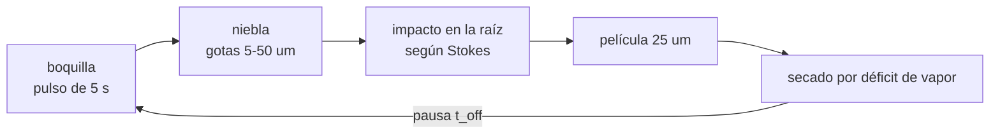

# B115-C04 — Sistemas aeropónicos

<!-- nav:top -->
[🏠 Programa](../../../../README.md) · [📚 Bloque B115](../../../tronco-comun/B115-sistemas-bioregenerativos-y-cultivo-en-habitats.md) · [← Anterior: B115-C03 — Control de nutrientes y solución nutritiva](../B115-C03-control-de-nutrientes-y-solucion-nutritiva/CLASE.md) · [Siguiente: B115-C05 — Ciclos de producción y calendarización de cultivos →](../B115-C05-ciclos-de-produccion-y-calendarizacion-de-cultivos/CLASE.md)
<!-- /nav -->

## 1. Ubicación, nivel y alcance

Clase 4 del bloque B115. Nivel N3. En la aeroponía las raíces cuelgan en el aire y reciben la solución nutritiva en forma de niebla a intervalos. Promete menos agua en circulación y menos masa, pero exige gotas del tamaño adecuado y un ciclo que no deje secar las raíces. Aquí modelas una cámara aeropónica sintética: la física de la gota, el secado de la película de agua sobre la raíz y el ciclo de niebla y pausa. Lo que cambia respecto de [B115-C01](../B115-C01-cultivos-hidroponicos-para-habitats/CLASE.md) es que no hay una lámina continua: el agua llega en pulsos.

## 2. Por qué esta clase existe

En un hábitat, cada litro y cada kilogramo cuentan. La decisión central: **¿cuánto tiempo puede pasar entre dos nieblas sin que la raíz se seque, y cómo depende eso de la humedad de la cámara y del tamaño de las gotas?**

## 3. Lo que podrás hacer al terminar

1. Calcular el tiempo de relajación, el número de Stokes y la sedimentación de una gota.
2. Estimar la vida de una gota por evaporación según la humedad.
3. Calcular el tiempo de secado de la película de agua sobre una raíz.
4. Simular el ciclo de niebla y pausa y compararlo con el cálculo analítico.
5. Leer críticamente una afirmación comercial de ahorro de agua.
6. Rotular qué es consultado, sintético e ilustrativo.

La evidencia es la **ficha de ciclo aeropónico con consumo de agua** del ejercicio 12 (sección 20).

## 4. Con qué llegas y cómo comprobarlo

1. ¿Qué es la humedad relativa?
2. ¿Qué es un número adimensional?
3. ¿Qué es una película de agua sobre una superficie?
4. ¿Qué es un dato sintético?
5. ¿Qué es una verificación por segunda vía?

<details>
<summary>Ver respuestas</summary>

1. El cociente entre el vapor presente y el de saturación a esa temperatura, en %. 2. Un cociente sin unidades que compara dos efectos (p. ej. inercia y arrastre). 3. Una capa muy fina de agua adherida a la superficie. 4. Un dato generado para el ejemplo, no medido. 5. Calcular lo mismo con otro método o contra una cifra publicada y comparar.
</details>

Con cuatro o cinco aciertos, sigue; si no, repasa los prerrequisitos.

## 5. Un caso de contexto y casos de referencia

Una cámara sintética a 22 °C y 90 % de humedad relativa lanza cada 5 s un pulso de niebla que deposita 1,25 mL sobre 0,05 m² de raíz: una película de 25 µm que tarda **53,7 min** en secarse. Con una pausa de 30 min la raíz nunca se seca; con 60 min está seca el 10,6 % del tiempo. Con 60 % de humedad la misma película dura 13,4 min y la pausa máxima baja a 14,5 min. Es el **ejemplo conductor**: todo es **sintético o ilustrativo**.

Casos de referencia consultados: Monje y colaboradores (2019) señalan que la hidroponía y la aeroponía en el espacio comparten retos de contención, aireación de las raíces y separación líquido/gas; y citan un estudio en el que la masa fresca de brotes de lechuga hidropónica fue el doble que la aeropónica y la de suelo. La nota de NASA Spinoff (2006) recoge que AgriHouse (empresa) afirma reducciones del 98 % en agua, 60 % en fertilizante y 100 % en pesticidas, con un aumento del rendimiento del 45–75 %: son **afirmaciones de la empresa**, sin la base de comparación.

## 6. Vocabulario

La **aeroponía** cultiva con las raíces en el aire y las moja con niebla. El **tiempo de relajación** `τ = ρ d²/(18 μ)` es lo que tarda una gota en ajustarse a la velocidad del aire. El **número de Stokes** `St = τ v/D` compara la inercia de la gota con el tamaño del obstáculo (la raíz). La **eficiencia de impactación** es la fracción de gotas que chocan con la raíz. La **velocidad de sedimentación** `v_s = τ g` es la de caída. La **ley `d²`** da la vida de una gota que se evapora. El **déficit de vapor** es la diferencia entre el vapor de saturación y el del aire.

## 7. Modelo mental



*Descripción textual:* cada pulso forma una película en la raíz; la película se seca a un ritmo que depende del déficit de vapor; el siguiente pulso debe llegar antes de que la raíz quede seca más tiempo del admisible.

Analogía: es regar con un pulverizador una lechuga colgada: si esperas demasiado entre pulverizaciones, se seca. Límite: la raíz real absorbe agua y tiene estructura (pelos radiculares), que este modelo de película uniforme no incluye.

## 8. La explicación, paso a paso

### 8.1 Física de la gota

Para una gota de 20 µm en aire a 22 °C: `τ = 1,235 ms`, `St = τ·v/D = 4,94` con un chorro de 2 m/s y una raíz de 0,5 mm; la eficiencia de impactación (una forma sigmoide ilustrativa, `(St/(St+0,5))²`) es 0,82. Una gota de 5 µm tiene `St = 0,31` y solo 0,15: sigue el aire y rodea la raíz. En la Tierra la de 50 µm cae a 75,7 mm/s; en gravedad cero la velocidad de sedimentación es 0 para todas y la niebla solo se mueve con la corriente de aire.

### 8.2 Vida de una gota

Con la ley `d²`, `t = ρ d²/(8 D_v Δρ_v)`: a 90 % de humedad una gota de 5 µm dura 0,064 s, una de 20 µm 1,03 s y una de 50 µm 6,44 s; a 60 % duran cuatro veces menos. Las gotas pequeñas pueden evaporarse antes de llegar a la raíz si el aire está seco: el tamaño y la humedad se eligen juntos.

### 8.3 Secado de la película de la raíz

El flujo de evaporación es `E = h_m·Δρ_v`, con `h_m = 0,004 m/s` (sintético). A 22 °C, la densidad de vapor saturado es 19,41 g/m³. Una película de 50 µm tarda `ρ δ/E`: 26,8 min a 60 %, 42,9 a 75 %, 107,3 a 90 % y 214,7 a 95 % de humedad. Con 1,25 mL sobre 0,05 m² (η = 30 %) la película es de 25 µm y los tiempos se reducen a la mitad.

### 8.4 El ciclo de niebla y pausa

La raíz está seca la fracción `max(0, (T − t_sec)/T)` del periodo `T = t_on + t_off`. La simulación segundo a segundo de un día coincide con esa expresión: el error máximo es 0,10 puntos porcentuales. A 90 % de humedad, pausas de hasta 30 min dejan la raíz siempre mojada y de 60 min la secan el 10,6 % del tiempo; a 60 %, 15 min ya dan el 11,1 % y 60 min el 77,7 %. Con la regla ilustrativa de raíz seca ≤ 10 % del tiempo, la pausa máxima es 3570 s a 90 % de humedad y 870 s a 60 %.

### 8.5 Agua y lectura crítica de las promesas

Con pausas de 5 min la boquilla bombea 1,18 L/día y deposita 0,35 L/día; con pausas de 1 min, 5,54 y 1,66 L/día. Lo bombeado que no se deposita vuelve al depósito; el consumo neto es lo que transpiran y absorben las plantas más lo que se evapora (C06). Por eso «98 % menos de agua» **no se puede evaluar** sin saber con qué se compara (suelo, hidroponía, qué cultivo, qué duración). En la comparación de Monje y colaboradores, el APH con sustrato rindió el 51 % del NFT en un experimento puntual, y la aeroponía no apareció como solución ya resuelta.

## 9. Magnitudes, símbolos y unidades

| Símbolo | Qué es | Unidad | Valor / nota |
|---|---|---|---|
| `d` | diámetro de la gota | µm | 5 a 50 (ilustrativo) |
| `τ` | tiempo de relajación | ms | 1,235 (20 µm) |
| `St` | número de Stokes | — | 4,94 (20 µm) |
| `Δρ_v` | déficit de vapor | g/m³ | 1,94 (90 %); 7,76 (60 %) |
| `δ` | espesor de la película | µm | 25 (pulso); 50 (máximo) |
| `t_sec` | tiempo de secado | min | 53,7 (90 %, 25 µm) |
| `t_off` | pausa entre pulsos | s | 60 a 3600 |

## 10. Convenciones y referencias

Cámara a 22 °C y 101,3 kPa, aire en calma salvo el chorro de 2 m/s, gravedad de la Tierra o cero. Presión de saturación de Magnus (estándar, no consultada); `μ_aire = 1,8×10⁻⁵ Pa s`; `D_v = 2,5×10⁻⁵ m²/s`. Datos sintéticos deterministas. Tolerancia: fracción seca simulada dentro de 0,5 puntos porcentuales de la analítica. Numpy 2.4.4, Python 3.12.9.

## 11. De dónde sale lo que afirmamos

| ID | Fuente | Localizador | Respalda | Estado |
|---|---|---|---|---|
| S1 | Monje, O. et al., «New Frontiers in Food Production Beyond LEO», ICES-2019-260, NTRS 20190027339, https://ntrs.nasa.gov/api/citations/20190027339/downloads/20190027339.pdf (consultada 2026-11-10, PyMuPDF) | sección III y figura 1 | retos de la hidroponía y la aeroponía (contención, aireación, separación líquido/gas); lechuga hidropónica con el doble de masa que la aeropónica (estudio citado por los autores) | Consultada |
| S2 | NASA Spinoff, «Progressive Plant Growing Has Business Blooming» (2006) — https://spinoff.nasa.gov/node/10469 (consultada 2026-11-10) | texto de la nota | afirmaciones de AgriHouse: 98 % menos agua, 60 % menos fertilizante, 100 % menos pesticidas, 45–75 % más rendimiento; experimento con NASA y BioServe en Mir (1997) | Consultada (afirmaciones de la empresa) |
| — | Magnus, Stokes, ley `d²`, impactación sigmoide | — | las verifica el laboratorio o son ilustrativas | No consultada en una fuente concreta |

Límites: el rango de tamaños de gota de las boquillas reales, los ciclos de los sistemas de la ISS (p. ej. XROOTS) y el artículo SAE de 2000 sobre aeroponía **no se consultaron**.

## 12. Cómo ver el resultado

| Magnitud | Valor |
|---|---|
| Gota de 20 µm: `τ`, `St`, impacto | 1,235 ms; 4,94; 0,82 |
| Vida a 90 % / 60 % (20 µm) | 1,03 s / 0,258 s |
| Secado de 50 µm a 60 / 75 / 90 / 95 % | 26,8 / 42,9 / 107,3 / 214,7 min |
| Película de un pulso | 25 µm (1,25 mL en 0,05 m²) |
| Raíz seca con `t_off = 3600 s` y 90 % | 10,6 % (simulada), 10,7 % (analítica) |
| Pausa máxima con raíz seca ≤ 10 % | 3570 s (90 %); 870 s (60 %) |

Descripción larga: la humedad decide cuánto dura la película; la pausa máxima se acorta de una hora a un cuarto de hora al bajar la humedad de 90 % a 60 %.

## 13. Ejemplo trabajado: secado de la película con 75 % de humedad

**Paso 1 · Saturación.** A 22 °C hay 19,41 g/m³ de vapor saturado.

**Paso 2 · Déficit.** `19,41·(1 − 0,75) = 4,85 g/m³`.

**Paso 3 · Flujo.** `0,004 m/s · 4,85×10⁻³ kg/m³ = 1,94×10⁻⁵ kg m⁻² s⁻¹ = 69,9 g m⁻² h⁻¹`.

**Paso 4 · Tiempo.** Una película de 50 µm contiene `0,05 kg/m²`; `0,05/1,94×10⁻⁵ = 2575 s = 42,9 min`.

## 14. Distintas formas de describir el problema

**Por gota:** `τ`, `St` y vida. **Por película:** espesor y secado. **Por tiempo:** fracción seca del ciclo. **Por agua:** bombeada, depositada y neta. **Por humedad:** déficit de vapor. **Por gravedad:** sedimentación frente a corriente de aire.

## 15. Práctica guiada

**Ejercicio 1 · con los pasos indicados.** Calcula el tiempo de relajación de una gota de 20 µm. *Pasos:* `τ = ρ d²/(18 μ)` con `ρ = 1000 kg/m³` y `μ = 1,8×10⁻⁵ Pa s`.

<details><summary>Solución comentada</summary>

`1000·(20×10⁻⁶)²/(18·1,8×10⁻⁵) = 4×10⁻⁷/3,24×10⁻⁴ = 1,235×10⁻³ s`.
</details>

**Ejercicio 2 · con una pista.** Calcula el número de Stokes con 2 m/s y una raíz de 0,5 mm. *Pista:* `St = τ v/D`.

<details><summary>Solución comentada</summary>

`1,235×10⁻³·2/5×10⁻⁴ = 4,94`.
</details>

**Ejercicio 3 · casi autónomo.** Calcula el espesor de la película que deja un pulso de 4,17 mL bombeados con η = 30 % sobre 0,05 m².

<details><summary>Solución comentada</summary>

`0,30·4,17 mL = 1,25 mL = 1,25×10⁻⁶ m³`; `/0,05 m² = 2,5×10⁻⁵ m = 25 µm`.
</details>

## 16. Práctica autónoma, transferencia e integrador

**Ejercicio 4 · autónomo.** Calcula el tiempo de secado de la película de 25 µm con 90 % de humedad.

<details><summary>Solución comentada</summary>

Mitad que la de 50 µm: `107,3/2 = 53,7 min`.
</details>

**Ejercicio 5 · autónomo.** ¿Cuánta agua bombea una boquilla de 0,05 L/min con pulsos de 5 s cada 305 s durante un día?

<details><summary>Solución comentada</summary>

`86 400/305 = 283` pulsos de `0,05/60·5 = 4,17 mL`: `1,18 L/día`.
</details>

**Ejercicio 6 · autónomo.** Si la raíz estuviera siempre mojada con 60 % de humedad y 0,05 m², ¿cuánta agua se evaporaría al día?

<details><summary>Solución comentada</summary>

`111,8 g m⁻² h⁻¹ · 0,05 m² · 24 h = 134 g/día`.
</details>

**Ejercicio 7 · autónomo.** ¿Cuál es la pausa máxima para raíz seca ≤ 10 % con 90 % de humedad y por qué es mayor que a 60 %?

<details><summary>Solución comentada</summary>

3570 s (59,5 min); con más humedad el déficit de vapor es menor y la película dura más.
</details>

**Ejercicio 8 · autónomo.** ¿Cómo se comparan la sedimentación de gotas de 5 y de 50 µm en la Tierra?

<details><summary>Solución comentada</summary>

0,76 mm/s frente a 75,7 mm/s: una razón de 100 (`v_s ∝ d²`).
</details>

**Ejercicio 9 · transferencia.** En microgravedad, ¿qué cambia en la niebla y qué retos señalan Monje y colaboradores?

<details><summary>Solución comentada</summary>

No hay sedimentación: la niebla sigue la corriente de aire y no cae sobre el fondo. Los retos citados son la contención, la aireación de las raíces y la separación líquido/gas: sin gravedad el agua que no se deposita no se drena sola.
</details>

**Ejercicio 10 · transferencia.** Una empresa dice «98 % menos agua». ¿Qué cuatro datos necesitas para evaluarlo?

<details><summary>Solución comentada</summary>

El sistema de referencia, el cultivo y su duración, la definición del consumo (¿incluye el agua de la cámara o solo la del depósito?) y los datos de la medición. La nota de Spinoff solo recoge la afirmación de la empresa.
</details>

**Ejercicio 11 · transferencia.** Si el NFT rindió 78 g por planta y la lechuga aeropónica de un estudio citado rindió la mitad de la hidropónica, ¿qué masa esperarías y por qué no es una predicción?

<details><summary>Solución comentada</summary>

Unos 39 g, pero son dos estudios distintos con condiciones distintas: es solo un orden de magnitud.
</details>

**Ejercicio 12 · integrador.** Elabora tu *ficha de ciclo aeropónico con consumo de agua*: condiciones de la cámara, gotas y su impactación, película y tiempo de secado, ciclo elegido con su fracción seca, agua bombeada y depositada, lectura de las afirmaciones comerciales y lista de qué es consultado, sintético e ilustrativo.

<details><summary>Solución comentada</summary>

Secciones 8.1–8.5 y la salida del laboratorio.
</details>

## 17. Laboratorio: gotas, secado y ciclo

El script [aeroponia.py](aeroponia.py) calcula la física de las gotas, el secado de la película, simula 24 h del ciclo y deduce la pausa máxima (**comprueba** que la fracción seca simulada coincide con la analítica en 0,5 puntos). Tarda unos segundos.

**Datos:** todo **sintético o ilustrativo**; Monje y NASA Spinoff solo en el texto de la clase. **Predice antes de ejecutar:** ¿la pausa máxima será mayor con 90 % o con 60 % de humedad? (Con 90 %.) **Ejecución del 2026-11-10 (Python 3.12.9):**

```text
Python 3.12.9; numpy 2.4.4
DATOS SINTETICOS/ILUSTRATIVOS: camara 22 C, boquilla 0.05 L/min, raiz 0.05 m2, pelicula maxima 50 um
Densidad de vapor saturado a 22 C = 19.41 g/m3
Gotas (chorro de 2 m/s, raiz de 0.5 mm; vida por evaporacion con HR 90 % y 60 %)
   d[um]  tau[ms]  Stokes  impacto  v_sed 1g[mm/s]  parada[mm]  vida90[s]  vida60[s]
       5    0.077    0.31     0.15            0.76        0.15      0.064      0.016
      10    0.309    1.23     0.51            3.03        0.62      0.258      0.064
      20    1.235    4.94     0.82           12.11        2.47      1.030      0.258
      50    7.716   30.86     0.97           75.69       15.43      6.440      1.610
En 0 g la velocidad de sedimentacion es 0 para todas las gotas: la niebla solo se mueve con el aire.
Tiempo de secado de una pelicula de 50 um en la raiz segun la humedad relativa
   HR  60 %: deficit =  7.76 g/m3; flujo =  111.8 g/m2/h; secado =   26.8 min
   HR  75 %: deficit =  4.85 g/m3; flujo =   69.9 g/m2/h; secado =   42.9 min
   HR  90 %: deficit =  1.94 g/m3; flujo =   28.0 g/m2/h; secado =  107.3 min
   HR  95 %: deficit =  0.97 g/m3; flujo =   14.0 g/m2/h; secado =  214.7 min
Pulso de 5 s: agua depositada = 1.25 mL -> 25.0 um de pelicula (limitado a 50 um)
Ciclo niebla/secado: fraccion del dia con la raiz seca (simulada / analitica) y consumo de la boquilla
   HR   t_off[s]   seca sim[%]  seca analitica[%]   pulsos/dia   agua bombeada[L/dia]   depositada[L/dia]
    90        60          0.0                0.0         1329                   5.54              1.66
    90       300          0.0                0.0          283                   1.18              0.35
    90       900          0.0                0.0           95                   0.40              0.12
    90      1800          0.0                0.0           48                   0.20              0.06
    90      3600         10.6               10.7           24                   0.10              0.03
    60        60          0.0                0.0         1329                   5.54              1.66
    60       300          0.0                0.0          283                   1.18              0.35
    60       900         11.1               11.1           95                   0.40              0.12
    60      1800         55.3               55.4           48                   0.20              0.06
    60      3600         77.7               77.7           24                   0.10              0.03
Error maximo de la fraccion seca simulada frente a la analitica = 0.10 puntos porcentuales
Regla de diseno ilustrativa: raiz seca <= 10 % del tiempo
   HR 90 %: t_off maximo = 3570 s (59.5 min)
   HR 60 %: t_off maximo = 870 s (14.5 min)
Pruebas superadas.
```

```bash
python programa/clases/B115/B115-C04-sistemas-aeroponicos/aeroponia.py
```

**Límites:** película uniforme sin absorción de la raíz, temperatura de la raíz igual a la del aire, sin turbulencia, sin lixiviado ni obstrucción de boquillas; el coeficiente de transferencia y la eficiencia de depósito son sintéticos. No es un diseño de aeroponía real.

## 18. Errores frecuentes y cómo corregirlos

**Suponer que la niebla fina llega siempre a la raíz.** Con `St` bajo, rodea la raíz (8.1).

**Elegir la pausa sin mirar la humedad.** Cambia de 60 min a 15 min (8.4).

**Aceptar un porcentaje de ahorro sin base de comparación.** Se corrige con 8.5 y el ejercicio 10.

**Presentar el modelo como un sistema probado en la ISS.** Se corrige con la sección 10.

## 19. Cómo sabrás que vas bien

Tras la sección 8: ¿qué pausa esperabas y cuál obtuviste? Si dudas, repasa el ejemplo 13. Tras el laboratorio: ¿qué comprueba? (ver la sección 17).

## 20. Qué entregas y cómo se evalúa

El producto es tu **ficha de ciclo aeropónico con consumo de agua** (ejercicio 12).

| Criterio | Inicial | En desarrollo | Logrado | Destacado |
|---|---|---|---|---|
| Conceptos | Confunde gota y película | Parciales | Explica Stokes, secado y ciclo | Explica el efecto de la gravedad |
| Cálculo | Sin unidades | Con errores | Calcula `τ`, `St`, secado y ciclo con unidades | Calcula casos nuevos |
| Numérico | Sin comprobar | Un caso | Compara simulación y analítica | Interpreta las diferencias |
| Fuentes | Sin fuente | Sin fecha | Fuentes con fecha y estado | Distingue afirmación de empresa y dato |
| Límites | No los nombra | Uno | Tres | Discute qué falta del modelo |

**Condiciones críticas (no se compensan con promedio):** rotular lo sintético; no presentar una afirmación comercial como dato; citar solo lo consultado.

## 21. Ética, seguridad y límites

Clase educativa: **no da consejo operativo ni sanitario**. Una niebla de nutrientes puede propagar contaminantes (ver C07) y requiere diseño y validación de especialistas; ningún resultado de esta clase sustituye ese trabajo. Accesibilidad: tablas equivalentes a las gráficas, fórmulas en texto, ejercicios sin conexión.

## 22. Para cerrar y seguir

Una película de 25 µm se seca en 54 min a 90 % de humedad y en 13 a 60 %; la pausa máxima pasa de una hora a un cuarto de hora, y las promesas de ahorro necesitan una base de comparación. Queda una pregunta: ¿cómo se programan las siembras para tener cosecha todos los días?

**Glosario español–inglés.** aeroponía · *aeroponics*; número de Stokes · *Stokes number*; tiempo de relajación · *relaxation time*; déficit de vapor · *vapor deficit*; película de agua · *water film*.

**Continuidad.** [B115-C05](../B115-C05-ciclos-de-produccion-y-calendarizacion-de-cultivos/CLASE.md) planifica la producción para una tripulación.

**Referencias:** ver sección 11.

<!-- nav:bottom -->
---

[← Anterior: B115-C03 — Control de nutrientes y solución nutritiva](../B115-C03-control-de-nutrientes-y-solucion-nutritiva/CLASE.md) · [📚 Bloque B115](../../../tronco-comun/B115-sistemas-bioregenerativos-y-cultivo-en-habitats.md) · [Siguiente: B115-C05 — Ciclos de producción y calendarización de cultivos →](../B115-C05-ciclos-de-produccion-y-calendarizacion-de-cultivos/CLASE.md)
<!-- /nav -->
