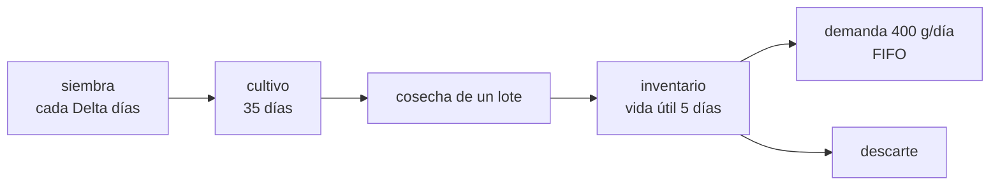

# B115-C05 — Ciclos de producción y calendarización de cultivos

<!-- nav:top -->
[🏠 Programa](../../../../README.md) · [📚 Bloque B115](../../../tronco-comun/B115-sistemas-bioregenerativos-y-cultivo-en-habitats.md) · [← Anterior: B115-C04 — Sistemas aeropónicos](../B115-C04-sistemas-aeroponicos/CLASE.md) · [Siguiente: B115-C06 — Balance de agua y evapotranspiración en cultivos →](../B115-C06-balance-de-agua-y-evapotranspiracion-en-cultivos/CLASE.md)
<!-- /nav -->

## 1. Ubicación, nivel y alcance

Clase 5 del bloque B115. Nivel N3. Un módulo de cultivo produce todo de una vez si se siembra de una vez; una tripulación necesita comer un poco cada día. Aquí planificas siembras escalonadas: cuántas plantas por lote, cuántos lotes en cultivo, cuánta área y cuánta cobertura se logra cuando algunos lotes fallan. Lo que cambia respecto de [B106](../../../tronco-comun/B106-habitats-espaciales-y-soporte-vital.md) es que allí el cultivo es un subsistema; aquí es una planificación en el tiempo.

## 2. Por qué esta clase existe

Cosechar mucho un día y nada los siguientes es inútil si lo cosechado se estropea. La decisión central: **¿cada cuántos días se siembra y cuántas plantas por lote hacen falta para cubrir la demanda diaria con una probabilidad aceptable, y qué área exige?**

## 3. Lo que podrás hacer al terminar

1. Calcular las plantas por lote y los lotes simultáneos de una siembra escalonada.
2. Calcular el área de cultivo necesaria.
3. Predecir con una fórmula la cobertura limitada por la vida útil y verificarla con una simulación.
4. Estimar con Monte Carlo el efecto de los fallos y el margen necesario.
5. Reconocer el efecto del redondeo y del rendimiento por planta en el área.
6. Rotular qué es consultado, sintético y de diseño ilustrativo.

La evidencia es el **calendario de siembras con área y margen** del ejercicio 12 (sección 20).

## 4. Con qué llegas y cómo comprobarlo

1. ¿Qué es un rendimiento por planta?
2. ¿Qué es una simulación de Monte Carlo?
3. ¿Qué significa FIFO?
4. ¿Qué es un dato sintético?
5. ¿Qué es una verificación por segunda vía?

<details>
<summary>Ver respuestas</summary>

1. La masa cosechable por planta (g). 2. Repetir una simulación con azar muchas veces para estimar una probabilidad o un promedio. 3. *First in, first out*: se consume primero lo más antiguo. 4. Un dato generado para el ejemplo, no medido. 5. Calcular lo mismo con otro método o contra una fórmula y comparar.
</details>

Con cuatro o cinco aciertos, sigue; si no, repasa los prerrequisitos.

## 5. Un caso de contexto y casos de referencia

Una tripulación sintética de 4 personas con una demanda de diseño de 100 g de hortaliza fresca por persona y día (**no es una recomendación nutricional**) necesita 400 g/día. Con 78 g por planta salen 5,13 plantas diarias. Sembrando y cosechando **cada día** 6 plantas hay 35 lotes en cultivo (ciclo de 35 días, sintético), 210 plantas y **8,4 m²**. Es el **ejemplo conductor**.

Casos de referencia consultados: Monje y colaboradores (2019) dan 78 g por planta en el NFT del experimento (n = 3) y 100 g con menos CO₂ y más humedad, y consideran 13 cultivos de lechuga al año en un APH de 0,2 m². Wheeler (NASA/KSC) estima el área de cultivo según la duración: de 1 a 5 m² en total para misiones cortas, de 10 a 25 m² por persona para duraciones mayores y unos 50 m² por persona para colonias autónomas.

## 6. Vocabulario

Un **lote** es el conjunto de plantas que se siembra y se cosecha a la vez. El **ciclo** es el tiempo de siembra a cosecha. El **intervalo `Δ`** es el tiempo entre siembras. La **vida útil** es el tiempo que el producto cosechado es utilizable. La **cobertura** es la fracción de los días en que se cubre la demanda. El **margen** multiplica las plantas por encima del cálculo nominal. El **descarte** es lo que se pierde por superar la vida útil.

## 7. Modelo mental



*Descripción textual:* los lotes se siembran cada `Δ` días, tardan el ciclo en madurar, se cosechan y pasan a un inventario del que se consume la demanda por antigüedad; lo que supera la vida útil se descarta.

Analogía: es el horno de una panadería que hornea varias tandas para que haya pan fresco todo el día. Límite: el modelo ignora que la lechuga no es lo único que se come y que la tripulación puede variar su consumo.

## 8. La explicación, paso a paso

### 8.1 Plantas por lote y área

Un lote de `n = ⌈D·Δ/Y⌉` plantas cubre `Δ` días de demanda `D` con rendimiento `Y`; hay `⌈ciclo/Δ⌉` lotes en cultivo; el área es `n·lotes·a_planta`. Con `Δ = 1`: 6 plantas, 35 lotes, 210 plantas y 8,40 m². Con `Δ = 3`: 16 plantas, 12 lotes y 7,68 m²; con `Δ = 7`: 36 plantas, 5 lotes y 7,20 m²; con `Δ = 14`: 72 plantas, 3 lotes y 8,64 m². El área apenas cambia con `Δ`: cambia la regularidad de la cosecha.

### 8.2 El redondeo es un margen oculto

Con `Δ = 1` hacen falta 5,13 plantas y se siembran 6: un 17 % más (468 g frente a 400 g al día). Por eso el margen adicional no mejora la cobertura (99,9 %) y solo aumenta el descarte.

### 8.3 La vida útil limita la cobertura

Si un lote cubre `Δ` días pero solo se conserva `S` días, la cobertura es `min(1, S/Δ)`. Con `S = 5` (sintético): 100 % para `Δ = 1` y 3, 71,4 % para `Δ = 7` y 35,7 % para `Δ = 14`. La simulación sin fallos da 100,0, 100,0, 71,5 y 35,9 %: coinciden. **Más plantas no arreglan una cosecha demasiado espaciada**: con `Δ = 7`, subir el margen a 1,5 solo sube la cobertura de 68,6 a 71,5 % y el descarte de 26,7 a 49,0 %.

### 8.4 Fallos y margen

Con una probabilidad del 10 % por lote de perder el 50 % (sintético), 300 repeticiones de 400 días (semilla 115): para `Δ = 1`, la cobertura es 99,9 % con margen 1,0 y el descarte 9,0 %; para `Δ = 3`, 96,5 % con margen 1,0, 98,5 % con 1,1 y 99,5 % con 1,2 (descarte 0,6, 4,9 y 14,3 %). El menor margen ensayado con cobertura media ≥ 95 % es 1,0 para ambos intervalos (8,4 y 7,7 m²). El compromiso es cobertura frente a descarte, no solo área.

### 8.5 Sensibilidad al rendimiento

Con `Δ = 1`: 50 g por planta exigen 8 plantas por lote, 280 plantas y 11,20 m²; 78 g, 6 y 210 y 8,40 m²; 100 g, 4 y 140 y 5,60 m². Una variación del rendimiento de ±30 % cambia el área en un 33 %: el rendimiento observado en las condiciones de la misión manda. Wheeler sitúa el área de plantas para «bioregenerativo» en 10–25 m² por persona; la de esta clase (≈2 m² por persona) cubre solo un complemento de hortaliza fresca, no la dieta.

## 9. Magnitudes, símbolos y unidades

| Símbolo | Qué es | Unidad | Valor / nota |
|---|---|---|---|
| `D` | demanda de la tripulación | g/día | 400 (diseño ilustrativo) |
| `Y` | rendimiento por planta | g | 78 (consultado); 50 y 100 (sensibilidad) |
| `Δ` | intervalo de siembra | días | 1, 3, 7, 14 |
| `n` | plantas por lote | — | 6, 16, 36, 72 |
| ciclo | siembra a cosecha | días | 35 (sintético) |
| `S` | vida útil | días | 5 (sintético) |
| `a_planta` | área por planta | m² | 0,04 (sintético) |

## 10. Convenciones y referencias

Un día es una unidad de tiempo; la cosecha se hace al comienzo del día y el consumo se descuenta en el mismo día. El inventario es FIFO y se descarta al cumplirse la vida útil. Las pérdidas por fallo son Bernoulli por lote (10 %), con la pérdida del 50 % de la masa. La cobertura se evalúa tras el arranque (ciclo más un intervalo). Semilla 115 y semillas 115–414 en Monte Carlo. Tolerancia: cobertura simulada sin fallos dentro de 2 puntos de la analítica. Numpy 2.4.4, Python 3.12.9.

## 11. De dónde sale lo que afirmamos

| ID | Fuente | Localizador | Respalda | Estado |
|---|---|---|---|---|
| S1 | Monje, O. et al., ICES-2019-260, NTRS 20190027339, https://ntrs.nasa.gov/api/citations/20190027339/downloads/20190027339.pdf (consultada 2026-11-10, PyMuPDF) | introducción y sección III | 78 g por planta en NFT (n = 3), 100 g con menos CO₂ y más humedad; 13 cultivos al año de lechuga con ~4 kg de sustrato por 0,2 m² (~52 kg) | Consultada |
| S2 | Wheeler, R. M., diapositivas NASA/KSC, NTRS 20150022488, https://ntrs.nasa.gov/api/citations/20150022488/downloads/20150022488.pdf (consultada 2026-11-10, PyMuPDF) | diapositiva «Role of Bioregenerative Components» | áreas de ≈1–5 m² totales, ≈10–25 m² por persona y ≈50 m² por persona según la duración de la misión | Consultada (la asignación de cada cifra a cada duración sigue el orden de la diapositiva extraída) |
| — | Ciclo de 35 días, vida útil, demanda, área por planta, probabilidad de fallo | — | diseño ilustrativo | No consultada: valores sintéticos |

Límites: el 78 g es un experimento de n = 3 en condiciones concretas; no se consultó una tabla de ciclos por especie ni una norma de ración.

## 12. Cómo ver el resultado

| Magnitud | Valor |
|---|---|
| Plan `Δ = 1` | 6 plantas, 35 lotes, 210 plantas, 8,40 m² |
| Cobertura sin fallos, `Δ` = 1 / 3 / 7 / 14 | 100,0 / 100,0 / 71,5 / 35,9 % (analítica 100 / 100 / 71,4 / 35,7) |
| Con fallos, `Δ = 3`, margen 1,0 / 1,1 / 1,2 | 96,5 / 98,5 / 99,5 % |
| Área con rendimiento 50 / 78 / 100 g | 11,20 / 8,40 / 5,60 m² |

Descripción larga: el área casi no depende del intervalo; la cobertura la limita la vida útil y, con fallos, se compra con margen a costa de descarte.

## 13. Ejemplo trabajado: plan con siembra cada 3 días

**Paso 1 · Demanda por lote.** `400·3 = 1200 g`.

**Paso 2 · Plantas.** `⌈1200/78⌉ = ⌈15,38⌉ = 16`.

**Paso 3 · Lotes.** `⌈35/3⌉ = 12`.

**Paso 4 · Área.** `16·12·0,04 = 7,68 m²`.

## 14. Distintas formas de describir el problema

**Por demanda:** gramos por día. **Por lotes:** plantas y lotes simultáneos. **Por área:** `n·lotes·a`. **Por tiempo:** cobertura y vida útil. **Por riesgo:** probabilidad de fallo y margen. **Por rendimiento:** sensibilidad a `Y`.

## 15. Práctica guiada

**Ejercicio 1 · con los pasos indicados.** ¿Cuántas plantas por día hacen falta con `D = 400 g/d` y `Y = 78 g`? *Pasos:* divide y redondea hacia arriba.

<details><summary>Solución comentada</summary>

`400/78 = 5,13`; se siembran 6.
</details>

**Ejercicio 2 · con una pista.** Calcula las plantas por lote con siembra cada 3 días. *Pista:* `⌈D Δ/Y⌉`.

<details><summary>Solución comentada</summary>

`⌈1200/78⌉ = 16`.
</details>

**Ejercicio 3 · casi autónomo.** Calcula el área con `Δ = 1`: 35 lotes de 6 plantas a 0,04 m² por planta.

<details><summary>Solución comentada</summary>

`35·6·0,04 = 8,40 m²`.
</details>

## 16. Práctica autónoma, transferencia e integrador

**Ejercicio 4 · autónomo.** ¿Qué cobertura máxima permite una cosecha cada 7 días con vida útil de 5 días?

<details><summary>Solución comentada</summary>

`5/7 = 71,4 %`.
</details>

**Ejercicio 5 · autónomo.** Con 100 g por planta y `Δ = 1`, ¿cuántas plantas y qué área?

<details><summary>Solución comentada</summary>

`⌈400/100⌉ = 4` plantas, `35·4·0,04 = 5,60 m²`.
</details>

**Ejercicio 6 · autónomo.** Con 6 plantas de 78 g, ¿cuánto excede la cosecha diaria a la demanda?

<details><summary>Solución comentada</summary>

`468 − 400 = 68 g/día`, un 17 %. Es el margen oculto del redondeo.
</details>

**Ejercicio 7 · autónomo.** Compara el área por persona de esta clase con las cifras de Wheeler.

<details><summary>Solución comentada</summary>

`8,4/4 = 2,1 m²` por persona, menos que los 10–25 m² por persona de la diapositiva; cubre solo 100 g de hortaliza fresca al día y no la dieta.
</details>

**Ejercicio 8 · autónomo.** Con 4 kg de sustrato por cultivo y 13 cultivos al año, ¿cuánto sustrato al año y por qué es un problema?

<details><summary>Solución comentada</summary>

`4·13 = 52 kg`; es masa que se debe lanzar y que, según Monje y colaboradores, no se recicla con facilidad en microgravedad.
</details>

**Ejercicio 9 · transferencia.** Una cosecha cada 14 días con vida útil de 5 cubre el 35,7 % de los días. ¿Qué dos cambios la mejoran?

<details><summary>Solución comentada</summary>

Acortar el intervalo de siembra y cosecha o alargar la vida útil con almacenamiento (p. ej. refrigeración). Añadir plantas no lo resuelve: el lote se estropea igual.
</details>

**Ejercicio 10 · transferencia.** La primera cosecha llega a los 35 días. ¿Qué implica para una misión de 60 días?

<details><summary>Solución comentada</summary>

Que el sistema produce solo unos 25 días y que la tripulación debe llevar el resto de su alimento. Es una consideración de diseño; la clase no evalúa su valor nutricional.
</details>

**Ejercicio 11 · transferencia.** ¿Qué pasa si el fallo afecta a todos los lotes a la vez (una causa común)?

<details><summary>Solución comentada</summary>

El Monte Carlo supone fallos independientes. Una causa común (agua contaminada, falla de luz) los correlaciona y hunde la cobertura sin que el margen lo remedie; se necesita redundancia en la causa (C07 trata la contaminación).
</details>

**Ejercicio 12 · integrador.** Elabora tu *calendario de siembras con área y margen*: demanda, rendimiento, ciclo, intervalo elegido, plantas por lote, lotes, área, cobertura sin y con fallos, margen y lista de qué es consultado, sintético e ilustrativo.

<details><summary>Solución comentada</summary>

Secciones 8.1–8.5 y la salida del laboratorio.
</details>

## 17. Laboratorio: siembra escalonada y cobertura

El script [calendario.py](calendario.py) calcula los planes, verifica la cobertura contra la fórmula, simula 300 repeticiones con fallos y estudia el rendimiento (**comprueba** la cobertura sin fallos frente a `min(1, S/Δ)` y el área de 8,4 m²). Tarda unos 10 s.

**Datos:** 78 g por planta **consultado**; el resto **sintético o de diseño ilustrativo**. **Predice antes de ejecutar:** ¿ayuda un margen de plantas con `Δ = 7`? (Casi no: manda la vida útil.) **Ejecución del 2026-11-10 (Python 3.12.9):**

```text
Python 3.12.9; numpy 2.4.4
DATO CONSULTADO: 78 g/planta (Monje et al., 2019); RESTO SINTETICO/DE DISENO: 4 personas, 100 g/persona/dia, ciclo 35 d, vida util 5 d
Demanda = 400 g/dia; rendimiento nominal = 78 g/planta -> 5.13 plantas/dia
Plan de siembra escalonada (margen 1.0, 78 g/planta)
   Delta[d]  plantas/lote  lotes en cultivo  plantas totales  area[m2]  cobertura sim sin fallos[%]  analitica[%]
          1             6                35              210      8.40                        100.0        100.0
          3            16                12              192      7.68                        100.0        100.0
          7            36                 5              180      7.20                         71.5         71.4
         14            72                 3              216      8.64                         35.9         35.7
Monte Carlo con fallos (300 repeticiones de 400 dias, semilla 115): cobertura y descarte segun el margen de plantas
   Delta[d]  margen  cobertura media[%]  descarte[%]  area[m2]
          1     1.0                99.9          9.0      8.40
          1     1.1                99.9          9.0      8.40
          1     1.2               100.0         21.8      9.80
          1     1.3               100.0         21.8      9.80
          1     1.5               100.0         31.4     11.20
          3     1.0                96.5          0.6      7.68
          3     1.1                98.5          4.9      8.16
          3     1.2                99.5         14.3      9.12
          3     1.3                99.5         18.4      9.60
          3     1.5               100.0         31.8     11.52
          7     1.0                68.6         26.7      7.20
          7     1.1                68.6         33.3      8.00
          7     1.2                70.0         38.7      8.80
          7     1.3                70.0         42.1      9.40
          7     1.5                71.5         49.0     10.80
Margen minimo ensayado con cobertura media >= 95 %: Delta 1 d -> x1.0 (8.4 m2), Delta 3 d -> x1.0 (7.7 m2)
Sensibilidad al rendimiento por planta (Delta = 1 d, margen 1.0)
      50 g/planta ->  8 plantas/lote, 280 plantas, 11.20 m2
      78 g/planta ->  6 plantas/lote, 210 plantas,  8.40 m2
     100 g/planta ->  4 plantas/lote, 140 plantas,  5.60 m2
Pruebas superadas.
```

```bash
python programa/clases/B115/B115-C05-ciclos-de-produccion-y-calendarizacion-de-cultivos/calendario.py
```

**Límites:** una sola especie, rendimiento constante, fallos independientes, demanda fija, sin tiempo de preparación ni de reposición de bandejas. No es un plan de producción real.

## 18. Errores frecuentes y cómo corregirlos

**Sumar plantas para compensar una cosecha demasiado espaciada.** La vida útil manda (8.3).

**Ignorar el redondeo.** Es un margen del 17 % (8.2).

**Usar un rendimiento sin condiciones.** Cambia el área en un 33 % (8.5).

**Presentar la ración de diseño como una recomendación nutricional.** Se corrige con la sección 21.

## 19. Cómo sabrás que vas bien

Tras la sección 8: ¿qué cobertura esperabas y cuál obtuviste? Si dudas, repasa el ejemplo 13. Tras el laboratorio: ¿qué comprueba? (ver la sección 17).

## 20. Qué entregas y cómo se evalúa

El producto es tu **calendario de siembras con área y margen** (ejercicio 12).

| Criterio | Inicial | En desarrollo | Logrado | Destacado |
|---|---|---|---|---|
| Conceptos | Confunde ciclo e intervalo | Parciales | Explica lotes, vida útil y cobertura | Explica el margen oculto del redondeo |
| Cálculo | Sin unidades | Con errores | Calcula plantas, lotes y área con unidades | Calcula casos nuevos |
| Numérico | Sin comprobar | Un caso | Compara simulación y fórmula | Interpreta el Monte Carlo |
| Fuentes | Sin fuente | Sin fecha | Fuentes con fecha y estado | Declara lo sintético |
| Límites | No los nombra | Uno | Tres | Discute las causas comunes de fallo |

**Condiciones críticas (no se compensan con promedio):** rotular lo sintético y la demanda como de diseño; no presentar una ración como recomendación; citar solo lo consultado.

## 21. Ética, seguridad y límites

Clase educativa: **no da consejo nutricional, médico ni operativo**. La demanda de 100 g/persona/día es un parámetro de diseño de ejemplo, no una ración; la alimentación de una tripulación la define personal especializado. Accesibilidad: tablas equivalentes a las gráficas, fórmulas en texto, ejercicios sin conexión.

## 22. Para cerrar y seguir

Para 4 personas y 400 g diarios de hortaliza, una siembra diaria de 6 plantas exige 8,4 m² y, con fallos del 10 %, mantiene una cobertura del 99,9 %; con siembra semanal manda la vida útil y no el margen. Queda una pregunta: ¿cuánta agua evapotranspira ese cultivo y cuánta se recupera?

**Glosario español–inglés.** siembra escalonada · *staggered planting*; lote · *batch*; vida útil · *shelf life*; cobertura · *coverage*; rendimiento · *yield*.

**Continuidad.** [B115-C06](../B115-C06-balance-de-agua-y-evapotranspiracion-en-cultivos/CLASE.md) cuantifica el agua del cultivo.

**Referencias:** ver sección 11.

<!-- nav:bottom -->
---

[← Anterior: B115-C04 — Sistemas aeropónicos](../B115-C04-sistemas-aeroponicos/CLASE.md) · [📚 Bloque B115](../../../tronco-comun/B115-sistemas-bioregenerativos-y-cultivo-en-habitats.md) · [Siguiente: B115-C06 — Balance de agua y evapotranspiración en cultivos →](../B115-C06-balance-de-agua-y-evapotranspiracion-en-cultivos/CLASE.md)
<!-- /nav -->
