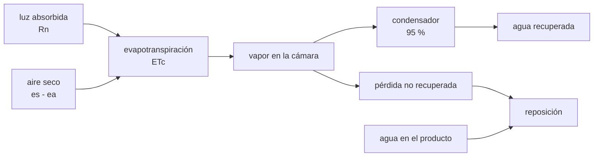

# B115-C06 — Balance de agua y evapotranspiración en cultivos

<!-- nav:top -->
[🏠 Programa](../../../../README.md) · [📚 Bloque B115](../../../tronco-comun/B115-sistemas-bioregenerativos-y-cultivo-en-habitats.md) · [← Anterior: B115-C05 — Ciclos de producción y calendarización de cultivos](../B115-C05-ciclos-de-produccion-y-calendarizacion-de-cultivos/CLASE.md) · [Siguiente: B115-C07 — Bioseguridad e inocuidad alimentaria en hábitats →](../B115-C07-bioseguridad-e-inocuidad-alimentaria-en-habitats/CLASE.md)
<!-- /nav -->

## 1. Ubicación, nivel y alcance

Clase 6 del bloque B115. Nivel N3. Las plantas transpiran: devuelven al aire del hábitat casi toda el agua que absorben. Esa agua se puede recuperar por condensación, pero hay que cuantificarla. Aquí calculas la evapotranspiración de un cultivo en cámara con la ecuación de Penman–Monteith, la verificas por dos vías y cierras el balance de agua del módulo. Lo que cambia respecto de [B106](../../../tronco-comun/B106-habitats-espaciales-y-soporte-vital.md) es el origen del agua: allí se trata el reciclaje del agua de la tripulación; aquí, el agua que mueve el cultivo.

## 2. Por qué esta clase existe

El cultivo es el mayor flujo de agua de un hábitat con plantas. La decisión central: **¿cuánta agua transpira el cultivo, cuánta se recupera y cuánta hay que reponer, y con qué incertidumbre?**

## 3. Lo que podrás hacer al terminar

1. Calcular la energía neta que recibe un cultivo con luz artificial.
2. Calcular la evapotranspiración de referencia con Penman–Monteith y separar el término radiativo y el aerodinámico.
3. Verificarla con un caso límite y con la forma general de Monteith.
4. Cerrar el balance de agua de un módulo con recuperación del condensado.
5. Estimar la incertidumbre con Monte Carlo.
6. Rotular qué es consultado, qué se usó sin consultar y qué es ilustrativo.

La evidencia es el **balance diario de agua de un módulo** del ejercicio 12 (sección 20).

## 4. Con qué llegas y cómo comprobarlo

1. ¿Qué es la evapotranspiración?
2. ¿Qué es la presión de vapor de saturación y de qué depende?
3. ¿Qué es 1 mm de agua sobre 1 m² en litros?
4. ¿Qué es un dato sintético?
5. ¿Qué es una verificación por segunda vía?

<details>
<summary>Ver respuestas</summary>

1. El agua que pasa a vapor desde el suelo y las plantas (evaporación más transpiración). 2. La presión máxima de vapor a una temperatura; crece rápido con ella. 3. 1 litro. 4. Un dato generado para el ejemplo, no medido. 5. Calcular lo mismo con otro método o contra un caso límite y comparar.
</details>

Con cuatro o cinco aciertos, sigue; si no, repasa los prerrequisitos.

## 5. Un caso de contexto y casos de referencia

Una cámara sintética a 23 °C, 60 % de humedad relativa y 0,5 m/s de aire, con 300 µmol m⁻² s⁻¹ durante 16 h (la luz de [B115-C02](../B115-C02-iluminacion-de-cultivos-con-led-y-espectro-de-crecimiento/CLASE.md)), recibe `Rn = 2,47 MJ m⁻² d⁻¹` y da `ETo = 1,152 mm/día`. Sobre los 8,4 m² de [B115-C05](../B115-C05-ciclos-de-produccion-y-calendarizacion-de-cultivos/CLASE.md) son **9,68 L/día** transpirados; con un condensador que recupere el 95 % hay que reponer **0,92 L/día**. Es el **ejemplo conductor**.

Casos de referencia consultados: el capítulo 2 de FAO-56 define la evapotranspiración de referencia (ETo en mm/día), el coeficiente de cultivo `Kc = ETc/ETo` y un cultivo hipotético de 0,12 m de altura, 70 s/m de resistencia superficial y albedo de 0,23. Monje y colaboradores (2019) señalan que en microgravedad no hay convección natural y empeora la transferencia de calor y masa hacia las hojas.

## 6. Vocabulario

La **evapotranspiración de referencia (ETo)** es la de un cultivo hipotético bien regado; la **del cultivo (ETc)** es `Kc·ETo`. La **radiación neta (Rn)** es la energía que absorbe la superficie. El **déficit de presión de vapor** `es − ea` mide lo seco que está el aire. La **pendiente `Δ`** de la curva de saturación y la **constante psicrométrica `γ`** acoplan temperatura y vapor. La **resistencia aerodinámica `r_a`** y la **superficial `r_s`** controlan el paso del vapor. El **condensado** es el agua que se recupera al enfriar el aire de la cámara.

## 7. Modelo mental



*Descripción textual:* la luz absorbida y el aire seco impulsan la transpiración; el vapor pasa al aire; un condensador recupera casi todo; lo no recuperado y el agua que sale en el producto se reponen.

Analogía: el cultivo es una bomba de agua impulsada por luz y por aire seco. Límite: la ecuación está calibrada para un cultivo de referencia de 0,12 m al aire libre, no para una lechuga bajo LED.

## 8. La explicación, paso a paso

### 8.1 Energía neta de la luz

`Rn = DLI·E_mol·f`, con `DLI = 17,28 mol m⁻² d⁻¹` (300 µmol m⁻² s⁻¹ y 16 h), `E_mol = 0,2045 MJ/mol` (mezcla 12:3 de la clase C02) y una fracción neta absorbida `f = 0,7` (ilustrativa): `Rn = 2,47 MJ m⁻² d⁻¹`. Es una simplificación: no incluye la onda larga ni el calor de los equipos.

### 8.2 Penman–Monteith

La forma estándar (FAO-56; no se consultó el texto de la ecuación en la página, que solo la muestra como imagen) es

`ETo = [0,408 Δ (Rn − G) + γ (900/(T+273)) u2 (es − ea)] / [Δ + γ (1 + 0,34 u2)]`.

Con `T = 23 °C`: `es = 2,809 kPa`, `ea = 1,686 kPa`, `Δ = 0,1699 kPa/°C`, `γ = 0,0674 kPa/°C` y `G = 0`: `ETo = 1,152 mm/día`, de los cuales 0,689 son del término radiativo y 0,463 del aerodinámico (el 60 % y el 40 %).

### 8.3 Tres comprobaciones

(1) Con humedad del 100 % el término aerodinámico se anula y `ETo = 0,689 mm/día`, igual al término radiativo. (2) La forma general de Monteith con `r_s = 70 s/m` y `r_a = 208/u2` da 1,149 mm/día: difiere un 0,30 % de la de FAO. (3) La cota de energía radiativa `Rn/λ` es 1,010 mm/día; el término radiativo (0,689) la respeta, pero el total la supera un 14 %: **el aire seco aporta calor sensible**, de modo que la evaporación puede exceder la energía de la luz (y ese calor lo suministra el sistema de climatización).

### 8.4 Qué manda: humedad y aire

A `u2 = 0,5 m/s`, `ETo` baja de 1,383 mm/día con 40 % de humedad a 0,747 con 95 %: un factor 1,85. A 60 % de humedad, pasar de 0,2 a 2,0 m/s lo sube de 0,899 a 2,232 mm/día. La resistencia superficial pesa menos: con `r_s` de 30, 70 y 120 s/m, `ETc` vale 1,179, 1,149 y 1,112 mm/día. **La humedad y la ventilación del hábitat deciden el agua del cultivo.**

### 8.5 Balance del módulo e incertidumbre

Con `Kc = 1,0` (ilustrativo), 8,4 m²: transpiración `9,68 L/día`; recuperación del 95 %: 9,19 L/día; no recuperada: 0,48 L/día. El producto (468 g/día con 94 % de agua, ilustrativo) retira 0,44 L/día. Reposición: **0,92 L/día** (0,110 L m⁻² d⁻¹); sin condensador serían 10,12 L/día. Un Monte Carlo (2000 casos, semilla 115: temperatura N(23; 1) °C, humedad 50–80 %, aire 0,2–1,0 m/s y luz ±10 %) da `ETo` con mediana 1,128 y rango 5–95 % de 0,872 a 1,554 mm/día; la reposición queda entre 0,81 y 1,09 L/día. La recuperación del condensado es la palanca más fuerte.

## 9. Magnitudes, símbolos y unidades

| Símbolo | Qué es | Unidad | Valor / nota |
|---|---|---|---|
| `Rn` | radiación neta | MJ m⁻² d⁻¹ | 2,47 |
| `T` | temperatura del aire | °C | 23 |
| `es`, `ea` | presión de vapor de saturación y real | kPa | 2,809 y 1,686 |
| `Δ`, `γ` | pendiente de saturación; constante psicrométrica | kPa/°C | 0,1699 y 0,0674 |
| `u2` | velocidad del aire | m/s | 0,5 |
| ETo, ETc | evapotranspiración | mm/día = L m⁻² d⁻¹ | 1,152 |
| `Kc` | coeficiente de cultivo | — | 1,0 (ilustrativo) |
| `λ` | calor latente de vaporización | MJ/kg | 2,45 |

## 10. Convenciones y referencias

Paso de tiempo de 24 h con valores medios; `G = 0`; sin convección natural especial; gravedad terrestre; `es(T)` de Magnus (estándar, no consultada aquí) y `λ = 2,45 MJ/kg`. La forma general de Monteith usa `ρ_a = 3,486 P/(1,01 (T+273))` y `c_p = 1,013×10⁻³ MJ kg⁻¹ K⁻¹`, estándar y no consultados. Semilla 115. Tolerancias: diferencia FAO–Monteith menor del 3 %, término radiativo ≤ `Rn/λ`. Numpy 2.4.4, Python 3.12.9.

## 11. De dónde sale lo que afirmamos

| ID | Fuente | Localizador | Respalda | Estado |
|---|---|---|---|---|
| S1 | Allen, R. G. et al., FAO Irrigation and Drainage Paper 56, cap. 2 — https://www.fao.org/4/x0490e/x0490e06.htm (consultada 2026-11-10) | texto de la página | variables y unidades de la ecuación de Penman–Monteith, definición de `Kc`, cultivo de referencia (0,12 m, 70 s/m, 0,23) | Consultada (la ecuación solo aparece como imagen; no se leyó) |
| S2 | Monje, O. et al., ICES-2019-260, NTRS 20190027339, https://ntrs.nasa.gov/api/citations/20190027339/downloads/20190027339.pdf (consultada 2026-11-10, PyMuPDF) | introducción | efectos indirectos de la microgravedad: mala aireación de la raíz y falta de convección natural | Consultada |
| — | Ecuación estándar de Penman–Monteith (forma con 900 y 0,34), Magnus, `λ`, forma general de Monteith, valores típicos de `Kc` | — | las verifica el laboratorio o son ilustrativos | No consultada en una fuente concreta |

Límites: de FAO-56 solo se consultó el capítulo 2 (como texto, sin ecuación); no se consultaron las tablas de `Kc` ni el cálculo de `es`. No se consultó ninguna medición de transpiración en cámaras de cultivo.

## 12. Cómo ver el resultado

| Magnitud | Valor |
|---|---|
| `Rn` | 2,47 MJ m⁻² d⁻¹ |
| ETo = radiativo + aerodinámico | 1,152 = 0,689 + 0,463 mm/día |
| Diferencia FAO frente a Monteith | 0,30 % |
| Transpirada / recuperada / no recuperada | 9,68 / 9,19 / 0,48 L/día |
| Reposición total | 0,92 L/día (10,12 sin condensador) |
| ETo, 5–95 % (Monte Carlo) | 0,872–1,554 mm/día |

Descripción larga: casi toda el agua transpirada vuelve; la reposición depende sobre todo de cuánto se recupere y de la humedad y el aire de la cámara.

## 13. Ejemplo trabajado: del DLI a los litros

**Paso 1 · Energía.** `17,28·0,2045·0,7 = 2,47 MJ m⁻² d⁻¹`.

**Paso 2 · ETo.** Penman–Monteith: `1,152 mm/día`.

**Paso 3 · Litros.** `1,152 L m⁻² d⁻¹ · 8,4 m² = 9,68 L/día`.

**Paso 4 · Reposición.** `9,68·0,05 + 0,44 = 0,92 L/día`.

## 14. Distintas formas de describir el problema

**Por energía:** `Rn/λ`. **Por aire:** déficit de vapor y `u2`. **Por masa:** transpirado = recuperado + no recuperado. **Por incertidumbre:** percentiles de Monte Carlo. **Por carga térmica:** calor latente a evacuar.

## 15. Práctica guiada

**Ejercicio 1 · con los pasos indicados.** Calcula `Rn` con DLI 17,28 mol m⁻² d⁻¹, 0,2045 MJ/mol y `f = 0,7`. *Pasos:* multiplica los tres factores.

<details><summary>Solución comentada</summary>

`17,28·0,2045 = 3,534`; `·0,7 = 2,47 MJ m⁻² d⁻¹`.
</details>

**Ejercicio 2 · con una pista.** Calcula `ea` y el déficit de vapor con `es = 2,809 kPa` y 60 % de humedad. *Pista:* `ea = RH·es`.

<details><summary>Solución comentada</summary>

`ea = 1,686 kPa`; déficit `es − ea = 1,123 kPa`.
</details>

**Ejercicio 3 · casi autónomo.** Convierte 1,152 mm/día en litros por día para 8,4 m².

<details><summary>Solución comentada</summary>

`1,152·8,4 = 9,68 L/día`.
</details>

## 16. Práctica autónoma, transferencia e integrador

**Ejercicio 4 · autónomo.** ¿Qué fracción de `ETo` aporta el término radiativo?

<details><summary>Solución comentada</summary>

`0,689/1,152 = 60 %`; el aerodinámico aporta el 40 %.
</details>

**Ejercicio 5 · autónomo.** Con recuperación del 95 %, ¿cuánta agua se recupera y cuánta hay que reponer sumando 0,44 L/día del producto?

<details><summary>Solución comentada</summary>

Recuperada: `0,95·9,68 = 9,19 L/día`; reposición: `0,48 + 0,44 = 0,92 L/día`.
</details>

**Ejercicio 6 · autónomo.** Calcula el agua incorporada en 468 g/día de producto con 94 % de agua.

<details><summary>Solución comentada</summary>

`0,468 kg·0,94 = 0,44 kg ≈ 0,44 L/día`.
</details>

**Ejercicio 7 · autónomo.** ¿Cuántas veces mayor es `ETo` con 40 % que con 95 % de humedad (a 0,5 m/s)?

<details><summary>Solución comentada</summary>

`1,383/0,747 = 1,85`.
</details>

**Ejercicio 8 · autónomo.** Calcula la cota `Rn/λ` con `Rn = 2,47` y `λ = 2,45`.

<details><summary>Solución comentada</summary>

`2,47/2,45 = 1,010 mm/día`.
</details>

**Ejercicio 9 · transferencia.** Si el condensador solo recuperara el 85 %, ¿cuánto sube la reposición?

<details><summary>Solución comentada</summary>

No recuperada: `0,15·9,68 = 1,45 L/día`; más 0,44 da `1,89 L/día`, más del doble de los 0,92 L/día. Pequeñas variaciones de eficiencia pesan mucho.
</details>

**Ejercicio 10 · transferencia.** Calcula la carga térmica latente del agua transpirada (9,68 kg/día) y compárala con la potencia media de la luz del módulo (300 µmol m⁻² s⁻¹ a 3,4 µmol/J durante 16 h).

<details><summary>Solución comentada</summary>

Latente: `9,68·2,45×10⁶ J/86 400 s = 274 W` medios. Luz: `300/3,4 = 88,2 W/m²`, `·8,4 = 741 W`, `·16/24 = 494 W` medios. El condensador debe evacuar el 55 % de la potencia media de la luz solo en calor latente.
</details>

**Ejercicio 11 · transferencia.** En microgravedad no hay convección natural alrededor de las hojas. ¿Qué haría la ventilación forzada y qué predice la ecuación si el aire se calma?

<details><summary>Solución comentada</summary>

La ventilación forzada reintroduce el transporte que falta. Con aire en calma (0,2 m/s en vez de 0,5, a 60 % de humedad) `ETo` pasa de 1,152 a 0,899 mm/día (−22 %), pero la ecuación no modela la temperatura de la hoja; faltaría un balance de energía propio.
</details>

**Ejercicio 12 · integrador.** Elabora tu *balance diario de agua de un módulo*: condiciones de la cámara, `Rn`, `ETo`, `ETc`, litros transpirados, recuperados, reposición, comparación con el caso límite y con Monteith, incertidumbre y lista de qué es consultado, qué se usó sin consultar y qué es ilustrativo.

<details><summary>Solución comentada</summary>

Secciones 8.1–8.5 y la salida del laboratorio.
</details>

## 17. Laboratorio: Penman–Monteith y balance de agua

El script [agua.py](agua.py) calcula `Rn`, `ETo`, las tres comprobaciones, las tablas de sensibilidad, el balance del módulo y el Monte Carlo (**comprueba** el caso de déficit nulo, el acuerdo con Monteith dentro del 3 % y la cota radiativa). Tarda menos de un segundo.

**Datos:** variables de FAO-56 **consultadas**; cámara, luz, área, recuperación y agua del producto **sintéticos o ilustrativos**. **Predice antes de ejecutar:** ¿qué pesa más, la humedad o la resistencia superficial? (La humedad.) **Ejecución del 2026-11-10 (Python 3.12.9):**

```text
Python 3.12.9; numpy 2.4.4
DATOS: variables de FAO-56 (consultadas); camara, luz, area, recuperacion y agua del producto SINTETICOS/ILUSTRATIVOS
es = 2.809 kPa; ea = 1.686 kPa; Delta = 0.1699 kPa/C; gamma = 0.0674 kPa/C
Rn = 2.47 MJ/m2/dia (DLI 17.28 mol/m2/d x 0.2045 MJ/mol x 0.7)
ETo (FAO) = 1.152 mm/dia = 0.689 (radiativo) + 0.463 (aerodinamico) mm/dia
Verificaciones
   (1) deficit nulo: ETo = 0.689 mm/dia; termino radiativo = 0.689 mm/dia
   (2) Monteith general con rs = 70 s/m y ra = 208/u2: 1.149 mm/dia; diferencia con FAO = 0.30 %
   (3) cota de energia radiativa Rn/lambda = 1.010 mm/dia; termino radiativo = 0.689; ETo/cota = 1.14 (el aire seco aporta calor sensible: ETo puede superar la cota)
Efecto de la humedad y del aire (u2) sobre ETo [mm/dia]
   u2[m/s] \ HR     40 %    60 %    80 %    95 %
       0.2        0.995   0.899   0.804   0.733
       0.5        1.383   1.152   0.921   0.747
       1.0        1.986   1.544   1.101   0.770
       2.0        3.045   2.232   1.419   0.809
Efecto de la resistencia superficial (cultivo de la camara frente al de referencia de 70 s/m), forma general de Monteith
   rs =    30 s/m -> ETc = 1.179 mm/dia
   rs =    70 s/m -> ETc = 1.149 mm/dia
   rs =   120 s/m -> ETc = 1.112 mm/dia
Balance de agua diario del modulo de 8.4 m2 (Kc = 1.0):
   transpirada = 9.68 L/dia; recuperada por condensado = 9.19 L/dia; no recuperada = 0.48 L/dia
   incorporada en el producto = 0.44 L/dia (468 g/dia de masa fresca con 94 % de agua, ilustrativo)
   reposicion necesaria = 0.92 L/dia = 0.110 L/m2/dia; sin condensador serian 10.12 L/dia
Monte Carlo (2000 casos, semilla 115; T ~ N(23, 1) C, HR 50-80 %, u2 0.2-1.0 m/s, luz +-10 %): ETo mediana 1.128, intervalo 5-95 % [0.872; 1.554] mm/dia
   Reposicion con los extremos: 0.81 a 1.09 L/dia
Pruebas superadas.
```

```bash
python programa/clases/B115/B115-C06-balance-de-agua-y-evapotranspiracion-en-cultivos/agua.py
```

**Límites:** ecuación diaria y de cultivo de referencia aplicada a una cámara con luz artificial; `Kc` supuesto; sin balance de energía de la hoja; sin la humedad que libera el depósito ni la evaporación del sustrato o de las bandejas. No es una predicción del consumo de un módulo real.

## 18. Errores frecuentes y cómo corregirlos

**Usar la ecuación sin pensar en su dominio.** Se calibró para un cultivo de referencia al aire libre (8.2).

**Creer que la energía de la luz acota la evaporación.** El aire seco aporta calor sensible (8.3).

**Ignorar la eficiencia del condensador.** Pasa de 0,92 a 1,89 L/día con 10 puntos (ejercicio 9).

**Presentar el balance como medición.** Se corrige con la sección 10.

## 19. Cómo sabrás que vas bien

Tras la sección 8: ¿qué reposición esperabas y cuál obtuviste? Si dudas, repasa el ejemplo 13. Tras el laboratorio: ¿qué comprueba? (ver la sección 17).

## 20. Qué entregas y cómo se evalúa

El producto es tu **balance diario de agua de un módulo** (ejercicio 12).

| Criterio | Inicial | En desarrollo | Logrado | Destacado |
|---|---|---|---|---|
| Conceptos | Confunde ET y consumo | Parciales | Explica Rn, déficit y condensado | Explica por qué ETo supera Rn/λ |
| Cálculo | Sin unidades | Con errores | Calcula ETo y litros con unidades | Calcula casos nuevos |
| Numérico | Sin comprobar | Un caso | Verifica con el caso límite y con Monteith | Interpreta el Monte Carlo |
| Fuentes | Sin fuente | Sin fecha | Fuentes con fecha y estado | Declara lo no consultado |
| Límites | No los nombra | Uno | Tres | Discute la validez del cultivo de referencia |

**Condiciones críticas (no se compensan con promedio):** rotular lo ilustrativo; no presentar el balance como medición; citar solo lo consultado.

## 21. Ética, seguridad y límites

Clase educativa: **no da consejo operativo ni sanitario**. El balance es un cálculo de ejemplo y el agua de un hábitat es un recurso crítico de seguridad: su gestión real exige diseño, ensayo y revisión de especialistas. Accesibilidad: tablas equivalentes a las gráficas, fórmulas en texto, ejercicios sin conexión.

## 22. Para cerrar y seguir

Un módulo de 8,4 m² transpira unos 10 L/día; con 95 % de recuperación se reponen 0,92 L/día y el resultado depende sobre todo de la humedad, la ventilación y el condensador. Queda una pregunta: ¿es seguro comer lo que ese módulo produce?

**Glosario español–inglés.** evapotranspiración · *evapotranspiration*; coeficiente de cultivo · *crop coefficient*; déficit de presión de vapor · *vapor pressure deficit*; radiación neta · *net radiation*; condensado · *condensate*.

**Continuidad.** [B115-C07](../B115-C07-bioseguridad-e-inocuidad-alimentaria-en-habitats/CLASE.md) trata la inocuidad del alimento cosechado.

**Referencias:** ver sección 11.

<!-- nav:bottom -->
---

[← Anterior: B115-C05 — Ciclos de producción y calendarización de cultivos](../B115-C05-ciclos-de-produccion-y-calendarizacion-de-cultivos/CLASE.md) · [📚 Bloque B115](../../../tronco-comun/B115-sistemas-bioregenerativos-y-cultivo-en-habitats.md) · [Siguiente: B115-C07 — Bioseguridad e inocuidad alimentaria en hábitats →](../B115-C07-bioseguridad-e-inocuidad-alimentaria-en-habitats/CLASE.md)
<!-- /nav -->
