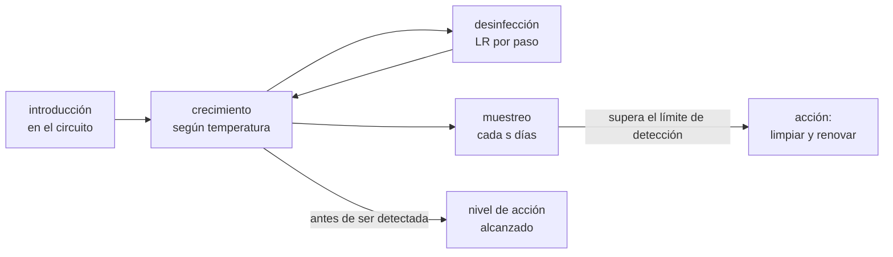

# B115-C07 — Bioseguridad e inocuidad alimentaria en hábitats

<!-- nav:top -->
[🏠 Programa](../../../../README.md) · [📚 Bloque B115](../../../tronco-comun/B115-sistemas-bioregenerativos-y-cultivo-en-habitats.md) · [← Anterior: B115-C06 — Balance de agua y evapotranspiración en cultivos](../B115-C06-balance-de-agua-y-evapotranspiracion-en-cultivos/CLASE.md) · [Siguiente: B116-C01 — Sensores fisiológicos y wearables para vuelo →](../../../tronco-comun/B116-telemedicina-y-monitorizacion-de-salud-en-mision.md#b116-c01)
<!-- /nav -->

## 1. Ubicación, nivel y alcance

Clase 7 del bloque B115. Nivel N3. Un cultivo dentro de un hábitat cerrado comparte aire, agua y superficies con la tripulación: lo que crece en la solución nutritiva puede terminar en el plato. Aquí aprendes a leer una carga microbiana en escala logarítmica, a evaluar un plan de muestreo, a ver cómo crece y se elimina una contaminación en un circuito y a calcular la probabilidad de detectarla a tiempo. Lo que cambia respecto de [B105](../../../tronco-comun/B105-medicina-y-biologia-espacial.md) es el objeto: allí se estudia el microbioma humano; aquí, el de las plantas y su circuito.

## 2. Por qué esta clase existe

Una contaminación en un circuito compartido afecta a todos los lotes a la vez. La decisión central: **¿con qué frecuencia se muestrea, qué se mide y qué barreras (desinfección, lavado, temperatura) hacen falta para que una contaminación se detecte antes de llegar a un nivel de acción?**

## 3. Lo que podrás hacer al terminar

1. Convertir entre UFC/g y log₁₀ UFC/g y comparar con un límite.
2. Calcular la probabilidad de aceptar un lote con un plan de 5 muestras (curva de operación).
3. Calcular cuántas muestras hacen falta para detectar una prevalencia dada.
4. Calcular el flujo de desinfección crítico de un circuito según la temperatura.
5. Calcular la probabilidad de que una contaminación llegue al nivel de acción antes de ser detectada.
6. Rotular qué es consultado, qué es sintético y qué no es una norma.

La evidencia es el **plan de control de inocuidad con su incertidumbre** del ejercicio 12 (sección 20).

## 4. Con qué llegas y cómo comprobarlo

1. ¿Qué es una UFC (unidad formadora de colonias)?
2. ¿Qué es un logaritmo decimal?
3. ¿Qué es una prevalencia?
4. ¿Qué es un dato sintético?
5. ¿Qué es una verificación por segunda vía?

<details>
<summary>Ver respuestas</summary>

1. Una célula o grupo de células viables que forma una colonia visible al cultivarla. 2. El exponente al que se eleva 10 para obtener el número (log₁₀ 1000 = 3). 3. La fracción de unidades que están contaminadas. 4. Un dato generado para el ejemplo, no medido. 5. Calcular lo mismo con otro método (analítico frente a Monte Carlo) y comparar.
</details>

Con cuatro o cinco aciertos, sigue; si no, repasa los prerrequisitos.

## 5. Un caso de contexto y casos de referencia

Un circuito sintético de 40 L con una contaminación inicial de 10 UFC/mL crece con duplicación de 3,96 h a 26 °C. Un desinfectante que trata 0,1 L/min con una reducción de 2 log por paso elimina 0,1485 por hora, menos que el crecimiento (0,1751 por hora): la contaminación **crece** con una tasa neta de 0,0266 por hora y llega a 10⁴ UFC/mL en 259,7 h. A 23 °C el mismo desinfectante la hace decaer. Con muestreo cada 7 días nunca escapa; sin desinfectar, el 84,8 % de los eventos escapa. Es el **ejemplo conductor**: todo es **sintético**.

Caso de referencia consultado: Khodadad y colaboradores (2020) analizaron lechuga cultivada en Veggie en la ISS y compararon con controles en tierra. Los recuentos totales de bacterias y de levaduras y mohos fueron de 2,14 a 4,86 log₁₀ UFC/g y el cribado de patógenos humanos dio negativo. El artículo señala que no hay norma de carga microbiana para producto fresco cultivado en el espacio; los límites de la NASA para alimento no termoestabilizado (< 2×10⁴ UFC/g en una muestra o < 1×10⁴ en dos de cinco) se aplican a alimento preenvasado.

## 6. Vocabulario

La **inocuidad** es la ausencia de peligros que dañen a quien consume. La **bioseguridad** son las barreras que evitan que un agente entre, se propague o salga. La **carga microbiana** son los microorganismos por gramo o por mililitro. La **reducción logarítmica (LR)** es cuántos órdenes de magnitud baja un tratamiento. El **punto de control** es un paso donde se mide o se actúa. El **nivel de acción** es la concentración que obliga a intervenir. El **límite de detección** es la menor concentración que el ensayo distingue.

## 7. Modelo mental



*Descripción textual:* una contaminación entra, crece o decae según la temperatura y la desinfección, y se detecta si el muestreo coincide con una concentración detectable; si crece más rápido de lo que se muestrea, llega al nivel de acción sin ser vista.

Analogía: una gotera en una despensa: si la revisas cada semana y el moho tarda dos días en aparecer, lo descubres tarde. Límite: los microbios no son una población homogénea; hay biopelículas, resistencia y organismos que no crecen en el medio de cultivo.

## 8. La explicación, paso a paso

### 8.1 La escala logarítmica

Los recuentos varían en órdenes de magnitud, de modo que se dan en `log₁₀ UFC/g`. El intervalo de Khodadad y colaboradores, de 2,14 a 4,86, va de 138 a 72 444 UFC/g, un factor de 525. El límite de 2×10⁴ UFC/g es 4,301 log; el valor máximo del estudio es 3,62 veces el límite de los alimentos preenvasados, pero **ese límite no se diseñó para producto fresco**, y los autores citan que para frutas y hortalizas los recuentos totales no son buenos indicadores de riesgo. No es un resultado de «cumple/no cumple».

### 8.2 Un plan de 5 muestras

Una lectura propia del texto citado (**no es la norma**): se acepta el lote si ninguna muestra llega a 2×10⁴ y como máximo una de las cinco llega a 1×10⁴ UFC/g. Con muestras independientes que varían 0,5 log entre sí (sintético), la probabilidad de aceptar es `q₀⁵ + 5 q₀⁴ q₁`, con `q₀ = Φ((4,0 − μ)/σ)` y `q₁ = Φ((4,301 − μ)/σ) − q₀`. Para una media de lote `μ` de 2,5; 3,0; 3,5; 4,0 y 4,5 log, `P(aceptar)` es 99,9; 97,4; 68,2; 10,2 y 0,1 %. Un Monte Carlo (20 000 lotes) coincide dentro de 0,32 puntos. Un lavado que baje 1 log (sintético) sube `P(aceptar)` con `μ = 3,5` de 68,2 a 99,9 %.

### 8.3 Detectar una prevalencia baja

Si una fracción `p` de las unidades está contaminada, con `n` muestras la probabilidad de detectar al menos una es `1 − (1 − p)ⁿ`; para el 95 % de confianza `n = ln 0,05/ln(1 − p)`: 29 unidades para `p = 10 %`, 59 para 5 % y 299 para 1 %. Con 5 muestras solo se detecta el 41,0 %, el 22,6 % y el 4,9 %. **Un resultado negativo con pocas muestras no demuestra ausencia.**

### 8.4 Crecimiento y eliminación en el circuito

Con duplicación de 6 h a 20 °C y `Q₁₀ = 2` (sintético), la tasa de crecimiento es `μ(T) = (ln 2/6)·2^((T−20)/10)`: 0,1155; 0,1422; 0,1751 y 0,2156 por hora a 20, 23, 26 y 29 °C. La desinfección de un caudal `Q` con reducción `LR` elimina `(Q/V)(1 − 10^−LR)`: con 0,1 L/min en 40 L y 2 log, 0,1485 por hora. La tasa neta es negativa a 20 y 23 °C (−0,0330 y −0,0063) y **positiva a 26 y 29 °C** (0,0266 y 0,0671). El flujo crítico que iguala el crecimiento sube con la temperatura: 0,0778; 0,0958; 0,1179 y 0,1452 L/min. Un aumento de 3 °C convierte un circuito que se limpia solo en uno que se contamina. La integración de Euler y la analítica coinciden (error 8×10⁻⁶).

### 8.5 Muestreo frente a velocidad de crecimiento

Una contaminación de 10 UFC/mL llega al límite de detección (10² UFC/mL) en `t_d = ln 10/r` y al nivel de acción (10⁴) en `t_a = ln 1000/r`. Si se muestrea cada `s` horas, la detección llega con un retraso uniforme entre 0 y `s` tras `t_d`, y el evento escapa con probabilidad `1 − (t_a − t_d)/s` (entre 0 y 1). A 26 °C sin desinfección `t_d = 13,2 h` y `t_a = 39,4 h`: muestrear cada día no deja escapar ninguno, cada 3 días escapa el 63,6 % (analítica 63,5 %) y cada 7 días el 84,8 % (84,3 %). Con desinfección de 0,1 L/min a 26 °C `t_d = 86,6 h` y `t_a = 259,7 h`: ni siquiera el muestreo semanal deja escapar. A 29 °C sin desinfección escapa el 11,0 % con muestreo diario. **La frecuencia de muestreo debe elegirse según la velocidad de crecimiento, no por costumbre.**

## 9. Magnitudes, símbolos y unidades

| Símbolo | Qué es | Unidad | Valor / nota |
|---|---|---|---|
| `N` | carga microbiana en alimento | UFC/g o log₁₀ UFC/g | 2,14 a 4,86 log (consultado) |
| `σ` | variación entre muestras | log₁₀ | 0,5 (sintético) |
| `μ(T)` | tasa de crecimiento | h⁻¹ | 0,1155 (20 °C) a 0,2156 (29 °C) |
| LR | reducción logarítmica por paso | log₁₀ | 2 (sintético) |
| `Q`, `V` | caudal tratado y volumen del circuito | L/min, L | 0,1 y 40 |
| `s` | intervalo de muestreo | días | 1, 3, 7 |
| `t_d`, `t_a` | tiempo a detectable y a nivel de acción | h | 13,2 y 39,4 (26 °C, sin desinfección) |

## 10. Convenciones y referencias

Muestras independientes con distribución normal en log₁₀; población homogénea; desinfección que actúa sobre el caudal tratado con mezcla perfecta; el crecimiento sigue una ley exponencial con `Q₁₀`; la detección ocurre al muestrear cuando la concentración supera el límite de detección. Semilla 115 (Monte Carlo de 20 000 repeticiones). Tolerancias: Monte Carlo dentro de 1,5 puntos de la analítica y Euler dentro del 1 %. Numpy 2.4.4, Python 3.12.9.

## 11. De dónde sale lo que afirmamos

| ID | Fuente | Localizador | Respalda | Estado |
|---|---|---|---|---|
| S1 | Khodadad, C. L. M. et al., «Microbiological and Nutritional Analysis of Lettuce Crops Grown on the International Space Station», *Frontiers in Plant Science* 11:199 (2020), doi:10.3389/fpls.2020.00199 — PDF https://www.frontiersin.org/articles/10.3389/fpls.2020.00199/pdf (consultada 2026-11-10, PyMuPDF) | resumen, introducción y métodos | recuentos de 2,14 a 4,86 log₁₀ UFC/g; cribado de patógenos negativo; límite de la NASA < 2×10⁴ UFC/g (una muestra) o < 1×10⁴ (2 de 5) para alimento no termoestabilizado, según Perchonok et al. (2012) citado por el artículo; ausencia de norma para producto fresco; los recuentos totales no son indicadores de riesgo en hortalizas; métodos de cultivo (Petrifilm, enriquecimiento para *Salmonella*) y secuenciación 16S/ITS | Consultada |
| — | Perchonok et al. (2012), Heaton y Jones (2008), Leff y Fierer (2013) | — | solo conocidos por la cita en S1 | No consultada |
| — | Modelo de crecimiento con `Q₁₀`, ley de reducción logarítmica, muestreo por prevalencia | — | las verifica el laboratorio o son ilustrativos | No consultada en una fuente concreta |

Límites: no se consultó ninguna norma de inocuidad de alimentos ni de calificación de vuelo, ni el análisis de peligros de ninguna misión. La «regla de aceptación» es una lectura propia y no la norma de la NASA.

## 12. Cómo ver el resultado

| Magnitud | Valor |
|---|---|
| Intervalo consultado | 138 a 72 444 UFC/g (2,14 a 4,86 log) |
| `P(aceptar)` con `μ` = 3,0 / 3,5 / 4,0 log | 97,4 / 68,2 / 10,2 % |
| Muestras para detectar `p = 1 %` con 95 % | 299 |
| Tasa neta a 23 / 26 °C con 0,1 L/min | −0,0063 / +0,0266 h⁻¹ |
| Flujo crítico a 23 / 26 °C | 0,0958 / 0,1179 L/min |
| Escape sin desinfección (26 °C), muestreo 1 / 3 / 7 días | 0,0 / 63,6 / 84,8 % |

Descripción larga: el muestreo por pocos individuos detecta poco; un aumento de temperatura cambia el signo de la tasa neta; y el muestreo semanal solo vale si la barrera lo hace lento.

## 13. Ejemplo trabajado: flujo crítico a 23 °C

**Paso 1 · Crecimiento.** `μ(23 °C) = (ln 2/6)·2^(0,3) = 0,1155·1,231 = 0,1422 h⁻¹`.

**Paso 2 · Eliminación por litro de caudal.** `(1/V)(1 − 10⁻²)·60 = 60·0,99/40 = 1,485 h⁻¹ por L/min`.

**Paso 3 · Flujo crítico.** `0,1422/1,485 = 0,0958 L/min`.

**Paso 4 · Lectura.** Con 0,1 L/min estás justo por encima (decae); con 0,08 L/min la contaminación crecería.

## 14. Distintas formas de describir el problema

**Por escala:** UFC/g y log₁₀. **Por muestreo:** curva de operación y número de muestras. **Por dinámica:** `crecimiento − eliminación`. **Por tiempo:** `t_d`, `t_a` e intervalo. **Por barreras:** desinfección, lavado, temperatura. **Por riesgo:** probabilidad de escape.

## 15. Práctica guiada

**Ejercicio 1 · con los pasos indicados.** Convierte 4,86 log₁₀ UFC/g a UFC/g y compáralo con 2×10⁴. *Pasos:* eleva 10 a 4,86 y divide.

<details><summary>Solución comentada</summary>

`10^4,86 = 72 444 UFC/g`; `/2×10⁴ = 3,62`.
</details>

**Ejercicio 2 · con una pista.** Expresa 2×10⁴ UFC/g en log₁₀. *Pista:* `log₁₀ 2 = 0,301`.

<details><summary>Solución comentada</summary>

`log₁₀(2×10⁴) = 4,301`.
</details>

**Ejercicio 3 · casi autónomo.** ¿Cuántas muestras hacen falta para detectar con 95 % de confianza una prevalencia del 5 %?

<details><summary>Solución comentada</summary>

`ln 0,05/ln 0,95 = 58,4`, es decir 59 muestras.
</details>

## 16. Práctica autónoma, transferencia e integrador

**Ejercicio 4 · autónomo.** ¿Qué probabilidad de detectar tiene un plan de 5 muestras con prevalencia del 5 %?

<details><summary>Solución comentada</summary>

`1 − 0,95⁵ = 22,6 %`.
</details>

**Ejercicio 5 · autónomo.** Calcula el flujo crítico a 26 °C con `μ = 0,1751 h⁻¹`, `V = 40 L` y `LR = 2`.

<details><summary>Solución comentada</summary>

`0,1751·40/60/0,99 = 0,1179 L/min`.
</details>

**Ejercicio 6 · autónomo.** Con tasa neta de 0,0266 h⁻¹, ¿cuánto tarda en pasar de 10 a 10⁴ UFC/mL?

<details><summary>Solución comentada</summary>

`ln 1000/0,0266 = 6,908/0,0266 = 259,7 h = 10,8 días`.
</details>

**Ejercicio 7 · autónomo.** Sin desinfección a 29 °C (`μ = 0,2156 h⁻¹`), ¿cuánto tarda en pasar de 10 a 100 UFC/mL?

<details><summary>Solución comentada</summary>

`ln 10/0,2156 = 10,7 h`.
</details>

**Ejercicio 8 · autónomo.** Con `t_d = 13,2 h` y `t_a = 39,4 h`, ¿qué probabilidad de escape hay con muestreo cada 3 días (72 h)?

<details><summary>Solución comentada</summary>

`1 − (39,4 − 13,2)/72 = 1 − 0,364 = 63,6 %`.
</details>

**Ejercicio 9 · transferencia.** Un lote da 4,86 log. ¿Basta compararlo con 2×10⁴ UFC/g para decidir si es seguro?

<details><summary>Solución comentada</summary>

No. El límite es de alimento preenvasado y el artículo indica que los recuentos totales no son indicadores de riesgo en hortalizas; la decisión exige la identificación de patógenos y un análisis de peligros hecho por especialistas. Esta clase no la sustituye.
</details>

**Ejercicio 10 · transferencia.** Si la temperatura del circuito sube de 23 a 26 °C, ¿qué le pasa al flujo crítico y qué sugiere?

<details><summary>Solución comentada</summary>

De 0,0958 a 0,1179 L/min (+23 %); con el flujo de 0,1 L/min el circuito pasa de limpiarse a contaminarse. Sugiere controlar y alarmar la temperatura como punto de control.
</details>

**Ejercicio 11 · transferencia.** En C05 los fallos eran independientes entre lotes. ¿Qué cambia si todos los lotes comparten este circuito?

<details><summary>Solución comentada</summary>

Una contaminación del circuito afecta a todos los lotes a la vez: la causa es común y el margen de plantas no ayuda. La barrera debe estar en el circuito (desinfección, muestreo, renovación).
</details>

**Ejercicio 12 · integrador.** Elabora tu *plan de control de inocuidad con su incertidumbre*: carga microbiana y límite (con la advertencia de aplicabilidad), plan de muestreo y su curva de operación, prevalencia detectable, flujo crítico de desinfección según la temperatura, intervalo de muestreo elegido con la probabilidad de escape y lista de qué es consultado, sintético y no es una norma.

<details><summary>Solución comentada</summary>

Secciones 8.1–8.5 y la salida del laboratorio.
</details>

## 17. Laboratorio: carga, muestreo y circuito

El script [inocuidad.py](inocuidad.py) convierte la escala, calcula la curva de operación (analítica y Monte Carlo), la detección por prevalencia, el crecimiento frente a la eliminación y la probabilidad de escape según el intervalo de muestreo (**comprueba** el Monte Carlo dentro de 1,5 puntos y Euler dentro del 1 %). Tarda unos segundos.

**Datos:** recuentos y límite **consultados** (S1); circuito, desinfección, muestreo y crecimiento **sintéticos**; la regla de aceptación es una **lectura propia**. **Predice antes de ejecutar:** ¿un desinfectante que decae a 23 °C seguirá decayendo a 26 °C? (No: a 26 °C la tasa neta pasa a ser positiva.) **Ejecución del 2026-11-10 (Python 3.12.9):**

```text
Python 3.12.9; numpy 2.4.4
DATOS: recuentos y limite de NASA citados por Khodadad et al. (2020, consultado); circuito, desinfeccion y muestreo SINTETICOS
Escala logaritmica
   2.140 log10 UFC/g =       138 UFC/g =  0.01 veces el limite de 2e4 UFC/g
   3.000 log10 UFC/g =      1000 UFC/g =  0.05 veces el limite de 2e4 UFC/g
   4.000 log10 UFC/g =     10000 UFC/g =  0.50 veces el limite de 2e4 UFC/g
   4.301 log10 UFC/g =     19999 UFC/g =  1.00 veces el limite de 2e4 UFC/g
   4.860 log10 UFC/g =     72444 UFC/g =  3.62 veces el limite de 2e4 UFC/g
Curva de operacion del plan de 5 muestras (sigma entre muestras = 0.5 log, sintetico)
   media del lote [log]   P(aceptar) analitica   P(aceptar) Monte Carlo   con lavado de -1 log
                  2.50                   99.9                     99.9                 100.0
                  3.00                   97.4                     97.5                 100.0
                  3.25                   89.4                     89.4                 100.0
                  3.50                   68.2                     67.9                  99.9
                  3.75                   35.6                     35.3                  99.5
                  4.00                   10.2                     10.4                  97.4
                  4.50                    0.1                      0.1                  68.2
   error maximo Monte Carlo frente a analitica = 0.32 puntos
Deteccion por muestreo si la prevalencia de unidades contaminadas es p: n = ln(0.05)/ln(1 - p) para 95 % de confianza
   p = 10.0 %: n =   29 unidades; con 5 muestras P(detectar) =  41.0 %
   p =  5.0 %: n =   59 unidades; con 5 muestras P(detectar) =  22.6 %
   p =  1.0 %: n =  299 unidades; con 5 muestras P(detectar) =   4.9 %
Circuito de 40 L: crecimiento y eliminacion (limite = flujo de desinfeccion que iguala el crecimiento)
   T[C]  duplicacion[h]  mu[1/h]  eliminacion con 0.1 L/min[1/h]  tasa neta[1/h]  t_deteccion[h]  t_accion[h]  sin desinfeccion t_accion[h]
     20            6.00   0.1155                          0.1485         -0.0330             nunca        nunca                          59.8
     23            4.87   0.1422                          0.1485         -0.0063             nunca        nunca                          48.6
     26            3.96   0.1751                          0.1485          0.0266            86.6        259.7                          39.4
     29            3.22   0.2156                          0.1485          0.0671            34.3        103.0                          32.0
   flujo critico de desinfeccion [L/min]: 20 C -> 0.0778, 23 C -> 0.0958, 26 C -> 0.1179, 29 C -> 0.1452
Euler (dt = 0.01 h) a 23 C, 72 h: log10 N = 0.8039 (analitica 0.8039); error relativo = 7.65e-06
Probabilidad de que un evento de contaminacion llegue al nivel de accion antes de ser detectado (20000 eventos por caso)
   caso                         intervalo de muestreo[dia]   P(escapa) Monte Carlo   analitica
   26 C sin desinfeccion                           1                    0.0         0.0
   26 C sin desinfeccion                           3                   63.6        63.5
   26 C sin desinfeccion                           7                   84.8        84.3
   26 C con 0.1 L/min                              1                    0.0         0.0
   26 C con 0.1 L/min                              3                    0.0         0.0
   26 C con 0.1 L/min                              7                    0.0         0.0
   29 C sin desinfeccion                           1                   11.0        11.0
   29 C sin desinfeccion                           3                   70.0        70.3
   29 C sin desinfeccion                           7                   87.0        87.3
   error maximo Monte Carlo frente a analitica = 0.42 puntos
Pruebas superadas.
```

```bash
python programa/clases/B115/B115-C07-bioseguridad-e-inocuidad-alimentaria-en-habitats/inocuidad.py
```

**Límites:** población microbiana homogénea, un solo organismo, sin biopelículas, sin resistencia ni persistencia, sin muerte natural ni limitación de nutrientes, un solo punto de introducción; los parámetros son sintéticos. No es un análisis de peligros ni un plan de inocuidad.

## 18. Errores frecuentes y cómo corregirlos

**Comparar un recuento total con un límite que no se diseñó para el alimento.** Se corrige con 8.1 y el ejercicio 9.

**Concluir ausencia con un resultado negativo de pocas muestras.** Se corrige con 8.3.

**Muestrear con una frecuencia fija sin mirar la velocidad de crecimiento.** Se corrige con 8.5.

**Presentar un parámetro sintético como una norma o un dato de misión.** Se corrige con la sección 10.

## 19. Cómo sabrás que vas bien

Tras la sección 8: ¿qué probabilidad de escape esperabas y cuál obtuviste? Si dudas, repasa el ejemplo 13. Tras el laboratorio: ¿qué comprueba? (ver la sección 17).

## 20. Qué entregas y cómo se evalúa

El producto es tu **plan de control de inocuidad con su incertidumbre** (ejercicio 12).

| Criterio | Inicial | En desarrollo | Logrado | Destacado |
|---|---|---|---|---|
| Conceptos | Confunde carga y riesgo | Parciales | Explica escala logarítmica, muestreo y barreras | Explica los límites de un recuento total |
| Cálculo | Sin unidades | Con errores | Calcula `P(aceptar)`, `n` y flujo crítico con unidades | Calcula casos nuevos |
| Numérico | Sin comprobar | Un caso | Compara Monte Carlo y analítica | Interpreta el cambio de signo de la tasa |
| Fuentes | Sin fuente | Sin fecha | Fuentes con fecha y estado | Declara que no es una norma |
| Límites | No los nombra | Uno | Tres | Discute qué falta del modelo |

**Condiciones críticas (no se compensan con promedio):** rotular lo sintético y que no es una norma; no dar consejo médico ni operativo; citar solo lo consultado.

## 21. Ética, seguridad y límites

Clase educativa: **no da consejo médico, sanitario ni operativo** ni valida alimento para consumo. Los parámetros son sintéticos; la regla de aceptación es una lectura propia y no una norma. La decisión de consumir un alimento en una misión corresponde a especialistas con análisis de peligros, muestreo real e identificación de patógenos. Accesibilidad: tablas equivalentes a las gráficas, fórmulas en texto, ejercicios sin conexión.

## 22. Para cerrar y seguir

Con 0,1 L/min de desinfección, un circuito de 40 L se limpia solo hasta unos 23,6 °C (cálculo propio con la tasa de 8.4) y se contamina a 26 °C, y un muestreo semanal solo basta si la barrera hace lento el crecimiento. Con esto se cierra el bloque: el módulo de cultivo, su luz, sus nutrientes, su agua y su calendario solo sirven si el alimento es seguro. Queda una pregunta: ¿cómo se integra este módulo en el soporte vital completo del hábitat?

**Glosario español–inglés.** inocuidad · *food safety*; bioseguridad · *biosafety*; unidad formadora de colonias · *colony-forming unit (CFU)*; reducción logarítmica · *log reduction*; nivel de acción · *action level*.

**Continuidad.** El bloque termina aquí; la integración con el soporte vital está en [B106](../../../tronco-comun/B106-habitats-espaciales-y-soporte-vital.md).

**Referencias:** ver sección 11.

<!-- nav:bottom -->
---

[← Anterior: B115-C06 — Balance de agua y evapotranspiración en cultivos](../B115-C06-balance-de-agua-y-evapotranspiracion-en-cultivos/CLASE.md) · [📚 Bloque B115](../../../tronco-comun/B115-sistemas-bioregenerativos-y-cultivo-en-habitats.md) · [Siguiente: B116-C01 — Sensores fisiológicos y wearables para vuelo →](../../../tronco-comun/B116-telemedicina-y-monitorizacion-de-salud-en-mision.md#b116-c01)
<!-- /nav -->
