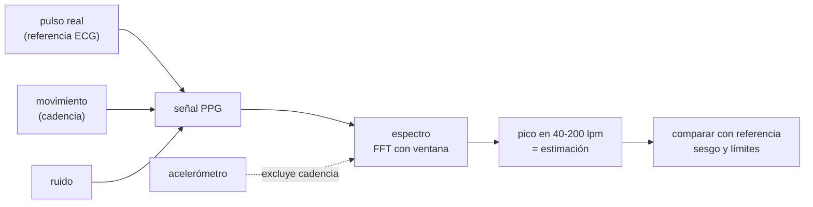

# B116-C01 — Sensores fisiológicos y wearables para vuelo

<!-- nav:top -->
[🏠 Programa](../../../../README.md) · [📚 Bloque B116](../../../tronco-comun/B116-telemedicina-y-monitorizacion-de-salud-en-mision.md) · [← Anterior: B115-C07 — Bioseguridad e inocuidad alimentaria en hábitats](../../B115/B115-C07-bioseguridad-e-inocuidad-alimentaria-en-habitats/CLASE.md) · [Siguiente: B116-C02 — Signos vitales: medición, interpretación y límites →](../B116-C02-signos-vitales-medicion-interpretacion-y-limites/CLASE.md)
<!-- /nav -->

## 1. Ubicación, nivel y alcance

Clase 1 de 7 del bloque B116. Nivel N4. Abre el bloque: antes de interpretar un signo vital hay que saber **cuánto se equivoca el sensor que lo mide**. La clase trata un sensor óptico de pulso (fotopletismografía, PPG) en una pulsera: cómo se estima la frecuencia cardiaca, cómo el movimiento la corrompe y cómo se cuantifica el error con sesgo y límites de acuerdo. La señal es **sintética**; no describe ningún dispositivo ni persona. **Clase educativa: no da consejo médico ni operativo.**

## 2. Por qué esta clase existe

Una pulsera que da «72 lpm» no dice «72 ± 0,1». Con movimiento puede dar 120 cuando el pulso real es 70. La decisión central: **¿en qué condiciones es utilizable la medida de un wearable y qué evidencia de desempeño hace falta antes de usarla en vuelo?**

## 3. Lo que podrás hacer al terminar

1. Explicar cómo una señal PPG se convierte en frecuencia cardiaca con un espectro.
2. Calcular la resolución espectral `60/T` de una ventana de `T` segundos.
3. Identificar cuándo el artefacto de movimiento domina y el estimador se engancha a la cadencia.
4. Calcular sesgo y límites de acuerdo (Bland–Altman) y reconocer cuándo engañan.
5. Evaluar una mitigación con un acelerómetro de referencia y sus límites.
6. Rotular lo simulado frente a lo consultado y no atribuir a un dispositivo real los resultados del laboratorio.

La evidencia es la **ficha de desempeño de un sensor** del ejercicio 12 (sección 20).

## 4. Con qué llegas y cómo comprobarlo

1. ¿Qué es una frecuencia en hercios y cómo se pasa a latidos por minuto?
2. ¿Qué es una transformada de Fourier, a grandes rasgos?
3. ¿Qué es una desviación estándar?
4. ¿Qué diferencia hay entre sesgo y dispersión?
5. ¿Qué es un dato sintético?

<details>
<summary>Ver respuestas</summary>

1. Ciclos por segundo; se multiplica por 60. 2. Una descomposición de una señal en frecuencias. 3. Una medida de dispersión alrededor de la media. 4. El sesgo es el error medio; la dispersión es la variación alrededor de él. 5. Un dato generado por un modelo, no medido; se rotula como tal.
</details>

Con cuatro o cinco aciertos, sigue; si no, repasa los prerrequisitos.

## 5. Un caso de contexto y casos de referencia

Una pulsera sintética mide con luz el volumen de sangre bajo la piel durante 30 s a 25 Hz. En reposo el estimador acierta con error máximo de 0,05 lpm. Cuando la persona hace un ejercicio con cadencia de 120 ciclos/min y el artefacto alcanza el 100 % de la amplitud del pulso, **la mitad de las estimaciones fallan por más de 5 lpm** (53,5 %); con 150 % fallan todas, con un sesgo de +45,65 lpm: el estimador mide la cadencia, no el pulso. Con el acelerómetro que informa de la cadencia y excluye esa banda, el fallo baja a 0 % en el laboratorio. Es el **ejemplo conductor**: todo es **sintético** (semilla 116).

## 6. Vocabulario

La **fotopletismografía (PPG)** mide con luz los cambios de volumen de sangre en la piel. La **frecuencia cardiaca** es el número de latidos por minuto (lpm). El **artefacto de movimiento** es la parte de la señal causada por el movimiento y no por el pulso. La **resolución espectral** es la separación mínima entre dos frecuencias distinguibles, `1/T` Hz o `60/T` lpm. **Bland–Altman**: gráfico y resumen de las diferencias entre dos métodos, con sesgo y límites de acuerdo `sesgo ± 1,96·DE`. **Cadencia**: ritmo del movimiento repetitivo. **Referencia** (*gold standard*): método considerado más exacto, aquí un ECG simulado.

## 7. Modelo mental



*Descripción textual:* la señal óptica suma pulso, movimiento y ruido; el espectro da una estimación por su pico; el acelerómetro puede excluir la banda del movimiento; la estimación se compara con la referencia.

Analogía: oír una voz en una sala con una taladradora; si la taladradora es más fuerte, se oye la taladradora. Límite: aquí el movimiento es una sinusoide perfecta; en la realidad es irregular y su espectro es más ancho.

## 8. La explicación, paso a paso

### 8.1 De la señal al número

La señal PPG se resta de su media, se multiplica por una ventana de Hann, se transforma con la FFT (con relleno de ceros ×16 para interpolar) y se toma el pico entre 40 y 200 lpm. Control: sin movimiento ni ruido el error máximo es 0,05 lpm en cinco frecuencias distintas.

### 8.2 Resolución y ventana

La resolución natural es `60/T`: 7,50 lpm con 8 s, 4,00 con 15 s, 2,00 con 30 s y 1,00 con 60 s. El relleno de ceros interpola, pero no separa dos frecuencias más próximas que `60/T`. Una ventana corta responde más rápido pero distingue peor.

### 8.3 El movimiento

Con la amplitud del artefacto en 0,0–0,6 veces la del pulso el error es nulo; con 0,8 aparece una dispersión de 9,40 lpm aunque solo el 2,5 % de los casos supera 5 lpm de error; con 1,0 el sesgo es +24,26 lpm y el 53,5 % de los casos falla; con 1,5 falla el 100 %. La transición es **abrupta**: cuando el artefacto supera al pulso, el pico del espectro cambia de sitio.

### 8.4 Sesgo y límites de acuerdo

Con amplitud 0,8, sesgo 1,50 y DE 9,40 lpm los límites son `1,50 ± 1,96·9,40 = [−16,9; 19,9]` lpm. Esos límites suponen diferencias gaussianas; aquí la distribución tiene colas pesadas (pocos errores enormes) y el resumen engaña: 2,5 % de fallos grandes con una media casi nula. Hay que mirar el histograma y el porcentaje fuera de tolerancia.

### 8.5 Mitigación con acelerómetro

Si el acelerómetro da la cadencia (120 ciclos/min), se excluye `±6 lpm` en torno a ella. En el laboratorio baja el fallo a 0 % para amplitudes de hasta 1,5. Límite: si el pulso real **coincide** con la cadencia (por ejemplo 118 lpm con cadencia de 120), se excluye la señal buscada; con la FC verdadera de 118 lpm y amplitud 2,5 el estimador sin acelerómetro da 119,8 lpm (el laboratorio no calcula ese caso con la máscara, pero la banda excluida contiene el pulso).

### 8.6 Qué dicen las fuentes y qué no

Una revisión sistemática de Koerber et al. (2022) reunió 10 estudios con 469 participantes sobre pulseras y tono de piel: 4 hallaron menor exactitud en piel más oscura, 4 no hallaron efecto y 2 mixtos; la conclusión de los autores es «inconclusa». Para los oxímetros de pulso, la FDA indica que las lecturas pueden verse afectadas por mala circulación, pigmentación, grosor y temperatura de la piel, tabaco y esmalte de uñas, y que solo un profesional sanitario diagnostica. **Ninguna de estas fuentes trata el vuelo espacial.** No se consultó ninguna validación de un wearable en microgravedad.

## 9. Magnitudes, símbolos y unidades

| Símbolo | Qué es | Unidad | Valor / nota |
|---|---|---|---|
| `f_s` | frecuencia de muestreo | Hz | 25 |
| `T` | ventana de análisis | s | 8–60 |
| `FC` | frecuencia cardiaca | lpm | 55–95 en el laboratorio |
| `60/T` | resolución espectral | lpm | 7,5; 4; 2; 1 |
| `a_mov / a_pulso` | amplitud relativa del artefacto | — | 0–1,5 |
| sesgo, DE | media y desviación de las diferencias | lpm | ver 8.3 |
| límites | `sesgo ± 1,96·DE` | lpm | [−16,9; 19,9] con 0,8 |

## 10. Convenciones y referencias

Señal sintética con dos armónicos del pulso (el segundo al 35 %), artefacto sinusoidal a 2,0 Hz (120 ciclos/min) con fase aleatoria y ruido gaussiano de DE 0,1. Estimador: ventana de Hann, FFT con relleno ×16, banda 40–200 lpm. Referencia: la FC verdadera de la simulación (como un ECG ideal). Semilla 116. Tolerancias: control sin movimiento ni ruido con error < 1 lpm; fallo con movimiento 1,5 mayor que con 0; el fallo con acelerómetro menor que sin él. Numpy 2.4.4, Python 3.12.9. No hay sistema de referencia espacial.

## 11. De dónde sale lo que afirmamos

| ID | Fuente | Localizador | Respalda | Estado |
|---|---|---|---|---|
| S1 | Koerber, D. et al., «Accuracy of Heart Rate Measurement with Wrist-Worn Wearable Devices in Various Skin Tones: a Systematic Review», *J Racial Ethn Health Disparities* (2022) — https://pmc.ncbi.nlm.nih.gov/articles/PMC9662769/ (consultada 2026-11-10) | resumen | 10 estudios, 469 participantes; resultados mixtos; conclusión «inconclusa» | Consultada (solo resumen) |
| S2 | FDA, «Pulse Oximeter Basics» — https://www.fda.gov/consumers/consumer-updates/pulse-oximeter-basics (consultada 2026-11-10) | página completa | factores que afectan la lectura; solo un profesional diagnostica | Consultada |
| S3 | Zhang, Y. et al., meta-análisis de la validez de pulseras PPG, *J Sports Sci* (2020) | resultado de búsqueda | el error aumenta con ejercicios de resistencia y ciclismo | Consultada solo mediante un resumen de resultados de búsqueda; el artículo **no se leyó** |
| — | Relaciones de procesamiento de señal (FFT, ventana de Hann, resolución `1/T`) y estadística de Bland–Altman | — | las verifica el laboratorio | No consultada en una fuente concreta (las verifica el laboratorio) |

Límites: no se consultó ninguna validación de wearables en vuelo ni en microgravedad; las cifras de error del laboratorio son del simulador y no de un dispositivo. Los documentos de la NASA sobre wearables no se consultaron.

## 12. Cómo ver el resultado

| Magnitud | Valor |
|---|---|
| Error sin movimiento (30 s) | 0,05 lpm |
| Resolución con 8 / 30 / 60 s | 7,5 / 2,0 / 1,0 lpm |
| Fallo > 5 lpm con movimiento 1,0 / 1,5 | 53,5 % / 100 % |
| Con acelerómetro, movimiento 1,5 | 0,0 % |

Descripción larga: el error es nulo hasta que el movimiento iguala al pulso y de ahí salta; la ventana mejora la resolución pero no arregla un artefacto dominante.

## 13. Ejemplo trabajado: límites de acuerdo y resolución

**Paso 1 · Resolución.** Ventana de 15 s: `60/15 = 4` lpm.

**Paso 2 · Sesgo y DE.** Con amplitud 0,8: sesgo 1,50 lpm y DE 9,40 lpm.

**Paso 3 · Límites.** `1,96·9,40 = 18,42`; `[1,50 − 18,42; 1,50 + 18,42] = [−16,9; 19,9]`.

**Paso 4 · Lectura.** La dispersión viene de pocos fallos grandes (solo el 2,5 % supera 5 lpm de error); el sesgo casi nulo engaña.

## 14. Distintas formas de describir el problema

**Por frecuencia:** el pico del espectro. **Por tiempo:** la ventana de `T` s. **Por error:** sesgo, DE y porcentaje fuera de tolerancia. **Por causa:** pulso, movimiento y ruido. **Por mitigación:** acelerómetro. **Por tabla:** la salida del laboratorio.

## 15. Práctica guiada

**Ejercicio 1 · con los pasos indicados.** Calcula la resolución espectral para `T = 15` s. *Pasos:* `60/T`.

<details><summary>Solución comentada</summary>

`60/15 = 4` lpm.
</details>

**Ejercicio 2 · con una pista.** Con sesgo 1,50 lpm y DE 9,40 lpm, calcula los límites de acuerdo. *Pista:* `sesgo ± 1,96·DE`.

<details><summary>Solución comentada</summary>

`[−16,9; 19,9]` lpm.
</details>

**Ejercicio 3 · casi autónomo.** Con la FC verdadera de 118 lpm y movimiento a 120 ciclos/min de amplitud 2,5, el estimador da 119,8 lpm. ¿Qué mide en realidad? *Pista:* compara con 120.

<details><summary>Solución comentada</summary>

Mide la cadencia del movimiento, no el pulso: el pico del artefacto domina el espectro.
</details>

## 16. Práctica autónoma, transferencia e integrador

**Ejercicio 4 · autónomo.** Con `f_s = 25` Hz, ¿cuál es la frecuencia máxima representable y a cuántos lpm equivale?

<details><summary>Solución comentada</summary>

`f_s/2 = 12,5` Hz `= 750` lpm: sobra para el pulso y sus armónicos.
</details>

**Ejercicio 5 · autónomo.** Si la FC verdadera fuera 120 lpm y la cadencia 120 ciclos/min, ¿ayuda excluir la banda de la cadencia?

<details><summary>Solución comentada</summary>

No: se excluye también el pulso buscado. La mitigación falla cuando pulso y cadencia coinciden.
</details>

**Ejercicio 6 · autónomo.** Con una ventana de 8 s, ¿se puede distinguir un cambio de 3 lpm?

<details><summary>Solución comentada</summary>

No de forma fiable: la resolución natural es 7,5 lpm (el relleno de ceros interpola pero no separa).
</details>

**Ejercicio 7 · autónomo.** Con movimiento 0,8 hay DE de 9,40 lpm y solo el 2,5 % de errores por encima de 5 lpm. ¿Qué indica?

<details><summary>Solución comentada</summary>

Una distribución de colas pesadas: casi todos aciertan y unos pocos fallan mucho; los límites gaussianos subestiman o sobreestiman según el caso y hay que informar el porcentaje fuera de tolerancia.
</details>

**Ejercicio 8 · autónomo.** Cuatro de diez estudios hallaron menor exactitud en piel más oscura y cuatro no hallaron efecto. ¿Qué afirmas?

<details><summary>Solución comentada</summary>

Que la evidencia es inconclusa (como concluyen los autores): hay que validar el dispositivo en todos los tonos de piel de la tripulación y no suponer ni que existe ni que no existe el sesgo.
</details>

**Ejercicio 9 · transferencia.** **Transferencia.** Un sensor se usará en reposo nocturno y otro en ejercicio. ¿Qué exigencia de validación cambia?

<details><summary>Solución comentada</summary>

En ejercicio hay que validar con movimiento (la tabla muestra la transición abrupta) y con acelerómetro; en reposo basta una validación más sencilla pero también con límites de acuerdo.
</details>

**Ejercicio 10 · transferencia.** **Transferencia.** Un wearable validado en tierra se usa en microgravedad. ¿Qué no puedes afirmar?

<details><summary>Solución comentada</summary>

Que su error sea el mismo: la perfusión, la postura y el movimiento cambian y no se consultó ninguna validación en vuelo. Hay que repetir la validación en el entorno de uso.
</details>

**Ejercicio 11 · transferencia.** **Transferencia.** Para ahorrar batería se reduce `f_s` a 12,5 Hz. ¿Qué frecuencia máxima queda y se pierde el segundo armónico de un pulso de 100 lpm?

<details><summary>Solución comentada</summary>

Máxima 6,25 Hz. El segundo armónico de 100 lpm es 3,33 Hz < 6,25: no se pierde, pero se reduce el margen.
</details>

**Ejercicio 12 · integrador.** **Integrador.** Elabora tu *ficha de desempeño de un sensor*: tabla de error por nivel de movimiento, resolución por ventana, sesgo y límites, porcentaje fuera de tolerancia, mitigación y sus límites, qué es simulado y qué fuentes se consultaron.

<details><summary>Solución comentada</summary>

Secciones 8.1–8.6 y la salida del laboratorio.
</details>

## 17. Laboratorio: frecuencia cardiaca óptica con movimiento

El script [sensor.py](sensor.py) genera una señal PPG sintética, estima la FC con la FFT y calcula el error por nivel de movimiento, la resolución por ventana, el sesgo y los límites de acuerdo y la mitigación con acelerómetro (**comprueba** el error < 1 lpm sin movimiento, el aumento del fallo con el movimiento y la mejora con la máscara).

**Datos:** todo **sintético** (semilla 116); ninguna cifra procede de una persona ni de un dispositivo. **Predice antes de ejecutar:** ¿qué estimará el sensor si el movimiento es el doble de intenso que el pulso? (La cadencia, con un fallo del 100 %.) **Ejecución del 2026-11-10 (Python 3.12.9):**

```text
Python 3.12.9; numpy 2.4.4
DATOS SINTETICOS (semilla 116): senal PPG simulada; ninguna cifra procede de una persona ni de un dispositivo real
Control sin movimiento ni ruido: error maximo = 0.05 lpm (ventana 30 s)
Resolucion espectral natural 60/T con T =  8 s:  7.50 lpm
Resolucion espectral natural 60/T con T = 15 s:  4.00 lpm
Resolucion espectral natural 60/T con T = 30 s:  2.00 lpm
Resolucion espectral natural 60/T con T = 60 s:  1.00 lpm
Error segun el nivel de movimiento (ventana 30 s, 200 ensayos, FC verdadera 55-95 lpm):
  amp. mov/amp. pulso   sesgo [lpm]   DE dif [lpm]   limites de acuerdo [lpm]   |error|>5 lpm   con acelerometro
        0.0               0.00          0.04        [   -0.1,    0.1]            0.0 %             0.0 %
        0.3               0.00          0.04        [   -0.1,    0.1]            0.0 %             0.0 %
        0.6              -0.00          0.04        [   -0.1,    0.1]            0.0 %             0.0 %
        0.8               1.50          9.40        [  -16.9,   19.9]            2.5 %             0.0 %
        1.0              24.26         24.31        [  -23.4,   71.9]           53.5 %             0.0 %
        1.5              45.65         11.75        [   22.6,   68.7]          100.0 %             0.0 %
Efecto de la ventana con movimiento 1.5 (200 ensayos):
  ventana [s]   |error| medio [lpm]   fraccion con |error| > 5 lpm
       8             44.55                100.0 %
      15             43.97                100.0 %
      30             45.02                100.0 %
      60             45.22                100.0 %
Caso de captura del artefacto: FC verdadera 118 lpm con movimiento a 120 ciclos/min y amplitud 2.5:
  estimacion media = 119.8 lpm (el estimador se engancha a la cadencia, no al pulso)
Pruebas superadas.
```

```bash
python programa/clases/B116/B116-C01-sensores-fisiologicos-y-wearables-para-vuelo/sensor.py
```

**Límites:** un solo canal óptico, movimiento sinusoidal, FC en reposo de 55 a 95 lpm, ruido blanco, referencia ideal; no replica la electrónica ni los algoritmos de ningún fabricante.

## 18. Errores frecuentes y cómo corregirlos

**Creer que el sesgo medio basta.** Informa el porcentaje fuera de tolerancia (8.4).

**Usar una ventana corta para distinguir cambios pequeños.** Calcula `60/T` (8.2).

**Excluir la banda de movimiento sin pensar en la coincidencia.** Comprueba el caso 8.5.

**Presentar el simulador como un dispositivo real.** Se corrige con la sección 10.

## 19. Cómo sabrás que vas bien

Tras la sección 8: ¿qué pasa con el estimador cuando el movimiento supera al pulso? Si dudas, repasa 8.3. Tras el laboratorio: ¿qué comprueba? (ver la sección 17).

## 20. Qué entregas y cómo se evalúa

El producto es tu **ficha de desempeño de un sensor** (ejercicio 12).

| Criterio | Inicial | En desarrollo | Logrado | Destacado |
|---|---|---|---|---|
| Conceptos | Confunde pulso y artefacto | Parciales | Explica espectro, resolución y artefacto | Explica cuándo falla la mitigación |
| Cálculo | Sin unidades | Con errores | Calcula `60/T` y límites | Calcula casos nuevos |
| Numérico | Sin control | Un caso | Control sin movimiento y barrido | Informa colas pesadas |
| Fuentes | Sin fuente | Sin fecha | Fuentes con fecha y estado | Declara lo no consultado |
| Límites | No los nombra | Uno | Tres | Discute la validación en vuelo |

**Condiciones críticas (no se compensan con promedio):** rotular lo simulado; no dar consejo médico ni operativo; no atribuir los resultados a un dispositivo real; citar solo lo consultado.

## 21. Ética, seguridad y límites

Clase educativa: **no da consejo médico ni operativo**. Un wearable de consumo no es un equipo médico; sus lecturas no sirven para diagnosticar ni para decidir sobre la salud de una persona. Cualquier uso real exige un dispositivo con la regulación aplicable, validación en el entorno de uso, consentimiento y revisión de personal sanitario. Los datos de salud son sensibles. Accesibilidad: tablas equivalentes a las gráficas, fórmulas en texto, ejercicios sin conexión.

## 22. Para cerrar y seguir

Un sensor óptico da una medida con un error que depende del movimiento: nulo en reposo, abrupto cuando el artefacto iguala al pulso y mitigable solo si se conoce la cadencia. Se informa con sesgo, límites y porcentaje fuera de tolerancia, y se valida donde se usará. En la clase siguiente el número del sensor se convierte en signo vital.

**Glosario español–inglés.** fotopletismografía · *photoplethysmography (PPG)*; frecuencia cardiaca · *heart rate*; artefacto de movimiento · *motion artifact*; límites de acuerdo · *limits of agreement*; ventana · *window*.

**Continuidad.** Sigue con la clase siguiente del bloque; ver el [bloque B116](../../../tronco-comun/B116-telemedicina-y-monitorizacion-de-salud-en-mision.md).

**Referencias:** ver sección 11.

<!-- nav:bottom -->
---

[← Anterior: B115-C07 — Bioseguridad e inocuidad alimentaria en hábitats](../../B115/B115-C07-bioseguridad-e-inocuidad-alimentaria-en-habitats/CLASE.md) · [📚 Bloque B116](../../../tronco-comun/B116-telemedicina-y-monitorizacion-de-salud-en-mision.md) · [Siguiente: B116-C02 — Signos vitales: medición, interpretación y límites →](../B116-C02-signos-vitales-medicion-interpretacion-y-limites/CLASE.md)
<!-- /nav -->
