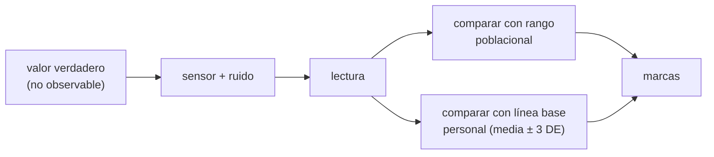

# B116-C02 — Signos vitales: medición, interpretación y límites

<!-- nav:top -->
[🏠 Programa](../../../../README.md) · [📚 Bloque B116](../../../tronco-comun/B116-telemedicina-y-monitorizacion-de-salud-en-mision.md) · [← Anterior: B116-C01 — Sensores fisiológicos y wearables para vuelo](../B116-C01-sensores-fisiologicos-y-wearables-para-vuelo/CLASE.md) · [Siguiente: B116-C03 — Historia clínica remota y registros médicos de misión →](../B116-C03-historia-clinica-remota-y-registros-medicos-de-mision/CLASE.md)
<!-- /nav -->

## 1. Ubicación, nivel y alcance

Clase 2 de 7 del bloque B116. Nivel N4. Toma el número que entrega un sensor (B116-C01) y pregunta qué significa: los signos vitales de reposo (pulso, frecuencia respiratoria, temperatura, presión arterial), sus rangos de referencia, cuánto cambia la lectura por el ruido de medida y por qué **la línea base personal** puede ser más informativa que el rango poblacional. Los datos son **sintéticos**. **Clase educativa: no da consejo médico ni operativo; los rangos no sirven para evaluar a una persona.**

## 2. Por qué esta clase existe

Un panel que marca en rojo todo lo que sale de «60–100 lpm» genera cientos de marcas por ruido en una persona sana, y puede no ver que un atleta con 52 lpm pasó a 64: sigue «dentro del rango». La decisión central: **¿con respecto a qué se compara una medida y cuánto de la desviación es ruido?**

## 3. Lo que podrás hacer al terminar

1. Citar los rangos de reposo de un adulto sano de una fuente y su advertencia de variabilidad.
2. Calcular la presión de pulso y la presión arterial media aproximada.
3. Calcular la probabilidad de marca falsa de un valor normal con ruido gaussiano y comprobarla con Monte Carlo.
4. Construir una línea base personal (media ± 3 DE) y compararla con el rango poblacional.
5. Explicar por qué una persona normal puede quedar fuera del rango poblacional todo el tiempo.
6. Rotular lo sintético y lo no consultado.

La evidencia es la **tabla de signos con incertidumbre** del ejercicio 12 (sección 20).

## 4. Con qué llegas y cómo comprobarlo

1. ¿Qué es la distribución normal (gaussiana)?
2. ¿Qué mide una desviación estándar?
3. ¿Qué es una probabilidad condicionada a un umbral?
4. ¿Qué son mmHg?
5. ¿Qué es una línea base?

<details>
<summary>Ver respuestas</summary>

1. Una campana simétrica descrita por media y desviación. 2. La dispersión típica alrededor de la media. 3. La fracción de casos que supera el umbral. 4. Milímetros de mercurio, unidad de presión. 5. El valor de referencia propio de una persona o sistema en estado normal.
</details>

Con cuatro o cinco aciertos, sigue; si no, repasa los prerrequisitos.

## 5. Un caso de contexto y casos de referencia

Una persona sintética con pulso verdadero de 98 lpm (dentro de 60–100) y un sensor con ruido de 3 lpm sale de rango en **el 25,25 %** de las medidas: con una medida cada 5 minutos serían 72,7 marcas por día en una persona normal. Otra persona sintética vive en 52 lpm; el rango poblacional la marca **todos los días** y, cuando su pulso sube a 64 lpm, la **deja de marcar**: el cambio de +12 lpm es invisible. Su línea base personal (media 51,9 lpm, DE 1,50) marca el día 20 exacto. Es el **ejemplo conductor**: todo es **sintético** (semilla 117).

## 6. Vocabulario

Los **signos vitales** son medidas básicas del estado fisiológico: pulso, frecuencia respiratoria, temperatura y presión arterial, entre otros. El **rango de referencia** es el intervalo en el que cae la mayoría de los adultos sanos en reposo. La **presión de pulso** es `PAS − PAD`; la **presión arterial media** aproximada `PAM = PAD + (PAS − PAD)/3`. La **línea base personal** es la media y la dispersión propias en un periodo de referencia. La **marca falsa** es una lectura marcada como anómala que en realidad es normal y solo está desplazada por el ruido. El **ruido de medida** es la variación aleatoria del sensor.

## 7. Modelo mental



*Descripción textual:* el valor verdadero se mide con ruido; la lectura se compara con un rango poblacional o con la línea base personal; ambas dan marcas con distinta sensibilidad y distintas falsas alarmas.

Analogía: juzgar la talla de una persona con la talla media del país o con su propia talla de la semana pasada; para detectar un cambio sirve la segunda. Límite: la línea base necesita días de datos y puede ocultar un problema ya presente al empezar.

## 8. La explicación, paso a paso

### 8.1 Rangos de referencia

MedlinePlus da para el adulto sano en reposo: pulso 60–100 lpm, frecuencia respiratoria 12–18 resp/min, temperatura 36,5–37,3 °C y presión 90/60 a 120/80 mmHg, y advierte que los valores normales cambian con la edad, el sexo, el peso, la capacidad de ejercicio y la salud general. Son **rangos poblacionales**, no el normal de una persona.

### 8.2 Presión de pulso y PAM

Para 120/80 mmHg: `PP = 40 mmHg` y `PAM = 80 + 40/3 = 93,3 mmHg`. Son relaciones estándar que verifica el laboratorio; no se consultaron en una fuente concreta.

### 8.3 Marca falsa por ruido

Un valor normal cerca del borde, medido con ruido gaussiano `σ`, sale de rango con probabilidad `P = Φ((lo − v)/σ) + 1 − Φ((hi − v)/σ)`. Resultados (analítica / Monte Carlo): pulso 98 lpm con `σ = 3`: 0,2525 / 0,2527; pulso 80: 0,0000; respiración 17 resp/min con `σ = 1,5`: 0,2529 / 0,2528; temperatura 37,2 °C con `σ = 0,2`: 0,3088 / 0,3077 y con `σ = 0,05`: 0,0228 / 0,0229. La diferencia máxima es 0,0011. Reducir el ruido de 0,2 a 0,05 °C baja la marca falsa del 31 % al 2,3 %.

### 8.4 Línea base personal

Con 14 días de referencia, la persona de 52 lpm tiene media 51,9 y DE 1,50 lpm; el umbral personal `media ± 3·DE` es [47,4; 56,4]. Con el cambio verdadero de +12 lpm desde el día 20 el criterio personal marca el día 20 y los 10 de 10 días siguientes. El rango poblacional marca los **20 primeros días** (todos normales para esa persona) y no marca los últimos 10 (64 lpm cae en 60–100): es el resultado opuesto al deseable.

### 8.5 Una persona en 75 lpm

Con un pulso de reposo de 75 lpm que sube a 87, el rango poblacional no marca ningún día y el personal marca desde el día 20. El rango poblacional tiene baja sensibilidad al cambio dentro del rango.

### 8.6 Cambios fisiológicos en vuelo

La nota técnica OCHMO-TB-043 de la NASA lista entre los cambios fisiológicos prevalentes en microgravedad la pérdida de fluidos y la intolerancia ortostática, los déficits musculares y aerobios y la pérdida ósea, entre otros. Por eso el vuelo exige línea base previa a la misión y vigilancia longitudinal; ese documento no da rangos de signos vitales y **no se consultaron rangos de signos vitales en vuelo**.

## 9. Magnitudes, símbolos y unidades

| Símbolo | Qué es | Unidad | Valor / nota |
|---|---|---|---|
| pulso | latidos por minuto | lpm | 60–100 (MedlinePlus) |
| FR | frecuencia respiratoria | resp/min | 12–18 |
| T | temperatura | °C | 36,5–37,3 |
| PAS/PAD | presión sistólica/diastólica | mmHg | 120/80 |
| PP, PAM | presión de pulso y media | mmHg | 40; 93,3 |
| `σ` | ruido del sensor | unidad de la magnitud | 3 lpm; 1,5 resp/min; 0,2 °C |
| `Φ` | función de distribución normal | — | vía `erf` |

## 10. Convenciones y referencias

Datos sintéticos con semilla 117. Ruido gaussiano independiente. Monte Carlo de 100 000 muestras por caso. Serie de 30 días con una medida diaria (media de reposo) y ruido de 1,5 lpm; línea base de los días 0–13, umbral `media ± 3·DE`. Tolerancia: diferencia entre probabilidad analítica y Monte Carlo menor que 0,01; el cambio detectado por la línea base no antes del día 20. Numpy 2.4.4, Python 3.12.9.

## 11. De dónde sale lo que afirmamos

| ID | Fuente | Localizador | Respalda | Estado |
|---|---|---|---|---|
| S1 | MedlinePlus (NLM/NIH), «Vital signs» — https://medlineplus.gov/ency/article/002341.htm (consultada 2026-11-10) | página completa | rangos de reposo del adulto sano y la advertencia de variabilidad | Consultada |
| S2 | NASA OCHMO, «NASA-STD-3001 Technical Brief: Longitudinal Health Surveillance» (OCHMO-TB-043 Rev A, 2023-12-05) — https://www.nasa.gov/wp-content/uploads/2023/12/ochmo-tb-043-longitudinal-health-surveillance.pdf (consultada 2026-11-10; PDF leído con PyMuPDF) | páginas 1–3 | vigilancia pre/en/post misión y lista de cambios fisiológicos | Consultada (parcialmente) |
| — | Presión de pulso, PAM aproximada, función de error y Monte Carlo | — | las verifica el laboratorio | No consultada en una fuente concreta (las verifica el laboratorio) |

Límites: no se consultaron rangos de signos vitales de vuelo ni los requisitos de monitoreo de NASA-STD-3001 Vol. 1 (solo el resumen de una búsqueda; **no consultado** el documento). El rango de MedlinePlus es informativo para adultos sanos en reposo.

## 12. Cómo ver el resultado

| Resultado | Valor |
|---|---|
| Marca falsa pulso 98 lpm, σ = 3 | 0,2525 (analítica) / 0,2527 (MC) |
| Marcas/día sin filtrar (288 medidas) | 72,7 |
| Persona de 52 lpm: población marca | 20 días normales, 0 días del cambio |
| Línea base personal | marca el día 20 y 10 de 10 |

Descripción larga: el rango poblacional se equivoca en ambos sentidos; la línea base personal detecta el cambio y no marca lo normal propio.

## 13. Ejemplo trabajado: marca falsa de una temperatura

**Paso 1 · Datos.** Valor verdadero 37,2 °C, rango 36,5–37,3, `σ = 0,2`.

**Paso 2 · Bordes.** Superior: `(37,3 − 37,2)/0,2 = 0,5`, `1 − Φ(0,5) = 0,3085`. Inferior: `(36,5 − 37,2)/0,2 = −3,5`, `Φ(−3,5) ≈ 0,0002`.

**Paso 3 · Total.** `≈ 0,3088`; el Monte Carlo da 0,3077.

**Paso 4 · Lectura.** Cerca del borde, casi un tercio de las lecturas de una persona normal se marcan solo por ruido.

## 14. Distintas formas de describir el problema

**Por rango:** poblacional o personal. **Por probabilidad:** `Φ`. **Por tiempo:** días de referencia y de seguimiento. **Por error:** ruido del sensor. **Por tabla:** salida del laboratorio.

## 15. Práctica guiada

**Ejercicio 1 · con los pasos indicados.** Calcula `PP` y `PAM` para 130/85 mmHg. *Pasos:* `PAS − PAD`; `PAD + PP/3`.

<details><summary>Solución comentada</summary>

`PP = 45` mmHg; `PAM = 85 + 15 = 100` mmHg.
</details>

**Ejercicio 2 · con una pista.** Un valor de 98 lpm con `σ = 3` queda a 2 lpm del borde 100. ¿Qué fracción de lecturas excede 100? *Pista:* `z = 2/3`.

<details><summary>Solución comentada</summary>

`1 − Φ(0,667) ≈ 0,2525` (el límite inferior aporta ≈ 0): una de cada cuatro.
</details>

**Ejercicio 3 · casi autónomo.** Con 288 medidas al día y esa probabilidad, ¿cuántas marcas diarias hay? *Pista:* multiplica.

<details><summary>Solución comentada</summary>

`288·0,2525 = 72,7` marcas por día en una persona normal.
</details>

## 16. Práctica autónoma, transferencia e integrador

**Ejercicio 4 · autónomo.** ¿Por qué el pulso de 80 lpm con `σ = 3` tiene probabilidad 0,0000 de marca?

<details><summary>Solución comentada</summary>

Está a 20 lpm del borde superior (6,7 σ) y a 20 del inferior: la cola es despreciable.
</details>

**Ejercicio 5 · autónomo.** ¿Cuántas desviaciones valen los umbrales personales de la persona de 52 lpm respecto a la media?

<details><summary>Solución comentada</summary>

3 DE: `3·1,50 = 4,5` lpm a cada lado, [47,4; 56,4].
</details>

**Ejercicio 6 · autónomo.** El cambio de +12 lpm equivale a cuántas DE de la línea base.

<details><summary>Solución comentada</summary>

`12/1,50 = 8` DE: muy por encima de las 3 DE del umbral, por eso se marca todos los días.
</details>

**Ejercicio 7 · autónomo.** La temperatura con `σ = 0,05` baja la marca falsa a 0,0228. ¿Qué indica sobre la calidad del sensor?

<details><summary>Solución comentada</summary>

Que reducir el ruido es tan útil como ensanchar el umbral: de 31 % a 2,3 %.
</details>

**Ejercicio 8 · autónomo.** MedlinePlus advierte que los valores normales cambian con la edad, el sexo y la salud. ¿Qué implica para el rango 60–100?

<details><summary>Solución comentada</summary>

Que es una referencia poblacional para adultos sanos en reposo y no un criterio individual.
</details>

**Ejercicio 9 · transferencia.** **Transferencia.** Un miembro de la tripulación tiene 14 días de línea base antes del vuelo. ¿Qué ventaja y qué riesgo tiene usar solo la línea base personal?

<details><summary>Solución comentada</summary>

Ventaja: detecta cambios pequeños propios. Riesgo: si ya había un problema al calcular la línea base, queda incorporado, y la línea previa al vuelo puede no valer en microgravedad (cambios fisiológicos de 8.6).
</details>

**Ejercicio 10 · transferencia.** **Transferencia.** Un panel marca 72,7 veces al día a una persona normal. ¿Qué cambias primero: el umbral, el sensor o la política?

<details><summary>Solución comentada</summary>

Primero la política (persistencia o promedio, B116-C05) y el ruido del sensor; ensanchar el umbral reduce sensibilidad.
</details>

**Ejercicio 11 · transferencia.** **Transferencia.** La FDA indica que la pigmentación, la circulación y las uñas pintadas afectan al oxímetro. ¿Qué incertidumbre añadirías a la saturación?

<details><summary>Solución comentada</summary>

Una incertidumbre sistemática dependiente del sujeto, además del ruido; la FDA no da una cifra en esa página, por lo que no se puede asignar un valor sin otra fuente.
</details>

**Ejercicio 12 · integrador.** **Integrador.** Elabora tu *tabla de signos con incertidumbre*: rangos con fuente, probabilidad de marca falsa por signo con su ruido, línea base personal con sus 3 DE, comparación con el rango poblacional y qué es sintético.

<details><summary>Solución comentada</summary>

Secciones 8.1–8.6 y la salida del laboratorio.
</details>

## 17. Laboratorio: rango poblacional frente a línea base personal

El script [signos.py](signos.py) calcula la probabilidad de marca falsa de forma analítica y por Monte Carlo y compara el rango poblacional con la línea base personal en una serie sintética de 30 días (**comprueba** la coincidencia dentro de 0,01 y que el cambio de 75 lpm se detecta solo con la línea base).

**Datos:** todo **sintético** (semilla 117); no describe a ninguna persona. **Predice antes de ejecutar:** ¿qué fracción de lecturas de un valor de 98 lpm con ruido de 3 lpm sale del rango? (≈ 25 %.) **Ejecución del 2026-11-10 (Python 3.12.9):**

```text
Python 3.12.9; numpy 2.4.4
DATOS SINTETICOS (semilla 117): signos simulados; no describen a ninguna persona
Presion de pulso y PAM para 120/80 mmHg: PP = 40 mmHg, PAM = 93.3 mmHg
Probabilidad de marca falsa (valor verdadero normal, ruido gaussiano del sensor):
  signo            verdadero   sigma   analitica   Monte Carlo (1e5)
  pulso [lpm]         98.0    3.00     0.2525      0.2527
  pulso [lpm]         80.0    3.00     0.0000      0.0000
  resp [resp/min]     17.0    1.50     0.2529      0.2528
  temp [C]            37.2    0.20     0.3088      0.3077
  temp [C]            37.2    0.05     0.0228      0.0229
Diferencia maxima analitica - Monte Carlo = 0.0011
Marcas por dia con medidas cada 5 min (288/dia) de un valor normal 98 lpm con sigma 3 lpm, sin filtrar: 72.7
Serie de 30 dias (pulso de reposo): base verdadera 52 lpm, +12 lpm desde el dia 20 (sintetico)
  linea base personal (dias 0-13): media = 51.9 lpm, DE = 1.50 lpm; umbral personal = media +/- 3 DE = [47.4, 56.4]
  rango poblacional 60-100: dias marcados = [0, 1, 2, 3, 4, 5] ... (20 dias)
  linea base personal: primer dia marcado = 20; dias marcados desde el 20 = 10 de 10
  nota: la persona sintetica vive por debajo de 60 lpm todo el tiempo, asi que el rango poblacional marca TODOS los dias normales (falsa alarma permanente)
Prueba del cambio con una persona sintetica en 75 lpm (+12 lpm desde el dia 20): el rango poblacional no lo detecta
  poblacional: dias marcados = []; personal: primer dia marcado = 20
Pruebas superadas.
```

```bash
python programa/clases/B116/B116-C02-signos-vitales-medicion-interpretacion-y-limites/signos.py
```

**Límites:** ruido gaussiano independiente, una medida diaria, una sola persona sintética por serie, cambio en escalón; no incluye variación circadiana ni de actividad, y los rangos son los de adultos sanos en reposo.

## 18. Errores frecuentes y cómo corregirlos

**Tratar el rango poblacional como el normal de la persona.** Usa una línea base (8.4).

**Ignorar el ruido cerca del borde.** Calcula la marca falsa (8.3).

**Creer que dentro del rango es sano.** El cambio de 52 a 64 lpm no se marca (8.4).

**Presentar un dato sintético como medida.** Se corrige con la sección 10.

## 19. Cómo sabrás que vas bien

Tras la sección 8: ¿por qué una persona normal puede estar fuera del rango poblacional siempre? Si dudas, repasa 8.4. Tras el laboratorio: ¿qué comprueba? (ver la sección 17).

## 20. Qué entregas y cómo se evalúa

El producto es tu **tabla de signos con incertidumbre** (ejercicio 12).

| Criterio | Inicial | En desarrollo | Logrado | Destacado |
|---|---|---|---|---|
| Conceptos | Confunde ruido y señal | Parciales | Explica rango, ruido y línea base | Explica ambos errores del rango poblacional |
| Cálculo | Sin unidades | Con errores | Calcula `Φ`, PP y PAM | Calcula casos nuevos |
| Numérico | Sin control | Un caso | Compara analítica y Monte Carlo | Ajusta política según las marcas |
| Fuentes | Sin fuente | Sin fecha | Fuentes con fecha y estado | Declara lo no consultado |
| Límites | No los nombra | Uno | Tres | Discute la línea base en vuelo |

**Condiciones críticas (no se compensan con promedio):** rotular lo sintético; no dar consejo médico ni operativo; no usar los rangos para evaluar a una persona; citar solo lo consultado.

## 21. Ética, seguridad y límites

Clase educativa: **no da consejo médico ni operativo**. Los rangos son de una fuente de divulgación para adultos sanos en reposo y no sirven para decidir sobre la salud de nadie. Cualquier interpretación real corresponde a personal sanitario cualificado con los datos y el contexto de cada persona. Los datos de salud son sensibles y requieren consentimiento. Accesibilidad: tablas equivalentes a las gráficas, fórmulas en texto, ejercicios sin conexión.

## 22. Para cerrar y seguir

Un signo vital es una lectura con ruido que se compara con un rango poblacional o con la línea base propia: el primero marca de más a quien es normal fuera del rango y de menos a quien cambia dentro de él; el segundo detecta el cambio, pero necesita referencia previa. En la clase siguiente esas lecturas se guardan en un registro que viaja a tierra.

**Glosario español–inglés.** signos vitales · *vital signs*; línea base · *baseline*; presión arterial media · *mean arterial pressure*; ruido · *noise*; marca falsa · *false flag*.

**Continuidad.** Sigue con la clase siguiente del bloque; ver el [bloque B116](../../../tronco-comun/B116-telemedicina-y-monitorizacion-de-salud-en-mision.md).

**Referencias:** ver sección 11.

<!-- nav:bottom -->
---

[← Anterior: B116-C01 — Sensores fisiológicos y wearables para vuelo](../B116-C01-sensores-fisiologicos-y-wearables-para-vuelo/CLASE.md) · [📚 Bloque B116](../../../tronco-comun/B116-telemedicina-y-monitorizacion-de-salud-en-mision.md) · [Siguiente: B116-C03 — Historia clínica remota y registros médicos de misión →](../B116-C03-historia-clinica-remota-y-registros-medicos-de-mision/CLASE.md)
<!-- /nav -->
