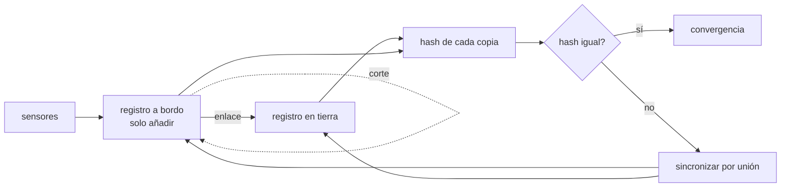

# B116-C03 — Historia clínica remota y registros médicos de misión

<!-- nav:top -->
[🏠 Programa](../../../../README.md) · [📚 Bloque B116](../../../tronco-comun/B116-telemedicina-y-monitorizacion-de-salud-en-mision.md) · [← Anterior: B116-C02 — Signos vitales: medición, interpretación y límites](../B116-C02-signos-vitales-medicion-interpretacion-y-limites/CLASE.md) · [Siguiente: B116-C04 — Triage asistido por decisión →](../B116-C04-triage-asistido-por-decision/CLASE.md)
<!-- /nav -->

## 1. Ubicación, nivel y alcance

Clase 3 de 7 del bloque B116. Nivel N4. Las lecturas de las clases anteriores tienen que **guardarse, viajar a tierra y llegar completas**. La clase trata un registro de observaciones estructuradas (campos como los del recurso FHIR `Observation`), su tamaño y ancho de banda, la integridad con un hash y la sincronización entre una copia a bordo y otra en tierra cuando el enlace se corta. Todo es **sintético**: una tripulación ficticia. **Clase educativa: no da consejo médico ni operativo ni orientación legal sobre datos de salud.**

## 2. Por qué esta clase existe

Si el enlace se corta 40 minutos y al volver los dos registros difieren, ¿cuál es el verdadero? Si un valor cambia en el camino, ¿cómo se enteran? La decisión central: **¿qué estructura y qué reglas de sincronización permiten que el registro de a bordo y el de tierra converjan sin perder ni alterar datos?**

## 3. Lo que podrás hacer al terminar

1. Describir una observación con sus campos mínimos (qué, valor, cuándo, estado, dispositivo, sujeto).
2. Calcular el volumen diario de un registro y su ancho de banda con y sin compresión.
3. Usar un hash SHA-256 para detectar alteraciones y comparar copias.
4. Sincronizar dos registros de solo añadir con identificador único y comprobar la convergencia.
5. Explicar por qué la sincronización por unión es idempotente y qué no resuelve (conflictos de edición).
6. Rotular lo sintético y lo no consultado.

La evidencia es el **diseño de un registro de misión** del ejercicio 12 (sección 20).

## 4. Con qué llegas y cómo comprobarlo

1. ¿Qué es un JSON?
2. ¿Qué es un hash criptográfico?
3. ¿Qué es la compresión sin pérdida?
4. ¿Qué significa «idempotente»?
5. ¿Qué es un identificador único?

<details>
<summary>Ver respuestas</summary>

1. Un formato de texto para datos estructurados con campos y valores. 2. Una huella de longitud fija de unos datos; un cambio mínimo da una huella muy distinta. 3. Reducir el tamaño sin perder información. 4. Aplicar la operación dos veces da lo mismo que una. 5. Un código que no se repite entre registros.
</details>

Con cuatro o cinco aciertos, sigue; si no, repasa los prerrequisitos.

## 5. Un caso de contexto y casos de referencia

Una tripulación ficticia de 4 personas registra 3 magnitudes (FC, SpO2 y temperatura) cada 5 min: 3456 observaciones por día de 133 bytes cada una, 0,476 MB en JSON y 0,021 MB comprimido (razón 22,7). Con muestreo cada 10 s son 14,295 MB y 0,621 MB comprimidos, es decir 1,380 kbit/s promediados en una hora de contacto. Con cortes de enlace en 3 de 10 pasos, la copia de a bordo y la de tierra difieren durante el corte y **coinciden de nuevo con el mismo hash** tras el siguiente contacto. Es el **ejemplo conductor**: todo es **sintético** (semilla 118).

## 6. Vocabulario

Una **observación** es una medida o afirmación simple sobre un sujeto: qué se observó (`code`), el resultado (`value`), cuándo (`effective`), su estado (`status`: p. ej. preliminar, final, enmendada), el dispositivo y el sujeto. Un **registro de solo añadir** no modifica entradas: añade nuevas (una corrección es otra observación). El **hash** es una huella (SHA-256) del contenido. La **sincronización por unión** junta los identificadores de ambas copias. La **convergencia** es que dos copias acaban idénticas. **Almacenar y reenviar** guarda localmente hasta que hay enlace.

## 7. Modelo mental



*Descripción textual:* los datos se guardan siempre a bordo; cuando hay enlace se sincronizan con tierra por unión de identificadores; los hashes de ambas copias dicen si son iguales.

Analogía: dos cuadernos de bitácora que se completan copiando solo las líneas que faltan, sin tachar nada. Límite: si dos personas **editan** a la vez la misma línea, la unión no decide cuál vale; por eso se corrige añadiendo, no editando.

## 8. La explicación, paso a paso

### 8.1 Qué hay en una observación

El recurso `Observation` de HL7 FHIR (consultado) registra medidas y afirmaciones simples sobre un sujeto (signos vitales, laboratorio, datos de dispositivos como ECG o pulsioximetría) y **no** registra diagnósticos, que van en otros recursos. Sus elementos clave: `code` (qué se observó, normalmente LOINC), `value[x]`, `effective[x]`, `status` (registered, preliminary, final, amended), `device`, `subject`, `performer`, `encounter` y `component` para magnitudes relacionadas (p. ej. sistólica y diastólica). El laboratorio usa un subconjunto con **rótulos propios**, no códigos LOINC reales ni un servidor FHIR.

### 8.2 Volumen y ancho de banda

Una observación del laboratorio mide 133 bytes en JSON compacto. Para 4 personas × 3 magnitudes: cada 300 s, 3456 observaciones/día, 0,476 MB, 0,021 MB comprimido (22,7×), 0,047 kbit/s; cada 60 s, 17 280 observaciones, 2,382 MB, 0,105 MB, 0,233 kbit/s; cada 10 s, 103 680, 14,295 MB, 0,621 MB, 1,380 kbit/s. La alta compresión (≈ 23×) se debe a que los campos se repiten; en datos reales, con valores más variables y metadatos, será menor. El enlace ilustrativo de 256 kbit/s durante 1 h/día transporta en teoría 115,2 MB: el registro de esta tripulación cabe con holgura; el problema no es el volumen sino el **retardo y los cortes**.

### 8.3 Integridad por hash

El SHA-256 del registro ordenado por identificador es a481ef1f…; si un solo valor cambia en 0,1, es 3637b7b4… El hash no dice **qué** cambió ni **quién**; solo que las copias difieren. No sustituye a una firma digital ni al control de acceso.

### 8.4 Sincronización con cortes

Con 3456 observaciones repartidas en 10 pasos y enlace caído en los pasos 1, 4 y 7, la copia de tierra queda en 345 (con 691 a bordo), 1382 (con 1728) y 2419 (con 2764) durante los cortes; con enlace ambas coinciden (hash igual) y tras el último contacto las dos tienen 3456 observaciones con el hash del original. Una segunda sincronización no cambia el hash (idempotente).

### 8.5 Retardo y autonomía

La NASA (Goddard) indica que el retardo unidireccional entre Marte y la Tierra va de unos 4 a unos 24 min. Una consulta con ida y vuelta puede tardar de 8 a 48 min: el registro de a bordo debe ser **autosuficiente** (la tripulación lo lee sin tierra) y la tierra lo recibe después. La nota OCHMO-TB-043 de la NASA menciona entregables de la vigilancia de salud como informes, envíos de historia clínica electrónica y descargas.

### 8.6 Qué no está resuelto

La unión de solo añadir no resuelve conflictos de edición, ni privacidad, ni control de acceso, ni retención. De NASA-STD-3001 solo se vio, mediante un resumen de búsqueda, que los resultados de la monitorización de la salud deben conservarse de forma permanente y que los registros deben asegurarse; **el texto de la norma no se consultó**.

## 9. Magnitudes, símbolos y unidades

| Símbolo | Qué es | Unidad | Valor / nota |
|---|---|---|---|
| `B_obs` | bytes por observación | B | 133 |
| `N` | observaciones por día | — | 3456; 17 280; 103 680 |
| `V` | volumen diario | MB | 0,476; 2,382; 14,295 |
| `r` | razón de compresión | — | 22,7; 22,8; 23,0 |
| `BW` | ancho de banda medio en 1 h | kbit/s | 0,047; 0,233; 1,380 |
| SHA-256 | huella del registro | hex | 64 caracteres |
| `t_efectivo` | instante de la observación | s | desde el inicio |

## 10. Convenciones y referencias

Tripulación ficticia S1–S4, magnitudes `fc` (lpm), `spo2` (%) y `temp` (°C) con medias 72, 97 y 36,8 y DE 4, 1 y 0,2; semilla 118. Observaciones en JSON compacto con claves ordenadas; hash SHA-256 de la lista ordenada por `id`. Compresión `zlib` nivel 9. Enlace ilustrativo de 256 kbit/s durante 1 h/día. Tolerancias: hash distinto con un valor alterado; hash final igual al del original; sincronización idempotente. Tiempo en segundos desde el inicio (no hay sistema de referencia espacial). Python 3.12.9, numpy 2.4.4.

## 11. De dónde sale lo que afirmamos

| ID | Fuente | Localizador | Respalda | Estado |
|---|---|---|---|---|
| S1 | HL7 International, «FHIR R5: Observation» — https://www.hl7.org/fhir/observation.html (consultada 2026-11-10) | primeras 100 000 caracteres de 304 250 | alcance y elementos del recurso `Observation` | Consultada (parcialmente) |
| S2 | NASA OCHMO-TB-043 Rev A, «Longitudinal Health Surveillance» (2023-12-05) — https://www.nasa.gov/wp-content/uploads/2023/12/ochmo-tb-043-longitudinal-health-surveillance.pdf (consultada 2026-11-10; PDF leído con PyMuPDF) | páginas 1–3 | entregables de vigilancia (informes, envíos de historia clínica electrónica, descargas) | Consultada (parcialmente) |
| S3 | NASA Goddard, «Space Communications: 7 Things You Need to Know» — https://www.nasa.gov/centers-and-facilities/goddard/space-communications-7-things-you-need-to-know/ (consultada 2026-11-10) | sección sobre Marte | retardo unidireccional de 4 a 24 min | Consultada |
| S4 | NASA-STD-3001 Vol. 1 Rev C (conservación y protección de registros de salud) | resumen de resultados de búsqueda | conservación permanente y protección de registros | Consultada solo mediante un resumen de búsqueda; el documento **no se leyó** |
| — | SHA-256, JSON, zlib y la sincronización por unión | — | las verifica el laboratorio | No consultada en una fuente concreta (las verifica el laboratorio) |

Límites: no se consultaron los códigos LOINC, los perfiles FHIR de misión ni ninguna norma de privacidad (HIPAA, RGPD) ni de ciberseguridad. De FHIR solo se leyó parte del recurso `Observation`.

## 12. Cómo ver el resultado

| Resultado | Valor |
|---|---|
| Bytes por observación | 133 |
| Volumen diario, 300 s / 10 s | 0,476 MB / 14,295 MB |
| Compresión | ≈ 23× |
| Hash con un valor alterado | distinto |
| Observaciones tras el último contacto | 3456 en ambas copias |

Descripción larga: el volumen es pequeño frente al enlace; lo difícil es la convergencia con cortes y la integridad, que la unión de solo añadir y el hash resuelven.

## 13. Ejemplo trabajado: volumen de un registro

**Paso 1 · Observaciones por día.** `4 personas · 3 magnitudes · 288 muestras (cada 300 s) = 3456`.

**Paso 2 · Volumen estimado.** `3456 · 133 B ≈ 0,46 MB` (el real, 0,476 MB, es algo mayor por identificadores y números más largos).

**Paso 3 · Comprimido.** `0,476/22,7 ≈ 0,021 MB`.

**Paso 4 · Ancho de banda medio.** `0,021 MB · 8 / 3600 s = 0,047 kbit/s`.

## 14. Distintas formas de describir el problema

**Por estructura:** campos de la observación. **Por tamaño:** bytes y MB. **Por integridad:** hash. **Por convergencia:** unión de identificadores. **Por tiempo:** retardo y cortes. **Por tabla:** salida del laboratorio.

## 15. Práctica guiada

**Ejercicio 1 · con los pasos indicados.** Calcula las observaciones por día con 4 personas, 3 magnitudes y una muestra cada 60 s. *Pasos:* `4·3·1440`.

<details><summary>Solución comentada</summary>

`17 280` observaciones por día.
</details>

**Ejercicio 2 · con una pista.** Estima el volumen en JSON con 133 B por observación. *Pista:* `17 280·133`.

<details><summary>Solución comentada</summary>

`≈ 2,30 MB`; el laboratorio da 2,382 MB.
</details>

**Ejercicio 3 · casi autónomo.** ¿Por qué el hash de un registro con un valor alterado en 0,1 es distinto? *Pista:* propiedad de las funciones hash.

<details><summary>Solución comentada</summary>

Un cambio mínimo en la entrada cambia por completo la salida; así se detecta una alteración, no su ubicación.
</details>

## 16. Práctica autónoma, transferencia e integrador

**Ejercicio 4 · autónomo.** ¿Qué ancho de banda medio hace falta para 14,295 MB comprimidos a 0,621 MB en 1 h?

<details><summary>Solución comentada</summary>

`0,621·8/3600 = 0,00138 Mbit/s = 1,38 kbit/s`.
</details>

**Ejercicio 5 · autónomo.** ¿Cuántos MB transporta en teoría un enlace de 256 kbit/s en 1 h?

<details><summary>Solución comentada</summary>

`256 000·3600/8 = 115,2 MB`.
</details>

**Ejercicio 6 · autónomo.** Tras el paso 1 (sin enlace) la tierra tiene 345 observaciones y a bordo hay 691. ¿Cuántas faltan en tierra?

<details><summary>Solución comentada</summary>

`691 − 345 = 346`; llegan en el siguiente contacto.
</details>

**Ejercicio 7 · autónomo.** ¿Por qué sincronizar dos veces no cambia el resultado?

<details><summary>Solución comentada</summary>

La unión de conjuntos de identificadores es idempotente: lo que ya está no se duplica.
</details>

**Ejercicio 8 · autónomo.** ¿Qué campo de la observación indica que un valor corrige a otro?

<details><summary>Solución comentada</summary>

El `status` (por ejemplo «amended») junto con una nueva observación con identificador propio; en un registro de solo añadir no se sobrescribe.
</details>

**Ejercicio 9 · transferencia.** **Transferencia.** Dos personas editan a la vez el mismo campo de una nota en lados distintos del enlace. ¿Qué falla de la unión simple y qué política propones?

<details><summary>Solución comentada</summary>

La unión no decide; propón que cada edición sea una observación nueva con autor y hora, y una regla visible (p. ej. la más reciente por `effective` y revisión del médico).
</details>

**Ejercicio 10 · transferencia.** **Transferencia.** El retardo es de 24 min en un sentido. ¿Qué parte del registro debe poder consultarse sin tierra?

<details><summary>Solución comentada</summary>

Todo lo necesario para la atención inmediata: la copia de a bordo completa y legible, ya que una consulta tarda hasta 48 min.
</details>

**Ejercicio 11 · transferencia.** **Transferencia.** ¿Qué te falta consultar antes de manejar datos de salud reales de una tripulación?

<details><summary>Solución comentada</summary>

La normativa de privacidad y ciberseguridad aplicable, los requisitos de la agencia (NASA-STD-3001 en su texto), los códigos y perfiles del estándar y el consentimiento; no se consultaron aquí.
</details>

**Ejercicio 12 · integrador.** **Integrador.** Elabora tu *diseño de un registro de misión*: campos de la observación, tamaño y ancho de banda, política de integridad, algoritmo de sincronización con cortes, qué decide la tripulación sin tierra, y qué es sintético y no consultado.

<details><summary>Solución comentada</summary>

Secciones 8.1–8.6 y la salida del laboratorio.
</details>

## 17. Laboratorio: registro, hash y sincronización con cortes

El script [registro.py](registro.py) genera observaciones sintéticas, calcula su tamaño y compresión, el hash del registro y simula la sincronización bordo-tierra con cortes (**comprueba** que un valor alterado cambia el hash, que el hash final coincide con el original y que la sincronización es idempotente).

**Datos:** todo **sintético** (semilla 118); una tripulación ficticia. **Predice antes de ejecutar:** ¿qué pasa con el hash de la copia de tierra durante un corte? (Es distinto del de a bordo hasta el siguiente contacto.) **Ejecución del 2026-11-10 (Python 3.12.9):**

```text
Python 3.12.9; numpy 2.4.4
DATOS SINTETICOS (semilla 118): tripulacion ficticia de 4 personas; ninguna observacion es de una persona real
Ejemplo de observacion: {"id":"o00000001","subject":"S1","code":"fc","value":69.9,"unit":"lpm","effective":0,"status":"final","device":"sensor-sintetico-01"}
Bytes por observacion (JSON compacto) = 133
Volumen por dia para 4 personas x 3 magnitudes segun el intervalo de muestreo:
  intervalo [s]   observaciones/dia   JSON [MB]   zlib [MB]   ratio   ancho de banda en 1 h de contacto [kbit/s]
       300             3456           0.476       0.021    22.7          0.047
        60            17280           2.382       0.105    22.8          0.233
        10           103680          14.295       0.621    23.0          1.380
Comparacion con el enlace ilustrativo de 256 kbit/s durante 1 h/dia (= 115.2 MB/dia utiles teoricos)
SHA-256 original   = a481ef1f30b277e3...
SHA-256 con un valor alterado en 0.1 = 3637b7b40f3d31ba... (distinto: True)
Sincronizacion bordo-tierra con cortes (pasos 1, 4 y 7 sin enlace); observaciones y coincidencia de hash:
  paso 0: enlace=si  bordo=  345  tierra=  345  hash igual=True
  paso 1: enlace=NO  bordo=  691  tierra=  345  hash igual=False
  paso 2: enlace=si  bordo= 1036  tierra= 1036  hash igual=True
  paso 3: enlace=si  bordo= 1382  tierra= 1382  hash igual=True
  paso 4: enlace=NO  bordo= 1728  tierra= 1382  hash igual=False
  paso 5: enlace=si  bordo= 2073  tierra= 2073  hash igual=True
  paso 6: enlace=si  bordo= 2419  tierra= 2419  hash igual=True
  paso 7: enlace=NO  bordo= 2764  tierra= 2419  hash igual=False
  paso 8: enlace=si  bordo= 3110  tierra= 3110  hash igual=True
  paso 9: enlace=si  bordo= 3456  tierra= 3456  hash igual=True
Tras el ultimo contacto: 3456 observaciones en ambas copias; hash final = hash del original: True
Idempotencia: sincronizar otra vez no cambia el hash: True
Pruebas superadas.
```

```bash
python programa/clases/B116/B116-C03-historia-clinica-remota-y-registros-medicos-de-mision/registro.py
```

**Límites:** sin conflictos de edición, sin pérdida de paquetes parciales, sin cifrado, sin control de acceso, enlace ilustrativo y datos sintéticos muy regulares (la compresión es optimista).

## 18. Errores frecuentes y cómo corregirlos

**Suponer que el hash dice qué cambió.** Solo dice que algo difiere (8.3).

**Sobrescribir entradas.** Añade una observación nueva (8.4).

**Depender de tierra para leer el registro.** Mantén la copia de a bordo completa (8.5).

**Presentar datos sintéticos como de personas.** Se corrige con la sección 10.

## 19. Cómo sabrás que vas bien

Tras la sección 8: ¿qué garantiza la unión y qué no? Si dudas, repasa 8.4 y 8.6. Tras el laboratorio: ¿qué comprueba? (ver la sección 17).

## 20. Qué entregas y cómo se evalúa

El producto es tu **diseño de un registro de misión** (ejercicio 12).

| Criterio | Inicial | En desarrollo | Logrado | Destacado |
|---|---|---|---|---|
| Conceptos | Confunde registro y copia | Parciales | Explica observación, hash y unión | Explica qué no resuelve |
| Cálculo | Sin unidades | Con errores | Calcula volumen y ancho de banda | Calcula casos nuevos |
| Numérico | Sin control | Un caso | Hash, convergencia e idempotencia | Analiza cortes más largos |
| Fuentes | Sin fuente | Sin fecha | Fuentes con fecha y estado | Declara lo no consultado |
| Límites | No los nombra | Uno | Tres | Discute privacidad y conflictos |

**Condiciones críticas (no se compensan con promedio):** rotular lo sintético; no dar consejo médico, operativo ni legal; no presentar el diseño como un sistema validado; citar solo lo consultado.

## 21. Ética, seguridad y límites

Clase educativa: **no da consejo médico ni operativo ni legal**. Un registro real de salud contiene datos especialmente sensibles: exige consentimiento, control de acceso, cifrado, retención y auditoría conforme a la normativa y a los requisitos de la agencia, que aquí no se consultaron. Los identificadores de este laboratorio son ficticios. Accesibilidad: tablas equivalentes a las gráficas, fórmulas en texto, ejercicios sin conexión.

## 22. Para cerrar y seguir

El registro clínico de misión es un conjunto de observaciones estructuradas que se guarda siempre a bordo, se verifica con un hash y se sincroniza por unión cuando hay enlace; el volumen es modesto, lo difícil son el retardo, los cortes y la privacidad. En la clase siguiente ese registro alimenta una decisión de triage.

**Glosario español–inglés.** observación · *observation*; registro de solo añadir · *append-only log*; huella · *hash*; sincronización · *synchronization*; almacenar y reenviar · *store and forward*.

**Continuidad.** Sigue con la clase siguiente del bloque; ver el [bloque B116](../../../tronco-comun/B116-telemedicina-y-monitorizacion-de-salud-en-mision.md).

**Referencias:** ver sección 11.

<!-- nav:bottom -->
---

[← Anterior: B116-C02 — Signos vitales: medición, interpretación y límites](../B116-C02-signos-vitales-medicion-interpretacion-y-limites/CLASE.md) · [📚 Bloque B116](../../../tronco-comun/B116-telemedicina-y-monitorizacion-de-salud-en-mision.md) · [Siguiente: B116-C04 — Triage asistido por decisión →](../B116-C04-triage-asistido-por-decision/CLASE.md)
<!-- /nav -->
