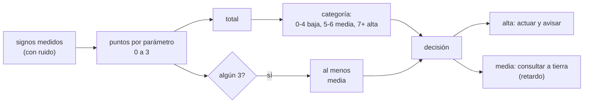

# B116-C04 — Triage asistido por decisión

<!-- nav:top -->
[🏠 Programa](../../../../README.md) · [📚 Bloque B116](../../../tronco-comun/B116-telemedicina-y-monitorizacion-de-salud-en-mision.md) · [← Anterior: B116-C03 — Historia clínica remota y registros médicos de misión](../B116-C03-historia-clinica-remota-y-registros-medicos-de-mision/CLASE.md) · [Siguiente: B116-C05 — Alertas de salud y umbrales de monitorización →](../B116-C05-alertas-de-salud-y-umbrales-de-monitorizacion/CLASE.md)
<!-- /nav -->

## 1. Ubicación, nivel y alcance

Clase 4 de 7 del bloque B116. Nivel N4. Con signos vitales medidos (B116-C02) y registrados (B116-C03), alguien tiene que decidir **cuánta urgencia** merece cada caso. La clase construye un **puntaje de triage ilustrativo** sobre casos sintéticos, mide su sub-triage y su especificidad con ruido de sensor y calcula cuánto del plazo se gasta cuando la decisión pasa por tierra con retardo. **El puntaje no es NEWS2 ni una guía clínica. Clase educativa: no da consejo médico ni operativo; no se usa para clasificar a una persona real.**

## 2. Por qué esta clase existe

Un puntaje simple ayuda a decidir rápido y de forma homogénea, pero un fallo por defecto (sub-triage) deja sin atender a quien lo necesita y uno por exceso (sobre-triage) agota recursos y atención. Y si la respuesta de tierra tarda decenas de minutos, **no se puede esperar a tierra para lo que no admite espera**. La decisión central: **¿qué decide la tripulación sola, qué se consulta y con qué puntaje y qué tolerancia a errores?**

## 3. Lo que podrás hacer al terminar

1. Construir un puntaje por parámetros y agregarlo en categorías baja, media y alta.
2. Aplicar la regla de un parámetro extremo que eleva la categoría aunque el total sea bajo.
3. Calcular sensibilidad, especificidad y sub-triage a partir de una matriz de confusión.
4. Medir cómo el ruido del sensor degrada la especificidad.
5. Calcular la probabilidad de que la respuesta de tierra llegue antes de un evento con retardo de comunicaciones.
6. Proponer una regla de autonomía y rotular lo sintético y lo ilustrativo.

La evidencia es el **informe de desempeño de un triage** del ejercicio 12 (sección 20).

## 4. Con qué llegas y cómo comprobarlo

1. ¿Qué es la sensibilidad de una prueba?
2. ¿Qué es la especificidad?
3. ¿Qué es una matriz de confusión?
4. ¿Qué es una distribución exponencial, a grandes rasgos?
5. ¿Qué es un dato ilustrativo?

<details>
<summary>Ver respuestas</summary>

1. La fracción de casos positivos que la prueba detecta. 2. La fracción de casos negativos que clasifica bien. 3. Una tabla de casos por estado verdadero y categoría asignada. 4. La distribución del tiempo hasta un evento con tasa constante. 5. Un valor puesto para enseñar, sin fuente que lo respalde.
</details>

Con cuatro o cinco aciertos, sigue; si no, repasa los prerrequisitos.

## 5. Un caso de contexto y casos de referencia

Veinte mil casos sintéticos (80 % estables, 15 % en deterioro, 5 % críticos). Sin ruido de sensor el puntaje detecta el 85,1 % de los casos con algún deterioro (sensibilidad), con una especificidad de 0,988 y un sub-triage del 2,96 %; con ruido doble la especificidad cae a 0,919 (1296 casos estables marcados en categoría media). Si la decisión pasa por tierra con 24 min de retardo unidireccional, la respuesta llega 58 min después (ida y vuelta más 10 min de revisión): solo el **38,0 %** de los casos críticos tiene respuesta de tierra antes del evento, frente al 100 % con decisión a bordo. Es el **ejemplo conductor**: todo es **sintético** (semilla 119) y el puntaje es **ilustrativo**.

## 6. Vocabulario

**Triage** es la clasificación de casos por urgencia para decidir el orden y el tipo de atención. Un **puntaje de alerta temprana** suma puntos por parámetros fisiológicos. La **categoría** (baja, media, alta) agrupa el total. **Sub-triage**: caso asignado a una categoría menos urgente que la verdadera; **sobre-triage**: a una más urgente. **Sensibilidad** `TP/(TP+FN)` y **especificidad** `TN/(TN+FP)`. **Apoyo a la decisión**: herramienta que sugiere, no decide. **Autonomía**: decisión de la tripulación sin esperar a tierra.

## 7. Modelo mental



*Descripción textual:* se puntúa cada signo; el total y la regla del parámetro extremo dan una categoría; la categoría alta se actúa a bordo y avisa; la media consulta con tierra aceptando el retardo.

Analogía: un semáforo de urgencia con una norma de «si un solo signo está muy mal, no lo dejes en verde». Límite: el puntaje resume signos y no sabe de contexto, antecedentes ni de lo que el médico ve.

## 8. La explicación, paso a paso

### 8.1 Lo consultado y lo propio

Del cuadro de umbrales de NEWS2 (Royal College of Physicians, 2017) se tomó solo la **estructura**: un total agregado de 0–4 es riesgo bajo con respuesta basada en sala; 5–6, riesgo medio, «umbral clave para respuesta urgente»; 7 o más, riesgo alto con respuesta urgente o de emergencia; y un 3 en un solo parámetro es riesgo bajo-medio con respuesta urgente aunque el total sea bajo. Las **bandas de puntos por parámetro** del laboratorio son propias y **no son las de NEWS2**: no se consultaron.

### 8.2 El puntaje del laboratorio

Cinco parámetros (FC, FR, SpO2, temperatura y presión sistólica) con 0 a 3 puntos según bandas ilustrativas; categoría 2 (alta) si el total es ≥ 7, 1 (media) si es 5–6 y 0 (baja) si es ≤ 4; si algún parámetro vale 3 y la categoría es baja, sube a media. Control: al empeorar todos los signos en 11 pasos el total nunca baja.

### 8.3 Desempeño sin ruido

Matriz (filas: estado verdadero 0, 1, 2; columnas: categoría 0, 1, 2): `[[15822, 200, 0], [593, 1132, 1240], [0, 0, 1013]]`. Sensibilidad `(1132 + 1240 + 1013)/3978 = 0,851`; especificidad `15822/16022 = 0,988`; sub-triage `593/20000 = 2,96 %`. Los críticos se clasifican todos como altos.

### 8.4 Efecto del ruido

Con ruido 1,0× la especificidad es 0,979 y con 2,0× baja a 0,919 (1296 estables en categoría media); la sensibilidad casi no cambia (0,854; 0,845). El ruido del sensor produce **sobre-triage** de personas estables, con el coste de alertas y consultas, más que sub-triage.

### 8.5 Retardo de comunicaciones

La NASA (Goddard) da un retardo unidireccional de unos 4 a unos 24 min entre Marte y la Tierra. Con ida y vuelta más 10 min de revisión (ilustrativo), la respuesta tarda 10, 18, 34 y 58 min para retardos de 0, 4, 12 y 24 min. Con un tiempo hasta el evento exponencial de media 60 min (ilustrativo), la probabilidad de que tierra responda antes es 0,846; 0,741; 0,567 y 0,380; con decisión a bordo es 1,000 (sin retardo). Lección: lo que no admite espera lo decide la tripulación.

### 8.6 Contexto de la autonomía

Kirkpatrick et al. (NASA) señalan que, a bordo de la ISS, la respuesta prevista a un traumatismo grave es la evacuación inmediata a un centro de atención definitiva en la Tierra y que la capacidad médica es modesta por restricciones de masa, potencia, volumen, comunicaciones y formación. Más allá de la órbita baja esa evacuación no es inmediata, de modo que el triage cambia de sentido: decide qué se trata a bordo. La regla de autonomía del laboratorio (alta: actuar y avisar; media: consultar) es **ilustrativa** y no una política de ninguna agencia.

## 9. Magnitudes, símbolos y unidades

| Símbolo | Qué es | Unidad | Valor / nota |
|---|---|---|---|
| FC, FR, SpO2, T, PAS | signos del puntaje | lpm, resp/min, %, °C, mmHg | ver 8.2 |
| puntos | 0 a 3 por parámetro | — | suma 0–15 |
| categoría | baja, media, alta | — | 0, 1, 2 |
| `S`, `E` | sensibilidad, especificidad | — | 0,851; 0,988 |
| `d` | retardo unidireccional | min | 0, 4, 12, 24 |
| `t_resp` | `2d + 10` | min | 10, 18, 34, 58 |
| `P_antes` | `exp(−t_resp/60)` | — | 0,846 … 0,380 |

## 10. Convenciones y referencias

Casos sintéticos con semilla 119; prevalencias 80/15/5 %; medias por estado (FC 72/104/128 lpm, FR 14/22/29 resp/min, SpO2 97,5/93,5/89 %, T 36,8/38,2/38,9 °C, PAS 118/98/84 mmHg) y DE 9, 2,5, 1,8, 0,35 y 10; ruido del sensor `0,5·σ·k` con `k = 0, 1, 2`. Revisión en tierra de 10 min y tiempo hasta el evento de media 60 min: ilustrativos. Tolerancias: control de monotonía; todos los críticos en categoría alta sin ruido. Python 3.12.9, numpy 2.4.4.

## 11. De dónde sale lo que afirmamos

| ID | Fuente | Localizador | Respalda | Estado |
|---|---|---|---|---|
| S1 | Royal College of Physicians, «National Early Warning Score (NEWS) 2, Chart 2: NEWS thresholds and triggers» (2017) — https://www.rcp.ac.uk/media/2acdezkd/news2-chart-2_news-thresholds-and-triggers_0.pdf (consultada 2026-11-10; PDF leído con PyMuPDF) | cuadro de umbrales | bandas agregadas 0–4, 5–6, ≥ 7 y disparador de un 3 en un parámetro | Consultada |
| S2 | NASA Goddard, «Space Communications: 7 Things You Need to Know» — https://www.nasa.gov/centers-and-facilities/goddard/space-communications-7-things-you-need-to-know/ (consultada 2026-11-10) | sección sobre Marte | retardo unidireccional de 4 a 24 min | Consultada |
| S3 | Kirkpatrick, A. W. et al., «Evaluating Trauma Sonography for Operational Use in the Microgravity Environment» (NASA NTRS 20070023642) — https://ntrs.nasa.gov/api/citations/20070023642/downloads/20070023642.pdf (consultada 2026-11-10; PDF leído con PyMuPDF) | resumen e introducción | capacidad médica modesta en la ISS y evacuación como respuesta prevista | Consultada (parcialmente) |
| — | Sensibilidad, especificidad, matriz de confusión y distribución exponencial | — | las verifica el laboratorio | No consultada en una fuente concreta (las verifica el laboratorio) |

Límites: **no se consultaron** las tablas de puntos por parámetro de NEWS2 ni su validación; el cuadro del RCP se tomó solo por su estructura de bandas. Tampoco se consultó ninguna política de triage de NASA ni de ESA, ni ninguna evidencia de desempeño de un puntaje en microgravedad.

## 12. Cómo ver el resultado

| Resultado | Valor |
|---|---|
| Sensibilidad / especificidad sin ruido | 0,851 / 0,988 |
| Especificidad con ruido 2× | 0,919 |
| Sub-triage sin ruido | 2,96 % |
| P(tierra responde antes), retardo 24 min | 0,380 (a bordo: 1,000) |

Descripción larga: el ruido del sensor degrada sobre todo la especificidad; el retardo de comunicaciones reduce a menos de dos quintos la probabilidad de respuesta a tiempo de tierra en el peor caso.

## 13. Ejemplo trabajado: retardo y respuesta a tiempo

**Paso 1 · Retardo total.** Con `d = 12` min: `t_resp = 2·12 + 10 = 34` min.

**Paso 2 · Probabilidad.** `exp(−34/60) = 0,567`.

**Paso 3 · Comparación.** Con decisión a bordo el retardo es 0 y la probabilidad 1,000.

**Paso 4 · Lectura.** Con 12 min de retardo, el 43 % de los casos (1 − 0,567) se queda sin respuesta de tierra a tiempo; esa decisión no puede esperar.

## 14. Distintas formas de describir el problema

**Por puntos:** suma por parámetro. **Por categoría:** baja, media, alta. **Por errores:** matriz, sub y sobre-triage. **Por tiempo:** retardo y plazo. **Por autonomía:** quién decide qué. **Por tabla:** salida del laboratorio.

## 15. Práctica guiada

**Ejercicio 1 · con los pasos indicados.** Calcula la sensibilidad con la matriz sin ruido. *Pasos:* suma los casos con estado ≥ 1 clasificados en categoría ≥ 1 y divide por todos los de estado ≥ 1.

<details><summary>Solución comentada</summary>

`(1132 + 1240 + 1013)/(593 + 1132 + 1240 + 1013) = 3385/3978 = 0,851`.
</details>

**Ejercicio 2 · con una pista.** Calcula la especificidad. *Pista:* estables bien clasificados entre todos los estables.

<details><summary>Solución comentada</summary>

`15822/(15822 + 200 + 0) = 0,988`.
</details>

**Ejercicio 3 · casi autónomo.** Con `d = 4` min, calcula `t_resp` y la probabilidad de respuesta a tiempo. *Pista:* `exp(−t/60)`.

<details><summary>Solución comentada</summary>

`t_resp = 18` min; `exp(−0,3) = 0,741`.
</details>

## 16. Práctica autónoma, transferencia e integrador

**Ejercicio 4 · autónomo.** ¿Qué porcentaje de casos en deterioro (estado 1) quedó en categoría baja sin ruido?

<details><summary>Solución comentada</summary>

`593/2965 = 20,0 %`; en el total son el 2,96 % de los 20 000 casos.
</details>

**Ejercicio 5 · autónomo.** ¿Por qué el ruido casi no cambia la sensibilidad y sí la especificidad?

<details><summary>Solución comentada</summary>

Los estables cercanos a los umbrales cruzan hacia arriba con el ruido (más falsos positivos), mientras que los enfermos están ya lejos del umbral y siguen marcados.
</details>

**Ejercicio 6 · autónomo.** Un caso suma 4 puntos con un parámetro en 3. ¿Qué categoría recibe y por qué?

<details><summary>Solución comentada</summary>

Media: el parámetro extremo eleva la categoría baja, como el disparador de NEWS2 de un 3 en un solo parámetro (urgente aunque el total sea bajo).
</details>

**Ejercicio 7 · autónomo.** Con `d = 24` min, ¿cuánto tarda la respuesta de tierra y por qué es mayor que dos veces 24?

<details><summary>Solución comentada</summary>

`2·24 + 10 = 58` min: ida y vuelta (48) más 10 min de revisión en tierra.
</details>

**Ejercicio 8 · autónomo.** ¿Qué indica que `P_antes` con 0 min de retardo sea 0,846 y no 1?

<details><summary>Solución comentada</summary>

Aun sin retardo, la revisión de 10 min consume plazo: `exp(−10/60) = 0,846`.
</details>

**Ejercicio 9 · transferencia.** **Transferencia.** Propón una regla de autonomía para la categoría media si el retardo es de 24 min.

<details><summary>Solución comentada</summary>

Que la tripulación inicie las medidas protocolizadas y repita las mediciones mientras consulta; la consulta es asíncrona y se acompaña del registro completo (B116-C03). Es una propuesta ilustrativa.
</details>

**Ejercicio 10 · transferencia.** **Transferencia.** ¿Qué le falta a este puntaje para usarlo con personas reales?

<details><summary>Solución comentada</summary>

Bandas validadas, evidencia de desempeño en la población y el entorno, aprobación sanitaria y supervisión clínica; nada de eso se consultó aquí.
</details>

**Ejercicio 11 · transferencia.** **Transferencia.** En la ISS la respuesta prevista a un traumatismo grave es la evacuación a la Tierra. ¿Cómo cambia el significado del triage en una misión sin evacuación inmediata?

<details><summary>Solución comentada</summary>

Pasa de decidir si evacuar a decidir qué se trata a bordo y con qué recursos, con más peso de la autonomía y del apoyo asíncrono de tierra.
</details>

**Ejercicio 12 · integrador.** **Integrador.** Elabora tu *informe de desempeño de un triage*: puntaje con sus bandas y su fuente, matriz de confusión, sensibilidad, especificidad, sub y sobre-triage, efecto del ruido y del retardo, regla de autonomía y qué es sintético e ilustrativo.

<details><summary>Solución comentada</summary>

Secciones 8.1–8.6 y la salida del laboratorio.
</details>

## 17. Laboratorio: triage ilustrativo con ruido y retardo

El script [triage.py](triage.py) simula 20 000 casos, puntúa, categoriza, evalúa con ruido creciente y calcula el efecto del retardo (**comprueba** la monotonía del puntaje y el orden de las probabilidades).

**Datos:** todo **sintético** (semilla 119); el puntaje es **ilustrativo**. **Predice antes de ejecutar:** ¿qué métrica empeora más con ruido doble, la sensibilidad o la especificidad? (La especificidad.) **Ejecución del 2026-11-10 (Python 3.12.9):**

```text
Python 3.12.9; numpy 2.4.4
DATOS SINTETICOS (semilla 119): casos simulados; el puntaje es ILUSTRATIVO y no es NEWS2 ni una guia clinica
Control: el puntaje total no baja cuando todos los signos empeoran (11 pasos): True
Desempeno del triage segun el ruido del sensor (n = 20000; matriz: filas = estado verdadero 0/1/2, columnas = categoria 0/1/2):
  ruido = 0.0 x: sensibilidad (estado >=1 -> categoria >=1) = 0.851; especificidad = 0.988; sub-triage =  2.96 %
      matriz = [[15822, 200, 0], [593, 1132, 1240], [0, 0, 1013]]
  ruido = 1.0 x: sensibilidad (estado >=1 -> categoria >=1) = 0.854; especificidad = 0.979; sub-triage =  2.95 %
      matriz = [[15625, 331, 1], [590, 1136, 1288], [0, 0, 1029]]
  ruido = 2.0 x: sensibilidad (estado >=1 -> categoria >=1) = 0.845; especificidad = 0.919; sub-triage =  3.12 %
      matriz = [[14696, 1296, 7], [622, 1102, 1306], [0, 2, 969]]
  con ruido 1.0 x: criticos (n = 1004) con categoria alta: 100.0 %; con baja: 0.0 %
Efecto del retardo de comunicaciones en la decision remota (un caso con categoria alta; tiempo hasta el evento ~ exp, media 60 min):
  retardo unidireccional [min]   ida y vuelta + revision [min]   P(respuesta de tierra llega antes del evento)   decision a bordo (0 min)
              0                        10                      0.846                         1.000
              4                        18                      0.741                         1.000
             12                        34                      0.567                         1.000
             24                        58                      0.380                         1.000
  regla de autonomia (ilustrativa): categoria alta -> la tripulacion actua de inmediato y avisa; categoria media -> consulta a tierra
Pruebas superadas.
```

```bash
python programa/clases/B116/B116-C04-triage-asistido-por-decision/triage.py
```

**Límites:** estados latentes discretos y solapados por construcción, parámetros independientes, ruido gaussiano, tiempo hasta el evento exponencial; sin antecedentes, sin contexto clínico y sin validación; no replica NEWS2.

## 18. Errores frecuentes y cómo corregirlos

**Creer que un puntaje es un diagnóstico.** Es una priorización (6, 8.6).

**Olvidar el ruido del sensor.** Mide la especificidad con ruido (8.4).

**Esperar a tierra para lo urgente.** Calcula el plazo con el retardo (8.5).

**Presentar el puntaje ilustrativo como NEWS2.** Se corrige con 8.1 y la sección 10.

## 19. Cómo sabrás que vas bien

Tras la sección 8: ¿qué decide la tripulación y qué decide tierra, y por qué? Si dudas, repasa 8.5. Tras el laboratorio: ¿qué comprueba? (ver la sección 17).

## 20. Qué entregas y cómo se evalúa

El producto es tu **informe de desempeño de un triage** (ejercicio 12).

| Criterio | Inicial | En desarrollo | Logrado | Destacado |
|---|---|---|---|---|
| Conceptos | Confunde puntaje y diagnóstico | Parciales | Explica puntos, categoría y errores | Explica la regla de autonomía |
| Cálculo | Sin unidades | Con errores | Calcula S, E y plazo | Calcula casos nuevos |
| Numérico | Sin control | Un caso | Matriz con y sin ruido | Analiza el retardo |
| Fuentes | Sin fuente | Sin fecha | Fuentes con fecha y estado | Declara lo no consultado |
| Límites | No los nombra | Uno | Tres | Discute la validación |

**Condiciones críticas (no se compensan con promedio):** rotular lo sintético e ilustrativo; no dar consejo médico ni operativo; no presentar el puntaje como NEWS2 ni clínico; citar solo lo consultado.

## 21. Ética, seguridad y límites

Clase educativa: **no da consejo médico ni operativo**. El puntaje es un ejercicio de ingeniería y no puede usarse para clasificar a una persona. Un sistema real de apoyo a la decisión necesita validación clínica, regulación, supervisión de un profesional y gestión de sus sesgos; su recomendación no sustituye al juicio clínico. Accesibilidad: tablas equivalentes a las gráficas, fórmulas en texto, ejercicios sin conexión.

## 22. Para cerrar y seguir

Un puntaje de triage convierte signos en una categoría y se evalúa con sensibilidad, especificidad y sub-triage; el ruido del sensor sube las falsas marcas y el retardo de comunicaciones obliga a decidir a bordo lo que no admite espera. En la clase siguiente esas marcas se convierten en alertas y se estudia cómo evitar la fatiga.

**Glosario español–inglés.** triage · *triage*; puntaje de alerta temprana · *early warning score*; sensibilidad · *sensitivity*; especificidad · *specificity*; sub-triage · *under-triage*.

**Continuidad.** Sigue con la clase siguiente del bloque; ver el [bloque B116](../../../tronco-comun/B116-telemedicina-y-monitorizacion-de-salud-en-mision.md).

**Referencias:** ver sección 11.

<!-- nav:bottom -->
---

[← Anterior: B116-C03 — Historia clínica remota y registros médicos de misión](../B116-C03-historia-clinica-remota-y-registros-medicos-de-mision/CLASE.md) · [📚 Bloque B116](../../../tronco-comun/B116-telemedicina-y-monitorizacion-de-salud-en-mision.md) · [Siguiente: B116-C05 — Alertas de salud y umbrales de monitorización →](../B116-C05-alertas-de-salud-y-umbrales-de-monitorizacion/CLASE.md)
<!-- /nav -->
