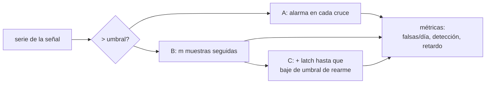

# B116-C05 — Alertas de salud y umbrales de monitorización

<!-- nav:top -->
[🏠 Programa](../../../../README.md) · [📚 Bloque B116](../../../tronco-comun/B116-telemedicina-y-monitorizacion-de-salud-en-mision.md) · [← Anterior: B116-C04 — Triage asistido por decisión](../B116-C04-triage-asistido-por-decision/CLASE.md) · [Siguiente: B116-C06 — Dispositivos biomédicos portátiles (ultrasonido, diagnóstico) →](../B116-C06-dispositivos-biomedicos-portatiles-ultrasonido-diagnostico/CLASE.md)
<!-- /nav -->

## 1. Ubicación, nivel y alcance

Clase 5 de 7 del bloque B116. Nivel N4. Una categoría de triage (B116-C04) o un valor fuera de rango (B116-C02) se convierte en **una alarma** que interrumpe a alguien. La clase compara tres políticas de alerta (umbral simple, persistencia, persistencia con histéresis) sobre una serie sintética de 30 días con artefactos y eventos verdaderos, y mide las falsas alarmas por día y el retardo de detección. Los umbrales son **ilustrativos, no clínicos**. **Clase educativa: no da consejo médico ni operativo ni sirve para configurar alarmas reales.**

## 2. Por qué esta clase existe

Una alarma que suena por cada artefacto enseña a ignorarla. Una que espera demasiado llega tarde. La decisión central: **¿qué política de alerta equilibra la detección a tiempo con un número de interrupciones que la tripulación pueda sostener?**

## 3. Lo que podrás hacer al terminar

1. Implementar un umbral simple, una persistencia de `m` muestras y una histéresis con latch.
2. Contar alarmas, falsas alarmas por día, eventos detectados y retardo medio.
3. Explicar por qué la persistencia elimina los artefactos aislados a costa de un retardo de `m − 1` minutos.
4. Barrer el umbral y la persistencia y leer el compromiso.
5. Relacionar la fatiga de alarmas con la política y no solo con la persona.
6. Rotular lo sintético y lo ilustrativo.

La evidencia es la **política de alertas comparada** del ejercicio 12 (sección 20).

## 4. Con qué llegas y cómo comprobarlo

1. ¿Qué es una falsa alarma y qué es una detección?
2. ¿Qué es un artefacto de medida?
3. ¿Qué es la histéresis, a grandes rasgos?
4. ¿Qué es un retardo de detección?
5. ¿Qué es un dato sintético?

<details>
<summary>Ver respuestas</summary>

1. Una alarma sin evento verdadero y una alarma con evento. 2. Una lectura anómala causada por la medida, no por el fenómeno. 3. Usar un umbral para disparar y otro distinto para rearmar. 4. El tiempo entre el inicio del evento y la alarma. 5. Un dato generado por un modelo; se rotula como tal.
</details>

Con cuatro o cinco aciertos, sigue; si no, repasa los prerrequisitos.

## 5. Un caso de contexto y casos de referencia

Una serie de frecuencia cardiaca sintética de 30 días (43 200 muestras, una por minuto) con ruido de 8 lpm, 125 artefactos de movimiento (+40 lpm) y 8 eventos verdaderos (+45 lpm durante 20 min). Un **umbral simple** de 100 lpm da 133 alarmas, de las que 118 son falsas: **3,93 falsas alarmas por día**, con detección de 8 de 8. Una **persistencia de 5 min** da 11 alarmas, **ninguna falsa**, detecta 8 de 8 y tarda 4,4 min de media. Añadiendo histéresis quedan 8 alarmas, una por evento. Es el **ejemplo conductor**: todo es **sintético** (semilla 120).

## 6. Vocabulario

Un **umbral** es el valor a partir del cual se dispara una alarma. La **persistencia** exige `m` muestras consecutivas por encima del umbral. La **histéresis** usa un umbral de disparo y otro más bajo de rearme, con un **latch** que evita alarmas repetidas durante el mismo evento. Una **falsa alarma** ocurre fuera de la ventana de un evento verdadero. El **retardo de detección** es el tiempo desde el inicio del evento hasta la alarma. La **fatiga de alarmas** es la desensibilización de quien recibe demasiadas alarmas poco útiles.

## 7. Modelo mental



*Descripción textual:* la misma señal pasa por tres políticas cada vez más filtradas; se miden falsas alarmas por día, eventos detectados y retardo.

Analogía: un portero que abre al primer golpe en la puerta, otro que espera a oír cinco golpes seguidos y otro que además no vuelve a avisar mientras la visita siga en el portal. Límite: aquí el evento es un escalón limpio; en la realidad empieza gradualmente y hay eventos cortos que la persistencia pierde.

## 8. La explicación, paso a paso

### 8.1 Las tres políticas

A: alarma en cada cruce ascendente de 100 lpm. B: alarma cuando 5 muestras consecutivas superan 100 lpm. C: como B pero queda latcheada hasta que la serie baje de 90 lpm durante 5 min. Una alarma es verdadera si cae en la ventana de un evento (de 2 min antes a 5 min después de su final).

### 8.2 Resultados

| Política | Alarmas | Falsas | Falsas/día | Detectados | Retardo medio |
|---|---|---|---|---|---|
| A umbral simple | 133 | 118 | 3,93 | 8 de 8 | 0,0 min |
| B persistencia 5 min | 11 | 0 | 0,00 | 8 de 8 | 4,4 min |
| C persistencia + histéresis | 8 | 0 | 0,00 | 8 de 8 | 4,4 min |

Control: sin ruido ni artefactos las tres detectan 8 de 8 sin falsas alarmas; B y C tardan 4 min por construcción (`m − 1`).

### 8.3 Por qué la persistencia filtra

Un artefacto aislado dura una muestra; el evento verdadero dura 20. Exigir 5 consecutivas descarta los artefactos casi siempre. La política A, además de los artefactos, dispara repetidamente cuando el ruido hace oscilar la señal alrededor de 100 durante un evento (133 − 118 = 15 alarmas verdaderas para 8 eventos).

### 8.4 Histéresis y latch

B puede alarmar varias veces dentro de un mismo evento (11 alarmas para 8 eventos); C lo evita con el latch y deja una alarma por evento (8). La histéresis reduce la **carga** sin retrasar la primera alarma.

### 8.5 Barridos

Persistencia 5 min con umbral variable: 90 lpm, 8 alarmas y 8 de 8; 95, 9 y 8 de 8; 100, 11 y 8 de 8; 105, 11 y 7 de 8; 110, 5 y 4 de 8. Con umbral 100 y persistencia `m`: `m = 1`, 133 alarmas, 3,93 falsas/día, retardo 0,0 min; `m = 3`, 13 alarmas, 0 falsas, 2,4 min; `m = 5`, 11, 0, 4,4; `m = 8`, 9, 0, 7,4; `m = 12`, 7 alarmas y 7 de 8 detectados, 11,4 min. Subir el umbral o la persistencia reduce las falsas alarmas hasta que empieza a perder eventos y a retrasar.

### 8.6 Lo consultado sobre la fatiga

La alerta 50 de la Joint Commission (2013) sobre la seguridad de las alarmas de dispositivos médicos en hospitales indica que la fatiga de alarmas fue el factor contribuyente más frecuente entre los eventos centinela relacionados con alarmas y que se estima que entre el 85 % y el 99 % de las señales no requieren intervención clínica; esto se vio **solo en un resumen de resultados de búsqueda y no se leyó el documento**. La proporción de falsas del laboratorio con la política A (88,7 %) cae por casualidad en ese intervalo y no se compara con él: es un caso sintético.

## 9. Magnitudes, símbolos y unidades

| Símbolo | Qué es | Unidad | Valor / nota |
|---|---|---|---|
| `x(t)` | frecuencia cardiaca sintética | lpm | 1 muestra/min |
| `u` | umbral de disparo | lpm | 100 |
| `u_r` | umbral de rearme | lpm | 90 |
| `m` | persistencia | muestras (= min) | 1–12 |
| falsas/día | falsas alarmas entre 30 días | 1/día | 3,93 (A) |
| retardo | alarma − inicio del evento | min | 0,0; 4,4 |
| ventana | `[inicio − 2, fin + 5]` | min | 27 min por evento |

## 10. Convenciones y referencias

Serie de 30 días con semilla 120: base 70 lpm, ritmo circadiano de ±5 lpm, ruido gaussiano de 8 lpm, artefactos del 0,3 % de las muestras (+40 lpm), 8 eventos separados al menos 200 min (+45 lpm, 20 min). Alarma verdadera si cae en la ventana de un evento; falsa si no. Retardo medio calculado sobre la primera alarma de cada evento detectado. Tolerancias: B tiene menos falsas que A; C no tiene más alarmas que B; control sin ruido con 8 de 8 y 0 falsas. Python 3.12.9, numpy 2.4.4.

## 11. De dónde sale lo que afirmamos

| ID | Fuente | Localizador | Respalda | Estado |
|---|---|---|---|---|
| S1 | The Joint Commission, «Sentinel Event Alert 50: Medical device alarm safety in hospitals» (2013-04-08) — https://jointcommission.org/sea_issue_50 | resumen de resultados de búsqueda (la página devolvió HTTP 403 a la lectura directa) | fatiga de alarmas como factor más frecuente; 85 %–99 % de señales sin necesidad de intervención | Consultada solo mediante un resumen de búsqueda; el documento **no se leyó** (2026-11-10) |
| — | Umbral, persistencia, histéresis, tasas de falsas alarmas y retardo | — | las verifica el laboratorio | No consultada en una fuente concreta (las verifica el laboratorio) |

Límites: no se consultaron ECRI, ISA-18.2, IEC 60601-1-8 ni guía de alarmas de NASA o ESA. Las cifras de eventos de la Joint Commission (muertes, MAUDE) no se usan. Los umbrales son ilustrativos y no clínicos.

## 12. Cómo ver el resultado

| Resultado | Valor |
|---|---|
| Falsas/día con umbral simple | 3,93 |
| Falsas/día con persistencia 5 min | 0,00 |
| Alarmas por evento con histéresis | 1 (8 para 8 eventos) |
| Retardo medio con `m = 5` | 4,4 min |

Descripción larga: la persistencia elimina las falsas alarmas a cambio de un retardo de unos `m − 1` minutos, y la histéresis deja una alarma por evento; con umbral o persistencia excesivos se pierden eventos.

## 13. Ejemplo trabajado: fracción de falsas y retardo

**Paso 1 · Fracción de falsas (A).** `118/133 = 0,887`.

**Paso 2 · Falsas por día (A).** `118/30 = 3,93`.

**Paso 3 · Retardo de la persistencia.** `m = 5`: se necesitan 5 muestras, la quinta es la de índice 4 desde el inicio: `m − 1 = 4` min (control); con ruido el medio es 4,4 min.

**Paso 4 · Lectura.** B elimina 118 falsas alarmas a cambio de unos 4 min de retardo.

## 14. Distintas formas de describir el problema

**Por política:** A, B, C. **Por compromiso:** falsas/día contra retardo. **Por umbral:** barrido. **Por persona:** carga de interrupciones. **Por tabla:** salida del laboratorio.

## 15. Práctica guiada

**Ejercicio 1 · con los pasos indicados.** Calcula la fracción de falsas alarmas de la política A. *Pasos:* falsas entre totales.

<details><summary>Solución comentada</summary>

`118/133 = 0,887`.
</details>

**Ejercicio 2 · con una pista.** ¿Cuál es el retardo de B sin ruido con `m = 5`? *Pista:* la quinta muestra.

<details><summary>Solución comentada</summary>

4 min (`m − 1`).
</details>

**Ejercicio 3 · casi autónomo.** ¿Cuántas alarmas por evento quedan con histéresis? *Pista:* alarmas entre eventos.

<details><summary>Solución comentada</summary>

`8/8 = 1`: el latch evita las alarmas repetidas dentro del evento.
</details>

## 16. Práctica autónoma, transferencia e integrador

**Ejercicio 4 · autónomo.** ¿Por qué con `m = 12` se pierde un evento de 20 min?

<details><summary>Solución comentada</summary>

Hay que superar 100 lpm durante 12 muestras seguidas y el ruido de 8 lpm lo impide en algún evento (con una probabilidad por muestra de ≈ 0,97, la de 12 seguidas es ≈ 0,69 por posición); además el retardo medio sube a 11,4 min.
</details>

**Ejercicio 5 · autónomo.** Con umbral 110 solo se detectan 4 de 8. ¿Por qué?

<details><summary>Solución comentada</summary>

El evento sube la media a ≈ 115 lpm y la probabilidad de superar 110 por muestra es ≈ 0,73; cinco seguidas ≈ 0,21 por posición: el umbral está demasiado cerca del nivel del evento.
</details>

**Ejercicio 6 · autónomo.** La política A tiene 133 alarmas y 118 falsas. ¿Qué son las 15 restantes?

<details><summary>Solución comentada</summary>

Alarmas dentro de las ventanas de evento: 8 primeras detecciones y 7 repeticiones por oscilación del ruido.
</details>

**Ejercicio 7 · autónomo.** Los retardos medios con `m = 1, 3, 5, 8, 12` son 0,0; 2,4; 4,4; 7,4 y 11,4 min. ¿Qué relación guardan con `m`?

<details><summary>Solución comentada</summary>

Crecen aproximadamente como `m − 1` (0, 2, 4, 7, 11) con un exceso por el ruido.
</details>

**Ejercicio 8 · autónomo.** ¿Puede decirse que 88,7 % de falsas en A «confirma» el 85–99 % de la Joint Commission?

<details><summary>Solución comentada</summary>

No: es un caso sintético con parámetros elegidos y la cifra de la Joint Commission solo se vio en un resumen de búsqueda; no hay comparación válida.
</details>

**Ejercicio 9 · transferencia.** **Transferencia.** Con 24 min de retardo unidireccional, ¿dónde debe generarse y gestionarse la alarma?

<details><summary>Solución comentada</summary>

A bordo: una alarma generada en tierra llegaría con 24 min de retardo; tierra recibe el registro y puede revisar las políticas.
</details>

**Ejercicio 10 · transferencia.** **Transferencia.** Un parámetro cuyo deterioro es de minutos y otro cuyo deterioro es de días: ¿qué persistencia eliges para cada uno?

<details><summary>Solución comentada</summary>

Persistencia corta (1–3 min) para el primero aceptando más falsas alarmas; larga (horas) o línea base personal (B116-C02) para el segundo.
</details>

**Ejercicio 11 · transferencia.** **Transferencia.** ¿Cómo combinas la política C con la línea base personal de B116-C02?

<details><summary>Solución comentada</summary>

Disparando con `media ± 3 DE` personal y persistencia, con rearme por debajo de `media ± 2 DE`.
</details>

**Ejercicio 12 · integrador.** **Integrador.** Elabora tu *política de alertas comparada*: tabla de las tres políticas con alarmas, falsas/día, detección y retardo, barridos de umbral y persistencia, política recomendada con su justificación y qué es sintético, ilustrativo y no consultado.

<details><summary>Solución comentada</summary>

Secciones 8.1–8.6 y la salida del laboratorio.
</details>

## 17. Laboratorio: tres políticas de alerta sobre 30 días sintéticos

El script [alertas.py](alertas.py) genera la serie, aplica las tres políticas y calcula alarmas, falsas por día, detección y retardo; barre umbral y persistencia (**comprueba** que B tiene menos falsas que A, que C no tiene más alarmas que B y que sin ruido las tres detectan 8 de 8).

**Datos:** todo **sintético** (semilla 120); umbrales **ilustrativos**. **Predice antes de ejecutar:** ¿cuántas falsas alarmas dará la persistencia de 5 min? (Ninguna, con un retardo de ≈ 4 min.) **Ejecución del 2026-11-10 (Python 3.12.9):**

```text
Python 3.12.9; numpy 2.4.4
DATOS SINTETICOS (semilla 120): serie de 30 dias simulada; los umbrales son ilustrativos, no clinicos
Muestras = 43200; artefactos = 125; eventos verdaderos = 8 (+45 lpm, 20 min)
Politica                                  alarmas  falsas  falsas/dia  eventos detectados  retardo medio [min]
A umbral simple (>100)                      133     118       3.93         8 de 8               0.0
B persistencia 5 min                         11       0       0.00         8 de 8               4.4
C persistencia + histeresis (90)              8       0       0.00         8 de 8               4.4
Control sin ruido ni artefactos: las tres politicas detectan 8 de 8 y 0 falsas alarmas (el retardo de B y C es de 4 min por la persistencia)
Barrido del umbral de la politica B (persistencia 5 min):
  umbral [lpm]   alarmas  falsas/dia  eventos detectados
      90            8        0.00        8 de 8
      95            9        0.00        8 de 8
     100           11        0.00        8 de 8
     105           11        0.00        7 de 8
     110            5        0.00        4 de 8
Barrido de la persistencia m con umbral 100 lpm:
  m [min]   alarmas  falsas/dia  eventos detectados  retardo medio [min]
     1        133        3.93        8 de 8               0.0
     3         13        0.00        8 de 8               2.4
     5         11        0.00        8 de 8               4.4
     8          9        0.00        8 de 8               7.4
    12          7        0.00        7 de 8              11.4
Pruebas superadas.
```

```bash
python programa/clases/B116/B116-C05-alertas-de-salud-y-umbrales-de-monitorizacion/alertas.py
```

**Límites:** una sola señal, eventos en escalón, artefactos aislados, ruido gaussiano, sin priorización entre señales ni acuse de recibo; no replica ninguna norma de alarmas.

## 18. Errores frecuentes y cómo corregirlos

**Medir la política solo por detección.** Mide también las falsas por día (8.2).

**Subir el umbral sin mirar los eventos perdidos.** Haz el barrido (8.5).

**Dejar que una alarma se repita dentro del mismo evento.** Usa histéresis (8.4).

**Tratar las cifras sintéticas como evidencia de hospital.** Se corrige con 8.6.

## 19. Cómo sabrás que vas bien

Tras la sección 8: ¿qué ganas y qué pierdes al subir la persistencia? Si dudas, repasa 8.5. Tras el laboratorio: ¿qué comprueba? (ver la sección 17).

## 20. Qué entregas y cómo se evalúa

El producto es tu **política de alertas comparada** (ejercicio 12).

| Criterio | Inicial | En desarrollo | Logrado | Destacado |
|---|---|---|---|---|
| Conceptos | Confunde alarma y evento | Parciales | Explica umbral, persistencia e histéresis | Explica la fatiga como problema de diseño |
| Cálculo | Sin unidades | Con errores | Calcula falsas/día y retardo | Calcula casos nuevos |
| Numérico | Sin control | Un caso | Control y barridos | Elige una política justificada |
| Fuentes | Sin fuente | Sin fecha | Fuentes con fecha y estado | Declara lo no consultado |
| Límites | No los nombra | Uno | Tres | Discute eventos graduales |

**Condiciones críticas (no se compensan con promedio):** rotular lo sintético e ilustrativo; no dar consejo médico ni operativo; no usar los umbrales para configurar un equipo real; citar solo lo consultado.

## 21. Ética, seguridad y límites

Clase educativa: **no da consejo médico ni operativo**. Los umbrales son ilustrativos y no clínicos: no deben usarse para configurar alarmas de ningún equipo ni para vigilar a una persona. Reducir las falsas alarmas puede ocultar eventos reales, por lo que toda política real necesita validación y supervisión clínica y de seguridad. Accesibilidad: tablas equivalentes a las gráficas, fórmulas en texto, ejercicios sin conexión.

## 22. Para cerrar y seguir

Una buena política de alertas se mide por falsas alarmas por día, eventos detectados y retardo: la persistencia elimina los artefactos y la histéresis deja una alarma por evento, a costa de unos minutos. La siguiente clase pasa a los equipos de diagnóstico que producen más datos que un sensor.

**Glosario español–inglés.** alarma · *alarm*; umbral · *threshold*; persistencia · *persistence*; histéresis · *hysteresis*; fatiga de alarmas · *alarm fatigue*.

**Continuidad.** Sigue con la clase siguiente del bloque; ver el [bloque B116](../../../tronco-comun/B116-telemedicina-y-monitorizacion-de-salud-en-mision.md).

**Referencias:** ver sección 11.

<!-- nav:bottom -->
---

[← Anterior: B116-C04 — Triage asistido por decisión](../B116-C04-triage-asistido-por-decision/CLASE.md) · [📚 Bloque B116](../../../tronco-comun/B116-telemedicina-y-monitorizacion-de-salud-en-mision.md) · [Siguiente: B116-C06 — Dispositivos biomédicos portátiles (ultrasonido, diagnóstico) →](../B116-C06-dispositivos-biomedicos-portatiles-ultrasonido-diagnostico/CLASE.md)
<!-- /nav -->
