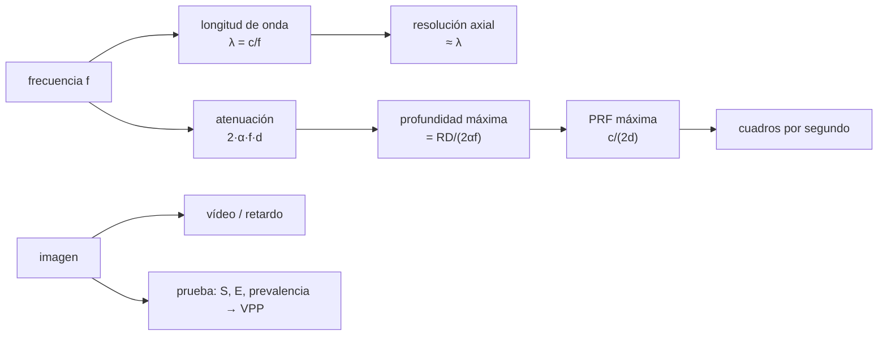

# B116-C06 — Dispositivos biomédicos portátiles (ultrasonido, diagnóstico)

<!-- nav:top -->
[🏠 Programa](../../../../README.md) · [📚 Bloque B116](../../../tronco-comun/B116-telemedicina-y-monitorizacion-de-salud-en-mision.md) · [← Anterior: B116-C05 — Alertas de salud y umbrales de monitorización](../B116-C05-alertas-de-salud-y-umbrales-de-monitorizacion/CLASE.md) · [Siguiente: B116-C07 — Diseño de paneles de monitoreo de salud →](../B116-C07-diseno-de-paneles-de-monitoreo-de-salud/CLASE.md)
<!-- /nav -->

## 1. Ubicación, nivel y alcance

Clase 6 de 7 del bloque B116. Nivel N4. Los sensores de las primeras clases miden signos; un **equipo de diagnóstico portátil** como un ecógrafo produce una imagen que alguien debe obtener e interpretar. La clase trata la física básica que fija qué puede ver un ecógrafo (frecuencia, profundidad, resolución, velocidad de cuadros), el ancho de banda y el retardo del guiado remoto y el valor predictivo de una prueba de diagnóstico según la prevalencia. Todo es **cálculo con parámetros ilustrativos**. **Clase educativa: no da consejo médico ni operativo ni enseña a realizar o interpretar una ecografía.**

## 2. Por qué esta clase existe

Un equipo no es solo su ficha técnica: lo que ve depende de la frecuencia elegida, quién lo maneja, cuánto entrena y qué retardo tiene el apoyo experto. Y una prueba con buenos números de sensibilidad y especificidad puede dar mayoría de falsos positivos si la condición es rara. La decisión central: **¿qué equipo, con qué configuración y con qué apoyo, produce una información diagnóstica útil a bordo?**

## 3. Lo que podrás hacer al terminar

1. Calcular el tiempo de ida y vuelta, la longitud de onda y la resolución axial de un pulso ultrasónico.
2. Calcular la profundidad máxima con una atenuación y un rango dinámico dados y explicar el compromiso con la frecuencia.
3. Calcular la frecuencia de repetición máxima y los cuadros por segundo.
4. Estimar el ancho de banda de un vídeo en vivo y comparar el retardo con la tolerancia de una guía en tiempo real.
5. Calcular el valor predictivo positivo y negativo con el teorema de Bayes y ver el efecto de la prevalencia.
6. Rotular lo ilustrativo y lo no consultado.

La evidencia es la **ficha de un equipo de diagnóstico** del ejercicio 12 (sección 20).

## 4. Con qué llegas y cómo comprobarlo

1. ¿Qué es un decibelio?
2. ¿Qué relación hay entre frecuencia y longitud de onda?
3. ¿Qué es la sensibilidad de una prueba?
4. ¿Qué es la prevalencia?
5. ¿Qué es un dato ilustrativo?

<details>
<summary>Ver respuestas</summary>

1. Una escala logarítmica de razones de potencia: 10·log10. 2. `λ = c/f`. 3. La fracción de casos positivos que detecta. 4. La fracción de la población que tiene la condición. 5. Un valor puesto para enseñar, sin fuente que lo respalde.
</details>

Con cuatro o cinco aciertos, sigue; si no, repasa los prerrequisitos.

## 5. Un caso de contexto y casos de referencia

Un ecógrafo de 3,5 MHz alcanza **17,1 cm** de profundidad máxima con el rango dinámico de 60 dB y la atenuación ilustrativa de 0,5 dB/(cm·MHz), con una resolución axial de 0,44 mm; uno de 7,5 MHz resuelve 0,205 mm pero solo llega a 8,0 cm: a 10 cm perdería 75 dB. Un vídeo en vivo de 640 × 480 px a 15 cuadros/s son 36,9 Mbit/s en bruto y 1,84 Mbit/s comprimido 20:1; pero con 4 min de retardo unidireccional la ida y vuelta es de 480 s y la guía en tiempo real es imposible. Y una prueba con S = 0,90 y E = 0,85 tiene un VPP de 0,057 si la prevalencia es del 1 % y de 0,400 si es del 10 %. Es el **ejemplo conductor**: todo es **ilustrativo**.

## 6. Vocabulario

El **ultrasonido** son ondas sonoras de más de 20 kHz; el ecógrafo emite pulsos y mide los ecos. El **tiempo de ida y vuelta** es `t = 2d/c`. La **resolución axial** es la separación mínima distinguible a lo largo del haz, `≈ N·λ/2` con `N` ciclos por pulso. La **atenuación** es la pérdida de señal con la distancia y crece con la frecuencia. El **rango dinámico** es la diferencia de nivel que el sistema puede representar. La **PRF** es la frecuencia de repetición de pulsos. El **valor predictivo positivo (VPP)** es la fracción de positivos que son verdaderos; el **negativo (VPN)**, la de negativos que son verdaderos. La **razón de verosimilitud positiva** es `S/(1 − E)`. **Almacenar y reenviar** guarda las imágenes para enviarlas después.

## 7. Modelo mental



*Descripción textual:* la frecuencia fija la resolución y, por la atenuación, la profundidad; la profundidad limita la PRF y los cuadros; la imagen pasa luego a un enlace con retardo y a una interpretación cuyo valor depende de la prevalencia.

Analogía: una linterna de luz azul alumbra con más detalle pero llega menos lejos que una roja en la niebla. Límite: el modelo usa una atenuación lineal con la frecuencia y un solo valor para el tejido; los tejidos reales difieren.

## 8. La explicación, paso a paso

### 8.1 Tiempo de vuelo

`t = 2d/c` con `c = 1540 m/s` (valor de enseñanza para el tejido blando): a 10 cm, `129,9 µs`; a 15 cm, `194,8 µs`. Control del laboratorio: 129,9 µs.

### 8.2 Frecuencia, resolución y profundidad

| f (MHz) | λ (mm) | res. axial (mm) | prof. máx. (cm) | PRF máx. (Hz) | cuadros/s (128 líneas) |
|---|---|---|---|---|---|
| 2,0 | 0,770 | 0,770 | 30,0 | 2567 | 20,1 |
| 3,5 | 0,440 | 0,440 | 17,1 | 4492 | 35,1 |
| 5,0 | 0,308 | 0,308 | 12,0 | 6417 | 50,1 |
| 7,5 | 0,205 | 0,205 | 8,0 | 9625 | 75,2 |
| 10,0 | 0,154 | 0,154 | 6,0 | 12 833 | 100,3 |
| 15,0 | 0,103 | 0,103 | 4,0 | 19 250 | 150,4 |

Con `N = 2` ciclos por pulso la resolución axial es `λ`. Subir `f` mejora la resolución y reduce la profundidad (la atenuación de ida y vuelta es `2·α·f·d`, con `α = 0,5 dB/(cm·MHz)`): 35,0 dB a 10 cm con 3,5 MHz frente a 75,0 dB con 7,5 MHz, que excede el rango dinámico de 60 dB.

### 8.3 Guiado remoto

En la ISS la ecografía es, según Kirkpatrick et al. (NASA), la única modalidad de imagen a bordo, y se evaluó en cuatro fases (identificar técnicas, probarlas en tierra, evaluarlas en vuelo parabólico y validarlas e implantarlas en el espacio); la fase IV abordó la formación de la tripulación, los protocolos de imagen a bordo y los procedimientos de transferencia de datos. Con un vídeo en vivo de 1,84 Mbit/s y un retardo unidireccional de 4 min (480 s de ida y vuelta) o de 24 min (2880 s), una guía en tiempo real (tolerancia ilustrativa de ~2 s) **no es posible**: hay que almacenar y reenviar, guiar antes (instrucción previa, ayudas visuales) y apoyar la interpretación a posteriori.

### 8.4 Valor predictivo y prevalencia

Con `S = 0,90` y `E = 0,85` (ilustrativas): prevalencia 1 %, VPP 0,057 y VPN 0,999; 5 %, 0,240 y 0,994; 10 %, 0,400 y 0,987; 30 %, 0,720 y 0,952; 50 %, 0,857 y 0,895. La razón de verosimilitud positiva es 6,00 en todos los casos: la prueba es la misma, pero lo que significa un positivo depende de lo probable que era la condición. En 1000 exploraciones con prevalencia del 10 %: 90 VP, 10 FN, 135 FP y 765 VN (VPP 0,400).

### 8.5 Qué no se consultó

Las páginas de la NASA sobre el sistema flexible de ultrasonido y sobre Ultrasound-2 **no se consultaron** (la primera no respondió a la lectura y la segunda dio error 404); lo que de ellas se sabe viene de un resumen de búsqueda no verificado. Las relaciones físicas (`c`, `α`, `RD`) son valores de enseñanza y no proceden de la hoja técnica de ningún equipo.

### 8.6 El operador importa

El rendimiento de una ecografía depende de quien la realiza. La sensibilidad y la especificidad de este laboratorio son ilustrativas y no corresponden a ninguna maniobra ni equipo; en un caso real dependen del entrenamiento y de la guía disponible, y por eso se evalúan en el entorno de uso.

## 9. Magnitudes, símbolos y unidades

| Símbolo | Qué es | Unidad | Valor / nota |
|---|---|---|---|
| `c` | velocidad del sonido en tejido blando | m/s | 1540 |
| `f` | frecuencia del transductor | MHz | 2–15 |
| `λ` | longitud de onda | mm | 0,103–0,770 |
| `α` | atenuación (un sentido) | dB/(cm·MHz) | 0,5 |
| `RD` | rango dinámico | dB | 60 |
| `d_max` | `RD/(2αf)` | cm | 30,0–4,0 |
| PRF | repetición de pulsos | Hz | `c/(2d)` |
| `S`, `E`, `p` | sensibilidad, especificidad, prevalencia | — | 0,90; 0,85; 0,01–0,50 |
| VPP, VPN | valores predictivos | — | ver 8.4 |

## 10. Convenciones y referencias

Cálculo determinista, sin semilla; todos los parámetros son ilustrativos. Convenciones: ida y vuelta `2d`; atenuación lineal con la frecuencia; 128 líneas por cuadro; vídeo de 640 × 480 px, 8 bit, 15 cuadros/s con compresión 20:1; retardo unidireccional de 4 a 24 min (Goddard, NASA). Tolerancias: tiempo a 10 cm igual a 129,87 µs; la profundidad máxima decrece con la frecuencia; el VPP crece con la prevalencia; la tabla de 1000 casos suma 1000. Python 3.12.9, numpy 2.4.4.

## 11. De dónde sale lo que afirmamos

| ID | Fuente | Localizador | Respalda | Estado |
|---|---|---|---|---|
| S1 | Kirkpatrick, A. W. et al., «Evaluating Trauma Sonography for Operational Use in the Microgravity Environment» (NASA NTRS 20070023642) — https://ntrs.nasa.gov/api/citations/20070023642/downloads/20070023642.pdf (consultada 2026-11-10; PDF leído con PyMuPDF) | resumen e introducción | ecografía como única modalidad de imagen en la ISS; evaluación en cuatro fases; formación, protocolos y transferencia de datos | Consultada (parcialmente) |
| S2 | NASA Goddard, «Space Communications: 7 Things You Need to Know» — https://www.nasa.gov/centers-and-facilities/goddard/space-communications-7-things-you-need-to-know/ (consultada 2026-11-10) | sección sobre Marte | retardo unidireccional de 4 a 24 min | Consultada |
| — | Física del ultrasonido (`t = 2d/c`, `λ = c/f`, atenuación, PRF) y teorema de Bayes | — | las verifica el laboratorio | No consultada en una fuente concreta (las verifica el laboratorio) |
| — | NASA, Flexible Ultrasound System y Ultrasound-2 | — | — | **No consultada** (error de conexión y HTTP 404) |

Límites: no se consultó ninguna hoja técnica ni norma de seguridad de ecógrafos (por ejemplo la regulación sobre índices de potencia acústica) ni la literatura de rendimiento diagnóstico en vuelo.

## 12. Cómo ver el resultado

| Resultado | Valor |
|---|---|
| Ida y vuelta a 10 cm | 129,9 µs |
| Profundidad máx. a 3,5 / 7,5 MHz | 17,1 / 8,0 cm |
| Vídeo comprimido | 1,84 Mbit/s |
| Ida y vuelta con 4 min unidireccionales | 480 s |
| VPP con prevalencia 1 % / 10 % | 0,057 / 0,400 |

Descripción larga: frecuencias altas dan más resolución y menos profundidad; el ancho de banda del vídeo es asumible pero el retardo impide la guía en vivo; y un positivo vale poco si la condición es rara.

## 13. Ejemplo trabajado: valor predictivo

**Paso 1 · Datos.** `S = 0,90`, `E = 0,85`, `p = 0,10`, 1000 exploraciones.

**Paso 2 · Conteos.** VP `= 0,90·100 = 90`; FN `= 10`; FP `= 0,15·900 = 135`; VN `= 0,85·900 = 765`.

**Paso 3 · VPP.** `90/(90 + 135) = 0,400`.

**Paso 4 · Lectura.** Seis de cada diez positivos son falsos con esa prevalencia, aunque la prueba tenga «buenos» números.

## 14. Distintas formas de describir el problema

**Por física:** `λ`, atenuación, profundidad. **Por tiempo:** vuelo y PRF. **Por datos:** bits y retardo. **Por decisión:** VPP, VPN y prevalencia. **Por operador:** entrenamiento y guía. **Por tabla:** salida del laboratorio.

## 15. Práctica guiada

**Ejercicio 1 · con los pasos indicados.** Calcula `λ` a 5 MHz. *Pasos:* `c/f`.

<details><summary>Solución comentada</summary>

`1540/5·10⁶ = 0,000308` m `= 0,308` mm.
</details>

**Ejercicio 2 · con una pista.** Calcula la profundidad máxima a 3,5 MHz. *Pista:* `RD/(2αf)`.

<details><summary>Solución comentada</summary>

`60/(2·0,5·3,5) = 17,1` cm.
</details>

**Ejercicio 3 · casi autónomo.** Calcula el tiempo de ida y vuelta a 15 cm. *Pista:* `2d/c`.

<details><summary>Solución comentada</summary>

`0,30/1540 = 194,8` µs.
</details>

## 16. Práctica autónoma, transferencia e integrador

**Ejercicio 4 · autónomo.** Calcula el VPP con `p = 0,10`, `S = 0,90`, `E = 0,85`.

<details><summary>Solución comentada</summary>

`0,090/(0,090 + 0,135) = 0,400`.
</details>

**Ejercicio 5 · autónomo.** Calcula la PRF máxima para 12 cm.

<details><summary>Solución comentada</summary>

`1540/(2·0,12) = 6417` Hz.
</details>

**Ejercicio 6 · autónomo.** ¿Cuánta atenuación de ida y vuelta hay a 10 cm con 7,5 MHz y por qué no se ve?

<details><summary>Solución comentada</summary>

`2·0,5·7,5·10 = 75` dB, mayor que el rango dinámico de 60 dB: queda por debajo de lo representable.
</details>

**Ejercicio 7 · autónomo.** Calcula el ancho de banda bruto de 640 × 480 px, 8 bit, 15 cuadros/s.

<details><summary>Solución comentada</summary>

`640·480·8·15 = 36,9` Mbit/s; con compresión 20:1, 1,84 Mbit/s.
</details>

**Ejercicio 8 · autónomo.** ¿Cuánto vale la ida y vuelta con 4 min unidireccionales y por qué excede la tolerancia de 2 s?

<details><summary>Solución comentada</summary>

`2·4·60 = 480` s, 240 veces la tolerancia.
</details>

**Ejercicio 9 · transferencia.** **Transferencia.** Un transductor de 10 MHz se propone para estructuras profundas. ¿Qué objeción hay desde la física?

<details><summary>Solución comentada</summary>

La profundidad máxima es 6,0 cm; para estructuras más profundas hace falta una frecuencia menor aunque se pierda resolución. No es criterio clínico.
</details>

**Ejercicio 10 · transferencia.** **Transferencia.** Un cribado en tripulación sana con prevalencia del 1 % da un VPP de 0,057. ¿Qué implica?

<details><summary>Solución comentada</summary>

Que casi todos los positivos serían falsos (94 %): conviene una confirmación y comunicar la incertidumbre; el VPN de 0,999 sí tranquiliza más.
</details>

**Ejercicio 11 · transferencia.** **Transferencia.** Con 24 min de retardo, ¿cómo organizas el apoyo experto a una ecografía hecha a bordo?

<details><summary>Solución comentada</summary>

Formación previa y ayudas «justo a tiempo» a bordo, captura de series de imágenes, envío por almacenar y reenviar y revisión asíncrona; esto es una propuesta ilustrativa y la fase IV de Kirkpatrick et al. trata formación, protocolos y transferencia.
</details>

**Ejercicio 12 · integrador.** **Integrador.** Elabora tu *ficha de un equipo de diagnóstico*: tabla de frecuencia, resolución, profundidad y cuadros, ancho de banda y retardo del guiado, valor predictivo según la prevalencia, requisitos de formación y qué es ilustrativo y no consultado.

<details><summary>Solución comentada</summary>

Secciones 8.1–8.6 y la salida del laboratorio.
</details>

## 17. Laboratorio: física del ecógrafo, guiado y valor predictivo

El script [ecografo.py](ecografo.py) calcula la tabla de frecuencias, la pérdida por profundidad, el ancho de banda y el retardo del guiado y el valor predictivo según la prevalencia (**comprueba** 129,9 µs a 10 cm, la profundidad decreciente con la frecuencia, el VPP creciente con la prevalencia y que la tabla de 1000 casos suma 1000).

**Datos:** cálculo determinista con parámetros **ilustrativos**; sin datos de personas ni de equipos. **Predice antes de ejecutar:** ¿qué profundidad máxima da 7,5 MHz con 60 dB? (8 cm.) **Ejecución del 2026-11-10 (Python 3.12.9):**

```text
Python 3.12.9; numpy 2.4.4
PARAMETROS ILUSTRATIVOS: calculo determinista; no describe un equipo real ni da criterio clinico
Control: tiempo de ida y vuelta a 10 cm = 129.9 us (esperado 129.9 us)
Frecuencia, longitud de onda, resolucion axial, profundidad maxima y velocidad de cuadros (128 lineas):
  f [MHz]   lambda [mm]   res. axial [mm]   prof. max. [cm]   PRF max a prof. max. [Hz]   cuadros/s
     2.0       0.770          0.770              30.0                 2567                  20.1
     3.5       0.440          0.440              17.1                 4492                  35.1
     5.0       0.308          0.308              12.0                 6417                  50.1
     7.5       0.205          0.205               8.0                 9625                  75.2
    10.0       0.154          0.154               6.0                12833                 100.3
    15.0       0.103          0.103               4.0                19250                 150.4
Compromiso: subir f mejora la resolucion axial pero reduce la profundidad (la atenuacion crece con f).
Perdida de ida y vuelta [dB] a distintas profundidades con f = 3.5 MHz y f = 7.5 MHz:
    2 cm:   7.0 dB (3.5 MHz) ;  15.0 dB (7.5 MHz)
    5 cm:  17.5 dB (3.5 MHz) ;  37.5 dB (7.5 MHz)
   10 cm:  35.0 dB (3.5 MHz) ;  75.0 dB (7.5 MHz)
   15 cm:  52.5 dB (3.5 MHz) ; 112.5 dB (7.5 MHz)
Guiado remoto: ancho de banda de una imagen en vivo 640 x 480 px, 8 bit, 15 cuadros/s, compresion 20:1 (ilustrativa):
  bruto = 36.9 Mbit/s; comprimido = 1.84 Mbit/s
Retardo de ida y vuelta para el guiado (4 a 24 min unidireccional) frente a la tolerancia de una guia en tiempo real (~2 s, ilustrativa):
   unidireccional  0.01 min: ida y vuelta =     1.2 s -> guia en tiempo real posible
   unidireccional  4.00 min: ida y vuelta =   480.0 s -> guia en tiempo real IMPOSIBLE: almacenar y reenviar
   unidireccional 12.00 min: ida y vuelta =  1440.0 s -> guia en tiempo real IMPOSIBLE: almacenar y reenviar
   unidireccional 24.00 min: ida y vuelta =  2880.0 s -> guia en tiempo real IMPOSIBLE: almacenar y reenviar
Valor predictivo de una prueba de diagnostico ILUSTRATIVA (S = 0.90, E = 0.85) segun la prevalencia:
  prevalencia   VPP     VPN     razon de verosimilitud +
      0.01     0.057   0.999           6.00
      0.05     0.240   0.994           6.00
      0.10     0.400   0.987           6.00
      0.30     0.720   0.952           6.00
      0.50     0.857   0.895           6.00
Tabla de 1000 exploraciones con p = 0.10: VP = 90, FN = 10, FP = 135, VN = 765; VPP = 0.400
Pruebas superadas.
```

```bash
python programa/clases/B116/B116-C06-dispositivos-biomedicos-portatiles-ultrasonido-diagnostico/ecografo.py
```

**Límites:** tejido homogéneo, atenuación lineal, sin ganancia en profundidad, haz ideal, sin Doppler ni artefactos; una sola prueba con S y E fijas; no representa ningún equipo ni maniobra.

## 18. Errores frecuentes y cómo corregirlos

**Elegir la frecuencia más alta «por la resolución».** Calcula la profundidad (8.2).

**Suponer guía en tiempo real con retardo de minutos.** Calcula la ida y vuelta (8.3).

**Leer un positivo sin la prevalencia.** Calcula el VPP (8.4).

**Tomar los parámetros ilustrativos por los de un equipo.** Se corrige con 8.5.

## 19. Cómo sabrás que vas bien

Tras la sección 8: ¿qué se gana y qué se pierde al subir la frecuencia? Si dudas, repasa 8.2. Tras el laboratorio: ¿qué comprueba? (ver la sección 17).

## 20. Qué entregas y cómo se evalúa

El producto es tu **ficha de un equipo de diagnóstico** (ejercicio 12).

| Criterio | Inicial | En desarrollo | Logrado | Destacado |
|---|---|---|---|---|
| Conceptos | Confunde resolución y profundidad | Parciales | Explica el compromiso y el VPP | Explica el papel del operador |
| Cálculo | Sin unidades | Con errores | Calcula `λ`, `d_max`, PRF y VPP | Calcula casos nuevos |
| Numérico | Sin control | Un caso | Controles y tabla completa | Analiza el retardo |
| Fuentes | Sin fuente | Sin fecha | Fuentes con fecha y estado | Declara lo no consultado |
| Límites | No los nombra | Uno | Tres | Discute la validación en uso |

**Condiciones críticas (no se compensan con promedio):** rotular lo ilustrativo; no dar consejo médico ni operativo; no presentar los parámetros como los de un equipo real; citar solo lo consultado.

## 21. Ética, seguridad y límites

Clase educativa: **no da consejo médico ni operativo** ni enseña a realizar, ni a interpretar, una ecografía. Los parámetros son ilustrativos. El uso de un equipo biomédico en una persona exige un dispositivo con la regulación aplicable, formación, protocolos y supervisión de personal sanitario cualificado. Los datos de imagen son datos de salud sensibles. Accesibilidad: tablas equivalentes a las gráficas, fórmulas en texto, ejercicios sin conexión.

## 22. Para cerrar y seguir

La física fija un compromiso entre resolución y profundidad, el retardo impide la guía en vivo y el valor de un positivo depende de la prevalencia; un equipo de diagnóstico se evalúa por el conjunto: física, operador, enlace y condición buscada. La última clase reúne todo en el panel que ve quien decide.

**Glosario español–inglés.** ecógrafo · *ultrasound scanner*; resolución axial · *axial resolution*; valor predictivo positivo · *positive predictive value*; rango dinámico · *dynamic range*; almacenar y reenviar · *store and forward*.

**Continuidad.** Sigue con la clase siguiente del bloque; ver el [bloque B116](../../../tronco-comun/B116-telemedicina-y-monitorizacion-de-salud-en-mision.md).

**Referencias:** ver sección 11.

<!-- nav:bottom -->
---

[← Anterior: B116-C05 — Alertas de salud y umbrales de monitorización](../B116-C05-alertas-de-salud-y-umbrales-de-monitorizacion/CLASE.md) · [📚 Bloque B116](../../../tronco-comun/B116-telemedicina-y-monitorizacion-de-salud-en-mision.md) · [Siguiente: B116-C07 — Diseño de paneles de monitoreo de salud →](../B116-C07-diseno-de-paneles-de-monitoreo-de-salud/CLASE.md)
<!-- /nav -->
