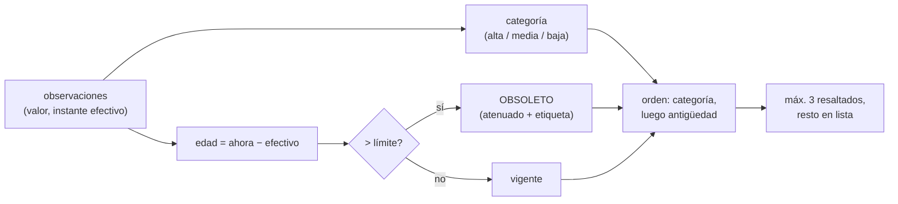

# B116-C07 — Diseño de paneles de monitoreo de salud

<!-- nav:top -->
[🏠 Programa](../../../../README.md) · [📚 Bloque B116](../../../tronco-comun/B116-telemedicina-y-monitorizacion-de-salud-en-mision.md) · [← Anterior: B116-C06 — Dispositivos biomédicos portátiles (ultrasonido, diagnóstico)](../B116-C06-dispositivos-biomedicos-portatiles-ultrasonido-diagnostico/CLASE.md) · [Siguiente: B117-C01 — Primeros auxilios y procedimientos básicos en entorno espacial →](../../../tronco-comun/B117-urgencias-medicas-y-atencion-clinica-en-mision.md#b117-c01)
<!-- /nav -->

## 1. Ubicación, nivel y alcance

Clase 7 y última del bloque B116. Nivel N4. Todo lo anterior (sensor, signo, registro, triage, alerta y equipo) llega a una persona a través de **un panel**. La clase trata las reglas de diseño que se pueden comprobar con un programa: la **antigüedad del dato** (el retardo ya ha pasado cuando se ve el número), la prioridad, el contraste accesible según WCAG 2.2 y la carga de indicadores resaltados. Los datos son **sintéticos** y el panel es un ejercicio, no un panel operativo. **Clase educativa: no da consejo médico ni operativo.**

## 2. Por qué esta clase existe

Un panel que muestra «FC 72» sin decir de cuándo es, o que usa un gris que no se lee, puede ser peor que no tener panel. La decisión central: **¿qué debe mostrar un panel de salud para que quien lo mira sepa qué está pasando, cuán fresco es el dato y a quién atender primero?**

## 3. Lo que podrás hacer al terminar

1. Calcular el contraste de un color sobre fondo blanco con la fórmula de WCAG 2.2 y decidir si cumple el mínimo.
2. Calcular la antigüedad de cada dato y marcarlo como vigente u obsoleto con un límite por signo.
3. Ordenar los indicadores por prioridad y antigüedad.
4. Limitar la carga de indicadores resaltados y definir qué ocurre al excederla.
5. Redundar el color con texto para que el estado no dependa solo del color.
6. Rotular lo sintético y lo ilustrativo.

La evidencia es la **especificación de un panel** del ejercicio 12 (sección 20).

## 4. Con qué llegas y cómo comprobarlo

1. ¿Qué es la luminancia relativa?
2. ¿Qué es una razón de contraste?
3. ¿Qué es la antigüedad de un dato?
4. ¿Qué es una categoría de prioridad?
5. ¿Qué es un dato sintético?

<details>
<summary>Ver respuestas</summary>

1. Una medida del brillo de un color en una escala de 0 a 1. 2. El cociente entre el brillo del color claro y el oscuro, con 0,05 de compensación. 3. El tiempo transcurrido desde que se midió. 4. Una clase (alta, media, baja) que ordena la atención. 5. Un dato generado por un modelo; se rotula como tal.
</details>

Con cuatro o cinco aciertos, sigue; si no, repasa los prerrequisitos.

## 5. Un caso de contexto y casos de referencia

Un panel sintético muestra 12 indicadores (4 personas × 3 signos): 2 en categoría alta (FC 118 lpm de S1 y SpO2 91 % de S2), 1 en media y 9 en baja, de los cuales **4 son obsoletos** (con 24 o 50 min de antigüedad frente a un límite de 10 o 30). Un valor «normal» obsoleto no se muestra como normal. El gris `#949494` sobre blanco tiene un contraste de 3,03:1 y no cumple el mínimo de 4,5:1 para texto normal; el ámbar `#FFC107` tiene 1,63:1 y no cumple ni el de texto grande; el ámbar oscuro `#8A5A00`, 5,93:1. Con 12 min de retardo unidireccional, solo la temperatura (límite de 30 min) sigue vigente. Es el **ejemplo conductor**: todo es **sintético** (semilla 121).

## 6. Vocabulario

Un **panel** es la vista que resume el estado de la tripulación. La **razón de contraste** de WCAG es `(L1 + 0,05)/(L2 + 0,05)`, con `L1` la luminancia relativa del color más claro y `L2` la del más oscuro. La **luminancia relativa** es `L = 0,2126 R + 0,7152 G + 0,0722 B` con cada canal sRGB linealizado. La **antigüedad** es `ahora − instante efectivo`. **Obsoleto** es un dato cuya antigüedad supera su límite. La **prioridad** ordena por categoría y luego por antigüedad. La **carga visual** es el número de elementos que compiten por la atención a la vez. **Redundancia**: transmitir un estado por más de un canal (color y texto).

## 7. Modelo mental



*Descripción textual:* cada observación tiene una antigüedad y una categoría; la antigüedad decide si se marca como obsoleta; el orden usa categoría y antigüedad y solo se resaltan unos pocos indicadores.

Analogía: el cuadro de mandos de un coche muestra la velocidad ahora; el panel de salud muestra «lo último que llegó» y debe decir cuándo fue. Límite: el laboratorio solo comprueba reglas lógicas y contraste; no mide la comprensión de usuarios reales.

## 8. La explicación, paso a paso

### 8.1 Contraste accesible

WCAG 2.2, criterio 1.4.3 (Nivel AA) exige 4,5:1 para texto normal y 3:1 para texto grande (18 pt o 14 pt en negrita), y los umbrales no se redondean (4,499:1 no cumple). Cada canal sRGB `c` se linealiza (`c/12,92` si `c ≤ 0,04045`; si no `((c + 0,055)/1,055)^2,4`). Control del laboratorio: negro sobre blanco da 21,00:1.

### 8.2 Resultados de contraste (texto sobre blanco)

| Color | Razón | Texto normal | Texto grande |
|---|---|---|---|
| negro | 21,00:1 | cumple | cumple |
| gris oscuro `#595959` | 7,00:1 | cumple | cumple |
| gris medio `#767676` | 4,54:1 | cumple | cumple |
| gris claro `#949494` | 3,03:1 | no cumple | cumple |
| rojo `#B00020` | 7,33:1 | cumple | cumple |
| ámbar `#FFC107` | 1,63:1 | no cumple | no cumple |
| ámbar oscuro `#8A5A00` | 5,93:1 | cumple | cumple |
| verde `#2E7D32` | 5,13:1 | cumple | cumple |
| verde claro `#66BB6A` | 2,36:1 | no cumple | no cumple |

El ámbar «semáforo» típico no sirve como texto sobre blanco; se usa un ámbar oscuro o se pone texto oscuro sobre un fondo ámbar.

### 8.3 Antigüedad del dato

La antigüedad es `ahora − efectivo`; el retardo de comunicaciones ya está en ese desfase. El campo `effective` de una observación FHIR es el instante clínicamente relevante; la antigüedad se calcula contra ese instante y no contra el de recepción. Límites ilustrativos: 10 min para FC y SpO2 y 30 min para la temperatura. Con las antigüedades del laboratorio (2, 8, 24 y 50 min) hay **4 de 12** indicadores obsoletos. Un valor obsoleto se muestra atenuado y con la etiqueta «obsoleto» y su edad; **nunca** como «normal».

### 8.4 Prioridad

Se ordena por categoría (alta primero) y luego por antigüedad (más antigua primero dentro de cada categoría). En el laboratorio las dos alertas altas (S1 FC 118 lpm, edad 8 min; S2 SpO2 91 %, edad 2 min) encabezan la lista; después, la media (S4 SpO2 94,8 %) y por último las bajas, con las obsoletas primero. No hay casos de categoría alta con dato obsoleto.

### 8.5 Carga visual

Una política de máximo 3 indicadores resaltados a la vez (ilustrativa): se resaltan los 3 primeros de la lista ordenada y el resto queda en la lista; si hay más de 3 altos, el panel muestra un resumen del número de altos y la lista completa sin parpadeo. Se enlaza con la fatiga de alarmas (B116-C05).

### 8.6 Efecto del retardo en el panel

La NASA (Goddard) da un retardo unidireccional de 4 a 24 min. Con 4 min, los tres signos están vigentes con sus límites; con 12 y 24 min solo la temperatura (límite 30 min) lo está: **un panel con datos de tierra siempre «viejos» exige que cada signo declare su antigüedad y que el panel de a bordo no dependa de tierra**. No se consultó NASA-STD-3001 Vol. 2 (factores humanos) ni ninguna guía de diseño de paneles de misión.

## 9. Magnitudes, símbolos y unidades

| Símbolo | Qué es | Unidad | Valor / nota |
|---|---|---|---|
| `L` | luminancia relativa | — | 0 a 1 |
| razón | `(L1 + 0,05)/(L2 + 0,05)` | `:1` | 1 a 21 |
| edad | `ahora − efectivo` | min | 2; 8; 24; 50 |
| límite | edad máxima por signo | min | 10 (FC, SpO2); 30 (T) |
| categoría | 0 baja, 1 media, 2 alta | — | 9; 1; 2 de 12 |
| resaltados | indicadores destacados | — | máx. 3 |

## 10. Convenciones y referencias

Tripulación ficticia S1–S4; valores con semilla 121, con dos casos forzados (FC 118 lpm de S1, SpO2 91 % de S2); antigüedades elegidas entre 2, 8, 24 y 50 min; umbrales de categoría ilustrativos (alta: FC ≥ 110 o ≤ 45 lpm, SpO2 ≤ 92 %, T ≥ 39,0 °C; media: FC ≥ 100, SpO2 ≤ 95 %, T ≥ 38,0 °C). Contraste sobre fondo blanco (255, 255, 255). Tolerancias: negro sobre blanco igual a 21 dentro de 1e-9; `#767676` cumple y `#949494` no; resaltados ≤ 3. Python 3.12.9, numpy 2.4.4.

## 11. De dónde sale lo que afirmamos

| ID | Fuente | Localizador | Respalda | Estado |
|---|---|---|---|---|
| S1 | W3C, «Understanding Success Criterion 1.4.3: Contrast (Minimum)», WCAG 2.2 — https://www.w3.org/WAI/WCAG22/Understanding/contrast-minimum.html (consultada 2026-11-10) | página | mínimos 4,5:1 y 3:1, no redondeo, fórmulas de contraste y luminancia | Consultada |
| S2 | HL7 International, «FHIR R5: Observation» — https://www.hl7.org/fhir/observation.html (consultada 2026-11-10) | primeros 100 000 caracteres | `effective[x]` como instante clínicamente relevante | Consultada (parcialmente) |
| S3 | NASA Goddard, «Space Communications: 7 Things You Need to Know» — https://www.nasa.gov/centers-and-facilities/goddard/space-communications-7-things-you-need-to-know/ (consultada 2026-11-10) | sección sobre Marte | retardo unidireccional de 4 a 24 min | Consultada |
| — | Reglas de prioridad, antigüedad y carga visual | — | las verifica el laboratorio | No consultada en una fuente concreta (las verifica el laboratorio) |
| — | NASA-STD-3001 Vol. 2 y guías de paneles de misión | — | — | **No consultada** |

Límites: de WCAG solo se consultó el criterio 1.4.3; los demás criterios (uso del color, contraste de componentes no textuales, etc.) **no se consultaron**. No se hicieron pruebas con usuarios.

## 12. Cómo ver el resultado

| Resultado | Valor |
|---|---|
| Contraste negro / `#949494` / `#FFC107` | 21,00 / 3,03 / 1,63 |
| Indicadores obsoletos | 4 de 12 |
| Indicadores altos | 2 (S1 FC, S2 SpO2) |
| Signos vigentes con 12 min de retardo | solo temperatura |

Descripción larga: el contraste decide la legibilidad; la antigüedad decide qué datos se pueden creer y la prioridad, a quién se atiende primero.

## 13. Ejemplo trabajado: contraste del gris `#949494`

**Paso 1 · Canal.** `0x94 = 148`; `148/255 = 0,580`; linealizado `((0,580 + 0,055)/1,055)^2,4 = 0,296`.

**Paso 2 · Luminancia.** Los tres canales iguales: `L = 0,296`.

**Paso 3 · Razón con el blanco (`L = 1`).** `(1 + 0,05)/(0,296 + 0,05) = 3,03`.

**Paso 4 · Lectura.** `3,03 < 4,5`: no cumple para texto normal; sí cumple el mínimo de 3:1 para texto grande.

## 14. Distintas formas de describir el problema

**Por legibilidad:** contraste. **Por tiempo:** antigüedad. **Por orden:** prioridad. **Por atención:** carga visual. **Por redundancia:** texto además de color. **Por tabla:** salida del laboratorio.

## 15. Práctica guiada

**Ejercicio 1 · con los pasos indicados.** Calcula el contraste de negro sobre blanco. *Pasos:* `L = 0` y `L = 1`.

<details><summary>Solución comentada</summary>

`(1 + 0,05)/(0 + 0,05) = 21,00`.
</details>

**Ejercicio 2 · con una pista.** Una temperatura de S1 tiene 50 min con límite de 30. ¿Es vigente? *Pista:* compara con el límite.

<details><summary>Solución comentada</summary>

No: 50 > 30, es obsoleto y se muestra atenuado con su edad.
</details>

**Ejercicio 3 · casi autónomo.** ¿Cumple `#949494` como texto normal? ¿Y como texto grande? *Pista:* 3,03:1.

<details><summary>Solución comentada</summary>

No como texto normal (3,03 < 4,5); sí como texto grande (3,03 ≥ 3).
</details>

## 16. Práctica autónoma, transferencia e integrador

**Ejercicio 4 · autónomo.** El ámbar `#FFC107` da 1,63:1. ¿Qué alternativa de la tabla usas para texto ámbar?

<details><summary>Solución comentada</summary>

El ámbar oscuro `#8A5A00` (5,93:1), o texto oscuro sobre fondo ámbar.
</details>

**Ejercicio 5 · autónomo.** Con 12 min de retardo, ¿qué signos siguen vigentes con los límites del laboratorio?

<details><summary>Solución comentada</summary>

Solo la temperatura (límite 30 min); FC y SpO2 (10 min) quedan obsoletas.
</details>

**Ejercicio 6 · autónomo.** Ordena: S4 SpO2 94,8 % (media, 8 min) y S1 temperatura 37,1 °C (baja, 50 min).

<details><summary>Solución comentada</summary>

Primero la media (categoría mayor); la baja va después aunque sea más antigua.
</details>

**Ejercicio 7 · autónomo.** ¿Por qué 4,499:1 no cumple 4,5:1?

<details><summary>Solución comentada</summary>

WCAG indica que los umbrales no se redondean: los valores calculados se comparan sin redondeo.
</details>

**Ejercicio 8 · autónomo.** Un valor bajo y obsoleto de 24 min, ¿se muestra como «normal»?

<details><summary>Solución comentada</summary>

No: se muestra atenuado con la etiqueta «obsoleto» y su edad; «normal» exigiría un dato vigente.
</details>

**Ejercicio 9 · transferencia.** **Transferencia.** Un panel marca el estado solo con círculos rojo/ámbar/verde. ¿Qué cambio introduces?

<details><summary>Solución comentada</summary>

Añadir texto («ALTA», «media», «baja») como en el panel del laboratorio, para que el estado no dependa solo del color; el criterio WCAG específico sobre el uso del color no se consultó.
</details>

**Ejercicio 10 · transferencia.** **Transferencia.** Con 24 min de retardo, ¿cómo evitas que la tripulación confíe en un panel de tierra?

<details><summary>Solución comentada</summary>

Cada valor lleva su edad y el panel de a bordo se alimenta de los sensores locales, no de tierra (8.6).
</details>

**Ejercicio 11 · transferencia.** **Transferencia.** Hay 5 indicadores altos a la vez y el máximo resaltado es 3. ¿Qué haces?

<details><summary>Solución comentada</summary>

Resaltar 3, mostrar un resumen («5 altos») y la lista completa ordenada, sin parpadeo; la regla de 3 es ilustrativa y debe validarse con usuarios.
</details>

**Ejercicio 12 · integrador.** **Integrador.** Elabora tu *especificación de un panel*: indicadores, categorías y umbrales, límites de antigüedad, orden, tabla de contraste de la paleta, política de carga visual, comportamiento ante retardo y qué es sintético, ilustrativo y no consultado.

<details><summary>Solución comentada</summary>

Secciones 8.1–8.6 y la salida del laboratorio.
</details>

## 17. Laboratorio: lógica de un panel con contraste y antigüedad

El script [panel.py](panel.py) calcula los contrastes de una paleta con la fórmula de WCAG 2.2, construye 12 indicadores sintéticos con su antigüedad, los ordena por prioridad y comprueba la carga visual (**comprueba** 21:1 para negro sobre blanco, que `#767676` cumple y `#949494` no, y que los resaltados no pasan de 3).

**Datos:** todo **sintético** (semilla 121); umbrales **ilustrativos**. **Predice antes de ejecutar:** ¿cumple el ámbar `#FFC107` sobre blanco? (No: 1,63:1.) **Ejecución del 2026-11-10 (Python 3.12.9):**

```text
Python 3.12.9; numpy 2.4.4
DATOS SINTETICOS (semilla 121): tripulacion ficticia; umbrales ilustrativos; no es un panel operativo
Control: contraste negro sobre blanco = 21.00:1 (esperado 21.00:1)
Contraste de colores de texto sobre fondo blanco (minimo 4.5:1 normal; 3:1 grande):
  color                    razon    texto normal  texto grande
  texto negro             21.00:1     cumple       cumple
  gris oscuro 595959       7.00:1     cumple       cumple
  gris medio 767676        4.54:1     cumple       cumple
  gris claro 949494        3.03:1     NO cumple    cumple
  rojo B00020              7.33:1     cumple       cumple
  ambar FFC107             1.63:1     NO cumple    NO cumple
  ambar oscuro 8A5A00      5.93:1     cumple       cumple
  verde 2E7D32             5.13:1     cumple       cumple
  verde claro 66BB6A       2.36:1     NO cumple    NO cumple
Panel de texto ordenado por prioridad (categoria y luego antiguedad); estado en TEXTO ademas del color:
  persona  signo   valor      edad [min]  categoria   estado del dato
   S1     FC      118.0 lpm      8.0     ALTA       vigente
   S2     SpO2     91.0 %        2.0     ALTA       vigente
   S4     SpO2     94.8 %        8.0     media      vigente
   S1     T        37.1 C       50.0     baja       OBSOLETO (> 30 min)
   S4     FC       76.1 lpm     50.0     baja       OBSOLETO (> 10 min)
   S1     SpO2     97.3 %       24.0     baja       OBSOLETO (> 10 min)
   S2     FC       75.5 lpm     24.0     baja       OBSOLETO (> 10 min)
   S4     T        36.8 C       24.0     baja       vigente
   S2     T        37.3 C        8.0     baja       vigente
   S3     FC       68.5 lpm      2.0     baja       vigente
   S3     SpO2     97.8 %        2.0     baja       vigente
   S3     T        36.6 C        2.0     baja       vigente
Indicadores totales = 12; en categoria alta = 2; obsoletos = 4
Un valor en categoria baja pero OBSOLETO no debe mostrarse como 'normal': se muestra atenuado con la etiqueta 'obsoleto'.
Casos de categoria alta con dato obsoleto (se muestran con la antiguedad): 0
Carga visual: numero de indicadores que parpadean o estan resaltados a la vez, con una politica de maximo 3:
  resaltados = 3 (maximo 3); resto en lista
Efecto de la antiguedad: con retardo unidireccional de 4 a 24 min el dato mas fresco ya tiene 4-24 min cuando llega:
   retardo  4 min: signos con limite de antiguedad aun vigentes = ['fc', 'spo2', 'temp']
   retardo 12 min: signos con limite de antiguedad aun vigentes = ['temp']
   retardo 24 min: signos con limite de antiguedad aun vigentes = ['temp']
Pruebas superadas.
```

```bash
python programa/clases/B116/B116-C07-diseno-de-paneles-de-monitoreo-de-salud/panel.py
```

**Límites:** solo reglas lógicas y contraste sobre fondo blanco; sin pruebas con usuarios, sin modo oscuro ni daltonismo, sin tiempos de respuesta y sin integración con el registro real.

## 18. Errores frecuentes y cómo corregirlos

**Mostrar el último valor sin su edad.** Calcula y muestra la antigüedad (8.3).

**Usar colores de semáforo como texto.** Comprueba el contraste (8.2).

**Resaltar todo.** Limita la carga (8.5).

**Tratar el panel del laboratorio como uno operativo.** Se corrige con la sección 10.

## 19. Cómo sabrás que vas bien

Tras la sección 8: ¿qué significa que un dato sea «obsoleto» y cómo se muestra? Si dudas, repasa 8.3. Tras el laboratorio: ¿qué comprueba? (ver la sección 17).

## 20. Qué entregas y cómo se evalúa

El producto es tu **especificación de un panel** (ejercicio 12).

| Criterio | Inicial | En desarrollo | Logrado | Destacado |
|---|---|---|---|---|
| Conceptos | Confunde valor y estado | Parciales | Explica antigüedad, prioridad y contraste | Explica la redundancia y la carga |
| Cálculo | Sin unidades | Con errores | Calcula el contraste y la edad | Calcula casos nuevos |
| Numérico | Sin control | Un caso | Control 21:1 y tabla de la paleta | Prueba reglas con casos límite |
| Fuentes | Sin fuente | Sin fecha | Fuentes con fecha y estado | Declara lo no consultado |
| Límites | No los nombra | Uno | Tres | Discute la validación con usuarios |

**Condiciones críticas (no se compensan con promedio):** rotular lo sintético e ilustrativo; no dar consejo médico ni operativo; no mostrar un dato obsoleto como vigente; citar solo lo consultado.

## 21. Ética, seguridad y límites

Clase educativa: **no da consejo médico ni operativo**. El panel del laboratorio es un ejercicio con datos ficticios y umbrales ilustrativos; un panel real para una tripulación exige análisis de factores humanos, pruebas con usuarios, requisitos de la agencia, validación clínica y gestión de datos de salud con consentimiento y seguridad. Accesibilidad: el contraste se comprueba con la fórmula de WCAG 2.2; las tablas equivalen a las gráficas, las fórmulas están en texto y los ejercicios no requieren conexión.

## 22. Para cerrar y seguir

Un panel de salud se diseña con reglas comprobables: contraste suficiente, estado en texto además de color, edad visible de cada dato, orden por prioridad y pocos elementos resaltados. Con esto se cierra el bloque: del sensor y su error al panel y su incertidumbre, siempre con el retardo y los límites a la vista.

**Glosario español–inglés.** panel · *dashboard*; razón de contraste · *contrast ratio*; antigüedad del dato · *data age*; obsoleto · *stale*; carga visual · *visual load*.

**Continuidad.** Esta es la última clase del bloque B116. Vuelve al [bloque B116](../../../tronco-comun/B116-telemedicina-y-monitorizacion-de-salud-en-mision.md) para el recorrido completo.

**Referencias:** ver sección 11.

<!-- nav:bottom -->
---

[← Anterior: B116-C06 — Dispositivos biomédicos portátiles (ultrasonido, diagnóstico)](../B116-C06-dispositivos-biomedicos-portatiles-ultrasonido-diagnostico/CLASE.md) · [📚 Bloque B116](../../../tronco-comun/B116-telemedicina-y-monitorizacion-de-salud-en-mision.md) · [Siguiente: B117-C01 — Primeros auxilios y procedimientos básicos en entorno espacial →](../../../tronco-comun/B117-urgencias-medicas-y-atencion-clinica-en-mision.md#b117-c01)
<!-- /nav -->
