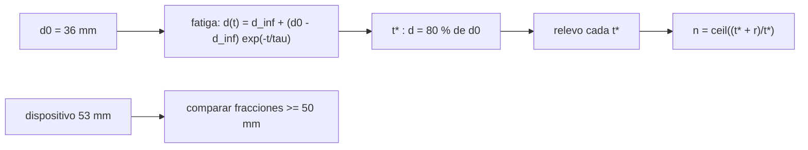

# B117-C01 — Primeros auxilios y procedimientos básicos en entorno espacial

<!-- nav:top -->
<!-- /nav -->

## 1. Ubicación, nivel y alcance

Clase 1 del bloque B117. Nivel N4. En microgravedad el reanimador no puede apoyar el peso del cuerpo sobre el pecho del paciente y debe sostener cada compresión con su musculatura, de modo que la calidad de la reanimación cambia con el tiempo. Aquí modelas esa fatiga con una curva exponencial, calculas cuánto tiempo mantiene la calidad un reanimador y cuántas personas hacen falta para relevarlo. Usas [B116](../../../tronco-comun/B116-telemedicina-y-monitorizacion-de-salud-en-mision.md) solo como contexto de apoyo médico a distancia. **Esta clase es educativa: no es una pauta de reanimación, no da consejo médico ni operativo y no sustituye formación, licencia ni supervisión profesional.** La reanimación es simulada y los parámetros son ilustrativos.

## 2. Por qué esta clase existe

Ninguna clase anterior trata primeros auxilios en microgravedad. La decisión central: **¿cuánto tiempo puede sostener un reanimador una compresión de calidad y cuándo hay que relevarlo?**

## 3. Lo que podrás hacer al terminar

1. Describir cómo cambia el soporte del reanimador sin gravedad.
2. Modelar la profundidad de compresión con una curva de fatiga `d(t)`.
3. Calcular el tiempo de calidad `t*` con una fórmula y comprobarlo numéricamente.
4. Planificar turnos de relevo y el número mínimo de reanimadores.
5. Comparar un método manual con un dispositivo mecánico con datos de maniquí.
6. Separar lo consultado (medianas de maniquí) de lo ilustrativo (fatiga, reposo).

La evidencia es la **ficha de plan de relevo de RCP simulada** del ejercicio 12 (sección 20).

## 4. Con qué llegas y cómo comprobarlo

1. ¿Qué es una función exponencial decreciente?
2. ¿Qué es una constante de tiempo?
3. ¿Qué es una mediana?
4. ¿Qué es un dato sintético?
5. ¿Qué es una verificación por segunda vía?

<details>
<summary>Ver respuestas</summary>

1. Una función que baja hacia un valor límite con rapidez proporcional a la distancia a él. 2. El tiempo en que la distancia al límite se reduce a `1/e` (37 %). 3. El valor central de un conjunto ordenado. 4. Un dato generado para el ejemplo, no medido. 5. Calcular lo mismo con otro método y comparar.
</details>

Con cuatro o cinco aciertos, sigue; si no, repasa los prerrequisitos.

## 5. Un caso de contexto y casos de referencia

Un estudio en maniquí en vuelos parabólicos (comunicado del 2025-08-27) midió profundidades de compresión **medianas** de 34,5 mm con el método manual «handstand», 53,0 mm con un pistón mecánico estándar y 29 mm con otros dos dispositivos, con unos 22 s de microgravedad por parábola. El comunicado cita 50–60 mm como la profundidad eficaz que recomienda el Consejo Europeo de Resucitación. Esas son las cifras **consultadas**. El **ejemplo conductor** es un reanimador sintético cuya profundidad parte de 36 mm y decae hacia 22 mm con `τ = 2,0 min`: cae al 80 % de su valor inicial a los `1,444 min`. Todo lo demás es **ilustrativo**.

## 6. Vocabulario

La **profundidad de compresión** `d` es cuánto se hunde el esternón del maniquí, en mm. La **fatiga** es la pérdida de profundidad con el tiempo. El **tiempo de calidad** `t*` es el tiempo hasta que la profundidad media cae al 80 % de la inicial (criterio ilustrativo). El **relevo** es el cambio de reanimador. El **reposo** `r` es el tiempo que necesita un reanimador para recuperarse. Un **maniquí** es un modelo físico del paciente.

## 7. Modelo mental: una batería que se descarga



*Descripción textual:* de la profundidad inicial y la fatiga sale el tiempo de calidad, de él los turnos de relevo y el número de reanimadores; el dispositivo se compara aparte.

Analogía: una batería que entrega menos corriente cuanto más se descarga; el relevo es cambiarla por otra cargada. Límite: la curva exponencial es una forma sencilla; la fatiga real depende de la persona, la técnica y el entorno.

## 8. La explicación, paso a paso

### 8.1 Profundidad con fatiga

`d(t) = d_inf + (d0 − d_inf) e^(−t/τ)` con `d0 = 36 mm`, `d_inf = 22 mm` y `τ = 2,0 min`. A 1, 2, 4 y 8 min vale 30,49, 27,15, 23,89 y 22,26 mm.

### 8.2 Tiempo de calidad

Se pide `d(t*) = 0,8 d0 = 28,8 mm`. Despejando, `t* = −τ ln[(0,8 d0 − d_inf)/(d0 − d_inf)] = −2 ln(6,8/14) = 1,444 min`. El laboratorio lo encuentra barriendo el tiempo: `1,445 min`.

### 8.3 Relevo

Si cada reanimador trabaja `t*` y necesita `r = 4 min` de reposo, hacen falta `n = ⌈(t* + r)/t*⌉ = ⌈3,77⌉ = 4` reanimadores. Un esfuerzo de 10 min son 7 turnos; de 20 min, 14; de 30 min, 21.

### 8.4 Manual frente a dispositivo

Con ruido de 3 mm por compresión, la fracción de compresiones de 50 mm o más en 2 min es `0,000` para el método manual y `0,832` para el dispositivo. El dispositivo no se fatiga en el modelo, pero tiene masa y volumen que el comunicado señala como limitación en una nave.

## 9. Magnitudes, símbolos y unidades

| Símbolo | Qué es | Unidad | Valor / nota |
|---|---|---|---|
| `d` | profundidad de compresión | mm | 36 → 22 |
| `τ` | constante de fatiga | min | 2,0 (ilustrativo) |
| `t*` | tiempo de calidad | min | 1,444 |
| `r` | reposo | min | 4 (ilustrativo) |
| `n` | reanimadores mínimos | — | 4 |
| `f` | frecuencia | compresiones/min | 110 (ilustrativo) |

## 10. Convenciones y referencias

Tiempo desde el inicio, en minutos; profundidades en mm; no hay marco espacial. La profundidad inicial de 36 mm se eligió cercana a la mediana consultada de 34,5 mm, pero **no es** ese dato. La frecuencia, la fatiga y el reposo son ilustrativos y no se consultaron.

## 11. De dónde sale lo que afirmamos

| ID | Fuente | Localizador | Respalda | Estado |
|---|---|---|---|---|
| S1 | Sociedad Europea de Cardiología, comunicado de prensa «Cardiac arrest in space…», 2025-08-27 — https://www.escardio.org/news/press/press-releases/cardiac-arrest-in-space-new-research-shows-that-automatic-chest-compressions-are-more-effective-for-cpr-when-both-rescuer-and-patient-are-floating-in-microgravity/ (consultada 2026-11-10) | comunicado completo leído mediante WebFetch | medianas de 34,5 / 53,0 / 29 mm, unos 22 s por parábola, uso de maniquí, el rango de 50–60 mm atribuido al Consejo Europeo de Resucitación, advertencia de que es un resumen de congreso | Consultada (comunicado; no es un artículo revisado) |
| — | Guías de reanimación (ERC, AHA) y protocolos de la EEI | — | rango de profundidad y frecuencia | No consultadas directamente |
| — | Modelo de fatiga exponencial | — | todo el modelo | Ilustrativo |

Límites: no se consultó el artículo ni el resumen del congreso; el modelo de fatiga no está calibrado con datos; ninguna cifra describe a una persona real.

## 12. Cómo ver la fatiga

| t (min) | d manual (mm) | d dispositivo (mm) |
|---|---|---|
| 0 | 36,00 | 53,0 |
| 1 | 30,49 | 53,0 |
| 2 | 27,15 | 53,0 |
| 4 | 23,89 | 53,0 |
| 8 | 22,26 | 53,0 |

Descripción larga: la profundidad manual cae rápido en los primeros minutos y se aplana en 22 mm; el dispositivo se mantiene constante.

## 13. Ejemplo trabajado: el relevo

**Paso 1 · Objetivo.** `0,8 × 36 = 28,8 mm`.

**Paso 2 · Cociente.** `(28,8 − 22)/(36 − 22) = 0,4857`.

**Paso 3 · Tiempo.** `t* = −2 ln 0,4857 = 1,444 min`.

**Paso 4 · Reanimadores.** `⌈(1,444 + 4)/1,444⌉ = ⌈3,77⌉ = 4`.

## 14. Distintas formas de describir la reanimación

**Por profundidad:** `d(t)`. **Por tiempo:** `t*`. **Por equipo:** `n` reanimadores. **Por fracción:** compresiones de 50 mm o más. **Por recursos:** manual (sin masa) o dispositivo (con masa y volumen).

## 15. Práctica guiada

**Ejercicio 1 · con los pasos indicados.** Calcula `d(2 min)`. *Pasos:* `e^(−1) = 0,3679`; multiplica por 14 y suma 22.

<details><summary>Solución comentada</summary>

`22 + 14 × 0,3679 = 27,15 mm`.
</details>

**Ejercicio 2 · con una pista.** Calcula `t*`. *Pista:* el objetivo es 28,8 mm.

<details><summary>Solución comentada</summary>

`t* = 1,444 min` (sección 8.2).
</details>

**Ejercicio 3 · casi autónomo.** ¿Por qué el dispositivo no muestra fatiga en el modelo y qué se omite?

<details><summary>Solución comentada</summary>

Se modeló constante a la mediana de 53,0 mm; se omiten la sujeción, la alineación y el tiempo de colocarlo.
</details>

## 16. Práctica autónoma, transferencia e integrador

**Ejercicio 4 · autónomo.** `d(1 min)`.

<details><summary>Solución comentada</summary>

`22 + 14 e^(−0,5) = 30,49 mm`.
</details>

**Ejercicio 5 · autónomo.** Si `τ` se duplica a 4 min, ¿cuánto vale `t*`?

<details><summary>Solución comentada</summary>

`t*` es proporcional a `τ`: `2,888 min`.
</details>

**Ejercicio 6 · autónomo.** Reanimadores mínimos con `r = 4 min` y `t* = 1,444 min`.

<details><summary>Solución comentada</summary>

4.
</details>

**Ejercicio 7 · autónomo.** Turnos para 10 min.

<details><summary>Solución comentada</summary>

`⌈10/1,444⌉ = ⌈6,92⌉ = 7`.
</details>

**Ejercicio 8 · autónomo.** Compresiones en un turno a 110/min.

<details><summary>Solución comentada</summary>

`110 × 1,444 = 158,8`, unas 159.
</details>

**Ejercicio 9 · transferencia.** **Transferencia.** El estudio de maniquí duró unos 22 s por parábola. ¿Sirve para decir cuánto dura la calidad en 20 min?

<details><summary>Solución comentada</summary>

No: 22 s no muestran la fatiga de minutos; `τ` habría que medirlo con ensayos más largos.
</details>

**Ejercicio 10 · transferencia.** **Transferencia.** Solo el pistón estándar alcanzó 50–60 mm. ¿Basta eso para decir que es la mejor opción a bordo?

<details><summary>Solución comentada</summary>

No: el comunicado señala masa, volumen y que es un estudio en maniquí; la decisión pesa más factores.
</details>

**Ejercicio 11 · transferencia.** **Transferencia.** ¿Qué medirías para calibrar `τ` y `d_inf` en un ensayo con maniquí?

<details><summary>Solución comentada</summary>

La profundidad de cada compresión con un sensor durante varios minutos y varios reanimadores, ajustando la curva a la media.
</details>

**Ejercicio 12 · integrador.** **Integrador.** Elabora tu *ficha de plan de relevo de RCP simulada*: tabla de `d(t)`, `t*`, turnos y reanimadores, comparación con el dispositivo y lista de qué es consultado e ilustrativo, con el aviso de que es educativa.

<details><summary>Solución comentada</summary>

Secciones 8.1–8.4 y la salida del laboratorio.
</details>

## 17. Laboratorio: fatiga y relevo en una RCP simulada

El script [rcp.py](rcp.py) calcula la profundidad con fatiga, `t*` por fórmula y por barrido, la media simulada con 2000 repeticiones y el plan de relevo (**comprueba** `t*` a 0,01 min y la media a 0,3 mm).

**Datos:** medianas de maniquí consultadas (34,5 y 53,0 mm); fatiga, ruido, frecuencia y reposo **ilustrativos**. **Predice antes de ejecutar:** ¿qué fracción de compresiones manuales llegará a 50 mm? (casi ninguna.) **Ejecución del 2026-11-10 (Python 3.12.9):**

```text
Python 3.12.9 (biblioteca estandar)
RCP SIMULADA, parametros ILUSTRATIVOS; solo las medianas de 34.5 y 53.0 mm son datos consultados (maniqui).
Modelo manual: d(t) = 22.0 + (36.0-22.0) exp(-t/2.0) mm; dispositivo: 53.0 mm constante
 t [min]  d manual [mm]  d dispositivo [mm]
      0          36.00                53.0
      1          30.49                53.0
      2          27.15                53.0
      4          23.89                53.0
      8          22.26                53.0
     16          22.00                53.0
t* (profundidad media = 80% de d0): analitico = 1.444 min ; numerico = 1.445 min
Error maximo media simulada - analitica = 0.056 mm
Fraccion de compresiones >= 50.0 mm en 2 min: manual = 0.000 ; dispositivo = 0.832
Esfuerzo de 10 min: 7 turnos de 1.44 min; reanimadores minimos con 4 min de reposo = 4
Esfuerzo de 20 min: 14 turnos de 1.44 min; reanimadores minimos con 4 min de reposo = 4
Esfuerzo de 30 min: 21 turnos de 1.44 min; reanimadores minimos con 4 min de reposo = 4
Pruebas superadas.
```

```bash
python programa/clases/B117/B117-C01-primeros-auxilios-y-procedimientos-basicos-en-entorno-espacial/rcp.py
```

**Límites:** curva de fatiga sin calibrar, un solo reanimador promedio, sin factores humanos reales; no es una pauta.

## 18. Errores frecuentes y cómo corregirlos

**Tomar el modelo como protocolo de reanimación.** Se corrige con las secciones 1 y 21.

**Creer que las medianas de maniquí describen a pacientes.** Se corrige con la sección 11.

**Confundir `d0 = 36 mm` con el dato consultado de 34,5 mm.** Se corrige con la sección 10.

**Olvidar el reposo al contar reanimadores.** Se corrige con 8.3.

## 19. Cómo sabrás que vas bien

Tras la sección 8: ¿qué `t*` esperabas y cuál obtuviste? Si dudas, repasa el ejemplo 13. Tras el laboratorio: ¿qué comprueba? (ver la sección 17).

## 20. Qué entregas y cómo se evalúa

El producto es tu **ficha de plan de relevo de RCP simulada** (ejercicio 12).

| Criterio | Inicial | En desarrollo | Logrado | Destacado |
|---|---|---|---|---|
| Conceptos | Los confunde | Parciales | Calcula `d(t)`, `t*` y `n` | Explica los límites |
| Cálculo | Sin unidades | Con errores | Tablas completas con unidades | Calcula casos nuevos |
| Numérico | Sin comprobar | Un caso | Contraste con una segunda vía | Interpreta las diferencias |
| Fuentes | Sin fuente | Sin fecha | Fuentes con fecha y estado | Declara lo ilustrativo y lo no consultado |
| Límites | No los nombra | Uno | Tres | Discute qué falta del modelo |

**Condiciones críticas (no se compensan con promedio):** rotular la fatiga y el reposo como ilustrativos; declarar que la clase no es una pauta médica; citar solo lo consultado.

## 21. Ética, seguridad y límites

Clase educativa: **no da consejo médico ni operativo** y no sustituye formación en soporte vital, licencia ni supervisión profesional; ningún resultado debe usarse para decidir sobre una persona real. Los modelos son simplificados y sus datos son sintéticos o ilustrativos. Accesibilidad: tablas equivalentes a las gráficas, fórmulas en texto, ejercicios sin conexión.

## 22. Para cerrar y seguir

Un reanimador sintético mantiene el 80 % de su profundidad inicial `1,444 min` y con `4 min` de reposo hacen falta 4 personas para relevarse. Queda una pregunta: ¿cómo se contiene un riesgo que no se trata en una persona sino en el aire de la cabina?

**Glosario español–inglés.** profundidad de compresión · *compression depth*; fatiga · *fatigue*; relevo · *rescuer rotation*; maniquí · *manikin*; reanimación cardiopulmonar · *cardiopulmonary resuscitation (CPR)*.

**Continuidad.** [B117-C02](../B117-C02-contencion-de-riesgos-biologicos-y-quimicos-en-cabina/CLASE.md) estudia la contención de riesgos en la cabina.

**Referencias:** ver sección 11.

<!-- nav:bottom -->
<!-- /nav -->
