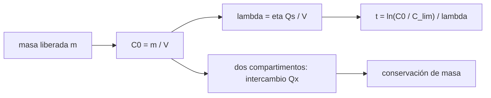

# B117-C02 — Contención de riesgos biológicos y químicos en cabina

<!-- nav:top -->
[🏠 Programa](../../../../README.md) · [📚 Bloque B117](../../../tronco-comun/B117-urgencias-medicas-y-atencion-clinica-en-mision.md) · [← Anterior: B117-C01 — Primeros auxilios y procedimientos básicos en entorno espacial](../B117-C01-primeros-auxilios-y-procedimientos-basicos-en-entorno-espacial/CLASE.md) · [Siguiente: B117-C03 — Emergencia cardiovascular simulada →](../B117-C03-emergencia-cardiovascular-simulada/CLASE.md)
<!-- /nav -->

## 1. Ubicación, nivel y alcance

Clase 2 del bloque B117. Nivel N4. En una nave el aire se comparte y se recircula: lo que se libera en un rincón puede llegar a todos. Aquí modelas el aire como un volumen bien mezclado, calculas la concentración de un contaminante tras un derrame, cuánto tarda un depurador en bajarla y qué ocurre si el módulo se aísla o se abre a la cabina. Usas [B115](../../../tronco-comun/B115-sistemas-bioregenerativos-y-cultivo-en-habitats.md) solo como contexto de la atmósfera del hábitat. **Esta clase es educativa: no es un procedimiento de seguridad, no da consejo médico ni operativo y no sustituye formación, licencia ni supervisión profesional.** El derrame y el gas son sintéticos.

## 2. Por qué esta clase existe

Ninguna clase anterior trata la contención de riesgos biológicos o químicos. La decisión central: **¿conviene aislar el módulo donde ocurre el derrame o dejar que se diluya en toda la cabina?**

## 3. Lo que podrás hacer al terminar

1. Convertir una masa liberada en concentración (mg/m³) y en ppm.
2. Calcular la tasa de remoción `λ = η Q_s/V` de un depurador.
3. Calcular el tiempo hasta un límite con `t = ln(C₀/C_lim)/λ`.
4. Resolver un modelo de dos compartimentos y comprobar la conservación de masa.
5. Comparar aislar el módulo con diluir en la cabina.
6. Separar lo consultado (volumen y presión de la cabina) de lo ilustrativo (derrame, depurador, límite).

La evidencia es la **ficha de contención de un derrame sintético** del ejercicio 12 (sección 20).

## 4. Con qué llegas y cómo comprobarlo

1. ¿Qué es una concentración y en qué unidades se da?
2. ¿Qué es un ppm?
3. ¿Qué es una ecuación de decaimiento exponencial?
4. ¿Qué es la conservación de masa?
5. ¿Qué es una verificación por segunda vía?

<details>
<summary>Ver respuestas</summary>

1. Masa de sustancia por unidad de volumen, por ejemplo mg/m³. 2. Una parte por millón en volumen. 3. `C' = −λC`, cuya solución es `C₀ e^(−λt)`. 4. La masa total no cambia si nada entra ni sale. 5. Calcular lo mismo con otro método y comparar.
</details>

Con cuatro o cinco aciertos, sigue; si no, repasa los prerrequisitos.

## 5. Un caso de contexto y casos de referencia

La NASA fija **límites de concentración en aire de nave** (SMAC, JSC 20584) por compuesto y por duración, de 1 hora a 1000 días. En el ejemplo conductor, 5 g de un gas de masa molar 17,03 g/mol se liberan en un módulo de 70 m³: `102,6 ppm`. Con un depurador de 100 m³/h y eficiencia 0,9, baja a un **límite de ejemplo de 5 ppm** en `141 min`. Si se diluyera en los 807,3 m³ de aire libre de la estación, la concentración inicial sería `8,90 ppm`. El volumen de la cabina es dato consultado; el derrame, el depurador y el límite de 5 ppm son **ilustrativos** (el límite de ejemplo **no es** un SMAC).

## 6. Vocabulario

La **concentración** `C` es masa por volumen (mg/m³) o fracción de volumen (ppm). Una **mezcla perfecta** reparte el contaminante al instante. La **tasa de remoción** `λ` (1/h) es la fracción del contaminante que se elimina por hora. El **SMAC** es la concentración máxima permitida en nave de la NASA para una duración dada. La **contención** es mantener el contaminante en un volumen acotado. Un **compartimento** es un volumen mezclado.

## 7. Modelo mental: una bañera con desagüe



*Descripción textual:* la masa liberada y el volumen dan la concentración inicial; la tasa de remoción da el tiempo al límite; con dos compartimentos se verifica que la masa se conserve.

Analogía: una bañera con tinta y un desagüe; cuanto más pequeña la bañera con el mismo desagüe, más rápido se aclara, pero parte más oscura. Límite: la mezcla perfecta es una idealización; en una nave real hay zonas de aire quieto.

## 8. La explicación, paso a paso

### 8.1 Concentración inicial

Con `m = 5000 mg` y `V = 70 m³`: `C₀ = 71,429 mg/m³`. A ppm: `C₀ V_m/M = 71,429 × 24,465/17,03 = 102,61 ppm`, con el volumen molar `V_m = RT/P = 24,465 L/mol` a 298,15 K y 101 325 Pa (gas ideal).

### 8.2 Remoción y tiempo al límite

`λ = 0,9 × 100/70 = 1,2857 h⁻¹`. `t = ln(102,61/5)/1,2857 = 2,350 h = 141,0 min`. En la cabina de 807,3 m³: `λ = 0,1115 h⁻¹` y `t = 310,2 min`; con 898,8 m³ son `281,0 min` (la concentración inicial ya es solo `7,99 ppm`).

### 8.3 Dos compartimentos

Un módulo de 70 m³ con depurador intercambia `20 m³/h` con la cabina de 807,3 m³. Sin depurador, tras 200 h ambos llegan a `5,6993 mg/m³`, igual que `m/(V₁ + V₂)`, y la masa total es `5000,000 mg` (se conserva). Con depurador en el módulo: a 0,5 h, `46,83 ppm` en el módulo y `0,875 ppm` en la cabina; a 2 h, `4,66 ppm` y `1,499 ppm`.

### 8.4 Aislar o diluir

Aislar con depurador local baja el módulo al límite de ejemplo en 2,35 h y la cabina nunca pasa de `1,5 ppm`; diluir sin depurador local deja `8,9 ppm` en toda la cabina durante más de 5 h. Con otros parámetros la respuesta cambia: es una comparación, no una regla.

## 9. Magnitudes, símbolos y unidades

| Símbolo | Qué es | Unidad | Valor / nota |
|---|---|---|---|
| `V` | volumen de aire | m³ | 70 (módulo); 807,3–898,8 (cabina, consultado) |
| `C` | concentración | mg/m³ o ppm | 71,4 mg/m³ = 102,6 ppm |
| `λ` | tasa de remoción | h⁻¹ | 1,2857 (módulo) |
| `Q_s` | caudal del depurador | m³/h | 100 (ilustrativo) |
| `η` | eficiencia por paso | — | 0,9 (ilustrativo) |
| `Q_x` | intercambio módulo-cabina | m³/h | 20 (ilustrativo) |
| `M` | masa molar | g/mol | 17,03 (ilustrativo) |

## 10. Convenciones y referencias

Gas ideal a 298,15 K y 101 325 Pa (`R = 8,314462618 J/(mol K)`, valor exacto SI; las presiones de la estación consultadas, 724–770,5 mmHg, rodean este valor). Mezcla perfecta, sin adsorción ni fuentes continuas. Unidades: m³, h, mg/m³, ppm en volumen.

## 11. De dónde sale lo que afirmamos

| ID | Fuente | Localizador | Respalda | Estado |
|---|---|---|---|---|
| S1 | Schaezler y Cook, «Report on ISS O2 Production, Gas Supply & Partial Pressure Management», ICES-2015-146, NASA NTRS 20150010425 — https://ntrs.nasa.gov/api/citations/20150010425/downloads/20150010425.pdf (consultada 2026-11-10, PDF leído con PyMuPDF) | resumen y sección de volumen libre | volumen libre de aire de la EEI 807,3–898,8 m³; presión total 724–770,5 mmHg; ppO₂ 146–178 mmHg | Consultada |
| S2 | NASA JSC 20584 Rev C, «Spacecraft Maximum Allowable Concentrations for Airborne Contaminants», 2024-06-13 — https://ntrs.nasa.gov/api/citations/20240007713/downloads/JSC%2020584_SMACs_Rev%20C_FINAL.pdf (consultada 2026-11-10, PDF leído con PyMuPDF) | portada, historial de cambios y estructura de la tabla | duraciones de 1 h a 1000 d, unidades ppm (mg/m³), los SMAC del CO₂ se eliminaron en esta revisión | Consultada (las cifras por compuesto no se transcriben: la extracción de texto no permitió asignarlas con certeza) |
| — | Modelo de volumen mezclado, gas ideal | — | verificado con RK4 frente a la solución analítica | No consultada en una fuente concreta |
| — | Derrame, depurador y límite de 5 ppm | — | todos los números del ejemplo | Ilustrativo |

Límites: no se consultó ningún dato de agentes biológicos; los riesgos biológicos se tratan solo por analogía de decaimiento; ningún valor describe un suceso real.

## 12. Cómo ver la contención

| Caso | V (m³) | C₀ (ppm) | t a 5 ppm (min) |
|---|---|---|---|
| Módulo aislado | 70,0 | 102,61 | 141,0 |
| Cabina (mín.) | 807,3 | 8,90 | 310,2 |
| Cabina (máx.) | 898,8 | 7,99 | 281,0 |

Descripción larga: el módulo parte de una concentración mucho mayor pero se limpia antes porque el depurador procesa un volumen más pequeño.

## 13. Ejemplo trabajado: el módulo aislado

**Paso 1 · Concentración.** `5000/70 = 71,429 mg/m³`.

**Paso 2 · ppm.** `71,429 × 24,465/17,03 = 102,61`.

**Paso 3 · Tasa.** `λ = 90/70 = 1,2857 h⁻¹`.

**Paso 4 · Tiempo.** `ln(20,52)/1,2857 = 2,350 h = 141,0 min`.

## 14. Distintas formas de describir un derrame

**Por concentración:** mg/m³ o ppm. **Por tiempo:** `t` al límite o vida media. **Por masa:** total en cada compartimento. **Por geometría:** módulo o cabina. **Por límite:** SMAC según compuesto y duración.

## 15. Práctica guiada

**Ejercicio 1 · con los pasos indicados.** Calcula `λ` del módulo. *Pasos:* `η Q_s = 90 m³/h`; divide por 70.

<details><summary>Solución comentada</summary>

`λ = 1,2857 h⁻¹`.
</details>

**Ejercicio 2 · con una pista.** Convierte `71,429 mg/m³` a ppm. *Pista:* multiplica por 24,465 y divide por 17,03.

<details><summary>Solución comentada</summary>

`102,61 ppm`.
</details>

**Ejercicio 3 · casi autónomo.** ¿Cuánto tarda en bajar de 102,61 a 5 ppm?

<details><summary>Solución comentada</summary>

`ln(20,52)/1,2857 = 2,350 h = 141 min`.
</details>

## 16. Práctica autónoma, transferencia e integrador

**Ejercicio 4 · autónomo.** `λ` de la cabina de 898,8 m³ con el mismo depurador.

<details><summary>Solución comentada</summary>

`90/898,8 = 0,1001 h⁻¹`.
</details>

**Ejercicio 5 · autónomo.** Vida media del contaminante en el módulo.

<details><summary>Solución comentada</summary>

`ln 2/1,2857 = 0,539 h = 32,3 min`.
</details>

**Ejercicio 6 · autónomo.** Concentración inicial en mg/m³ si se diluye en 898,8 m³.

<details><summary>Solución comentada</summary>

`5000/898,8 = 5,563 mg/m³`.
</details>

**Ejercicio 7 · autónomo.** Si el caudal del depurador se duplica, ¿cuánto tarda el módulo en llegar a 5 ppm?

<details><summary>Solución comentada</summary>

`λ` se duplica y `t` se reduce a la mitad: `70,5 min`.
</details>

**Ejercicio 8 · autónomo.** Concentración en el módulo aislado (sin intercambio) tras 2 h.

<details><summary>Solución comentada</summary>

`102,61 × e^(−1,2857×2) = 102,61 × 0,0764 = 7,84 ppm`.
</details>

**Ejercicio 9 · transferencia.** **Transferencia.** Un aerosol biológico se retira con un filtro. ¿Sirve la misma ecuación y qué cambia?

<details><summary>Solución comentada</summary>

La forma exponencial sirve con una `λ` propia del filtro y del aerosol, pero el criterio de riesgo no es una concentración química: depende de la dosis y del agente, que esta clase no trata.
</details>

**Ejercicio 10 · transferencia.** **Transferencia.** Un colega usa 5 ppm como límite de un compuesto real. ¿Qué error comete?

<details><summary>Solución comentada</summary>

El 5 ppm es un valor de ejemplo, no un SMAC; el límite real depende del compuesto y de la duración y se consulta en la tabla vigente.
</details>

**Ejercicio 11 · transferencia.** **Transferencia.** ¿Qué pasa con la concentración de la cabina si el intercambio `Q_x` entre módulo y cabina aumenta?

<details><summary>Solución comentada</summary>

La cabina sube antes pero el módulo baja antes por dilución; sin depurador ambos tienden a `m/(V₁ + V₂)` más rápido.
</details>

**Ejercicio 12 · integrador.** **Integrador.** Elabora tu *ficha de contención de un derrame sintético*: tabla de `C₀`, `λ` y `t` para módulo y cabina, evolución en dos compartimentos, comparación aislar frente a diluir y lista de qué es consultado e ilustrativo, con el aviso de que es educativa.

<details><summary>Solución comentada</summary>

Secciones 8.1–8.4 y la salida del laboratorio.
</details>

## 17. Laboratorio: derrame en módulo y cabina

El script [contencion.py](contencion.py) calcula `C₀`, `λ` y el tiempo al límite en tres volúmenes, integra con RK4 el decaimiento y el modelo de dos compartimentos (**comprueba** error relativo < 1e-9 y conservación de masa).

**Datos:** volumen libre y presión de la EEI consultados; derrame, depurador y límite **ilustrativos**. **Predice antes de ejecutar:** ¿qué masa total habrá sin depurador tras 200 h? (los 5000 mg.) **Ejecución del 2026-11-10 (Python 3.12.9):**

```text
Python 3.12.9 (biblioteca estandar)
Volumen molar a 298.15 K y 101325 Pa = 24.465 L/mol
Datos consultados: V libre EEI 807.3-898.8 m3; resto ILUSTRATIVO (limite de ejemplo 5 ppm, no es un SMAC).
 caso              V [m3]  C0 [mg/m3]  C0 [ppm]  lambda [1/h]  t a 5 ppm [min]
modulo aislado       70.0      71.429    102.61       1.2857            141.0
cabina (min)        807.3       6.193      8.90       0.1115            310.2
cabina (max)        898.8       5.563      7.99       0.1001            281.0
Error relativo maximo RK4 frente a analitico = 5.73e-14
Sin depurador, t = 200 h: C modulo = 5.6993, C cabina = 5.6993 mg/m3; uniforme esperado = 5.6993; masa total = 5000.000 mg
Con depurador en el modulo, t = 0.5 h: C modulo =   46.83 ppm ; C cabina =  0.875 ppm
Con depurador en el modulo, t = 1.0 h: C modulo =   21.45 ppm ; C cabina =  1.263 ppm
Con depurador en el modulo, t = 2.0 h: C modulo =    4.66 ppm ; C cabina =  1.499 ppm
Pruebas superadas.
```

```bash
python programa/clases/B117/B117-C02-contencion-de-riesgos-biologicos-y-quimicos-en-cabina/contencion.py
```

**Límites:** mezcla perfecta, sin adsorción ni fuentes continuas, límite de ejemplo; no es un procedimiento.

## 18. Errores frecuentes y cómo corregirlos

**Usar el límite de ejemplo como un SMAC.** Se corrige con la sección 11.

**Creer que diluir en toda la cabina siempre es mejor.** Se corrige con 8.4.

**Olvidar convertir mg/m³ a ppm con el volumen molar.** Se corrige con 8.1.

**Esperar que el modelo valga para un agente biológico.** Se corrige con el ejercicio 9.

## 19. Cómo sabrás que vas bien

Tras la sección 8: ¿qué tiempo esperabas para el módulo y cuál obtuviste? Si dudas, repasa el ejemplo 13. Tras el laboratorio: ¿qué comprueba? (ver la sección 17).

## 20. Qué entregas y cómo se evalúa

El producto es tu **ficha de contención de un derrame sintético** (ejercicio 12).

| Criterio | Inicial | En desarrollo | Logrado | Destacado |
|---|---|---|---|---|
| Conceptos | Los confunde | Parciales | Calcula `C₀`, `λ` y `t` | Explica los límites |
| Cálculo | Sin unidades | Con errores | Tablas completas con unidades | Calcula casos nuevos |
| Numérico | Sin comprobar | Un caso | Contraste con una segunda vía | Interpreta las diferencias |
| Fuentes | Sin fuente | Sin fecha | Fuentes con fecha y estado | Declara lo ilustrativo y lo no consultado |
| Límites | No los nombra | Uno | Tres | Discute qué falta del modelo |

**Condiciones críticas (no se compensan con promedio):** rotular el límite de 5 ppm como ejemplo y no como SMAC; declarar que la clase no es un procedimiento de seguridad; citar solo lo consultado.

## 21. Ética, seguridad y límites

Clase educativa: **no da consejo médico ni operativo** y no sustituye formación en seguridad de la tripulación, licencia ni supervisión profesional; ningún resultado debe usarse ante un derrame real. Los modelos son simplificados y sus datos son sintéticos o ilustrativos. Accesibilidad: tablas equivalentes a las gráficas, fórmulas en texto, ejercicios sin conexión.

## 22. Para cerrar y seguir

Un derrame de 5 g produce `102,6 ppm` en un módulo de 70 m³ y `8,9 ppm` si se diluye en la cabina; con depurador local baja al límite de ejemplo en `141 min`. Queda una pregunta: ¿qué ocurre en el cuerpo cuando el sistema que falla es el corazón?

**Glosario español–inglés.** concentración · *concentration*; tasa de remoción · *removal rate*; mezcla perfecta · *well-mixed*; contención · *containment*; depurador · *scrubber*.

**Continuidad.** [B117-C03](../B117-C03-emergencia-cardiovascular-simulada/CLASE.md) simula una emergencia cardiovascular.

**Referencias:** ver sección 11.

<!-- nav:bottom -->
---

[← Anterior: B117-C01 — Primeros auxilios y procedimientos básicos en entorno espacial](../B117-C01-primeros-auxilios-y-procedimientos-basicos-en-entorno-espacial/CLASE.md) · [📚 Bloque B117](../../../tronco-comun/B117-urgencias-medicas-y-atencion-clinica-en-mision.md) · [Siguiente: B117-C03 — Emergencia cardiovascular simulada →](../B117-C03-emergencia-cardiovascular-simulada/CLASE.md)
<!-- /nav -->
