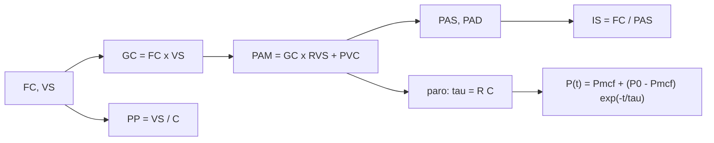

# B117-C03 — Emergencia cardiovascular simulada

<!-- nav:top -->
<!-- /nav -->

## 1. Ubicación, nivel y alcance

Clase 3 del bloque B117. Nivel N4. El sistema circulatorio se puede resumir en un circuito: una bomba (corazón), una resistencia (vasos) y una compliancia (elasticidad de las arterias). Aquí calculas gasto cardíaco, presión media, índice de shock y la caída de presión tras un paro en cuatro escenarios **sintéticos**, y ves por qué una presión normal puede esconder una hemorragia. Usas [B116](../../../tronco-comun/B116-telemedicina-y-monitorizacion-de-salud-en-mision.md) solo como contexto de monitorización a distancia. **Esta clase es educativa: no es un criterio diagnóstico, no da consejo médico ni operativo y no sustituye formación, licencia ni supervisión profesional.**

## 2. Por qué esta clase existe

Ninguna clase anterior simula una emergencia cardiovascular. La decisión central: **¿qué señales de un modelo simple delatan un problema de circulación y cuáles lo esconden?**

## 3. Lo que podrás hacer al terminar

1. Calcular el gasto cardíaco `GC = FC × VS`.
2. Calcular la presión media `PAM = GC × RVS + PVC` y estimar presión sistólica y diastólica.
3. Calcular el índice de shock `IS = FC/PAS` y su detección sobre una población sintética.
4. Resolver la caída de presión tras un paro con un modelo de dos elementos y comprobarlo con Euler.
5. Estimar el efecto de compresiones que entregan una fracción del gasto basal.
6. Separar lo consultado (nada numérico) de lo ilustrativo (todos los parámetros).

La evidencia es la **ficha de escenarios cardiovasculares sintéticos** del ejercicio 12 (sección 20).

## 4. Con qué llegas y cómo comprobarlo

1. ¿Qué es la frecuencia cardíaca y en qué unidades se mide?
2. ¿Qué es el volumen sistólico?
3. ¿Qué es una resistencia hidráulica?
4. ¿Qué es una ecuación diferencial de primer orden?
5. ¿Qué es una verificación por segunda vía?

<details>
<summary>Ver respuestas</summary>

1. Latidos por minuto (lpm). 2. El volumen que expulsa el corazón en cada latido, en mL. 3. El cociente entre la caída de presión y el caudal. 4. Una ecuación que relaciona una magnitud con su derivada primera, como `C P' = −(P − P_mcf)/R`. 5. Calcular lo mismo con otro método y comparar.
</details>

Con cuatro o cinco aciertos, sigue; si no, repasa los prerrequisitos.

## 5. Un caso de contexto y casos de referencia

El Integrated Medical Model de la NASA estima probabilidades de eventos médicos en una misión para dimensionar recursos; **no** aporta los parámetros fisiológicos de esta clase. El **ejemplo conductor** es un tripulante sintético con `FC = 70 lpm` y `VS = 70 mL`: `GC = 4,90 L/min` y `PAM = 92,2 mmHg`. Con una hemorragia simulada (`FC = 120`, `VS = 40 mL`) el gasto casi no cambia (`4,80 L/min`) y la presión media tampoco (`90,4 mmHg`), pero el índice de shock sube a `1,11`. Todo es **ilustrativo**.

## 6. Vocabulario

El **gasto cardíaco** `GC` es el volumen bombeado por minuto (L/min). La **resistencia vascular sistémica** `RVS` (mmHg·min/L) es la oposición al flujo. La **presión arterial media** `PAM` es la presión promedio. La **presión de pulso** `PP = VS/C` es la diferencia entre sistólica y diastólica. El **índice de shock** `IS` es `FC/PAS`. La **presión media de llenado circulatorio** `P_mcf` es la presión a la que se equilibra el sistema sin flujo. Un **paro** es el cese del bombeo.

## 7. Modelo mental: un circuito con bomba, resistencia y condensador



*Descripción textual:* de la frecuencia y el volumen sistólico salen el gasto, la presión y el índice de shock; en un paro la presión decae hacia `P_mcf` con la constante de tiempo `R C`.

Analogía: un circuito eléctrico con fuente, resistencia y condensador; al apagar la fuente el voltaje se descarga exponencialmente. Límite: el modelo omite el lado venoso, los reflejos y la dinámica de la sangre; no es un modelo calibrado de un paciente.

## 8. La explicación, paso a paso

### 8.1 Cuatro escenarios

| Escenario | FC | VS (mL) | GC (L/min) | PAM (mmHg) | PAS | PAD | IS |
|---|---|---|---|---|---|---|---|
| basal | 70 | 70 | 4,90 | 92,2 | 123,3 | 76,6 | 0,57 |
| hemorragia | 120 | 40 | 4,80 | 90,4 | 108,2 | 81,5 | 1,11 |
| taquiarritmia | 160 | 35 | 5,60 | 104,8 | 120,4 | 97,0 | 1,33 |
| bradicardia | 35 | 80 | 2,80 | 54,4 | 90,0 | 36,6 | 0,39 |

Con `RVS = 18 mmHg·min/L`, `PVC = 4 mmHg` y `C = 1,5 mL/mmHg`. La hemorragia y la taquiarritmia superan el umbral de alerta de 0,9; la bradicardia **no**, aunque su presión es baja: el índice de shock mide una cosa y no sirve para todo.

### 8.2 Paro

`R = RVS × 0,06 = 1,08 mmHg·s/mL`; `τ = R C = 1,62 s`. `P(t) = P_mcf + (P₀ − P_mcf) e^(−t/τ)` con `P₀ = 92,2` y `P_mcf = 7 mmHg`. La presión llega a 40 mmHg en `1,54 s` y vale `7,18 mmHg` a los 10 s. Con Euler (`dt = 10⁻⁵ s`) la diferencia máxima con la solución es `8,8 × 10⁻⁵ mmHg`. Este `τ` es de un modelo de dos elementos **sin** compartimento venoso: sirve para entender la forma de la caída, no para predecir tiempos.

### 8.3 Compresiones

Si las compresiones entregan una fracción `0,25` del gasto basal (ilustrativa), `GC = 1,225 L/min` y `PAM = 1,225 × 18 + 4 = 26,1 mmHg`.

### 8.4 Qué detecta el índice de shock

Con una población sintética de 1000 tripulantes (FC y VS normales con dispersión de 8) y una pérdida de volumen `f` (VS `= 70(1 − f)`, FC `= 70 + 100 f`), la fracción con `IS > 0,9` es 0,000, 0,009, 0,078, 0,392 y 0,933 para `f = 0; 0,1; 0,2; 0,3; 0,4`. Detecta tarde las pérdidas pequeñas.

## 9. Magnitudes, símbolos y unidades

| Símbolo | Qué es | Unidad | Valor / nota |
|---|---|---|---|
| `FC` | frecuencia cardíaca | lpm | 70 |
| `VS` | volumen sistólico | mL | 70 |
| `GC` | gasto cardíaco | L/min | 4,90 |
| `RVS` | resistencia vascular | mmHg·min/L | 18 (ilustrativo) |
| `PAM` | presión arterial media | mmHg | 92,2 |
| `C` | compliancia arterial | mL/mmHg | 1,5 (ilustrativo) |
| `τ` | constante de tiempo del paro | s | 1,62 |

## 10. Convenciones y referencias

Presiones en mmHg, flujos en L/min, tiempo en s. `PAD = PAM − PP/3`; `PAS = PAD + PP`. Conversión `RVS` a `R`: `1 mmHg·min/L = 0,06 mmHg·s/mL`. Todos los parámetros son sintéticos.

## 11. De dónde sale lo que afirmamos

| ID | Fuente | Localizador | Respalda | Estado |
|---|---|---|---|---|
| S1 | Myers J. et al., «Integrated Medical Model Project – Overview and Summary of Historical Application», NASA NTRS 20140016998 — https://ntrs.nasa.gov/api/citations/20140016998/downloads/20140016998.pdf (consultada 2026-11-10, PDF leído con PyMuPDF) | resumen | el IMM es un modelo probabilístico de riesgo médico de la NASA (HRP), con 100 condiciones médicas, operativo desde 2011 (versión 3.0) | Consultada |
| — | Relaciones cardiovasculares (GC, PAM, Windkessel, índice de shock) | — | todo el modelo; verificado con Euler y con la inversión de la PAM | No consultadas en una fuente concreta |
| — | Parámetros fisiológicos, umbral de 0,9 y fracción de gasto | — | todos los números | Ilustrativo |

Límites: no se consultó ningún dato clínico; el índice de shock y sus umbrales no se tomaron de una guía; ningún resultado describe a una persona.

## 12. Cómo ver la circulación

| Magnitud | Valor |
|---|---|
| `GC` basal | 4,90 L/min |
| `PAM` basal | 92,2 mmHg |
| `IS` en hemorragia | 1,11 |
| `τ` del paro | 1,62 s |
| `PAM` en compresiones | 26,1 mmHg |

Descripción larga: la presión media casi no distingue el caso basal del hemorrágico, pero la frecuencia y la presión de pulso sí; tras un paro la presión se desploma hacia `P_mcf`.

## 13. Ejemplo trabajado: la hemorragia

**Paso 1 · Gasto.** `120 × 40/1000 = 4,80 L/min`.

**Paso 2 · Presión media.** `4,80 × 18 + 4 = 90,4 mmHg`.

**Paso 3 · Presión de pulso.** `40/1,5 = 26,67 mmHg`; `PAD = 90,4 − 8,89 = 81,5`; `PAS = 108,2`.

**Paso 4 · Índice de shock.** `120/108,2 = 1,11`.

## 14. Distintas formas de describir la circulación

**Por flujo:** `GC`. **Por presión:** `PAM`, `PAS`, `PAD`. **Por índice:** `IS`. **Por tiempo:** `τ`. **Por escenario:** basal, hemorragia, arritmia, bradicardia, paro.

## 15. Práctica guiada

**Ejercicio 1 · con los pasos indicados.** Calcula `GC` basal. *Pasos:* multiplica y divide por 1000.

<details><summary>Solución comentada</summary>

`70 × 70/1000 = 4,90 L/min`.
</details>

**Ejercicio 2 · con una pista.** Calcula la `PAM` basal. *Pista:* `GC × RVS + PVC`.

<details><summary>Solución comentada</summary>

`4,9 × 18 + 4 = 92,2 mmHg`.
</details>

**Ejercicio 3 · casi autónomo.** Calcula el índice de shock de la hemorragia.

<details><summary>Solución comentada</summary>

`PP = 26,67`; `PAD = 81,5`; `PAS = 108,2`; `IS = 1,11`.
</details>

## 16. Práctica autónoma, transferencia e integrador

**Ejercicio 4 · autónomo.** `τ` del paro.

<details><summary>Solución comentada</summary>

`1,08 × 1,5 = 1,62 s`.
</details>

**Ejercicio 5 · autónomo.** `PAM` con compresiones del 25 %.

<details><summary>Solución comentada</summary>

`0,25 × 4,9 = 1,225 L/min`; `1,225 × 18 + 4 = 26,1 mmHg`.
</details>

**Ejercicio 6 · autónomo.** Tiempo para caer a 40 mmHg.

<details><summary>Solución comentada</summary>

`1,62 ln(85,2/33) = 1,54 s`.
</details>

**Ejercicio 7 · autónomo.** Recupera `RVS` desde `PAM = 92,2` y `GC = 4,9`.

<details><summary>Solución comentada</summary>

`(92,2 − 4)/4,9 = 18,0 mmHg·min/L`.
</details>

**Ejercicio 8 · autónomo.** ¿Qué pasa con `τ` y con el tiempo a 40 mmHg si `C` se duplica a 3 mL/mmHg?

<details><summary>Solución comentada</summary>

Ambos se duplican: `τ = 3,24 s` y `t = 3,07 s` (con la misma `P₀`).
</details>

**Ejercicio 9 · transferencia.** **Transferencia.** En la hemorragia simulada el gasto y la presión media casi no cambian. ¿Qué enseña eso sobre vigilar solo la presión?

<details><summary>Solución comentada</summary>

Que la compensación (más frecuencia) esconde la pérdida; hacen falta varias señales, y el modelo ni siquiera incluye todas.
</details>

**Ejercicio 10 · transferencia.** **Transferencia.** La bradicardia tiene `IS = 0,39` y presión media baja. ¿Qué límite del índice muestra?

<details><summary>Solución comentada</summary>

Que el índice no detecta todos los problemas: una frecuencia baja lo hace parecer normal.
</details>

**Ejercicio 11 · transferencia.** **Transferencia.** ¿Por qué no usar el `τ = 1,62 s` para predecir cuánto tarda un paro real en desplomar la presión?

<details><summary>Solución comentada</summary>

El modelo omite el lado venoso y no está calibrado; solo muestra la forma exponencial de la caída.
</details>

**Ejercicio 12 · integrador.** **Integrador.** Elabora tu *ficha de escenarios cardiovasculares sintéticos*: tabla de los cuatro escenarios, paro con `τ`, compresiones, detección del índice de shock y lista de qué es consultado e ilustrativo, con el aviso de que es educativa.

<details><summary>Solución comentada</summary>

Secciones 8.1–8.4 y la salida del laboratorio.
</details>

## 17. Laboratorio: circulación y paro simulados

El script [cardio.py](cardio.py) calcula los cuatro escenarios, el paro con Euler frente a la solución analítica, las compresiones y la detección del índice de shock con 1000 tripulantes sintéticos (**comprueba** Euler a 1e-3 mmHg y la recuperación de `RVS`).

**Datos:** ningún dato fisiológico consultado; todo **ilustrativo**. **Predice antes de ejecutar:** ¿qué fracción de tripulantes superará `IS = 0,9` con `f = 0,3`? (algo menos de la mitad.) **Ejecución del 2026-11-10 (Python 3.12.9):**

```text
Python 3.12.9 (biblioteca estandar)
Escenarios SINTETICOS con parametros ILUSTRATIVOS; sin datos fisiologicos consultados.
 escenario        FC   VS[mL]  GC[L/min]  PAM[mmHg]  PAS   PAD    IS    alerta
basal             70      70       4.90       92.2  123.3  76.6   0.57  no
hemorragia       120      40       4.80       90.4  108.2  81.5   1.11  si
taquiarritmia    160      35       5.60      104.8  120.4  97.0   1.33  si
bradicardia       35      80       2.80       54.4   90.0  36.6   0.39  no
Paro: tau = R C = 1.620 s ; P(0) = 92.2 mmHg ; tiempo hasta 40 mmHg = 1.54 s ; P(10 s) = 7.18 mmHg
Error maximo Euler - analitico = 8.76e-05 mmHg
Compresiones simuladas (fraccion 0.25): GC = 1.225 L/min ; PAM estacionaria = 26.1 mmHg
RVS recuperada desde la PAM basal = 18.000000 mmHg min/L (original 18.0)
Perdida de volumen sintetica: VS = 70 (1 - f) mL, FC = 70 + 100 f lpm; 1000 tripulantes sinteticos (semilla 117)
  f      IS medio   fraccion con IS > 0.9
  0.0      0.569      0.000
  0.1      0.662      0.009
  0.2      0.763      0.078
  0.3      0.884      0.392
  0.4      1.054      0.933
Pruebas superadas.
```

```bash
python programa/clases/B117/B117-C03-emergencia-cardiovascular-simulada/cardio.py
```

**Límites:** modelo concentrado sin lado venoso ni reflejos; el umbral y los parámetros son ilustrativos; no es un criterio diagnóstico.

## 18. Errores frecuentes y cómo corregirlos

**Tomar el índice de shock como diagnóstico.** Se corrige con 8.4 y el ejercicio 10.

**Fiarse solo de la presión media.** Se corrige con el ejercicio 9.

**Usar el `τ` del modelo como tiempo real de un paro.** Se corrige con 8.2.

**Confundir mmHg·min/L con mmHg·s/mL.** Se corrige con la sección 10.

## 19. Cómo sabrás que vas bien

Tras la sección 8: ¿qué `IS` esperabas en la hemorragia y cuál obtuviste? Si dudas, repasa el ejemplo 13. Tras el laboratorio: ¿qué comprueba? (ver la sección 17).

## 20. Qué entregas y cómo se evalúa

El producto es tu **ficha de escenarios cardiovasculares sintéticos** (ejercicio 12).

| Criterio | Inicial | En desarrollo | Logrado | Destacado |
|---|---|---|---|---|
| Conceptos | Los confunde | Parciales | Calcula `GC`, `PAM` e `IS` | Explica los límites |
| Cálculo | Sin unidades | Con errores | Tablas completas con unidades | Calcula casos nuevos |
| Numérico | Sin comprobar | Un caso | Contraste con una segunda vía | Interpreta las diferencias |
| Fuentes | Sin fuente | Sin fecha | Fuentes con fecha y estado | Declara lo ilustrativo y lo no consultado |
| Límites | No los nombra | Uno | Tres | Discute qué falta del modelo |

**Condiciones críticas (no se compensan con promedio):** rotular todos los parámetros como ilustrativos; no presentar un índice como criterio diagnóstico; citar solo lo consultado.

## 21. Ética, seguridad y límites

Clase educativa: **no da consejo médico ni operativo** y no sustituye formación clínica, licencia ni supervisión profesional; ningún resultado debe usarse para valorar a una persona real. Los modelos son simplificados y sus datos son sintéticos o ilustrativos. Accesibilidad: tablas equivalentes a las gráficas, fórmulas en texto, ejercicios sin conexión.

## 22. Para cerrar y seguir

Una hemorragia simulada deja la presión media casi intacta y sube el índice de shock a `1,11`; tras un paro, la presión se desploma con `τ = 1,62 s` en el modelo. Queda una pregunta: ¿qué ocurre cuando lo que falla es el intercambio de gases?

**Glosario español–inglés.** gasto cardíaco · *cardiac output*; presión arterial media · *mean arterial pressure*; índice de shock · *shock index*; compliancia · *compliance*; paro cardíaco · *cardiac arrest*.

**Continuidad.** [B117-C04](../B117-C04-problemas-respiratorios-simulados/CLASE.md) simula problemas respiratorios.

**Referencias:** ver sección 11.

<!-- nav:bottom -->
<!-- /nav -->
