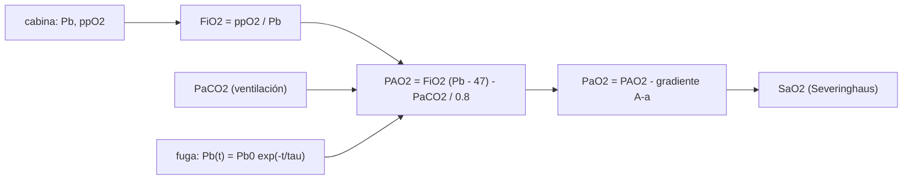

# B117-C04 — Problemas respiratorios simulados

<!-- nav:top -->
[🏠 Programa](../../../../README.md) · [📚 Bloque B117](../../../tronco-comun/B117-urgencias-medicas-y-atencion-clinica-en-mision.md) · [← Anterior: B117-C03 — Emergencia cardiovascular simulada](../B117-C03-emergencia-cardiovascular-simulada/CLASE.md) · [Siguiente: B117-C05 — Inventario y gestión del equipo médico a bordo →](../B117-C05-inventario-y-gestion-del-equipo-medico-a-bordo/CLASE.md)
<!-- /nav -->

## 1. Ubicación, nivel y alcance

Clase 4 del bloque B117. Nivel N4. El oxígeno que llega a la sangre depende de lo que hay en el aire de la cabina y de lo que ocurre en el pulmón. Aquí conectas ambos con la ecuación del gas alveolar y la curva de saturación de Severinghaus, y simulas cinco situaciones: la atmósfera nominal de la estación, sus extremos, una fuga de presión, un CO₂ elevado y una combinación. Usas [C02](../B117-C02-contencion-de-riesgos-biologicos-y-quimicos-en-cabina/CLASE.md) solo para el concepto de contaminante en el aire. **Esta clase es educativa: no es un criterio diagnóstico, no da consejo médico ni operativo y no sustituye formación, licencia ni supervisión profesional.**

## 2. Por qué esta clase existe

Ninguna clase anterior simula problemas respiratorios. La decisión central: **¿cuánto margen de oxigenación hay entre la atmósfera nominal de la cabina y una condición peligrosa, y qué variable lo consume más rápido?**

## 3. Lo que podrás hacer al terminar

1. Calcular la fracción inspirada de O₂ `FiO₂ = ppO₂/Pb`.
2. Calcular la presión alveolar de oxígeno con la ecuación del gas alveolar.
3. Calcular la saturación con la curva de Severinghaus y comprobar su `P50`.
4. Calcular el tiempo hasta un umbral en una fuga exponencial y comprobarlo numéricamente.
5. Contrastar mantener `FiO₂` constante con mantener `ppO₂` constante.
6. Separar lo consultado (presión y ppO₂ de la estación) de lo ilustrativo (escenarios, parámetros).

La evidencia es la **tabla de oxigenación en cinco escenarios de cabina** del ejercicio 12 (sección 20).

## 4. Con qué llegas y cómo comprobarlo

1. ¿Qué es una presión parcial?
2. ¿Qué es el cociente respiratorio?
3. ¿Qué es una saturación de oxígeno?
4. ¿Qué es la mmHg como unidad de presión?
5. ¿Qué es una verificación por segunda vía?

<details>
<summary>Ver respuestas</summary>

1. La presión que ejercería un gas de una mezcla si ocupara solo el volumen. 2. El cociente entre el CO₂ producido y el O₂ consumido, `RQ ≈ 0,8` (valor ilustrativo aquí). 3. La fracción de hemoglobina que lleva oxígeno. 4. Milímetros de mercurio; 760 mmHg = 101,325 kPa. 5. Calcular lo mismo con otro método y comparar.
</details>

Con cuatro o cinco aciertos, sigue; si no, repasa los prerrequisitos.

## 5. Un caso de contexto y casos de referencia

Un informe de la NASA sobre la atmósfera de la estación (ICES-2015) establece que la presión parcial de O₂ se mantiene entre `146` y `178 mmHg` y la presión total entre `724` y `770,5 mmHg`. El **ejemplo conductor** usa un punto dentro de esos rangos, `Pb = 760 mmHg` y `ppO₂ = 160 mmHg`: `FiO₂ = 0,2105` y `PAO₂ = 100,1 mmHg`, `SaO₂ = 0,970`. Los extremos consultados dan `86,5` y `117,1 mmHg`. Las fugas y la hipoventilación son **ilustrativas**.

## 6. Vocabulario

La **fracción inspirada** `FiO₂` es la proporción de O₂ del aire que se respira. La **presión alveolar** `PAO₂` es la presión de O₂ en el alvéolo. El **gradiente alvéolo-arterial** `A-a` es la diferencia entre `PAO₂` y `PaO₂`. La **saturación** `SaO₂` es la fracción de hemoglobina oxigenada. La **hipoventilación** es una ventilación insuficiente que eleva el CO₂. La **fuga** es una pérdida de presión de la cabina.

## 7. Modelo mental: de la cabina a la sangre



*Descripción textual:* la cabina fija la fracción de O₂ inspirada; con la ventilación (CO₂) se obtiene la presión alveolar, después la arterial y la saturación; una fuga reduce `Pb` con el tiempo.

Analogía: una escalera de cuatro peldaños por la que baja el oxígeno desde el aire hasta la sangre, perdiendo altura en cada uno. Límite: el modelo usa un gradiente `A-a` fijo y no representa enfermedades ni la respuesta del cuerpo.

## 8. La explicación, paso a paso

### 8.1 Cinco escenarios

`PAO₂ = FiO₂ (Pb − 47) − PaCO₂/0,8`, `PaO₂ = PAO₂ − 10 mmHg`, `SaO₂` por Severinghaus.

| Escenario | Pb | ppO₂ | FiO₂ | PaCO₂ | PAO₂ | PaO₂ | SaO₂ |
|---|---|---|---|---|---|---|---|
| nominal | 760,0 | 160,0 | 0,2105 | 40 | 100,1 | 90,1 | 0,970 |
| extremo bajo | 724,0 | 146,0 | 0,2017 | 40 | 86,5 | 76,5 | 0,952 |
| extremo alto | 770,5 | 178,0 | 0,2310 | 40 | 117,1 | 107,1 | 0,982 |
| fuga a 600 | 600,0 | 126,3 | 0,2105 | 40 | 66,4 | 56,4 | 0,889 |
| CO₂ elevado | 760,0 | 160,0 | 0,2105 | 48 | 90,1 | 80,1 | 0,957 |
| fuga + hipoventilación | 600,0 | 126,3 | 0,2105 | 60 | 41,4 | 31,4 | 0,604 |

### 8.2 Comprobación de la curva

La curva de Severinghaus vale `0,4986` en `26,8 mmHg`, la `P50` típica, y es monótona creciente entre 10 y 200 mmHg.

### 8.3 Una fuga en el tiempo

Con `FiO₂` constante y `Pb(t) = 760 e^(−t/48 h)`, `PAO₂` llega al umbral ilustrativo de `60 mmHg` cuando `Pb = 47 + (60 + 50)/0,2105 = 569,5 mmHg`, a las `t = 48 ln(760/569,5) = 13,851 h`. La bisección numérica da `13,851 h`.

### 8.4 Dos formas de cuidar el oxígeno

Si en la fuga a 600 mmHg se mantiene `ppO₂ = 160 mmHg` (aportando O₂), `FiO₂ = 0,2667` y `PAO₂ = 97,5 mmHg`, casi igual que el nominal. Sin esa reposición cae a `66,4 mmHg`. La estación controla el O₂ con electrólisis de agua y reposición, según el informe consultado.

## 9. Magnitudes, símbolos y unidades

| Símbolo | Qué es | Unidad | Valor / nota |
|---|---|---|---|
| `Pb` | presión total de la cabina | mmHg | 724–770,5 (consultado) |
| `ppO₂` | presión parcial de O₂ | mmHg | 146–178 (consultado) |
| `FiO₂` | fracción inspirada | — | 0,2105 |
| `PaCO₂` | CO₂ arterial | mmHg | 40 (ilustrativo) |
| `PAO₂` | O₂ alveolar | mmHg | 100,1 |
| `SaO₂` | saturación | — | 0,970 |
| `P_H₂O` | vapor de agua | mmHg | 47 (ilustrativo) |

## 10. Convenciones y referencias

Presiones en mmHg, tiempo en h. `RQ = 0,8`, `P_H₂O = 47 mmHg` y `A-a = 10 mmHg` son ilustrativos. La fuga se modela con `FiO₂` constante, sin reposición de O₂.

## 11. De dónde sale lo que afirmamos

| ID | Fuente | Localizador | Respalda | Estado |
|---|---|---|---|---|
| S1 | Schaezler y Cook, «Report on ISS O2 Production, Gas Supply & Partial Pressure Management», ICES-2015-146, NASA NTRS 20150010425 — https://ntrs.nasa.gov/api/citations/20150010425/downloads/20150010425.pdf (consultada 2026-11-10, PDF leído con PyMuPDF) | resumen | ppO₂ 146–178 mmHg; presión total 724–770,5 mmHg; el O₂ se mantiene sobre todo por electrólisis de agua | Consultada |
| S2 | NASA JSC 20584 Rev C, SMAC, 2024-06-13 — https://ntrs.nasa.gov/api/citations/20240007713/downloads/JSC%2020584_SMACs_Rev%20C_FINAL.pdf (consultada 2026-11-10, PDF leído con PyMuPDF) | historial de cambios | los SMAC del CO₂ se eliminaron porque el CO₂ se gestiona según decrementos de rendimiento y salud | Consultada |
| — | Ecuación del gas alveolar y curva de Severinghaus | — | el modelo; se comprueba `P50` y la monotonía | No consultadas en una fuente concreta |
| — | Fugas, hipoventilación, `A-a` y umbral de 60 mmHg | — | escenarios | Ilustrativo |

Límites: no se consultó ninguna fuente fisiológica; los parámetros del pulmón son típicos pero ilustrativos; ningún resultado describe a una persona.

## 12. Cómo ver la oxigenación

| Escenario | PAO₂ (mmHg) | SaO₂ |
|---|---|---|
| nominal | 100,1 | 0,970 |
| fuga a 600 | 66,4 | 0,889 |
| fuga + hipoventilación | 41,4 | 0,604 |

Descripción larga: la saturación casi no cambia entre los extremos nominales, pero cae mucho cuando se combinan fuga e hipoventilación.

## 13. Ejemplo trabajado: el escenario nominal

**Paso 1 · Fracción.** `160/760 = 0,2105`.

**Paso 2 · Presión alveolar.** `0,2105 × (760 − 47) − 40/0,8 = 150,1 − 50 = 100,1 mmHg`.

**Paso 3 · Presión arterial.** `100,1 − 10 = 90,1 mmHg`.

**Paso 4 · Saturación.** Severinghaus con 90,1 mmHg: `0,970`.

## 14. Distintas formas de describir la oxigenación

**Por atmósfera:** `Pb`, `ppO₂`. **Por fracción:** `FiO₂`. **Por pulmón:** `PAO₂`, `PaO₂`. **Por sangre:** `SaO₂`. **Por tiempo:** `t` hasta el umbral.

## 15. Práctica guiada

**Ejercicio 1 · con los pasos indicados.** Calcula `FiO₂`. *Pasos:* divide la presión parcial por la total.

<details><summary>Solución comentada</summary>

`160/760 = 0,2105`.
</details>

**Ejercicio 2 · con una pista.** Calcula `PAO₂` nominal. *Pista:* `Pb − 47 = 713`.

<details><summary>Solución comentada</summary>

`0,2105 × 713 − 50 = 100,1 mmHg`.
</details>

**Ejercicio 3 · casi autónomo.** `SaO₂` para `PaO₂ = 90,1`.

<details><summary>Solución comentada</summary>

`0,970` con la curva de Severinghaus (laboratorio).
</details>

## 16. Práctica autónoma, transferencia e integrador

**Ejercicio 4 · autónomo.** `PAO₂` en el extremo bajo consultado.

<details><summary>Solución comentada</summary>

`FiO₂ = 146/724 = 0,2017`; `0,2017 × 677 − 50 = 86,5 mmHg`.
</details>

**Ejercicio 5 · autónomo.** `PAO₂` con `PaCO₂ = 48`.

<details><summary>Solución comentada</summary>

`150,1 − 48/0,8 = 90,1 mmHg`.
</details>

**Ejercicio 6 · autónomo.** Presión crítica y tiempo de la fuga.

<details><summary>Solución comentada</summary>

`569,5 mmHg` y `13,85 h`.
</details>

**Ejercicio 7 · autónomo.** Si `τ` fuera 96 h, ¿cuánto sería el tiempo?

<details><summary>Solución comentada</summary>

Proporcional a `τ`: `27,70 h`.
</details>

**Ejercicio 8 · autónomo.** `SaO₂` en fuga más hipoventilación.

<details><summary>Solución comentada</summary>

`0,604` (`PaO₂ = 31,4 mmHg`).
</details>

**Ejercicio 9 · transferencia.** **Transferencia.** En la fuga a 600 mmHg, ¿qué `PAO₂` se obtiene si se mantiene `ppO₂ = 160 mmHg`?

<details><summary>Solución comentada</summary>

`FiO₂ = 0,2667`; `0,2667 × 553 − 50 = 97,5 mmHg`; por eso la reposición de O₂ importa más que la presión total.
</details>

**Ejercicio 10 · transferencia.** **Transferencia.** `SaO₂` baja solo 0,018 entre 90 y 76 mmHg de `PaO₂` pero 0,285 entre 56 y 31. ¿Qué implica para vigilar solo la saturación?

<details><summary>Solución comentada</summary>

La curva es plana arriba: la saturación avisa tarde de una caída moderada de la presión de O₂.
</details>

**Ejercicio 11 · transferencia.** **Transferencia.** ¿Por qué no hay un SMAC del CO₂ en la tabla consultada?

<details><summary>Solución comentada</summary>

La revisión C de JSC 20584 los eliminó porque el CO₂ no encaja en el paradigma SMAC y se gestiona según decrementos de rendimiento y salud.
</details>

**Ejercicio 12 · integrador.** **Integrador.** Elabora tu *tabla de oxigenación en cinco escenarios de cabina*: `FiO₂`, `PAO₂`, `PaO₂`, `SaO₂`, tiempo de fuga y lista de qué es consultado e ilustrativo, con el aviso de que es educativa.

<details><summary>Solución comentada</summary>

Secciones 8.1–8.4 y la salida del laboratorio.
</details>

## 17. Laboratorio: oxigenación y fuga simuladas

El script [respiratorio.py](respiratorio.py) calcula `FiO₂`, `PAO₂`, `PaO₂` y `SaO₂` en seis escenarios, comprueba la `P50` de Severinghaus, su monotonía y el tiempo de fuga analítico frente a bisección (**comprueba** `P50` a 0,01 y el tiempo a 1e-6 h).

**Datos:** presión total y ppO₂ de la estación consultadas; fisiología y escenarios **ilustrativos**. **Predice antes de ejecutar:** ¿qué `SaO₂` esperas con fuga e hipoventilación? (en torno a 0,6.) **Ejecución del 2026-11-10 (Python 3.12.9):**

```text
Python 3.12.9 (biblioteca estandar)
Cabina CONSULTADA (EEI): Pb 724-770.5 mmHg, ppO2 146-178 mmHg. Escenarios de fuga e hipoventilacion ILUSTRATIVOS.
 escenario                  Pb    ppO2   FiO2    PaCO2  PAO2    PaO2   SaO2
nominal (760; 160)          760.0  160.0 0.2105   40.0  100.1    90.1  0.970
extremo bajo (724; 146)     724.0  146.0 0.2017   40.0   86.5    76.5  0.952
extremo alto (770.5; 178)   770.5  178.0 0.2310   40.0  117.1   107.1  0.982
fuga a 600 mmHg             600.0  126.3 0.2105   40.0   66.4    56.4  0.889
CO2 elevado (PaCO2 48)      760.0  160.0 0.2105   48.0   90.1    80.1  0.957
fuga + hipoventilacion      600.0  126.3 0.2105   60.0   41.4    31.4  0.604
Severinghaus en PO2 = 26.8 mmHg: SaO2 = 0.4986 (P50 esperada ~0.50)
Fuga con tau = 48 h y FiO2 = 0.2105: Pb critica = 569.5 mmHg ; t analitico = 13.8509 h ; t numerico = 13.8509 h
Curva de Severinghaus monotona creciente en 10-200 mmHg: True
Pruebas superadas.
```

```bash
python programa/clases/B117/B117-C04-problemas-respiratorios-simulados/respiratorio.py
```

**Límites:** gradiente `A-a` fijo, sin enfermedad ni respuesta fisiológica, `FiO₂` constante en la fuga; no es un criterio diagnóstico.

## 18. Errores frecuentes y cómo corregirlos

**Usar la presión total en vez de `Pb − 47` en la ecuación alveolar.** Se corrige con 8.1.

**Creer que la saturación avisa pronto.** Se corrige con el ejercicio 10.

**Suponer que la `FiO₂` constante describe una cabina con control de O₂.** Se corrige con 8.4.

**Presentar un escenario de fuga como un suceso real.** Se corrige con la sección 10.

## 19. Cómo sabrás que vas bien

Tras la sección 8: ¿qué `PAO₂` esperabas en el escenario nominal y cuál obtuviste? Si dudas, repasa el ejemplo 13. Tras el laboratorio: ¿qué comprueba? (ver la sección 17).

## 20. Qué entregas y cómo se evalúa

El producto es tu **tabla de oxigenación en cinco escenarios de cabina** (ejercicio 12).

| Criterio | Inicial | En desarrollo | Logrado | Destacado |
|---|---|---|---|---|
| Conceptos | Los confunde | Parciales | Calcula `FiO₂`, `PAO₂` y `SaO₂` | Explica los límites |
| Cálculo | Sin unidades | Con errores | Tablas completas con unidades | Calcula casos nuevos |
| Numérico | Sin comprobar | Un caso | Contraste con una segunda vía | Interpreta las diferencias |
| Fuentes | Sin fuente | Sin fecha | Fuentes con fecha y estado | Declara lo ilustrativo y lo no consultado |
| Límites | No los nombra | Uno | Tres | Discute qué falta del modelo |

**Condiciones críticas (no se compensan con promedio):** rotular los escenarios y la fisiología como ilustrativos; no presentar un modelo como criterio diagnóstico; citar solo lo consultado.

## 21. Ética, seguridad y límites

Clase educativa: **no da consejo médico ni operativo** y no sustituye formación clínica, licencia ni supervisión profesional; ningún resultado debe usarse para valorar a una persona real ni para decidir ante una fuga o una alarma reales. Los modelos son simplificados y sus datos son sintéticos o ilustrativos. Accesibilidad: tablas equivalentes a las gráficas, fórmulas en texto, ejercicios sin conexión.

## 22. Para cerrar y seguir

Con la atmósfera nominal la `PAO₂` simulada es `100,1 mmHg`; una fuga sin reposición de O₂ llega al umbral en `13,85 h` y, combinada con hipoventilación, la saturación cae a `0,60`. Queda una pregunta: ¿con qué equipo y en qué cantidad se atienden estas situaciones a bordo?

**Glosario español–inglés.** presión alveolar · *alveolar pressure*; saturación · *oxygen saturation*; hipoventilación · *hypoventilation*; fuga · *leak*; fracción inspirada · *inspired fraction*.

**Continuidad.** [B117-C05](../B117-C05-inventario-y-gestion-del-equipo-medico-a-bordo/CLASE.md) trata el inventario del equipo médico.

**Referencias:** ver sección 11.

<!-- nav:bottom -->
---

[← Anterior: B117-C03 — Emergencia cardiovascular simulada](../B117-C03-emergencia-cardiovascular-simulada/CLASE.md) · [📚 Bloque B117](../../../tronco-comun/B117-urgencias-medicas-y-atencion-clinica-en-mision.md) · [Siguiente: B117-C05 — Inventario y gestión del equipo médico a bordo →](../B117-C05-inventario-y-gestion-del-equipo-medico-a-bordo/CLASE.md)
<!-- /nav -->
