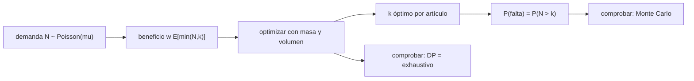

# B117-C05 — Inventario y gestión del equipo médico a bordo

<!-- nav:top -->
[🏠 Programa](../../../../README.md) · [📚 Bloque B117](../../../tronco-comun/B117-urgencias-medicas-y-atencion-clinica-en-mision.md) · [← Anterior: B117-C04 — Problemas respiratorios simulados](../B117-C04-problemas-respiratorios-simulados/CLASE.md) · [Siguiente: B118-C01 — Población de objetos orbitales →](../../../tronco-comun/B118-trafico-espacial-y-sostenibilidad-orbital.md#b118-c01)
<!-- /nav -->

## 1. Ubicación, nivel y alcance

Clase 5 del bloque B117 y última del área A09. Nivel N4. En una nave no se puede pedir más material: lo que se embarca es lo que hay, con límites de masa y de volumen. Aquí tratas el botiquín como un problema de selección: qué artículos y cuántas unidades maximizan el beneficio esperado, y con qué probabilidad faltará cada uno. Usas [C01](../B117-C01-primeros-auxilios-y-procedimientos-basicos-en-entorno-espacial/CLASE.md) a [C04](../B117-C04-problemas-respiratorios-simulados/CLASE.md) solo como motivación de qué se necesita. **Esta clase es educativa: no es una lista de equipo médico, no da consejo médico ni operativo y no sustituye formación, licencia ni supervisión profesional.** Los artículos son genéricos y sintéticos.

## 2. Por qué esta clase existe

Ninguna clase anterior trata el equipo médico de a bordo. La decisión central: **¿qué embarcar bajo un límite de masa y volumen y qué riesgo de quedarse sin él se acepta?**

## 3. Lo que podrás hacer al terminar

1. Modelar la demanda de un artículo con una distribución de Poisson.
2. Calcular el beneficio esperado `w E[min(N, k)]` de embarcar `k` unidades.
3. Resolver la selección bajo dos restricciones con programación dinámica y verificarla con búsqueda exhaustiva.
4. Calcular la probabilidad de desabastecimiento `P(N > k)` y comprobarla con Monte Carlo.
5. Ver qué pasa con el riesgo cuando la misión se alarga.
6. Separar lo consultado (el concepto del IMM de la NASA) de lo ilustrativo (todos los artículos y números).

La evidencia es el **botiquín sintético optimizado con su riesgo de falta** del ejercicio 12 (sección 20).

## 4. Con qué llegas y cómo comprobarlo

1. ¿Qué es una distribución de Poisson?
2. ¿Qué es un valor esperado?
3. ¿Qué es un problema de la mochila?
4. ¿Qué es una simulación de Monte Carlo?
5. ¿Qué es una verificación por segunda vía?

<details>
<summary>Ver respuestas</summary>

1. La distribución del número de eventos en un intervalo si ocurren al azar con una tasa media `μ`. 2. El promedio ponderado por probabilidad. 3. Elegir objetos con peso y valor para maximizar el valor sin superar una capacidad. 4. Estimar una probabilidad repitiendo un experimento aleatorio muchas veces. 5. Calcular lo mismo con otro método y comparar.
</details>

Con cuatro o cinco aciertos, sigue; si no, repasa los prerrequisitos.

## 5. Un caso de contexto y casos de referencia

El resumen del Integrated Medical Model (NASA, Myers et al.) explica que el modelo estima de forma probabilística 100 condiciones médicas y que sus métricas permiten estimar el **contenido óptimo de un botiquín** bajo restricciones de masa y volumen o de un nivel de riesgo aceptable. Esa es la única afirmación **consultada**; ninguna cifra de esta clase viene de ahí. El **ejemplo conductor** es un botiquín sintético de 8 artículos genéricos con límites de `4000 g` y `6000 cm³`: el óptimo pesa `3090 g` (77,2 %) y ocupa `5070 cm³` (84,5 %), y el equipo de reanimación queda fuera. Todo es **ilustrativo**.

## 6. Vocabulario

La **demanda** `N` es el número de veces que se necesita un artículo en la misión. La **tasa** `μ` es su media. El **beneficio** `w E[min(N, k)]` pondera por gravedad `w` las veces que el stock `k` cubre la demanda. El **desabastecimiento** es `N > k`. La **programación dinámica** resuelve el problema por etapas. La **búsqueda exhaustiva** prueba todas las combinaciones. El **IMM** es el modelo probabilístico de riesgo médico de la NASA.

## 7. Modelo mental: una maleta con dos límites



*Descripción textual:* la demanda aleatoria da un beneficio por artículo; se elige cuántas unidades llevar bajo los dos límites, se calcula el riesgo de falta y se verifica con dos vías.

Analogía: llenar una maleta con límite de peso y de volumen, donde cada objeto vale más cuanto más probable es usarlo. Límite: el beneficio esperado promedia y puede dejar fuera algo raro pero catastrófico.

## 8. La explicación, paso a paso

### 8.1 Beneficio de embarcar `k` unidades

`E[min(N, k)] = Σ_{j=1..k} P(N ≥ j)` y `P(N ≥ j) = 1 − Σ_{i<j} e^(−μ) μ^i/i!`. Para `μ = 2` y `k = 1`: `1 − e^(−2) = 0,8647`.

### 8.2 Selección óptima

Con 8 artículos, hasta 3 unidades (1 el equipo de reanimación) y pasos de 10 g y 10 cm³, la programación dinámica da un beneficio de `14,827484`, idéntico al de la búsqueda exhaustiva (32 768 combinaciones), con la misma selección.

| Artículo | k | Masa (g) | Vol. (cm³) | μ | P(falta) |
|---|---|---|---|---|---|
| vendas y apósitos | 3 | 120 | 240 | 2,00 | 0,1429 |
| analgésico genérico | 3 | 90 | 120 | 3,00 | 0,3528 |
| antiséptico | 3 | 180 | 300 | 1,50 | 0,0656 |
| hemostático | 3 | 360 | 600 | 0,40 | 0,0008 |
| antibiótico genérico | 3 | 300 | 360 | 0,60 | 0,0034 |
| pulsioxímetro | 3 | 240 | 450 | 1,00 | 0,0190 |
| botella de oxígeno | 2 | 1800 | 3000 | 0,10 | 0,0002 |
| equipo de RCP | 0 | 0 | 0 | 0,02 | 0,0198 |

### 8.3 Lo que el valor esperado deja fuera

El equipo de reanimación (2400 g, gravedad 50) aporta `50 × 0,0198 = 0,99`; una primera botella de oxígeno (900 g, gravedad 20) aporta `20 × 0,0952 = 1,90`. El óptimo prefiere el oxígeno y los artículos de uso frecuente y **no** lleva el equipo de reanimación: su probabilidad de uso es baja y su masa alta. Esto muestra el límite del criterio: un evento raro y grave puede exigir un criterio de riesgo y no solo de promedio.

### 8.4 Riesgo y duración

El Monte Carlo (20 000 misiones, semilla 117) coincide con Poisson dentro de `0,0026` en `P(falta)`. Si la misión dura el doble (`μ × 2`) con el mismo botiquín, `P(falta)` de las vendas pasa de `0,1429` a `0,5665` y la del analgésico de `0,3528` a `0,8488`.

## 9. Magnitudes, símbolos y unidades

| Símbolo | Qué es | Unidad | Valor / nota |
|---|---|---|---|
| `μ` | eventos esperados por misión | — | 0,02–3 (ilustrativo) |
| `k` | unidades embarcadas | — | 0–3 |
| `w` | peso de gravedad | — | 1–50 (ilustrativo) |
| `m`, `v` | masa y volumen por unidad | g, cm³ | ilustrativos |
| `M`, `V` | límites | g, cm³ | 4000; 6000 |
| `P(falta)` | `P(N > k)` | — | 0,0002–0,3528 |

## 10. Convenciones y referencias

Misión de 180 d (ilustrativo). Demanda de Poisson independiente por artículo, sin caducidad, sin reposición y sin sustituciones entre artículos. Unidades: g, cm³. Los artículos y sus números son sintéticos y no representan ningún botiquín real.

## 11. De dónde sale lo que afirmamos

| ID | Fuente | Localizador | Respalda | Estado |
|---|---|---|---|---|
| S1 | Myers J. et al., «Integrated Medical Model Project – Overview and Summary of Historical Application», NASA NTRS 20140016998 — https://ntrs.nasa.gov/api/citations/20140016998/downloads/20140016998.pdf (consultada 2026-11-10, PDF leído con PyMuPDF) | resumen | el IMM, parte del Human Research Program, evalúa de forma probabilística 100 condiciones médicas; sus métricas permiten estimar el contenido óptimo de un botiquín bajo restricciones de masa y volumen o de riesgo aceptable | Consultada |
| — | Distribución de Poisson, programación dinámica | — | verificados con búsqueda exhaustiva y Monte Carlo | No consultadas en una fuente concreta |
| — | Artículos, pesos de gravedad, `μ`, límites | — | todos los números | Ilustrativo |

Límites: no se consultó ningún inventario médico real ni su caducidad; ningún artículo, cantidad ni probabilidad corresponde a un botiquín de una misión.

## 12. Cómo ver el botiquín

| Magnitud | Valor |
|---|---|
| Beneficio óptimo | 14,827484 |
| Masa usada | 3090 g (77,2 %) |
| Volumen usado | 5070 cm³ (84,5 %) |
| Mayor `P(falta)` | 0,3528 (analgésico) |
| Equipo de RCP | no se embarca |

Descripción larga: el óptimo llena casi todo el volumen con artículos de uso frecuente y deja fuera el artículo pesado y raro.

## 13. Ejemplo trabajado: beneficio de un artículo

**Paso 1 · Probabilidades.** Con `μ = 2`: `P(N ≥ 1) = 0,8647`; `P(N ≥ 2) = 0,5940`; `P(N ≥ 3) = 0,3233`.

**Paso 2 · Valor esperado.** `E[min(N, 3)] = 0,8647 + 0,5940 + 0,3233 = 1,7820`.

**Paso 3 · Beneficio.** Con `w = 1`: `1,7820`.

**Paso 4 · Riesgo.** `P(N > 3) = 0,1429`.

## 14. Distintas formas de describir un botiquín

**Por artículo:** `k`, masa y volumen. **Por beneficio:** valor esperado. **Por riesgo:** `P(falta)`. **Por recursos:** fracción de masa y volumen. **Por duración:** `μ` según la misión.

## 15. Práctica guiada

**Ejercicio 1 · con los pasos indicados.** Calcula `P(N ≥ 1)` para `μ = 3`. *Pasos:* `1 − e^(−3)`.

<details><summary>Solución comentada</summary>

`1 − 0,0498 = 0,9502`.
</details>

**Ejercicio 2 · con una pista.** Calcula `E[min(N, 1)]` para `μ = 2`. *Pista:* es `P(N ≥ 1)`.

<details><summary>Solución comentada</summary>

`1 − e^(−2) = 0,8647`.
</details>

**Ejercicio 3 · casi autónomo.** ¿Qué probabilidad hay de quedarse sin vendas con `k = 3` y `μ = 2`?

<details><summary>Solución comentada</summary>

`P(N > 3) = 1 − (0,1353 + 0,2707 + 0,2707 + 0,1804) = 0,1429`.
</details>

## 16. Práctica autónoma, transferencia e integrador

**Ejercicio 4 · autónomo.** ¿Qué fracción de la masa máxima usa el óptimo?

<details><summary>Solución comentada</summary>

`3090/4000 = 77,2 %`.
</details>

**Ejercicio 5 · autónomo.** Margen restante de masa y volumen.

<details><summary>Solución comentada</summary>

`4000 − 3090 = 910 g` y `6000 − 5070 = 930 cm³`; el equipo de RCP (2400 g) no cabe.
</details>

**Ejercicio 6 · autónomo.** Beneficio por gramo del equipo de RCP y de la primera botella de oxígeno.

<details><summary>Solución comentada</summary>

RCP: `0,990/2400 = 4,1 × 10⁻⁴` por g. Oxígeno: `1,903/900 = 2,1 × 10⁻³` por g, cinco veces más.
</details>

**Ejercicio 7 · autónomo.** `P(falta)` del analgésico si la misión se duplica.

<details><summary>Solución comentada</summary>

`0,8488` (de `0,3528`).
</details>

**Ejercicio 8 · autónomo.** ¿Cuántas combinaciones revisa la búsqueda exhaustiva?

<details><summary>Solución comentada</summary>

`4⁷ × 2 = 32 768`.
</details>

**Ejercicio 9 · transferencia.** **Transferencia.** El óptimo deja fuera el equipo de reanimación. ¿Es una buena decisión?

<details><summary>Solución comentada</summary>

Es óptima para el criterio de beneficio esperado con esos pesos ilustrativos; un evento raro y grave puede exigir un criterio de riesgo aceptable, no solo de promedio.
</details>

**Ejercicio 10 · transferencia.** **Transferencia.** Un fármaco caduca a los 120 d y la misión dura 180 d. ¿Qué cambia en el modelo?

<details><summary>Solución comentada</summary>

La caducidad acorta la vida útil del stock: hay que embarcar para la ventana de validez o aceptar que parte no estará; el modelo no la incluye.
</details>

**Ejercicio 11 · transferencia.** **Transferencia.** Una misión lejos de la Tierra no admite reposición. ¿Cómo cambia el criterio de selección?

<details><summary>Solución comentada</summary>

Sube el valor de embarcar márgenes (más `k`), porque no hay un segundo pedido; se compensa con mayor masa y volumen.
</details>

**Ejercicio 12 · integrador.** **Integrador.** Elabora tu *botiquín sintético optimizado con su riesgo de falta*: tabla de `k`, masa, volumen y `P(falta)`, verificación (DP frente a exhaustivo y Monte Carlo), sensibilidad a la duración y lista de qué es consultado e ilustrativo, con el aviso de que es educativa.

<details><summary>Solución comentada</summary>

Secciones 8.1–8.4 y la salida del laboratorio.
</details>

## 17. Laboratorio: botiquín sintético

El script [botiquin.py](botiquin.py) optimiza con programación dinámica, verifica con búsqueda exhaustiva, calcula `P(falta)` y lo contrasta con un Monte Carlo (**comprueba** igualdad del beneficio a 1e-9 y Monte Carlo a 0,01). Tarda unos 50 s en un equipo común.

**Datos:** solo el concepto del IMM consultado; artículos, tasas, pesos y límites **ilustrativos**. **Predice antes de ejecutar:** ¿embarcará el óptimo el equipo de RCP? (no.) **Ejecución del 2026-11-10 (Python 3.12.9):**

```text
Python 3.12.9 (biblioteca estandar)
Articulos GENERICOS y SINTETICOS (ilustrativos); solo el concepto del IMM de la NASA es consultado.
Limites: masa 4000 g, volumen 6000 cm3; eventos esperados por mision de 180 d (ilustrativo)
Beneficio optimo DP = 14.827484 ; busqueda exhaustiva = 14.827484 ; selecciones iguales: True
 articulo                 k   masa[g]  vol[cm3]  mu    P(falta)
vendas y apositos         3       120       240  2.00    0.1429
analgesico generico       3        90       120  3.00    0.3528
antiseptico               3       180       300  1.50    0.0656
hemostatico               3       360       600  0.40    0.0008
antibiotico generico      3       300       360  0.60    0.0034
pulsioximetro             3       240       450  1.00    0.0190
botella de oxigeno        2      1800      3000  0.10    0.0002
equipo de RCP             0         0         0  0.02    0.0198
Total: masa = 3090 g (77.2%); volumen = 5070 cm3 (84.5%)
Error maximo Monte Carlo - Poisson en P(falta) = 0.0026
Mision del doble de duracion (mu x 2) con el mismo botiquin:
  vendas y apositos        P(falta) 0.1429 -> 0.5665
  analgesico generico      P(falta) 0.3528 -> 0.8488
  antiseptico              P(falta) 0.0656 -> 0.3528
  hemostatico              P(falta) 0.0008 -> 0.0091
  antibiotico generico     P(falta) 0.0034 -> 0.0338
  pulsioximetro            P(falta) 0.0190 -> 0.1429
  botella de oxigeno       P(falta) 0.0002 -> 0.0011
  equipo de RCP            P(falta) 0.0198 -> 0.0392
Pruebas superadas.
```

```bash
python programa/clases/B117/B117-C05-inventario-y-gestion-del-equipo-medico-a-bordo/botiquin.py
```

**Límites:** demanda de Poisson independiente, sin caducidad ni reposición ni sustitución; pesos de gravedad inventados; no es una lista de equipo médico.

## 18. Errores frecuentes y cómo corregirlos

**Tomar el botiquín sintético como una lista real.** Se corrige con la sección 10.

**Creer que el valor esperado cubre los eventos raros y graves.** Se corrige con 8.3.

**Ignorar que el riesgo de falta crece con la duración.** Se corrige con 8.4.

**Dar por verificado un resultado con una sola vía.** Se corrige con 8.2 y 8.4.

## 19. Cómo sabrás que vas bien

Tras la sección 8: ¿qué selección esperabas y cuál obtuviste? Si dudas, repasa el ejemplo 13. Tras el laboratorio: ¿qué comprueba? (ver la sección 17).

## 20. Qué entregas y cómo se evalúa

El producto es tu **botiquín sintético optimizado con su riesgo de falta** (ejercicio 12).

| Criterio | Inicial | En desarrollo | Logrado | Destacado |
|---|---|---|---|---|
| Conceptos | Los confunde | Parciales | Calcula beneficio y `P(falta)` | Explica los límites |
| Cálculo | Sin unidades | Con errores | Tablas completas con unidades | Calcula casos nuevos |
| Numérico | Sin comprobar | Un caso | Contraste con una segunda vía | Interpreta las diferencias |
| Fuentes | Sin fuente | Sin fecha | Fuentes con fecha y estado | Declara lo ilustrativo y lo no consultado |
| Límites | No los nombra | Uno | Tres | Discute qué falta del modelo |

**Condiciones críticas (no se compensan con promedio):** rotular los artículos y números como sintéticos; no presentar la selección como una lista de equipo médico real; citar solo lo consultado.

## 21. Ética, seguridad y límites

Clase educativa: **no da consejo médico ni operativo** y no sustituye formación clínica, licencia ni supervisión profesional; ningún resultado debe usarse para armar o evaluar un botiquín real. Los modelos son simplificados y sus datos son sintéticos o ilustrativos. Accesibilidad: tablas equivalentes a las gráficas, fórmulas en texto, ejercicios sin conexión.

## 22. Para cerrar y seguir

Un botiquín sintético de 8 artículos llena el `77,2 %` de la masa y el `84,5 %` del volumen, deja fuera el equipo de reanimación y se queda corto de analgésico con probabilidad `0,3528`; si la misión se duplica, esa probabilidad sube a `0,8488`. Con esto termina el bloque B117 y el área A09 de astronáutica humana, medicina y hábitats.

**Glosario español–inglés.** botiquín · *medical kit*; desabastecimiento · *stockout*; programación dinámica · *dynamic programming*; demanda · *demand*; probabilidad de falta · *stockout probability*.

**Continuidad.** [B118](../../../tronco-comun/B118-trafico-espacial-y-sostenibilidad-orbital.md) es el bloque siguiente del programa, sobre el tráfico espacial y la sostenibilidad orbital.

**Referencias:** ver sección 11.

<!-- nav:bottom -->
---

[← Anterior: B117-C04 — Problemas respiratorios simulados](../B117-C04-problemas-respiratorios-simulados/CLASE.md) · [📚 Bloque B117](../../../tronco-comun/B117-urgencias-medicas-y-atencion-clinica-en-mision.md) · [Siguiente: B118-C01 — Población de objetos orbitales →](../../../tronco-comun/B118-trafico-espacial-y-sostenibilidad-orbital.md#b118-c01)
<!-- /nav -->
