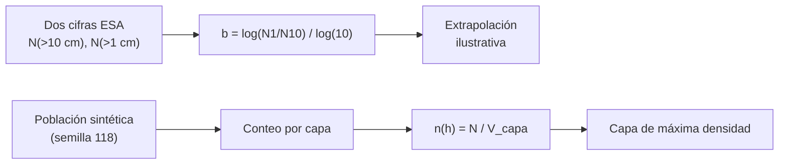

# B118-C01 — Población de objetos orbitales

<!-- nav:top -->
[🏠 Programa](../../../../README.md) · [📚 Bloque B118](../../../tronco-comun/B118-trafico-espacial-y-sostenibilidad-orbital.md) · [← Anterior: B117-C05 — Inventario y gestión del equipo médico a bordo](../../B117/B117-C05-inventario-y-gestion-del-equipo-medico-a-bordo/CLASE.md) · [Siguiente: B118-C02 — Catálogos de objetos espaciales →](../B118-C02-catalogos-de-objetos-espaciales/CLASE.md)
<!-- /nav -->

## 1. Ubicación, nivel y alcance

Clase 1 del bloque B118. Nivel N3. Primera clase del tramo «Conocer el entorno». Antes de hablar de conjunciones o de desechos hay que saber **cuántos objetos hay, de qué tamaño y a qué altitud**. Aquí usas dos cifras publicadas por la ESA para estimar cómo se reparte el tamaño de los desechos y calculas la densidad espacial por capa de altitud de una población **sintética** de 5000 objetos en órbita baja (LEO). **Esta clase es educativa: no constituye asesoría legal, regulatoria, financiera ni operativa y no sustituye la lectura del texto normativo vigente ni a un profesional habilitado.**

## 2. Por qué esta clase existe

Los catálogos solo contienen los objetos que los sensores pueden seguir; el resto se conoce por modelos y por mediciones in situ. Esta clase fija el vocabulario cuantitativo (conteos acumulados, pendiente, densidad) que usan todas las demás. La decisión central: **¿qué se puede afirmar de la población total a partir de dos cifras de conteo, y qué no?**

## 3. Lo que podrás hacer al terminar

1. Distinguir objetos seguidos, cargas útiles activas y desechos por clase de tamaño.
2. Calcular la pendiente `b` de `N(>d) = k d^-b` con dos cifras de la ESA (resultado `1,380`).
3. Extrapolar a tamaños menores y señalar que el resultado es ilustrativo, no una cifra oficial.
4. Calcular la densidad espacial `n(h)` de una capa de altitud y comprobar que `n × volumen` devuelve el conteo.
5. Reconocer en qué capa se concentra la población sintética y por qué importa para el riesgo de colisión.
6. Separar lo consultado (cifras de la ESA), lo sintético (la población) y lo ilustrativo (la extrapolación).

La evidencia es la **ficha de población orbital con la densidad por capa** del ejercicio 12 (sección 20).

## 4. Con qué llegas y cómo comprobarlo

1. ¿Qué es una ley de potencias `N = k x^-b`?
2. ¿Qué es el volumen de una capa esférica entre dos radios?
3. ¿Qué significa «órbita baja» (LEO)?
4. ¿Qué es una densidad espacial?
5. ¿Para qué sirve una semilla fija?

<details>
<summary>Ver respuestas</summary>

1. Una relación en la que el conteo cae como una potencia del tamaño; en escala log-log es una recta de pendiente `-b`. 2. `4π/3 (r₂³ − r₁³)`. 3. Hasta 2000 km de altitud en la definición de región protegida de la IADC (sección 3.3.2 de las directrices consultadas). 4. Un conteo dividido por el volumen que ocupa, en objetos por km³. 5. Para que el muestreo aleatorio sea reproducible.
</details>

Con cuatro o cinco aciertos, sigue; si no, repasa los prerrequisitos.

## 5. Un caso de contexto y casos de referencia

El **Informe sobre el Entorno Espacial 2025** de la ESA (página publicada el 1 de abril de 2025, con datos hasta fines de 2024) indica que hay unos 40 000 objetos seguidos en órbita, de los cuales unos 11 000 son cargas útiles activas; estima más de 50 000 desechos mayores de 10 cm y más de 1,2 millones mayores de 1 cm, y que en 2024 las fragmentaciones añadieron al menos 3000 objetos seguidos. El **ejemplo conductor** usa solo estas cifras para obtener `b = 1,380` y una población sintética para la densidad por capa. Los datos de la población son sintéticos, no observados.

## 6. Vocabulario

Un **objeto seguido** es el que está en un catálogo. Un **desecho** es un objeto artificial sin función útil. El **conteo acumulado** `N(>d)` es el número de objetos mayores que `d`. La **pendiente** `b` describe qué tan rápido crece el conteo al bajar el tamaño. La **densidad espacial** `n(h)` es el número de objetos por unidad de volumen en una capa de altitud `h`. Una **capa** es la región entre dos altitudes.

## 7. Modelo mental



*Descripción textual:* de dos conteos acumulados se obtiene la pendiente de la distribución de tamaños; de la población sintética se obtiene el conteo por capa y, dividido por el volumen, la densidad espacial.

Analogía: contar peces en un estanque con dos redes de malla distinta; la proporción entre lo que atrapa cada malla sugiere cuántos peces más pequeños escapan. Límite: la ley de potencias de dos puntos supone que la pendiente es constante entre ambos tamaños y fuera de ellos, lo que no está demostrado.

## 8. La explicación, paso a paso

### 8.1 La pendiente de los tamaños

Con `N(>10 cm) = 50 000` y `N(>1 cm) = 1 200 000` (ambas «más de», es decir, cotas inferiores de la ESA):

`b = ln(1 200 000 / 50 000) / ln(10 / 1) = ln 24 / ln 10 = 1,3802`.

Extrapolar a 1 mm da `1 200 000 × 10^b = 2,88 × 10⁷` objetos. Es un **ejercicio ilustrativo**: la ESA no publica esa cifra en la página consultada y la pendiente puede cambiar para tamaños menores.

### 8.2 Fracción activa

`11 000 / 40 000 = 0,275`: aproximadamente uno de cada cuatro objetos seguidos es una carga útil activa; el resto son desechos y objetos fuera de servicio.

### 8.3 Densidad por capa (población sintética)

Se generan 5000 alturas con tres concentraciones (550, 800 y 1000 km, con pesos 0,45; 0,30 y 0,25). Para cada capa de 100 km se calcula `n = N / [4π/3 ((R+h_b)³ − (R+h_a)³)]` con `R = 6378,137 km`. La capa de mayor densidad es 500–600 km, con `30,54 × 10⁻⁹ objetos/km³`. El 41,6 % de los objetos sintéticos está por debajo de 600 km.

### 8.4 Qué no dice esta clase

Los conteos no distinguen la masa ni el área; un objeto de 10 cm y otro de 10 m cuentan igual en `N(>1 cm)`. Y la población sintética es una construcción didáctica: **no describe la distribución real por altitud**.

## 9. Magnitudes, símbolos y unidades

| Símbolo | Qué es | Unidad | Valor / nota |
|---|---|---|---|
| `b` | pendiente de `N(>d)` | adimensional | 1,380 |
| `N(>10 cm)` | desechos mayores de 10 cm | objetos | > 50 000 (ESA 2025) |
| `N(>1 cm)` | desechos mayores de 1 cm | objetos | > 1 200 000 (ESA 2025) |
| `n(h)` | densidad espacial por capa | objetos/km³ | 30,54 × 10⁻⁹ (pico, sintética) |
| `R` | radio ecuatorial | km | 6378,137 |

## 10. Convenciones y referencias

Altitud `h` sobre el radio ecuatorial `R = 6378,137 km` (la IADC toma 6378 km; la diferencia no cambia ningún resultado a esta precisión). Volúmenes de capas esféricas; densidades en objetos/km³ (multiplicadas por 10⁹ para legibilidad). Los conteos «más de» de la ESA se tratan como valores, aunque son cotas inferiores: si la ESA publicara el valor central, la pendiente cambiaría.

## 11. De dónde sale lo que afirmamos

| ID | Fuente | Localizador | Respalda | Estado |
|---|---|---|---|---|
| S4 | ESA Space Environment Report 2025 (página, publicada el 1 de abril de 2025 con datos hasta fines de 2024) — https://www.esa.int/Space_Safety/Space_Debris/ESA_Space_Environment_Report_2025 (consultada 2026-11-11; página leída con WebFetch; el informe completo no se abrió) | página del informe (cifras de conteo) | unos 40 000 objetos seguidos, unos 11 000 cargas útiles activas, más de 50 000 desechos > 10 cm, más de 1,2 millones > 1 cm, al menos 3000 objetos añadidos en 2024 | Consultada |
| S3 | IADC Space Debris Mitigation Guidelines, IADC-02-01 Rev. 4 (enero de 2025), presentadas como A/AC.105/C.1/2025/CRP.9 (3 de febrero de 2025) — https://www.unoosa.org/res/oosadoc/data/documents/2025/aac_105c_12025crp/aac_105c_12025crp_9_0_html/AC105_C1_2025_CRP09E.pdf (consultada 2026-11-11; PDF leído con PyMuPDF) | sección 3.3.2 | la región protegida LEO llega a 2000 km de altitud | Consultada |
| — | Distribución real por altitud y por tamaño (modelos MASTER o ORDEM) | — | comparación con la población sintética | No consultada |
| — | Población sintética (5000 objetos), extrapolación a 1 mm | — | capas y densidades | Sintético / ilustrativo |

Límites: de la ESA solo se leyó la página, no el informe completo; sus conteos son cotas («más de»); la población por altitud es sintética y no se contrastó con ningún catálogo.

## 12. Cómo ver los resultados

| Magnitud | Valor |
|---|---|
| `b` (1–10 cm) | 1,380 |
| Extrapolación a > 1 mm | 2,88 × 10⁷ (ilustrativa) |
| Fracción activa | 0,275 |
| Capa de pico | 500–600 km |
| Densidad de pico | 30,54 × 10⁻⁹ /km³ |
| Bajo 600 km | 41,6 % |

Descripción larga: la tabla de capas muestra tres concentraciones (la de 500–600 km es la más densa) y casi nada por encima de 1200 km; los conteos de la ESA, en escala log-log, caen en una recta de pendiente `−1,38`.

## 13. Ejemplo trabajado

**Paso 1 · Cociente de conteos.** `1 200 000 / 50 000 = 24`.

**Paso 2 · Pendiente.** `b = log₁₀ 24 = 1,3802`.

**Paso 3 · Comprobación.** `N(>10 cm) = 1 200 000 × 10^(−b) = 50 000` (la ley reproduce el punto).

**Paso 4 · Volumen de una capa.** Entre 500 y 600 km: `4π/3 [(6978,137)³ − (6878,137)³]` ≈ `6,032 × 10¹⁰ km³`.

**Paso 5 · Densidad.** `1842 / 6,032 × 10¹⁰ = 30,54 × 10⁻⁹ /km³` (coincide con la tabla de la sección 17).

## 14. Distintas formas de describir el problema

**Por conteo:** `N(>d)`. **Por pendiente:** `b`. **Por volumen:** `n(h)`. **Por fracción:** activos sobre seguidos. **Por tabla:** el conteo por capa de la sección 17.

## 15. Práctica guiada

**Ejercicio 1 · con los pasos indicados.** Calcula `b` con `N(>10 cm) = 50 000` y `N(>1 cm) = 1 200 000`. *Pasos:* cociente, logaritmo decimal.

<details><summary>Solución comentada</summary>

`24`; `log₁₀ 24 = 1,380`.
</details>

**Ejercicio 2 · con una pista.** Calcula el volumen de la capa de 500 a 600 km de altitud. *Pista:* `4π/3 (r₂³ − r₁³)` con `r = 6378,137 + h`.

<details><summary>Solución comentada</summary>

`≈ 6,032 × 10¹⁰ km³`.
</details>

**Ejercicio 3 · casi autónomo.** Una capa tiene 240 objetos y un volumen de `5,86 × 10¹⁰ km³`. ¿Cuál es su densidad?

<details><summary>Solución comentada</summary>

`240 / 5,86 × 10¹⁰ ≈ 4,1 × 10⁻⁹ objetos/km³`.
</details>

## 16. Práctica autónoma, transferencia e integrador

**Ejercicio 4 · autónomo.** Fracción de cargas útiles activas entre los objetos seguidos.

<details><summary>Solución comentada</summary>

`11 000 / 40 000 = 0,275`.
</details>

**Ejercicio 5 · autónomo.** Extrapola `N(>d)` a 5 cm con la pendiente obtenida, partiendo de `N(>1 cm)`.

<details><summary>Solución comentada</summary>

`1 200 000 × 5^(−1,380) = 130153`, valor coherente con ser menos que a 1 cm y más que a 10 cm.
</details>

**Ejercicio 6 · autónomo.** ¿Cuántos objetos mayores de 1 mm predice la ley? Compara con la cifra del informe.

<details><summary>Solución comentada</summary>

`2,88 × 10⁷`; la cifra no figura en la página consultada, así que no puede compararse: es ilustrativa.
</details>

**Ejercicio 7 · autónomo.** ¿Cómo cambia `b` si los conteos fueran `N(>10 cm) = 60 000` y `N(>1 cm) = 1 200 000`?

<details><summary>Solución comentada</summary>

`log₁₀ 20 = 1,301`: una cota mayor en 10 cm achata la pendiente.
</details>

**Ejercicio 8 · autónomo.** Con la tabla de la sección 17, ¿qué fracción de la población sintética está en la capa de máxima densidad?

<details><summary>Solución comentada</summary>

`1842 / 5000 = 0,368`.
</details>

**Ejercicio 9 · transferencia.** **Transferencia.** Un operador dice «la población de 1 cm a 10 cm es 24 veces mayor que la de más de 10 cm». ¿Qué falta para tomarlo como dato?

<details><summary>Solución comentada</summary>

Que la ESA da cotas inferiores («más de») y no incertidumbres; la razón 24 es un cociente de cotas, no una medición.
</details>

**Ejercicio 10 · transferencia.** **Transferencia.** ¿Por qué una alta densidad en 500–600 km importa más para el riesgo que el conteo total?

<details><summary>Solución comentada</summary>

Porque la tasa de encuentros crece con la densidad local; muchos objetos en capas distintas casi no interactúan.
</details>

**Ejercicio 11 · transferencia.** **Transferencia.** Tu colega usa `b` para estimar cuántos fragmentos de 1 mm hay y los cita como dato de la ESA. ¿Qué corriges?

<details><summary>Solución comentada</summary>

Que es una extrapolación propia, marcada como ilustrativa, no una cifra de la ESA.
</details>

**Ejercicio 12 · integrador.** **Integrador.** Elabora tu *ficha de población orbital con la densidad por capa*: las cifras de la ESA con fecha, la pendiente `b`, la extrapolación rotulada como ilustrativa, la tabla de capas de la población sintética y la lista de qué es consultado, sintético e ilustrativo.

<details><summary>Solución comentada</summary>

Secciones 8.1–8.4 y la salida del laboratorio, con el aviso de que es educativa.
</details>

## 17. Laboratorio

El script [poblacion.py](poblacion.py) calcula la pendiente a partir de dos cifras de la ESA, genera la población sintética con semilla 118 y tabula la densidad por capa (**comprueba** que densidad × volumen devuelve el conteo y que la ley reproduce el punto de 10 cm).

**Datos:** cifras de conteo de la ESA (consultadas); población de 5000 objetos **sintética**; la extrapolación a 1 mm es **ilustrativa**. **Predice antes de ejecutar:** ¿en qué rango de 100 km espera hallar la mayor densidad? (en la capa que contiene el pico más ponderado, 500–600 km.) **Ejecución del 2026-11-11 (Python 3.12.9):**

```text
Python 3.12.9 (biblioteca estandar)
Cifras ESA 2025 (consultadas): >10 cm: 50000; >1 cm: 1200000; seguidos: ~40000; activos: ~11000
Poblacion LEO SINTETICA (semilla 118); no es observada.
Pendiente b de N(>d) = k d^-b entre 1 cm y 10 cm: 1.3802
Extrapolacion ILUSTRATIVA a >1 mm: 2.880e+07 objetos (no es una cifra de la ESA)
Fraccion de activos entre los seguidos: 0.275
Objetos sinteticos: 5000; altura media 731.5 km; fraccion bajo 600 km: 0.416
 capa [km]        N    densidad [1e-9 /km^3]
    300-  400       0        0.000
    400-  500     240        4.096
    500-  600    1842       30.538
    600-  700     255        4.108
    700-  800     717       11.229
    800-  900     792       12.063
    900- 1000     557        8.254
   1000- 1100     549        7.918
   1100- 1200      47        0.660
   1200- 1300       1        0.014
   1300- 1400       0        0.000
   1400- 1500       0        0.000
   1500- 1600       0        0.000
   1600- 1700       0        0.000
   1700- 1800       0        0.000
   1800- 1900       0        0.000
   1900- 2000       0        0.000
Capa de mayor densidad: 500-600 km (30.538 e-9 /km^3)
Pruebas superadas (densidad x volumen = N; ley reproduce el punto de 10 cm).
```

```bash
python programa/clases/B118/B118-C01-poblacion-de-objetos-orbitales/poblacion.py
```

**Límites:** la población sintética no es el catálogo real; la pendiente se calcula con dos puntos y cotas inferiores; no hay incertidumbres.

## 18. Errores frecuentes y cómo corregirlos

**Tratar «más de 50 000» como un valor exacto.** Se corrige con 8.1: son cotas inferiores.

**Presentar la extrapolación a 1 mm como cifra de la ESA.** Se corrige con el ejercicio 11: es ilustrativa.

**Confundir conteo con riesgo.** Se corrige con el ejercicio 10: importa la densidad local.

**Olvidar el volumen de la capa al calcular la densidad.** Se corrige con el paso 4 del ejemplo.

## 19. Cómo sabrás que vas bien

Tras la sección 8: ¿qué pendiente esperabas y cuál obtuviste? Si dudas, repasa el ejemplo 13. Tras el laboratorio: ¿qué comprueba? (ver la sección 17).

## 20. Qué entregas y cómo se evalúa

El producto es tu **ficha de población orbital con la densidad por capa** (ejercicio 12).

| Criterio | Inicial | En desarrollo | Logrado | Destacado |
|---|---|---|---|---|
| Conceptos | Los confunde | Parciales | Calcula `b` y densidades | Explica los límites del modelo |
| Cálculo | Sin unidades | Con errores | Tablas completas con unidades | Calcula casos nuevos |
| Numérico | Sin comprobar | Un caso | Contraste con una segunda vía | Interpreta las diferencias |
| Fuentes | Sin fuente | Sin fecha | Fuentes con fecha, versión y estado | Declara lo ilustrativo y lo no consultado |
| Límites | No los nombra | Uno | Tres | Discute qué falta del modelo |

**Condiciones críticas (no se compensan con promedio):** rotular los datos sintéticos e ilustrativos como tales; no presentar un modelo como observación; citar solo lo consultado, con su versión y fecha; no usar la ficha como asesoría legal, regulatoria o financiera.

## 21. Ética, seguridad y límites

Clase educativa: **no constituye asesoría legal, regulatoria ni financiera** ni orienta decisiones operativas reales, y no sustituye la lectura del texto normativo vigente (se cita siempre la versión y la fecha consultadas) ni la opinión de un especialista habilitado. Los modelos son simplificados y sus datos son sintéticos o ilustrativos. Accesibilidad: tablas equivalentes a las gráficas, fórmulas en texto, ejercicios sin conexión.

## 22. Para cerrar y seguir

Dos cifras de la ESA dan una pendiente de `1,380` entre 1 y 10 cm, y una población sintética muestra cómo se concentran los objetos por capa. Queda una pregunta: ¿cómo se identifica cada objeto en un catálogo y cómo se asocia una nueva observación con él?

**Glosario español–inglés.** desecho espacial · *space debris* · objeto seguido · *tracked object* · pendiente de tamaños · *size-distribution slope* · densidad espacial · *spatial density* · capa de altitud · *altitude shell*.

**Continuidad.** [B118-C02](../B118-C02-catalogos-de-objetos-espaciales/CLASE.md) estudia los catálogos de objetos espaciales.

**Referencias:** ver sección 11.

<!-- nav:bottom -->
---

[← Anterior: B117-C05 — Inventario y gestión del equipo médico a bordo](../../B117/B117-C05-inventario-y-gestion-del-equipo-medico-a-bordo/CLASE.md) · [📚 Bloque B118](../../../tronco-comun/B118-trafico-espacial-y-sostenibilidad-orbital.md) · [Siguiente: B118-C02 — Catálogos de objetos espaciales →](../B118-C02-catalogos-de-objetos-espaciales/CLASE.md)
<!-- /nav -->
