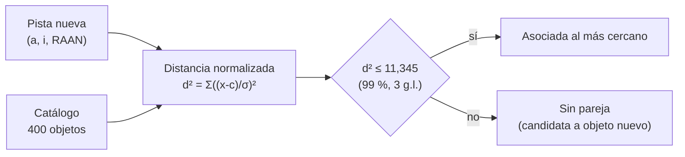

# B118-C02 — Catálogos de objetos espaciales

<!-- nav:top -->
[🏠 Programa](../../../../README.md) · [📚 Bloque B118](../../../tronco-comun/B118-trafico-espacial-y-sostenibilidad-orbital.md) · [← Anterior: B118-C01 — Población de objetos orbitales](../B118-C01-poblacion-de-objetos-orbitales/CLASE.md) · [Siguiente: B118-C03 — Detección y seguimiento óptico →](../B118-C03-deteccion-y-seguimiento-optico/CLASE.md)
<!-- /nav -->

## 1. Ubicación, nivel y alcance

Clase 2 del bloque B118. Nivel N3. Segunda clase del tramo «Conocer el entorno». Un catálogo es la lista de objetos con su identificador y sus elementos orbitales. Aquí aprendes cómo se numeran los objetos (con el esquema Alpha-5 que describe Space-Track), cómo se verifica una línea de elementos mediante su suma de comprobación y cómo se **asocia una pista nueva con un objeto catalogado** usando una puerta estadística. Todos los datos son **sintéticos**. **Esta clase es educativa: no constituye asesoría legal, regulatoria, financiera ni operativa y no sustituye la lectura del texto normativo vigente ni a un profesional habilitado.**

## 2. Por qué esta clase existe

Sin un catálogo no hay conjunciones: cada alerta empieza identificando de qué objeto habla. Los formatos antiguos tienen límites de tamaño y la asociación de observaciones puede equivocarse. La decisión central: **¿cuándo se acepta que una pista es de un objeto conocido y cuándo se declara desconocida?**

## 3. Lo que podrás hacer al terminar

1. Codificar y decodificar números de catálogo con Alpha-5 y reconocer su límite (339 999).
2. Calcular la suma de comprobación módulo 10 de una línea de 68 caracteres y verificar la longitud de 69.
3. Explicar por qué los TLE públicos son elementos medios y no sirven como entrada de una evaluación de conjunción.
4. Asociar pistas ruidosas con un catálogo mediante una puerta chi-cuadrado y contar aciertos, errores y pistas sin pareja.
5. Estimar cuántas pistas conocidas se pierden por la puerta (≈ 1 % con 99 %).
6. Separar lo consultado (formatos), lo sintético (catálogo y pistas) y lo no consultado (la regla exacta del guion en la suma).

La evidencia es la **ficha de catálogo con tasas de asociación** del ejercicio 12 (sección 20).

## 4. Con qué llegas y cómo comprobarlo

1. ¿Qué es un elemento orbital?
2. ¿Qué es una suma de comprobación?
3. ¿Qué es una distribución chi-cuadrado?
4. ¿Qué es un falso positivo en asociación?
5. ¿Qué es una semilla?

<details>
<summary>Ver respuestas</summary>

1. Un parámetro de la órbita, como el semieje mayor `a`, la inclinación `i` o la ascensión recta del nodo `Ω`. 2. Un dígito calculado a partir de los demás que detecta errores de transcripción. 3. La de la suma de cuadrados de variables normales estándar; con 3 grados de libertad, el 99 % queda por debajo de 11,345. 4. Asignar una pista a un objeto equivocado. 5. El valor que fija la secuencia pseudoaleatoria.
</details>

Con cuatro o cinco aciertos, sigue; si no, repasa los prerrequisitos.

## 5. Un caso de contexto y casos de referencia

La documentación de **Space-Track** (consultada el 2026-11-11) indica que una TLE tiene dos líneas de 69 caracteres, que el último es una suma de comprobación módulo 10, que Alpha-5 reemplaza el primer dígito por una letra para llegar al número 339 999 (A = 10, sin I ni O), que los objetos con número mayor deberían intercambiarse en formatos OMM (XML, KVN, JSON, CSV), que las clases TLE se reemplazan por GP y que los TLE públicos «no deben usarse» para la predicción de conjunciones. El **ejemplo conductor**: el número 123 456 se escribe `C3456` en Alpha-5.

## 6. Vocabulario

Un **catálogo** es una lista de objetos con identificador y elementos. Una **TLE** (*two-line element set*) es un formato de dos líneas con elementos medios. **GP** son los elementos de perturbaciones generales; **OMM** es un mensaje de elementos orbitales por campos. **Alpha-5** es la ampliación del campo numérico con una letra inicial. Una **puerta** es el umbral de distancia estadística bajo el cual se acepta una asociación. Una **pista** es un conjunto de observaciones de un objeto.

## 7. Modelo mental



*Descripción textual:* cada pista se compara con todos los objetos del catálogo mediante una distancia normalizada por la incertidumbre; si la menor distancia cabe en la puerta se asocia, si no queda sin pareja.

Analogía: reconocer a una persona entre una lista de fotos con ruido; si el parecido supera un umbral lo aceptas, si no, la dejas como «desconocida». Límite: aquí los elementos son tres y las incertidumbres son independientes; en la realidad hay correlaciones y mucha más densidad.

## 8. La explicación, paso a paso

### 8.1 Alpha-5

El número se divide en dos partes: `g = n // 10 000` y `resto = n % 10 000`. Si `n < 100 000` se escribe con 5 dígitos; si no, la letra es la correspondiente a `g` (10 → A, … 17 → H, 18 → J, … 22 → N, 23 → P, … 33 → Z) seguida de 4 dígitos. Resultados: 99 999 → `99999`; 100 000 → `A0000`; 123 456 → `C3456`; 339 999 → `Z9999`. El 340 000 se rechaza: no cabe.

### 8.2 Suma de comprobación

Para la línea 1 sintética `1 99999U 24999A   24001.00000000  .00000000  00000-0  00000-0 0  9995` se suman los dígitos de los 68 primeros caracteres y el guion `-` cuenta 1 (regla que **no se consultó** en el texto de Space-Track; es la regla habitual). El resultado módulo 10 es el último dígito, y la longitud total es 69.

### 8.3 Asociación

El catálogo sintético tiene 400 objetos con `(a, i, Ω)` uniformes. Se generan 360 pistas con ruido de `σ = (2 km; 0,05°; 0,1°)` y 40 pistas de objetos **no catalogados**. Para cada pista se halla el objeto de menor `d² = Σ((x−c)/σ)²`; si `d² ≤ 11,345` se asocia. Resultado: **357 correctas, 0 equivocadas y 43 sin pareja**. De las 43, 40 son los objetos no catalogados y 3 son pistas conocidas rechazadas por la puerta (esperado `1 % × 360 = 3,6`).

### 8.4 Qué falta

Con 400 objetos en un espacio de elementos amplio no hay confusiones. Con decenas de miles de objetos y órbitas casi iguales (constelaciones) las asociaciones equivocadas aparecen. La clase **no** modela eso.

## 9. Magnitudes, símbolos y unidades

| Símbolo | Qué es | Unidad | Valor / nota |
|---|---|---|---|
| `n` | número de catálogo | adimensional | 0 a 339 999 en Alpha-5 |
| `d²` | distancia normalizada | adimensional | puerta 11,345 |
| `σ_a` | incertidumbre del semieje | km | 2 (sintética) |
| `σ_i`, `σ_Ω` | incertidumbre de inclinación y nodo | grados | 0,05 y 0,1 (sintéticas) |
| longitud TLE | caracteres por línea | caracteres | 69 |

## 10. Convenciones y referencias

Elementos `(a, i, Ω)` en km y grados; incertidumbres independientes. Puerta chi-cuadrado de 3 grados de libertad al 99 % (11,345). Los números de catálogo y las TLE de la clase son **sintéticos**: no corresponden a ningún objeto real.

## 11. De dónde sale lo que afirmamos

| ID | Fuente | Localizador | Respalda | Estado |
|---|---|---|---|---|
| S5 | Space-Track.org, documentación (operado por Space Forces-Space; 18.º y 19.º Escuadrón de Defensa Espacial) — https://www.space-track.org/documentation (consultada 2026-11-11; página leída con WebFetch) | página de documentación (TLE, Alpha-5, GP, CDM) | TLE de dos líneas de 69 caracteres con suma módulo 10; Alpha-5 hasta 339 999; TLE públicos no aptos para la predicción de conjunciones; datos que publica Space-Track | Consultada |
| — | Regla del guion en la suma de comprobación | — | cuenta 1 por cada `-` | No consultada (regla habitual) |
| — | Puerta chi-cuadrado y valores 11,345 / 7,815 | — | umbrales de asociación | No consultada (tabla estándar) |
| — | Catálogo, pistas y objetos no catalogados (semilla 118) | — | tasas de asociación | Sintético |

Límites: de Space-Track solo se leyó la página de documentación; no se consultó la descripción campo a campo de la TLE ni de la OMM; el catálogo sintético no replica la densidad real.

## 12. Cómo ver los resultados

| Magnitud | Valor |
|---|---|
| Correctas | 357 |
| Equivocadas | 0 |
| Sin pareja | 43 (40 desconocidas + 3 conocidas) |
| Alpha-5 de 123 456 | C3456 |
| Máximo Alpha-5 | Z9999 |

Descripción larga: la mayor parte de las pistas se asocia bien; las que quedan sin pareja son casi todas los 40 objetos nuevos, más unas pocas conocidas que la puerta rechaza por ruido.

## 13. Ejemplo trabajado

**Paso 1 · Codificar.** 123 456: `g = 12`, `resto = 3456`; la letra de 12 es C → `C3456`.

**Paso 2 · Decodificar.** `C3456`: C = 12 → `12 × 10 000 + 3456 = 123 456`.

**Paso 3 · Límite.** Z = 33 → `33 × 10 000 + 9999 = 339 999`.

**Paso 4 · Puerta.** Una pista con desviaciones `(2 km; 0,05°; 0,1°)` respecto a un objeto da `d² = 1 + 1 + 1 = 3`, por debajo de 11,345: se asocia.

## 14. Distintas formas de describir el problema

**Por formato:** TLE, GP, OMM. **Por identificador:** número de 5 dígitos o Alpha-5. **Por estadística:** distancia normalizada y puerta. **Por resultado:** correcta, equivocada, sin pareja.

## 15. Práctica guiada

**Ejercicio 1 · con los pasos indicados.** Codifica 100 000 en Alpha-5. *Pasos:* divide entre 10 000 y busca la letra.

<details><summary>Solución comentada</summary>

`g = 10` → A; `A0000`.
</details>

**Ejercicio 2 · con una pista.** Decodifica `C3456`. *Pista:* C es la letra número 12 de la escala.

<details><summary>Solución comentada</summary>

`123 456`.
</details>

**Ejercicio 3 · casi autónomo.** ¿Cuál es el mayor número representable con Alpha-5 y por qué?

<details><summary>Solución comentada</summary>

`339 999`: la letra Z vale 33 y quedan cuatro dígitos.
</details>

## 16. Práctica autónoma, transferencia e integrador

**Ejercicio 4 · autónomo.** Suma de comprobación de la cadena `1 2-3` con la regla habitual del guion.

<details><summary>Solución comentada</summary>

`1 + 2 + 3 + 1 = 7`; módulo 10: 7.
</details>

**Ejercicio 5 · autónomo.** Si un operador pierde un `-` al transcribir, ¿cambia la suma? ¿Se detecta el error?

<details><summary>Solución comentada</summary>

Sí cambia (baja 1); se detecta salvo coincidencia módulo 10.
</details>

**Ejercicio 6 · autónomo.** ¿Qué fracción de las 360 pistas conocidas se asoció correctamente?

<details><summary>Solución comentada</summary>

`357 / 360 = 0,992`.
</details>

**Ejercicio 7 · autónomo.** ¿Cuántas pistas conocidas rechazó la puerta y cuántas se esperaban?

<details><summary>Solución comentada</summary>

3 frente a `1 % × 360 = 3,6`.
</details>

**Ejercicio 8 · autónomo.** Con una puerta al 95 % (7,815) ¿cuántas pistas conocidas esperarías perder?

<details><summary>Solución comentada</summary>

`5 % × 360 ≈ 18`, a cambio de menos asociaciones equivocadas.
</details>

**Ejercicio 9 · transferencia.** **Transferencia.** ¿Por qué no basta una TLE pública para evaluar una conjunción?

<details><summary>Solución comentada</summary>

Son elementos medios generales; Space-Track advierte que no se usen para predecir conjunciones, que requieren posición y covarianza de mayor calidad.
</details>

**Ejercicio 10 · transferencia.** **Transferencia.** Un objeto tiene número 250 000. ¿Cómo lo intercambiarías?

<details><summary>Solución comentada</summary>

En Alpha-5 como `Q0000` (Q = 25) en TLE/3LE o en un formato OMM (XML, KVN, JSON o CSV), que no tiene el límite de 5 dígitos.
</details>

**Ejercicio 11 · transferencia.** **Transferencia.** En la clase no hubo asociaciones equivocadas. ¿Por qué podría haberlas en la realidad?

<details><summary>Solución comentada</summary>

Porque hay muchísimos más objetos y órbitas casi idénticas (constelaciones), de modo que dos objetos caben en la misma puerta.
</details>

**Ejercicio 12 · integrador.** **Integrador.** Elabora tu *ficha de catálogo con tasas de asociación*: tabla de Alpha-5, TLE sintética con su suma de comprobación, conteo de correctas, equivocadas y sin pareja, lo esperado por la puerta y la lista de qué es consultado, sintético y no consultado.

<details><summary>Solución comentada</summary>

Secciones 8.1–8.4 y la salida del laboratorio.
</details>

## 17. Laboratorio

El script [catalogo.py](catalogo.py) implementa Alpha-5 (ida y vuelta para todo el rango), construye una línea TLE sintética con su suma de comprobación y asocia 400 pistas sintéticas con el catálogo (**comprueba** la ida y vuelta, el rechazo del 340 000 y que los conteos suman 400).

**Datos:** catálogo y pistas **sintéticos** (semilla 118); formatos según Space-Track (consultado); la regla del guion y la puerta chi-cuadrado **no consultadas**. **Predice antes de ejecutar:** ¿cuántas pistas conocidas rechazará la puerta del 99 %? (alrededor de 3 o 4 de 360.) **Ejecución del 2026-11-11 (Python 3.12.9):**

```text
Python 3.12.9 (biblioteca estandar)
Catalogo y pistas SINTETICOS (semilla 118); formatos segun Space-Track (consultado); no son datos reales.
Alpha-5:  99999 -> 99999 -> 99999
Alpha-5: 100000 -> A0000 -> 100000
Alpha-5: 123456 -> C3456 -> 123456
Alpha-5: 339999 -> Z9999 -> 339999
TLE sintetica L1: 1 99999U 24999A   24001.00000000  .00000000  00000-0  00000-0 0  9995 | longitud 69
340000 rechazado: Alpha-5 termina en 339999
Asociacion de 400 pistas (360 catalogadas + 40 no catalogadas), puerta 11.345:
  correctas 357, equivocadas 0, sin pareja 43
Pruebas superadas (ida y vuelta Alpha-5, checksum, conteos).
```

```bash
python programa/clases/B118/B118-C02-catalogos-de-objetos-espaciales/catalogo.py
```

**Límites:** la TLE es una cadena sintética (campos en cero), no un elemento real; la asociación usa solo tres elementos; no hay objetos cercanos entre sí.

## 18. Errores frecuentes y cómo corregirlos

**Creer que Alpha-5 usa la I y la O.** Se corrige con 8.1: se omiten.

**Usar TLE públicas para evaluar conjunciones.** Se corrige con el ejercicio 9.

**Fijar una puerta sin conocer la incertidumbre.** Se corrige con 8.3: la puerta depende de `σ`.

**Olvidar que el 340 000 no cabe.** Se corrige con el ejercicio 3.

## 19. Cómo sabrás que vas bien

Tras la sección 8: ¿qué letra esperabas para 123 456 y cuál obtuviste? Si dudas, repasa el ejemplo 13. Tras el laboratorio: ¿qué comprueba? (ver la sección 17).

## 20. Qué entregas y cómo se evalúa

El producto es tu **ficha de catálogo con tasas de asociación** (ejercicio 12).

| Criterio | Inicial | En desarrollo | Logrado | Destacado |
|---|---|---|---|---|
| Conceptos | Los confunde | Parciales | Codifica Alpha-5 y explica la puerta | Explica los límites del modelo |
| Cálculo | Sin unidades | Con errores | Tablas completas con unidades | Calcula casos nuevos |
| Numérico | Sin comprobar | Un caso | Contraste con una segunda vía | Interpreta las diferencias |
| Fuentes | Sin fuente | Sin fecha | Fuentes con fecha, versión y estado | Declara lo ilustrativo y lo no consultado |
| Límites | No los nombra | Uno | Tres | Discute qué falta del modelo |

**Condiciones críticas (no se compensan con promedio):** rotular los datos sintéticos e ilustrativos como tales; no presentar un modelo como observación; citar solo lo consultado, con su versión y fecha; no usar la ficha como asesoría legal, regulatoria o financiera.

## 21. Ética, seguridad y límites

Clase educativa: **no constituye asesoría legal, regulatoria ni financiera** ni orienta decisiones operativas reales, y no sustituye la lectura del texto normativo vigente (se cita siempre la versión y la fecha consultadas) ni la opinión de un especialista habilitado. Los modelos son simplificados y sus datos son sintéticos o ilustrativos. Accesibilidad: tablas equivalentes a las gráficas, fórmulas en texto, ejercicios sin conexión.

## 22. Para cerrar y seguir

Alpha-5 cubre hasta 339 999 y la puerta del 99 % asoció 357 de 360 pistas conocidas sin una sola equivocación, dejando 43 sin pareja. Queda una pregunta: ¿cómo se obtienen las pistas con un telescopio?

**Glosario español–inglés.** catálogo de objetos · *object catalog* · elementos de dos líneas · *two-line elements* · suma de comprobación · *checksum* · asociación de pistas · *track association* · puerta estadística · *statistical gate*.

**Continuidad.** [B118-C03](../B118-C03-deteccion-y-seguimiento-optico/CLASE.md) estudia la detección y el seguimiento óptico.

**Referencias:** ver sección 11.

<!-- nav:bottom -->
---

[← Anterior: B118-C01 — Población de objetos orbitales](../B118-C01-poblacion-de-objetos-orbitales/CLASE.md) · [📚 Bloque B118](../../../tronco-comun/B118-trafico-espacial-y-sostenibilidad-orbital.md) · [Siguiente: B118-C03 — Detección y seguimiento óptico →](../B118-C03-deteccion-y-seguimiento-optico/CLASE.md)
<!-- /nav -->
