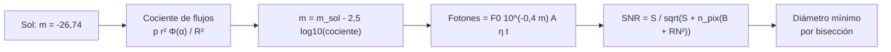

# B118-C03 — Detección y seguimiento óptico

<!-- nav:top -->
[🏠 Programa](../../../../README.md) · [📚 Bloque B118](../../../tronco-comun/B118-trafico-espacial-y-sostenibilidad-orbital.md) · [← Anterior: B118-C02 — Catálogos de objetos espaciales](../B118-C02-catalogos-de-objetos-espaciales/CLASE.md) · [Siguiente: B118-C04 — Detección por radar →](../B118-C04-deteccion-por-radar/CLASE.md)
<!-- /nav -->

## 1. Ubicación, nivel y alcance

Clase 3 del bloque B118. Nivel N3. Tercera clase del tramo «Conocer el entorno». Los telescopios ven los objetos iluminados por el Sol. Aquí calculas **qué brillo tiene un desecho esférico, qué señal-ruido obtiene un telescopio hipotético y cuál es el objeto más pequeño detectable** en órbita baja y en GEO, y cuánto se alarga su traza durante una exposición. Todos los parámetros del telescopio son **ilustrativos**. **Esta clase es educativa: no constituye asesoría legal, regulatoria, financiera ni operativa y no sustituye la lectura del texto normativo vigente ni a un profesional habilitado.**

## 2. Por qué esta clase existe

La óptica es el medio principal para ver objetos lejanos, pero depende de la iluminación, la distancia y el tiempo de exposición. La decisión central: **¿qué diámetro mínimo se puede detectar con una apertura y un tiempo dados, y cómo cambia con el rango?**

## 3. Lo que podrás hacer al terminar

1. Calcular la magnitud aparente de una esfera difusa con albedo `p` y ángulo de fase `α`.
2. Comprobar que pasar de 1000 a 36 000 km añade `5 log₁₀(36)` magnitudes.
3. Calcular la relación señal-ruido de una exposición con ruido de Poisson, fondo y lectura.
4. Obtener el diámetro mínimo detectable por bisección y ver cómo mejora con la apertura.
5. Calcular la longitud de la traza de un objeto de movimiento propio rápido.
6. Separar lo convencional no consultado (magnitud solar, flujo de V = 0) de lo ilustrativo (telescopio).

La evidencia es la **ficha de detectabilidad óptica** del ejercicio 12 (sección 20).

## 4. Con qué llegas y cómo comprobarlo

1. ¿Qué es una magnitud aparente?
2. ¿Qué es el ángulo de fase?
3. ¿Qué es el albedo?
4. ¿Qué es la relación señal-ruido?
5. ¿Qué es una bisección?

<details>
<summary>Ver respuestas</summary>

1. Una escala logarítmica de brillo: 5 magnitudes equivalen a un factor 100 en flujo. 2. El ángulo Sol–objeto–observador. 3. La fracción de luz incidente que refleja el objeto. 4. El cociente entre la señal y la desviación típica del ruido total. 5. Un método que reduce a la mitad el intervalo que contiene la solución.
</details>

Con cuatro o cinco aciertos, sigue; si no, repasa los prerrequisitos.

## 5. Un caso de contexto y casos de referencia

El informe de la ESA citado en B118-C01 (página consultada el 2026-11-11) estima más de 50 000 desechos mayores de 10 cm: el tamaño que interesa a los sensores. El **ejemplo conductor** es un desecho esférico de 10 cm, albedo 0,1, ángulo de fase 60°, observado con una apertura de 0,5 m durante 2 s. Ningún instrumento real está detrás de estos números: son ilustrativos.

## 6. Vocabulario

La **magnitud aparente** `m` mide el brillo. El **ángulo de fase** `α` determina qué fracción iluminada se ve. La **función de fase de Lambert** `Φ(α) = (2/3π)[(π−α)cos α + sin α]` describe una esfera difusa. El **albedo** `p` es la reflectividad. La **relación señal-ruido** `SNR` compara la señal con el ruido. La **traza** es la línea que deja un objeto con movimiento propio durante la exposición.

## 7. Modelo mental



*Descripción textual:* el cociente entre la luz que devuelve la esfera y la del Sol da la magnitud; de ahí se calculan los fotones recogidos y la relación señal-ruido, que se invierte para obtener el diámetro mínimo.

Analogía: ver una linterna lejana de noche; la distancia la debilita como el cuadrado y el ruido del cielo la tapa. Límite: se ignora la forma real, la rotación, el brillo de fondo variable y el seeing.

## 8. La explicación, paso a paso

### 8.1 Magnitud de la esfera

`cociente = p (D/2)² Φ(α) / R²` y `m = m_sol − 2,5 log₁₀(cociente)`, con `m_sol = −26,74` (convención **no consultada**). Para `D = 10 cm`, `p = 0,1`, `α = 60°`: `m = 13,24` a 1000 km y `m = 21,03` a 36 000 km. La diferencia `7,78` es `5 log₁₀ 36 = 7,78`.

### 8.2 Señal-ruido

Fotones: `S = F₀ 10^(−0,4 m) A η t`, con `F₀ = 10⁶ fotones/(s·cm²)` (ilustrativo), `A` el área de la apertura (cm²), `η = 0,3` y `t` el tiempo. Ruido: `√(S + n_pix (fondo + RN²))` con 9 píxeles, fondo de 400 e⁻ y lectura de 5 e⁻. Con apertura 0,5 m y 2 s: `SNR = 60,1`; un Monte Carlo con 20 000 ensayos da `59,6` (diferencia menor que 5 %).

### 8.3 Diámetro mínimo

Invirtiendo `SNR ≥ 5`: a 1000 km, **2,3 cm**; a 36 000 km, **83,8 cm**. Con apertura de 1,0 m en GEO baja a **41,9 cm** (la mitad: el área crece como `D²` y el diámetro mínimo depende de `√`).

### 8.4 Traza

Un objeto en LEO con velocidad transversal de 7,3 km/s a 1000 km se mueve `7,3/1000 rad/s`; en 2 s la traza mide **3011 segundos de arco**. Un objeto geoestacionario no deja traza apreciable si el telescopio sigue las estrellas.

## 9. Magnitudes, símbolos y unidades

| Símbolo | Qué es | Unidad | Valor / nota |
|---|---|---|---|
| `m` | magnitud aparente | mag | 13,24 (10 cm a 1000 km) |
| `α` | ángulo de fase | grados | 60 |
| `p` | albedo | adimensional | 0,1 (ilustrativo) |
| `SNR` | relación señal-ruido | adimensional | 60,1 |
| `D_min` | diámetro mínimo detectable | cm | 2,3 (LEO) / 83,8 (GEO) |

## 10. Convenciones y referencias

Rangos en km, diámetros en m, tiempos en s, magnitudes en el sistema V convencional. Ángulo de fase medido en el objeto. `m_sol = −26,74` y `F₀ = 10⁶ fotones/(s·cm²)` son convenciones usadas como ilustrativas; ni la atmósfera ni el seeing están modelados.

## 11. De dónde sale lo que afirmamos

| ID | Fuente | Localizador | Respalda | Estado |
|---|---|---|---|---|
| S4 | ESA Space Environment Report 2025 (página, publicada el 1 de abril de 2025 con datos hasta fines de 2024) — https://www.esa.int/Space_Safety/Space_Debris/ESA_Space_Environment_Report_2025 (consultada 2026-11-11; página leída con WebFetch; el informe completo no se abrió) | página del informe | más de 50 000 desechos mayores de 10 cm (motivación del tamaño de referencia) | Consultada |
| — | Magnitud solar V = −26,74 y flujo de V = 0 | — | fotometría de la esfera | No consultada (convención) |
| — | Telescopio de 0,5 m, eficiencia, fondo y lectura | — | SNR y diámetro mínimo | Ilustrativo |

Límites: no se consultó ningún catálogo fotométrico ni ficha de telescopio; la fotometría es de una esfera difusa ideal.

## 12. Cómo ver los resultados

| Magnitud | Valor |
|---|---|
| Magnitud, 10 cm a 1000 km | 13,24 |
| Magnitud, 10 cm a 36 000 km | 21,03 |
| SNR (0,5 m, 2 s) | 60,1 |
| `D_min` LEO | 2,3 cm |
| `D_min` GEO (0,5 m) | 83,8 cm |
| `D_min` GEO (1,0 m) | 41,9 cm |
| Traza LEO en 2 s | 3011 arcsec |

Descripción larga: el diámetro mínimo en GEO es unas 36 veces mayor que en LEO a igual apertura, por la distancia, y baja a la mitad al duplicar la apertura.

## 13. Ejemplo trabajado

**Paso 1 · Radio y distancia.** `r = 0,05 m`, `R = 10⁶ m`.

**Paso 2 · Fase.** `Φ(60°) = (2/3π)[(π−π/3) cos 60° + sin 60°] = 0,4060`.

**Paso 3 · Cociente.** `0,1 × 0,05² × Φ / 10¹² = 1.015e-16`.

**Paso 4 · Magnitud.** `m = −26,74 − 2,5 log₁₀(cociente) = 13,24`.

## 14. Distintas formas de describir el problema

**Por brillo:** magnitud. **Por fotones:** señal en electrones. **Por calidad:** SNR. **Por tamaño:** diámetro mínimo. **Por movimiento:** longitud de la traza.

## 15. Práctica guiada

**Ejercicio 1 · con los pasos indicados.** Calcula `Φ(90°)`. *Pasos:* `cos 90° = 0`, `sin 90° = 1`.

<details><summary>Solución comentada</summary>

`(2/3π)(0 + 1) = 0,2122`.
</details>

**Ejercicio 2 · con una pista.** ¿Cuántas magnitudes más débil es un objeto al triplicar el rango? *Pista:* `5 log₁₀ 3`.

<details><summary>Solución comentada</summary>

`2,39` magnitudes.
</details>

**Ejercicio 3 · casi autónomo.** Si el albedo se reduce a la mitad, ¿cuánto cambia la magnitud?

<details><summary>Solución comentada</summary>

`2,5 log₁₀ 2 = 0,753` magnitudes más débil.
</details>

## 16. Práctica autónoma, transferencia e integrador

**Ejercicio 4 · autónomo.** Si el diámetro se duplica, ¿cuánto cambia la magnitud?

<details><summary>Solución comentada</summary>

`−5 log₁₀ 2 = −1,51`: 1,51 magnitudes más brillante.
</details>

**Ejercicio 5 · autónomo.** ¿Cuánto cambia el diámetro mínimo en LEO con apertura de 1,0 m en vez de 0,5 m?

<details><summary>Solución comentada</summary>

Aproximadamente a la mitad (1,2 cm) cuando domina el ruido de fondo; con ruido de Poisson puro, el factor es `1/2`.
</details>

**Ejercicio 6 · autónomo.** Calcula la traza en segundos de arco de un objeto a 36 000 km con 3 km/s de velocidad transversal en 2 s.

<details><summary>Solución comentada</summary>

`3/36 000 × 2 rad = 34,4` arcsec.
</details>

**Ejercicio 7 · autónomo.** ¿Es coherente el SNR de la fórmula (60,1) con el Monte Carlo (59,6)? ¿Qué tolerancia usó el laboratorio?

<details><summary>Solución comentada</summary>

Sí; la tolerancia es 5 %.
</details>

**Ejercicio 8 · autónomo.** ¿Por qué al aumentar el tiempo de exposición por 4 el SNR sube solo por 2 cuando domina el fondo?

<details><summary>Solución comentada</summary>

Porque señal y fondo crecen por 4 y el ruido por 2; el SNR crece como `√t`.
</details>

**Ejercicio 9 · transferencia.** **Transferencia.** Un telescopio detecta un objeto con `SNR = 6` en una exposición. ¿Basta para catalogarlo?

<details><summary>Solución comentada</summary>

No: hacen falta varias observaciones, astrometría y asociación (B118-C02); un SNR bajo da mala posición.
</details>

**Ejercicio 10 · transferencia.** **Transferencia.** ¿Por qué el seguimiento óptico en LEO sólo es útil en crepúsculo?

<details><summary>Solución comentada</summary>

Porque de noche cerrada el objeto está en la sombra de la Tierra y de día el cielo lo tapa; solo en el crepúsculo está iluminado y el cielo oscuro (ver B118-C16).
</details>

**Ejercicio 11 · transferencia.** **Transferencia.** Un proveedor dice «detectamos objetos de 1 cm en GEO». ¿Qué datos pides?

<details><summary>Solución comentada</summary>

Apertura, tiempo, albedo supuesto, fase, SNR y falsos positivos; con este modelo 1 cm en GEO no es alcanzable.
</details>

**Ejercicio 12 · integrador.** **Integrador.** Elabora tu *ficha de detectabilidad óptica*: magnitudes a 1000 y 36 000 km, SNR de la exposición, diámetros mínimos para dos aperturas, traza esperada y la lista de qué es convencional, ilustrativo y consultado.

<details><summary>Solución comentada</summary>

Secciones 8.1–8.4 y la salida del laboratorio.
</details>

## 17. Laboratorio

El script [optico.py](optico.py) calcula la magnitud, el SNR, el diámetro mínimo por bisección y la traza, y contrasta el SNR con un Monte Carlo (**comprueba** `5 log₁₀ 36` exacto y el SNR a 5 %).

**Datos:** ningún instrumento real; telescopio, albedo y fondo **ilustrativos**; magnitud solar y flujo de V = 0 **convencionales, no consultados**. **Predice antes de ejecutar:** ¿qué diámetro mínimo esperas en GEO frente a LEO con la misma apertura? (unas 36 veces mayor, por la distancia.) **Ejecución del 2026-11-11 (Python 3.12.9):**

```text
Python 3.12.9 (biblioteca estandar)
Todos los parametros del telescopio y del albedo son ILUSTRATIVOS; magnitud solar y flujo V=0 son convenciones no consultadas.
Magnitud de una esfera de 10 cm, albedo 0.1, fase 60 deg: 13.24 a 1000 km; 21.03 a 36000 km
Diferencia 7.78 mag (esperada 5 log10(36) = 7.78)
SNR (apertura 0.5 m, 2 s) del objeto de 10 cm a 1000 km: 60.1
Diametro minimo con SNR >= 5 (0.5 m, 2 s): LEO 1000 km 2.3 cm; GEO 36000 km 83.8 cm
Con apertura 1.0 m en GEO: 41.9 cm
Traza de un objeto LEO (v_perp 7.3 km/s, 1000 km, 2 s): 3011 arcsec; GEO sin movimiento propio: 0 arcsec
SNR Monte Carlo (20000 ensayos): 59.6
Pruebas superadas (ley de rango 5 log10, SNR formula vs Monte Carlo a 5 %).
```

```bash
python programa/clases/B118/B118-C03-deteccion-y-seguimiento-optico/optico.py
```

**Límites:** esfera difusa ideal, ruido gaussiano, sin atmósfera, sin rotación ni forma.

## 18. Errores frecuentes y cómo corregirlos

**Olvidar elevar al cuadrado el rango.** Se corrige con 8.1.

**Confundir magnitud con flujo.** Se corrige con el ejercicio 2.

**Esperar que un objeto de GEO deje traza.** Se corrige con 8.4.

**Afirmar un diámetro sin decir la apertura.** Se corrige con el ejercicio 11.

## 19. Cómo sabrás que vas bien

Tras la sección 8: ¿qué magnitud esperabas y cuál obtuviste? Si dudas, repasa el ejemplo 13. Tras el laboratorio: ¿qué comprueba? (ver la sección 17).

## 20. Qué entregas y cómo se evalúa

El producto es tu **ficha de detectabilidad óptica** (ejercicio 12).

| Criterio | Inicial | En desarrollo | Logrado | Destacado |
|---|---|---|---|---|
| Conceptos | Los confunde | Parciales | Calcula magnitud y SNR | Explica los límites del modelo |
| Cálculo | Sin unidades | Con errores | Tablas completas con unidades | Calcula casos nuevos |
| Numérico | Sin comprobar | Un caso | Contraste con una segunda vía | Interpreta las diferencias |
| Fuentes | Sin fuente | Sin fecha | Fuentes con fecha, versión y estado | Declara lo ilustrativo y lo no consultado |
| Límites | No los nombra | Uno | Tres | Discute qué falta del modelo |

**Condiciones críticas (no se compensan con promedio):** rotular los datos sintéticos e ilustrativos como tales; no presentar un modelo como observación; citar solo lo consultado, con su versión y fecha; no usar la ficha como asesoría legal, regulatoria o financiera.

## 21. Ética, seguridad y límites

Clase educativa: **no constituye asesoría legal, regulatoria ni financiera** ni orienta decisiones operativas reales, y no sustituye la lectura del texto normativo vigente (se cita siempre la versión y la fecha consultadas) ni la opinión de un especialista habilitado. Los modelos son simplificados y sus datos son sintéticos o ilustrativos. Accesibilidad: tablas equivalentes a las gráficas, fórmulas en texto, ejercicios sin conexión.

## 22. Para cerrar y seguir

Un desecho de 10 cm a 1000 km tiene magnitud 13,2, un telescopio ilustrativo lo detecta con SNR 60 y el mínimo en LEO es 2,3 cm. Queda una pregunta: ¿qué ve un radar, que no depende del Sol?

**Glosario español–inglés.** magnitud aparente · *apparent magnitude* · ángulo de fase · *phase angle* · relación señal-ruido · *signal-to-noise ratio* · traza · *streak* · albedo · *albedo*.

**Continuidad.** [B118-C04](../B118-C04-deteccion-por-radar/CLASE.md) estudia la detección por radar.

**Referencias:** ver sección 11.

<!-- nav:bottom -->
---

[← Anterior: B118-C02 — Catálogos de objetos espaciales](../B118-C02-catalogos-de-objetos-espaciales/CLASE.md) · [📚 Bloque B118](../../../tronco-comun/B118-trafico-espacial-y-sostenibilidad-orbital.md) · [Siguiente: B118-C04 — Detección por radar →](../B118-C04-deteccion-por-radar/CLASE.md)
<!-- /nav -->
